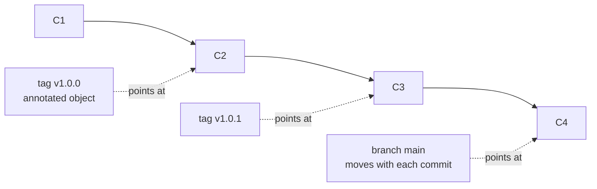
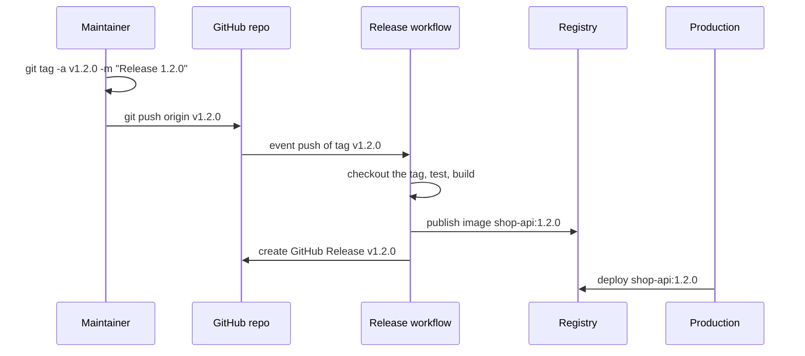

# L3.6 — Tags

> **Level 3: Git & GitHub** · Topic 6 of 13 · ⏱ ~2.5 hours · Difficulty: Beginner

## 1. What it is

A **tag** is a permanent, human-readable name for one specific commit, such as `v1.4.2`. Branches move every time you
commit; a tag is meant to stay put forever, so it answers the question "exactly which code did we ship as 1.4.2?"

Git has two kinds:

- **Lightweight tag:** just a ref (a file under `.git/refs/tags/`) pointing straight at a commit. No metadata. Good for a private bookmark.
- **Annotated tag:** a full Git *object* with its own tagger name, email, date, message and (optionally) a cryptographic
  **signature**, which in turn points at the commit. This is the kind you use for **releases**.

Tags are **not pushed automatically** by a normal `git push`. You push them explicitly, and that push is often what
triggers a release pipeline.

## 2. Why it matters in DevOps

- **Reproducibility:** "deploy `v2.3.1`" means the same bytes today and in a year. Rollback is "deploy the previous tag".
- **Pipeline trigger:** release workflows commonly run `on: push: tags: ['v*']` (see
  [GitHub Actions workflows](11-github-actions-workflows.md)) and build the artifact, container image and GitHub Release from the tag.
- **Versioning contract:** tags are how [semantic versions](10-semantic-versioning-and-releases.md) get attached to code.
- **Supply-chain trust:** a signed tag proves that a known maintainer, not someone who merely gained push access, created the release.
- **Pitfall:** moving or deleting a published tag silently changes what "v1.0.0" means for every consumer and cache. It is the
  Git equivalent of overwriting a published package version.

## 3. Real-world system example

**Kubernetes** publishes every release as a Git tag in its repository (for example `v1.31.0`), including pre-release tags
such as `-alpha`, `-beta` and `-rc` forms, and release tooling and downstream distributors build from those tags.

**Go modules** resolve versions straight from Git tags in the module's repository: a tag like `v1.2.3` *is* the version, and
the Go module proxy and checksum database then make it effectively immutable for consumers. Moving a tag after publication
is a well-known way to break everyone's builds.

**GitHub Releases** are built on top of tags: a Release is a tag plus release notes and attached binaries, and you can ask
GitHub to create the tag when you publish the release. The Linux kernel project signs its release tags with PGP, and its
documentation describes verifying them with `git verify-tag` against the maintainers' public keys.

## 4. Diagram

A tag is a fixed pointer; a branch is a moving pointer:



From tag to production:



## 5. How it works

| Aspect | Lightweight | Annotated | Signed (`-s`) |
|--------|-------------|-----------|---------------|
| Command | `git tag v1.0.0` | `git tag -a v1.0.0 -m "msg"` | `git tag -s v1.0.0 -m "msg"` |
| Git object type | `commit` (a bare ref) | `tag` | `tag` containing a signature |
| Stores tagger, date, message | No | Yes | Yes |
| Verifiable | No | No | `git tag -v v1.0.0` |
| `git describe` sees it | Only with `--tags` | Yes (default) | Yes |
| Use for | local bookmarks | **releases** | releases needing provenance |

Essential commands:

| Task | Command |
|------|---------|
| List (sorted by version) | `git tag -l` / `git tag --sort=-v:refname` |
| List by pattern | `git tag -l "v1.0.*"` |
| Show tag and its commit | `git show v1.0.0` |
| Tag an older commit | `git tag -a v0.9.0 <sha> -m "msg"` |
| Push one tag | `git push origin v1.0.0` |
| Push all tags | `git push origin --tags` (also pushes lightweight scratch tags: avoid) |
| Push commits plus the annotated tags that point at them | `git push --follow-tags` |
| Delete locally / remotely | `git tag -d v1.0.0` / `git push origin --delete v1.0.0` |
| Move a tag (avoid on published tags) | `git tag -f -a v1.0.0 <sha>`, then `git push --force origin v1.0.0` |
| Name a commit from the nearest tag | `git describe --tags` gives `v1.0.1-3-g1a2b3c4` (3 commits after the tag) |
| Check out a tag | `git switch --detach v1.0.0` (detached HEAD: branch from it if you want to commit) |

**Signing options:**

- **GPG (OpenPGP):** `git tag -s` using `user.signingkey`. Verify with `git tag -v` or `git verify-tag`.
- **SSH keys** (Git 2.34+): `git config gpg.format ssh` and point `user.signingkey` at your public key. Verification needs
  `gpg.ssh.allowedSignersFile`. Easier to manage if you already use SSH keys (see [SSH keys](../level-01-linux-fundamentals/12-ssh-keys-and-authorized-keys.md)).
- GitHub shows a **Verified** badge when the signing key is uploaded to your account as a *signing key*. Branch protection
  and rulesets can also require signed commits, which is a separate setting from tags.

## 6. Step-by-step guide

**Prerequisites:** Git 2.34+ (for SSH signing), a scratch directory, optionally `gpg`. Free and local.

1. **Create a repo with a bare "remote".**
   ```bash
   git init --bare shop-api-origin.git
   git init -b main shop-api-tags && cd shop-api-tags
   git config user.name "Dev" && git config user.email "dev@example.com"
   git remote add origin ../shop-api-origin.git
   echo "v1" > app.txt && git add . && git commit -m "feat: first release candidate"
   ```

2. **Create a lightweight and an annotated tag.**
   ```bash
   git tag v0.1.0-light
   git tag -a v1.0.0 -m "Release 1.0.0"
   git tag -l
   ```
   Expected:
   ```text
   v0.1.0-light
   v1.0.0
   ```

3. **See the difference.**
   ```bash
   git cat-file -t v0.1.0-light     # commit
   git cat-file -t v1.0.0           # tag
   git show v1.0.0
   ```
   `git show` on the annotated tag prints `tag v1.0.0`, the `Tagger:` line, the date, the message, and then the commit.

4. **Tag a later commit and use `describe`.**
   ```bash
   echo "fix" >> app.txt && git commit -am "fix: handle empty cart"
   git tag -a v1.0.1 -m "Release 1.0.1"
   echo "more" >> app.txt && git commit -am "feat: add coupon field"
   git describe --tags
   ```
   Expected (similar to): `v1.0.1-1-g<short-sha>`. That means "one commit after v1.0.1".

5. **Push commits, then tags.**
   ```bash
   git push origin main
   git push origin v1.0.0
   git push --follow-tags          # sends annotated tags reachable from pushed commits
   git ls-remote --tags origin
   ```
   `git ls-remote` lists `refs/tags/v1.0.0` and, for annotated tags, an extra `refs/tags/v1.0.0^{}` line that is the commit it dereferences to.

6. **Prove that a plain push does not send tags.**
   ```bash
   git tag -a v1.1.0 -m "Release 1.1.0"
   git push origin main
   git ls-remote --tags origin | grep v1.1.0 || echo "tag not on remote yet"
   git push origin v1.1.0
   ```

7. **Fix a mistaken tag *before* anyone has used it.**
   ```bash
   git tag -d v1.1.0                      # delete locally
   git push origin --delete v1.1.0        # delete on the remote
   git tag -a v1.1.0 <correct-sha> -m "Release 1.1.0"
   git push origin v1.1.0
   ```
   If the tag was already consumed, do **not** reuse the number. Publish `v1.1.1` instead.

8. **Sign a tag with GPG** (needs `gpg` and a key; list yours with `gpg --list-secret-keys --keyid-format=long`).
   ```bash
   git config user.signingkey <YOUR_KEY_ID>
   git tag -s v1.2.0 -m "Release 1.2.0 (signed)"
   git tag -v v1.2.0
   ```
   Expected: `gpg: Good signature from "Dev <dev@example.com>"`. The tag object ends with a `-----BEGIN PGP SIGNATURE-----` block.

9. **Or sign with an SSH key** (no GPG needed).
   ```bash
   git config gpg.format ssh
   git config user.signingkey ~/.ssh/id_ed25519.pub
   echo "dev@example.com $(cat ~/.ssh/id_ed25519.pub)" > ~/.config/git/allowed_signers   # create the directory first if needed
   git config gpg.ssh.allowedSignersFile ~/.config/git/allowed_signers
   git tag -s v1.2.1 -m "Release 1.2.1 (ssh-signed)"
   git tag -v v1.2.1
   ```
   Upload the same public key to GitHub (Settings, SSH and GPG keys, type "Signing Key") so the tag shows as Verified.

10. **Make tags trigger a pipeline** (preview of [topic 11](11-github-actions-workflows.md)):
    ```yaml
    on:
      push:
        tags:
          - 'v*.*.*'
    ```

## 7. Real-world scenario

*(Illustrative.)* The `shop-api` team tags `v2.3.0` and the pipeline publishes `shop-api:2.3.0`. Twenty minutes later
someone notices the tag points at the commit *before* the final fix, so they run `git tag -f v2.3.0 <right-sha>` and force-push the tag.
The pipeline reruns and overwrites `shop-api:2.3.0` in the registry, but the staging cluster already pulled the old image, its node cache
considers the tag present, and two environments now run different code under the same version. Nobody can say which is "2.3.0".
The team adopts a rule: **published tags are immutable; fix forward with `v2.3.1`**, and the registry is configured with
immutable image tags.
**Lesson:** a version number is a promise. Breaking it costs more than skipping a number ever will.

## 8. Common mistakes and best practices

**Don't**

- Use lightweight tags for releases (no author, date or message, and `git describe` ignores them by default).
- Move or delete a tag that has been pushed and consumed.
- Use `git push --tags` casually; it publishes every local scratch tag.
- Tag from a dirty or unreviewed branch. Tag a commit that is already on protected `main`.
- Assume the tag *name* proves anything. Only a verified signature proves who created it.

**Do**

- Use annotated tags `vMAJOR.MINOR.PATCH` for every release, with a one-line message.
- Sign release tags where provenance matters, and publish the public key or enable the Verified badge.
- Let a pipeline create release artifacts *from the tag*, not from a developer's laptop.
- Protect tag names such as `v*` with a repository ruleset so only maintainers can create or delete them (GitHub's tag protection feature has been superseded by rulesets).
- Fix forward: a bad `v1.4.0` is followed by `v1.4.1`.

## 9. Tasks

- [ ] **T1 — Lightweight vs annotated** *(≈20 min, beginner)*
  - **Goal:** see the object-level difference.
  - **Steps:**
    1. In a scratch repo with one commit, create `light` (lightweight) and `v1.0.0` (annotated).
    2. Run `git cat-file -t` on both, then `git show` on both.
    3. Run `git describe` and `git describe --tags`.
  - **Done when:** you can point to the output line that proves which tag stores a tagger and message, and explain why `describe` ignores `light` by default.

- [ ] **T2 — Tag history and push them** *(≈25 min, beginner)*
  - **Goal:** tag an old commit and publish tags deliberately.
  - **Steps:**
    1. Make four commits. Tag the second as `v0.9.0` using its SHA.
    2. Create a bare repo as `origin`, push `main`, confirm `git ls-remote --tags origin` is empty.
    3. Push only `v0.9.0`.
  - **Done when:** `git ls-remote --tags origin` shows exactly `v0.9.0` (plus its `^{}` line).

- [ ] **T3 — Break it: move a published tag** *(≈25 min, intermediate)*
  - **Goal:** feel why tags must be immutable.
  - **Steps:**
    1. Clone your bare origin into `clone-a/` and `clone-b/`. Make both fetch `v1.0.0`.
    2. In `clone-a/`, move the tag (`git tag -f -a v1.0.0 <newer-sha> -m "oops"`) and `git push --force origin v1.0.0`.
    3. In `clone-b/`, run `git fetch` and then `git fetch --tags --force`; compare `git rev-parse v1.0.0^{commit}` in both.
  - **Done when:** you have shown that `clone-b` kept the old commit until forced, and you wrote one sentence on what that would do to a build cache.

- [ ] **T4 — Sign and verify** *(≈30 min, intermediate)*
  - **Goal:** produce a verifiable release tag.
  - **Steps:**
    1. Create a throw-away key (`gpg --quick-generate-key "Dev <dev@example.com>" ed25519 sign 1d`) or an SSH key with `ssh-keygen -t ed25519`.
    2. Configure Git for GPG or SSH signing and create `v1.0.0-signed` with `-s`.
    3. Verify it with `git tag -v`, then edit nothing but re-create the tag unsigned and compare the verify output.
  - **Done when:** `git tag -v` reports a good signature for the signed tag and an error (`error: no signature found`) for the unsigned one.

- [ ] **T5 — Automate: release on tag** *(≈40 min, intermediate)*
  - **Goal:** prove a tag push starts a workflow.
  - **Steps:**
    1. In a GitHub repo, add `.github/workflows/release.yml` triggered on `push: tags: ['v*.*.*']` that echoes `${{ github.ref_name }}`.
    2. Push a commit to `main` (nothing should run), then push `v0.0.1`.
    3. Read the run log.
  - **Done when:** the Actions tab shows a run only for the tag push, and the log prints `v0.0.1`.

- [ ] **T6 — Prove it: tag policy** *(≈25 min, intermediate)*
  - **Goal:** state and justify a tagging policy.
  - **Steps:**
    1. Without the guide, write a 6-line team policy: tag format, annotated or signed, who may tag, from which branch, what to do about a bad tag, and how the pipeline consumes tags.
    2. Demonstrate each rule with one command in a scratch repo.
  - **Done when:** every rule in your policy has a command that follows it, and you can explain the "fix forward" rule aloud.

## 10. Self-check questions

1. What is the difference between a lightweight and an annotated tag, and which one belongs on a release?
2. Why does `git push origin main` not publish your new tag?
3. A tag was pushed with the wrong commit and a package manager already resolved it. What do you do?
4. What does `v1.0.1-3-g1a2b3c4` from `git describe` mean?
5. How can a consumer check that a tag was really made by the maintainer?

<details>
<summary>Answers</summary>

1. A lightweight tag is only a ref to a commit; an annotated tag is an object with tagger, date, message and optional signature. Use annotated (or signed) for releases.
2. Tags are separate refs and are only pushed when named (`git push origin <tag>`), via `--tags`, or via `--follow-tags` for annotated ones.
3. Do not move it. Publish a new patch version containing the correct commit and, if needed, mark the bad version deprecated.
4. Three commits after the nearest annotated tag `v1.0.1`, currently at commit `1a2b3c4` (the `g` prefix means "git").
5. Verify a signature (`git tag -v` with the maintainer's public key, or the Verified badge on GitHub for a key registered to that account).
</details>

## 11. Further reading

- *Pro Git* by Scott Chacon and Ben Straub (free at git-scm.com), the "Tagging" and "Signing Your Work" sections.
- `git help tag`, `git help describe` and `git help verify-tag`.
- GitHub Docs: "About commit signature verification" and "Managing rulesets for a repository".
- Semantic Versioning specification: https://semver.org

<!-- nav -->
---
← Previous: [stash](05-stash.md) · [Level 3 index](README.md) · Next: [bisect](07-bisect.md) →
