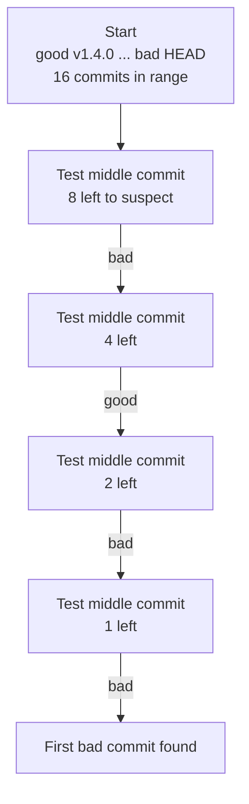
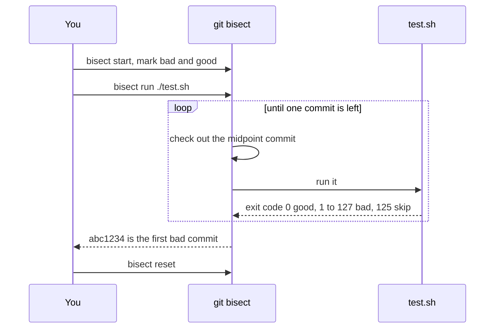

# L3.7 — bisect

> **Level 3: Git & GitHub** · Topic 7 of 13 · ⏱ ~2.5 hours · Difficulty: Intermediate

## 1. What it is

`git bisect` finds **the exact commit that introduced a bug** using **binary search** over your history. You tell Git one commit
where things were **good** and one where they are **bad**. Git checks out the commit halfway between, you test it and say
`good` or `bad`, and Git halves the remaining range again. Searching 1,000 commits takes about 10 steps (log2 of 1000 is just under 10);
searching 1,000,000 takes about 20.

Even better, if you can express "is it broken?" as a **script that exits 0 (good) or non-zero (bad)**, `git bisect run` does the
whole search unattended and hands you the guilty commit.

## 2. Why it matters in DevOps

- **"It worked last release."** Between two release tags there may be hundreds of commits from many people. Reading them is hopeless;
  bisecting is minutes.
- **Regressions that tests missed:** a performance cliff, a flaky deployment, a config that stopped parsing. If you can script a
  check, you can bisect it, even for non-code regressions such as "`docker build` now takes 12 minutes".
- **Blameless debugging:** the output is a commit, with its pull request and reviewers, which is the starting point for a
  [postmortem](../level-14-sre/07-postmortems.md) and for a [revert](04-reset-and-revert.md) if production is hurting.
- **It rewards good history:** small, atomic commits that each build and pass tests make bisect fast and precise. Huge
  "misc fixes" commits make it point at a haystack. Tags from [topic 6](06-tags.md) make excellent good/bad endpoints.

## 3. Real-world system example

**The Linux kernel.** `git bisect` was created for it, and the kernel's own documentation (the "Bug hunting" guide) tells reporters
of regressions to bisect between a working and a failing release and to report the first bad commit. The kernel's history spans many
thousands of commits between releases, which is exactly the situation binary search is built for.

**Git's own project** describes `git bisect` in its manual with a `run` example, and many large open-source projects (browsers,
language runtimes, databases) ask for a bisect result in regression bug reports, often using the project's own build and test
script as the `bisect run` command. Within a company the same pattern applies: a CI "smoke test" script that exits non-zero on failure is
already a bisect script.

## 4. Diagram

Binary search in action. Each test halves the suspects:



How `git bisect run` drives a script:



## 5. How it works

| Command | Meaning |
|---------|---------|
| `git bisect start [<bad> [<good>...]]` | Begin. Without arguments, mark them afterwards. |
| `git bisect bad [<rev>]` / `git bisect good [<rev>]` | Mark the current (or given) commit. |
| `git bisect skip` | You cannot test this commit (does not build). Git picks a neighbour. |
| `git bisect run <cmd> [args]` | Automate: exit 0 = good, 1-124 and 126-127 = bad, **125 = skip**, 128 or above aborts the bisect. |
| `git bisect log` | Show the decisions so far. Save it to a file and replay with `git bisect replay <file>`. |
| `git bisect visualize` (`view`) | Open `gitk` or `git log` on the remaining range. |
| `git bisect reset` | Finish and return to the branch you started from. **Always do this.** |
| `git bisect start --term-old=fast --term-new=slow` | Custom words when "good/bad" reads wrong (for example, finding when something got *fixed* or *slower*). |
| `git bisect start --first-parent` | Only follow the first parent, so you bisect over merge commits (PRs) on `main` rather than every commit inside them (Git 2.29+). |

Rules of a good bisect script:

1. **Deterministic.** A flaky test makes bisect lie. Run it several times in the loop or fix the flake first.
2. **Fast.** It runs about log2(n) times, but each run may include a build; cache dependencies.
3. **Self-contained.** Keep the script *outside* the repo (or untracked), since each checkout replaces tracked files.
4. **Distinguish "bad" from "cannot test"** by returning 125 when the commit does not even build.
5. **Exit status is everything.** `./test.sh && echo ok` hides failures; just let the exit code propagate.

## 6. Step-by-step guide

**Prerequisites:** Git and a POSIX shell. Everything is local and free.

1. **Build a repo with a hidden regression.** Eight docs commits surround one bad change.
   ```bash
   git init -b main shop-api-bisect && cd shop-api-bisect
   git config user.name "Dev" && git config user.email "dev@example.com"

   cat > price.sh <<'EOF'
   #!/bin/sh
   # total for 2 items at 10 each
   echo $((2 * 10))
   EOF
   chmod +x price.sh
   git add . && git commit -m "feat: price calculation"

   for i in 1 2 3 4 5 6 7 8; do
     echo "# change $i" >> notes.txt && git add notes.txt && git commit -m "docs: note $i"
     if [ "$i" = 5 ]; then
       sed -i 's/2 \* 10/2 * 11/' price.sh && git commit -am "feat: add tax"   # the bug
     fi
   done
   git log --oneline
   ```
   You should see 10 commits. (On macOS use `sed -i ''`.) Note the `feat: price calculation` SHA: it is your **good** commit.

2. **Write the check as a script, kept outside the repo.**
   ```bash
   cat > /tmp/check-price.sh <<'EOF'
   #!/bin/sh
   [ "$(sh ./price.sh)" = "20" ]
   EOF
   chmod +x /tmp/check-price.sh
   ```
   The script exits 0 when the output is `20` and 1 otherwise.

3. **Manual bisect first, to see the mechanics.**
   ```bash
   git bisect start
   git bisect bad HEAD
   git bisect good <sha-of-feat-price-calculation>
   ```
   Output (similar to): `Bisecting: 4 revisions left to test after this (roughly 2 steps)` followed by the commit Git checked out.
   Test it yourself (`sh ./price.sh`) and answer `git bisect good` or `git bisect bad` until Git prints
   `<sha> is the first bad commit` with the `feat: add tax` commit details.

4. **Save the log, reset, and replay.**
   ```bash
   git bisect log > /tmp/bisect.log
   git bisect reset                  # back on main
   git bisect replay /tmp/bisect.log # re-apply every decision instantly
   git bisect reset
   ```

5. **Now automate it.**
   ```bash
   git bisect start HEAD <sha-of-feat-price-calculation>
   git bisect run /tmp/check-price.sh
   ```
   Output (similar to):
   ```text
   running  '/tmp/check-price.sh'
   Bisecting: 0 revisions left to test after this (roughly 0 steps)
   ...
   0ac366d... is the first bad commit
   commit 0ac366d...
       feat: add tax
   bisect found first bad commit
   ```
   `git bisect start <bad> <good>` is shorthand for start plus the two marks.

6. **Always clean up.**
   ```bash
   git bisect reset
   git status          # "On branch main", nothing to commit
   ```

7. **Handle a commit that cannot be tested.** Make the script return 125 when the project is not buildable:
   ```bash
   cat > /tmp/check-price.sh <<'EOF'
   #!/bin/sh
   [ -f price.sh ] || exit 125        # skip commits before the file existed
   [ "$(sh ./price.sh)" = "20" ]
   EOF
   ```

8. **Bisect a real project (pattern).** Between two release tags, with build + test as the check:
   ```bash
   git bisect start v2.4.0 v2.3.0          # <bad> <good>, both tags
   git bisect run sh -c 'npm ci --silent && npm test --silent'
   git bisect reset
   ```
   Use `--first-parent` if `main` uses merge commits and you only need to find the guilty pull request.

## 7. Real-world scenario

*(Illustrative.)* After the `v3.8.0` release of `shop-api`, checkout latency doubles in staging. The last good tag, `v3.7.0`, is 214 commits behind.
Nobody wants to read them. An SRE writes a 10-line script that starts the API with the test database, fires 200 requests with `curl`, and exits 1 if the p95
is above 300 ms. `git bisect run ./perf-check.sh` takes eight steps (about 20 minutes, mostly builds) and names a commit titled
"refactor: load cart items individually", which introduced an N+1 query. The fix is a one-line eager load; the follow-up adds the perf script to CI.
**Lesson:** whatever you can measure with an exit code you can bisect, and the regression test you wrote to find it should stay in the pipeline.

## 8. Common mistakes and best practices

**Don't**

- Forget `git bisect reset` and then wonder why you are in a detached HEAD on an odd commit.
- Bisect with a flaky test: one wrong "good" sends the search to the wrong half and you get a confident wrong answer.
- Keep the test script in the repo as a tracked file; checkouts may delete or change it.
- Mark a commit `bad` because it fails to build for an unrelated reason; use `skip` / exit 125.

**Do**

- Pick endpoints you have verified: check out your "good" commit and run the script on it, and on the "bad" commit.
- Use release tags as endpoints (see [tags](06-tags.md)) and keep commits small and buildable.
- Save `git bisect log` in the bug report, so others can `replay` it.
- Turn the script into a permanent regression test once the bug is fixed.

## 9. Tasks

- [ ] **T1 — Manual bisect** *(≈25 min, beginner)*
  - **Goal:** experience binary search by hand.
  - **Steps:**
    1. Build the repo from guide step 1.
    2. Start a bisect with the first commit as good and `HEAD` as bad.
    3. Answer each prompt by running `sh ./price.sh`.
  - **Done when:** Git prints `is the first bad commit` naming `feat: add tax`, and you counted the number of tests (about 3 for 10 commits).

- [ ] **T2 — Automate with `run`** *(≈20 min, beginner)*
  - **Goal:** let a script do the search.
  - **Steps:**
    1. `git bisect reset`, then create `/tmp/check-price.sh` outside the repo.
    2. Run `git bisect start HEAD <good>` and `git bisect run /tmp/check-price.sh`.
    3. Run `git bisect reset`.
  - **Done when:** the same commit is found with no manual input and `git status` says you are back on `main`.

- [ ] **T3 — Scale it up** *(≈30 min, intermediate)*
  - **Goal:** see the logarithm.
  - **Steps:**
    1. Generate 256 commits in a loop with a single bad one at commit 173 (change the output of `price.sh`).
    2. Bisect with `run` and count `running` lines in the output.
  - **Done when:** it takes 8 or 9 runs, and you can explain why that is log2(256).

- [ ] **T4 — Break it: skip and flake** *(≈35 min, intermediate)*
  - **Goal:** handle untestable commits and unreliable checks.
  - **Steps:**
    1. Add a commit that deletes `price.sh` and a later one restoring it. Make the script `exit 125` when the file is absent.
    2. Run bisect again and verify the correct commit is still found.
    3. Make the script randomly fail (`[ $((RANDOM % 4)) -ne 0 ]` in bash) and run bisect twice.
  - **Done when:** step 2 finds the right commit, and you have documented that step 3 produces different (wrong) answers on repeated runs.

- [ ] **T5 — Bisect a build or config problem** *(≈40 min, intermediate)*
  - **Goal:** use bisect on something that is not a unit test.
  - **Steps:**
    1. Take any small repo with a Dockerfile (or a `nginx -t` config check run with Docker) and introduce a syntax error in a mid-history commit.
    2. Write a script that runs `docker build .` (or the config check) and returns its exit status.
    3. Bisect with `--term-old=works --term-new=broken` for readable output.
  - **Done when:** bisect names your breaking commit and the output uses your custom words.

- [ ] **T6 — Prove it: regression report** *(≈30 min, intermediate)*
  - **Goal:** produce a result a teammate can reproduce.
  - **Steps:**
    1. Without the guide, bisect a new regression in a fresh repo using `run`.
    2. Save `git bisect log` to a file.
    3. Write a 5-line report: good commit, bad commit, script, first bad commit, proposed fix or `git revert <sha>`.
  - **Done when:** a teammate can run `git bisect replay <file>` and land on the same commit.

## 10. Self-check questions

1. How many tests does bisect need for 1,000 commits and why?
2. What do exit codes 0, 1, 125 and 130 mean to `git bisect run`?
3. Why must the test script live outside the working tree (or be untracked)?
4. A flaky test marked one commit `good` wrongly. What happens?
5. How would you bisect only over pull-request merges on `main`?

<details>
<summary>Answers</summary>

1. About 10, because each test halves the range (log2 of 1000 is just under 10).
2. 0 means good; 1 means bad; 125 means skip (cannot test); 130 is 128 or above, which aborts the bisect (for example, the script was killed by Ctrl-C).
3. Each step checks out a different commit, which may modify or delete tracked files, including your script.
4. The search narrows to the wrong half and ends on an innocent commit, with full confidence. Re-run, and make the check deterministic.
5. `git bisect start --first-parent` (Git 2.29+), so only first-parent commits (the merge commits) are candidates.
</details>

## 11. Further reading

- *Pro Git* by Scott Chacon and Ben Straub (free at git-scm.com), the "Debugging with Git" section on binary search.
- `git help bisect`, the official manual page, including the `run` and `--first-parent` sections.
- The Linux kernel documentation, "Bug hunting" (kernel.org), for the regression-reporting workflow.

<!-- nav -->
---
← Previous: [Tags](06-tags.md) · [Level 3 index](README.md) · Next: [Protected Branches and Pull Requests](08-protected-branches-and-pull-requests.md) →
