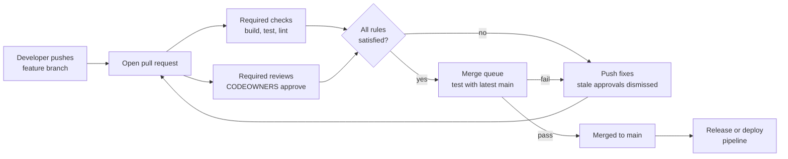
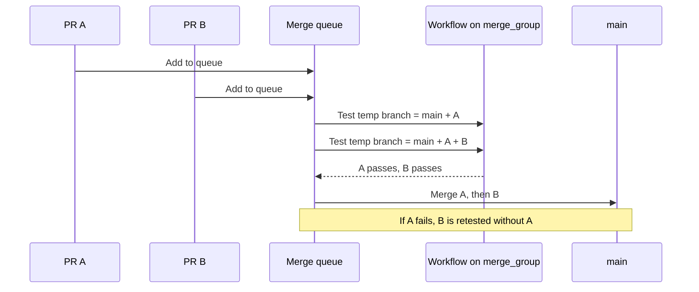

# L3.8 — Protected Branches and Pull Requests

> **Level 3: Git & GitHub** · Topic 8 of 13 · ⏱ ~3.5 hours · Difficulty: Intermediate

## 1. What it is

A **pull request (PR)** is a proposal to merge one branch into another, with a conversation, a diff, automated checks and
reviews attached. A **protected branch** is a branch (usually `main`) that GitHub refuses to change except through rules you
define: no direct pushes, no force-pushes, no deletion, and merges only when reviews and **status checks** (automated CI results) pass.

On GitHub there are two ways to express those rules:

- **Branch protection rules** (the classic feature): configured per branch name pattern under *Settings, Branches*.
- **Rulesets** (the newer feature): configured under *Settings, Rules*. They can target branches *and* tags, can be layered (several
  rulesets apply at once and the strictest result wins), can be set at organization level, have an *Evaluate* mode to dry-run, and
  can be bypassed by named roles or apps. New setups should prefer rulesets; the concepts below apply to both.

Together they turn `main` into a **controlled gate**: every change is reviewed, tested, and traceable to a PR.

## 2. Why it matters in DevOps

- **`main` is what ships.** In CI/CD ([CI/CD](../level-00-what-devops-is/02-ci-cd.md)) a merge to `main` often deploys. An unreviewed push is an unreviewed production change.
- **Prevents the classic accidents:** force-pushing over teammates' commits, deleting the default branch, merging with failing tests.
- **Compliance and audit:** SOC 2, ISO 27001 and similar frameworks ask for evidence that changes are reviewed and tested. PR history plus enforced rules is that evidence ([DevSecOps](../level-00-what-devops-is/12-devsecops.md)).
- **Knowledge flow and ownership:** `CODEOWNERS` routes database-migration changes to the DBAs and Terraform changes to the platform team automatically.
- **Pitfall:** rules that are too heavy (three approvals, 40-minute CI, no bypass for incidents) get routed around. Protection must be strong *and* livable.

## 3. Real-world system example

**Kubernetes and other large open-source projects** run every PR through automated checks (Prow in the Kubernetes project) and require
maintainer approval from the `OWNERS` files before an automated bot merges. The `OWNERS` idea is the same as GitHub's `CODEOWNERS`.

**GitHub itself** offers the merge queue feature, which it describes as built to solve the problem of busy repositories where many PRs pass
checks against an older `main` but break once combined. The queue tests each PR against the latest `main` plus the PRs ahead of it, and
merges only those that pass. GitHub documents this in its own product docs; before a native version existed, many large engineering teams
and tools (for example, Kubernetes's Prow bot above, and third-party merge-queue services) provided the same capability.

**Typical pattern in many companies:** a repository ruleset requires one or two approvals, a green `ci` check, code-owner review on sensitive paths
(`/infra/`, `/.github/workflows/`), linear history, and prevents deletion/force-push, with a small "break glass" bypass list for the
on-call lead.

## 4. Diagram

Life of a protected-branch change:



What the merge queue adds (sequence):



## 5. How it works

**Common rules (names differ slightly between rules and rulesets):**

| Rule | What it enforces |
|------|------------------|
| Require a pull request before merging | No direct pushes. Sub-options: required approving reviews (1-6), dismiss stale approvals when new commits are pushed, require review from Code Owners, require approval of the most recent push, require conversation resolution |
| Require status checks to pass | Named checks (the *job name* of a workflow, for example `test`) must be green. "Require branches to be up to date" forces PRs to be re-tested against the latest `main` |
| Require signed commits | Every commit must carry a verified signature |
| Require linear history | No merge commits: squash or rebase merges only |
| Require merge queue | Merges go through the queue (see below) |
| Block force pushes / restrict deletions | Protects history and the branch itself |
| Restrict who can push / bypass list | Allow specific teams or apps (like a release bot) |
| Include administrators / do not allow bypassing | Applies the rules to admins as well |

**Merge methods** (enable only the ones you want): *merge commit* (preserves branch history), *squash* (one commit per PR, tidy
history, pairs well with PR-title conventions from [semantic versioning](10-semantic-versioning-and-releases.md)), *rebase and merge*
(linear, keeps individual commits; see [rebasing](02-rebasing.md)).

**CODEOWNERS.** A file at `.github/CODEOWNERS`, `CODEOWNERS` or `docs/CODEOWNERS`. Each line is a pattern followed by owners (users, teams as `@org/team`, or emails).
**The last matching pattern wins**, so put general rules first and specific ones later. It only *blocks* merges when "Require review from Code Owners" is on.

```text
# .github/CODEOWNERS
*                       @example/shop-api-maintainers
/infra/                 @example/platform-team
/db/migrations/         @example/dba-team @alice
/.github/workflows/     @example/platform-team
*.md                    @example/docs
```

**Required checks gotchas:**

- The check name must match the *job* name, and GitHub offers it in the picker only if it has run in the repo recently (within about the last week).
- If a required workflow is skipped by a `paths:` filter, the check never reports and the PR waits forever. Use a path-aware job inside an always-running workflow, or a final "gate" job that always runs.
- Required checks use the **commit status/check run name**, not the workflow file name. If you rename a job, update the rule.

**Merge queue.** When enabled by the rule, the **Merge** button becomes **Merge when ready**. GitHub builds a temporary `gh-readonly-queue/...` branch containing
the base branch plus the queued PRs, and runs your checks on it. For that to work, your workflows must also trigger on the `merge_group` event:

```yaml
on:
  pull_request:
  merge_group:
```

Availability note: merge queue is available for public repositories owned by organizations and for private repositories on GitHub Enterprise Cloud;
branch protection on private repositories needs a paid plan. Check the current GitHub Docs for the plan you have.

## 6. Step-by-step guide

**Prerequisites:** a GitHub account and a repository you own. A **public** repository on a free account supports protection and rulesets at no cost.
Optional: the GitHub CLI (`gh auth login`). No cloud cost involved.

1. **Create the repo and a minimal CI workflow** (this gives you a status check to require).
   ```bash
   gh repo create shop-api-protect --public --clone && cd shop-api-protect
   mkdir -p .github/workflows
   cat > .github/workflows/ci.yml <<'EOF'
   name: CI
   on:
     pull_request:
     merge_group:
     push:
       branches: [main]
   jobs:
     test:
       runs-on: ubuntu-latest
       steps:
         - uses: actions/checkout@v4
         - run: echo "pretend tests pass"
   EOF
   printf '# shop-api\n' > README.md
   git add . && git commit -m "chore: add CI" && git push -u origin main
   ```
   Wait for the `CI` run on `main` to finish (so GitHub knows the `test` check exists).

2. **Add CODEOWNERS.** Replace `YOUR_USER` with your GitHub username.
   ```bash
   cat > .github/CODEOWNERS <<'EOF'
   *                     @YOUR_USER
   /.github/workflows/   @YOUR_USER
   EOF
   git add . && git commit -m "chore: add CODEOWNERS" && git push
   ```

3. **Create a ruleset in the UI.** *Settings, Rules, Rulesets, New ruleset, New branch ruleset.*
   Name it `protect-main`, set *Enforcement status* to **Active**, target the **Default branch**, and enable:
   - Restrict deletions, Block force pushes
   - Require a pull request before merging (1 approval, dismiss stale approvals, require review from Code Owners, require conversation resolution)
   - Require status checks to pass: add `test`, and tick "Require branches to be up to date before merging"
   - Require linear history

   (For a solo repository where you are the only collaborator, set approvals to 0 or you cannot merge your own PR. GitHub does not let an author approve their own PR.)

4. **Or create the same ruleset with the API.**
   ```bash
   cat > ruleset.json <<'EOF'
   {
     "name": "protect-main",
     "target": "branch",
     "enforcement": "active",
     "conditions": { "ref_name": { "include": ["~DEFAULT_BRANCH"], "exclude": [] } },
     "rules": [
       { "type": "deletion" },
       { "type": "non_fast_forward" },
       { "type": "required_linear_history" },
       { "type": "pull_request",
         "parameters": {
           "required_approving_review_count": 0,
           "dismiss_stale_reviews_on_push": true,
           "require_code_owner_review": false,
           "require_last_push_approval": false,
           "required_review_thread_resolution": true
         } },
       { "type": "required_status_checks",
         "parameters": {
           "strict_required_status_checks_policy": true,
           "required_status_checks": [ { "context": "test" } ]
         } }
     ]
   }
   EOF
   gh api -X POST repos/:owner/:repo/rulesets --input ruleset.json
   ```
   Here approvals are 0 so a solo learner can merge; set `1` (and `require_code_owner_review: true`) when you have a second account or teammate.

5. **Prove direct pushes are blocked.**
   ```bash
   echo "direct" >> README.md
   git commit -am "docs: sneak onto main"
   git push origin main
   ```
   Expected: `remote: error: GH013: Repository rule violations found` (rulesets) or `remote: error: GH006: Protected branch update failed` (classic rules), then `! [remote rejected] main -> main`.
   Undo locally: `git reset --hard origin/main`.

6. **Use the PR workflow.**
   ```bash
   git switch -c docs/readme-update
   echo "A sample Node.js API with PostgreSQL, Redis and Nginx." >> README.md
   git commit -am "docs: describe shop-api"
   git push -u origin docs/readme-update
   gh pr create --fill
   gh pr checks --watch
   ```
   The `test` check appears and turns green. Then merge: `gh pr merge --squash --delete-branch` (or use the button).
   If the merge button is disabled, the PR page tells you which rule is unmet.

7. **See CODEOWNERS in action.** Edit `.github/workflows/ci.yml` on a branch and open a PR. The PR automatically requests review from the owner of `/.github/workflows/`.
   With "Require review from Code Owners" on and a second account as owner, the PR cannot merge until that owner approves.

8. **Try the merge queue** (needs an organization-owned repository on a qualifying plan). In the ruleset, add *Require merge queue*. Open two PRs; click *Merge when ready* on both;
   open the Actions tab and note CI running with the `merge_group` event on branches named `gh-readonly-queue/main/...`.

9. **Classic branch protection via API (alternative).**
   ```bash
   cat > protection.json <<'EOF'
   {
     "required_status_checks": { "strict": true, "contexts": ["test"] },
     "enforce_admins": true,
     "required_pull_request_reviews": { "required_approving_review_count": 1, "dismiss_stale_reviews": true, "require_code_owner_reviews": true },
     "restrictions": null,
     "required_linear_history": true,
     "allow_force_pushes": false,
     "allow_deletions": false
   }
   EOF
   gh api -X PUT repos/:owner/:repo/branches/main/protection --input protection.json
   ```

## 7. Real-world scenario

*(Illustrative.)* A `shop-api` engineer pushes a "tiny" change straight to `main` on a Friday: the repository has no protection. It skips the unit tests, a migration drops
an index, and checkout slows to a crawl. The rollback takes an hour because the deploy pipeline built from the broken commit. The postmortem
actions: a ruleset on `main` (PR required, one approval, `test` and `lint` required, no force-push), `CODEOWNERS` for `/db/migrations/` so a DBA must approve, and a
two-person "break glass" bypass group for incidents. Two months later, two PRs that each pass alone conflict logically in the same file; the new merge queue tests them together
and rejects the second, instead of breaking `main`.
**Lesson:** protection is not bureaucracy; it moves failure from production to the pull request.

## 8. Common mistakes and best practices

**Don't**

- Require checks by workflow *file* name or forget the job name, so the rule waits forever for a check that never reports.
- Use `paths:` filters on required workflows without a fallback; skipped checks leave PRs unmergeable.
- Give admins a blanket bypass and then use it daily. Bypass should be rare, named, and audited.
- Require so many approvals that people rubber-stamp. One real review beats three clicks.
- Forget `merge_group` in workflows when you turn on the merge queue; queued PRs will sit pending.

**Do**

- Protect every deployable branch (`main`, `release/*`) and your release tags (see [tags](06-tags.md)).
- Keep PRs small, descriptive and linked to an issue; use a PR template with a test plan.
- Dismiss stale approvals on new commits, and require conversation resolution.
- Treat `.github/workflows/` and infrastructure code as sensitive paths in CODEOWNERS.
- Start new rulesets in *Evaluate* mode to see what would be blocked before enforcing.
- Prefer rulesets for new setups; use organization rulesets to apply one policy to many repos.

## 9. Tasks

- [ ] **T1 — Protect `main`** *(≈30 min, beginner)*
  - **Goal:** enforce "no direct pushes".
  - **Steps:**
    1. Follow guide steps 1-3 or 4 to create a repo, a `test` check and a ruleset.
    2. Try `git push origin main` with a new local commit.
  - **Done when:** the push is rejected with a `GH013` or `GH006` message and you can quote it.

- [ ] **T2 — Full PR cycle** *(≈25 min, beginner)*
  - **Goal:** merge a change only through a PR with a green check.
  - **Steps:**
    1. Create a branch, change a file, push, and run `gh pr create --fill`.
    2. Watch `gh pr checks --watch`; merge with `--squash`.
    3. Run `git log --oneline` on `main` after pulling.
  - **Done when:** `main` has one new squashed commit and the PR page shows the `test` check passed.

- [ ] **T3 — CODEOWNERS routing** *(≈30 min, intermediate)*
  - **Goal:** see automatic review requests.
  - **Steps:**
    1. Add a CODEOWNERS file assigning `/db/` to a teammate or second account (an invited collaborator works).
    2. Open a PR touching `/db/schema.sql`.
    3. Turn on "Require review from Code Owners" and try to merge without approval.
  - **Done when:** the PR shows the owner as a requested reviewer and the merge button is blocked until they approve.

- [ ] **T4 — Break it: the check that never reports** *(≈35 min, intermediate)*
  - **Goal:** reproduce and fix the `paths:` pitfall.
  - **Steps:**
    1. Change the workflow to run on `pull_request` with `paths: ['src/**']`. Require the `test` check.
    2. Open a PR that only edits `README.md`.
    3. Observe "Expected - Waiting for status to be reported". Fix it by removing the filter or adding an always-running `gate` job and requiring that instead.
  - **Done when:** the README-only PR becomes mergeable and you can explain why the first attempt hung.

- [ ] **T5 — Evaluate mode and the merge queue** *(≈40 min, advanced)*
  - **Goal:** roll out a stricter rule safely.
  - **Steps:**
    1. Change the ruleset enforcement to **Evaluate** and add "Require signed commits". Push an unsigned commit on a PR branch.
    2. Read *Settings, Rules, Insights* to see what would have been blocked.
    3. If your org supports it, enable the merge queue and add `merge_group:` to the workflow. Queue two PRs.
  - **Done when:** the Insights page lists the would-be violation, and (if available) both PRs merge via `gh-readonly-queue/*` runs.

- [ ] **T6 — Prove it: write the policy** *(≈30 min, advanced)*
  - **Goal:** design protection for a team of eight.
  - **Steps:**
    1. Without the guide, write the ruleset for `main` and `release/*`: approvals, required checks, CODEOWNERS paths, merge method, who can bypass.
    2. Justify each setting in one sentence and name one cost it adds.
    3. Apply it with the API to a scratch repo.
  - **Done when:** `gh api repos/:owner/:repo/rulesets` returns your ruleset and a teammate can explain every rule from your notes.

## 10. Self-check questions

1. What is the difference between branch protection rules and rulesets?
2. A required check is stuck on "Expected - Waiting for status to be reported". Name two likely causes.
3. Which CODEOWNERS entry wins when two patterns match a file?
4. Why does "Require branches to be up to date" slow teams down, and what does a merge queue do about it?
5. Why do the workflows need `on: merge_group`?

<details>
<summary>Answers</summary>

1. Rules are per branch pattern and classic; rulesets are layered, can target tags, work at org level, have an evaluate mode and finer bypass control. Rulesets are the recommended approach for new setups.
2. The workflow was skipped by a `paths:`/`branches:` filter, the job was renamed (so the required name no longer exists), or the workflow does not trigger for that event (for example missing `merge_group`).
3. The last matching pattern in the file.
4. Every merge makes other PRs stale, so each must be updated and re-run, which serializes the team. The queue tests each PR on top of the latest `main` plus the PRs ahead of it and merges automatically, removing the manual update loop.
5. The queue creates temporary branches and fires `merge_group` events to run required checks; without the trigger the checks never start.
</details>

## 11. Further reading

- GitHub Docs: "About protected branches", "About rulesets", "About code owners" and "Managing a merge queue" (docs.github.com).
- *Pro Git* by Scott Chacon and Ben Straub (free at git-scm.com), chapter "GitHub", sections on contributing to a project.
- *Accelerate* by Nicole Forsgren, Jez Humble and Gene Kim, on why small, fast-reviewed changes correlate with delivery performance.

<!-- nav -->
---
← Previous: [bisect](07-bisect.md) · [Level 3 index](README.md) · Next: [Trunk-based Development and GitFlow](09-trunk-based-vs-gitflow.md) →
