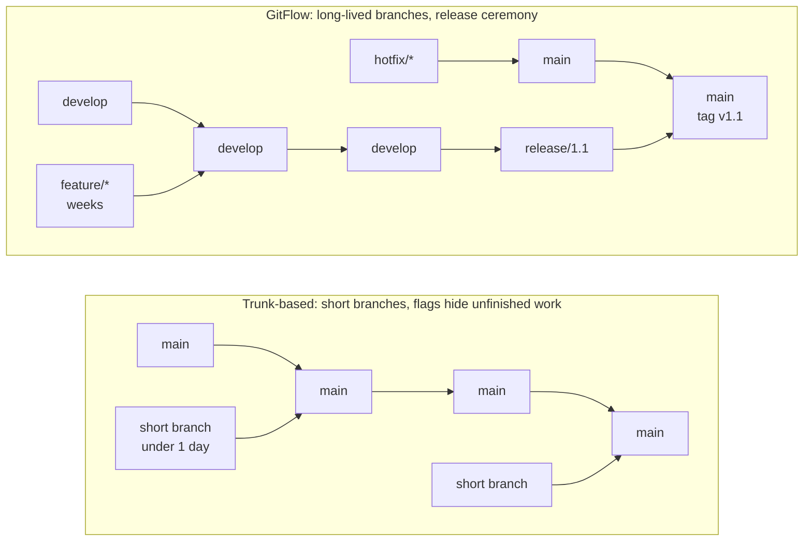
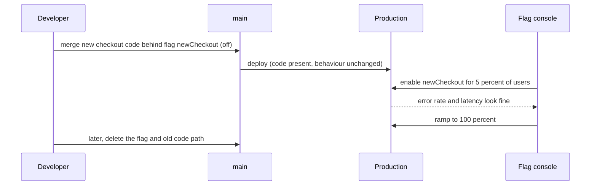

# L3.9 — Trunk-based Development and GitFlow

> **Level 3: Git & GitHub** · Topic 9 of 13 · ⏱ ~2.5 hours · Difficulty: Intermediate

## 1. What it is

A **branching strategy** is the team agreement on *which branches exist, how long they live, and how code travels from a laptop to production*.
Git does not care; your delivery speed, release risk and merge pain care a lot. Three strategies dominate:

- **Trunk-based development (TBD):** everyone integrates into a single shared branch (`main`, the "trunk") at least daily, either by committing directly or via
  very short-lived branches (hours to a couple of days) merged through small PRs. Unfinished work is hidden behind **feature flags** (also called feature toggles):
  `if (flag) { new path } else { old path }`, so code can be merged and even deployed without being *released*.
- **GitFlow:** a heavier model proposed by Vincent Driessen in 2010 with long-lived `main` (production) and `develop` (integration) branches, plus
  `feature/*`, `release/*` and `hotfix/*` branches. Releases are cut from `develop`, stabilised on a release branch, merged to `main`, tagged, and merged back.
- **GitHub flow** (a lightweight middle ground): `main` is always deployable; short feature branches become PRs; merge triggers deployment.
  It is trunk-based in spirit, usually with branches that live a few days.

Related: **release branches** (a branch cut from trunk to stabilise and patch one version, for example `release/2.3`) show up in TBD too, but as a
*maintenance* tool, not the main workflow.

## 2. Why it matters in DevOps

- **Delivery speed and risk:** the longer a branch lives, the bigger and riskier its merge ("merge hell"), and the longer features wait to reach users.
  The DORA / *Accelerate* research programme lists trunk-based development among the technical practices associated with higher software-delivery performance.
- **CI only works if you integrate:** "continuous integration" means integrating *continuously*. A feature branch that lives two weeks is not continuously integrated, however many CI runs it has
  (see [CI/CD](../level-00-what-devops-is/02-ci-cd.md)).
- **Deploy is not release:** feature flags decouple shipping code from exposing behaviour, which enables canary releases and instant "kill switches"
  ([deployment strategies](../level-00-what-devops-is/07-deployment-strategies.md)).
- **Process cost:** GitFlow's ceremony (two permanent branches, back-merges, release branches) is a tax. It pays for itself only when you genuinely ship several
  supported versions or have long, gated release cycles.
- **Pitfall:** adopting TBD without tests, flags and review discipline simply means pushing broken code to `main` faster.

## 3. Real-world system example

**Google** has publicly described (in the paper "Why Google Stores Billions of Lines of Code in a Single Repository", 2016) a single monorepo where engineers
commit to the trunk and rely on automated testing and tooling, instead of long-lived development branches; release branches are cut from trunk when needed.
**Facebook/Meta** has similarly described trunk-style development with gated, flag-controlled rollouts in public engineering posts.

**Feature-flag platforms** (LaunchDarkly, Unleash, Flagsmith, and open standards such as OpenFeature) exist because of this pattern: teams
merge incomplete code daily and turn it on gradually for a percentage of users.

**GitFlow in the wild:** it is common for software shipped in explicit versions (desktop apps, on-premise products, libraries with multiple supported lines) where you must patch
v1.x while developing v2. Its author later added a note to his original 2010 article saying GitFlow was designed for versioned software and that teams doing
continuous delivery of web applications should consider a simpler workflow such as GitHub flow.

**Open-source projects such as the Linux kernel and PostgreSQL** keep maintained stable branches/versions alongside a main development line, which is the "release branch" idea
applied to long-lived supported versions.

## 4. Diagram

Branch shapes side by side:



How a feature flag separates deploy from release:



## 5. How it works

| Dimension | Trunk-based | GitHub flow | GitFlow |
|-----------|-------------|-------------|---------|
| Long-lived branches | `main` only (plus short-lived release branches if needed) | `main` | `main` and `develop` |
| Feature branch life | Hours to ~2 days | Days | Days to weeks |
| Integration frequency | At least daily | Per PR | Per feature, release merges later |
| Release mechanism | Deploy trunk (often continuously); flags control exposure | Deploy on merge | Cut `release/*`, stabilise, merge to `main`, tag |
| Hotfix | Fix on trunk, deploy; cherry-pick to a release branch if one exists | Same as normal change | `hotfix/*` from `main`, merge to `main` and `develop` |
| Needs strong CI and tests | Essential | Essential | Helpful |
| Feature flags | Core technique | Optional | Rare |
| Best fit | SaaS, continuous delivery, strong test culture | Most web teams | Versioned products, multiple supported releases, gated QA cycles |

**Feature flag mechanics.** Types, from shortest to longest lived:

- **Release flags:** hide unfinished work. Delete soon after rollout.
- **Ops flags / kill switches:** disable an expensive or risky feature during an incident. May live long.
- **Experiment flags:** A/B tests, percentage rollouts.
- **Permission flags:** entitlements per customer or plan.

Flag rules: default to **off**, test **both** paths in CI, give each flag an **owner and an expiry date**, and remove flags once the rollout is done (flag debt is real technical debt).
Other techniques for incomplete work: **branch by abstraction** (introduce an interface, build the new implementation behind it, switch over, remove the old), and **dark launches** (new code path runs but its result is discarded).

**Release branches in TBD** are cut from trunk when you need a stabilisation window or to support an old version; fixes land on **trunk first** and are
[cherry-picked](03-cherry-picking.md) to the release branch, never the other way around.

**What makes TBD safe:** a fast pipeline (minutes), good automated tests, small PRs, required checks on `main`
([protected branches](08-protected-branches-and-pull-requests.md)), pre-merge review (or pair/mob programming), and the ability to roll forward or [revert](04-reset-and-revert.md) quickly.

**Choosing:** if you can deploy `main` safely, you do not need `develop`. If you must maintain several released versions in parallel, you need release branches; GitFlow is one (heavy) way to organise them.

## 6. Step-by-step guide

**Prerequisites:** Git, Node.js 18+ (any recent version). All local and free.

1. **Create a sample repo with a feature flag helper.**
   ```bash
   git init -b main shop-api-tbd && cd shop-api-tbd
   git config user.name "Dev" && git config user.email "dev@example.com"
   cat > flags.js <<'EOF'
   // Minimal feature flags: env override, then percentage rollout, then default (off)
   const defaults = { newCheckout: false };
   function isEnabled(name, userId) {
     const key = 'FLAG_' + name.toUpperCase();
     if (process.env[key] !== undefined) return process.env[key] === 'true';
     const pct = Number(process.env[key + '_PCT'] || 0);
     if (pct > 0 && userId !== undefined) return (userId % 100) < pct;
     return defaults[name] === true;
   }
   module.exports = { isEnabled };
   EOF
   cat > app.js <<'EOF'
   const { isEnabled } = require('./flags');
   function checkout(userId) {
     return isEnabled('newCheckout', userId) ? 'new checkout flow' : 'old checkout flow';
   }
   for (const id of [7, 42, 150]) console.log(id, checkout(id));
   EOF
   git add . && git commit -m "feat: checkout with newCheckout flag (off)"
   ```

2. **Run with the flag off, on, and at 10 percent.**
   ```bash
   node app.js
   FLAG_NEWCHECKOUT=true node app.js
   FLAG_NEWCHECKOUT_PCT=10 node app.js
   ```
   Expected: all three users see `old checkout flow`; then all see `new checkout flow`; then only user `7` (7 is below 10) sees the new flow.
   This is the whole idea: the *same deployed code* behaves differently, controlled outside the code.

3. **Practise a short-lived branch cycle (TBD style).** Aim for a branch that lives minutes to hours.
   ```bash
   git switch -c tidy-logging
   echo "// TODO: structured logging" >> app.js
   git commit -am "chore: note logging todo"
   git switch main && git merge --ff-only tidy-logging && git branch -d tidy-logging
   ```

4. **Simulate GitFlow for comparison.**
   ```bash
   git branch develop
   git switch -c release/1.0 develop
   echo "1.0.0" > VERSION && git add VERSION && git commit -m "chore: bump version to 1.0.0"
   git switch main && git merge --no-ff release/1.0 -m "Release 1.0.0"
   git tag -a v1.0.0 -m "Release 1.0.0"
   git switch develop && git merge --no-ff release/1.0 -m "Merge release 1.0 back into develop"
   git log --oneline --graph --all --decorate
   ```
   Count the steps and branches involved. That is the ceremony cost of every release.

5. **Practise a hotfix both ways.** In GitFlow: branch `hotfix/1.0.1` from `main`, fix, merge into **both** `main` and `develop`, tag.
   In TBD: fix on `main`, run CI, deploy; if `release/1.0` exists, `git switch release/1.0 && git cherry-pick <sha>`.

6. **Retire the flag.** Once `newCheckout` is at 100 percent and stable, delete the flag check and the old path in one small PR. Verify with `grep -rn newCheckout .` that nothing references it.

7. **Wire trunk-friendly CI.** Run checks on every PR and on pushes to `main`:
   ```yaml
   on:
     pull_request:
     push:
       branches: [main]
   ```
   Combine with required checks so `main` stays green (topic 8).

## 7. Real-world scenario

*(Illustrative.)* A 25-person team building `shop-api` uses GitFlow with a two-week `develop` cycle. Each release needs a "merge day", the release branch stabilises for three days, and a hotfix
forgotten on the back-merge to `develop` reappears as a regression in the next release. Lead time from commit to production averages three weeks, and a big-bang release breaks checkout twice a quarter.
The team moves to trunk-based development in stages: first required checks and a 10-minute pipeline, then PRs capped at a day of work, then flags for the new checkout.
Deployments go from every two weeks to several per day; the last release branch is retired after two cycles. When the new checkout misbehaves for 5 percent of users, an engineer turns the flag off in 30 seconds
rather than rolling back a deploy.
**Lesson:** the strategy is a delivery-speed decision, and trunk-based development works only with the safety net (tests, flags, review, fast rollback) built first.

## 8. Common mistakes and best practices

**Don't**

- Call a branch "trunk-based" while features still live for two weeks.
- Leave flags in the code forever; stale flags multiply the paths you must test.
- Merge unfinished work without a flag, branch by abstraction, or dark launch; users will see it.
- Adopt GitFlow for a single continuously deployed web service "because it's standard".
- Hotfix on the release branch and forget the trunk, so the bug returns in the next release.

**Do**

- Keep branches under about a day or two, PRs small, and the pipeline fast.
- Default flags to off, test both states, give each an owner and removal date.
- Fix on trunk first and cherry-pick to supported release branches.
- Choose the lightest workflow that fits how you actually ship (one version in production means no `develop`).
- Measure lead time and change failure rate before and after changing strategy.

## 9. Tasks

- [ ] **T1 — Flag on, off, partial** *(≈25 min, beginner)*
  - **Goal:** see deploy and release separated.
  - **Steps:**
    1. Build the repo from guide steps 1-2.
    2. Run the three flag modes and record which users see which flow.
  - **Done when:** you can show the same `app.js` giving three different results without editing it.

- [ ] **T2 — Run a full GitFlow release** *(≈30 min, intermediate)*
  - **Goal:** feel the ceremony.
  - **Steps:**
    1. Follow guide step 4.
    2. Add a `hotfix/1.0.1` branch from `main`, fix a bug, and merge it into both `main` and `develop`, tagging `v1.0.1`.
    3. Run `git log --oneline --graph --all` and count the merge commits.
  - **Done when:** `main` and `develop` both contain the hotfix and you can state how many commands a release plus hotfix took.

- [ ] **T3 — Same work, trunk-based** *(≈25 min, intermediate)*
  - **Goal:** compare the effort.
  - **Steps:**
    1. In a fresh repo, ship the same feature and hotfix using only `main`, a one-hour branch, and a flag.
    2. Count the commands and merge commits.
  - **Done when:** you have a two-column list of commands (GitFlow vs TBD) and a one-sentence conclusion.

- [ ] **T4 — Break it: the forgotten back-merge** *(≈30 min, intermediate)*
  - **Goal:** reproduce a classic GitFlow bug.
  - **Steps:**
    1. Do a hotfix on `hotfix/1.0.1`, merge it to `main` only, and tag.
    2. Cut `release/1.1` from `develop`; run the app and observe the old bug is back.
    3. Fix it by merging `main` into `develop`, or cherry-pick the fix (see [cherry-picking](03-cherry-picking.md)).
  - **Done when:** the regression appears in step 2 and disappears after your fix.

- [ ] **T5 — Automate flag safety in CI** *(≈45 min, advanced)*
  - **Goal:** make both flag states tested automatically.
  - **Steps:**
    1. Add a Node test (`node --test`) that calls `checkout()` with `FLAG_NEWCHECKOUT` set to `true` and to `false`.
    2. Put it in a GitHub Actions job using a matrix over `flag: [true, false]` that sets the env var.
    3. Add a script that fails if a flag name in `defaults` appears nowhere else in the source.
  - **Done when:** the workflow runs two matrix jobs on a PR and your script flags an unused flag.

- [ ] **T6 — Prove it: choose a strategy** *(≈30 min, advanced)*
  - **Goal:** justify a branching strategy for three teams.
  - **Steps:**
    1. Without the guide, recommend a strategy for (a) a SaaS web app deployed 10 times a day, (b) a mobile app with two supported major versions, (c) an on-premise installer shipped quarterly.
    2. For each, name the branches, how hotfixes flow, and one risk.
  - **Done when:** each recommendation names concrete branches and a hotfix path, and explicitly says where flags help or do not.

## 10. Self-check questions

1. Why can a feature branch that lives two weeks undermine continuous integration even if CI runs on it?
2. What is the difference between deploying code and releasing a feature?
3. When is GitFlow a reasonable choice, and what does its own author say about web apps?
4. What must be true of your pipeline before you move to trunk-based development?
5. In which direction do fixes flow between trunk and a release branch, and why?

<details>
<summary>Answers</summary>

1. CI integrates your code with everyone else's only when you merge. A long-lived branch diverges, so conflicts and surprises pile up and are found late.
2. Deploying puts code on production servers; releasing exposes behaviour to users. Feature flags separate the two.
3. Software shipped in discrete versions with several supported lines. The author added a note that for continuously delivered web apps a simpler flow is better.
4. It must be fast and reliable, with good automated tests, required checks on `main`, a way to roll forward or revert quickly, and ideally feature flags.
5. Trunk first, then cherry-pick to the release branch, so the fix cannot be lost in the next release.
</details>

## 11. Further reading

- Vincent Driessen, "A successful Git branching model" (2010), including the author's later note. Read it as history and trade-off analysis.
- trunkbaseddevelopment.com (Paul Hammant), the reference site for the practice.
- *Accelerate* by Nicole Forsgren, Jez Humble and Gene Kim, and the annual DORA reports.
- *Continuous Delivery* by Jez Humble and David Farley, chapters on branching and release strategies.
- Google Research, "Why Google Stores Billions of Lines of Code in a Single Repository" (2016).
- OpenFeature (openfeature.dev), the vendor-neutral feature-flag specification.

<!-- nav -->
---
← Previous: [Protected Branches and Pull Requests](08-protected-branches-and-pull-requests.md) · [Level 3 index](README.md) · Next: [Semantic Versioning and Release Management](10-semantic-versioning-and-releases.md) →
