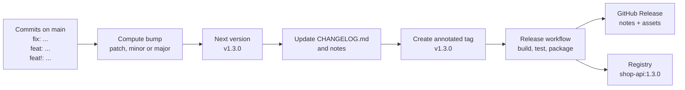
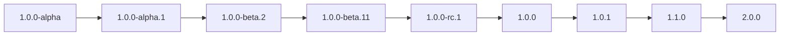

# L3.10 — Semantic Versioning and Release Management

> **Level 3: Git & GitHub** · Topic 10 of 13 · ⏱ ~3 hours · Difficulty: Intermediate

## 1. What it is

**Semantic Versioning (SemVer)** is a convention for version numbers of the form **`MAJOR.MINOR.PATCH`** (for example `2.7.1`) where each part carries a promise about
compatibility:

- **PATCH** (`2.7.1` to `2.7.2`): backwards-compatible bug fixes.
- **MINOR** (`2.7.1` to `2.8.0`): new functionality, still backwards compatible.
- **MAJOR** (`2.7.1` to `3.0.0`): incompatible changes to the public API.

A **pre-release** adds a hyphen suffix (`3.0.0-rc.1`, sorted *before* `3.0.0`), and **build metadata** adds a plus suffix (`3.0.0+build.5`, ignored when comparing versions).
Versions `0.y.z` mean "initial development: anything may change".

**Conventional Commits** is a lightweight convention for commit messages (`type(scope): description`) that makes the bump *machine-readable*: `fix:` means PATCH, `feat:` means MINOR, and
`feat!:` or a `BREAKING CHANGE:` footer means MAJOR. Tools then compute the next version, write the **changelog** (a human-readable list of what changed), tag the commit, and publish a
**GitHub Release** (a tag plus notes and downloadable files). That chain is **release management**.

## 2. Why it matters in DevOps

- **Consumers need a contract.** Dependency managers (npm, Go modules, Cargo, Helm charts) choose upgrades from version ranges like `^2.7.0`. A breaking change shipped as a patch breaks everyone's build on the next install.
- **Predictable releases.** When version, tag, changelog and release notes are generated from commit history, releasing is a button, not a Friday-evening ritual.
- **Audit and rollback.** "What changed between 1.8.2 and 1.9.0?" and "roll back to 1.8.2" both need clean versions and notes ([rollback](../level-05-cicd/07-rollback.md)).
- **Pipeline trigger.** The tag created for a release is what starts the build-and-publish pipeline ([tags](06-tags.md), [GitHub Actions workflows](11-github-actions-workflows.md)).
- **Pitfall:** versions that mean nothing (`v1`, `v2-final`, `release-march`) or "latest" as a deployment target make incidents slow to diagnose.

## 3. Real-world system example

**Kubernetes, Terraform, Go and npm** all lean on SemVer. The Go toolchain requires module versions to be SemVer-style tags (`v1.4.2`); npm's `^` and `~` range operators are defined in terms of SemVer;
Terraform providers declare version constraints like `~> 5.0`. Kubernetes uses `vMAJOR.MINOR.PATCH` for releases and documents a deliberate release cadence and support policy for minor versions.

**The SemVer specification itself** (semver.org, authored by Tom Preston-Werner, co-founder of GitHub) is the reference all of them point to, and **Conventional Commits** (conventionalcommits.org) is the companion spec for commit messages.

**Automation tools** that implement this pipeline are widely used in open source: `release-please` (from Google), `semantic-release`, `git-cliff` (changelog generation) and `changesets` (popular in JavaScript monorepos).
**GitHub** itself provides auto-generated release notes (from merged PR titles and labels) and a `gh release create` CLI command.

## 4. Diagram

From commit message to published release:



Version precedence (what sorts above what):



## 5. How it works

**Conventional Commit types and their effect**

| Commit subject | Bump | Appears in changelog |
|----------------|------|----------------------|
| `fix: handle empty cart` | PATCH | Bug Fixes |
| `feat(cart): add coupon codes` | MINOR | Features |
| `feat(api)!: remove /v1/orders` | MAJOR | Breaking changes |
| `refactor: ... ` with footer `BREAKING CHANGE: config format changed` | MAJOR | Breaking changes |
| `docs:`, `chore:`, `ci:`, `test:`, `style:`, `build:`, `perf:`, `refactor:` | none by default (`perf` is often listed) | usually hidden |

Format: `type(optional scope)!: short description`, then an optional body, then optional footers (`BREAKING CHANGE: ...`, `Refs: #123`).

**SemVer rules worth memorising**

- Once a version is published, its contents **never change**; fix forward with a new version ([tags](06-tags.md)).
- Resetting: bumping MINOR resets PATCH to 0; bumping MAJOR resets MINOR and PATCH to 0.
- Pre-release identifiers compare field by field: numeric parts numerically (`beta.2` before `beta.11`), alphanumeric parts alphabetically (`alpha` before `beta` before `rc`).
- "Public API" is whatever you declare it to be: HTTP routes, CLI flags, config format, database schema, Helm chart values. Say so in the README.

**Three ways to automate**

| Approach | How it works | Trade-off |
|----------|--------------|-----------|
| **Manual tag** | A maintainer decides the version, tags, pushes; a workflow publishes | Simple, human judgement, easy to forget notes |
| **Release PR bot** (`release-please`) | Bot keeps an open "Release PR" that bumps version and changelog; merging it creates the tag and Release | Reviewable and safe; needs Conventional Commits or squash-titles |
| **Fully automatic** (`semantic-release`) | Every merge to `main` that contains a releasable commit publishes | Fast, but no human gate; needs strong tests |

**Changelog styles**

- Generated from commits (git-cliff, release-please, semantic-release): accurate, as good as your commit messages.
- GitHub auto-generated notes from PRs: `gh release create v1.3.0 --generate-notes`, grouped by PR labels via `.github/release.yml`.
- Hand-written "Keep a Changelog" style (`## [1.3.0] - 2026-10-09` with `Added / Changed / Fixed / Removed`): best for human readers, costs effort.

**Gotcha:** events created with the default `GITHUB_TOKEN` (such as a tag or release pushed by a workflow) do **not** start other workflows. If a release bot creates the tag, either do the
build in the same workflow, or authenticate the bot with a GitHub App token or a fine-grained personal access token.

## 6. Step-by-step guide

**Prerequisites:** Git, bash. For the GitHub parts: a GitHub account, a repo, and the `gh` CLI (`gh auth login`). Free.

1. **Create a repo with conventional commits and a first release tag.**
   ```bash
   git init -b main shop-api-release && cd shop-api-release
   git config user.name "Dev" && git config user.email "dev@example.com"
   echo "shop-api" > README.md && git add . && git commit -m "chore: initial commit"
   git tag -a v1.2.3 -m "Release 1.2.3"
   for m in "fix: handle empty cart" "feat(cart): add coupons" "docs: update readme" "feat(api)!: remove v1 orders endpoint"; do
     date +%s%N >> CHANGES.txt && git add . && git commit -m "$m"
   done
   git log --oneline v1.2.3..HEAD
   ```

2. **Write a tiny bump calculator** to see the rules in code (save as `next-version.sh`, `chmod +x`).
   ```bash
   #!/usr/bin/env bash
   # Suggest the next semver from Conventional Commits since the last v* tag
   set -euo pipefail
   re_break='^[a-z]+(\([^)]*\))?!:'
   re_feat='^feat(\([^)]*\))?:'
   re_fix='^fix(\([^)]*\))?:'
   last=$(git describe --tags --abbrev=0 --match 'v[0-9]*' 2>/dev/null || echo "v0.0.0")
   range="$last..HEAD"; [ "$last" = "v0.0.0" ] && range="HEAD"
   ver=${last#v}; IFS=. read -r major minor patch <<<"${ver%%-*}"
   bump=none
   while IFS= read -r subject; do
     if   [[ $subject =~ $re_break ]]; then bump=major
     elif [[ $subject =~ $re_feat  ]] && [ "$bump" != major ]; then bump=minor
     elif [[ $subject =~ $re_fix   ]] && [ "$bump" = none ];   then bump=patch
     fi
   done < <(git log --format=%s "$range")
   if git log --format=%B "$range" | grep -q '^BREAKING CHANGE:'; then bump=major; fi
   case "$bump" in
     major) echo "v$((major+1)).0.0" ;;
     minor) echo "v$major.$((minor+1)).0" ;;
     patch) echo "v$major.$minor.$((patch+1))" ;;
     none)  echo "$last (no release-worthy commits)" ;;
   esac
   ```
   ```bash
   ./next-version.sh
   ```
   Expected: `v2.0.0` (the `!` commit makes it a MAJOR bump). Try `git reset --hard HEAD~1` and rerun: you get `v1.3.0`; reset two more and you get `v1.2.4`.
   (This is a teaching sketch. Real tools handle many more cases.)

3. **Generate a changelog section from commits.**
   ```bash
   { echo "## v2.0.0 ($(date +%F))"; echo
     git log v1.2.3..HEAD --pretty='* %s (%h)'; } | tee -a CHANGELOG.md
   ```
   The output is a bullet list of the four commit subjects. Tools like `git-cliff` do the same with grouping by type.

4. **Tag the release** (annotated, per [tags](06-tags.md)) and push, if you have a GitHub remote.
   ```bash
   git tag -a v2.0.0 -m "Release 2.0.0"
   git remote add origin git@github.com:<YOUR_USER>/shop-api-release.git
   git push -u origin main --follow-tags
   ```

5. **Create a GitHub Release from the tag**, with generated notes.
   ```bash
   gh release create v2.0.0 --verify-tag --title "v2.0.0" --generate-notes
   gh release view v2.0.0
   ```
   `--verify-tag` aborts if the tag does not already exist on the remote, instead of silently creating one from the default branch. For a release candidate add `--prerelease`.

6. **Group the generated notes by PR label** with `.github/release.yml`:
   ```yaml
   changelog:
     exclude:
       labels: [ignore-for-release]
       authors: [dependabot]
     categories:
       - title: Breaking changes
         labels: [breaking-change]
       - title: Features
         labels: [enhancement]
       - title: Bug fixes
         labels: [bug]
       - title: Other changes
         labels: ["*"]
   ```

7. **Publish a release automatically when a tag is pushed.** `.github/workflows/release.yml`:
   ```yaml
   name: Release
   on:
     push:
       tags: ['v*.*.*']

   permissions:
     contents: write        # needed to create the release

   jobs:
     release:
       runs-on: ubuntu-latest
       steps:
         - uses: actions/checkout@v4
         - name: Create GitHub Release
           env:
             GH_TOKEN: ${{ github.token }}
           run: |
             if [[ "$GITHUB_REF_NAME" == *-* ]]; then PRE="--prerelease"; else PRE=""; fi
             gh release create "$GITHUB_REF_NAME" --verify-tag --generate-notes $PRE
   ```
   A tag containing a hyphen (`v2.1.0-rc.1`) is treated as a pre-release, matching SemVer.

8. **Let a bot propose releases (release-please).** `.github/workflows/release-please.yml`:
   ```yaml
   name: release-please
   on:
     push:
       branches: [main]
   permissions:
     contents: write
     pull-requests: write
   jobs:
     release-please:
       runs-on: ubuntu-latest
       steps:
         - uses: googleapis/release-please-action@v4
           with:
             release-type: node
   ```
   After merging `feat:` or `fix:` commits to `main`, the bot opens a "chore(main): release X.Y.Z" PR containing the version bump and changelog. Merging it creates the tag and GitHub Release.
   Also enable *Settings, Actions, General, Allow GitHub Actions to create and approve pull requests* for the repository. Remember the `GITHUB_TOKEN` gotcha above if another workflow must react to the new tag.

9. **Enforce the commit format** so the automation has clean input: either require squash merges with the PR title as the commit message and validate PR titles with an action, or add a `commit-msg` hook locally (`commitlint` is the common tool).

## 7. Real-world scenario

*(Illustrative.)* The `shop-api` mobile app talks to the API using a published client library. A developer renames a JSON field and ships it in `1.9.1` labelled "small cleanup".
Renovate/Dependabot-style update bots in downstream projects accept patch updates automatically, so three internal services pick up `1.9.1` overnight and fail at runtime on
the missing field. The incident review finds no changelog mention. The team adopts Conventional Commits with a PR-title check, so the rename is `feat!: rename total to totalPrice`,
which `release-please` turns into `2.0.0` with a "Breaking changes" section, and downstream pinned ranges (`^1.9`) stop auto-upgrading.
**Lesson:** the version number is an API. If you break it, you owe consumers a major bump and a note, and tooling makes honesty the default.

## 8. Common mistakes and best practices

**Don't**

- Ship breaking changes in a MINOR or PATCH release.
- Reuse, move or delete a published version. Release `1.4.1` instead.
- Use `latest` or a branch name as your deployment version; deploy immutable, versioned artifacts.
- Hide a `BREAKING CHANGE` in the body without a `!` or the exact footer, since tools will miss it.
- Stay on `0.x` forever; consumers cannot tell what is stable. Declare `1.0.0` when you commit to compatibility.

**Do**

- Define your public API and write it down.
- Use Conventional Commits (or squash-merge titles) and let tooling compute versions and changelogs.
- Create annotated or signed tags only from protected `main`, and have a pipeline build the release assets.
- Mark release candidates as pre-releases and promote the same artifact to final, not a rebuild.
- Put the version in one place and make everything else (image tag, chart `appVersion`, package.json) derive from the tag.

## 9. Tasks

- [ ] **T1 — Classify the commits** *(≈20 min, beginner)*
  - **Goal:** apply the SemVer and Conventional Commits rules by hand.
  - **Steps:**
    1. Take the current version `3.4.1`. For each message, write the resulting version if it were the only change: `fix: null total`, `feat: export orders as CSV`, `refactor!: drop Node 16`, `docs: typo`, `perf: cache lookups`.
    2. Then work out the version after all five together.
  - **Done when:** you get `3.4.2`, `3.5.0`, `4.0.0`, `3.4.1` (no release), `3.4.1` (no release by default) and a combined `4.0.0`; and you can justify each.

- [ ] **T2 — Run the bump script** *(≈25 min, beginner)*
  - **Goal:** see automation compute a version.
  - **Steps:**
    1. Build the repo from guide steps 1-2.
    2. Reset commits one at a time and record the output for each.
    3. Add a commit with a `BREAKING CHANGE:` footer in the body and confirm the script reports a major bump.
  - **Done when:** you have a table of commit sets and suggested versions matching the SemVer rules.

- [ ] **T3 — Changelog and a GitHub Release** *(≈30 min, intermediate)*
  - **Goal:** publish a real release.
  - **Steps:**
    1. Push the repo to GitHub with a tag `v2.0.0`.
    2. Run `gh release create v2.0.0 --verify-tag --generate-notes`.
    3. Add `.github/release.yml` and create labelled PRs (`bug`, `enhancement`) to see the categories on the next release.
  - **Done when:** the Releases page shows `v2.0.0` with notes, and a later release groups PRs under your category titles.

- [ ] **T4 — Release on tag** *(≈40 min, intermediate)*
  - **Goal:** make a tag push create the release.
  - **Steps:**
    1. Add the workflow from guide step 7.
    2. Push `v2.1.0-rc.1`, then `v2.1.0`.
  - **Done when:** the first appears as a Pre-release and the second as a normal release, with no manual `gh` commands.

- [ ] **T5 — Break it: the silent trigger** *(≈45 min, advanced)*
  - **Goal:** reproduce the `GITHUB_TOKEN` non-trigger rule.
  - **Steps:**
    1. Create workflow A that, on push to `main`, creates and pushes a tag with `GITHUB_TOKEN`; and workflow B with `on: push: tags`.
    2. Observe that B does not run for A's tag.
    3. Fix it using a fine-grained PAT stored as a secret (`<YOUR_TOKEN>`) or by merging the jobs into one workflow.
  - **Done when:** the tag created by A now triggers B, and you can explain why GitHub blocks the default behaviour (to prevent recursive workflow loops).

- [ ] **T6 — Prove it: operate a release bot** *(≈45 min, advanced)*
  - **Goal:** operate a bot-driven release.
  - **Steps:**
    1. Without the guide, set up `release-please` on a scratch repo.
    2. Merge one `fix:` and one `feat:` PR, then merge the Release PR.
    3. Explain in writing why the resulting version is what it is.
  - **Done when:** the repo has a tag and a GitHub Release whose version matches the SemVer rule for your commits, and your explanation names which commit drove the bump.

## 10. Self-check questions

1. A change removes a field from a JSON response. Which version component do you bump, and why?
2. Which sorts higher: `1.0.0-rc.1` or `1.0.0`? `1.0.0-beta.2` or `1.0.0-beta.11`?
3. What bump does `feat(api)!: ...` produce? What about a `docs:` commit?
4. Why might a workflow triggered on tag push not run when a bot creates the tag?
5. Why is it a bad idea to rebuild the artifact when promoting a release candidate to final?

<details>
<summary>Answers</summary>

1. MAJOR, since it is an incompatible change to the public API (unless the API is explicitly marked as unstable, `0.x`).
2. `1.0.0` is higher than `1.0.0-rc.1`; `1.0.0-beta.11` is higher than `1.0.0-beta.2` because numeric identifiers compare numerically.
3. MAJOR; a `docs:` commit produces no release by default.
4. Events produced using the default `GITHUB_TOKEN` do not trigger new workflow runs (to avoid loops). Use a GitHub App token or PAT, or run the build in the same workflow.
5. A rebuild is a different artifact; what you tested as the candidate is no longer what you ship. Promote the exact tested artifact.
</details>

## 11. Further reading

- Semantic Versioning 2.0.0 specification: https://semver.org
- Conventional Commits specification: https://www.conventionalcommits.org
- Keep a Changelog: https://keepachangelog.com
- GitHub Docs: "Managing releases in a repository" and "Automatically generated release notes".
- Documentation for `release-please`, `semantic-release`, `git-cliff` and `changesets` (each project's repository README).
- *Software Engineering at Google* (Winters, Manshreck, Wright), the chapter on dependency management, for the argument about version promises.

<!-- nav -->
---
← Previous: [Trunk-based Development and GitFlow](09-trunk-based-vs-gitflow.md) · [Level 3 index](README.md) · Next: [GitHub Actions: Workflows, Jobs and Triggers](11-github-actions-workflows.md) →
