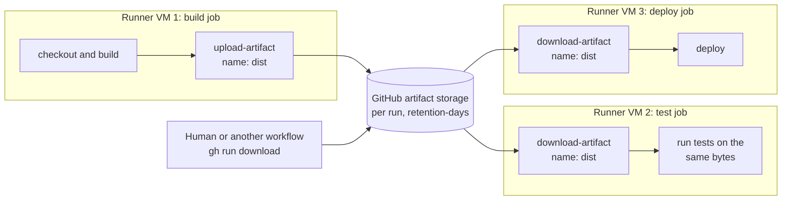
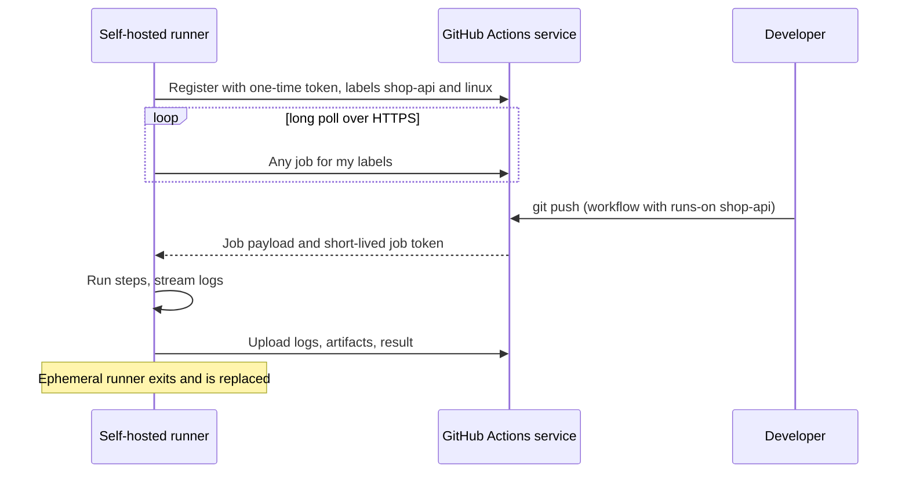

# L3.13 — Artifacts and Runners

> **Level 3: Git & GitHub** · Topic 13 of 13 · ⏱ ~3.5 hours · Difficulty: Intermediate

## 1. What it is

Two ideas finish the GitHub Actions picture:

- **Artifacts** are files produced by a workflow run and **stored by GitHub** so that other jobs, other workflows or people can use them afterwards: a build output, a test report, a coverage file, a binary, a log bundle. Because every job starts on a fresh machine, an artifact is how job B receives what job A built.
  Artifacts expire after a **retention period** (90 days by default, configurable down to one day).
- **Runners** are the machines that execute jobs. **GitHub-hosted runners** are virtual machines that GitHub provisions per job, wipes afterwards, and maintains (`ubuntu-latest`, `windows-latest`, `macos-latest`, plus larger and Arm variants).
  **Self-hosted runners** are machines *you* operate (a VM, a bare-metal server, a Kubernetes pod) that run GitHub's runner agent, register with your repository or organization, and pick up jobs whose `runs-on:` matches their **labels**.

## 2. Why it matters in DevOps

- **Build once, deploy many.** The artifact tested in CI should be the exact artifact promoted to staging and production, not rebuilt each time. Artifacts (and registries) make that possible ([build artifacts](../level-05-cicd/06-artifacts.md)).
- **Debuggability.** Test reports, screenshots, heap dumps and logs uploaded on failure turn "it failed on CI and I can't reproduce it" into a download.
- **Cost and speed.** Runner choice is a budget and performance decision: hosted runners cost nothing to maintain but bill by the minute on private repos; self-hosted runners cost infrastructure and operations but give bigger machines, private network access, GPUs, or special hardware.
- **Security.** A self-hosted runner executes whatever code a workflow tells it to, inside your network. A badly configured one is an open door into your infrastructure.
- **Pitfall:** confusing caches with artifacts, uploading secrets or `.git` credentials into artifacts, and leaving 2 GB of build output for 90 days.

## 3. Real-world system example

**GitHub-hosted runners in open source.** Public repositories on GitHub can use standard hosted runners at no charge, which is why most open-source libraries run their entire test matrix there. The runner images (Ubuntu, Windows, macOS) are
published as open source in the `actions/runner-images` repository, including the list of preinstalled software for each image, so you can see exactly what a job will have available.

**Actions Runner Controller (ARC).** GitHub supports running self-hosted runners as ephemeral pods on Kubernetes through ARC, which scales runner pods up and down with the job queue. Platform teams use it to give CI jobs access to private networks and custom hardware without keeping idle VMs.

**Artifact attestations and provenance.** GitHub documents artifact attestations (using the `actions/attest-build-provenance` action) that cryptographically link a built artifact to the workflow, repository and commit that produced it, in the spirit of the SLSA supply-chain framework. It is how consumers can verify "this binary came from that tag and that pipeline" ([DevSecOps](../level-00-what-devops-is/12-devsecops.md)).

**Typical production pattern:** build on GitHub-hosted runners, upload the artifact (or push an image to a registry), then run deployment jobs on a self-hosted runner inside the VPC that can reach a private cluster, with the cloud credentials coming from OIDC ([environments and secrets](12-environments-and-secrets.md)).

## 4. Diagram

Artifacts hand work between isolated jobs:



How a self-hosted runner gets work (it dials out; GitHub never connects in):



## 5. How it works

**Artifacts: key facts (v4 of the actions)**

| Topic | Detail |
|-------|--------|
| Upload | `actions/upload-artifact@v4` with `name`, `path` (file, directory or glob), optional `retention-days`, `if-no-files-found`, `compression-level` |
| Download | `actions/download-artifact@v4` with `name` (one artifact), or `pattern` plus `merge-multiple: true` for several; downloads into `path` |
| Naming | Within one run each artifact `name` must be unique in v4; uploading the same name again fails unless `overwrite: true`. Matrix jobs therefore use `name: results-${{ matrix.node }}` |
| Scope | Available to later jobs of the same run; other workflows can fetch via the API, `gh run download <run-id>`, or `download-artifact` with `run-id` and a token |
| Retention | Default 90 days; set shorter per upload; repository and organization settings can lower the maximum |
| Storage | Counts toward the account's Actions storage quota; large, long-lived artifacts cost real money on private repos |
| Visibility | Anyone who can read the repo can download them, so never include secrets or credentials files |
| Always upload | Add `if: always()` (or `if: failure()`) on the upload step so reports exist even when tests fail |

**Artifact, cache, release asset, or registry?**

| Need | Use |
|------|-----|
| Speed up dependency installs between runs | **Cache** (`actions/cache`, `setup-*` caching) |
| Pass build output to later jobs/people, short-lived | **Artifact** |
| Publish a versioned downloadable binary | **GitHub Release asset** ([releases](10-semantic-versioning-and-releases.md)) |
| Ship a container image to deploy | **Container registry** ([registries](../level-04-docker/04-registries.md)) |

**Runner types compared**

| | GitHub-hosted | Self-hosted |
|---|---------------|-------------|
| Provisioning | New VM per job, destroyed afterwards | You provision; can be persistent or ephemeral |
| Maintenance | GitHub patches the images | You patch OS, tools and the runner agent |
| Isolation | Strong: clean machine every job | Only as good as your setup; persistent runners leak state between jobs |
| Cost | Free for public repos (standard runners); per-minute on private beyond included minutes | Your infrastructure and operations time (GitHub does not bill minutes for self-hosted runners at the time of writing; check current pricing) |
| Network | Public internet, cannot reach your private network (static IP only on larger runners) | Inside your network or VPC |
| Hardware | Standard sizes, larger and Arm runners (paid), macOS, GPU options | Anything you can run the agent on |
| Typical use | Almost everything | Private network access, special hardware, heavy builds with warm caches, compliance |

**Labels and `runs-on`.** `runs-on: ubuntu-latest` selects a hosted runner. `runs-on: [self-hosted, linux, x64, shop-api]` requires a runner having *all* those labels. Runner **groups** (organization level) control which repositories may use which runners.
`ubuntu-latest` moves to a newer Ubuntu LTS over time; pin `ubuntu-24.04` when you need stability.

**Self-hosted runner security rules**

1. **Never attach a self-hosted runner to a public repository.** Anyone can open a fork PR that runs arbitrary code on your machine.
2. Prefer **ephemeral** runners (`--ephemeral`): one job, then the runner deregisters and the VM or pod is thrown away.
3. Run as an unprivileged user with no standing cloud credentials; use OIDC for cloud access.
4. Put runners in an isolated network segment with only the egress they need.
5. Keep the runner application updated; GitHub requires up-to-date runner versions for the service to assign jobs.

## 6. Step-by-step guide

**Prerequisites:** the `shop-api-actions` project from [topic 11](11-github-actions-workflows.md) (or any repo with a Node project), a GitHub account, `gh` CLI. Parts 1-3 use hosted runners and are free for public repos.
For part 4 you need a Linux machine you control (a VM, a spare laptop, or a small cloud VPS). A tiny VPS bills by the hour; destroy it in the teardown step.

1. **Build once and upload an artifact.** `.github/workflows/artifacts.yml`:
   ```yaml
   name: Build and share

   on:
     pull_request:
     push:
       branches: [main]

   permissions:
     contents: read

   jobs:
     build:
       runs-on: ubuntu-latest
       timeout-minutes: 10
       steps:
         - uses: actions/checkout@v4
         - uses: actions/setup-node@v4
           with:
             node-version: 22
             cache: npm
         - run: npm ci
         - name: Package
           run: |
             mkdir -p dist
             tar czf "dist/shop-api-${GITHUB_SHA::7}.tgz" src package.json package-lock.json
             (cd dist && sha256sum "shop-api-${GITHUB_SHA::7}.tgz" | tee SHA256SUMS)
         - uses: actions/upload-artifact@v4
           with:
             name: shop-api-dist
             path: dist/
             retention-days: 7
             if-no-files-found: error

     verify:
       needs: build
       runs-on: ubuntu-latest
       steps:
         - uses: actions/download-artifact@v4
           with:
             name: shop-api-dist
             path: dist
         - name: Verify checksum and contents
           run: |
             cd dist
             sha256sum -c SHA256SUMS
             tar tzf shop-api-*.tgz
   ```
   Push it. In the run page, the **Artifacts** section lists `shop-api-dist` with its size. The `verify` job prints `shop-api-<sha>.tgz: OK`, proving it received the same bytes the build job produced.

2. **Download an artifact from your terminal.**
   ```bash
   gh run list --workflow "Build and share" --limit 1
   gh run download <run-id> -n shop-api-dist -D /tmp/shop-api-dist
   ls -l /tmp/shop-api-dist
   ```

3. **Upload test results from a matrix, even on failure, and merge them.**
   ```yaml
     test:
       runs-on: ubuntu-latest
       strategy:
         fail-fast: false
         matrix:
           node: [20, 22]
       steps:
         - uses: actions/checkout@v4
         - uses: actions/setup-node@v4
           with:
             node-version: ${{ matrix.node }}
         - run: node --test --test-reporter=tap > results-${{ matrix.node }}.tap
         - uses: actions/upload-artifact@v4
           if: always()
           with:
             name: results-node-${{ matrix.node }}
             path: results-${{ matrix.node }}.tap
             retention-days: 3

     report:
       needs: test
       if: always()
       runs-on: ubuntu-latest
       steps:
         - uses: actions/download-artifact@v4
           with:
             pattern: results-node-*
             merge-multiple: true
             path: all-results
         - run: |
             ls all-results
             grep -H "^# \(pass\|fail\)" all-results/*.tap || true
   ```
   Two uniquely named artifacts (`results-node-20`, `results-node-22`) are uploaded; the `report` job downloads both into one folder. (Name collisions would fail in v4: that is the point of the `${{ matrix.node }}` suffix.)
   Note `merge-multiple: true` merges files into one directory, which is why each matrix entry writes a differently named file (`results-20.tap`, `results-22.tap`); identical file names would overwrite each other.

4. **Write to the job summary** for a quick human-readable report (no artifact needed):
   ```yaml
         - run: echo "### Build ${GITHUB_SHA::7} passed on Node 22" >> "$GITHUB_STEP_SUMMARY"
   ```

5. **Register an ephemeral self-hosted runner** on a Linux machine you control. In the repository: *Settings, Actions, Runners, New self-hosted runner*. GitHub shows the exact download and `config.sh` commands for your OS and architecture, including a short-lived registration token; copy them from that page because the version in the URL changes. The shape is:
   ```bash
   mkdir actions-runner && cd actions-runner
   # download and extract exactly as shown on the GitHub page (curl + tar)
   ./config.sh --url https://github.com/<OWNER>/<REPO> --token <REGISTRATION_TOKEN> \
               --labels shop-api --ephemeral --unattended
   ./run.sh
   ```
   `--ephemeral` makes the runner take one job and then deregister. The terminal prints `Listening for Jobs`, and the repository's Runners page shows the runner as **Idle**. Run this on a throwaway VM, **never** on a public repository and not as `root`.

6. **Send a job to it.**
   ```yaml
   name: Self-hosted check
   on: workflow_dispatch
   jobs:
     whoami:
       runs-on: [self-hosted, linux, shop-api]
       timeout-minutes: 10
       steps:
         - run: |
             echo "running on $(hostname) as $(whoami)"
             uname -a
   ```
   Trigger it with `gh workflow run "Self-hosted check"`. The runner terminal logs `Running job: whoami`, the Actions log shows your machine's hostname, and the runner exits afterwards because it is ephemeral.

7. **Keep it running as a service (persistent runner, non-ephemeral).** Only for trusted private repositories:
   ```bash
   sudo ./svc.sh install
   sudo ./svc.sh start
   sudo ./svc.sh status
   ```
   For scale, prefer ephemeral runners created on demand (for example ARC on Kubernetes) over a long-lived server.

8. **Teardown.**
   ```bash
   # on the runner machine, if the runner is still registered
   ./config.sh remove --token <REMOVAL_TOKEN>
   ```
   Delete the VM/VPS, confirm the runner no longer appears under *Settings, Actions, Runners*, and delete old artifacts you no longer need (*Actions, run, Artifacts*, or `gh run delete <run-id>`).

## 7. Real-world scenario

*(Illustrative.)* A team's CI reruns unit tests and rebuilds the package in every deploy job, and twice the staging build differed from the one that passed tests because a dependency released in between. They switch to build-once: the `build` job uploads a tarball with a checksum and
the `test` and `deploy` jobs download it. Separately, their integration tests need a database in a private subnet, so they run those jobs on ephemeral self-hosted runners deployed with ARC inside the cluster. Weeks later a security review finds a runner
attached to a *public* repository by an enthusiastic contributor; it is removed immediately and an organization policy now restricts which repositories can use self-hosted runner groups.
**Lesson:** artifacts give you reproducibility, runners give you reach, and every unit of reach is also attack surface.

## 8. Common mistakes and best practices

**Don't**

- Upload `.env`, `.git/config`, cloud credential files or build directories that contain tokens: artifacts are readable by anyone with repo access.
- Use caches to pass build results between jobs, or artifacts to speed up dependency installs.
- Attach self-hosted runners to public repositories, or run them as `root` with permanent cloud keys.
- Leave default 90-day retention on big artifacts you only needed for ten minutes.
- Upload artifacts with the same name from matrix jobs (v4 fails).

**Do**

- Upload test reports and logs with `if: always()` so failures are debuggable.
- Set `retention-days`, `if-no-files-found: error`, and checksums for artifacts that become releases.
- Use ephemeral, isolated, regularly rebuilt self-hosted runners; label them precisely; restrict them with runner groups.
- Pin the runner OS version when stability matters (`ubuntu-24.04`) and keep the runner agent current.
- Attest and publish release binaries from the tag-triggered workflow ([semver and releases](10-semantic-versioning-and-releases.md)).

## 9. Tasks

- [ ] **T1 — Build once, verify downstream** *(≈30 min, beginner)*
  - **Goal:** pass an artifact between jobs and prove it is identical.
  - **Steps:**
    1. Add the workflow from guide step 1 and push.
    2. Open the run and find the artifact.
  - **Done when:** the `verify` job logs `shop-api-<sha>.tgz: OK` and the Artifacts section lists `shop-api-dist`.

- [ ] **T2 — Download and inspect from the CLI** *(≈15 min, beginner)*
  - **Goal:** retrieve run output outside the browser.
  - **Steps:**
    1. Use `gh run list` and `gh run download` for the latest run.
    2. Recompute `sha256sum` locally and compare with `SHA256SUMS`.
  - **Done when:** your local checksum equals the one produced in CI.

- [ ] **T3 — Matrix artifacts** *(≈35 min, intermediate)*
  - **Goal:** upload per-matrix results and merge them.
  - **Steps:**
    1. Add the `test` and `report` jobs from guide step 3, with distinct file names per matrix entry.
    2. Make one matrix entry fail deliberately (for example change an assertion for Node 20 only via `if: matrix.node == 20`).
  - **Done when:** the failing run still shows two result artifacts and `report` lists both files.

- [ ] **T4 — Break it: artifact name collision** *(≈25 min, intermediate)*
  - **Goal:** hit and fix the v4 uniqueness rule.
  - **Steps:**
    1. Remove the `${{ matrix.node }}` suffix so both matrix jobs upload `results`.
    2. Read the error, then fix it two ways: a unique name, and `overwrite: true` (and note what you lose).
  - **Done when:** you can quote the error and explain why the unique-name fix is safer.

- [ ] **T5 — Self-hosted runner, ephemeral** *(≈60 min, advanced; may cost a few cents on a VPS)*
  - **Goal:** run a job on your own machine safely.
  - **Steps:**
    1. Follow guide steps 5-6 on a throwaway VM, private test repo.
    2. Confirm the runner deregisters after one job.
    3. Do guide step 8.
  - **Done when:** the Actions log shows your VM's hostname, the runner disappears from the Runners list after the job, and the VM is deleted.

- [ ] **T6 — Prove it: choose runners** *(≈30 min, advanced)*
  - **Goal:** justify a runner strategy.
  - **Steps:**
    1. Without the guide, write a one-page decision for `shop-api`: which jobs run on hosted runners, which (if any) on self-hosted, how artifacts flow between them, retention policy, and the five security controls for the self-hosted pool.
    2. Add a workflow that proves one hosted job builds, a second job downloads the artifact, and the artifact's checksum matches.
  - **Done when:** your decision names concrete labels, retention values and controls, and the workflow run demonstrates the artifact hand-off.

## 10. Self-check questions

1. Why can't job B simply read the files job A created?
2. When would you choose a cache, an artifact, a Release asset, or a container registry?
3. What does `if: always()` on an upload step achieve?
4. Why must self-hosted runners never be attached to public repositories?
5. What does `--ephemeral` change about a runner?
6. Why does a matrix upload with a fixed artifact name fail with v4 of the action?

<details>
<summary>Answers</summary>

1. Each job runs on its own fresh runner, so there is no shared filesystem. Pass files via artifacts (or a registry) and small values via job outputs.
2. Cache for repeated dependency downloads; artifact for short-lived hand-off or reports; Release asset for versioned downloads to users; registry for container images you deploy.
3. The upload runs even if earlier steps failed, so reports and logs are available for debugging.
4. Anyone can open a pull request from a fork that runs arbitrary code, which would then execute on your machine inside your network.
5. The runner accepts exactly one job, then deregisters, so no state or credentials persist for the next job.
6. In v4 artifacts are immutable and unique per run by name, so the second upload with the same name conflicts. Use unique names (for example with the matrix value) and merge when downloading.
</details>

## 11. Further reading

- GitHub Docs: "Storing and sharing data from a workflow", "About GitHub-hosted runners", "About self-hosted runners", "Security hardening for GitHub Actions" and "Actions Runner Controller" (docs.github.com/actions).
- The `actions/upload-artifact`, `actions/download-artifact` and `actions/runner-images` repositories on GitHub.
- SLSA framework (slsa.dev) for build provenance concepts.
- Next: the [Level 3 capstone](99-capstone-project.md) ties the whole level together.

<!-- nav -->
---
← Previous: [GitHub Environments and Secrets](12-environments-and-secrets.md) · [Level 3 index](README.md) · Next: [Level capstone project](99-capstone-project.md) →
