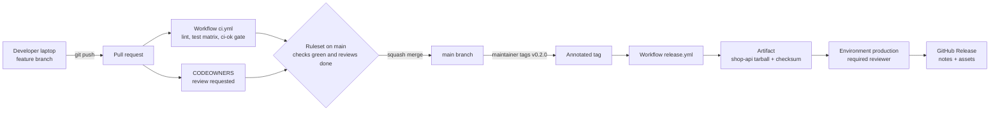
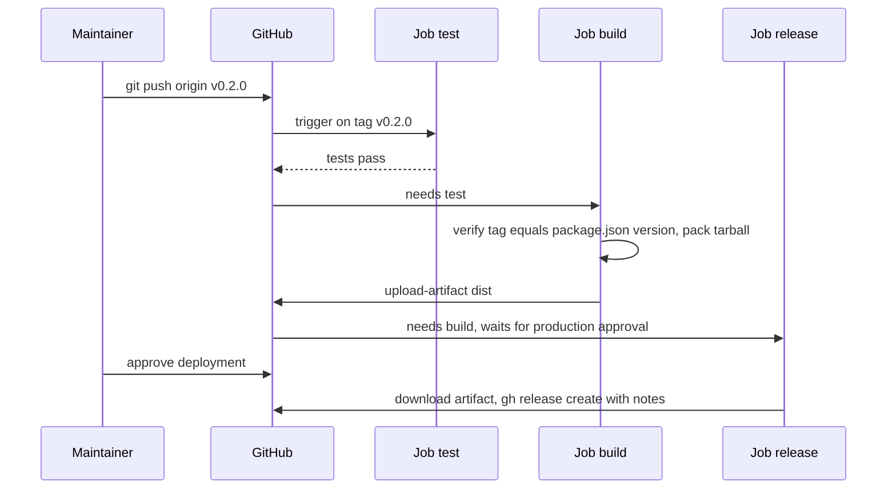

# L3 Capstone — Protected `main`, PR checks and tag-driven releases

> **Level 3: Git & GitHub** · Capstone · ⏱ ~8 hours

## 1. Goal and outcome

Build a small but real delivery system around the `shop-api` Node.js project using only Git and GitHub:

- `main` is **protected**: nobody pushes to it directly, every change arrives through a **pull request** that needs a green CI check, a conversation resolved and (with a teammate) a code-owner review.
- Every PR runs a **GitHub Actions** workflow: lint plus tests on a Node version matrix, with caching, cancelled when superseded.
- Releases are **semantic-version tags** (`v0.1.0`, `v0.2.0`, ...) created on `main`. Pushing a tag triggers a **release workflow** that re-tests, builds a versioned tarball, uploads it as an artifact, waits for approval in the `production` environment, and publishes a **GitHub Release** with generated notes and the tarball attached.
- You can also **operate** the repository like a senior engineer: stash work, rebase a branch, cherry-pick a hotfix onto a release branch, revert a bad merge, and bisect a regression.

**Outcome:** a public GitHub repository `shop-api-pipeline` whose settings, workflows and history prove all 13 topics of Level 3. You can show it in an interview and explain every rule in it.

## 2. Architecture



The release workflow in detail:



## 3. Prerequisites and cost

- **Accounts and tools:** a GitHub account, Git 2.34+, Node.js 20+, and the GitHub CLI (`gh auth login`). Optional: a second GitHub account (or a friend) to act as reviewer and code owner.
- **Cost:** **free**. Use a **public** repository so branch rulesets, environments and hosted-runner minutes cost nothing. If you use a private repo, check your plan for rulesets/environments and monitor Actions minutes.
- **No cloud account is required.** The OIDC-to-AWS extension in the stretch goals uses IAM resources that are free, but set a billing alarm first and tear them down.
- **Time plan:** milestones 1-2 about 1.5 h, 3 about 1.5 h, 4-5 about 2.5 h, 6 about 2 h, wrap-up 0.5 h.

## 4. Build it step by step

### Milestone 1 — Repository and application (topics 1, 5)

```bash
mkdir shop-api-pipeline && cd shop-api-pipeline
git init -b main
git config user.name "Your Name" && git config user.email "you@example.com"

cat > package.json <<'EOF'
{
  "name": "shop-api",
  "version": "0.1.0",
  "private": true,
  "scripts": {
    "lint": "node --check src/index.js",
    "test": "node --test"
  }
}
EOF
mkdir -p src test .github/workflows
cat > src/index.js <<'EOF'
function total(items) {
  return items.reduce((sum, i) => sum + i.price * i.qty, 0);
}
module.exports = { total };
EOF
cat > test/total.test.js <<'EOF'
const test = require('node:test');
const assert = require('node:assert');
const { total } = require('../src/index.js');
test('adds up the cart', () => {
  assert.strictEqual(total([{ price: 10, qty: 2 }, { price: 5, qty: 1 }]), 25);
});
EOF
printf 'node_modules/\ndist/\n' > .gitignore
npm install --package-lock-only >/dev/null && npm test
git add . && git commit -m "feat: initial shop-api with total()"
gh repo create shop-api-pipeline --public --source . --push
```

Expected: `# pass 1` from `npm test`, and the repo visible on GitHub. Because this first push is to an unprotected repository, direct pushes still work: this is the last one you make to `main`.

### Milestone 2 — CI workflow that runs on pull requests (topic 11)

Create `.github/workflows/ci.yml`:

```yaml
name: CI

on:
  pull_request:
  merge_group:
  push:
    branches: [main]

permissions:
  contents: read

concurrency:
  group: ci-${{ github.workflow }}-${{ github.ref }}
  cancel-in-progress: true

jobs:
  lint:
    runs-on: ubuntu-latest
    timeout-minutes: 5
    steps:
      - uses: actions/checkout@v4
      - uses: actions/setup-node@v4
        with:
          node-version: 22
          cache: npm
      - run: npm ci
      - run: npm run lint

  test:
    runs-on: ubuntu-latest
    timeout-minutes: 10
    strategy:
      fail-fast: false
      matrix:
        node: [20, 22]
    steps:
      - uses: actions/checkout@v4
      - uses: actions/setup-node@v4
        with:
          node-version: ${{ matrix.node }}
          cache: npm
      - run: npm ci
      - run: npm test

  ci-ok:
    if: always()
    needs: [lint, test]
    runs-on: ubuntu-latest
    steps:
      - name: Fail if any required job did not succeed
        if: contains(needs.*.result, 'failure') || contains(needs.*.result, 'cancelled') || contains(needs.*.result, 'skipped')
        run: exit 1
```

Protection is not switched on yet, so push this bootstrap commit directly. The push also runs the workflow once on `main`, which makes the `ci-ok` check name available to select in the ruleset:

```bash
git add . && git commit -m "ci: add pull request workflow" && git push
```

`ci-ok` is the single, stable required check, so you can change the matrix later without editing the ruleset.

### Milestone 3 — Protect `main`: ruleset and CODEOWNERS (topic 8)

```bash
cat > .github/CODEOWNERS <<'EOF'
*                      @<YOUR_USER>
/.github/workflows/    @<YOUR_USER>
EOF
git add . && git commit -m "chore: add CODEOWNERS" && git push
```

Create `ruleset.json` (approvals are 0 so a solo learner can merge; set it to 1 and `require_code_owner_review` to true once you have a second account):

```json
{
  "name": "protect-main",
  "target": "branch",
  "enforcement": "active",
  "conditions": { "ref_name": { "include": ["~DEFAULT_BRANCH"], "exclude": [] } },
  "rules": [
    { "type": "deletion" },
    { "type": "non_fast_forward" },
    { "type": "required_linear_history" },
    { "type": "pull_request",
      "parameters": {
        "required_approving_review_count": 0,
        "dismiss_stale_reviews_on_push": true,
        "require_code_owner_review": false,
        "require_last_push_approval": false,
        "required_review_thread_resolution": true
      } },
    { "type": "required_status_checks",
      "parameters": {
        "strict_required_status_checks_policy": true,
        "required_status_checks": [ { "context": "ci-ok" } ]
      } }
  ]
}
```

```bash
gh api -X POST repos/:owner/:repo/rulesets --input ruleset.json
```

In the repository settings, enable only **Squash merging** and "Automatically delete head branches". Confirm: `git commit --allow-empty -m "test: direct push" && git push` is rejected (`GH013`); undo with `git reset --hard origin/main`.

### Milestone 4 — Feature work through pull requests (topics 1, 2, 5, 8, 9)

Use Conventional Commit messages from now on. Develop a feature behind a flag (topic 9), interrupt yourself with a stash (topic 5) and keep the branch fresh with a rebase (topic 2):

```bash
git switch -c feat/discount
cat > src/flags.js <<'EOF'
const defaults = { discount: false };
function isEnabled(name) {
  const env = process.env['FLAG_' + name.toUpperCase()];
  return env !== undefined ? env === 'true' : defaults[name] === true;
}
module.exports = { isEnabled };
EOF
git add . && git commit -m "feat: add feature flag helper"

# start the discount logic, then get interrupted
cat >> src/index.js <<'EOF'
const { isEnabled } = require('./flags');
function totalWithDiscount(items) {
  const t = total(items);
  return isEnabled('discount') ? t * 0.9 : t;
}
module.exports.totalWithDiscount = totalWithDiscount;
EOF
git stash push -m "wip discount logic"
git switch main && git pull
git switch feat/discount && git rebase main      # keep the branch current
git stash pop

git commit -am "feat: apply discount when flag enabled"
git push -u origin feat/discount
gh pr create --fill
gh pr checks --watch
gh pr merge --squash --delete-branch
git switch main && git pull
```

The PR cannot merge until `ci-ok` is green; if you push another commit while a run is in progress, the older run is cancelled.

### Milestone 5 — Semantic version tag and release workflow (topics 6, 10, 11, 12, 13)

Create the `production` environment and add a required reviewer in the UI (*Settings, Environments, production*; restrict deployment branches and tags to `v*`):

```bash
gh api --method PUT repos/:owner/:repo/environments/production
```

Create `.github/workflows/release.yml` (on a feature branch, via PR):

```yaml
name: Release

on:
  push:
    tags: ['v[0-9]+.[0-9]+.[0-9]+*']

permissions:
  contents: read

jobs:
  test:
    runs-on: ubuntu-latest
    timeout-minutes: 10
    steps:
      - uses: actions/checkout@v4
      - uses: actions/setup-node@v4
        with:
          node-version: 22
          cache: npm
      - run: npm ci
      - run: npm run lint && npm test

  build:
    needs: test
    runs-on: ubuntu-latest
    timeout-minutes: 10
    steps:
      - uses: actions/checkout@v4
      - uses: actions/setup-node@v4
        with:
          node-version: 22
      - name: Tag must match package.json version
        run: |
          pkg="v$(node -p "require('./package.json').version")"
          if [ "$pkg" != "$GITHUB_REF_NAME" ]; then
            echo "tag $GITHUB_REF_NAME does not match package.json ($pkg)"; exit 1
          fi
      - name: Package
        run: |
          mkdir -p dist
          tar czf "dist/shop-api-${GITHUB_REF_NAME}.tgz" src package.json package-lock.json
          (cd dist && sha256sum "shop-api-${GITHUB_REF_NAME}.tgz" | tee SHA256SUMS)
      - uses: actions/upload-artifact@v4
        with:
          name: shop-api-dist
          path: dist/
          retention-days: 14
          if-no-files-found: error

  release:
    needs: build
    runs-on: ubuntu-latest
    timeout-minutes: 10
    environment:
      name: production
    permissions:
      contents: write
    steps:
      - uses: actions/download-artifact@v4
        with:
          name: shop-api-dist
          path: dist
      - name: Verify checksum
        run: cd dist && sha256sum -c SHA256SUMS
      - name: Create GitHub Release
        env:
          GH_TOKEN: ${{ github.token }}
          GH_REPO: ${{ github.repository }}
        run: |
          if [[ "$GITHUB_REF_NAME" == *-* ]]; then PRE="--prerelease"; else PRE=""; fi
          gh release create "$GITHUB_REF_NAME" dist/* --verify-tag --generate-notes --title "$GITHUB_REF_NAME" $PRE
```

Prepare and publish the first release:

```bash
git switch -c chore/release-0.2.0
npm version 0.2.0 --no-git-tag-version
git commit -am "chore(release): v0.2.0"
git push -u origin chore/release-0.2.0
gh pr create --fill && gh pr checks --watch && gh pr merge --squash --delete-branch

git switch main && git pull
git tag -a v0.2.0 -m "Release 0.2.0"
git push origin v0.2.0
gh run watch
```

Approve the `release` job when it shows **Waiting**. Then `gh release view v0.2.0` lists the tarball and `SHA256SUMS` as assets.

### Milestone 6 — Operate it: hotfix, revert and bisect (topics 3, 4, 6, 7)

First, protect release tags so published versions cannot be moved or deleted. Do this **after** you finish the deliberately wrong tag experiment in T5, because the rule also blocks deleting tags:

```bash
cat > tag-ruleset.json <<'EOF'
{
  "name": "protect-release-tags",
  "target": "tag",
  "enforcement": "active",
  "conditions": { "ref_name": { "include": ["refs/tags/v*"], "exclude": [] } },
  "rules": [ { "type": "update" }, { "type": "deletion" } ]
}
EOF
gh api -X POST repos/:owner/:repo/rulesets --input tag-ruleset.json
```

Now the hotfix flow:

```bash
# a hotfix lands on main first, then is cherry-picked to a release branch
git switch -c fix/empty-cart
# edit src/index.js so total([]) returns 0 explicitly, add a test
git commit -am "fix: total of empty cart is zero"
git push -u origin fix/empty-cart && gh pr create --fill && gh pr merge --squash --delete-branch
git switch main && git pull
FIX=$(git rev-parse HEAD)

git switch -c release/0.2 v0.2.0
git cherry-pick -x "$FIX"
npm version 0.2.1 --no-git-tag-version && git commit -am "chore(release): v0.2.1"
git push -u origin release/0.2        # release branches are unprotected here; see the stretch goals
```

Then tag and release from the branch (the `build` job checks that the tag matches `package.json`, which is why the version was bumped first):

```bash
git tag -a v0.2.1 -m "Release 0.2.1"
git push origin v0.2.1
```

Revert a bad change safely: merge a harmless but wrong PR, then revert it through GitHub's **Revert** button on the merged PR (or `git revert <sha>` on a branch plus a PR). Finally, practise bisect between two tags with the test suite as the oracle:

```bash
git switch main
git bisect start HEAD v0.2.0        # bad = HEAD, good = v0.2.0
git bisect run npm test
git bisect reset
```

## 5. Tasks

- [ ] **T1 — Repo, app and first push** *(Milestone 1, ≈40 min, beginner; topics 1, 5)*
  - **Goal:** have `shop-api-pipeline` on GitHub with a passing test and a clean history.
  - **Steps:**
    1. Run Milestone 1.
    2. Create a branch, make an edit, stash it, switch to `main`, switch back and pop.
  - **Done when:** `npm test` prints `# pass 1`, the repo exists on GitHub, and `git stash list` is empty after the pop.

- [ ] **T2 — PR CI with a matrix and cache** *(Milestone 2, ≈60 min, intermediate; topic 11)*
  - **Goal:** every PR runs lint and tests on Node 20 and 22.
  - **Steps:**
    1. Add `ci.yml` (pushed directly in Milestone 2), then open a PR with a small change such as one extra test.
    2. Re-run the workflow and find the cache-restored line in the `setup-node` step.
    3. Push two commits quickly and observe the older run being cancelled.
  - **Done when:** the PR shows `lint`, `test (20)`, `test (22)` and `ci-ok` green, one run is marked cancelled, and the cache line is visible.

- [ ] **T3 — Protect `main`** *(Milestone 3, ≈60 min, intermediate; topic 8)*
  - **Goal:** make it impossible to change `main` without a green PR.
  - **Steps:**
    1. Apply the branch ruleset and CODEOWNERS.
    2. Try a direct push; then make a PR whose test fails and confirm the merge button is blocked.
    3. If you have a second account, make it the owner of `/.github/workflows/` and require code-owner review.
  - **Done when:** you can show the `GH013` rejection message, a blocked PR with a red `ci-ok`, and the ruleset JSON from `gh api repos/:owner/:repo/rulesets`.

- [ ] **T4 — Feature via PR with flag, stash and rebase** *(Milestone 4, ≈75 min, intermediate; topics 1, 2, 5, 9)*
  - **Goal:** ship a flagged feature without breaking `main`.
  - **Steps:**
    1. Complete Milestone 4 including the stash and `git rebase main`.
    2. While the PR is open, merge another PR to `main` first so your branch is behind, then rebase and force-push with `git push --force-with-lease`.
    3. Run `FLAG_DISCOUNT=true node -e "console.log(require('./src/flags').isEnabled('discount'))"` and without the variable.
  - **Done when:** the PR merges as one squashed commit, the log shows a linear history, and the command prints `true` then `false`.

- [ ] **T5 — Tag, release workflow and approval** *(Milestone 5, ≈90 min, advanced; topics 6, 10, 11, 12, 13)*
  - **Goal:** a tag push produces a GitHub Release with an artifact, gated by approval.
  - **Steps:**
    1. Add `release.yml`, set up the `production` environment with a reviewer, bump to `0.2.0` through a PR.
    2. Push the annotated tag `v0.2.0` and approve the deployment.
    3. Push a bad tag `v0.9.9` that does not match `package.json`, read the failure, then delete it (`git push origin --delete v0.9.9` and `git tag -d v0.9.9`) before enabling the tag ruleset.
    4. Download the artifact with `gh run download` and verify the checksum.
  - **Done when:** `gh release view v0.2.0` shows the tarball and `SHA256SUMS`, the mismatched tag fails in the `build` job, and your local `sha256sum -c` passes.

- [ ] **T6 — Break and fix: bad merge, revert and hotfix** *(Milestone 6, ≈75 min, advanced; topics 3, 4)*
  - **Goal:** recover production-style from a bad change.
  - **Steps:**
    1. Merge a PR that changes `total()` to ignore `qty` but also edits the test so CI stays green (the "tests lie" case). Bump to `0.3.0` through a release PR and tag `v0.3.0`.
    2. Notice the problem, revert it with a PR, bump to `0.3.1` and publish `v0.3.1` (never move `v0.3.0`; the tag ruleset should refuse it).
    3. Backport a fix to `release/0.2` with `git cherry-pick -x` and release `v0.2.1`.
  - **Done when:** `main` history shows the original change, its revert and the fix; `v0.3.0` still exists unchanged; `v0.2.1` has a release created from the release branch.

- [ ] **T7 — Bisect a regression** *(Milestone 6, ≈45 min, advanced; topic 7)*
  - **Goal:** find a breaking commit automatically.
  - **Steps:**
    1. On a scratch clone, add 10 commits of which one (the 6th) breaks `npm test`.
    2. Run `git bisect start HEAD v0.2.0` and `git bisect run npm test`.
    3. Save `git bisect log` to a file and replay it.
  - **Done when:** bisect names the 6th commit in about 4 test runs and the replay reproduces the same answer.

- [ ] **T8 — Prove it: rebuild from memory and explain** *(whole project, ≈90 min, advanced; all topics)*
  - **Goal:** demonstrate mastery without the guide.
  - **Steps:**
    1. In a fresh repository, set up branch protection, CI on PRs and a tag-triggered release in under an hour using only your own notes and the GitHub docs.
    2. Write a one-page README for the repo describing the flow (branch, PR, checks, tag, release) with the Mermaid diagram of your pipeline.
    3. Explain aloud (or record) why each rule exists and what breaks without it: required check, linear history, tag protection, environment approval, `--verify-tag`.
  - **Done when:** a teammate can open a PR, merge it, tag a release and see a GitHub Release appear by following only your README.

## 6. Verification checklist

- [ ] `git push origin main` from a clean clone is **rejected** by the ruleset.
- [ ] A PR with a failing test cannot be merged; one with all checks green can.
- [ ] The CI run for a PR shows lint, `test (20)`, `test (22)` and `ci-ok`, and a newer push cancels the older run.
- [ ] `.github/CODEOWNERS` exists and a PR touching `.github/workflows/` requests the owner.
- [ ] Only squash merges are enabled and `main` history is linear.
- [ ] `git tag -l` shows annotated `vX.Y.Z` tags; `git cat-file -t v0.2.0` prints `tag`.
- [ ] After the tag ruleset is applied, `git push origin --delete v0.2.0` and a forced re-push of `v0.2.0` are both rejected.
- [ ] Pushing a tag starts `Release`; `build` fails when the tag does not match `package.json`.
- [ ] The `release` job waits for approval in the `production` environment, and records the approver.
- [ ] The GitHub Release for each tag lists the tarball and `SHA256SUMS`, and `sha256sum -c` passes after download.
- [ ] A hotfix exists on `main` and on `release/0.2` (check with `git log --oneline --cherry-pick main...release/0.2` or the `(cherry picked from commit ...)` line).
- [ ] You can reproduce a bisect result using `git bisect replay`.

## 7. Teardown

All of this is free, but clean up so nothing stays public or running.

```bash
# remove the runner, if you registered one in the stretch goals
cd ~/actions-runner && ./config.sh remove --token <REMOVAL_TOKEN>

# delete the repository (needs the delete_repo scope: gh auth refresh -h github.com -s delete_repo)
gh repo delete <YOUR_USER>/shop-api-pipeline --yes

# remove the local copy
cd .. && rm -rf shop-api-pipeline
```

If you did the AWS OIDC stretch goal, delete the IAM role and the OIDC identity provider, and remove any billing alarm you created only for this exercise (see [Environments and Secrets](12-environments-and-secrets.md), step 8).
Download any release artifacts you want to keep first; deleting the repository removes its releases, artifacts and Actions history.

## 8. Stretch goals and what to learn next

- **Automate versioning:** replace the manual `npm version` PR with `release-please` and Conventional Commits ([topic 10](10-semantic-versioning-and-releases.md)).
- **Add a merge queue** (needs an organization-owned repository) and the `merge_group` trigger already present in `ci.yml` ([topic 8](08-protected-branches-and-pull-requests.md)).
- **Sign tags** with an SSH or GPG key and require signed commits in the ruleset ([topic 6](06-tags.md)).
- **Deploy with OIDC:** add a job that assumes an AWS role using `id-token: write` and a trust policy scoped to `environment:production`, with no stored keys ([topic 12](12-environments-and-secrets.md)).
- **Self-hosted ephemeral runner** for a job that needs private network access ([topic 13](13-artifacts-and-runners.md)).
- **Supply chain:** add `actions/attest-build-provenance`, pin third-party actions to SHAs, and enable Dependabot for `github-actions`.
- **Protect release branches:** extend the branch ruleset's `include` list with `refs/heads/release/*` and cut hotfix branches via PR ([topic 8](08-protected-branches-and-pull-requests.md)).
- **Compare strategies:** repeat the exercise with a GitFlow-style `develop` and `release/*` flow and note the extra steps ([topic 9](09-trunk-based-vs-gitflow.md)).

**Next level:** package this service into a container image and run it reproducibly in [Level 4: Docker](../level-04-docker/01-docker-internals.md); later, extend this pipeline to build and push images in [Level 5: CI/CD](../level-05-cicd/01-pipeline-design.md).

<!-- nav -->
---
← Previous: [Artifacts and Runners](13-artifacts-and-runners.md) · [Level 3 index](README.md) · Next level: [Level 4 — Docker](../level-04-docker/README.md) →
