# Level 3 — Git & GitHub

> **Goal:** Use Git and GitHub as a team collaboration and release system, not just a save button.

| | |
|---|---|
| **Recommended time** | 2-3 weeks |
| **Topics** | 13 |
| **Practice / capstone** | Set up a repo with protected main, PR workflow, semantic-version tags, and a GitHub Actions workflow that runs on PRs and releases on tags. |

## Topics

| # | Topic | What you will learn |
|---|-------|---------------------|
| 1 | [Branching and Merging](01-branching-and-merging.md) | branches, fast-forward vs merge commit, conflicts |
| 2 | [Rebasing](02-rebasing.md) | rebase vs merge, interactive rebase, golden rule, force-with-lease |
| 3 | [Cherry-picking](03-cherry-picking.md) | hotfix backports, release branches |
| 4 | [reset and revert](04-reset-and-revert.md) | soft/mixed/hard reset, revert on shared branches, reflog recovery |
| 5 | [stash](05-stash.md) | saving WIP, stash list/pop/apply, stash branches |
| 6 | [Tags](06-tags.md) | lightweight vs annotated, release tags, signing |
| 7 | [bisect](07-bisect.md) | binary search for a regression, automated bisect with a test script |
| 8 | [Protected Branches and Pull Requests](08-protected-branches-and-pull-requests.md) | branch protection rules, required reviews/checks, CODEOWNERS, merge queue |
| 9 | [Trunk-based Development and GitFlow](09-trunk-based-vs-gitflow.md) | branching strategies, feature flags, trade-offs |
| 10 | [Semantic Versioning and Release Management](10-semantic-versioning-and-releases.md) | semver, conventional commits, changelogs, GitHub Releases |
| 11 | [GitHub Actions: Workflows, Jobs and Triggers](11-github-actions-workflows.md) | workflow YAML, events, jobs, steps, matrix, caching |
| 12 | [GitHub Environments and Secrets](12-environments-and-secrets.md) | environments, protection rules, secrets, OIDC to cloud |
| 13 | [Artifacts and Runners](13-artifacts-and-runners.md) | upload/download artifacts, GitHub-hosted vs self-hosted runners |
| ★ | [Level capstone project](99-capstone-project.md) | Set up a repo with protected main, PR workflow, semantic-version tags, and a GitHub Actions workflow that runs on PRs and releases on tags. |

## How to work through this level

1. Read each topic in order: *what it is → why it matters → real-world example → diagram → guide*.
2. Do **every task** in the topic's *Tasks* section and tick the box (`- [x]`) in your own fork or notes.
3. Answer the *Self-check questions* without looking, then reveal the answers.
4. Finish with the **capstone project**, which combines all topics of the level.
5. Move on only when you can do the capstone's *Prove it* task without the guide.

## Topic flow

```mermaid
flowchart LR
    T1["1. Branching and Merging"]
    T2["2. Rebasing"]
    T3["3. Cherry-picking"]
    T4["4. reset and revert"]
    T5["5. stash"]
    T6["6. Tags"]
    T7["7. bisect"]
    T8["8. Protected Branches and Pull Requests"]
    T9["9. Trunk-based Development and GitFlow"]
    T10["10. Semantic Versioning and Release Management"]
    T11["11. GitHub Actions: Workflows, Jobs and Triggers"]
    T12["12. GitHub Environments and Secrets"]
    T13["13. Artifacts and Runners"]
    CAP(["Capstone"])
    T1 --> T2 --> T3 --> T4 --> T5 --> T6 --> T7 --> T8 --> T9 --> T10 --> T11 --> T12 --> T13 --> CAP
```

---
← [Level 2 — Networking](../level-02-networking/README.md) · [Roadmap home](../README.md) · [Level 4 — Docker](../level-04-docker/README.md) →
