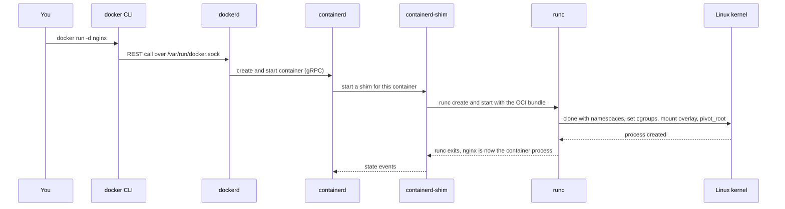
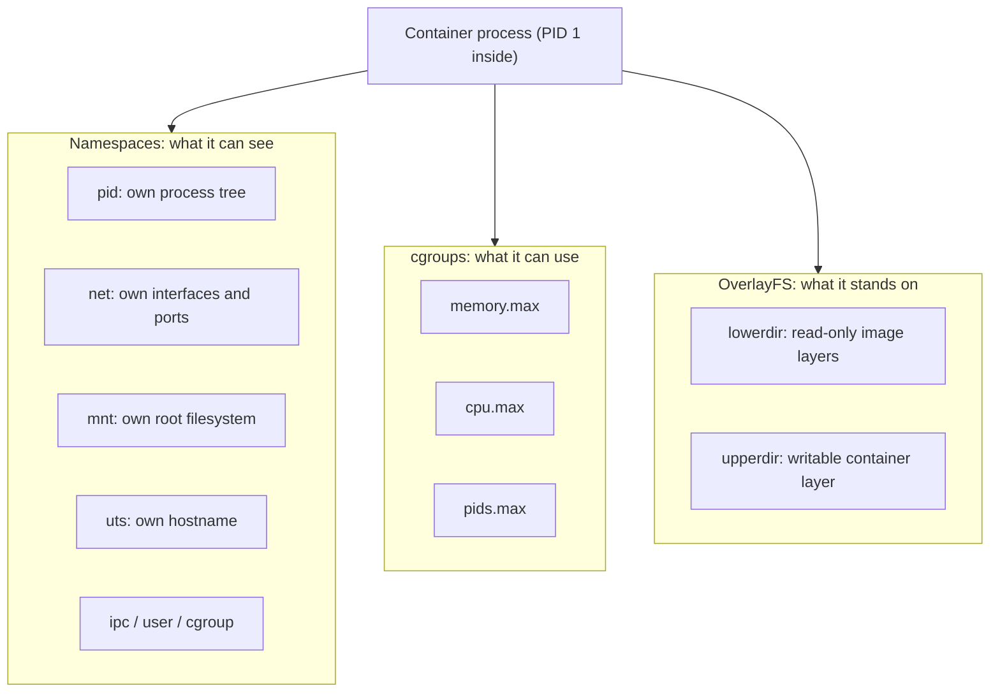

# L4.1 — How Docker Works Internally

> **Level 4: Docker** · Topic 1 of 14 · ⏱ ~4 hours · Difficulty: Intermediate

## 1. What it is

A Docker container is **not a tiny virtual machine**. It is an ordinary Linux process (or group of processes) that the
kernel has been told to *lie to*: it sees its own process tree, its own network stack, its own hostname and its own root
filesystem, and the kernel limits how much CPU and memory it may use. Docker is the friendly tooling around three
kernel features:

- **Namespaces** — control what a process can *see* (PIDs, network interfaces, mounts, hostname, users...).
- **Control groups (cgroups)** — control how much a process can *use* (CPU, memory, I/O, number of processes).
- **Union filesystems (OverlayFS)** — stack read-only image layers plus one thin writable layer into a single `/`.

On top of those sit a few userspace components: the `docker` CLI, the Docker daemon (`dockerd`), `containerd`
(the container lifecycle manager) and `runc` (the tiny program that actually calls the kernel to create the container).
Image and runtime formats are standardised by the **Open Container Initiative (OCI)**, which is why an image built with
Docker runs on Kubernetes, Podman or AWS Fargate.

## 2. Why it matters in DevOps

- **Debugging:** "container OOM-killed", "can't bind port", "permission denied on a volume" and "PID 1 ignores SIGTERM"
  are all kernel-feature problems. If you only know `docker run`, you can only guess.
- **Security:** a container shares the host kernel. A kernel exploit or an over-privileged container (`--privileged`,
  mounting `/var/run/docker.sock`) is a host compromise. A VM has a much harder boundary.
- **Capacity planning:** CPU and memory limits are cgroup settings. Without them one noisy container starves its neighbours.
- **Kubernetes:** Kubernetes does not need Docker Engine at all; it talks to `containerd` or CRI-O (which call `runc`).
  Knowing the layers tells you which tool to use on a node when `docker` is not installed.
- See also [Processes, PIDs and Signals](../level-01-linux-fundamentals/08-processes-and-signals.md) — a container is just such a process.

## 3. Real-world system example

**Kubernetes nodes and AWS Fargate/Lambda.** Since Kubernetes 1.24 removed the built-in "dockershim", most clusters run
**containerd** (or CRI-O) directly on each node; the kubelet asks containerd to create pods, and containerd calls an OCI
runtime (normally `runc`) to create the namespaces and cgroups. The Docker daemon is not involved. Docker itself uses
the same `containerd` underneath, which is why the two ecosystems are interchangeable at the image level.

For workloads where the shared-kernel boundary is not strong enough (multi-tenant serverless), cloud providers put a
lightweight VM around the container: AWS Lambda and Fargate are built on **Firecracker** microVMs, and projects such as
**gVisor** (user-space kernel) and **Kata Containers** (a small VM per container) exist for the same reason. The image format
stays the same; only the isolation layer below the runtime changes.

## 4. Diagram

The path from your keyboard to a running process:



What the kernel builds for one container:



## 5. How it works

**Namespaces** (each is a file under `/proc/<PID>/ns/`):

| Namespace | Isolates | Visible effect inside a container |
|-----------|----------|-----------------------------------|
| `pid` | process IDs | the app is PID 1; it cannot see host processes |
| `net` | interfaces, routes, ports, iptables | its own `eth0`; port 80 inside does not clash with port 80 on the host |
| `mnt` | mount points | its own `/` built from the image |
| `uts` | hostname | hostname is the container ID by default |
| `ipc` | System V IPC, POSIX queues | no shared memory with other containers |
| `user` | UID/GID mapping | optional: root inside can map to an unprivileged user outside (user-namespace remapping, rootless mode) |
| `cgroup` | view of the cgroup tree | the container sees its own cgroup as the root |

**cgroups** are a hierarchy of directories under `/sys/fs/cgroup` (cgroup v2 on modern distributions). Each directory has
control files: `memory.max`, `cpu.max`, `pids.max`, and stat files such as `memory.current`. `docker run --memory 256m --cpus 0.5`
just writes those files. Exceed `memory.max` and the kernel's OOM killer terminates a process in the cgroup (exit code 137 = 128 + SIGKILL).
CPU limits *throttle* rather than kill.

**Union filesystem (OverlayFS).** An image is a stack of read-only directories (`lowerdir`). Docker adds an empty
writable directory (`upperdir`) and mounts them together as the container's `/`.
Reads fall through to the lower layers; the first write to a file **copies it up** into the upper layer
(copy-on-write); a delete leaves a *whiteout* marker in the upper layer. When the container is removed the upper
layer is discarded — which is why data you want to keep belongs in a [volume](05-volumes.md).

**The component stack:**

| Component | Job |
|-----------|-----|
| `docker` CLI | Parses commands, calls the daemon's REST API (over a Unix socket by default) |
| `dockerd` | Images, networks, volumes, build (BuildKit), the user-facing API |
| `containerd` | Pulls and stores images, manages container lifecycle and snapshots |
| `containerd-shim` | One small process per container; keeps it running if `dockerd` or `containerd` restarts, relays stdio and exit status |
| `runc` | Reference OCI runtime: sets up namespaces, cgroups, mounts, drops capabilities, `exec`s your program, then exits |

**Containers vs VMs:**

| | Container | Virtual machine |
|---|-----------|-----------------|
| Kernel | Shared with the host | Own guest kernel on virtualised hardware |
| Start time | Typically well under a second | Typically seconds to minutes |
| Overhead | A process plus a few MB | A full OS: GBs of disk, hundreds of MB of RAM |
| Isolation | Kernel features (weaker boundary) | Hypervisor (stronger boundary) |
| Good for | Packaging and scaling applications | Different OS kernels, hard multi-tenant isolation |

On macOS and Windows, Docker Desktop runs a small Linux VM and your containers run inside it — because containers
need a Linux kernel.

## 6. Step-by-step guide

**Prerequisites:** a Linux machine or VM where you have `sudo`, and Docker Engine for the later steps. Steps 1-3 need
no Docker at all — they use `unshare` from `util-linux`. Output below was captured on a Linux host; PIDs and IDs will differ on yours.

1. **List the namespaces your shell lives in.**
   ```bash
   ls -l /proc/self/ns
   ```
   You see `cgroup`, `ipc`, `mnt`, `net`, `pid`, `time`, `user`, `uts`, each a link such as `pid:[4026531836]`. Two processes
   with the same number share that namespace.

2. **Create your own PID namespace without Docker.**
   ```bash
   sudo unshare --pid --fork --mount-proc bash -c 'ps -ef; echo "my PID is $$"'
   ```
   ```text
   UID          PID    PPID  C STIME TTY          TIME CMD
   root           1       0  0 00:41 ?        00:00:00 bash -c ps -ef; echo "my PID is $$"
   root           2       1  0 00:41 ?        00:00:00 ps -ef
   my PID is 1
   ```
   Your command became PID 1 and the host's processes vanished. That is the `pid` namespace, the whole trick.

3. **Change a hostname that only you can see (UTS namespace).**
   ```bash
   sudo unshare --uts bash -c 'hostname demo; hostname'; hostname
   ```
   The first prints `demo`; the second prints the real hostname — the host is unaffected.

4. **Build a union filesystem by hand with OverlayFS.**
   ```bash
   mkdir -p /tmp/ov/{lower,upper,work,merged}
   echo base  > /tmp/ov/lower/a.txt
   echo hello > /tmp/ov/lower/b.txt
   sudo mount -t overlay overlay \
     -o lowerdir=/tmp/ov/lower,upperdir=/tmp/ov/upper,workdir=/tmp/ov/work /tmp/ov/merged
   echo changed | sudo tee /tmp/ov/merged/a.txt   # copy-up
   sudo rm /tmp/ov/merged/b.txt                    # whiteout
   ls -l /tmp/ov/upper
   cat /tmp/ov/lower/a.txt
   ls /tmp/ov/merged
   sudo umount /tmp/ov/merged
   ```
   ```text
   -rw-r--r-- 1 root root    8 ... a.txt
   c--------- 2 root root 0, 0 ... b.txt
   base
   a.txt
   ```
   `a.txt` was copied into `upper` and modified there; the lower copy still says `base`. The deleted `b.txt` is a
   character device with major/minor `0, 0` — a *whiteout*. This is exactly what Docker does with image layers.

5. **Run a container and find it from the host.** (Needs Docker.)
   ```bash
   docker run -d --name web --memory 128m --cpus 0.5 nginx:1.27
   docker top web                                  # host PIDs of the container's processes
   PID=$(docker inspect -f '{{.State.Pid}}' web)
   sudo ls -l /proc/$PID/ns                        # different numbers from your shell's namespaces
   ```
   The nginx master process has an ordinary host PID. The namespace link targets differ from step 1 for `mnt`, `net`, `pid`, `uts`, `ipc` (and `cgroup`).

6. **Read the limits you set from the cgroup filesystem.**
   ```bash
   docker exec web cat /sys/fs/cgroup/memory.max /sys/fs/cgroup/cpu.max
   ```
   ```text
   134217728
   50000 100000
   ```
   128 MiB in bytes, and 50 ms of CPU per 100 ms period (0.5 CPU). *(These paths are for cgroup v2; on a cgroup v1 host the files live under `/sys/fs/cgroup/memory/` and `/sys/fs/cgroup/cpu/`.)*

7. **Look at the overlay Docker mounted.**
   ```bash
   docker inspect -f '{{.GraphDriver.Name}}' web
   docker inspect -f '{{json .GraphDriver.Data}}' web | python3 -m json.tool
   ```
   With the classic overlay2 storage driver you see `LowerDir`, `UpperDir`, `WorkDir`, `MergedDir`. (Recent Docker versions may
   default to the containerd image store, where the driver reports as `overlayfs` and the fields differ — the idea is identical.)

8. **Meet the runtime layers.**
   ```bash
   ps -eo pid,ppid,cmd --forest | grep -E 'dockerd|containerd|nginx' | grep -v grep
   ```
   You see `dockerd` and `containerd` as long-lived daemons and a `containerd-shim-runc-v2` process as the parent of `nginx: master process`.
   There is no `runc` process: it exits after starting the container.

9. **Clean up.**
   ```bash
   docker rm -f web; sudo rm -rf /tmp/ov
   ```

## 7. Real-world scenario

*(Illustrative.)* **"The API container keeps dying every night at 02:00."** The `shop-api` container restarts with no application
error in the logs. `docker inspect shop-api --format '{{.State.OOMKilled}} {{.State.ExitCode}}'` prints `true 137`:
the kernel OOM-killed it. The nightly report job pushed memory above the `--memory 256m` limit set in the Compose file,
and `memory.max` is enforced by the kernel, not by Node.js. The team raised the limit to 512 MB, set `NODE_OPTIONS=--max-old-space-size=384`
so the V8 heap stays below the cgroup limit, and added a memory-usage alert at 80% of the limit.
**Lesson:** a container limit is a kernel rule — runtime settings inside the app must be sized to fit under it.

## 8. Common mistakes and best practices

**Don't**

- Say "containers are lightweight VMs" in a design review — they share the host kernel and its vulnerabilities.
- Run `--privileged` or mount `/var/run/docker.sock` into containers casually; both are effectively root on the host.
- Store data in the container's writable layer and expect it to survive `docker rm`.
- Leave production containers without memory and PID limits.

**Do**

- Set `--memory`, `--cpus` (or Compose `deploy.resources`/`mem_limit`) and `--pids-limit` on every service.
- Use `docker inspect`, `docker top` and `/proc/<PID>/ns` when something "impossible" happens; the host can see everything.
- Prefer rootless Docker or user-namespace remapping where you can, and keep the host kernel patched.
- Remember Kubernetes talks to containerd/CRI-O; learn `crictl` for nodes without Docker.

## 9. Tasks

- [ ] **T1 — Create a PID namespace by hand** *(≈20 min, beginner)*
  - **Goal:** see isolation without Docker.
  - **Steps:**
    1. Run `sudo unshare --pid --fork --mount-proc bash`.
    2. Inside, run `echo $$` and `ps -ef`.
    3. Open a second terminal on the host and run `pgrep -f "unshare --pid"` to find the same process from outside.
    4. `exit` the inner shell.
  - **Done when:** inside you are PID 1 with a two-line `ps`, and from outside you can show the same process has a large PID.

- [ ] **T2 — Map a container to the host** *(≈25 min, beginner)*
  - **Goal:** prove a container is just a process.
  - **Steps:**
    1. `docker run -d --name t2 nginx:1.27` and `docker top t2`.
    2. Get its host PID with `docker inspect -f '{{.State.Pid}}' t2` and run `sudo cat /proc/<PID>/cgroup`.
    3. Compare `readlink /proc/<PID>/ns/pid` with `readlink /proc/self/ns/pid`.
  - **Done when:** the PIDs match between `docker top` and `inspect`, and the two `pid` namespace IDs differ.

- [ ] **T3 — Enforce a memory limit** *(≈30 min, intermediate)*
  - **Goal:** watch the cgroup OOM killer act.
  - **Steps:**
    1. Run `docker run --name hog --memory 64m --memory-swap 64m python:3.12-slim python -c "x=bytearray(200*1024*1024)"`.
    2. Run `docker inspect hog -f '{{.State.OOMKilled}} {{.State.ExitCode}}'`.
    3. Remove the container.
  - **Done when:** the output is `true 137` and you can explain where 137 comes from.

- [ ] **T4 — Rebuild copy-on-write by hand** *(≈30 min, intermediate)*
  - **Goal:** understand layers by creating them.
  - **Steps:**
    1. Follow step 4 but add a *second* lower layer: `lowerdir=/tmp/ov/lower2:/tmp/ov/lower` (the left-most is the top layer), with a different `a.txt` in `lower2`.
    2. Read `merged/a.txt`, modify it, and list `upper`.
  - **Done when:** you can show which layer each file came from and that both lower layers are unchanged after writes.

- [ ] **T5 — Break it: no limit vs limit on PIDs** *(≈30 min, intermediate)*
  - **Goal:** see why `--pids-limit` exists.
  - **Steps:**
    1. Run `docker run --rm --pids-limit 20 alpine sh -c 'for i in $(seq 1 100); do sleep 30 & done; wait'` and note the "can't fork" errors.
    2. Re-run with `--pids-limit 200` and observe it succeed (stop it after a few seconds).
  - **Done when:** the first run prints fork errors and the second does not.

- [ ] **T6 — Prove it: draw and explain the stack** *(≈30 min, advanced)*
  - **Goal:** explain what happens on `docker run -d nginx`.
  - **Steps:**
    1. Without notes, draw the chain CLI → dockerd → containerd → shim → runc → kernel.
    2. For each box write what it owns, and for the kernel list the three mechanisms (namespaces, cgroups, overlay).
    3. Explain to a colleague why a shared kernel makes the container isolation boundary weaker than a VM's.
  - **Done when:** your diagram and explanation match section 4 and a listener can answer "where does the memory limit live?" (a cgroup file).

## 10. Self-check questions

1. Which three kernel features make a container, and what does each control?
2. What does `runc` do, and why is there no `runc` process while a container runs?
3. What does exit code 137 mean for a container?
4. Why does deleting a file in a container not shrink the image?
5. Why might a company run containers inside Firecracker microVMs?
6. Does Kubernetes need `dockerd`?

<details>
<summary>Answers</summary>

1. Namespaces (visibility), cgroups (resource limits and accounting), and a union filesystem such as OverlayFS (layered root filesystem).
2. It creates the namespaces/cgroups/mounts per the OCI spec and `exec`s the container's program; once that is done, runc has nothing left to do and exits. The shim stays as parent.
3. 128 + 9: the process was killed by SIGKILL, commonly by the kernel OOM killer when the cgroup memory limit was hit (confirm with `OOMKilled` in `docker inspect`).
4. Image layers are read-only; a delete writes a whiteout in a *new* layer, and the old layer's bytes still ship.
5. To get a hardware-virtualisation boundary between tenants while keeping container-like start times and the same image format.
6. No. The kubelet talks to a CRI runtime such as containerd or CRI-O, which uses an OCI runtime like runc.
</details>

## 11. Further reading

- Docker documentation: "Docker overview" and "Storage drivers" (docs.docker.com).
- `man 7 namespaces`, `man 7 cgroups`, `man 1 unshare` — the primary sources.
- Linux kernel documentation: "Control Group v2" and "Overlay Filesystem".
- Open Container Initiative runtime and image specifications (opencontainers.org).
- *Container Security* by Liz Rice — how namespaces, cgroups and capabilities combine.

<!-- nav -->
---
← Previous level: [Level 3 — Git & GitHub](../level-03-git-and-github/README.md) · [Level 4 index](README.md) · Next: [Images and Layers](02-images-and-layers.md) →
