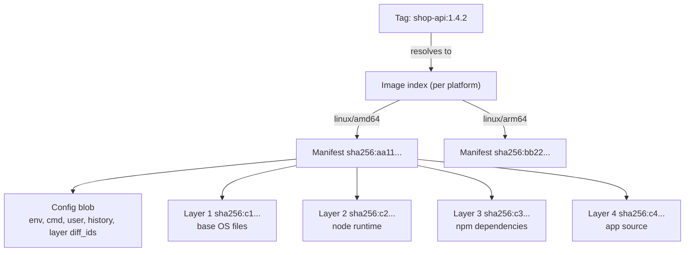
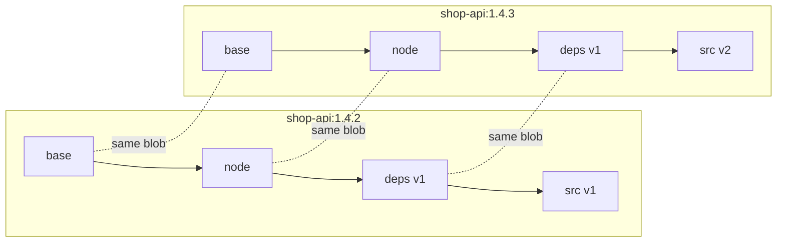

# L4.2 — Images and Layers

> **Level 4: Docker** · Topic 2 of 14 · ⏱ ~4 hours · Difficulty: Intermediate

## 1. What it is

A **container image** is a read-only package containing a filesystem (your app, its runtime, libraries, OS userland) plus
metadata: which command to run, which environment variables to set, which user to run as, which port the app expects.
A container is an image *plus* a thin writable layer plus a running process.

An image is not one big file. It is a **stack of layers**, each layer being a compressed tar archive of filesystem changes
("add these files, delete those"). Every layer, and the image's configuration, is stored and referenced by the **SHA-256
hash of its content** — this is called **content-addressable storage**. Because the name *is* the hash, two images that share
a base (say `node:22-slim`) store those layers only once on disk, in a registry and on the wire.

## 2. Why it matters in DevOps

- **Speed:** pushes, pulls and CI builds are fast only if layers are reused. A badly ordered Dockerfile re-uploads hundreds of MB on every commit.
- **Reproducibility and rollback:** a *tag* can be moved to different content; a *digest* cannot. Deploying by digest is how you guarantee "the thing I tested is the thing in production".
- **Security:** every layer is permanent. A secret copied in one layer and deleted in the next is still extractable from the earlier layer. Vulnerability scanners work layer by layer.
- **Cost:** registry storage, cross-region transfer and node disk usage all scale with image size.
- See also [Image Caching and Layer Optimization](09-layer-caching-and-optimization.md) and [Image Scanning and Container Security](14-image-scanning-and-container-security.md).

## 3. Real-world system example

**Docker Hub and the OCI image format.** Every image on Docker Hub, GitHub Container Registry or Amazon ECR is described by an
**OCI image manifest**: a small JSON document listing one *config* blob and an ordered list of *layer* blobs, each by media type,
size and `sha256:` digest. Multi-architecture images such as `nginx` or `node` publish an **image index** (a "manifest list") that
maps `linux/amd64`, `linux/arm64` and so on to per-platform manifests — which is how the same tag works on an Intel server and an
Apple-silicon laptop. Kubernetes manifests, Helm charts and GitOps tools commonly pin `image: repo/app@sha256:...` to deploy an exact,
immutable artifact. Official Docker images also use mutable tags on purpose (`node:22` moves with each patch release), which is
convenient but exactly why production deployments should pin more precisely.

## 4. Diagram

How a tag leads to bytes:



Sharing between images (each blob is stored once):



Only `src v2` has to be pushed and pulled for version 1.4.3.

## 5. How it works

**Anatomy of an image** (OCI layout, which you can see with `docker save`):

| Piece | What it is |
|-------|-----------|
| Image index | Optional list of per-platform manifests (multi-arch) |
| Manifest | JSON: pointer to the config blob + ordered list of layer blobs (digest, size, media type) |
| Config | JSON: `Env`, `Cmd`, `Entrypoint`, `User`, `ExposedPorts`, `WorkingDir`, `Labels`, build `history`, and `rootfs.diff_ids` |
| Layers | Compressed tar archives (gzip or zstd) of changes; applied bottom to top |

**Where layers come from.** Dockerfile instructions that change the filesystem (`RUN`, `COPY`, `ADD`) create layers.
Instructions that only change metadata (`ENV`, `CMD`, `EXPOSE`, `USER`, `WORKDIR`, `LABEL`) go in the config and add (almost) no size.
Two digests matter: the **diff ID** (hash of the *uncompressed* tar, listed in the config) and the **layer digest** (hash of the *compressed* blob, listed in the manifest).

**Layers are immutable and additive.** Deleting a file in a later layer writes a *whiteout* entry; the earlier layer's bytes are still in the image.
That is why `RUN rm -rf /var/cache` as a *separate* step saves nothing, while doing the install and the cleanup in the *same* `RUN` does.

**Tags vs digests:**

| | Tag (`node:22-slim`) | Digest (`node@sha256:9f1c...`) |
|---|----------------------|-------------------------------|
| What it is | A human-friendly, **mutable** pointer | The SHA-256 of the manifest — **immutable** |
| Can change underneath you | Yes (re-pushed, `latest` moves) | No — different content means a different digest |
| Use for | Development, human conversation | Production deploys, audit trails, reproducible builds |
| Common pattern | `1.4.2`, `1.4`, `1`, `latest`, `git-3f9a2c1` | `image: ghcr.io/example/shop-api@sha256:...` |

A reference can carry both (`name:tag@sha256:...`); the digest wins and the tag becomes documentation.

**Local view.** `docker images` shows tags; `docker image ls --digests` adds digests; `docker history <image>` lists each layer
with the instruction that created it and its size; `docker inspect <image>` prints the config including `RootFS.Layers`.

## 6. Step-by-step guide

**Prerequisites:** Docker Engine (or Docker Desktop) and internet access to pull small public images from Docker Hub. Steps 1 and 2 need only `tar` and `sha256sum`. Image-related output below is *illustrative*: digests, sizes and layer counts change with every upstream release, so expect something similar, not identical.

1. **Feel content addressing with plain tar.** The hash of a layer is just a hash of bytes, so identical content gives an identical name.
   ```bash
   mkdir -p /tmp/layer1 && echo hi > /tmp/layer1/a.txt
   tar --sort=name --mtime='UTC 2020-01-01' --owner=0 --group=0 --numeric-owner -cf /tmp/l1.tar -C /tmp/layer1 .
   sleep 1
   tar --sort=name --mtime='UTC 2020-01-01' --owner=0 --group=0 --numeric-owner -cf /tmp/l2.tar -C /tmp/layer1 .
   sha256sum /tmp/l1.tar /tmp/l2.tar
   ```
   Both lines show the same hash, even though they were created a second apart. (Change `a.txt` and the hash changes completely.) Real layer hashes work the same way, which is why reproducible builds normalise timestamps.

2. **Inspect an image's layers and config.**
   ```bash
   docker pull node:22-slim
   docker image inspect node:22-slim --format '{{json .RootFS.Layers}}' | python3 -m json.tool
   docker history node:22-slim
   ```
   `RootFS.Layers` is the ordered list of `sha256:` diff IDs. `docker history` prints one row per layer with `CREATED BY` (the instruction) and `SIZE`; metadata-only instructions show `0B`.

3. **Open the image like an archive.**
   ```bash
   mkdir -p /tmp/img && docker save node:22-slim -o /tmp/node.tar && tar -xf /tmp/node.tar -C /tmp/img
   ls /tmp/img /tmp/img/blobs/sha256 | head -20
   cat /tmp/img/index.json
   ```
   You should see `index.json`, `oci-layout`, `manifest.json` and a `blobs/sha256/` directory full of files named by their hashes. (Layout details vary slightly between Docker versions and image stores.) Each blob is a manifest, a config or a layer.

4. **Prove layers are shared.** Pull two images that share a base and watch Docker skip layers it already has.
   ```bash
   docker pull node:22-slim
   docker pull node:22-bookworm-slim
   ```
   Lines such as `<id>: Already exists` mean the layer was identified by hash and not downloaded again. (`22-slim` and `22-bookworm-slim` are often the same image under two tags; if both resolve to the same digest, the second pull reports "Image is up to date".)

5. **See tags vs digests.**
   ```bash
   docker image ls --digests node
   docker run --rm node:22-slim node --version
   DIGEST=$(docker image inspect node:22-slim --format '{{index .RepoDigests 0}}')
   echo "$DIGEST"
   docker run --rm "$DIGEST" node --version
   ```
   `RepoDigests` contains `node@sha256:...`. Running by digest always executes exactly those bytes.

6. **Add a layer yourself and look at the history.**
   ```bash
   mkdir -p /tmp/lyr && cd /tmp/lyr
   printf 'FROM alpine:3.20\nRUN echo one > /one.txt\nRUN echo two > /two.txt\nENV STAGE=demo\nCMD ["cat","/one.txt","/two.txt"]\n' > Dockerfile
   docker build -t layers-demo:1 .
   docker history layers-demo:1
   docker run --rm layers-demo:1
   ```
   The history shows the base layers, then two layers of a few bytes each, then `0B` metadata rows for `ENV` and `CMD`. The run prints `one` and `two`.

7. **Show that deleting does not shrink an image.**
   ```bash
   printf 'FROM alpine:3.20\nRUN dd if=/dev/zero of=/big bs=1M count=50\nRUN rm /big\n' > Dockerfile
   docker build -t layers-demo:big .
   docker history layers-demo:big
   docker image ls layers-demo
   ```
   One layer is ~50 MB, the `rm` layer is `0B`, and the image is still 50 MB larger than `alpine`. Now change it to `RUN dd ... && rm /big` in a single `RUN` and rebuild: the 50 MB disappears.

8. **Tag, retag and clean up.**
   ```bash
   docker tag layers-demo:1 layers-demo:stable
   docker image ls layers-demo
   docker rmi layers-demo:stable layers-demo:1 layers-demo:big
   ```
   Two tags, same image ID: tags are just names pointing at content.

## 7. Real-world scenario

*(Illustrative.)* **"Staging passed, production broke, and the code is identical."** The release pipeline deployed `shop-api:latest`
to staging on Monday and to production on Wednesday. On Tuesday the base image `node:22-slim` had been rebuilt upstream with a new
OpenSSL, and a rebuild in CI had silently pulled it. Production ran code that nobody had tested. The team traced it with
`docker image inspect` on both hosts: different `Id` and different `RepoDigests` for the "same" tag.
They changed CI to build once, push `shop-api:git-3f9a2c1`, record the resulting digest, and deploy `shop-api@sha256:<digest>`
to every environment, with Renovate/Dependabot opening explicit PRs for base-image bumps.
**Lesson:** tags are conversation, digests are evidence.

## 8. Common mistakes and best practices

**Don't**

- Deploy `latest` (or any floating tag) to production and call it a version.
- Copy secrets (`.env`, SSH keys, npm tokens) into any layer, even if you delete them later — they remain in earlier layers.
- Put `RUN rm` in a separate step to "clean up" and expect a smaller image.
- Assume `docker pull` today and `docker pull` next month give the same bytes.

**Do**

- Tag images with an immutable identifier (git SHA or semantic version) and deploy by digest.
- Order instructions from least to most frequently changing so layers are reused (see topic 9).
- Combine install and cleanup in one `RUN`, and use a [multi-stage build](10-multi-stage-builds.md) to keep build tools out of the final layers.
- Build multi-arch images (`docker buildx build --platform linux/amd64,linux/arm64`) if your fleet or laptops mix architectures.

## 9. Tasks

- [ ] **T1 — Read an image's layers** *(≈20 min, beginner)*
  - **Goal:** map instructions to layers.
  - **Steps:**
    1. `docker pull nginx:1.27` (or any small image).
    2. Run `docker history --no-trunc nginx:1.27` and `docker image inspect nginx:1.27 --format '{{len .RootFS.Layers}}'`.
    3. Identify which history rows are `0B` metadata rows and which add files.
  - **Done when:** you can state the layer count and name the instruction behind the biggest layer.

- [ ] **T2 — Crack open `docker save`** *(≈30 min, intermediate)*
  - **Goal:** find the manifest, config and layers on disk.
  - **Steps:**
    1. `docker save alpine:3.20 -o alpine.tar` and extract it into an empty directory.
    2. Locate the manifest (via `index.json` or `manifest.json`), then the config blob, then the layer blob.
    3. Extract the layer tar and list its files; confirm `sha256sum` of the blob equals its filename.
  - **Done when:** you have `sha256sum <blob>` output that matches the blob's name, and you can point to the file that holds `Cmd`.

- [ ] **T3 — Measure layer sharing** *(≈30 min, intermediate)*
  - **Goal:** prove deduplication.
  - **Steps:**
    1. Build two images `FROM alpine:3.20` that each add a different 1 MB file.
    2. Run `docker system df -v` and compare the "SHARED SIZE" and "UNIQUE SIZE" columns.
    3. Explain how much disk two images really consume together.
  - **Done when:** you can show the shared base counted once and the unique parts of about 1 MB each.

- [ ] **T4 — Break it: the "deleted" secret** *(≈30 min, intermediate)*
  - **Goal:** learn why secrets in layers leak.
  - **Steps:**
    1. Write a Dockerfile with `RUN echo "API_KEY=FAKE-123" > /secret` followed by `RUN rm /secret`.
    2. Build it, run `docker save` and extract the layers, then `grep -r FAKE-123` through the extracted layer tars (`tar -xOf <layer> | grep FAKE`).
    3. Rewrite the build using a BuildKit secret mount (`RUN --mount=type=secret,id=api_key ...`) and repeat the search.
  - **Done when:** the first image leaks `FAKE-123` and the second does not.

- [ ] **T5 — Pin by digest and detect drift** *(≈30 min, intermediate)*
  - **Goal:** make a build reproducible.
  - **Steps:**
    1. Get the digest of `alpine:3.20` and write it into a Dockerfile as `FROM alpine:3.20@sha256:<digest>`.
    2. Build, then run `docker buildx imagetools inspect alpine:3.20` and compare the digest to the one you pinned.
    3. Write two sentences on how you would update the pin safely (automation + PR review).
  - **Done when:** your Dockerfile builds from the pinned digest and you can explain the update process.

- [ ] **T6 — Prove it: explain a pull** *(≈30 min, advanced)*
  - **Goal:** narrate what a registry pull downloads.
  - **Steps:**
    1. Without notes, write the sequence: tag → (index) → manifest → config + layers → verify digests → unpack to snapshots.
    2. Explain why a second `docker pull` of an updated tag downloads only some layers.
    3. State when you would use a tag and when a digest.
  - **Done when:** your explanation matches sections 4-5 and includes "content-addressable" used correctly.

## 10. Self-check questions

1. What is in an image manifest, and how does it differ from the image config?
2. Why do two images that share a base take less space than the sum of their sizes?
3. Why is `RUN rm -rf /tmp/build` in its own step useless for reducing image size?
4. What is the difference between a tag and a digest, and which would you put in a production Kubernetes manifest?
5. What is the difference between a layer's diff ID and its digest?

<details>
<summary>Answers</summary>

1. The manifest lists the config blob and the ordered layer blobs by media type, size and digest. The config holds runtime metadata (env, cmd, user), the build history and the uncompressed layer diff IDs.
2. Layers are identified by content hash and stored once; images that reference the same hash share the blob on disk, in the registry and on the wire.
3. Layers are additive: the deletion is recorded as a whiteout in a new layer while the earlier layer still contains the bytes. Delete in the same `RUN` that created the files, or use a multi-stage build.
4. A tag is a mutable pointer; a digest is the immutable hash of the manifest. Production manifests should reference the digest (optionally with a human-readable tag alongside).
5. The diff ID is the hash of the uncompressed tar (stored in the config); the digest is the hash of the compressed blob (stored in the manifest and used by registries).
</details>

## 11. Further reading

- OCI Image Format Specification (opencontainers.org) — the manifest, config and layout definitions.
- Docker documentation: "Images and layers" and "Build best practices" (docs.docker.com).
- Docker documentation: `docker buildx imagetools` and the multi-platform builds guide.
- *Docker Deep Dive* by Nigel Poulton — a clear walk through images and layers.

<!-- nav -->
---
← Previous: [How Docker Works Internally](01-docker-internals.md) · [Level 4 index](README.md) · Next: [Containers and Their Lifecycle](03-containers.md) →
