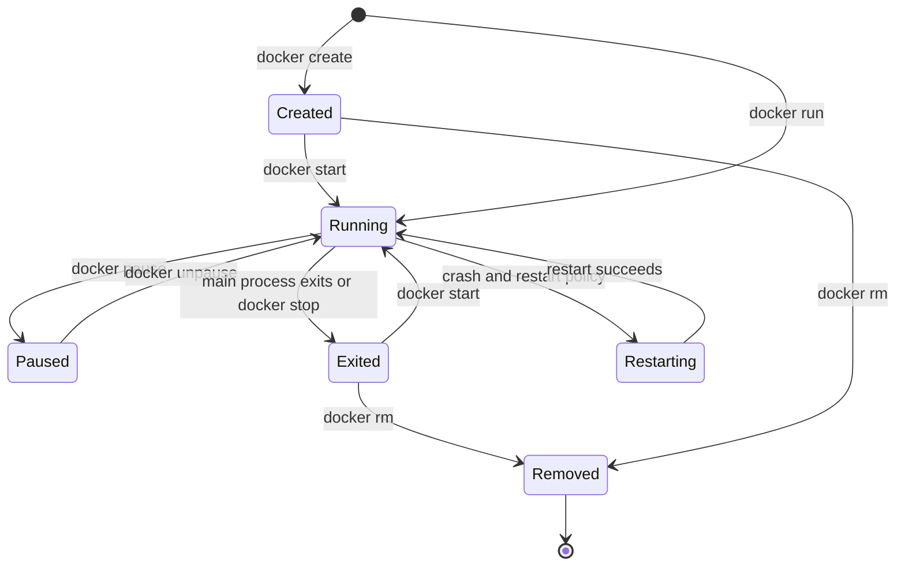
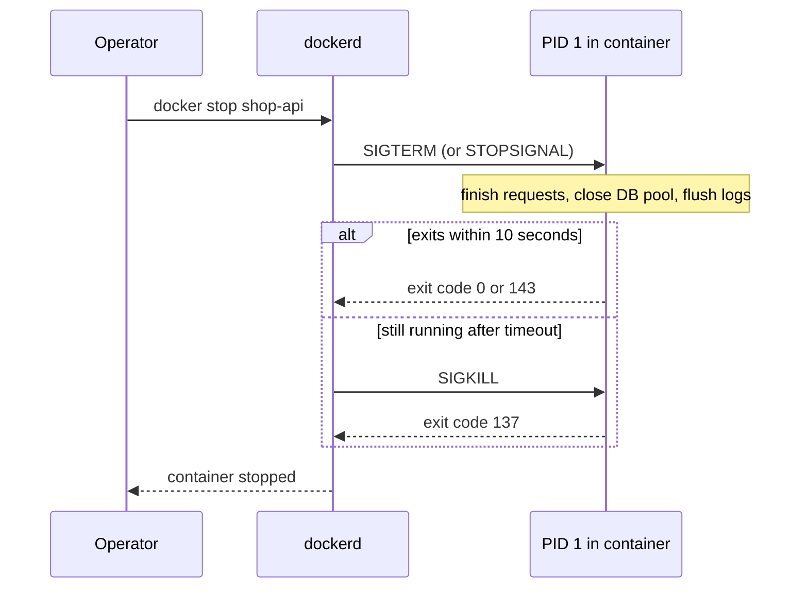

# L4.3 — Containers and Their Lifecycle

> **Level 4: Docker** · Topic 3 of 14 · ⏱ ~4 hours · Difficulty: Beginner

## 1. What it is

A **container** is a running (or stopped) instance of an image: the image's read-only layers, one thin writable layer, a set
of isolation settings (namespaces, cgroup limits, network, mounts) and a **main process** that the runtime starts. The container
lives exactly as long as that main process — when it exits, the container stops. This "one main process, tied to the container's
life" rule explains most beginner surprises: containers that exit immediately, containers that will not stop politely, and
containers that restart forever.

The everyday verbs are `docker run` (create + start), `docker ps` (list), `docker logs` (read stdout/stderr), `docker exec`
(run another process inside), `docker stop` / `docker kill` (end it), `docker start` / `docker restart` (bring it back) and
`docker rm` (delete it and its writable layer).

## 2. Why it matters in DevOps

- **Graceful shutdown = no dropped requests.** Every deploy, scale-down and node drain sends your container a signal. If the app ignores it, users see errors and in-flight jobs are lost.
- **Restart behaviour decides availability.** A restart policy turns a crash into a blip — or into a crash loop that hides a real bug and burns CPU.
- **Logs are your first debugging tool.** In containers, logs are what the process writes to stdout/stderr, not files you SSH in to read.
- **PID 1 is special.** Getting it wrong causes zombie processes and containers that take 10 seconds to stop on every deploy.
- See also [Processes, PIDs and Signals](../level-01-linux-fundamentals/08-processes-and-signals.md) for the Linux foundations.

## 3. Real-world system example

**Kubernetes pod termination.** When Kubernetes removes a pod it sends `SIGTERM` to the main process of each container, waits up
to `terminationGracePeriodSeconds` (default 30 seconds), then sends `SIGKILL`. This is exactly the `docker stop` contract
(SIGTERM, wait, SIGKILL; default wait 10 seconds). Services like Nginx and PostgreSQL define their own signal semantics:
Nginx treats `SIGQUIT` as "graceful shutdown" and `SIGTERM` as "fast shutdown", which is why the official Nginx image sets
`STOPSIGNAL SIGQUIT`; PostgreSQL treats `SIGTERM` as "smart" shutdown and `SIGINT` as "fast", and its image also sets a stop signal to match.
Rolling deployments in Kubernetes, ECS and Docker Swarm are only zero-downtime if containers honour this contract.

## 4. Diagram

Container state machine:



What `docker stop` does:



## 5. How it works

**Core commands:**

| Command | Purpose | Useful flags |
|---------|---------|-------------|
| `docker run IMAGE [CMD]` | create and start | `-d` detach, `-it` interactive TTY, `--name`, `--rm`, `-p`, `-e`, `-v`, `--restart`, `--init`, `--memory`, `--cpus` |
| `docker ps` / `ps -a` | running / all containers | `--filter status=exited`, `--format` |
| `docker logs NAME` | stdout and stderr | `-f` follow, `--tail 100`, `--since 10m`, `-t` timestamps |
| `docker exec NAME CMD` | run a new process in a running container | `-it` for a shell, `-u` user, `-e` env |
| `docker stop` / `kill` | SIGTERM then SIGKILL / immediate signal | `-t 30` grace seconds, `-s SIGHUP` |
| `docker inspect NAME` | full JSON state | `-f '{{.State.ExitCode}}'` |
| `docker stats` | live CPU, memory, network, PIDs | `--no-stream` |
| `docker cp` | copy files in or out | |
| `docker rm` | delete a stopped container | `-f` force (kill first), `-v` remove anonymous volumes |

**Exit codes you must recognise:** `0` success; `1` generic app error; `125` Docker itself failed; `126` command not executable;
`127` command not found; `137` = 128 + 9 (SIGKILL — often out-of-memory or a `docker stop` timeout); `143` = 128 + 15 (SIGTERM, a normal stop for a process with no handler).

**PID 1 rules.** Inside a PID namespace the first process is PID 1, and the kernel treats it specially:
1. Signals with the default action ("terminate") are **not** delivered to PID 1 unless it has installed a handler. A Node.js process that
   does not call `process.on('SIGTERM', ...)` ignores `docker stop` until the 10-second timeout, then gets `SIGKILL`.
2. PID 1 must **reap** orphaned children (`wait()` on them) or they stay as zombies.
Fixes: handle `SIGTERM` in the app, and/or run a tiny init as PID 1 with `docker run --init` (Compose: `init: true`), which uses `tini` to forward signals and reap zombies.

**Shell form vs exec form.** `CMD node server.js` (shell form) runs `/bin/sh -c "node server.js"`, so **`sh` is PID 1** and your app never sees `SIGTERM`.
`CMD ["node", "server.js"]` (exec form) makes node PID 1 directly. Always use exec form (details in [Dockerfile](07-dockerfile.md)).
(Some shells optimise a lone command in `sh -c` by exec-ing it, which can mask the problem; wrappers such as `npm start`, `a && b` or scripts that do not end in `exec` do not get that luck.)

**Restart policies** (`--restart` or Compose `restart:`):

| Policy | Behaviour |
|--------|-----------|
| `no` (default) | never restart |
| `on-failure[:N]` | restart only on non-zero exit, at most N times |
| `always` | restart whatever the exit code; also restarts when the Docker daemon starts |
| `unless-stopped` | like `always`, but not if you manually stopped it before the daemon restarted |

Docker delays restarts with an increasing back-off, so a crash loop does not spin the CPU, but it still never fixes a bug. In Kubernetes the equivalent is the pod `restartPolicy` and the `CrashLoopBackOff` state.

**Logs.** The default `json-file` driver stores stdout/stderr under `/var/lib/docker/containers/<id>/` and **never rotates by default**.
Set `--log-opt max-size=10m --log-opt max-file=3` (or the same in `daemon.json`) or switch drivers (`local`, `fluentd`, `awslogs`, `loki`).

## 6. Step-by-step guide

**Prerequisites:** Docker Engine/Desktop. Outputs are illustrative (IDs, timings differ).

1. **Run, list, read logs.**
   ```bash
   docker run -d --name web -p 8080:80 nginx:1.27
   docker ps
   curl -sI http://localhost:8080 | head -1
   docker logs --tail 3 web
   ```
   `docker ps` shows `web` with `0.0.0.0:8080->80/tcp`; curl prints `HTTP/1.1 200 OK`; the logs show your request in the access log.

2. **Open a shell inside and look around.**
   ```bash
   docker exec -it web sh
   ps aux | head -3        # PID 1 is "nginx: master process"
   cat /etc/os-release | head -2
   exit
   ```
   `exec` starts an *additional* process in the same namespaces; exiting it does not stop the container.

3. **Time a stop and read the exit code.**
   ```bash
   time docker stop web
   docker inspect -f '{{.State.Status}} exit={{.State.ExitCode}}' web
   ```
   Nginx handles its stop signal, so this returns in about a second with `exited exit=0`.

4. **See PID 1 ignoring SIGTERM, then fix it.** Create a deliberately bad app:
   ```bash
   mkdir -p /tmp/sig && cd /tmp/sig
   cat > Dockerfile <<'EOF'
   FROM node:22-alpine
   CMD ["node", "-e", "setInterval(() => console.log('tick'), 1000)"]
   EOF
   docker build -t sig-bad .
   docker run -d --name bad sig-bad
   time docker stop bad
   docker inspect -f 'exit={{.State.ExitCode}}' bad
   ```
   It takes about 10 seconds and the exit code is `137`: Docker had to `SIGKILL` it because node as PID 1 had no SIGTERM handler.
   Now fix it two ways:
   ```bash
   docker run -d --name init --init sig-bad && time docker stop init       # tini forwards SIGTERM; node dies at once
   docker inspect -f 'exit={{.State.ExitCode}}' init                         # 143
   ```
   Or handle the signal in code (the real fix):
   ```js
   // server.js (excerpt)
   process.on('SIGTERM', () => {
     console.log('SIGTERM received, shutting down');
     server.close(() => process.exit(0));   // stop accepting, drain, then exit
   });
   ```

5. **Use a restart policy and watch a crash loop.**
   ```bash
   docker run -d --name flaky --restart on-failure:3 alpine sh -c 'echo boot; sleep 2; exit 1'
   sleep 15
   docker inspect -f 'restarts={{.RestartCount}} status={{.State.Status}}' flaky
   docker logs flaky | head
   ```
   After three retries the policy gives up: `restarts=3 status=exited`. The logs show `boot` repeated. With `--restart always` it would never give up.

6. **Limit and watch resources.**
   ```bash
   docker run -d --name limited --memory 64m --cpus 0.25 nginx:1.27
   docker stats --no-stream limited
   ```
   The `MEM USAGE / LIMIT` column shows a `64MiB` limit.

7. **Cap the log size, then clean up.**
   ```bash
   docker run -d --name chatty --log-opt max-size=1m --log-opt max-file=2 alpine sh -c 'while true; do echo spam; done'
   sleep 5 && docker inspect -f '{{.HostConfig.LogConfig}}' chatty
   docker rm -f web bad init flaky limited chatty
   ```
   The log config shows the `json-file` driver with `max-size:1m` and `max-file:2`. The last line removes every container created in this guide.

## 7. Real-world scenario

*(Illustrative.)* **"Every deploy drops a few payments."** `shop-api` is deployed with a rolling update. During each rollout, the
checkout endpoint returns a handful of 502s. `docker stop` (and, in the cluster, the pod termination) takes exactly the full grace period, and exit
code is `137`. The Dockerfile used `CMD npm start`: `npm` was PID 1, did not forward `SIGTERM` to node, and the app never closed its
HTTP server — in-flight requests were cut when the `SIGKILL` arrived. The fix was three lines: exec-form `CMD ["node","server.js"]`,
a `SIGTERM` handler that calls `server.close()` and then drains the database pool, and `init: true` in Compose. Deploys now stop in
under two seconds with exit code `0`.
**Lesson:** graceful shutdown is part of the application's contract with its platform.

## 8. Common mistakes and best practices

**Don't**

- Use `CMD npm start` or shell-form `CMD` for production; wrapper processes swallow signals.
- Write logs to files inside the container, and never `docker exec` in to "fix" a production container by hand — changes vanish on restart.
- Use `--restart always` to paper over crashes without alerting on `RestartCount`.
- Leave the default `json-file` log driver unbounded on a long-lived host.
- Run `docker rm -f` as your normal stop command; it skips graceful shutdown.

**Do**

- Run the app in the foreground as PID 1 (exec form), log to stdout/stderr, and handle `SIGTERM`.
- Use `--init` or `init: true` when the image runs shells or spawns child processes.
- Set `--memory` and log rotation on every container; choose `unless-stopped` for single-host services and `on-failure` for batch jobs.
- Inspect with `docker inspect`, `docker logs --since` and `docker stats` before touching anything.

## 9. Tasks

- [ ] **T1 — Lifecycle tour** *(≈20 min, beginner)*
  - **Goal:** use every lifecycle verb once.
  - **Steps:**
    1. `docker create --name t1 nginx:1.27`, then `docker ps -a` (status `Created`).
    2. `docker start t1`, `docker pause t1`, `docker unpause t1`, `docker stop t1`, `docker start t1`, `docker rm -f t1`.
    3. After each step run `docker ps -a --filter name=t1` and note the state.
  - **Done when:** you have seen `Created`, `Up`, `Up (Paused)`, `Exited` and the container disappearing.

- [ ] **T2 — Debug a container that exits immediately** *(≈25 min, beginner)*
  - **Goal:** read an exit code and logs.
  - **Steps:**
    1. Run `docker run --name oops alpine sh -c 'echo failing; exit 3'`.
    2. Find the exit code with `docker inspect` and the output with `docker logs`.
    3. Re-run with `--rm` and compare `docker ps -a`.
  - **Done when:** you report exit code `3`, the `failing` log line, and explain what `--rm` changed.

- [ ] **T3 — Fix a slow stop** *(≈30 min, intermediate)*
  - **Goal:** make shutdown graceful.
  - **Steps:**
    1. Build the `sig-bad` image from step 4 and time `docker stop` (about 10 s, exit 137).
    2. Add a `SIGTERM` handler (or `--init`) and rebuild.
    3. Time `docker stop` again.
  - **Done when:** stop takes under 2 seconds and the exit code is not `137`.

- [ ] **T4 — Shell form vs exec form** *(≈30 min, intermediate)*
  - **Goal:** see who PID 1 is.
  - **Steps:**
    1. Build two images from `node:22-alpine` with `CMD node -e "setInterval(()=>{},1000)"; echo done` (shell, compound so the shell stays resident) and `CMD ["node","-e","setInterval(()=>{},1000)"]` (exec).
    2. Run each and execute `docker exec <name> ps` (or `docker top <name>`).
    3. Record which process is PID 1 in each.
  - **Done when:** the shell form shows `/bin/sh -c ...` as PID 1 with node as its child, and the exec form shows `node` as PID 1.

- [ ] **T5 — Restart policies under fire** *(≈30 min, intermediate)*
  - **Goal:** compare policies empirically.
  - **Steps:**
    1. Start three crashing containers (`sh -c 'sleep 1; exit 1'`) with `no`, `on-failure:2` and `unless-stopped`.
    2. After 30 seconds compare `RestartCount` and status for each.
    3. Restart the Docker daemon (`sudo systemctl restart docker`, skip on Docker Desktop) and see which come back.
  - **Done when:** you can tabulate the three outcomes and explain them.

- [ ] **T6 — Prove it: write the shutdown contract** *(≈30 min, advanced)*
  - **Goal:** specify graceful shutdown for `shop-api`.
  - **Steps:**
    1. Without notes, write the 5-step sequence from "SIGTERM received" to "exit 0" (stop accepting, drain in-flight, close DB/Redis, flush logs, exit).
    2. Add the Dockerfile and Compose settings it relies on (`exec form`, `init: true`, `stop_grace_period: 30s`).
    3. Demonstrate with a running container and `docker stop`, showing the shutdown log line and exit code.
  - **Done when:** the log shows your shutdown message and `docker inspect` reports `ExitCode=0`.

## 10. Self-check questions

1. What happens, step by step, when you run `docker stop`?
2. Why does a Node.js container often take 10 seconds to stop, and how do you fix it?
3. What do exit codes 137 and 143 mean?
4. What is the difference between `docker exec` and `docker run`?
5. When would you choose `on-failure:5` instead of `always`?
6. Where do container logs go by default, and what is the risk?

<details>
<summary>Answers</summary>

1. Docker sends the stop signal (SIGTERM by default or the image's `STOPSIGNAL`) to PID 1, waits for the timeout (10 s by default), then sends SIGKILL.
2. Node as PID 1 has no default SIGTERM handler (the kernel ignores signals with default action for PID 1) or a wrapper such as `sh`/`npm` swallows it. Use exec-form CMD, handle SIGTERM, or use `--init`.
3. 137 = killed by SIGKILL (OOM kill or stop timeout); 143 = terminated by SIGTERM.
4. `run` creates a new container from an image; `exec` starts an extra process inside an already running container.
5. For jobs that should stop retrying after repeated failure so the failure is visible, rather than looping indefinitely.
6. Stdout/stderr of PID 1 go to the `json-file` driver under `/var/lib/docker/containers/`; without `max-size`/`max-file` they grow without limit and can fill the disk.
</details>

## 11. Further reading

- Docker documentation: "Run" reference (`docker run`), "Start containers automatically" and "Logging drivers" (docs.docker.com).
- Kubernetes documentation: "Pod Lifecycle" — termination and grace periods.
- `man 7 signal` and `man 7 pid_namespaces` — why PID 1 is special.
- The `tini` project README (github.com/krallin/tini) — a minimal init for containers.

<!-- nav -->
---
← Previous: [Images and Layers](02-images-and-layers.md) · [Level 4 index](README.md) · Next: [Registries](04-registries.md) →
