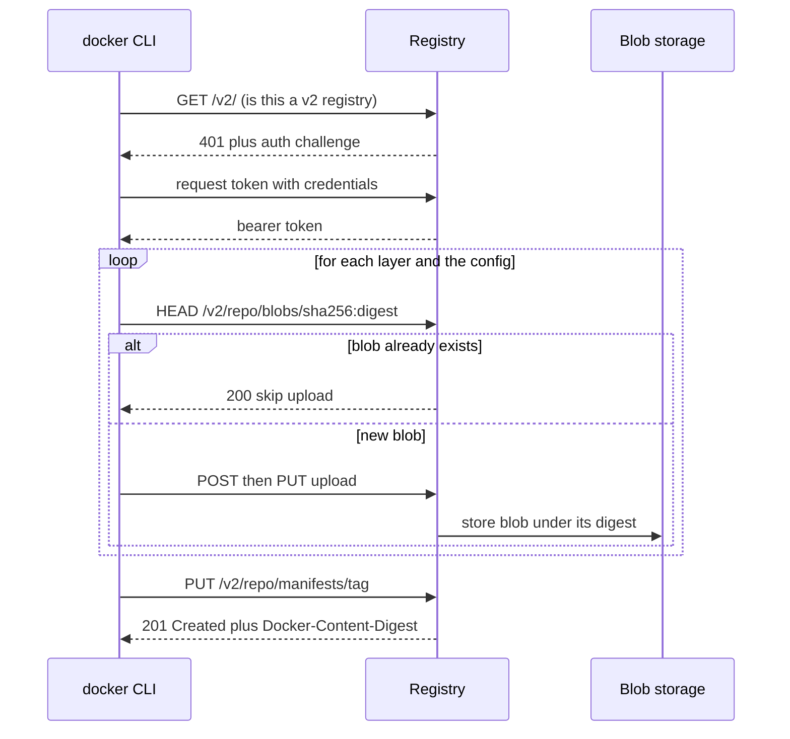
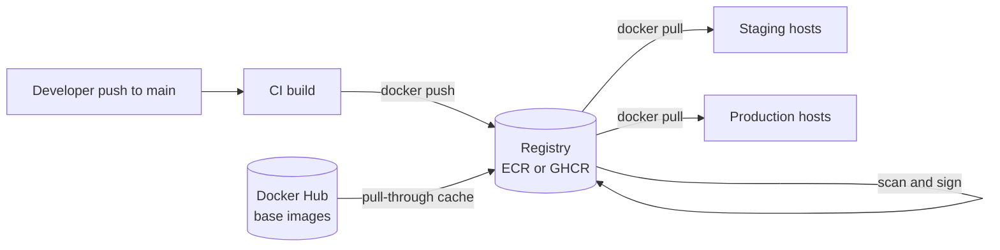

# L4.4 — Registries

> **Level 4: Docker** · Topic 4 of 14 · ⏱ ~3 hours · Difficulty: Beginner

## 1. What it is

A **container registry** is a server that stores and serves container images over HTTP, using the OCI Distribution API
(the "Docker Registry HTTP API v2"). It is to images what a Git host is to source code: you **push** an image from your build
machine, and any server, laptop or cluster with permission **pulls** it. Registries store blobs (layers and configs) by digest and
manifests by tag or digest, so they deduplicate layers automatically (see [Images and Layers](02-images-and-layers.md)).

An image name encodes where it lives: `REGISTRY/NAMESPACE/REPOSITORY:TAG`, for example `ghcr.io/example/shop-api:1.4.2`.
If you omit the registry, Docker assumes Docker Hub (`docker.io`); if you omit the tag, it assumes `latest`.

## 2. Why it matters in DevOps

- **The registry is the hand-off point between CI and deployment.** CI builds and pushes; CD pulls. If the registry is down or a credential is wrong, nothing ships.
- **Access control and supply chain security.** Who may push to production images? Who may pull private code? Compromised push rights mean an attacker can run code in your cluster.
- **Cost and reliability.** Pull rate limits on public registries, cross-region transfer and storage growth all show up on bills and in outages ("ImagePullBackOff" at 3 a.m.).
- **Retention and compliance.** Old images pile up forever unless lifecycle rules delete them; vulnerability scanning usually hooks in at the registry.
- See also [Docker Image Builds and Registries in CI](../level-05-cicd/04-docker-builds-and-registries.md).

## 3. Real-world system example

**Where real teams keep images.**
- **Docker Hub** hosts the "Docker Official Images" (`nginx`, `postgres`, `redis`, `node`, `alpine`) that most Dockerfiles start `FROM`. Anonymous and free pulls are subject to rate limits, so busy CI systems usually authenticate or mirror the base images they use.
- **Amazon ECR (Elastic Container Registry)** is the natural choice on AWS: it integrates with IAM, is reachable privately from a VPC through endpoints, supports image scanning and **lifecycle policies**, and is what ECS and EKS nodes pull from by default in AWS-centric stacks.
- **GitHub Container Registry (GHCR, `ghcr.io`)** sits next to the code: GitHub Actions can push with the built-in `GITHUB_TOKEN`, and images are linked to repositories.
- Kubernetes itself publishes release images to its own registry, `registry.k8s.io`, and many open-source projects use Quay.io or GHCR.
- Large organisations often add a **pull-through cache or mirror** (for example ECR pull-through cache, Harbor or Artifactory) so that upstream outages and rate limits do not stop deployments.

## 4. Diagram

What `docker push` actually does (HTTP calls simplified):



A typical delivery path:



## 5. How it works

**Naming and tagging**

| Part | Example | Notes |
|------|---------|-------|
| Registry host | `ghcr.io`, `123456789012.dkr.ecr.us-east-1.amazonaws.com`, `localhost:5000` | default `docker.io` |
| Namespace / repo | `example/shop-api` | Hub: `username/repo`; official images live under `library/` |
| Tag | `1.4.2`, `git-3f9a2c1`, `main` | default `latest`; mutable unless the registry enforces immutability |
| Digest | `@sha256:...` | immutable content address |

`docker tag SOURCE TARGET` just adds another name to the same image locally; `docker push TARGET` uploads it.
One build commonly gets several tags: the git SHA (unique), a semantic version, and maybe a moving `1.4` or `main`.

**Authentication**

| Registry | How to log in |
|----------|---------------|
| Docker Hub | `docker login -u USER` with a **personal access token**, not your password |
| GHCR | `echo $CR_PAT \| docker login ghcr.io -u USERNAME --password-stdin` with a token scoped to packages; in GitHub Actions use `GITHUB_TOKEN` with `packages: write` |
| Amazon ECR | `aws ecr get-login-password --region us-east-1 \| docker login --username AWS --password-stdin ACCOUNT.dkr.ecr.us-east-1.amazonaws.com` — the token lasts 12 hours |
| Self-hosted | basic auth (htpasswd), token auth, or an OIDC-backed registry such as Harbor |

`docker login` stores credentials in `~/.docker/config.json`, ideally via a credential helper (`osxkeychain`, `pass`, `ecr-login`) rather than base64 text.

**Private registries.** You can run the open-source `registry:2` image (the CNCF Distribution project) for a lab or an internal cache, or use Harbor for
a full product with RBAC, replication, scanning and signing. Docker allows plain HTTP only to `localhost` or to hosts listed under
`insecure-registries` in `daemon.json`; real deployments need TLS.

**Immutability, retention, scanning.** ECR supports *tag immutability* (a tag can be pushed only once) and *lifecycle policies*
(for example "keep the last 20 images, expire untagged after 7 days"). GHCR and others have retention settings or API-based cleanup.
Enable push-time scanning, and prefer deploying by digest.

## 6. Step-by-step guide

**Prerequisites:** Docker. Steps 1-5 use a local registry on `localhost:5000` and cost nothing. ECR/GHCR steps (6-7) need an AWS
account or a GitHub account; ECR storage is billed per GB-month (a few small images cost cents) and the cleanup step deletes it.
Outputs are illustrative.

1. **Run a private registry on your laptop.**
   ```bash
   docker run -d --name registry -p 5000:5000 -v registry-data:/var/lib/registry registry:2
   curl -s http://localhost:5000/v2/
   ```
   The curl prints `{}`: the API is alive. The `registry-data` named volume keeps images across restarts.

2. **Tag an image for it and push.**
   ```bash
   docker pull alpine:3.20
   docker tag alpine:3.20 localhost:5000/lab/alpine:3.20
   docker push localhost:5000/lab/alpine:3.20
   ```
   You see `Pushed` for the layer and a final line like `3.20: digest: sha256:... size: 528`.

3. **Query the registry API.**
   ```bash
   curl -s http://localhost:5000/v2/_catalog
   curl -s http://localhost:5000/v2/lab/alpine/tags/list
   ```
   Expect `{"repositories":["lab/alpine"]}` and `{"name":"lab/alpine","tags":["3.20"]}`.

4. **Prove a pull comes from the registry.**
   ```bash
   docker rmi localhost:5000/lab/alpine:3.20 alpine:3.20
   docker pull localhost:5000/lab/alpine:3.20
   docker run --rm localhost:5000/lab/alpine:3.20 echo "served by my registry"
   ```

5. **Tag the way CI does: SHA + version.**
   ```bash
   SHA=$(git rev-parse --short HEAD 2>/dev/null || echo local1)
   docker tag localhost:5000/lab/alpine:3.20 localhost:5000/lab/alpine:git-$SHA
   docker tag localhost:5000/lab/alpine:3.20 localhost:5000/lab/alpine:1.0.0
   docker push --all-tags localhost:5000/lab/alpine
   docker image ls --digests localhost:5000/lab/alpine
   ```
   All three tags show the *same* digest and image ID: tags are names, content is shared.

6. **Push to Amazon ECR** (real cloud, small cost).
   ```bash
   export AWS_REGION=us-east-1
   ACCOUNT=$(aws sts get-caller-identity --query Account --output text)
   aws ecr create-repository --repository-name shop-api --image-scanning-configuration scanOnPush=true \
     --image-tag-mutability IMMUTABLE --region $AWS_REGION
   aws ecr get-login-password --region $AWS_REGION | \
     docker login --username AWS --password-stdin $ACCOUNT.dkr.ecr.$AWS_REGION.amazonaws.com
   docker tag localhost:5000/lab/alpine:3.20 $ACCOUNT.dkr.ecr.$AWS_REGION.amazonaws.com/shop-api:1.0.0
   docker push $ACCOUNT.dkr.ecr.$AWS_REGION.amazonaws.com/shop-api:1.0.0
   aws ecr describe-images --repository-name shop-api --region $AWS_REGION
   ```
   `describe-images` lists the image with its digest and tag. Pushing `1.0.0` a second time with different content fails because tags are immutable.
   Set a billing alarm in your account if you do not have one.

7. **Push to GHCR.**
   ```bash
   echo "$CR_PAT" | docker login ghcr.io -u YOUR_GITHUB_USERNAME --password-stdin    # CR_PAT = a token with package write scope
   docker tag localhost:5000/lab/alpine:3.20 ghcr.io/YOUR_GITHUB_USERNAME/shop-api-lab:1.0.0
   docker push ghcr.io/YOUR_GITHUB_USERNAME/shop-api-lab:1.0.0
   ```
   The package appears under your GitHub profile's *Packages* tab (private by default for new personal packages; change visibility there if you want it public).

8. **Clean up.**
   ```bash
   docker rm -f registry && docker volume rm registry-data
   aws ecr delete-repository --repository-name shop-api --force --region us-east-1
   docker logout ghcr.io
   ```
   Delete the GHCR package from its settings page, and revoke the token you created.

## 7. Real-world scenario

*(Illustrative.)* **"Production can't scale: ImagePullBackOff."** During a traffic spike the autoscaler starts new nodes, but pods stay
in `ImagePullBackOff`. The events say `toomanyrequests` from Docker Hub: dozens of new nodes were pulling `node:22-slim` and `redis`
anonymously from the same NAT IP. Existing nodes were fine because the layers were cached; fresh nodes had nothing. The team mirrored the handful of base
images into their own ECR through a pull-through cache, switched Dockerfiles and manifests to the ECR names, and added an alert on registry pull errors.
**Lesson:** a third-party registry is a runtime dependency of your autoscaling. Own a copy of what you depend on.

## 8. Common mistakes and best practices

**Don't**

- Rely on `latest` or any mutable tag to identify a release.
- Use your account password with `docker login`, commit `~/.docker/config.json`, or paste tokens into Dockerfiles or CI logs.
- Leave a self-hosted registry on plain HTTP or without authentication on a reachable network.
- Let repositories grow forever; storage and scanning costs grow with them.

**Do**

- Tag with immutable identifiers (git SHA, semver) and deploy by digest; enable tag immutability where available.
- Give CI a narrowly scoped, short-lived credential (OIDC to ECR, `GITHUB_TOKEN` to GHCR); give production hosts pull-only rights.
- Add lifecycle/retention rules, push-time scanning and a pull-through cache for upstream base images.
- Keep the registry in the same region as the compute that pulls from it.

## 9. Tasks

- [ ] **T1 — Stand up a local registry** *(≈25 min, beginner)*
  - **Goal:** push and pull your own image.
  - **Steps:**
    1. Follow steps 1-4 with an image of your choice.
    2. List repositories and tags with the `/v2/` API.
  - **Done when:** `curl localhost:5000/v2/_catalog` lists your repository and you pulled it back after deleting the local copy.

- [ ] **T2 — Dissect the push** *(≈30 min, intermediate)*
  - **Goal:** observe blobs and manifests.
  - **Steps:**
    1. Fetch the manifest: `curl -s -H 'Accept: application/vnd.oci.image.manifest.v1+json, application/vnd.docker.distribution.manifest.v2+json' http://localhost:5000/v2/lab/alpine/manifests/3.20`.
    2. Identify the config digest and layer digests.
    3. Download a blob with `curl http://localhost:5000/v2/lab/alpine/blobs/sha256:<digest>` and verify its `sha256sum`.
  - **Done when:** the computed hash matches the digest in the URL.

- [ ] **T3 — Tagging strategy** *(≈30 min, intermediate)*
  - **Goal:** produce SHA, semver and moving tags from one build.
  - **Steps:**
    1. Build `shop-api` (any small app) and tag it `git-<sha>`, `1.2.3`, `1.2` and `1`.
    2. Push all tags and show they share one digest.
    3. Write down which tag production should use and why (answer: the digest, tracked from the SHA tag).
  - **Done when:** `docker image ls --digests` shows one digest across four tags.

- [ ] **T4 — Authenticate to a hosted registry** *(≈40 min, intermediate)*
  - **Goal:** push to GHCR or ECR.
  - **Steps:**
    1. Create a scoped credential (GitHub PAT with package scope or an AWS IAM user/role limited to `ecr:*` on one repository).
    2. Log in using `--password-stdin`, tag, push and pull from a second machine or after `docker rmi`.
    3. Revoke the credential and confirm `docker push` now fails.
  - **Done when:** a push succeeds, then fails with an authorization error after revocation. For ECR, run the cleanup step.

- [ ] **T5 — Break it: retention and immutability** *(≈30 min, advanced)*
  - **Goal:** see policy enforcement.
  - **Steps:**
    1. In an ECR repository with immutable tags, push `1.0.0`, change the image, and push `1.0.0` again (expect rejection).
    2. Add a lifecycle policy that expires untagged images older than 1 day (`aws ecr put-lifecycle-policy`), and describe what it would remove.
  - **Done when:** the second push is rejected with `ImageTagAlreadyExistsException` and the policy JSON is saved in your notes.

- [ ] **T6 — Prove it: design the registry plan for `shop-api`** *(≈30 min, advanced)*
  - **Goal:** justify a registry setup.
  - **Steps:**
    1. Without notes, write: which registry, naming convention, tagging scheme, who can push, who can pull, retention, scanning, and how base images are mirrored.
    2. Explain what happens to deployments if Docker Hub is unreachable.
  - **Done when:** your plan covers all eight items and a reviewer can find no single point of failure you did not acknowledge.

## 10. Self-check questions

1. How does Docker decide which registry an image name refers to?
2. Why does a second `docker push` of a slightly changed image upload so little data?
3. Why log in with `--password-stdin` and a token instead of `-p PASSWORD`?
4. How long is an ECR login token valid, and what does that mean for CI?
5. Why mirror base images into your own registry?

<details>
<summary>Answers</summary>

1. By the first path component: if it contains a `.` or `:` (or is `localhost`) it is a registry host; otherwise Docker assumes Docker Hub (`docker.io`).
2. The registry already has the unchanged layers by digest (HEAD returns 200), so only new blobs and the manifest are sent.
3. `-p` leaks the secret into shell history and process lists; tokens can be scoped and revoked, unlike your account password.
4. 12 hours; CI should fetch a fresh token at the start of each job, not cache it.
5. To avoid rate limits and upstream outages affecting your autoscaling and deploys, and to scan and control what enters your supply chain.
</details>

## 11. Further reading

- Docker documentation: "Docker Hub", "Deploy a registry server" and `docker login` reference (docs.docker.com).
- Amazon ECR User Guide — private repositories, lifecycle policies, pull-through cache.
- GitHub Docs — "Working with the Container registry".
- OCI Distribution Specification (opencontainers.org) and the CNCF Distribution (`registry:2`) and Harbor project docs.

<!-- nav -->
---
← Previous: [Containers and Their Lifecycle](03-containers.md) · [Level 4 index](README.md) · Next: [Volumes and Bind Mounts](05-volumes.md) →
