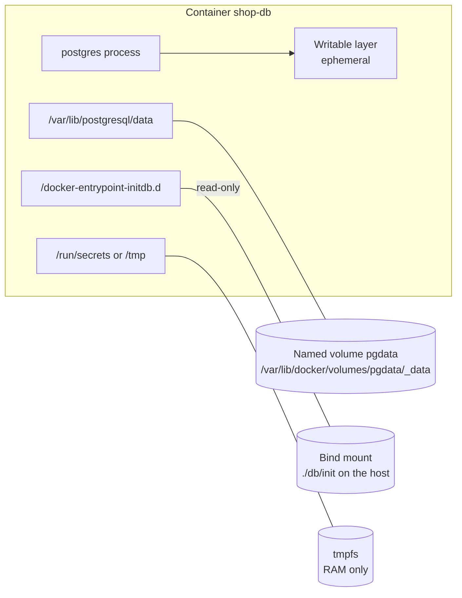
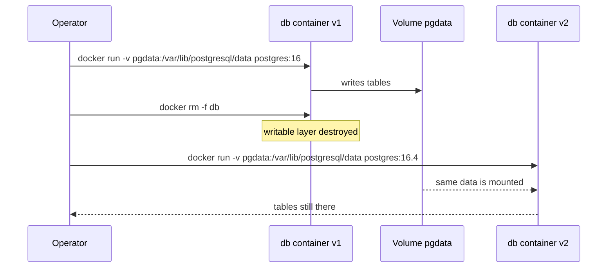

# L4.5 — Volumes and Bind Mounts

> **Level 4: Docker** · Topic 5 of 14 · ⏱ ~4 hours · Difficulty: Intermediate

## 1. What it is

A container's writable layer is **ephemeral**: `docker rm` deletes it, and it is slower than a native filesystem because of
copy-on-write. Anything that must outlive the container — database files, uploaded images, a Prometheus time-series store —
must live somewhere else. Docker offers three ways to attach storage to a container:

- **Named volume** — storage that Docker creates and manages (by default under `/var/lib/docker/volumes/<name>/_data` on the host). Referenced by name, portable between containers, the right default for data.
- **Bind mount** — a specific host path (`/home/me/project/src`) mapped into the container. Great for development and for injecting config files; tied to the host's directory layout and permissions.
- **tmpfs mount** — an in-memory filesystem that vanishes when the container stops. For scratch data and secrets that must never touch disk.

## 2. Why it matters in DevOps

- **Data loss is the worst outage.** "We recreated the database container and the data was gone" is a classic, avoidable disaster.
- **Disk-full incidents.** Volumes, images and logs all live under `/var/lib/docker`; knowing what grows where tells you what to clean or move to a bigger disk.
- **Permissions.** Most "permission denied" errors in containers are a UID mismatch on a volume or bind mount (see [Non-root Containers](11-non-root-containers.md)).
- **Backups and portability.** A volume is only as safe as the last tested backup. In Kubernetes the same ideas return as PersistentVolumes: see [Volumes, PersistentVolumes and PersistentVolumeClaims](../level-08-kubernetes/09-volumes-pv-pvc.md) and, for databases, [Backups and Point-in-Time Recovery](../level-13-databases-distributed-systems/05-backups-and-pitr.md).

## 3. Real-world system example

**The official `postgres`, `redis` and `prometheus` images.** They are built around volumes. The `postgres` image keeps its cluster in a data directory
(`/var/lib/postgresql/data` in most versions; images from PostgreSQL 18 onward move this under `/var/lib/postgresql`, so check the
image documentation for your version) and declares it a `VOLUME` so data survives even if you forget to name one (as an anonymous volume).
Redis writes its RDB/AOF persistence to `/data`. Prometheus stores its TSDB under `/prometheus` and Grafana keeps dashboards and its SQLite database in `/var/lib/grafana`.
In production on a single Docker host, these are usually named volumes on a dedicated disk; on Kubernetes, the equivalent is a PersistentVolumeClaim backed by a cloud disk
(for example EBS on AWS). Many teams deliberately run *managed* databases (RDS) so they don't have to run volumes for the database at all.

## 4. Diagram

Where the data lives:



The lifecycle that makes volumes valuable:



## 5. How it works

| | Named volume | Bind mount | tmpfs |
|---|-------------|-----------|-------|
| Created by | Docker (`docker volume create` or on first use) | You (host path must exist with `-v`; `--mount` errors if missing) | Docker, in RAM |
| Host location | `/var/lib/docker/volumes/NAME/_data` | any path you choose | none (memory) |
| Survives `docker rm` | Yes (until `docker volume rm`) | Yes (it is your file) | No |
| Pre-populated from the image | Yes: an empty new volume is initialised with the image's files at that path | No: the host directory hides what the image had there | No |
| Good for | databases, TSDBs, uploads | source code in dev, config files, certificates | scratch space, secrets, tests |
| Pitfalls | invisible in your project tree; easy to forget in backups | UID/GID mismatches, host-path coupling, slow on macOS/Windows Docker Desktop, SELinux labels | consumes RAM; size-limit it |

**Syntax.** Two flags do the same thing; prefer the explicit `--mount` for clarity:

```bash
docker run -v pgdata:/var/lib/postgresql/data postgres:16                      # short: named volume
docker run --mount type=volume,src=pgdata,dst=/var/lib/postgresql/data postgres:16
docker run -v "$PWD/conf/nginx.conf:/etc/nginx/nginx.conf:ro" nginx:1.27        # bind, read-only
docker run --mount type=bind,src="$PWD/conf",dst=/etc/nginx/conf.d,readonly nginx:1.27
docker run --tmpfs /tmp:rw,size=64m,mode=1777 alpine                            # tmpfs
docker run --mount type=tmpfs,dst=/tmp,tmpfs-size=67108864 alpine
```

**Anonymous volumes.** An image with `VOLUME /data` and no `-v` creates an anonymous volume with a random name on every `docker run` — easy to orphan.
`docker rm -v` removes a container's anonymous volumes; `docker volume prune` removes unused ones (check what it will delete first).

**Persistence and consistency.** A volume is just files. Copying live database files while the database runs can produce a corrupt backup.
For databases use a logical dump (`pg_dump`) or a proper physical backup tool; for plain files, a `tar` taken through a throw-away container is fine.

**Volume drivers.** The default `local` driver can mount NFS or other filesystems (`--opt type=nfs ...`); plugins integrate cloud disks. In Swarm and Kubernetes the storage backend is the platform's job.

**Compose.** Declare named volumes at the top level and reference them from services (see [Docker Compose](08-docker-compose.md)); `docker compose down` keeps them, `docker compose down -v` deletes them.

## 6. Step-by-step guide

**Prerequisites:** Docker. Everything runs locally and is free. Outputs are illustrative.

1. **Prove the writable layer is ephemeral.**
   ```bash
   docker run --name tmp1 alpine sh -c 'echo precious > /data.txt && cat /data.txt'
   docker rm tmp1
   docker run --rm alpine cat /data.txt
   ```
   The last command fails with `No such file or directory`: a new container starts from the pristine image.

2. **Use a named volume.**
   ```bash
   docker volume create notes
   docker run --rm -v notes:/data alpine sh -c 'echo precious > /data/a.txt'
   docker run --rm -v notes:/data alpine cat /data/a.txt
   docker volume ls
   docker volume inspect notes
   ```
   The second container prints `precious`. `inspect` shows `"Mountpoint": "/var/lib/docker/volumes/notes/_data"`.

3. **Persist a PostgreSQL database across container replacement.**
   ```bash
   docker run -d --name db -e POSTGRES_PASSWORD=devpass -e POSTGRES_DB=shop \
     -v pgdata:/var/lib/postgresql/data postgres:16
   sleep 8
   docker exec db psql -U postgres -d shop -c "CREATE TABLE orders(id serial primary key, item text); INSERT INTO orders(item) VALUES ('keyboard');"
   docker rm -f db
   docker run -d --name db -e POSTGRES_PASSWORD=devpass -v pgdata:/var/lib/postgresql/data postgres:16
   sleep 8
   docker exec db psql -U postgres -d shop -c "SELECT * FROM orders;"
   ```
   The final query returns the `keyboard` row from a brand-new container. (`devpass` is a throw-away lab password. For PostgreSQL 18+ images, mount the volume at `/var/lib/postgresql` instead.)

4. **Use a bind mount for live config, read-only.**
   ```bash
   mkdir -p /tmp/site && echo '<h1>hello from the host</h1>' > /tmp/site/index.html
   docker run -d --name web -p 8081:80 -v /tmp/site:/usr/share/nginx/html:ro nginx:1.27
   curl -s localhost:8081
   echo '<h1>edited live</h1>' > /tmp/site/index.html && curl -s localhost:8081
   docker exec web sh -c 'echo x > /usr/share/nginx/html/new.html'
   ```
   The page changes instantly without a rebuild. The final command fails with `Read-only file system`.

5. **Use tmpfs.**
   ```bash
   docker run --rm --tmpfs /scratch:rw,size=16m alpine sh -c 'df -h /scratch; dd if=/dev/zero of=/scratch/f bs=1M count=32'
   ```
   `df` shows a 16 MB `tmpfs`; the `dd` fails with `No space left on device` after about 16 MB.

6. **Back up and restore a volume with a helper container.**
   ```bash
   docker run --rm -v notes:/data:ro -v "$PWD":/backup alpine tar czf /backup/notes-backup.tgz -C /data .
   docker volume create notes-restored
   docker run --rm -v notes-restored:/data -v "$PWD":/backup alpine tar xzf /backup/notes-backup.tgz -C /data
   docker run --rm -v notes-restored:/data alpine cat /data/a.txt
   ```
   The last command prints `precious`. For the database, prefer a logical dump:
   ```bash
   docker exec db pg_dump -U postgres shop > shop-$(date +%F).sql
   ```

7. **See the UID problem and fix it.**
   ```bash
   mkdir /tmp/owned && docker run --rm -v /tmp/owned:/out alpine sh -c 'echo hi > /out/root-file'
   ls -l /tmp/owned
   docker run --rm -u "$(id -u):$(id -g)" -v /tmp/owned:/out alpine sh -c 'echo hi > /out/my-file'
   ls -l /tmp/owned
   ```
   The first file is owned by `root`; the second by you. (On Docker Desktop for macOS/Windows ownership is translated, so you may not see the difference.)

8. **Clean up.**
   ```bash
   docker rm -f db web; docker volume rm notes notes-restored pgdata; rm -rf /tmp/site /tmp/owned notes-backup.tgz
   docker system df -v | head -20   # review what else is using space
   ```

## 7. Real-world scenario

*(Illustrative.)* **"The staging database was empty on Monday."** Over the weekend an engineer ran `docker compose down -v` to "clean up" a
colleague's problem. The `-v` flag removed the named volume `pgdata`, and staging, which held three weeks of QA test data, started with an empty database.
Nothing in production was touched, but QA lost a week. The team (1) removed `-v` from their cheat sheet and Makefile, (2) added a nightly `pg_dump` to
object storage from a sidecar container, (3) labelled volumes (`labels: backup=true`) and wrote a restore runbook, and (4) rehearsed a restore into a new volume.
**Lesson:** `down` is safe, `down -v` is data deletion, and a backup you have never restored is a hope.

## 8. Common mistakes and best practices

**Don't**

- Store databases or uploads in the container's writable layer.
- Bind-mount `/var/run/docker.sock` or host system directories into containers unless you accept root-equivalent access.
- Run `docker volume prune` or `docker system prune --volumes` on a host you do not fully understand.
- Back up a running database by copying its files, or mount the same volume read-write into two database containers.

**Do**

- Use named volumes for data, bind mounts for dev code and config (read-only with `:ro`), tmpfs for scratch and secrets.
- Give volumes meaningful names and labels; keep Docker's data root on a separate disk with monitoring.
- Back up with `pg_dump`/native tools, copy the backup off-host, and test the restore.
- Match container UID/GID with volume ownership (run as non-root and `chown` at build time, or use `--user`).

## 9. Tasks

- [ ] **T1 — Lose data, then keep it** *(≈20 min, beginner)*
  - **Goal:** feel the difference between the writable layer and a volume.
  - **Steps:**
    1. Run steps 1 and 2 of the guide.
    2. Write down in one sentence why the first test lost data and the second did not.
  - **Done when:** `precious` is printed from a *new* container using the named volume, and you demonstrated the loss without it.

- [ ] **T2 — Database survives an upgrade** *(≈30 min, intermediate)*
  - **Goal:** replace a container while keeping the data.
  - **Steps:**
    1. Run `postgres:16` with a named volume and insert rows.
    2. Remove the container and start `postgres:16.4` (or any newer 16.x tag) on the same volume.
    3. Query the table.
  - **Done when:** the rows are still present and `SELECT version();` shows the newer minor version.

- [ ] **T3 — Hot-reload with a bind mount** *(≈30 min, intermediate)*
  - **Goal:** develop without rebuilding.
  - **Steps:**
    1. Create a tiny Node.js server that returns a string; run it with `docker run -v "$PWD":/app -w /app node:22-alpine node --watch server.js`.
    2. Edit the string on the host.
  - **Done when:** `curl` shows the new string without rebuilding or restarting the container yourself.

- [ ] **T4 — Break it: UID mismatch** *(≈30 min, intermediate)*
  - **Goal:** reproduce and fix a classic permission error.
  - **Steps:**
    1. Create a host directory owned by your user with mode `700`, and run a container as `-u 1234:1234` writing into it (expect `Permission denied`).
    2. Fix it by `chown 1234:1234` on the host directory, or by running with `-u $(id -u):$(id -g)`.
  - **Done when:** the write fails, then succeeds, and you can state the rule: numeric IDs matter, not names.

- [ ] **T5 — Automate backup and restore** *(≈45 min, advanced)*
  - **Goal:** a script that backs up a named volume and restores it into a new one.
  - **Steps:**
    1. Write `backup.sh VOLUME` producing `VOLUME-YYYYMMDD.tgz` using the helper-container pattern.
    2. Write `restore.sh VOLUME FILE` that creates the volume and unpacks the archive.
    3. Round-trip a Postgres volume: dump with `pg_dump`, destroy the volume, restore, verify the rows.
  - **Done when:** the `orders` rows come back after you deliberately deleted the volume.

- [ ] **T6 — Prove it: choose the mount type** *(≈20 min, advanced)*
  - **Goal:** justify storage choices.
  - **Steps:**
    1. Without notes, decide and justify the mount type for each `shop-api` stack item: Postgres data, Redis AOF, Nginx config, Prometheus TSDB, API temp upload buffer, TLS private key.
    2. State for each: backup strategy and who owns the files.
  - **Done when:** each item has a type, a backup answer and an ownership answer, and you can explain why none uses the writable layer.

## 10. Self-check questions

1. What happens to data in a container's writable layer when you run `docker rm`?
2. When would you pick a bind mount over a named volume, and when the opposite?
3. What does `docker compose down -v` do that `docker compose down` does not?
4. Why is copying a running database's files a bad backup method?
5. What is an anonymous volume and why is it a problem?

<details>
<summary>Answers</summary>

1. It is deleted with the container.
2. Bind mount: development source code, injected config or certificates you manage on the host. Named volume: application data that Docker should manage and that must be portable between hosts' directory layouts.
3. It also deletes the named volumes declared in the Compose file — i.e. your data.
4. Files may be mid-write and inconsistent; use `pg_dump` or a physical backup tool that is transaction-aware.
5. A volume with a random name created from an image's `VOLUME` instruction when none is specified; it is easy to orphan and hard to identify later.
</details>

## 11. Further reading

- Docker documentation: "Volumes", "Bind mounts" and "tmpfs mounts" (docs.docker.com).
- Docker documentation: "Back up, restore, or migrate data volumes".
- The Docker Official Image pages for `postgres`, `redis`, `prometheus` and `grafana` — data directories and permissions notes.
- PostgreSQL documentation: "Backup and Restore".

<!-- nav -->
---
← Previous: [Registries](04-registries.md) · [Level 4 index](README.md) · Next: [Docker Networks](06-networks.md) →
