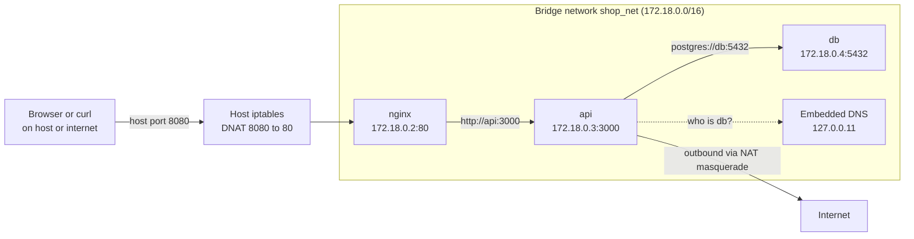
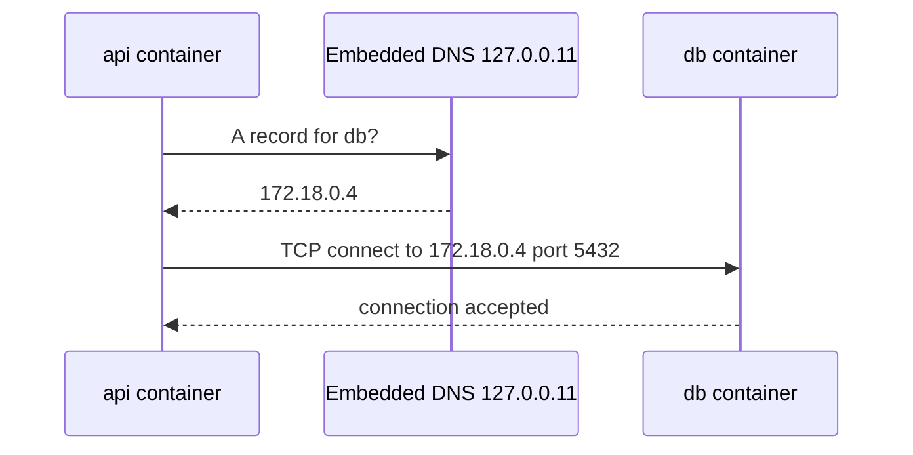

# L4.6 — Docker Networks

> **Level 4: Docker** · Topic 6 of 14 · ⏱ ~4 hours · Difficulty: Intermediate

## 1. What it is

Every container gets its own **network namespace**: its own `eth0`, IP address, routing table and port space. Docker connects those
namespaces with virtual networks. The most important network type is the **bridge**: a virtual Layer-2 switch inside the host, with each
container attached through a virtual Ethernet pair (`veth`). Containers on the same user-defined bridge can reach each other by
**container or service name** thanks to Docker's built-in DNS server, and the host reaches the outside world through NAT (Network Address Translation).

To let something *outside* the Docker network (your browser, a load balancer) reach a container, you **publish a port**
(`-p 8080:80`), which installs a forwarding rule from a host port to the container's port.

## 2. Why it matters in DevOps

- **"Connection refused" and "could not resolve host"** between containers are the most common Compose problems, and nearly all are network-name or port mistakes.
- **Security:** a published port is an open door. Binding the database to `0.0.0.0:5432` on a cloud VM is how databases end up on the public internet. Segmenting networks (frontend vs backend) limits blast radius.
- **Performance and debugging:** NAT, userland proxies and DNS add latency; host networking removes it at the cost of isolation.
- **It maps directly to Kubernetes:** pod networking, Services and cluster DNS are the same ideas at larger scale. Background: [Routing, NAT, Ports and Firewalls](../level-02-networking/04-routing-nat-ports-firewalls.md) and [DNS Resolution](../level-02-networking/05-dns-resolution.md).

## 3. Real-world system example

**Docker Compose stacks (and Kubernetes pods).** A typical `shop-api` development stack has Nginx, the API, PostgreSQL and Redis. Compose creates one project network;
the API connects to `postgres://db:5432` and `redis://cache:6379` using *service names*, and only Nginx publishes a port to the host. The same pattern, "only the edge is reachable, everything else is internal",
is how production platforms are laid out: in Kubernetes pods find each other through Service DNS names (`db.default.svc.cluster.local`), and only the ingress controller or load balancer is exposed.
Multi-host container networking in Docker Swarm uses **overlay** networks (VXLAN tunnels between hosts); Kubernetes delegates this to CNI plugins such as Calico or Cilium.

## 4. Diagram

A user-defined bridge network with DNS and one published port:



Name resolution for one request:



## 5. How it works

**Network drivers**

| Driver | What it does | Typical use |
|--------|-------------|-------------|
| `bridge` (default) | Private virtual switch on one host; NAT to the outside | Single-host apps, Compose |
| `host` | Container shares the host's network namespace — no isolation, no port mapping | Performance-critical or network tooling; Linux hosts |
| `none` | Only a loopback interface | Fully isolated batch jobs, security tests |
| `overlay` | Multi-host network over VXLAN (needs Swarm mode) | Swarm services across nodes |
| `macvlan` / `ipvlan` | Container gets an address on the physical LAN | Legacy apps that need a real LAN IP |

**Default bridge vs user-defined bridge.** Docker always creates a default network called `bridge` (interface `docker0`). Containers on it
can reach each other by IP address only. A **user-defined bridge** (`docker network create`) adds automatic DNS by container name, better isolation and
the ability to connect/disconnect containers live. Compose always creates a user-defined network for each project, so **never rely on the default bridge**.

**Embedded DNS.** On user-defined networks the container's `/etc/resolv.conf` points to `127.0.0.11`; Docker answers for container names, **network aliases** and Compose service names, and forwards everything else to the host's resolvers.
Name lookups only work between containers that share at least one network. If a container is on several networks, it can resolve names on each.

**Port publishing.** `-p HOST_PORT:CONTAINER_PORT[/proto]` creates NAT rules (iptables/nftables DNAT, plus a userland proxy for some paths).
- `-p 8080:80` binds **all** host interfaces. `-p 127.0.0.1:8080:80` binds loopback only, the right choice for anything not meant to be public.
- `-P` publishes every `EXPOSE`d port on random high ports. `EXPOSE` itself publishes nothing; it is documentation (and a hint for `-P`).
- Containers talk to each other on the **container port** (`api:3000`), never the host port.
- Docker edits firewall rules directly, so published ports can **bypass host firewalls such as UFW**. Bind to `127.0.0.1` or put a real firewall/security group in front.

**Useful commands:** `docker network ls`, `docker network inspect NET`, `docker network create --driver bridge --subnet 172.30.0.0/24 NET`,
`docker network connect NET CONTAINER`, `docker network disconnect`, `docker port CONTAINER`, `docker run --network NET --network-alias NAME`.
Add `--internal` to a network to cut off outbound internet access completely.

## 6. Step-by-step guide

**Prerequisites:** Docker on Linux, macOS or Windows. Everything is local and free. Outputs are illustrative. A Linux host is needed for the `host` network demo (step 6).

1. **Look at what Docker created.**
   ```bash
   docker network ls
   docker network inspect bridge --format '{{range .IPAM.Config}}{{.Subnet}}{{end}}'
   ```
   You see `bridge`, `host` and `none`. The default bridge subnet is commonly `172.17.0.0/16`.

2. **Show that the default bridge has no name resolution.**
   ```bash
   docker run -d --name a1 alpine sleep 600
   docker run -d --name a2 alpine sleep 600
   A2_IP=$(docker inspect -f '{{.NetworkSettings.IPAddress}}' a2)
   docker exec a1 ping -c1 "$A2_IP"      # works
   docker exec a1 ping -c1 a2            # fails: bad address 'a2'
   ```

3. **Create a user-defined bridge and use DNS.**
   ```bash
   docker network create shop_net
   docker run -d --name db  --network shop_net -e POSTGRES_PASSWORD=devpass postgres:16
   docker run -d --name api --network shop_net alpine sleep 600
   docker exec api ping -c1 db
   docker exec api cat /etc/resolv.conf
   docker exec api nslookup db 2>/dev/null | tail -3
   ```
   `ping db` succeeds, and `resolv.conf` shows `nameserver 127.0.0.11`. Names work because both containers are on a user-defined network.

4. **Publish a port, then restrict it.**
   ```bash
   docker run -d --name web1 -p 8080:80 nginx:1.27
   docker port web1
   curl -sI localhost:8080 | head -1
   docker run -d --name web2 -p 127.0.0.1:8081:80 nginx:1.27
   docker ps --format 'table {{.Names}}\t{{.Ports}}'
   ```
   `web1` shows `0.0.0.0:8080->80/tcp` (reachable from other machines); `web2` shows `127.0.0.1:8081->80/tcp` (this machine only).

5. **Prove "container port, not host port" inside the network.**
   ```bash
   docker network connect shop_net web1
   docker exec api wget -qO- http://web1:80 | head -3     # works: container port 80
   docker exec api wget -qO- http://web1:8080 || echo "refused: 8080 is only the host port"
   ```

6. **Try host and none networking** (Linux).
   ```bash
   docker run --rm --network host alpine ip -br addr | head -3      # the host's own interfaces
   docker run --rm --network none alpine ip -br addr                # only lo
   ```

7. **Segment networks and block egress.**
   ```bash
   docker network create --internal backend
   docker run -d --name secret-db --network backend -e POSTGRES_PASSWORD=devpass postgres:16
   docker run --rm --network backend alpine sh -c 'ping -c1 -W2 1.1.1.1 || echo "no internet, as intended"'
   docker network connect backend api      # api is now on shop_net and backend
   docker exec api ping -c1 secret-db
   ```

8. **Clean up.**
   ```bash
   docker rm -f a1 a2 db api web1 web2 secret-db
   docker network rm shop_net backend
   ```

## 7. Real-world scenario

*(Illustrative.)* **"The API can't reach Postgres, but `psql` from my laptop works."** After moving `shop-api` into Compose, the API logged
`ECONNREFUSED 127.0.0.1:5432`. The configuration still said `DB_HOST=localhost`: inside the API container, `localhost` is the API container itself, not the host or the database.
The team changed it to the service name `db`. A second bug appeared when someone "fixed" it by using the host port from `ports: "15432:5432"`: `db:15432` is refused, since containers use the **container** port 5432.
Finally, a security review noticed `ports: "5432:5432"` exposed the database on the VM's public IP; they removed the mapping entirely (only the API needs the database) and used `docker compose exec db psql` for admin work.
**Lesson:** `localhost` means "this container"; use service names and container ports inside the network, and publish only what outsiders need.

## 8. Common mistakes and best practices

**Don't**

- Use `localhost` or the host's IP to reach another container.
- Rely on container IP addresses — they change on every recreate.
- Publish database, cache or metrics ports on `0.0.0.0` on an internet-facing host.
- Use `--network host` for convenience in production; you lose isolation and port independence.
- Use `--link`; it is legacy. Use user-defined networks and aliases.

**Do**

- Create one user-defined network per application (Compose does this), and split into `frontend`/`backend` networks when appropriate.
- Publish only the edge service (Nginx) and bind admin ports to `127.0.0.1`.
- Use service names + container ports in connection strings, configured via environment variables.
- Debug with `docker network inspect`, `docker exec ... nslookup/ping/wget`, and a throwaway `nicolaka/netshoot` container on the same network.

## 9. Tasks

- [ ] **T1 — DNS by name** *(≈25 min, beginner)*
  - **Goal:** prove name resolution works on a user-defined network and not on the default bridge.
  - **Steps:**
    1. Run steps 2 and 3 of the guide.
    2. Record which `ping` succeeded and which failed, with the error message.
  - **Done when:** you demonstrate `ping db` working on `shop_net` and `ping a2` failing on `bridge`.

- [ ] **T2 — Publish smartly** *(≈20 min, beginner)*
  - **Goal:** control exposure.
  - **Steps:**
    1. Publish Nginx on `127.0.0.1:9090:80`.
    2. From the host, `curl localhost:9090`; then from another machine/VM or by using the host's LAN IP, confirm it is refused.
  - **Done when:** loopback works and the LAN address does not.

- [ ] **T3 — Two-tier network** *(≈40 min, intermediate)*
  - **Goal:** build `nginx → api → db` where `db` is unreachable from `nginx`.
  - **Steps:**
    1. Create networks `front` and `back`. Put `nginx` on `front`, `db` on `back`, `api` (a simple container) on both.
    2. From `nginx`, try `nslookup db`; from `api`, ping both.
  - **Done when:** `nginx` cannot resolve `db` while `api` reaches everything.

- [ ] **T4 — Break it: wrong port and wrong host** *(≈30 min, intermediate)*
  - **Goal:** diagnose the two classic errors.
  - **Steps:**
    1. Run Postgres with `-p 15432:5432` on a user-defined network and a client container on the same network.
    2. Try `psql -h localhost`, `-h db -p 15432`, and `-h db -p 5432`; note which work.
    3. Write the one-line rule for each failure.
  - **Done when:** only `-h db -p 5432` succeeds and your rules mention "localhost is the container itself" and "container port, not host port".

- [ ] **T5 — Inspect the plumbing** *(≈40 min, advanced)*
  - **Goal:** see the bridge, veth and NAT rules on the host (Linux).
  - **Steps:**
    1. Start two containers on `shop_net`; run `ip -br link` and `bridge link` on the host to find `br-<id>` and the `veth*` interfaces.
    2. Run `sudo iptables -t nat -S | grep -E 'DOCKER|MASQUERADE'` (or `sudo nft list ruleset | grep -i docker`) before and after publishing a port.
    3. Match the new rule to the published port.
  - **Done when:** you can point at the DNAT rule created by `-p` and the masquerade rule that gives containers internet access.

- [ ] **T6 — Prove it: explain a request path** *(≈30 min, advanced)*
  - **Goal:** narrate `curl localhost:8080` all the way to the database.
  - **Steps:**
    1. Without notes, write the hops: host port → DNAT → nginx container → DNS lookup of `api` → API → DNS lookup of `db` → Postgres.
    2. Mark which hops use host ports, container ports and DNS.
  - **Done when:** your path matches the diagrams in section 4 and you can say where each of `localhost`, `127.0.0.11`, `172.18.x.x` appears.

## 10. Self-check questions

1. Why can containers on a user-defined bridge reach each other by name, but not on the default bridge?
2. What does `-p 127.0.0.1:8080:80` do differently from `-p 8080:80`?
3. Inside the `api` container, how should it reach PostgreSQL in a Compose service called `db`?
4. What does `EXPOSE 3000` actually do?
5. When is `--network host` reasonable, and what do you give up?

<details>
<summary>Answers</summary>

1. Only user-defined networks get Docker's embedded DNS server (127.0.0.11); the default bridge supports IP addresses only.
2. It binds the published port to loopback only, so it is unreachable from other machines; the second form binds all interfaces.
3. `db:5432` — the service name and the container port, never `localhost` and never the published host port.
4. It documents the port (image metadata) and enables `-P`; it publishes nothing and does not open a firewall.
5. For network tools or very latency-sensitive workloads on Linux; you give up network isolation and port remapping, and risk port conflicts.
</details>

## 11. Further reading

- Docker documentation: "Networking overview", "Bridge network driver", "Publishing and exposing ports" (docs.docker.com).
- Docker documentation: "Packet filtering and firewalls" — how Docker interacts with iptables and UFW.
- The `nicolaka/netshoot` project README — a debugging toolbox container.
- Kubernetes documentation: "Cluster Networking" and "Service" — the next step up from single-host networking.

<!-- nav -->
---
← Previous: [Volumes and Bind Mounts](05-volumes.md) · [Level 4 index](README.md) · Next: [Dockerfile](07-dockerfile.md) →
