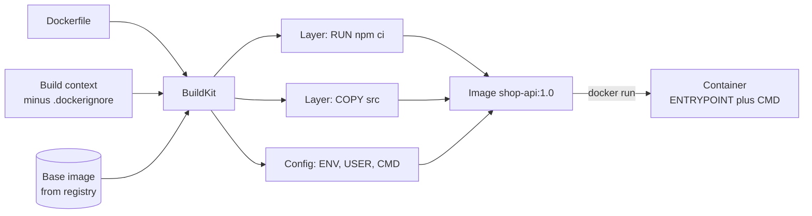
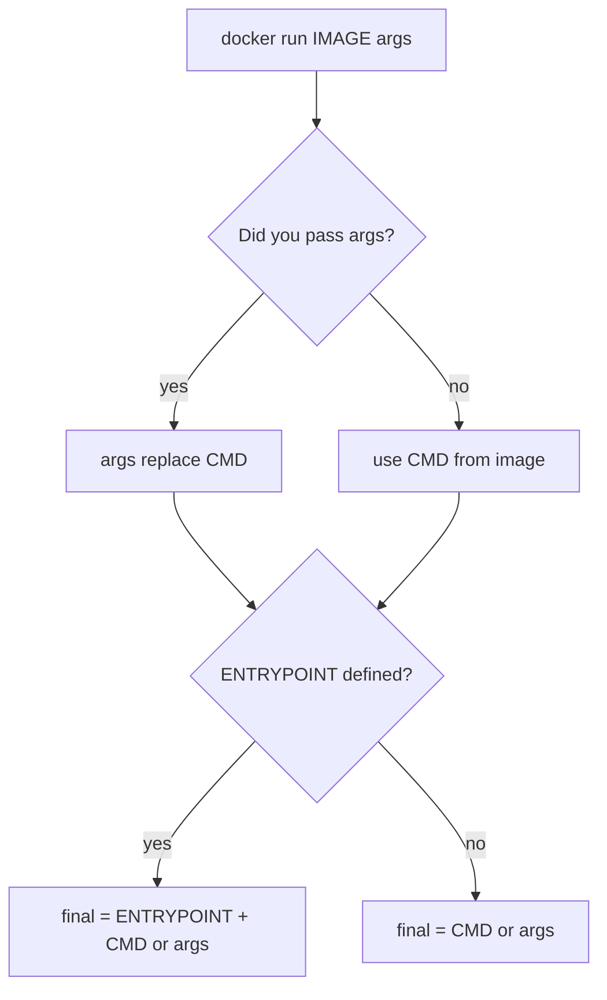

# L4.7 — Dockerfile

> **Level 4: Docker** · Topic 7 of 14 · ⏱ ~5 hours · Difficulty: Intermediate

## 1. What it is

A **Dockerfile** is a plain-text recipe that tells the builder (BuildKit, driven by `docker build` or `docker buildx build`) how to assemble an image:
start `FROM` a base image, copy in your code, run install commands, set the user and the default command. Each instruction that changes the
filesystem produces a [layer](02-images-and-layers.md); instructions that only set metadata (`ENV`, `CMD`, `EXPOSE`, `USER`) edit the image configuration.

The directory you pass to `docker build` (usually `.`) is the **build context**. Everything in it is sent to the builder, and `COPY` can only read from it.
A file called **`.dockerignore`** in the context root excludes paths from that upload, which makes builds faster and keeps secrets out of the image.

## 2. Why it matters in DevOps

- **The Dockerfile is your deployment artifact's source code.** Reviewers should read it as carefully as application code: it decides image size, build speed, who the process runs as, and what vulnerabilities ship.
- **Reproducible builds** (pinned bases, lockfile installs) are the difference between "works on my machine" and "the same bytes everywhere".
- **Most image-security findings start here:** running as root, secrets baked into layers, unpinned `latest`, build tools left in the final image.
- **CI time and cost.** A badly ordered Dockerfile rebuilds `npm install` on every commit (next topic: [Image Caching and Layer Optimization](09-layer-caching-and-optimization.md)).

## 3. Real-world system example

**The official Docker images.** The Dockerfiles for `nginx`, `postgres`, `redis` and `node` are public on GitHub (the "docker-library" project) and are a good reference.
The `nginx` image ends with `ENTRYPOINT ["/docker-entrypoint.sh"]`, `CMD ["nginx", "-g", "daemon off;"]` and `STOPSIGNAL SIGQUIT`: the entrypoint script runs
init steps (templating config, for example) and then `exec "$@"` so the real server becomes PID 1, while `CMD` supplies the default server command that you can override.
The `postgres` image's entrypoint does the same thing, additionally creating the database cluster on first start and running any `*.sql` files in `/docker-entrypoint-initdb.d`.
Google's `distroless` images and Chainguard images are published as base images precisely so application Dockerfiles can end with a tiny, shell-less runtime stage.
When companies say "we containerise with a golden Dockerfile", they usually mean a reviewed template of the pattern below.

## 4. Diagram

From Dockerfile to a running container:



How ENTRYPOINT and CMD combine into the final command:



## 5. How it works

**Core instructions**

| Instruction | Purpose | Notes |
|-------------|---------|-------|
| `FROM image[:tag][@digest] [AS name]` | Start a build stage | Pin a version; multi-stage uses several `FROM`s |
| `WORKDIR /app` | Set (and create) the working directory | Prefer over `RUN cd` |
| `COPY [--chown=u:g] src dest` | Copy from context (or `--from=stage`) | Use `COPY`, not `ADD`, unless you need auto-extract or a URL |
| `RUN cmd` | Run a command at build time, creating a layer | Chain related commands with `&&`; `--mount=type=cache/secret` for BuildKit extras |
| `ENV KEY=value` | Environment variable in the image **and** at runtime | Visible in `docker inspect` |
| `ARG NAME[=default]` | Build-time variable | Not in the running container's environment |
| `EXPOSE 3000` | Documents a port | Publishes nothing |
| `USER 10001` | Switch to a non-root user for later steps and runtime | See [Non-root Containers](11-non-root-containers.md) |
| `CMD` / `ENTRYPOINT` | What runs on `docker run` | See below |
| `HEALTHCHECK` | How Docker tests health | See [Health Checks](12-health-checks.md) |
| `LABEL` | Metadata (OCI annotations such as `org.opencontainers.image.source`) | |
| `VOLUME`, `STOPSIGNAL`, `SHELL`, `ONBUILD` | Declare a volume path / change stop signal / change shell / trigger on child builds | `ONBUILD` is rarely wise |

**CMD vs ENTRYPOINT.**
- `ENTRYPOINT` is "the program this image *is*"; `CMD` is "its default arguments". `docker run IMAGE x y` replaces `CMD` only; `--entrypoint` replaces the entrypoint.
- Pattern 1 — **CMD only** (most application images): `CMD ["node", "server.js"]`; users can run `docker run image sh` to get a shell.
- Pattern 2 — **ENTRYPOINT + CMD** (tools and wrapper scripts): `ENTRYPOINT ["python", "-m", "http.server"]` + `CMD ["8000"]` makes the image behave like a CLI.
- Always use **exec form** (JSON array). Shell form (`CMD node server.js`) runs under `/bin/sh -c`, which becomes PID 1 and swallows `SIGTERM` (see [Containers](03-containers.md)). A wrapper entrypoint script must end with `exec "$@"` for the same reason.

**ARG vs ENV**

| | `ARG` | `ENV` |
|---|-------|-------|
| Available during build | Yes | Yes (after it is set) |
| Available in the running container | **No** | **Yes** |
| Set from the CLI | `docker build --build-arg NAME=value` | `docker run -e NAME=value` overrides the default |
| Stored in the image | In build history (`docker history` can show it) | In the image config |
| Use for | versions, build flags, `NODE_ENV` choice at build | runtime defaults such as `PORT=3000` |
| Secrets? | **Never** | **Never** — use `RUN --mount=type=secret` at build and runtime secrets from the platform |

A common pattern converts one to the other: `ARG APP_VERSION=dev` then `ENV APP_VERSION=$APP_VERSION`. An `ARG` declared before the first `FROM` is only usable in `FROM` lines; redeclare it inside a stage to use it there.

**.dockerignore** (same location as the context root; globbing similar to `.gitignore`):

```text
node_modules
npm-debug.log
.git
.gitignore
.env
.env.*
Dockerfile
docker-compose*.yml
coverage
*.md
```

Without it, `COPY . .` drags in your local `node_modules` (wrong OS binaries), `.git` history, and `.env` secrets, and invalidates the cache whenever any of them change.

## 6. Step-by-step guide

**Prerequisites:** Docker Engine/Desktop with BuildKit (the default builder in current versions). Outputs are illustrative.

1. **Create a tiny app and a first Dockerfile.**
   ```bash
   mkdir -p ~/lab/dockerfile && cd ~/lab/dockerfile
   cat > app.js <<'EOF'
   const http = require('http');
   const port = process.env.PORT || 3000;
   const server = http.createServer((req, res) => {
     res.end(JSON.stringify({ app: 'shop-api', version: process.env.APP_VERSION, greeting: process.env.GREETING }) + '\n');
   });
   server.listen(port, () => console.log('listening on ' + port));
   process.on('SIGTERM', () => server.close(() => process.exit(0)));
   EOF
   cat > Dockerfile <<'EOF'
   FROM node:22-alpine
   WORKDIR /app
   COPY app.js .
   ENV PORT=3000 GREETING=hello
   EXPOSE 3000
   CMD ["node", "app.js"]
   EOF
   docker build -t dockerfile-lab:1 .
   docker run -d --name lab -p 3000:3000 dockerfile-lab:1
   curl -s localhost:3000
   ```
   The build prints one step per instruction; curl returns `{"app":"shop-api","greeting":"hello"}` (`version` is absent because it is undefined).

2. **Override ENV at runtime, and add ARG.** Edit the Dockerfile to add after `WORKDIR`:
   ```dockerfile
   ARG APP_VERSION=dev
   ENV APP_VERSION=$APP_VERSION
   ```
   ```bash
   docker rm -f lab
   docker build --build-arg APP_VERSION=1.2.3 -t dockerfile-lab:2 .
   docker run -d --name lab -p 3000:3000 -e GREETING=bonjour dockerfile-lab:2
   curl -s localhost:3000
   docker exec lab printenv | grep -E 'APP_VERSION|GREETING'
   ```
   The response shows `"version":"1.2.3","greeting":"bonjour"`: the ARG was baked into an ENV at build time, and `-e` overrode the ENV default at runtime.

3. **See the difference between ARG and ENV in the image.**
   ```bash
   docker history --no-trunc dockerfile-lab:2 | grep -E 'APP_VERSION|GREETING'
   docker image inspect dockerfile-lab:2 --format '{{json .Config.Env}}'
   ```
   Both appear in history and config. This is why neither is a place for secrets.

4. **Prove ENTRYPOINT vs CMD behaviour.**
   ```bash
   mkdir -p ../ep && cd ../ep
   printf 'FROM alpine:3.22\nENTRYPOINT ["echo", "hello"]\nCMD ["world"]\n' > Dockerfile
   docker build -t ep-lab .
   docker run --rm ep-lab
   docker run --rm ep-lab there
   docker run --rm --entrypoint sh ep-lab -c 'echo replaced entrypoint'
   ```
   Output: `hello world`, then `hello there` (args replaced CMD), then `replaced entrypoint`.

5. **Make shell form fail to stop quickly, then fix it.**
   ```bash
   cd ../dockerfile
   sed 's|CMD \["node", "app.js"\]|CMD node app.js; echo "node exited"|' Dockerfile > Dockerfile.shell
   docker build -f Dockerfile.shell -t dockerfile-lab:shell .
   docker run -d --name shellform dockerfile-lab:shell
   docker exec shellform ps
   ```
   `ps` shows PID 1 is `/bin/sh -c node app.js; echo "node exited"` with node as a child. (Our app handles SIGTERM, but PID 1 is the shell, which does not forward it, so `docker stop` waits the full timeout then kills.) Compare with `docker exec lab ps`, where `node app.js` is PID 1. Note: some shells optimise a *lone* command in `sh -c` by exec-ing it directly, which can hide the problem; wrappers like `npm start` or compound commands like the one above do not get that optimisation.

6. **Add `.dockerignore` and watch the context shrink.**
   ```bash
   mkdir -p junk && dd if=/dev/zero of=junk/big.bin bs=1M count=100 2>/dev/null
   docker build -t dockerfile-lab:3 . 2>&1 | grep -i 'transferring context'
   printf 'junk\n.git\n.env\nDockerfile*\n' > .dockerignore
   docker build -t dockerfile-lab:4 . 2>&1 | grep -i 'transferring context'
   ```
   The first build transfers about 100 MB of context (lines like `transferring context: 100.00MB`); the second transfers a few kB.

7. **Lint it.** Run a Dockerfile linter such as Hadolint (`docker run --rm -i hadolint/hadolint < Dockerfile`) and BuildKit's own checks:
   ```bash
   docker build --check .
   ```
   Fix warnings (for example "FROM should be pinned", "JSON arguments recommended for CMD").

8. **The real `shop-api` Dockerfile** (used again in the capstone, combined with later topics):
   ```dockerfile
   FROM node:22-alpine
   WORKDIR /app
   COPY package*.json ./
   RUN npm ci --omit=dev
   COPY server.js ./
   ENV NODE_ENV=production PORT=3000
   EXPOSE 3000
   USER node
   CMD ["node", "server.js"]
   ```

9. **Clean up.**
   ```bash
   docker rm -f lab shellform; docker rmi dockerfile-lab:1 dockerfile-lab:2 dockerfile-lab:3 dockerfile-lab:4 dockerfile-lab:shell ep-lab
   rm -rf ~/lab/dockerfile ~/lab/ep
   ```

## 7. Real-world scenario

*(Illustrative.)* **"The image is 1.4 GB and has our `.env` in it."** A security scan of `shop-api` flagged a database password in an image layer. The Dockerfile used `COPY . .` with no `.dockerignore`, so the developer's local `.env`,
`node_modules` (built for macOS), and the whole `.git` directory were all copied in. Fixing it took four changes: add a `.dockerignore`; `COPY package*.json` first and run `npm ci --omit=dev`; stop using `ENV DB_PASSWORD=...`
and inject secrets at runtime; rotate the leaked password. The image dropped from about 1.4 GB to a few hundred MB and the build stopped re-installing dependencies on every commit.
**Lesson:** the build context is an upload, and `COPY . .` copies whatever happens to be on your disk.

## 8. Common mistakes and best practices

**Don't**

- `FROM node:latest` or any unpinned base; `ADD` for local files; `COPY . .` without `.dockerignore`.
- Put secrets in `ENV`, `ARG`, or `COPY`ed files — they persist in layers and image metadata.
- Use shell-form `CMD`/`ENTRYPOINT` for the main process, or `RUN apt-get update` on its own line (stale cached package lists).
- Run the app as root, install editors/debug tools in production images, or `curl | bash` in builds.

**Do**

- Pin base images (`node:22-alpine`, ideally with `@sha256:`), copy dependency manifests before source, and chain `RUN` steps that belong together.
- Use exec-form `CMD`, `USER` with a numeric non-root ID, and `LABEL org.opencontainers.image.*` for provenance.
- Keep a `.dockerignore`; lint with Hadolint and `docker build --check`; scan the result.
- Prefer multi-stage builds for compiled languages and bundlers ([Multi-stage Builds](10-multi-stage-builds.md)).

## 9. Tasks

- [ ] **T1 — Containerize a tiny app** *(≈30 min, beginner)*
  - **Goal:** write your first Dockerfile from scratch.
  - **Steps:**
    1. Create the `app.js` and Dockerfile from step 1 without copying.
    2. Build, run with `-p 3000:3000` and `curl` it.
  - **Done when:** `curl localhost:3000` returns the JSON and `docker ps` shows the container `Up`.

- [ ] **T2 — ARG vs ENV experiment** *(≈30 min, intermediate)*
  - **Goal:** demonstrate the lifetime of each.
  - **Steps:**
    1. Add `ARG BUILD_TOKEN=none` and `ENV RUNTIME_MODE=dev`; build with `--build-arg BUILD_TOKEN=abc`.
    2. Run `docker run --rm IMAGE printenv` and `docker history --no-trunc IMAGE`.
    3. Override `RUNTIME_MODE` with `-e`.
  - **Done when:** `printenv` shows `RUNTIME_MODE` but not `BUILD_TOKEN`, `history` reveals `abc`, and you can explain why that proves ARG is not a secret store.

- [ ] **T3 — Control the entrypoint** *(≈30 min, intermediate)*
  - **Goal:** build a CLI-style image.
  - **Steps:**
    1. Build an image with `ENTRYPOINT ["node", "-e"]` and `CMD ["console.log('default')"]`. (Or use `curl`: `ENTRYPOINT ["curl", "-s"]`, `CMD ["https://example.com"]`.)
    2. Run it with no args, with a custom argument, and with `--entrypoint sh`.
  - **Done when:** all three invocations behave as the ENTRYPOINT/CMD rules predict.

- [ ] **T4 — Break it: context bloat and leaked secret** *(≈40 min, intermediate)*
  - **Goal:** feel what `.dockerignore` protects.
  - **Steps:**
    1. Create a fake `.env` containing `API_KEY=FAKE-123` and a 100 MB junk file, then build with `COPY . .` and no `.dockerignore`.
    2. Run `docker run --rm IMAGE cat /app/.env`.
    3. Add `.dockerignore`, rebuild, and repeat.
  - **Done when:** the first image prints `FAKE-123`, the second fails with "No such file", and the context size dropped.

- [ ] **T5 — Write the production Dockerfile for `shop-api`** *(≈60 min, intermediate)*
  - **Goal:** produce a reviewed Dockerfile you will reuse in the capstone.
  - **Steps:**
    1. Create the `shop-api` source (from the capstone) or any Node.js app with `package.json`.
    2. Write the Dockerfile from step 8, a matching `.dockerignore`, and lint it with Hadolint.
    3. Run it and confirm `docker exec CONTAINER id` reports a non-root user.
  - **Done when:** Hadolint reports no errors, the container runs as UID 1000 (`node`) and `docker stop` completes in under 2 seconds.

- [ ] **T6 — Prove it: review a bad Dockerfile** *(≈30 min, advanced)*
  - **Goal:** spot problems like a senior reviewer.
  - **Steps:**
    1. Write a deliberately bad Dockerfile (latest tag, root, `COPY . .`, shell-form CMD, secret in ENV, `apt-get update` alone).
    2. Without notes, list every issue and the one-line fix for each, then fix the file.
  - **Done when:** you found at least 6 issues and the fixed version builds and passes Hadolint.

## 10. Self-check questions

1. What is the build context and why does `.dockerignore` matter?
2. What is the difference between `CMD` and `ENTRYPOINT`, and how do `docker run IMAGE args` and `--entrypoint` change them?
3. Why is shell-form `CMD` a problem?
4. How do `ARG` and `ENV` differ in lifetime and visibility? Which one is safe for secrets?
5. Why should `COPY package*.json` come before `COPY . .`?
6. When would you use `ADD` instead of `COPY`?

<details>
<summary>Answers</summary>

1. The directory uploaded to the builder; `COPY` can only read from it. `.dockerignore` keeps large or sensitive files out (smaller, faster, safer) and avoids spurious cache invalidations.
2. `ENTRYPOINT` is the fixed program, `CMD` the default arguments. Arguments after the image name replace `CMD`; `--entrypoint` replaces `ENTRYPOINT`.
3. It runs under `/bin/sh -c`, so the shell is PID 1 and does not forward signals to your app: slow, ungraceful stops.
4. `ARG` exists only during the build (but shows in history); `ENV` persists in the image and the container. Neither is safe for secrets — use BuildKit secret mounts at build and runtime secret injection.
5. So the expensive dependency-install layer is cached until the manifest changes, not on every source edit.
6. Rarely: to auto-extract a local tar archive or fetch a remote URL/Git source — otherwise prefer `COPY` for predictability.
</details>

## 11. Further reading

- Docker documentation: "Dockerfile reference" and "Building best practices" (docs.docker.com).
- Docker documentation: "Build secrets" and `.dockerignore` reference.
- Hadolint (github.com/hadolint/hadolint) — Dockerfile linter rules with explanations.
- The `docker-library` GitHub organisation — Dockerfiles of the official images, good examples to read.

<!-- nav -->
---
← Previous: [Docker Networks](06-networks.md) · [Level 4 index](README.md) · Next: [Docker Compose](08-docker-compose.md) →
