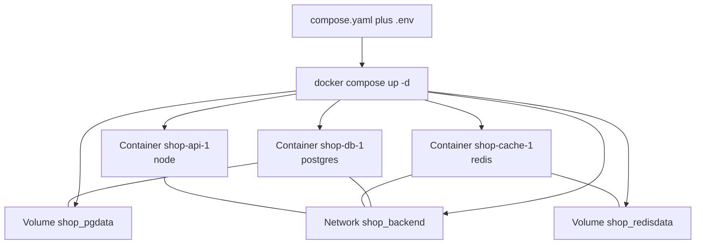
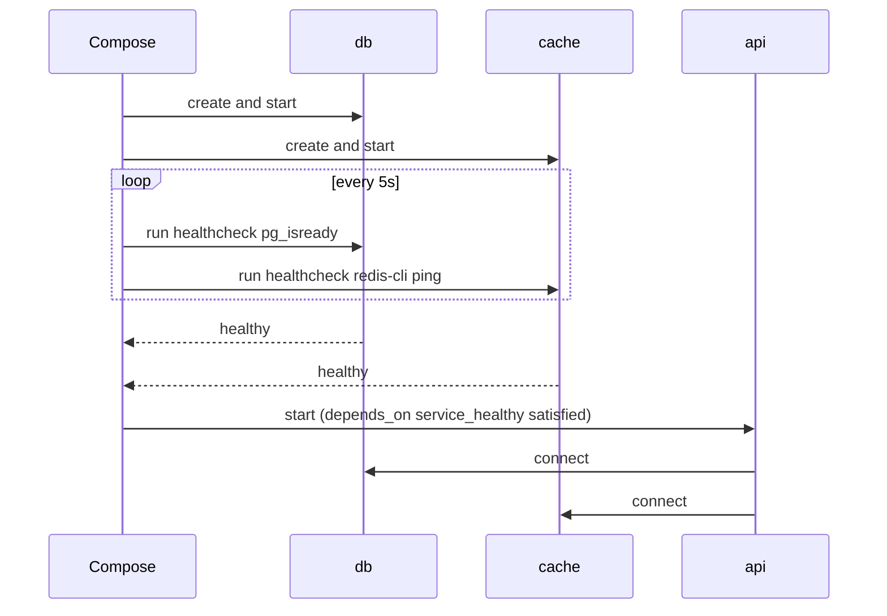

# L4.8 — Docker Compose

> **Level 4: Docker** · Topic 8 of 14 · ⏱ ~5 hours · Difficulty: Intermediate

## 1. What it is

**Docker Compose** lets you describe a whole multi-container application — services, networks, volumes, configuration, startup order — in one YAML file and run it with a single command.
Instead of typing five long `docker run` commands in the right order with the right flags, you write `compose.yaml` and run `docker compose up`.
The file format is the open **Compose Specification**; it has **no top-level `version:` key** any more (current Compose ignores it and warns). Compose V2 is a Docker CLI plugin, invoked as `docker compose` (with a space), not the old Python `docker-compose` binary.

A Compose file has top-level sections: `services` (the containers), `networks`, `volumes`, and optionally `configs` and `secrets`. Compose groups everything it creates under a **project** (default name = directory name, or the top-level `name:`), prefixing resource names so that two copies of a stack do not collide.

## 2. Why it matters in DevOps

- **Local development parity:** "clone, `docker compose up`" gives every developer the same PostgreSQL, Redis and API versions — no more "works on my machine".
- **CI integration tests:** pipelines start the stack, run tests against it and tear it down; flaky tests usually trace back to startup order (the `depends_on` section below).
- **Small production:** many single-host deployments (side projects, internal tools, edge devices) run on Compose. For anything needing multiple hosts, rolling updates and self-healing, the next step is Kubernetes (Level 8).
- **A readable architecture document:** the Compose file shows which services exist, who talks to whom, and which ports are exposed.
- See also [Docker Networks](06-networks.md) and [Volumes and Bind Mounts](05-volumes.md), whose concepts Compose declares in YAML.

## 3. Real-world system example

**The development stack for a typical web product.** Public repositories for projects such as Grafana's observability stacks, Sentry's self-hosted distribution and many open-source web apps ship a `docker-compose.yml`/`compose.yaml`
that starts the application together with PostgreSQL, Redis and supporting services. For example, Sentry's self-hosted installer is driven by Compose, and the Grafana, Prometheus and Loki projects publish Compose examples in their documentation.
Companies commonly use the same approach for local development and CI service containers, then deploy the *images* (not the Compose file) to Kubernetes or ECS. The capstone of this level builds exactly such a stack for `shop-api`.

## 4. Diagram

What `docker compose up` creates for a project named `shop`:



Startup ordering with health gating:



## 5. How it works

**Anatomy of a service**

| Key | Meaning |
|-----|---------|
| `image` / `build` | use a pulled image or build from a Dockerfile (`build: ./api`, or `{context, dockerfile, args, target}`); both together build and tag |
| `ports` | publish `"HOST:CONTAINER"`; prefix `127.0.0.1:` for local-only |
| `environment` / `env_file` | set variables inline or from files |
| `volumes` | named volumes, bind mounts (`./src:/app/src`), tmpfs |
| `networks` | which networks the service joins; others cannot reach it |
| `depends_on` | start order, optionally gated on health (below) |
| `healthcheck` | how Compose/Docker decides a service is healthy |
| `restart` | `no`, `on-failure`, `always`, `unless-stopped` |
| `command` / `entrypoint` / `init` / `user` / `read_only` | override image defaults |
| `profiles` | only start the service when the profile is enabled |
| `deploy.resources` / `mem_limit` / `cpus` | resource limits |

**`depends_on` and health.** Plain `depends_on: [db]` only orders *container start*; it does **not** wait for PostgreSQL to accept connections, so the API can crash on boot.
The long form waits for the dependency's health check:

```yaml
depends_on:
  db:
    condition: service_healthy     # wait until db's healthcheck passes
```
Other conditions are `service_started` (default) and `service_completed_successfully` (for one-shot jobs such as migrations). Combine with an application that retries its connections anyway. See [Health Checks](12-health-checks.md).

**Profiles.** Services with `profiles: ["tools"]` are skipped by default and started with `docker compose --profile tools up` (or `COMPOSE_PROFILES=tools`). Use them for debug UIs, seeders and one-off jobs.

**Configuration and variable precedence.** Two different mechanisms are easy to confuse:
- **`.env` file** (next to `compose.yaml`) feeds **interpolation** inside the Compose file: `${POSTGRES_PASSWORD}`, `${TAG:-dev}` (default), `${POSTGRES_PASSWORD:?error message}` (required).
- **`env_file:` / `environment:`** set variables **inside the container**.
Precedence for container variables, highest first: `docker compose run -e` > `environment:` > `env_file:` > the image's `ENV`. Shell variables take priority over `.env` for interpolation.
Never commit real secrets: commit `.env.example`, git-ignore `.env`, and use Compose `secrets:` or your platform's secret store for anything sensitive.

**Multiple files.** `compose.yaml` plus an automatically merged `compose.override.yaml` is the classic dev-override pattern; `-f compose.yaml -f compose.prod.yaml` merges explicitly.

**Everyday commands**

| Command | Purpose |
|---------|---------|
| `docker compose up -d [--build] [--wait]` | create/start in background; `--wait` blocks until healthy |
| `docker compose ps` / `logs -f [svc]` | status / follow logs |
| `docker compose exec svc sh` / `run --rm svc cmd` | shell in a running service / one-off container |
| `docker compose config` | render and validate the merged, interpolated file |
| `docker compose down` | stop and remove containers and networks (**volumes kept**) |
| `docker compose down -v` | the same **plus named volumes (data deleted)** |
| `docker compose pull` / `build` / `restart svc` | update images / rebuild / restart one service |

## 6. Step-by-step guide

**Prerequisites:** Docker with the Compose plugin (`docker compose version` prints a version). Everything is local and free. Outputs are illustrative; `docker compose config` output was checked against a real Compose binary, running containers was not possible in the authoring environment.

1. **Create the project skeleton.** We use the `shop-api` source from the capstone ([L4 Capstone](99-capstone-project.md)). If you don't have it yet, any Node.js app with a Dockerfile works for `api`.
   ```bash
   mkdir -p ~/lab/shop/api ~/lab/shop/db ~/lab/shop/config && cd ~/lab/shop
   # put server.js, package.json, package-lock.json, Dockerfile in ./api and init.sql in ./db
   ```

2. **Write the environment files.** `.env` is used for interpolation; `config/api.env` is passed into the API container.
   ```bash
   printf 'POSTGRES_PASSWORD=change-me-dev-only\n' > .env
   printf 'LOG_LEVEL=info\nCACHE_TTL_SECONDS=30\n' > config/api.env
   printf '.env\n' >> .gitignore
   ```

3. **Write `compose.yaml`.**
   ```yaml
   name: shop

   services:
     api:
       build: ./api
       image: shop-api:dev
       env_file:
         - config/api.env
       environment:
         DATABASE_URL: postgres://shop:${POSTGRES_PASSWORD}@db:5432/shop
         REDIS_URL: redis://cache:6379
       ports:
         - "127.0.0.1:3000:3000"
       depends_on:
         db:
           condition: service_healthy
         cache:
           condition: service_healthy
       restart: unless-stopped
       init: true
       networks:
         - backend

     db:
       image: postgres:17-alpine
       environment:
         POSTGRES_USER: shop
         POSTGRES_PASSWORD: ${POSTGRES_PASSWORD:?set POSTGRES_PASSWORD in .env}
         POSTGRES_DB: shop
       volumes:
         - pgdata:/var/lib/postgresql/data
         - ./db/init.sql:/docker-entrypoint-initdb.d/init.sql:ro
       healthcheck:
         test: ["CMD-SHELL", "pg_isready -U shop -d shop"]
         interval: 5s
         timeout: 3s
         retries: 10
         start_period: 10s
       restart: unless-stopped
       networks:
         - backend

     cache:
       image: redis:7.4-alpine
       command: ["redis-server", "--appendonly", "yes"]
       volumes:
         - redisdata:/data
       healthcheck:
         test: ["CMD", "redis-cli", "ping"]
         interval: 5s
         timeout: 3s
         retries: 10
       restart: unless-stopped
       networks:
         - backend

     adminer:
       image: adminer:5
       profiles: ["tools"]
       ports:
         - "127.0.0.1:8081:8080"
       depends_on:
         db:
           condition: service_healthy
       networks:
         - backend

   networks:
     backend:

   volumes:
     pgdata:
     redisdata:
   ```
   Note: the database is **not** published to the host — only the API (loopback) is.

4. **Validate before running.**
   ```bash
   docker compose config --quiet && echo "compose file OK"
   docker compose config --services
   ```
   The second command lists `db`, `cache` and `api` (not `adminer`, because its profile is off). Try removing `.env` temporarily: `config` fails with `required variable POSTGRES_PASSWORD is missing a value: set POSTGRES_PASSWORD in .env`.

5. **Start the stack and wait for health.**
   ```bash
   docker compose up -d --build --wait
   docker compose ps
   ```
   `ps` shows `db` and `cache` as `healthy` and `api` as `running`. Check the application:
   ```bash
   curl -s localhost:3000/readyz
   curl -s localhost:3000/products
   ```

6. **Read logs and exec into services.**
   ```bash
   docker compose logs --tail 5 api
   docker compose exec db psql -U shop -d shop -c 'SELECT count(*) FROM products;'
   docker compose exec cache redis-cli keys '*'
   ```

7. **Enable the profile for a debug UI.**
   ```bash
   docker compose --profile tools up -d adminer
   ```
   Open `http://localhost:8081` (System: PostgreSQL, Server: `db`, user `shop`, password from `.env`).

8. **Prove health gating.** Stop the database and recreate the API:
   ```bash
   docker compose stop db
   docker compose up -d --force-recreate api      # waits for db to be healthy first
   docker compose start db
   docker compose ps
   ```
   Compose starts `db` again and the API becomes `running` only after `db` reports `healthy`.

9. **Tear down.** Note the difference:
   ```bash
   docker compose down            # keeps pgdata and redisdata
   docker compose up -d --wait && curl -s localhost:3000/products | head -c 80   # data still there
   docker compose down -v         # deletes volumes too
   ```

## 7. Real-world scenario

*(Illustrative.)* **"CI is flaky: the integration tests pass one run in four."** The pipeline ran `docker compose up -d` and immediately `npm test`. `depends_on: [db]` guaranteed that the
PostgreSQL *container* had started, not that PostgreSQL was ready: on slow CI runners the API tried to connect while the database was still initialising and exited, and the tests failed with `ECONNREFUSED`.
The fix: a `pg_isready` healthcheck on `db`, `condition: service_healthy` in the API's `depends_on`, and `docker compose up -d --wait` in the pipeline so the test step only starts once everything is healthy.
They also added a retry-with-backoff loop to the API's startup connection. Flakiness dropped to zero.
**Lesson:** "started" is not "ready"; health checks turn timing guesses into facts.

## 8. Common mistakes and best practices

**Don't**

- Add `version: "3.8"` at the top (obsolete), or use the old `docker-compose` binary in new docs.
- Publish database/cache ports on `0.0.0.0` (or at all) when only other containers need them.
- Commit `.env` with real credentials, or hard-code passwords in `compose.yaml`.
- Use `latest` tags, or run `docker compose down -v` casually.
- Use `localhost` for service-to-service connections; use service names.

**Do**

- Pin image tags, add health checks, and gate dependencies with `condition: service_healthy`.
- Name volumes, keep data services on a private network, and publish only the edge on `127.0.0.1` or behind Nginx.
- Use `docker compose config` in CI to validate, `.env.example` for documentation, profiles for optional tools, and `--wait` in scripts.
- Set `restart:` policies, `init: true`, memory limits and log rotation (`logging: options: max-size`).

## 9. Tasks

- [ ] **T1 — Bring up the stack** *(≈40 min, beginner)*
  - **Goal:** run `api`, `db` and `cache` with Compose.
  - **Steps:**
    1. Follow steps 1-5.
    2. Call `/readyz` and `/products` twice and note the `X-Cache` header changes from MISS to HIT (`curl -si`).
  - **Done when:** `docker compose ps` shows three healthy/running services and the second `/products` returns `X-Cache: HIT`.

- [ ] **T2 — Profiles and overrides** *(≈30 min, intermediate)*
  - **Goal:** add optional services and a dev override.
  - **Steps:**
    1. Bring up the `tools` profile and open Adminer.
    2. Create `compose.override.yaml` that bind-mounts `./api/server.js` into the API container and sets `LOG_LEVEL=debug`; run `docker compose config` to see the merged result.
  - **Done when:** `docker compose config` shows the bind mount and the override, and Adminer lists the `products` table.

- [ ] **T3 — Break it: remove the healthcheck** *(≈30 min, intermediate)*
  - **Goal:** reproduce start-order flakiness.
  - **Steps:**
    1. Change `depends_on` for `api` to the short form `[db, cache]` and remove the `db` healthcheck.
    2. Run `docker compose down && docker compose up -d` several times and check `docker compose logs api`.
    3. Restore the long form and compare.
  - **Done when:** you captured at least one failed connection in the API logs without health gating and none with it (the effect is timing dependent; try three runs).

- [ ] **T4 — Persistence rules** *(≈30 min, intermediate)*
  - **Goal:** prove which command keeps data.
  - **Steps:**
    1. `POST` an order (`curl -XPOST -H 'content-type: application/json' -d '{"product_id":1,"quantity":2}' localhost:3000/orders`).
    2. Run `docker compose down`, `up -d --wait`, and count orders in `psql`.
    3. Run `docker compose down -v`, `up -d --wait`, and count again.
  - **Done when:** the order exists after step 2 and is gone after step 3, and you can explain why.

- [ ] **T5 — Automate with a Makefile or script** *(≈40 min, advanced)*
  - **Goal:** make the stack a one-command workflow.
  - **Steps:**
    1. Write `make up` (`docker compose up -d --build --wait`), `make test` (smoke `curl` checks that exit non-zero on failure), `make logs`, `make down`.
    2. Run `make up test down` from a clean checkout in CI (a GitHub Actions job is a good target: see [Docker Image Builds and Registries in CI](../level-05-cicd/04-docker-builds-and-registries.md)).
  - **Done when:** `make up test down` exits 0 on a clean machine and non-zero when you stop `db` first.

- [ ] **T6 — Prove it: explain the file** *(≈30 min, advanced)*
  - **Goal:** justify every line of your Compose file.
  - **Steps:**
    1. Without notes, add a `worker` service that runs the same image with `command: ["node","worker.js"]`, shares the network, and starts only after `db` is healthy.
    2. For each service explain: why it has (or lacks) published ports, which network it is on, where its data lives, how it is restarted.
  - **Done when:** `docker compose config` validates and a reviewer agrees with your answers.

## 10. Self-check questions

1. Why is there no `version:` key in modern Compose files?
2. What does plain `depends_on` guarantee, and what does `condition: service_healthy` add?
3. What is the difference between `.env` and `env_file:`?
4. What is the difference between `docker compose down` and `docker compose down -v`?
5. How would you run an optional debug container only when asked?
6. Why shouldn't you publish PostgreSQL's port in a production Compose file?

<details>
<summary>Answers</summary>

1. The Compose Specification is versionless; the key is obsolete and ignored (with a warning).
2. Plain `depends_on` orders container start only; `service_healthy` waits for the dependency's healthcheck to pass.
3. `.env` provides values for `${...}` interpolation in the Compose file itself; `env_file:` injects variables into the container's environment.
4. `down` removes containers and networks; `down -v` also deletes named volumes, destroying data.
5. Give the service a `profiles:` entry and start it with `--profile NAME` (or `COMPOSE_PROFILES`).
6. Anything that reaches the host's public interface can reach the database; only the API on the same private network needs it.
</details>

## 11. Further reading

- Compose Specification (compose-spec.io) and Docker documentation: "Docker Compose" overview, "Use service profiles", "Control startup order".
- Docker documentation: "Environment variables in Compose" — precedence rules.
- `docker compose --help` and `docker compose config` — the best self-service debugging tools.
- Docker Samples repository on GitHub (`docker/awesome-compose`) — worked examples.

<!-- nav -->
---
← Previous: [Dockerfile](07-dockerfile.md) · [Level 4 index](README.md) · Next: [Image Caching and Layer Optimization](09-layer-caching-and-optimization.md) →
