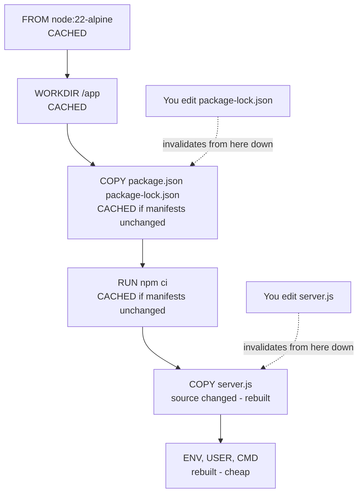
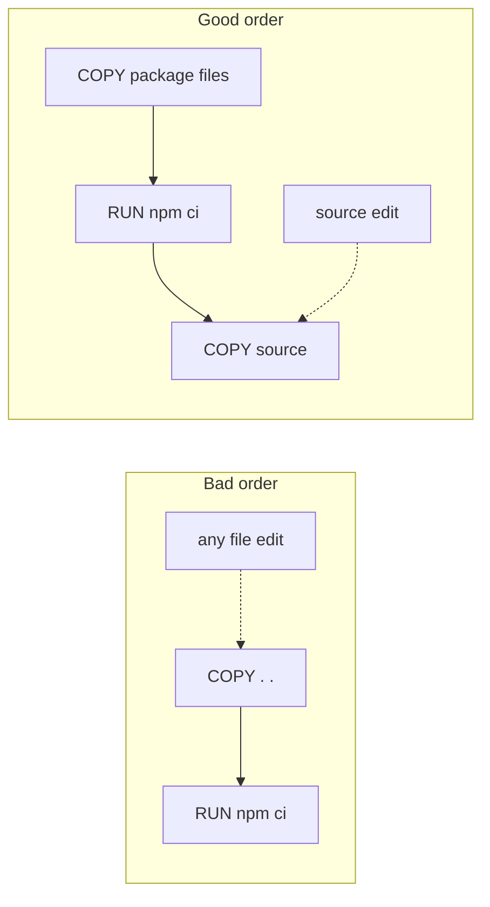

# L4.9 — Image Caching and Layer Optimization

> **Level 4: Docker** · Topic 9 of 14 · ⏱ ~4 hours · Difficulty: Intermediate

## 1. What it is

Building an image runs the Dockerfile instructions top to bottom, and each filesystem-changing instruction produces a [layer](02-images-and-layers.md).
The builder (BuildKit) keeps a **build cache**: before executing an instruction it asks "have I already run this exact instruction on top of this exact parent layer with these exact inputs?"
If yes, it reuses the stored layer and prints `CACHED` instead of doing the work again.

**Layer optimization** is the craft of writing a Dockerfile so that (a) most builds hit the cache, because the things that change often are listed *last*, and (b) the final image contains only what it needs to run. Fast builds and small images are the same discipline viewed from two sides.

## 2. Why it matters in DevOps

- **Developer and CI time.** Re-running `npm ci` or `pip install` on every commit can turn a 20-second build into a 5-minute one. Multiply by every pull request, every day.
- **Money.** CI minutes, registry storage, cross-region transfer and node disk space all scale with how many bytes you rebuild and ship.
- **Deployment speed.** Smaller images pull faster, which shortens autoscaling reaction time and rolling-deploy duration.
- **Security surface.** Fewer packages in the final image means fewer CVEs to patch (see [Image Scanning and Container Security](14-image-scanning-and-container-security.md)).
- See also [Docker Image Builds and Registries in CI](../level-05-cicd/04-docker-builds-and-registries.md) for sharing the cache between CI runs.

## 3. Real-world system example

**BuildKit in GitHub Actions and Docker's own tooling.** Docker's official GitHub Actions (`docker/build-push-action`, `docker/setup-buildx-action`) are built around BuildKit's exportable cache:
a CI runner is a fresh VM every time, so without exporting the cache the pipeline starts cold on every run. The documented cache backends include `type=gha` (the GitHub Actions cache), `type=registry`
(store cache as an image in your registry) and `type=local`. Official language base images such as `node`, `python` and `golang` are rebuilt regularly upstream, which is why cached `FROM` layers refresh whenever you pull a newer base.
Projects that publish many images, such as the Docker official images themselves, rely on layer sharing so that variants (`alpine`, `slim`, `bookworm`) of the same app do not duplicate work.

## 4. Diagram

How cache invalidation cascades:



Bad order versus good order:



In the bad order every source edit re-runs `npm ci`; in the good order it only re-copies source.

## 5. How it works

**Cache rules (simplified)**

1. A layer is reused only if the **parent layer** is reused. One miss invalidates everything below it.
2. For `RUN`, the cache key is the **command text** (plus parent). It does *not* notice that `apt-get install` would now fetch newer packages — a cached `RUN apt-get update` stays stale forever (until you rebuild with `--no-cache` or change the line).
3. For `COPY`/`ADD`, the key includes a **checksum of the copied files' content and metadata**. Any change to any copied file invalidates that layer and all below.
4. `ARG` values used by a later instruction are part of its key; changing a `--build-arg` invalidates from the first use.
5. A newer upstream base image does not invalidate cache until you `docker pull`/`--pull` it; CI should build with `--pull` on a schedule.

**The five habits**

| Habit | Why |
|-------|-----|
| Order instructions from **least to most frequently changing** | maximise cache hits |
| `COPY` dependency manifests first, install, **then** `COPY` the source | source edits don't re-install dependencies |
| Use `.dockerignore` | stops irrelevant changes (`.git`, logs, docs) invalidating `COPY . .` |
| Combine `RUN` steps that belong together and **clean up in the same step** | deleted files in a later layer still occupy space |
| Install only what you need: `npm ci --omit=dev`, `apt-get install --no-install-recommends`, no build tools in the runtime image | smaller image, fewer CVEs |

**BuildKit cache mounts.** A *cache mount* gives a `RUN` step a persistent directory that is **not part of the image** and survives between builds, so package managers can reuse downloaded files even when the layer itself must re-run:

```dockerfile
RUN --mount=type=cache,target=/root/.npm npm ci --omit=dev
RUN --mount=type=cache,target=/var/cache/apt --mount=type=cache,target=/var/lib/apt \
    apt-get update && apt-get install -y --no-install-recommends curl
RUN --mount=type=cache,target=/root/.cache/pip pip install -r requirements.txt
```
Also useful: `--mount=type=bind` (read source files without a `COPY` layer) and `--mount=type=secret` (use a credential during one `RUN` without it being stored in any layer).
For Debian/Ubuntu images that auto-clean apt caches, remove `/etc/apt/apt.conf.d/docker-clean` when using an apt cache mount (the Docker documentation shows this).

**Size-reduction toolbox**

| Technique | Typical effect |
|-----------|---------------|
| Smaller base (`-slim`, `-alpine`, distroless — see [Minimal Base Images](13-minimal-base-images.md)) | hundreds of MB |
| [Multi-stage build](10-multi-stage-builds.md): compile in one stage, copy only artifacts | removes compilers, dev dependencies, sources |
| `npm ci --omit=dev` / `pip install --no-cache-dir` | tens to hundreds of MB |
| `apt-get install --no-install-recommends` + `rm -rf /var/lib/apt/lists/*` in the same `RUN` | tens of MB |
| `.dockerignore` | smaller context; no accidental junk |
| Don't `chown -R` big trees in a separate layer — use `COPY --chown=` | avoids duplicating the whole tree in a new layer |

**CI caching.** Export the cache from the builder: `docker buildx build --cache-from type=registry,ref=REG/shop-api:buildcache --cache-to type=registry,ref=REG/shop-api:buildcache,mode=max ...`
(`mode=max` also caches intermediate stages). On GitHub Actions use `type=gha`.

**Inspecting results:** `docker build --progress=plain .` (see every step and `CACHED`), `docker history IMAGE`, `docker image ls`, and the third-party tool `dive` to explore layer contents.

## 6. Step-by-step guide

**Prerequisites:** Docker with BuildKit (default in current Docker). Needs internet access to download npm packages from the registry (small). Times and sizes below are illustrative; yours will differ.

1. **Create a small Node project with a real dependency.**
   ```bash
   mkdir -p ~/lab/cache && cd ~/lab/cache
   npm init -y >/dev/null && npm install express --package-lock-only >/dev/null
   echo "console.log('v1')" > server.js
   ls   # package.json  package-lock.json  server.js
   ```

2. **Build with the naive Dockerfile and time it.**
   ```bash
   cat > Dockerfile.bad <<'EOF'
   FROM node:22-alpine
   WORKDIR /app
   COPY . .
   RUN npm ci --omit=dev
   CMD ["node", "server.js"]
   EOF
   time docker build -f Dockerfile.bad -t cache-lab:bad .
   echo "console.log('v2')" > server.js
   time docker build -f Dockerfile.bad -t cache-lab:bad .
   ```
   The second build re-runs `npm ci` (you see the install output again and the time is similar to the first) even though only `server.js` changed.

3. **Fix the order.**
   ```bash
   cat > Dockerfile <<'EOF'
   FROM node:22-alpine
   WORKDIR /app
   COPY package.json package-lock.json ./
   RUN npm ci --omit=dev
   COPY server.js ./
   CMD ["node", "server.js"]
   EOF
   time docker build -t cache-lab:good .
   echo "console.log('v3')" > server.js
   time docker build --progress=plain -t cache-lab:good . 2>&1 | grep -E 'CACHED|COPY|RUN'
   ```
   On the rebuild `RUN npm ci` is marked `CACHED` and only the final `COPY` runs: typically a second or less instead of tens of seconds.

4. **Add a BuildKit cache mount.**
   ```bash
   sed -i 's|RUN npm ci --omit=dev|RUN --mount=type=cache,target=/root/.npm npm ci --omit=dev|' Dockerfile
   time docker build -t cache-lab:mount .
   npm install --package-lock-only lodash >/dev/null           # change the manifest on purpose
   time docker build -t cache-lab:mount .
   ```
   Changing the manifest invalidates the `RUN` layer, but the cache mount means previously downloaded tarballs are reused: the install is faster than a cold one.

5. **Measure size and see where it goes.**
   ```bash
   docker image ls cache-lab
   docker history cache-lab:good
   ```
   The `node_modules` layer is the biggest after the base image. Compare `node:22` (Debian, large) to `node:22-slim` and `node:22-alpine` with `docker image ls node`.

6. **Show that cleanup must share a layer.**
   ```bash
   cat > Dockerfile.apt <<'EOF'
   FROM debian:bookworm-slim
   RUN apt-get update && apt-get install -y --no-install-recommends curl ca-certificates \
       && rm -rf /var/lib/apt/lists/*
   EOF
   docker build -f Dockerfile.apt -t cache-lab:apt .
   printf 'FROM debian:bookworm-slim\nRUN apt-get update && apt-get install -y --no-install-recommends curl ca-certificates\nRUN rm -rf /var/lib/apt/lists/*\n' > Dockerfile.apt2
   docker build -f Dockerfile.apt2 -t cache-lab:apt2 .
   docker image ls cache-lab
   ```
   `apt2` is larger than `apt` by roughly the size of the apt lists (tens of MB): the separate `rm` layer did not reclaim it.

7. **Use a secret mount (no trace in layers).**
   ```bash
   echo "super-secret-token" > /tmp/npm_token
   printf 'FROM alpine:3.22\nRUN --mount=type=secret,id=npm_token cat /run/secrets/npm_token | wc -c\n' > Dockerfile.secret
   docker build --progress=plain --secret id=npm_token,src=/tmp/npm_token -f Dockerfile.secret -t cache-lab:secret .
   docker history cache-lab:secret --no-trunc | grep -c super-secret-token || true
   ```
   The build prints `19` (the token length incl. newline); the history grep count is `0`.

8. **Clean up.**
   ```bash
   docker rmi cache-lab:bad cache-lab:good cache-lab:mount cache-lab:apt cache-lab:apt2 cache-lab:secret
   docker builder prune -f      # remove build cache (this deletes your cache mounts too)
   rm -rf ~/lab/cache /tmp/npm_token
   ```

## 7. Real-world scenario

*(Illustrative.)* **"CI takes 9 minutes and the pull-request queue is backed up."** A `shop-api` pipeline spent most of its time in `docker build`: each run started on a fresh runner (empty cache) and the Dockerfile had `COPY . .` before `npm ci`.
Two changes: reorder to copy the manifests first and add `--cache-from/--cache-to type=gha,mode=max` (cache exported between runs), and add `--mount=type=cache,target=/root/.npm` for the occasional dependency bump.
Typical PR builds (source-only changes) dropped from about 9 minutes of build time to well under one, and the image shrank by removing dev dependencies with `--omit=dev`. A scheduled nightly build with `--pull --no-cache` makes sure base-image security fixes are not hidden behind a stale cache.
**Lesson:** cache hit-rate is a pipeline metric; refresh deliberately so "cached" never means "forever outdated".

## 8. Common mistakes and best practices

**Don't**

- `COPY . .` before installing dependencies.
- Put `apt-get update` on its own `RUN` line (cached stale), or clean up in a *later* layer.
- Copy secrets or credentials into layers to use them for one step.
- Rely on the cache for security freshness: a cached `RUN apt-get upgrade` never upgrades again.

**Do**

- Order layers by volatility, keep `.dockerignore` tight, and use `npm ci`/lockfiles for deterministic installs.
- Use `RUN --mount=type=cache` for package managers and `--mount=type=secret` for credentials.
- Export the cache in CI and rebuild from scratch on a schedule with `--pull --no-cache`.
- Track image size over time and fail CI if it grows past a budget.

## 9. Tasks

- [ ] **T1 — Measure the cache** *(≈30 min, beginner)*
  - **Goal:** see `CACHED` and its absence.
  - **Steps:**
    1. Build the bad and good Dockerfiles from steps 2-3.
    2. Change only `server.js` and rebuild each, recording build time and which steps print `CACHED`.
  - **Done when:** you have a table of times and the good Dockerfile shows `npm ci` as cached.

- [ ] **T2 — Reorder a real Dockerfile** *(≈30 min, intermediate)*
  - **Goal:** fix a cache-hostile file.
  - **Steps:**
    1. Take the `shop-api` Dockerfile and put `COPY . .` first.
    2. Measure a source-only rebuild, then restore the right order and measure again.
  - **Done when:** the second rebuild is clearly faster and `docker build --progress=plain` shows the install layer as `CACHED`.

- [ ] **T3 — Cache mounts** *(≈30 min, intermediate)*
  - **Goal:** speed up installs when the manifest changes.
  - **Steps:**
    1. Add `--mount=type=cache,target=/root/.npm` to the install step.
    2. Add a dependency, rebuild, and compare with a rebuild using `--no-cache` and no mount.
  - **Done when:** the cached-mount install is measurably faster and the image size is unchanged (the cache is not in the image).

- [ ] **T4 — Break it: the stale `apt-get update`** *(≈40 min, intermediate)*
  - **Goal:** understand why `update` and `install` share a `RUN`.
  - **Steps:**
    1. Build an image with `RUN apt-get update` and a separate `RUN apt-get install -y curl`.
    2. Change only the package list in the second line to add another package, rebuild, and read the output. Then rebuild with `--no-cache`.
    3. Explain in two sentences what could go wrong if the first layer were weeks old.
  - **Done when:** you can show the first layer being `CACHED` and describe the failure mode (`404`/missing package versions from a stale index).

- [ ] **T5 — Shrink the image** *(≈45 min, advanced)*
  - **Goal:** reduce `shop-api` below a size budget.
  - **Steps:**
    1. Record the starting size with `docker image ls`.
    2. Apply, one at a time: `node:22-alpine` base, `npm ci --omit=dev`, `.dockerignore`, removal of build tools. Record the size after each.
  - **Done when:** you have a before/after table and the final image is smaller than half the original (a typical result when starting from the full `node:22` image).

- [ ] **T6 — Prove it: explain cache invalidation** *(≈30 min, advanced)*
  - **Goal:** predict builds.
  - **Steps:**
    1. Without running anything, predict which layers rebuild for each of: edit `server.js`; add an npm dependency; change `ENV NODE_ENV`; change base tag; touch `README.md` (with and without `.dockerignore`).
    2. Run the builds and check your predictions.
  - **Done when:** at least 5 of 5 predictions match, and you can state the "parent layer miss invalidates everything below" rule.

## 10. Self-check questions

1. What decides whether BuildKit reuses a `RUN` layer? A `COPY` layer?
2. Why does `COPY . .` before `RUN npm ci` slow every build?
3. What does a cache mount do that layer caching alone does not?
4. Why can't you shrink an image by deleting files in a later layer?
5. How do you share the build cache between CI runs on ephemeral runners?

<details>
<summary>Answers</summary>

1. `RUN`: the parent layer and the command text. `COPY`: the parent layer and a checksum of the copied files.
2. Any source change alters the `COPY` checksum, invalidating the layer and everything after it, including the dependency install.
3. It provides a persistent scratch directory (package-manager download cache) that survives across builds without becoming part of the image, so even a re-run `RUN` step avoids re-downloading.
4. Layers are additive; the delete is recorded in a new layer while the earlier layer's data is still shipped.
5. Export and import it: `--cache-to`/`--cache-from` with `type=registry`, `type=gha` or `type=local`.
</details>

## 11. Further reading

- Docker documentation: "Build cache", "Cache backends" and "Optimize cache usage in builds" (docs.docker.com).
- Docker documentation: Dockerfile reference for `RUN --mount` (cache, secret, bind, tmpfs).
- Docker documentation: "GitHub Actions cache" for `docker/build-push-action`.
- `dive` (github.com/wagoodman/dive) — explore image layers and wasted space.

<!-- nav -->
---
← Previous: [Docker Compose](08-docker-compose.md) · [Level 4 index](README.md) · Next: [Multi-stage Builds](10-multi-stage-builds.md) →
