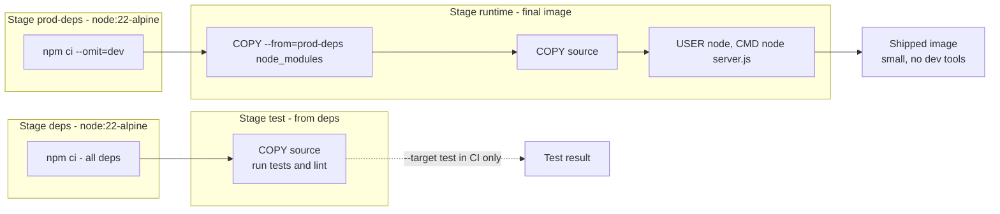
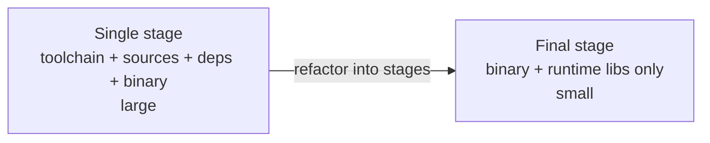

# L4.10 — Multi-stage Builds

> **Level 4: Docker** · Topic 10 of 14 · ⏱ ~4 hours · Difficulty: Intermediate

## 1. What it is

A **multi-stage build** is a single Dockerfile with several `FROM` instructions. Each `FROM` starts a new, independent **stage** with its own filesystem. You use early stages to
*build* things (install compilers, download dev dependencies, compile, run tests) and a final stage to *run* them. The final stage pulls just the finished artifacts out of the earlier stages with
`COPY --from=<stage>`; everything else — compilers, source code, package-manager caches, test tools — is left behind and never reaches the image you ship.

The result is a runtime image that contains only what the application needs at runtime: usually smaller, faster to pull, and with a far smaller attack surface, while the whole recipe still lives in one reviewable file.

## 2. Why it matters in DevOps

- **Size and speed:** a Go service built in `golang:1.24` is several hundred MB with the toolchain; the static binary alone, copied into a minimal image, can be only a few MB.
- **Security:** no compiler, `git`, `curl`, package manager or shell in production means fewer CVEs for scanners to flag and fewer tools for an attacker to use (see [Image Scanning and Container Security](14-image-scanning-and-container-security.md)).
- **One Dockerfile, several outcomes:** the same file builds a `dev` image with hot-reload tools, a `test` image used in CI, and a lean `prod` image, selected with `--target`.
- **No separate "build script" pipelines:** the older "builder pattern" used two Dockerfiles and a shell script to copy artifacts between them; multi-stage replaces it.

## 3. Real-world system example

**Official images and Go/Rust/Java microservices.** The Dockerfiles of widely used Go projects (for example Prometheus and many Kubernetes components) build a static binary in a `golang` stage
and place it into a tiny final image (`scratch`, `busybox` or a distroless variant). The Prometheus Docker image, for instance, is deliberately minimal: a small base with the `prometheus` and `promtool` binaries,
and a non-root user. Google's **distroless** project documents multi-stage examples where a language-specific stage compiles and a `gcr.io/distroless/...` stage runs.
For interpreted languages (Node.js, Python) teams use the same pattern to install build-time dependencies (compilers for native modules) in one stage and copy only `node_modules` or the virtualenv into the runtime stage.

## 4. Diagram



Size effect (conceptual):



## 5. How it works

**Syntax**

```dockerfile
FROM golang:1.24-alpine AS build          # stage named "build"
WORKDIR /src
COPY go.mod go.sum ./
RUN go mod download
COPY . .
RUN CGO_ENABLED=0 go build -trimpath -ldflags="-s -w" -o /out/app .

FROM scratch                              # final stage: the shipped image
COPY --from=build /out/app /app
USER 10001:10001
ENTRYPOINT ["/app"]
```

**Key rules**

| Rule | Detail |
|------|--------|
| Stages are independent filesystems | Only what you `COPY --from` crosses over; `ENV`, `USER`, `WORKDIR` are **not** inherited unless you start a stage `FROM` another stage |
| The **last stage** is the image you get by default | Everything else is build-time only |
| Name stages with `AS name` | Refer to them as `--from=name` (or by number `--from=0`, fragile) |
| `--target name` builds up to that stage | e.g. `docker build --target test .` for CI or `--target dev` for local |
| `COPY --from=image:tag /path /dest` | Copy from any image, not just a stage (e.g. `--from=nginx:1.28-alpine /etc/nginx/nginx.conf /tmp/`) |
| BuildKit builds only the stages the target needs | An unreferenced `test` stage is skipped for the default build — it is not a gate unless something depends on it |
| Stages can share a common ancestor | `FROM base AS dev-deps` and `FROM base AS prod-deps` share the cached `base` layers |

**Making tests a gate.** Run them as a separate CI step with `docker build --target test .` (fails the pipeline if a `RUN` in that stage fails) before building the production target.
Alternatively make the runtime stage depend on the test stage (for instance `COPY --from=test /app/.tested /tmp/.tested`), which forces the tests to run in every build at the cost of coupling.

**What to copy.** Compiled binaries (`/out/app`), built frontend assets (`dist/`), production-only `node_modules`, Python virtualenvs (`/opt/venv`), CA certificates and timezone data if the final image lacks them
(`COPY --from=build /etc/ssl/certs/ca-certificates.crt /etc/ssl/certs/`). Remember that `scratch` has no shell, no `/tmp`, no users file — decide how the app will get CA certificates and a non-root UID.

**Cache behaviour.** Each stage's layers are cached independently, so a source change does not invalidate `go mod download` or `npm ci` as long as manifests are copied first ([caching topic](09-layer-caching-and-optimization.md)).

## 6. Step-by-step guide

**Prerequisites:** Docker with BuildKit. Go source below was compiled and run locally to check it; image sizes are illustrative (they vary by base-image release).

1. **Create a small Go service.**
   ```bash
   mkdir -p ~/lab/multistage && cd ~/lab/multistage
   cat > go.mod <<'EOF'
   module example.com/hello

   go 1.24
   EOF
   cat > main.go <<'EOF'
   package main

   import (
   	"fmt"
   	"log"
   	"net/http"
   	"os"
   )

   func main() {
   	addr := ":" + getenv("PORT", "8080")
   	http.HandleFunc("/", func(w http.ResponseWriter, r *http.Request) {
   		fmt.Fprintln(w, "hello from a multi-stage build")
   	})
   	log.Printf("listening on %s", addr)
   	log.Fatal(http.ListenAndServe(addr, nil))
   }

   func getenv(k, d string) string {
   	if v := os.Getenv(k); v != "" {
   		return v
   	}
   	return d
   }
   EOF
   ```

2. **Build a single-stage image first (the "before").**
   ```bash
   cat > Dockerfile.single <<'EOF'
   FROM golang:1.24-alpine
   WORKDIR /src
   COPY . .
   RUN CGO_ENABLED=0 go build -o /app .
   CMD ["/app"]
   EOF
   docker build -f Dockerfile.single -t ms-lab:single .
   docker image ls ms-lab
   ```
   The image is hundreds of MB (the Go toolchain is in it).

3. **Convert to multi-stage with `scratch`.**
   ```bash
   cat > Dockerfile <<'EOF'
   FROM golang:1.24-alpine AS build
   WORKDIR /src
   COPY go.mod ./
   RUN go mod download
   COPY . .
   RUN CGO_ENABLED=0 go build -trimpath -ldflags="-s -w" -o /out/app .

   FROM scratch
   COPY --from=build /out/app /app
   USER 10001:10001
   EXPOSE 8080
   ENTRYPOINT ["/app"]
   EOF
   docker build -t ms-lab:multi .
   docker image ls ms-lab
   ```
   `ms-lab:multi` is only a few MB (about the size of the binary, roughly 5 MB when built with the flags shown).

4. **Run it and prove there is nothing else inside.**
   ```bash
   docker run -d --name ms -p 8080:8080 ms-lab:multi
   curl -s localhost:8080
   docker exec ms sh 2>&1 | head -1
   docker run --rm ms-lab:single ls /usr/local/go/bin | head -3
   ```
   The service answers `hello from a multi-stage build`. `docker exec ms sh` fails (`executable file not found`) because the image has no shell; the single-stage image still carries the Go toolchain.

5. **Add named stages and `--target` for a Node.js service.** For `shop-api` (create the files from the capstone, or use any Node app):
   ```dockerfile
   FROM node:22-alpine AS base
   WORKDIR /app
   COPY package.json package-lock.json ./

   FROM base AS dev-deps
   RUN --mount=type=cache,target=/root/.npm npm ci

   FROM base AS prod-deps
   RUN --mount=type=cache,target=/root/.npm npm ci --omit=dev

   FROM dev-deps AS test
   COPY server.js ./
   RUN node --check server.js          # replace with: npm test

   FROM node:22-alpine AS runtime
   WORKDIR /app
   ENV NODE_ENV=production PORT=3000
   COPY --from=prod-deps --chown=node:node /app/node_modules ./node_modules
   COPY --chown=node:node package.json server.js ./
   USER node
   EXPOSE 3000
   CMD ["node", "server.js"]
   ```
   ```bash
   docker build --target test -t shop-api:test .      # CI gate: fails if the test stage fails
   docker build -t shop-api:1.0.0 .                   # production image: last stage
   docker run --rm shop-api:1.0.0 ls node_modules/.bin 2>&1 | head -3   # no dev tooling
   ```

6. **Copy from an external image.** Take a config file out of another image without running it:
   ```dockerfile
   FROM nginx:1.28-alpine AS nginxconf
   FROM alpine:3.22
   COPY --from=nginxconf /etc/nginx/nginx.conf /tmp/nginx.conf.default
   ```
   This is the pattern for borrowing binaries (`COPY --from=busybox:1.37 /bin/busybox /bin/`, `--from=tini` and similar) into minimal images.

7. **Clean up.**
   ```bash
   docker rm -f ms; docker rmi ms-lab:single ms-lab:multi shop-api:test shop-api:1.0.0
   rm -rf ~/lab/multistage
   ```

## 7. Real-world scenario

*(Illustrative.)* **"The vulnerability report has 200 findings for a Go service that uses three libraries."** A scan of the `shop-api` sidecar written in Go showed hundreds of CVEs, almost all in packages the service never executes: `git`, `curl`, `openssl` tools, `perl` and the compiler toolchain from the single-stage `golang` image,
plus Debian packages in the base. The team moved to a multi-stage build with a `scratch`/distroless final stage and built the binary statically. The next scan reported near-zero OS findings, the image went from hundreds of MB to a few MB, pulls on new autoscaled nodes became nearly instant,
and the on-call team lost a debugging crutch (no shell) — so they added an ephemeral debug workflow (`docker debug` / `kubectl debug` with a toolbox image) instead of shipping `sh` everywhere.
**Lesson:** what is not in the image cannot be exploited or flagged. Plan your debugging path before removing the shell.

## 8. Common mistakes and best practices

**Don't**

- Copy the entire build stage (`COPY --from=build /src /src`) — you re-import the bloat you were avoiding.
- Forget runtime needs of the final stage: CA certificates, timezone data, a non-root user, a writable `/tmp`.
- Use `scratch` with a dynamically linked binary (see the glibc/musl note in [Minimal Base Images](13-minimal-base-images.md)).
- Expect an unreferenced `test` stage to run during a normal `docker build`.

**Do**

- Name every stage and `COPY --from=name`; put the shipped stage **last**.
- Copy dependency manifests first in each stage for caching; use cache mounts for package managers.
- Run tests in a `--target test` step in CI before building the final image.
- Set `USER` in the final stage (it is not inherited from build stages) and pin base images.

## 9. Tasks

- [ ] **T1 — Shrink a single-stage image** *(≈30 min, beginner)*
  - **Goal:** see the size difference.
  - **Steps:**
    1. Build the single-stage and multi-stage Go images from the guide.
    2. Compare `docker image ls ms-lab` and `docker history` of both.
  - **Done when:** you have a before/after size table and a one-sentence explanation of what was left behind.

- [ ] **T2 — Multi-stage for `shop-api`** *(≈40 min, intermediate)*
  - **Goal:** separate dev and production dependencies.
  - **Steps:**
    1. Write the Node.js multi-stage Dockerfile from step 5 for your `shop-api`.
    2. Build the default target and compare `docker run --rm IMAGE ls node_modules | wc -l` with a single-stage `npm ci` image that includes dev dependencies.
  - **Done when:** the runtime image has fewer packages and starts normally with `docker run -p 3000:3000`.

- [ ] **T3 — A test gate** *(≈40 min, intermediate)*
  - **Goal:** make a failing test stop the build.
  - **Steps:**
    1. Add a `test` stage with a command that you can make fail (for example `RUN test "$(node -p 1+1)" = 2`).
    2. Run `docker build --target test .` and observe success; change the assertion and observe failure.
  - **Done when:** the second build exits non-zero and prints the failing `RUN` step, and you wrote the CI snippet that calls it before the production build.

- [ ] **T4 — Break it: missing CA certificates** *(≈40 min, intermediate)*
  - **Goal:** discover a classic `scratch` pitfall.
  - **Steps:**
    1. Extend the Go app to call an HTTPS URL (`http.Get("https://example.com")`) and build it into `scratch`.
    2. Run it and read the TLS error (`x509: certificate signed by unknown authority`).
    3. Fix it with `COPY --from=build /etc/ssl/certs/ca-certificates.crt /etc/ssl/certs/`.
  - **Done when:** the request succeeds after the fix and you can explain why `scratch` has no certificates.

- [ ] **T5 — Targets for dev, test and prod** *(≈45 min, advanced)*
  - **Goal:** one Dockerfile, three behaviours.
  - **Steps:**
    1. Add a `dev` stage that includes dev dependencies and runs `node --watch server.js`.
    2. In Compose, set `build: {context: ./api, target: dev}` for development and `target: runtime` in an override for production.
    3. Run `docker compose config` for both and show the differing `target`.
  - **Done when:** `docker compose up` runs the `dev` stage with hot reload via a bind mount, and the prod override builds the lean image.

- [ ] **T6 — Prove it: review a Dockerfile** *(≈30 min, advanced)*
  - **Goal:** turn a bloated Dockerfile into a multi-stage one without notes.
  - **Steps:**
    1. Take a single-stage Dockerfile that compiles TypeScript (`npm ci`, `npm run build`, `CMD node dist/index.js`).
    2. Rewrite it with a build stage and a runtime stage that contains only `dist/` and production dependencies, running as non-root.
    3. Explain each `COPY --from`.
  - **Done when:** the image runs the compiled app, contains no `src/` or `typescript` package, and you can defend each line.

## 10. Self-check questions

1. What crosses from one stage to another, and what doesn't?
2. Which stage becomes the image if you don't pass `--target`?
3. Why won't a `test` stage run in a normal build, and how do you make tests a gate?
4. What must you add to a `scratch` image for HTTPS to work?
5. Is `USER` inherited from a build stage to the final stage?

<details>
<summary>Answers</summary>

1. Only files you explicitly `COPY --from`; environment, user, workdir and layers are not inherited.
2. The last stage in the file.
3. BuildKit builds only the stages the requested target depends on. Build it explicitly with `--target test` in CI, or make a later stage depend on it.
4. CA certificates (copy `ca-certificates.crt` from a build stage) — scratch is empty.
5. No. Each stage starts fresh from its own `FROM`; set `USER` in the final stage.
</details>

## 11. Further reading

- Docker documentation: "Multi-stage builds" and Dockerfile reference for `FROM ... AS` and `COPY --from` (docs.docker.com).
- Google `distroless` project README (github.com/GoogleContainerTools/distroless) — multi-stage examples per language.
- Docker documentation: "Build best practices".
- Go documentation: `go build` flags (`-trimpath`, `-ldflags`) and `CGO_ENABLED`.

<!-- nav -->
---
← Previous: [Image Caching and Layer Optimization](09-layer-caching-and-optimization.md) · [Level 4 index](README.md) · Next: [Non-root Containers](11-non-root-containers.md) →
