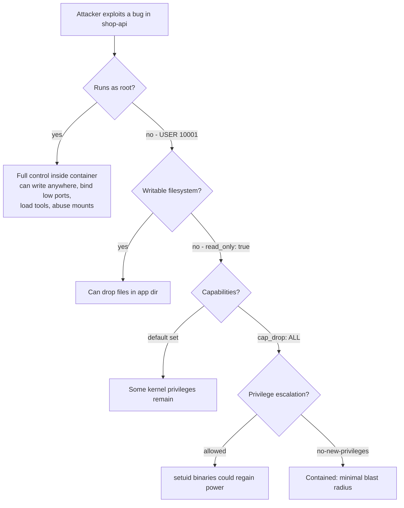
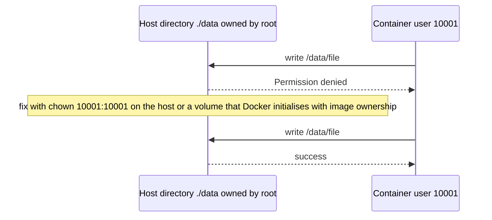

# L4.11 — Non-root Containers

> **Level 4: Docker** · Topic 11 of 14 · ⏱ ~4 hours · Difficulty: Intermediate

## 1. What it is

By default a process in a container runs as **UID 0 — `root` inside the container**. Because a container shares the host kernel, root in the container is a powerful identity: if the app is exploited, or if the container
is later given extra privileges (a mounted Docker socket, a host path, `--privileged`), the attacker starts from the strongest possible position. A **non-root container** runs the application as an unprivileged numeric user instead,
and is further hardened by removing Linux **capabilities** (fine-grained slices of root power), mounting the filesystem **read-only**, and forbidding privilege escalation.

The four building blocks of this topic:
1. `USER` — which UID/GID the process runs as.
2. **File ownership** — making sure that user can read the code and write only where it must.
3. **Dropping capabilities** — `--cap-drop ALL`, then add back only what is needed.
4. **Read-only root filesystem** — `--read-only`, with `tmpfs` or volumes for the few writable paths.

## 2. Why it matters in DevOps

- **Blast radius.** A remote-code-execution bug in `shop-api` becomes "attacker is `node` with no write access" instead of "attacker is root who can rewrite the app, install tools and probe the host".
- **Platform policy.** Kubernetes' *restricted* Pod Security Standard requires non-root, no privilege escalation, dropped capabilities and a default seccomp profile. Many clusters and compliance regimes (CIS Docker Benchmark, SOC 2 controls) reject root containers.
- **Failure mode: volumes.** Switching to non-root is the most common cause of "permission denied" on mounted volumes; understanding UIDs is a core operational skill (see also [Volumes and Bind Mounts](05-volumes.md)).
- See also [Rootless and Minimal Containers](../level-11-security-devsecops/12-rootless-and-minimal-containers.md) and [Pod Security](../level-16-advanced-kubernetes/03-pod-security.md) for the same ideas at cluster level.

## 3. Real-world system example

**Official images and Kubernetes Pod Security Standards.** Many popular images ship an unprivileged user and an "unprivileged" variant: the `node` image includes a `node` user (UID 1000);
the official Nginx project publishes `nginxinc/nginx-unprivileged`, which listens on port 8080 and runs as a non-root user; the `redis` and `postgres` images start as root only long enough to fix ownership of their data directory and then drop to a service user (`redis`, `postgres`).
The Prometheus and Grafana images run as unprivileged users (`nobody` and UID 472 respectively), which is why a freshly created bind-mounted data directory owned by root causes "permission denied" until the owner is fixed.
On Kubernetes, the **Pod Security Standards** ("baseline" and "restricted" profiles, enforced by the Pod Security Admission controller that replaced PodSecurityPolicy) encode exactly these hardening settings, and managed platforms such as OpenShift run containers with arbitrary non-root UIDs by default.

## 4. Diagram

Layers of defence around one process:



How a UID mismatch breaks a volume:



## 5. How it works

**1. `USER`.** Create a user with a **fixed numeric UID/GID** and switch to it late in the Dockerfile (after installing packages as root).
Prefer numbers (`USER 10001:10001`) over names: Kubernetes' `runAsNonRoot` check can only verify a numeric UID.

```dockerfile
# Debian/Ubuntu based
RUN groupadd --system --gid 10001 app && useradd --system --uid 10001 --gid app --no-create-home --shell /usr/sbin/nologin app
# Alpine (busybox) based
RUN addgroup -S -g 10001 app && adduser -S -u 10001 -G app -H -s /sbin/nologin app
# Node images already ship a "node" user with UID 1000: just use USER node
```

**2. File ownership.** Files `COPY`ed in default to `root:root`. A non-root user can usually *read* them (mode 644/755), which is what you want: the app should **not** be able to modify its own code.
Give ownership only to paths that must be written (data, cache, tmp). Use `COPY --chown=10001:10001 ...` (not a separate `RUN chown -R`, which duplicates the files in a new layer). For volumes: Docker initialises an *empty named volume* with the image's ownership at that path, so
`RUN mkdir /data && chown 10001:10001 /data` before `USER` makes a named volume writable; **bind mounts** keep the host's ownership, so `chown` the host directory or use `--user "$(id -u):$(id -g)"` in development.

**3. Capabilities.** Root's powers are split into ~40 capabilities. Docker gives containers a default set of about 14 (including `CHOWN`, `DAC_OVERRIDE`, `SETUID`, `SETGID`, `NET_RAW`, `NET_BIND_SERVICE`, `KILL`) and no more. Best practice is to drop all and add back only what the app proves it needs:

```bash
docker run --cap-drop ALL --cap-add NET_BIND_SERVICE ...    # only if binding ports below 1024 as non-root is required
```
Prefer high ports (`8080`, `3000`) and then no capability is needed. Never use `--privileged` (all capabilities, all devices, no confinement) or `--cap-add SYS_ADMIN` outside deliberate tooling.

**4. Read-only root filesystem and friends.**

| Flag (Compose key) | Effect |
|--------------------|--------|
| `--read-only` (`read_only: true`) | Root filesystem mounted read-only; writes fail with `Read-only file system` |
| `--tmpfs /tmp` (`tmpfs: [/tmp]`) | In-memory writable scratch directory |
| `--security-opt no-new-privileges` (`security_opt: ["no-new-privileges:true"]`) | Setuid binaries cannot gain extra privileges |
| `--pids-limit`, `--memory`, `--cpus` | Limit fork bombs and resource abuse |
| `--user 10001:10001` (`user:`) | Override the image's user at run time |
| seccomp / AppArmor | Default profiles already apply; keep them (never `--security-opt seccomp=unconfined`) |

**Rootless Docker and user namespaces.** Everything above hardens *inside* the container. **Rootless mode** runs the Docker daemon itself as an unprivileged host user, and **user-namespace remapping** (`userns-remap`)
maps container UID 0 to an unprivileged host UID range, so even "root in the container" is nobody on the host. They complement, not replace, `USER`.

## 6. Step-by-step guide

**Prerequisites:** Docker. Everything is local and free. Outputs are illustrative; capability bitmasks are standard for Docker's default profile but may differ on your runtime.

1. **Observe the default: root.**
   ```bash
   docker run --rm alpine id
   docker run --rm alpine sh -c 'grep Cap /proc/1/status'
   ```
   `uid=0(root) gid=0(root)` and a non-zero `CapEff` such as `00000000a80425fb` (Docker's default capability set).

2. **Run as another user.**
   ```bash
   docker run --rm --user 10001:10001 alpine id
   docker run --rm --user 10001:10001 alpine touch /etc/x    # permission denied
   ```
   The user has no name (`uid=10001 gid=10001`) and cannot modify `/etc`.

3. **Drop all capabilities.**
   ```bash
   docker run --rm --cap-drop ALL alpine sh -c 'grep Cap /proc/1/status; chown 5:5 /etc/hostname'
   ```
   `CapEff` is all zeros and `chown` fails with `Operation not permitted` even though the user is root: capabilities, not just UID, gate privileged actions.

4. **Make the filesystem read-only.**
   ```bash
   docker run --rm --read-only alpine touch /x                 # Read-only file system
   docker run --rm --read-only --tmpfs /tmp alpine sh -c 'touch /tmp/ok && echo tmp-ok'
   ```

5. **Build a non-root `shop-api` image.** (Use your `shop-api`; a minimal Node image already has the `node` user.)
   ```dockerfile
   FROM node:22-alpine
   WORKDIR /app
   COPY package.json package-lock.json ./
   RUN npm ci --omit=dev
   COPY --chown=root:root server.js ./
   ENV NODE_ENV=production PORT=3000
   USER 1000:1000
   EXPOSE 3000
   CMD ["node", "server.js"]
   ```
   ```bash
   docker build -t shop-api:nonroot .
   docker run --rm shop-api:nonroot id           # uid=1000(node) gid=1000(node)
   ```
   Code is owned by root and read-only to the app; the app cannot rewrite itself.

6. **Run it fully hardened** next to throw-away PostgreSQL and Redis containers.
   ```bash
   docker network create hardnet
   docker run -d --name pg --network hardnet -e POSTGRES_USER=shop -e POSTGRES_PASSWORD=devpass -e POSTGRES_DB=shop postgres:17-alpine
   docker run -d --name rd --network hardnet redis:7.4-alpine
   docker run -d --name hardened --network hardnet -p 127.0.0.1:3000:3000 \
     --read-only --tmpfs /tmp \
     --cap-drop ALL --security-opt no-new-privileges:true \
     --pids-limit 100 --memory 256m \
     -e DATABASE_URL=postgres://shop:devpass@pg:5432/shop -e REDIS_URL=redis://rd:6379 \
     shop-api:nonroot
   sleep 8; docker logs hardened | tail -3
   curl -s localhost:3000/readyz
   ```
   `readyz` returns `{"status":"ready"}`. If the app fails to start, `docker logs` names the path it tried to write, which you then provide as a `tmpfs` or volume.

7. **The same in Compose.**
   ```yaml
   services:
     api:
       image: shop-api:nonroot
       user: "1000:1000"
       read_only: true
       tmpfs:
         - /tmp
       cap_drop:
         - ALL
       security_opt:
         - no-new-privileges:true
       pids_limit: 100
       mem_limit: 256m
   ```
   Validate with `docker compose config`.

8. **See the volume-ownership problem and fix it.**
   ```bash
   mkdir -p /tmp/rootowned && sudo chown root:root /tmp/rootowned
   docker run --rm --user 10001:10001 -v /tmp/rootowned:/data alpine sh -c 'echo hi > /data/f'      # Permission denied
   sudo chown 10001:10001 /tmp/rootowned
   docker run --rm --user 10001:10001 -v /tmp/rootowned:/data alpine sh -c 'echo hi > /data/f && echo written'
   ```
   (On Docker Desktop for macOS/Windows file ownership is translated and you may not see the first failure.)

9. **Clean up.**
   ```bash
   docker rm -f hardened pg rd; docker network rm hardnet; docker rmi shop-api:nonroot; sudo rm -rf /tmp/rootowned
   ```

## 7. Real-world scenario

*(Illustrative.)* **"Security review blocks the production launch."** The audit found three things in `shop-api`: container running as root, `/var/run/docker.sock` mounted into it "for log collection", and the app directory writable.
A pen-tester used a deserialisation bug in a dependency to get a shell, then used the Docker socket to start a privileged container and read the host's files. The fix list: `USER 1000:1000`, code owned by root and read-only (`read_only: true`),
`cap_drop: [ALL]`, `no-new-privileges`, removal of the Docker socket mount (logs now go to stdout and are collected by an agent with its own scoped access), and a Kubernetes `restricted` Pod Security label on the namespace so regressions are rejected at admission.
The retest could execute code as `node` but could not write anywhere except `/tmp` or reach the host.
**Lesson:** each control alone is bypassable; together they turn a critical finding into a low one.

## 8. Common mistakes and best practices

**Don't**

- Leave `USER` unset or switch to a *named* user the base image doesn't define.
- `chown -R` huge directories in a separate `RUN` (doubles the layer) or make the app's code writable by the app.
- "Fix" permission errors with `chmod 777` or by running as root again.
- Mount `/var/run/docker.sock`, use `--privileged`, or `--cap-add SYS_ADMIN` in application containers.

**Do**

- Use a fixed numeric UID/GID (above 10000 is a good habit), set `USER` as late as possible, and verify with `docker exec CONTAINER id`.
- Drop all capabilities, set `no-new-privileges`, and use `read_only: true` with `tmpfs` for scratch.
- Bind to ports above 1024 (the reverse proxy or load balancer publishes 80/443).
- Test the hardened configuration in CI (`docker run --read-only --cap-drop ALL ...` + a smoke test), and enforce it in Kubernetes with Pod Security Admission.

## 9. Tasks

- [ ] **T1 — Compare root and non-root** *(≈20 min, beginner)*
  - **Goal:** see what changes with `--user`.
  - **Steps:**
    1. Run `id` and `grep Cap /proc/1/status` in `alpine` as default, as `--user 10001:10001`, and with `--cap-drop ALL`.
    2. Try `apk add curl` in each.
  - **Done when:** you have a 3-row table of UID, capability mask and whether `apk add` worked.

- [ ] **T2 — Make `shop-api` non-root** *(≈40 min, intermediate)*
  - **Goal:** produce a non-root image.
  - **Steps:**
    1. Add `USER 1000:1000` (or a custom UID) and ensure code is root-owned.
    2. Build, run, and verify with `docker exec CONTAINER id` and `docker exec CONTAINER sh -c 'touch /app/x'` (should fail).
  - **Done when:** the API works and writing to `/app` is denied.

- [ ] **T3 — Hardened runtime profile** *(≈45 min, intermediate)*
  - **Goal:** find the minimum writable paths.
  - **Steps:**
    1. Run with `--read-only --cap-drop ALL --security-opt no-new-privileges:true`.
    2. If the app fails, read `docker logs` for the path, add only that path as `tmpfs`/volume, and retry.
    3. Capture the final Compose snippet.
  - **Done when:** the container is healthy with a read-only root filesystem and the only writable mounts are the ones you listed.

- [ ] **T4 — Break it: volume permissions** *(≈30 min, intermediate)*
  - **Goal:** reproduce and fix `Permission denied` on a mounted path.
  - **Steps:**
    1. Run step 8 of the guide with a root-owned host directory.
    2. Fix it three ways: `chown` the host dir; `--user "$(id -u):$(id -g)"`; use a named volume initialised from an image directory owned by the app UID.
  - **Done when:** all three approaches write successfully and you can explain which one you would use in production and why.

- [ ] **T5 — Low ports without root** *(≈30 min, advanced)*
  - **Goal:** understand `NET_BIND_SERVICE`.
  - **Steps:**
    1. Run a tiny server on port 80 as a non-root user with `--cap-drop ALL` and note the result (the outcome depends on your Docker version: recent versions allow unprivileged binding to low ports via a sysctl default, older ones fail with `EACCES`).
    2. Add `--cap-add NET_BIND_SERVICE` (or switch to 8080 and publish `-p 80:8080`) and compare.
  - **Done when:** you can state which approach is preferable (high port + publish) and why.

- [ ] **T6 — Prove it: harden and verify** *(≈45 min, advanced)*
  - **Goal:** produce evidence of hardening.
  - **Steps:**
    1. Without notes, write the Compose service for `shop-api` with every control from this topic.
    2. Write a script that checks them against the running container (`docker inspect` fields `.Config.User`, `.HostConfig.ReadonlyRootfs`, `.HostConfig.CapDrop`, `.HostConfig.SecurityOpt`).
  - **Done when:** the script prints PASS for all four settings and FAILs if you remove any one.

## 10. Self-check questions

1. Why is "root in a container" dangerous even though it is isolated?
2. Why prefer a numeric `USER`?
3. What is a Linux capability, and what does `--cap-drop ALL` do?
4. What breaks when you add `--read-only`, and how do you fix it?
5. Why does a bind-mounted directory give "permission denied" to a non-root container?
6. How do rootless Docker and `USER` differ?

<details>
<summary>Answers</summary>

1. It shares the host kernel; combined with a misconfiguration (docker.sock, privileged, host mounts) or a kernel bug it can lead to host compromise, and it lets an attacker modify files and tools inside the container freely.
2. Orchestrators like Kubernetes can only verify a numeric UID against `runAsNonRoot`; names may not exist or may map differently.
3. A capability is a single privilege that used to be bundled in root (change file owner, bind low ports, send raw packets...). `--cap-drop ALL` removes them all, leaving the process unable to perform privileged operations.
4. Anything that writes to the root filesystem (temp files, caches, PID files). Mount `tmpfs` or volumes at those exact paths.
5. Bind mounts keep the host's ownership and mode; if the container UID doesn't match, access is denied. Fix ownership or run with a matching UID.
6. `USER` limits the process inside the container; rootless Docker runs the whole daemon and containers without host root, so even a container escape lands in an unprivileged host account.
</details>

## 11. Further reading

- Docker documentation: "Run the Docker daemon as a non-root user (Rootless mode)", "Isolate containers with a user namespace", and `docker run` runtime privilege and Linux capabilities reference.
- Kubernetes documentation: "Pod Security Standards" and "Configure a Security Context for a Pod or Container".
- CIS Docker Benchmark (cisecurity.org) — host and container hardening checks.
- `man 7 capabilities` — the full list of capabilities and what each allows.

<!-- nav -->
---
← Previous: [Multi-stage Builds](10-multi-stage-builds.md) · [Level 4 index](README.md) · Next: [Health Checks](12-health-checks.md) →
