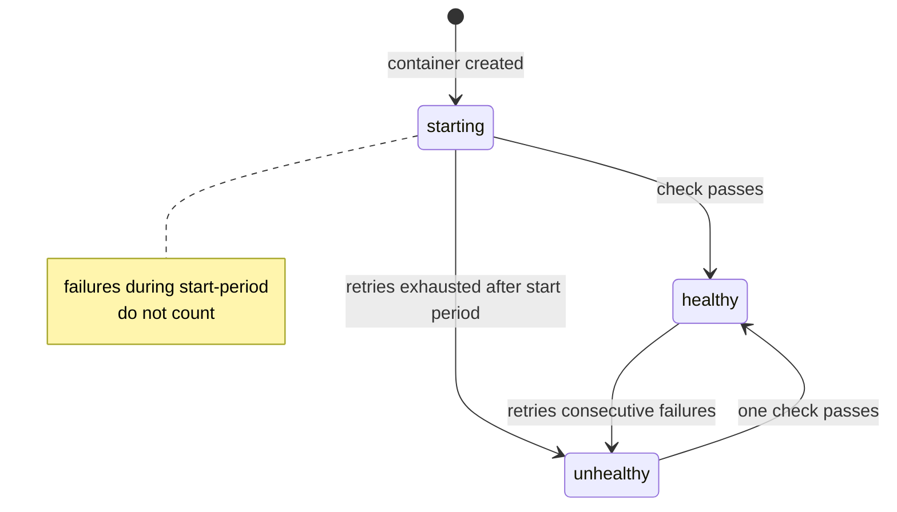
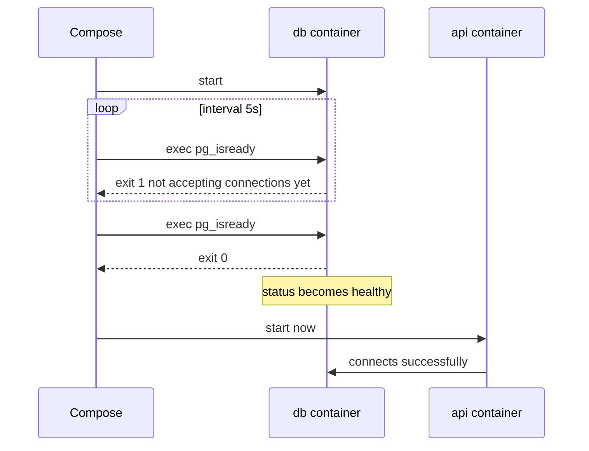

# L4.12 — Health Checks

> **Level 4: Docker** · Topic 12 of 14 · ⏱ ~3 hours · Difficulty: Intermediate

## 1. What it is

A running container is not necessarily a *working* container. The process can be alive but deadlocked, still warming up, or unable to reach its database. A **health check** is a small command that Docker runs inside the container on a schedule;
its exit code tells Docker whether the application is healthy. The container then has a health status in addition to its running state: `starting`, `healthy` or `unhealthy`.

You declare it in the Dockerfile with `HEALTHCHECK` or in Compose under `healthcheck:`. Health status is what lets tools answer two different questions:
- **Liveness** — "is this process stuck so badly that it should be restarted?"
- **Readiness** — "is this instance ready to receive traffic or to be depended on right now?"

Docker's own health status is one signal that is used mostly for readiness-style gating (for example Compose's `depends_on: condition: service_healthy`); Kubernetes uses separate *probes* for both concepts.

## 2. Why it matters in DevOps

- **Startup ordering without guessing.** The API must not start until PostgreSQL accepts connections ([Docker Compose](08-docker-compose.md)). Health gating replaces `sleep 10` hacks.
- **Zero-downtime deploys.** Load balancers and orchestrators only send traffic to instances that report ready; otherwise users get errors from half-started containers.
- **Faster incident detection.** `unhealthy` in `docker ps` is a clear, queryable signal long before customer complaints.
- **The wrong check is worse than none.** A health check that tests the database in a *liveness* role can restart every API instance at once when the database blips, turning a small incident into an outage.
- See also [Liveness and Readiness Probes](../level-08-kubernetes/15-liveness-and-readiness-probes.md) and [What to Monitor](../level-10-observability/11-what-to-monitor.md).

## 3. Real-world system example

**Kubernetes probes, AWS load balancers and the official database images.** Kubernetes runs three kinds of probe per container: **liveness** (restart on failure), **readiness** (remove from Service endpoints on failure) and **startup** (give slow starters time).
It ignores a Dockerfile `HEALTHCHECK` entirely; you re-declare the check as a probe. AWS Application Load Balancers use *target group health checks* (an HTTP path, interval and threshold) to decide which targets receive requests, and ECS services can use container health checks to replace tasks.
The official `postgres` image documents `pg_isready` and the `redis` image `redis-cli ping` as the canonical checks, and nearly every Compose example for databases uses them. Prometheus and Grafana expose `/-/healthy` and `/-/ready`
(Prometheus) and `/api/health` (Grafana) endpoints for exactly this purpose. The pattern is universal: a cheap HTTP endpoint or CLI command that returns success only when the service can do its job.

## 4. Diagram

Health state machine of a container with a health check:



Health gating in Compose (what the API waits for):



## 5. How it works

**The instruction**

```dockerfile
HEALTHCHECK --interval=30s --timeout=3s --start-period=20s --retries=3 \
  CMD node -e "fetch('http://127.0.0.1:3000/readyz').then(r=>process.exit(r.ok?0:1)).catch(()=>process.exit(1))"
```

| Option | Default | Meaning |
|--------|---------|---------|
| `--interval` | 30s | time between checks |
| `--timeout` | 30s | a check taking longer counts as a failure |
| `--start-period` | 0s | grace time at boot: failures do not count toward `retries` (a success ends it early) |
| `--start-interval` | 5s | check frequency during the start period (Docker Engine 25 and later) |
| `--retries` | 3 | consecutive failures before `unhealthy` |

The command's **exit code** decides: `0` = healthy, `1` = unhealthy (code `2` is reserved). `HEALTHCHECK NONE` disables an inherited check. In Compose the same fields appear as `test`, `interval`, `timeout`, `start_period`, `start_interval`, `retries`;
`test` is `["CMD", "prog", "arg"]` (exec) or `["CMD-SHELL", "shell command"]`.

**What the check runs in.** The command runs *inside* the container, so the tool must exist in the image: `curl` is not in `alpine`, `-slim` or distroless images. Options: BusyBox `wget --spider` (Alpine), the language runtime itself (`node -e "fetch(...)"`, `python -c "import urllib.request..."`),
a tiny compiled health binary, or a service-native CLI (`pg_isready`, `redis-cli ping`, `mysqladmin ping`). Use `127.0.0.1`, not the service name, inside the check.

**Liveness vs readiness — design the endpoints separately**

| | Liveness (`/healthz`) | Readiness (`/readyz`) |
|---|----------------------|----------------------|
| Question | Is the process fundamentally working? | Can it serve requests right now? |
| Checks | the event loop answers; nothing external | database, cache and other hard dependencies; warm-up complete |
| On failure | restart the container | stop sending traffic / do not start dependents |
| Risk if too deep | dependency outage causes mass restarts | too shallow lets traffic hit a broken instance |
| Must be | very cheap, fast, no dependencies | still fast (use timeouts), cached if expensive |

In `shop-api`, `/healthz` returns 200 without touching anything, and `/readyz` pings PostgreSQL and Redis with a 2-second timeout so a dead dependency produces a fast `503`, not a hang.
Docker itself does **not** restart an `unhealthy` container on a plain Docker host; it only labels it. Docker Swarm and ECS act on it; on a single host you add `restart: on-failure` plus your own supervisor, or an "autoheal" helper, if you need that behaviour. Kubernetes' liveness probe is the equivalent action.

**Tuning.** Interval 5-30 s, timeout 2-5 s, retries 3, and a start period that covers real boot time (databases with large recovery need more). Too aggressive checks create load and false alarms; too lax ones react too late.

## 6. Step-by-step guide

**Prerequisites:** Docker. Free, local. The `node -e fetch(...)` check command was run against a local copy of `shop-api` to confirm exit codes (0 when ready, 1 when the dependency is down). Docker outputs below are illustrative.

1. **Watch a database become healthy.**
   ```bash
   docker run -d --name pg -e POSTGRES_PASSWORD=devpass \
     --health-cmd 'pg_isready -U postgres' --health-interval 2s --health-timeout 3s --health-retries 10 \
     postgres:17-alpine
   for i in 1 2 3 4 5 6; do docker inspect -f '{{.State.Health.Status}}' pg; sleep 2; done
   ```
   You see `starting` a few times, then `healthy`. `docker ps` shows `(healthy)` in the STATUS column.

2. **Read the check history.**
   ```bash
   docker inspect --format '{{json .State.Health}}' pg | python3 -m json.tool | head -20
   ```
   `Log` lists the last five runs with start/end times, `ExitCode` and `Output`.

3. **Make a check fail on purpose.**
   ```bash
   docker run -d --name flaky --health-cmd 'test -f /tmp/ok' --health-interval 2s --health-retries 2 alpine sleep 600
   sleep 8; docker inspect -f '{{.State.Health.Status}}' flaky        # unhealthy
   docker exec flaky touch /tmp/ok; sleep 4
   docker inspect -f '{{.State.Health.Status}}' flaky                 # healthy
   ```
   Recovery needs just one passing run.

4. **Add a HEALTHCHECK to `shop-api`.** Append to the Dockerfile (before `USER`/`CMD` is fine; it applies to the final image):
   ```dockerfile
   HEALTHCHECK --interval=10s --timeout=3s --start-period=15s --retries=3 \
     CMD node -e "fetch('http://127.0.0.1:3000/readyz').then(r=>process.exit(r.ok?0:1)).catch(()=>process.exit(1))"
   ```
   Build and run it with the stack from the capstone, then:
   ```bash
   docker compose ps          # api shows (healthy)
   docker compose stop cache  # kill a dependency
   sleep 40; docker compose ps
   ```
   The API turns `unhealthy` (its `/readyz` returns 503 within ~2 s because Redis is down) while `/healthz` is still 200. Start the cache again and it recovers by itself.

5. **Gate startup in Compose.**
   ```yaml
   services:
     api:
       build: ./api
       depends_on:
         db:
           condition: service_healthy
     db:
       image: postgres:17-alpine
       environment:
         POSTGRES_PASSWORD: ${POSTGRES_PASSWORD:?set it in .env}
       healthcheck:
         test: ["CMD-SHELL", "pg_isready -U postgres"]
         interval: 5s
         timeout: 3s
         retries: 10
         start_period: 10s
   ```
   ```bash
   docker compose up -d --wait   # returns only when all services with healthchecks are healthy
   ```

6. **Query health in scripts and CI.**
   ```bash
   docker ps --filter health=unhealthy --format '{{.Names}}'
   docker inspect -f '{{.State.Health.Status}}' pg | grep -qx healthy && echo READY
   ```

7. **Clean up.**
   ```bash
   docker rm -f pg flaky; docker compose down
   ```

## 7. Real-world scenario

*(Illustrative.)* **"One database blip restarted the whole fleet."** An orchestrator ran `shop-api` with a single `/health` endpoint that executed `SELECT 1` and was used as the *liveness* check. During a 40-second PostgreSQL failover, every API replica failed its probe
at the same moment, was killed and restarted, and came back to a database that was just recovering and got hit by a thundering herd of reconnects. What should have been 40 seconds of degraded service became 8 minutes of outage.
The fix split the endpoints: `/healthz` (liveness, no dependencies) and `/readyz` (readiness, checks dependencies with a 2-second timeout), with readiness failures merely removing instances from the load balancer, plus jittered, capped reconnect backoff in the database client.
**Lesson:** liveness answers "restart me", readiness answers "don't send me traffic". Mixing them multiplies failures.

## 8. Common mistakes and best practices

**Don't**

- Use `curl` in the check when the image doesn't contain it (the check fails forever with exit 127 and the container is `unhealthy`).
- Put dependency checks in liveness, or make checks slow, expensive or stateful (writing to the database every 5 seconds).
- Forget `start_period`, so a slow boot is reported as unhealthy and dependents never start.
- Assume Docker restarts unhealthy containers, or that Kubernetes will read your Dockerfile `HEALTHCHECK`.

**Do**

- Provide `/healthz` (shallow) and `/readyz` (deep with timeouts), and keep both fast and unauthenticated on an internal port or path.
- Use native checks for datastores (`pg_isready`, `redis-cli ping`) and `condition: service_healthy` for dependents.
- Tune `interval`, `timeout`, `retries`, `start_period` from measured startup times, and alert on `unhealthy` containers.
- Translate checks into Kubernetes liveness, readiness and startup probes when you move to a cluster.

## 9. Tasks

- [ ] **T1 — Watch the states** *(≈20 min, beginner)*
  - **Goal:** observe `starting` → `healthy` → `unhealthy`.
  - **Steps:**
    1. Run steps 1-3 of the guide.
    2. Record the transitions with timestamps from `docker inspect`.
  - **Done when:** you captured all three statuses and the `Log` entries behind them.

- [ ] **T2 — Add a real check to `shop-api`** *(≈30 min, intermediate)*
  - **Goal:** a HEALTHCHECK that works in a minimal image.
  - **Steps:**
    1. Add the Node-based `HEALTHCHECK` from step 4 (no `curl` needed).
    2. Run the API with and without Redis reachable.
  - **Done when:** the container is `healthy` with Redis up and `unhealthy` within about a minute with Redis down.

- [ ] **T3 — Gate the startup order** *(≈30 min, intermediate)*
  - **Goal:** replace sleeps with health gating.
  - **Steps:**
    1. In Compose, make `api` depend on `db` and `cache` with `condition: service_healthy`.
    2. Run `docker compose down && docker compose up -d --wait` and read the timestamps in `docker compose logs`.
  - **Done when:** the API's first log line is later than the database's "ready to accept connections" line.

- [ ] **T4 — Break it: wrong check** *(≈30 min, intermediate)*
  - **Goal:** see why checks must match the image.
  - **Steps:**
    1. Use `CMD curl -f http://localhost:3000/healthz || exit 1` in an Alpine- or slim-based image without curl.
    2. Read `docker inspect` output (`exit code 127`, `curl: not found`) and fix it with `wget --spider`, the Node one-liner or by installing curl.
  - **Done when:** the container goes from `unhealthy` to `healthy` and you can explain what exit code 127 meant.

- [ ] **T5 — Auto-heal on a single host** *(≈45 min, advanced)*
  - **Goal:** restart unhealthy containers when the platform won't.
  - **Steps:**
    1. Write a small script or sidecar loop that runs `docker ps --filter health=unhealthy -q | xargs -r docker restart`.
    2. Break the `shop-api` dependency and confirm the script restarts it (and note the risk: this is a liveness action tied to a readiness signal).
  - **Done when:** the container restarts automatically once, and you wrote one sentence on how you would avoid restart storms (backoff, separate liveness check).

- [ ] **T6 — Prove it: design the endpoints** *(≈30 min, advanced)*
  - **Goal:** specify liveness vs readiness for `shop-api`.
  - **Steps:**
    1. Without notes, write what `/healthz` and `/readyz` check, their timeouts, their failure behaviour, and the Docker/Compose settings that consume them.
    2. Describe what happens in each of: Redis down, PostgreSQL down, event loop blocked.
  - **Done when:** your table matches the design in section 5 and shows that only an event-loop block should trigger a restart.

## 10. Self-check questions

1. What are the three health statuses and what moves a container between them?
2. What does `start_period` do?
3. Does Docker restart an unhealthy container on a single host? Does Kubernetes use your `HEALTHCHECK`?
4. Why shouldn't a liveness check call the database?
5. How does `depends_on: condition: service_healthy` differ from plain `depends_on`?

<details>
<summary>Answers</summary>

1. `starting`, `healthy`, `unhealthy`. After the start period, `retries` consecutive failures make it unhealthy; a passing check makes it healthy.
2. It gives the app boot time: failing checks during that window don't count toward `retries`, and a success ends the window.
3. No, a plain Docker host only marks it (Swarm/ECS act on it). Kubernetes ignores `HEALTHCHECK` and uses its own probes.
4. A dependency outage would fail every instance's liveness at once and restart them all, amplifying the incident.
5. Plain `depends_on` waits only for the container to start; `service_healthy` waits until the dependency's health check passes.
</details>

## 11. Further reading

- Docker documentation: Dockerfile reference for `HEALTHCHECK`, and the Compose `healthcheck` and `depends_on` references (docs.docker.com).
- Kubernetes documentation: "Configure Liveness, Readiness and Startup Probes".
- PostgreSQL documentation for `pg_isready`; Redis documentation for `PING`.
- *Site Reliability Engineering* (Google) — chapters on monitoring and handling overload.

<!-- nav -->
---
← Previous: [Non-root Containers](11-non-root-containers.md) · [Level 4 index](README.md) · Next: [Minimal Base Images](13-minimal-base-images.md) →
