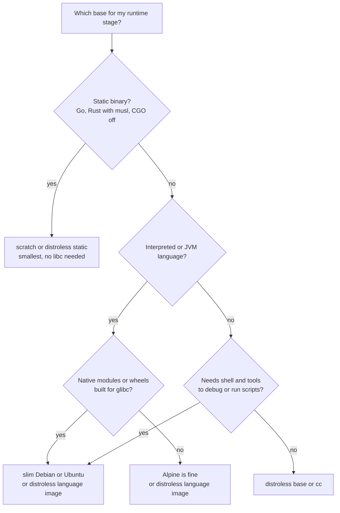
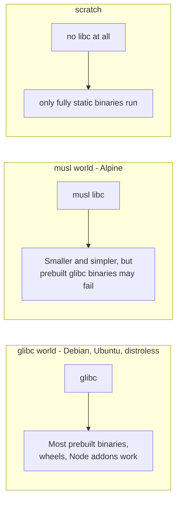

# L4.13 — Minimal Base Images

> **Level 4: Docker** · Topic 13 of 14 · ⏱ ~4 hours · Difficulty: Intermediate

## 1. What it is

Every image starts `FROM` a **base image**, and the base decides most of what ends up in production: the C library, the shell, the package manager, hundreds of small utilities — and every security vulnerability (CVE) in them.
A **minimal base image** deliberately ships less. The common choices form a ladder from "convenient" to "bare":

| Rung | Examples | What you get |
|------|----------|--------------|
| Full distro | `node:22`, `python:3.12`, `ubuntu:24.04` | compilers, `git`, `curl`, many libraries; huge |
| **slim** | `node:22-slim`, `python:3.12-slim`, `debian:bookworm-slim` | Debian/Ubuntu userland trimmed down; glibc, `apt`, a shell |
| **Alpine** | `alpine:3.22`, `node:22-alpine` | BusyBox tools, `apk`, **musl** libc instead of glibc; very small |
| **Distroless** | `gcr.io/distroless/static`, `.../base`, `.../nodejs22-debian12` | just the runtime and its libraries: **no shell, no package manager** |
| **scratch** | `FROM scratch` | literally empty: only what you `COPY` in (a static binary) |

## 2. Why it matters in DevOps

- **Security:** fewer packages means fewer CVEs for scanners to report and fewer tools (`sh`, `curl`, `apt`) for an attacker who gets code execution. See [Image Scanning and Container Security](14-image-scanning-and-container-security.md).
- **Speed and cost:** smaller images pull faster onto freshly scaled nodes and cost less to store and transfer.
- **Reliability trade-offs:** going too minimal moves the pain elsewhere — musl incompatibilities, missing CA certificates or timezone data, nothing to debug with.
- **Policy:** many organisations standardise on approved minimal bases ("golden images") so that patching one base fixes hundreds of services.
- See also [Rootless and Minimal Containers](../level-11-security-devsecops/12-rootless-and-minimal-containers.md) and [Multi-stage Builds](10-multi-stage-builds.md), the technique that makes minimal runtime images practical.

## 3. Real-world system example

**Google's distroless, Alpine, Chainguard and the official images.** Google's open-source **distroless** project publishes language-focused images (static, base, cc, Java, Node.js, Python) with no shell or package manager, and is used as the runtime stage of many Go and Java services;
Kubernetes' own components are published as small, mostly distroless-style images. **Alpine Linux** is the base of countless Docker Official Image variants (`-alpine` tags) and underpins the `busybox`-style debugging experience many engineers know.
Vendors such as Chainguard sell and publish minimal, frequently rebuilt "zero-CVE-goal" images, and Canonical offers "chiselled" Ubuntu images — all responding to the same pressure: scanners and auditors count every package. Docker Official Images for `postgres`, `redis` and `nginx` offer both Debian and Alpine variants because operators disagree about the trade-offs described below.

## 4. Diagram

Choosing a base:



What differs underneath:



## 5. How it works

**Approximate sizes** (compressed sizes shown on Docker Hub for linux/amd64 when this was written; they change with each release):

| Image | Approx. compressed size |
|-------|------------------------|
| `busybox:1.37` | about 2 MB |
| `alpine:3.22` | about 4 MB |
| `debian:bookworm-slim` | about 28 MB |
| `ubuntu:24.04` | about 30 MB |
| `node:22-alpine` | about 61 MB |
| `node:22-slim` | about 80 MB |
| `node:22` (full) | about 410 MB |
| `python:3.12-alpine` / `python:3.12-slim` | about 21 MB / 43 MB |

**alpine vs slim vs distroless vs scratch**

| | Alpine | slim (Debian/Ubuntu) | Distroless | scratch |
|---|--------|---------------------|-----------|---------|
| libc | musl | glibc | glibc (or none for `static`) | none |
| Shell | `sh` (BusyBox) | `bash`/`dash` | none (a `:debug` tag adds BusyBox) | none |
| Package manager | `apk` | `apt` | none | none |
| Debugging | easy (`docker exec -it ... sh`) | easy | hard: use `kubectl debug`/`docker debug`/`:debug` tags | hard |
| CVE surface | small | medium | very small | minimal (only your binary) |
| Compatibility | musl gotchas | best | good (matches Debian glibc) | static binaries only |
| Non-root user | create one | create one | `:nonroot` tags provided (UID 65532) | `USER 10001` works without /etc/passwd entries |

**glibc vs musl — the real trade-offs.** `glibc` is the GNU C library used by mainstream distributions; `musl` is a smaller, stricter alternative used by Alpine. Consequences:
- **Prebuilt binaries** (Python manylinux wheels, Node.js native addons with prebuilt glibc binaries, some vendor agents and database clients) either don't run or must be compiled from source on Alpine, making builds slower and larger.
- **Behavioural differences:** DNS resolution (older musl versions handled `search` domains and TCP fallback differently, which has caused surprises in clusters), locale support, and memory-allocator performance in some workloads.
- **Go** can avoid libc entirely with `CGO_ENABLED=0` (static binary → `scratch` or distroless `static`). **Rust** targets `x86_64-unknown-linux-musl` for static builds. **Java/Node/Python** usually prefer `slim` or distroless-glibc images unless you've tested on Alpine.
- A rule of thumb used by many teams: *"Alpine for tools and static-ish workloads you have tested, Debian slim by default for interpreted languages, distroless/scratch for compiled services."*

**What minimal images lack (and what to bring):** CA certificates (`ca-certificates`), timezone data (`tzdata`), a non-root user entry, a shell for entrypoint scripts, and `/tmp`. Copy them from a build stage:
`COPY --from=build /etc/ssl/certs/ca-certificates.crt /etc/ssl/certs/` and `COPY --from=build /usr/share/zoneinfo /usr/share/zoneinfo`.

**Pin and refresh.** Pin the base by digest, rebuild on a schedule to pick up security patches, and let a bot (Renovate, Dependabot) propose base updates — a minimal image that is a year stale is still vulnerable.

## 6. Step-by-step guide

**Prerequisites:** Docker, internet access for pulls (a few hundred MB in total). Outputs and sizes are illustrative; use `docker image ls` on your machine for real values.

1. **Compare the base sizes.**
   ```bash
   docker pull alpine:3.22 && docker pull debian:bookworm-slim && docker pull node:22-alpine && docker pull node:22-slim
   docker image ls --format 'table {{.Repository}}:{{.Tag}}\t{{.Size}}' | grep -E 'alpine|slim'
   ```
   Disk sizes (uncompressed) are larger than the Hub's compressed numbers but keep the same ordering.

2. **See what is inside each.**
   ```bash
   docker run --rm alpine:3.22 sh -c 'cat /etc/os-release | head -2; ls /bin | wc -l; ldd --version 2>&1 | head -1'
   docker run --rm debian:bookworm-slim sh -c 'head -2 /etc/os-release; ls /bin | wc -l; ldd --version | head -1'
   ```
   Alpine reports musl; Debian reports `GNU libc` (glibc). Alpine's tools are BusyBox symlinks (`ls -l /bin/ls` shows `busybox`).

3. **Build the same Go app three ways** (use the Go program from [Multi-stage Builds](10-multi-stage-builds.md)).
   ```dockerfile
   # Dockerfile.scratch
   FROM golang:1.24-alpine AS build
   WORKDIR /src
   COPY . .
   RUN CGO_ENABLED=0 go build -trimpath -ldflags="-s -w" -o /out/app .
   FROM scratch
   COPY --from=build /out/app /app
   USER 10001:10001
   ENTRYPOINT ["/app"]
   ```
   Create `Dockerfile.distroless` by changing the second stage to `FROM gcr.io/distroless/static-debian12:nonroot` (and drop `USER`), and `Dockerfile.alpine` with `FROM alpine:3.22` plus `RUN adduser -S -u 10001 app` and `USER app`.
   ```bash
   for v in scratch distroless alpine; do docker build -f Dockerfile.$v -t mini:$v .; done
   docker image ls mini
   ```
   Expect roughly: scratch about 5 MB (just the binary), distroless a little larger (adds CA certs, tzdata, passwd entries), alpine about 9-10 MB.

4. **Try to debug each one.**
   ```bash
   docker run -d --name m-alpine -p 8080:8080 mini:alpine
   docker exec -it m-alpine sh -c 'id && wget -qO- localhost:8080'      # works
   docker run -d --name m-scratch -p 8081:8080 mini:scratch
   docker exec -it m-scratch sh                                          # fails: no shell
   ```
   For the shell-less image, debug from outside: `docker logs`, `docker cp`, `docker run --rm --pid=container:m-scratch --net=container:m-scratch nicolaka/netshoot ps aux`
   (a toolbox container joining the target's namespaces), or the `docker debug` command if your Docker edition has it.

5. **Hit the musl/glibc wall.** Run a glibc-linked binary on Alpine:
   ```bash
   docker run --rm -v "$PWD":/w debian:bookworm-slim sh -c 'cp /bin/ls /w/ls-glibc'
   docker run --rm -v "$PWD":/w alpine:3.22 /w/ls-glibc /
   ```
   The second command fails with `exec /w/ls-glibc: no such file or directory` — the "missing file" is the glibc dynamic loader the binary asks for. This is what happens with glibc-only wheels and addons.

6. **Python wheels on Alpine vs slim.**
   ```bash
   docker run --rm python:3.12-slim sh -c 'time pip install --no-cache-dir numpy 2>&1 | tail -1'
   docker run --rm python:3.12-alpine sh -c 'time pip install --no-cache-dir numpy 2>&1 | tail -3'
   ```
   On `slim` pip downloads a prebuilt wheel in seconds. Recent versions of pip and numpy publish musl wheels for common platforms, so the Alpine run may also be quick today; with packages that lack musl wheels you will see a long compile instead. Check the output rather than assuming.

7. **Scan each image** (preview of the next topic):
   ```bash
   docker run --rm -v /var/run/docker.sock:/var/run/docker.sock aquasec/trivy:0.58.0 image --quiet --severity HIGH,CRITICAL mini:alpine
   ```
   Compare counts across `mini:scratch`, `mini:distroless` and `mini:alpine`; they should be very low (the Go standard library version still matters).

8. **Clean up.**
   ```bash
   docker rm -f m-alpine m-scratch; docker rmi mini:scratch mini:distroless mini:alpine; rm -f ls-glibc
   ```

## 7. Real-world scenario

*(Illustrative.)* **"We moved to Alpine and builds went from 2 minutes to 25."** A team shrank their Python data-export worker by switching `python:3.12` to `python:3.12-alpine`. The image got smaller, but the build now compiled `cryptography` and `psycopg2` from source at every build
(needing `gcc`, `musl-dev`, `libffi-dev`, `openssl-dev`), so CI ballooned and the compiler packages bloated the image again until they added a multi-stage build. A month later a DNS-related timeout appeared only in the Alpine image under high load.
They reverted to `python:3.12-slim` for the interpreted services (keeping Alpine for small utility containers), and used distroless/scratch for their Go services, with a shared "debug sidecar" workflow to replace `docker exec sh`.
**Lesson:** the smallest image isn't the best image — compatibility, build time and debuggability are costs too. Choose per workload and measure.

## 8. Common mistakes and best practices

**Don't**

- Pick Alpine reflexively for Python/Node/Java without testing native dependencies and DNS behaviour.
- Use `FROM scratch` with a dynamically linked binary, or forget CA certificates, timezone data and a non-root user.
- Ship `latest` bases or leave a "minimal" image unpatched for months.
- Strip the shell from production with no debugging plan.

**Do**

- Build in a full image and run in a minimal one ([multi-stage](10-multi-stage-builds.md)).
- Prefer glibc `-slim` or distroless language images by default; use `scratch`/`static` for static binaries.
- Pin by tag plus digest, rebuild regularly, and scan every build.
- Standardise approved base images across teams, and document the debug workflow (ephemeral debug containers, `:debug` tags).

## 9. Tasks

- [ ] **T1 — Size table** *(≈25 min, beginner)*
  - **Goal:** quantify the options.
  - **Steps:**
    1. Pull `alpine`, `debian:bookworm-slim`, `ubuntu:24.04`, `node:22`, `node:22-slim`, `node:22-alpine`.
    2. Record `docker image ls` sizes and the layer count (`docker history`).
  - **Done when:** you have a sorted table and can say how many times bigger the full `node:22` is than `node:22-alpine`.

- [ ] **T2 — Same app, three bases** *(≈45 min, intermediate)*
  - **Goal:** compare size and debuggability.
  - **Steps:**
    1. Build `shop-api` on `node:22-slim`, `node:22-alpine` and `gcr.io/distroless/nodejs22-debian12:nonroot` (check the distroless README for current tags; use `CMD ["server.js"]` since its entrypoint is node).
    2. Run each and test `/healthz`; try `docker exec ... sh` on each.
  - **Done when:** all three serve traffic, and you recorded size, shell availability and the user ID for each.

- [ ] **T3 — Break it: glibc on musl** *(≈30 min, intermediate)*
  - **Goal:** reproduce "no such file or directory" for an existing binary.
  - **Steps:**
    1. Run step 5.
    2. Diagnose with `ldd` or `readelf -l ls-glibc | grep interpreter` on the host and explain the missing loader.
    3. Fix by running it in `debian:bookworm-slim`, or by installing `gcompat` on Alpine (and note it is a workaround).
  - **Done when:** the binary runs and you can explain the interpreter path mismatch.

- [ ] **T4 — Shell-less debugging** *(≈40 min, advanced)*
  - **Goal:** troubleshoot a container with no shell.
  - **Steps:**
    1. Run the `scratch` image and the distroless image.
    2. Use `docker logs`, `docker inspect`, `docker cp` and a `nicolaka/netshoot` container joined with `--pid=container:` and `--network=container:` to list processes and `curl localhost:8080`.
  - **Done when:** you retrieved the app's HTTP response and process list without a shell inside the target.

- [ ] **T5 — Scan and compare** *(≈40 min, advanced)*
  - **Goal:** connect base choice to vulnerability counts.
  - **Steps:**
    1. Scan `node:22`, `node:22-slim`, `node:22-alpine` and your distroless build with Trivy or Grype.
    2. Make a table of HIGH+CRITICAL counts, and note which packages account for most findings.
  - **Done when:** you have a table and one paragraph explaining what drives the differences.

- [ ] **T6 — Prove it: write the base-image policy** *(≈30 min, advanced)*
  - **Goal:** make a decision others can follow.
  - **Steps:**
    1. Without notes, write a half-page policy: default base per language, when to use `scratch`/distroless, required additions (certs, tz, non-root), pinning and refresh rules, debug workflow.
    2. Justify each rule with a trade-off from this topic.
  - **Done when:** a teammate can pick the right base for a new Go service, a Python service and a Node service using only your policy.

## 10. Self-check questions

1. What is the difference between glibc and musl, and why does it matter for containers?
2. When is `FROM scratch` a good choice, and what must you add to it?
3. What does distroless remove, and how do you debug such a container?
4. Why isn't "smallest image" always the right goal?
5. How do you keep a minimal base from becoming a stale, vulnerable one?

<details>
<summary>Answers</summary>

1. They are different C standard libraries. Alpine uses musl; most distributions use glibc. Binaries, wheels and addons built for glibc may not run on musl, and some runtime behaviours differ.
2. For fully static binaries (Go with `CGO_ENABLED=0`, static Rust). Add CA certificates, timezone data if needed, and a non-root `USER`.
3. The shell, package manager and most utilities. Debug with ephemeral containers (`kubectl debug`, `docker debug`), debug-variant tags, or a toolbox container sharing namespaces.
4. Compatibility, build time, debuggability and operational cost can outweigh a few megabytes.
5. Pin plus rebuild on a schedule, automate base-image update PRs, and scan every build.
</details>

## 11. Further reading

- Google `distroless` project README (github.com/GoogleContainerTools/distroless) — image list, `:nonroot` and `:debug` tags.
- Alpine Linux documentation and the musl libc "Functional differences from glibc" page (wiki.musl-libc.org).
- Docker documentation: "Build best practices — choose the right base image" (docs.docker.com).
- Docker Official Images documentation on Docker Hub (variants: `-slim`, `-alpine`).

<!-- nav -->
---
← Previous: [Health Checks](12-health-checks.md) · [Level 4 index](README.md) · Next: [Image Scanning and Container Security](14-image-scanning-and-container-security.md) →
