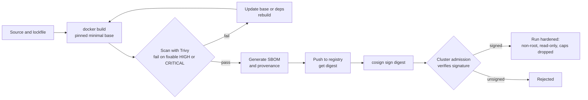
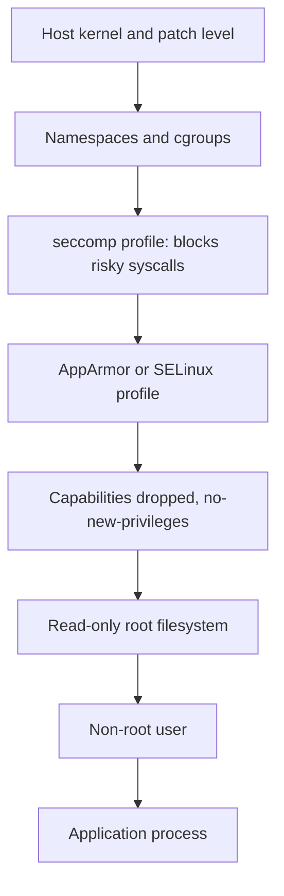

# L4.14 — Image Scanning and Container Security

> **Level 4: Docker** · Topic 14 of 14 · ⏱ ~5 hours · Difficulty: Advanced

## 1. What it is

Container security has two halves. **Before runtime** you ask "what is inside this image, and is any of it known to be vulnerable or tampered with?" **At runtime** you ask "how do I limit what this container can do if it is compromised?"

- An **image scanner** (Trivy, Grype, Docker Scout, Snyk and others) unpacks an image, inventories the operating-system packages and language dependencies, and matches them against vulnerability databases. Each match is a **CVE** (Common Vulnerabilities and Exposures: a public identifier such as `CVE-2021-44228`) with a **severity** (often from CVSS, the Common Vulnerability Scoring System, rated Low/Medium/High/Critical).
- An **SBOM** (Software Bill of Materials) is the inventory itself: a machine-readable list of every component in the image (formats: SPDX and CycloneDX). Generate it once at build time and you can answer "are we affected?" later without re-scanning.
- **Signing** (for example with Sigstore **cosign**) attaches a cryptographic signature to an image digest so deployers can verify *who built it* and that it was not modified. **Provenance attestations** record how it was built.
- **Runtime hardening** applies the least-privilege controls from [Non-root Containers](11-non-root-containers.md) plus seccomp/AppArmor, resource limits, and not exposing the Docker socket.

## 2. Why it matters in DevOps

- **Supply-chain attacks are routine.** Public base images, npm/PyPI packages and CI actions are all attack paths. A scanner in CI is the cheapest control you can add.
- **"Are we affected?" must take minutes, not days.** When a headline vulnerability drops, SBOMs let you query every deployed image instead of grepping repositories.
- **Compliance.** SOC 2, PCI-DSS and customer questionnaires increasingly ask for image scanning, patch SLAs and artifact signing.
- **Noise management is a skill.** An unfiltered scan of a large image reports hundreds of findings, most unreachable; teams need policies (severity thresholds, unfixed-only, suppression with expiry) so the signal is acted on.
- See also [Container Image Scanning (Trivy)](../level-11-security-devsecops/09-container-image-scanning.md), [DevSecOps](../level-00-what-devops-is/12-devsecops.md) and [Minimal Base Images](13-minimal-base-images.md).

## 3. Real-world system example

**Log4Shell and the SBOM argument.** In December 2021 a critical flaw in the Java logging library Log4j (CVE-2021-44228, "Log4Shell") was disclosed. Organisations scrambled to learn which of their applications and container images bundled a vulnerable log4j-core JAR, often buried inside fat JARs. The incident is widely cited as the moment SBOMs went mainstream;
it contributed to US government guidance on software supply-chain security and to industry adoption of SPDX and CycloneDX.
On the tooling side, **Trivy** (open source, by Aqua Security) is widely used in CI and is the default scanner integrated into the **Harbor** registry; **Grype** and **Syft** (Anchore) are a popular scanner/SBOM pair; **cosign** and the Sigstore project provide keyless signing using OIDC identities
(for example a GitHub Actions workflow identity) and a public transparency log; Kubernetes admission policies (Kyverno, Sigstore policy-controller, OPA Gatekeeper) can refuse unsigned or vulnerable images. Docker Engine itself ships with a default **seccomp** profile that blocks dozens of risky system calls.

## 4. Diagram

A secure delivery pipeline for one image:



Layers of runtime isolation around a container:



## 5. How it works

**Scanning.** A scanner reads the image layers, identifies the OS (from `/etc/os-release`) and package databases (`dpkg`, `apk`, `rpm`) and language lockfiles/manifests (`package-lock.json`, `go.mod`, `requirements.txt`, JAR metadata), then matches versions against advisories.

| Tool | Notes |
|------|-------|
| **Trivy** | One tool for images, filesystems, Git repos, IaC/Dockerfile misconfiguration (`trivy config`), secrets and SBOMs. `trivy image IMAGE`, `trivy fs .`, `trivy config .` |
| **Grype** + **Syft** | Syft generates the SBOM; Grype scans an image or an SBOM (`grype sbom:sbom.json`) |
| **Docker Scout** | Integrated in Docker Desktop/CLI and Docker Hub |
| Registry scanners | ECR basic/enhanced scanning, GHCR + Dependabot alerts, Harbor + Trivy |

**Reading results.** A finding has a package, installed version, **fixed version** (may be empty = "no fix yet"), severity and CVE ID. Useful triage questions: Is a fix available? Is the vulnerable code path reachable from our app? Is it a build-time-only package that is not in the runtime image? Is it known-exploited?
(CISA publishes a Known Exploited Vulnerabilities catalog; the EPSS score estimates exploitation likelihood.) Common policy: **fail the pipeline on fixable HIGH/CRITICAL** (`--ignore-unfixed --severity HIGH,CRITICAL --exit-code 1`), report the rest, and track exceptions with an owner and an expiry date in an ignore file (`.trivyignore`).
**False positives and VEX:** a *VEX* (Vulnerability Exploitability eXchange) statement records "this CVE exists in the package but does not affect us".

**Rescan continuously.** New CVEs are published for images you shipped months ago. Schedule a daily scan of what is *deployed* (registry scanning or a cron job), not just what you build.

**SBOMs and attestations.** `trivy image --format cyclonedx --output sbom.cdx.json IMAGE` or `syft IMAGE -o spdx-json=sbom.spdx.json` produce an SBOM. BuildKit can attach SBOM and provenance attestations directly to the pushed image:
`docker buildx build --sbom=true --provenance=mode=max --push -t REG/shop-api:1.0.0 .`.

**Signing and verification (basics).**
1. Build and push; take the immutable **digest** (`REG/shop-api@sha256:...`).
2. `cosign sign REG/shop-api@sha256:...` — keyless in CI (the OIDC token of the workflow becomes a short-lived certificate recorded in a transparency log) or with a managed key (`--key`).
3. Consumers verify: `cosign verify REG/shop-api@sha256:... --certificate-identity <workflow identity> --certificate-oidc-issuer https://token.actions.githubusercontent.com`.
4. A cluster admission policy enforces "only run images signed by our pipeline". Sign **digests**, never mutable tags. (Docker Content Trust, based on Notary v1, is the older mechanism; modern setups use Sigstore cosign or Notation.)

**Runtime hardening checklist**

| Control | How |
|---------|-----|
| Non-root, caps dropped, read-only rootfs, `no-new-privileges` | see [Non-root Containers](11-non-root-containers.md) |
| Keep the default **seccomp** profile and AppArmor/SELinux | never `--security-opt seccomp=unconfined` |
| Never `--privileged`; don't mount `/var/run/docker.sock` or host paths | the socket is root on the host |
| Resource limits | `--memory`, `--cpus`, `--pids-limit` |
| No secrets in images or env files in git | inject at runtime from a secret manager |
| Isolate networks; publish only the edge | [Docker Networks](06-networks.md) |
| Minimal, patched, pinned base images | [Minimal Base Images](13-minimal-base-images.md) |
| Patch the host kernel and Docker Engine; consider rootless mode | containers share the kernel |
| Runtime detection (Falco and similar) and logs to a central store | detect shells spawned in containers, unexpected outbound traffic |

## 6. Step-by-step guide

**Prerequisites:** Docker and internet access. Scanner tools run as containers, so nothing needs installing. Vulnerability counts and exact output are illustrative: they change daily as databases update. Keep image tags below pinned to versions that exist (check the tool's release page if a tag has moved on).

1. **Scan a deliberately old image.**
   ```bash
   docker run --rm -v trivy-cache:/root/.cache aquasec/trivy:0.58.0 image --severity HIGH,CRITICAL python:3.9-slim-bullseye
   ```
   You get a table: library/package, CVE ID, severity, installed version, fixed version and a title. The first run downloads the vulnerability database into the `trivy-cache` volume.

2. **Scan your own image and filter the noise.**
   ```bash
   docker build -t shop-api:scan ./api
   docker run --rm -v /var/run/docker.sock:/var/run/docker.sock -v trivy-cache:/root/.cache \
     aquasec/trivy:0.58.0 image --severity HIGH,CRITICAL --ignore-unfixed shop-api:scan
   ```
   (Mounting the Docker socket into a short-lived scanner is acceptable on a lab machine; in CI scan from a registry or a tar archive: `docker save shop-api:scan -o img.tar` and `trivy image --input img.tar`.)

3. **Make it a gate.** Exit non-zero on fixable high/critical findings:
   ```bash
   docker run --rm -v /var/run/docker.sock:/var/run/docker.sock -v trivy-cache:/root/.cache \
     aquasec/trivy:0.58.0 image --severity HIGH,CRITICAL --ignore-unfixed --exit-code 1 shop-api:scan
   echo "exit code: $?"
   ```
   `0` means the gate passes; `1` fails the pipeline.

4. **Compare a bloated and a minimal base.** Scan `node:22` versus `node:22-alpine`, or your multi-stage distroless build, and compare counts:
   ```bash
   for img in node:22 node:22-slim node:22-alpine; do
     echo "== $img"; docker run --rm -v trivy-cache:/root/.cache aquasec/trivy:0.58.0 image --quiet --severity HIGH,CRITICAL --format json "$img" \
       | python3 -c 'import sys,json; d=json.load(sys.stdin); print(sum(len(r.get("Vulnerabilities") or []) for r in d.get("Results",[])))'
   done
   ```
   The full image usually reports many more findings than `slim` or `alpine`.

5. **Lint the Dockerfile and Compose file for misconfiguration.**
   ```bash
   docker run --rm -v "$PWD":/work -w /work aquasec/trivy:0.58.0 config .
   ```
   Expect findings such as "image user should not be root" and "no HEALTHCHECK defined" if you skipped them.

6. **Generate an SBOM and query it.**
   ```bash
   docker run --rm -v /var/run/docker.sock:/var/run/docker.sock -v "$PWD":/out aquasec/trivy:0.58.0 \
     image --format cyclonedx --output /out/sbom.cdx.json shop-api:scan
   python3 -c 'import json; d=json.load(open("sbom.cdx.json")); print(len(d["components"]), "components"); print([c["name"]+" "+c.get("version","") for c in d["components"] if c["name"]=="express"])'
   ```
   You get a component count and the `express` version: the "are we affected by X?" answer in one query.
   Scan the SBOM later without the image: `docker run --rm -v "$PWD":/w aquasec/trivy:0.58.0 sbom /w/sbom.cdx.json`.

7. **Sign and verify with cosign** (using a local key pair on a local registry, for learning).
   ```bash
   docker run -d -p 5000:5000 --name registry registry:2
   docker tag shop-api:scan localhost:5000/shop-api:1.0.0 && docker push localhost:5000/shop-api:1.0.0
   DIGEST=$(docker inspect --format '{{index .RepoDigests 0}}' localhost:5000/shop-api:1.0.0)
   docker run --rm -v "$PWD":/k -w /k --network host -e COSIGN_PASSWORD=lab-only gcr.io/projectsigstore/cosign:latest generate-key-pair
   docker run --rm -v "$PWD":/k -w /k --network host -e COSIGN_PASSWORD=lab-only gcr.io/projectsigstore/cosign:latest sign --yes --key cosign.key --allow-insecure-registry "$DIGEST"
   docker run --rm -v "$PWD":/k -w /k --network host gcr.io/projectsigstore/cosign:latest verify --key cosign.pub --allow-insecure-registry "$DIGEST"
   ```
   `verify` prints the signature payload JSON (with the digest) and "The following checks were performed"; modify the image, push a different digest and verify again to see it fail. In real pipelines prefer keyless signing from CI and verify identities. Flags and image tags can change between cosign releases, so consult `cosign --help` if a flag is rejected.

8. **Run a hardened container and inspect the evidence.**
   ```bash
   docker run -d --name secure --read-only --tmpfs /tmp --cap-drop ALL --security-opt no-new-privileges:true \
     --pids-limit 100 --memory 256m --user 1000:1000 -p 127.0.0.1:3000:3000 \
     -e DATABASE_URL=postgres://invalid -e REDIS_URL=redis://invalid shop-api:scan sleep 300
   docker inspect secure --format 'user={{.Config.User}} ro={{.HostConfig.ReadonlyRootfs}} capdrop={{.HostConfig.CapDrop}} secopt={{.HostConfig.SecurityOpt}} pids={{.HostConfig.PidsLimit}}'
   ```
   (The `sleep 300` overrides the app because only the settings are being inspected.) The output lists every control.

9. **Clean up.**
   ```bash
   docker rm -f secure registry; docker rmi shop-api:scan localhost:5000/shop-api:1.0.0; docker volume rm trivy-cache; rm -f sbom.cdx.json cosign.key cosign.pub img.tar
   ```

## 7. Real-world scenario

*(Illustrative.)* **"Is any production image running the vulnerable library?"** On a Friday afternoon a critical advisory is published for a popular npm package. Management asks which services are affected. Because the `shop-api` pipeline had been storing a CycloneDX SBOM alongside each image digest,
a script queried 40 SBOMs in a few minutes and found the package in two images (one `shop-api` replica set and a worker), with exact versions. Both were patched and redeployed by the evening. Without SBOMs, the previous incident had taken two days of grepping repositories and unpacking images.
Afterwards the team added a daily scan of deployed digests, a policy of "fixable critical findings block the merge", and signature verification at admission so that only pipeline-built images can run.
**Lesson:** inventory and automation convert emergencies into routine work.

## 8. Common mistakes and best practices

**Don't**

- Scan once at build time and never again, or treat a clean scan as proof of safety (scanners only know *published* CVEs).
- Drown the team in findings: unfiltered output teaches people to ignore the scanner.
- Suppress CVEs forever without an owner and an expiry date.
- Sign mutable tags, trust unsigned images from any registry, or run `--privileged` and mount `docker.sock` "just for CI".

**Do**

- Scan in CI (gate on fixable HIGH/CRITICAL) **and** rescan deployed images on a schedule.
- Prefer minimal, pinned, regularly rebuilt bases; remove build tools from runtime images ([multi-stage](10-multi-stage-builds.md)).
- Produce SBOMs and provenance for every release; sign digests; verify at admission.
- Combine scanning with runtime hardening (non-root, read-only, no caps, seccomp, limits) and keep host kernels and Docker Engine patched.

## 9. Tasks

- [ ] **T1 — First scan** *(≈25 min, beginner)*
  - **Goal:** read a vulnerability report.
  - **Steps:**
    1. Run the Trivy scan from step 1 on an old image.
    2. Pick three findings and for each note the package, installed vs fixed version, and severity.
  - **Done when:** you can explain what a CVE ID, "fixed version" and severity mean for each of your three findings.

- [ ] **T2 — Gate your build** *(≈40 min, intermediate)*
  - **Goal:** make CI fail on fixable high/critical issues.
  - **Steps:**
    1. Run step 3 against `shop-api`; if it passes, build a copy `FROM node:18` (end-of-life) to force a failure.
    2. Turn the command into a pipeline step (a GitHub Actions job or a Makefile target) that returns Trivy's exit code.
  - **Done when:** the old base fails the gate with exit code 1 and the current base passes.

- [ ] **T3 — Reduce findings by changing the base** *(≈45 min, intermediate)*
  - **Goal:** quantify the effect of minimal images.
  - **Steps:**
    1. Scan `shop-api` built on `node:22`, `node:22-slim`, `node:22-alpine` and a distroless runtime.
    2. Record HIGH+CRITICAL counts and the top three packages causing them.
  - **Done when:** you have a table of counts per base and a note on which packages disappear in the minimal builds.

- [ ] **T4 — SBOM-driven triage** *(≈40 min, intermediate)*
  - **Goal:** answer "are we affected?" without the image.
  - **Steps:**
    1. Generate CycloneDX SBOMs for two image versions.
    2. Write a short script that searches the SBOMs for a given package name and version range and prints the matching image.
    3. Re-scan one SBOM with `trivy sbom`.
  - **Done when:** your script finds a known dependency (for example `express`) in the correct SBOM, and the SBOM scan reports the same vulnerabilities as the image scan.

- [ ] **T5 — Sign and verify, then tamper** *(≈50 min, advanced)*
  - **Goal:** see signatures protect a digest.
  - **Steps:**
    1. Follow step 7 to sign and verify.
    2. Rebuild with a small change, push it under the same tag, and verify the new digest.
    3. Write down why verifying by tag would be unsafe and verifying a digest is safe.
  - **Done when:** verification succeeds for the signed digest and fails for the unsigned one.

- [ ] **T6 — Prove it: security review of `shop-api`** *(≈60 min, advanced)*
  - **Goal:** deliver an evidence-based review.
  - **Steps:**
    1. Without notes, list the 10 controls you would require before production (base, user, caps, rootfs, secrets, scan gate, SBOM, signing, limits, network exposure).
    2. For each, state how to verify it with a command (`docker inspect`, `trivy`, `cosign verify`, `docker compose config`).
    3. Run the checks against your capstone stack and mark pass/fail.
  - **Done when:** you have a table of control, command and result, with every failing item turned into a ticket or fix.

## 10. Self-check questions

1. What is a CVE, and how is it different from an SBOM?
2. Why use `--ignore-unfixed` in a gating scan, and what is the downside?
3. Why sign a digest rather than a tag?
4. What does the default seccomp profile do, and why shouldn't you disable it?
5. Why should deployed images be rescanned even if the build scan was clean?
6. Why is mounting `/var/run/docker.sock` into a container dangerous?

<details>
<summary>Answers</summary>

1. A CVE is a public identifier for a specific known vulnerability; an SBOM is the inventory of components inside your software, which you match against CVE data.
2. It hides findings that have no available fix so the gate only fails on actionable issues; the downside is that unfixed risks go unseen unless reported separately and tracked.
3. A tag can be moved to different content after signing; a digest identifies exactly one image.
4. It blocks a list of dangerous or rarely needed system calls, reducing kernel attack surface; disabling it removes that safety net.
5. New vulnerabilities are published daily against components you already shipped.
6. Anyone who controls that container can talk to the Docker daemon, start privileged containers and take over the host: it is effectively root on the host.
</details>

## 11. Further reading

- Trivy documentation (trivy.dev) and Grype/Syft documentation (github.com/anchore).
- Sigstore documentation (docs.sigstore.dev) — cosign signing and verification.
- Docker documentation: "Docker security", "Seccomp security profiles" and "Build attestations".
- OWASP Docker Security Cheat Sheet and the CIS Docker Benchmark.
- NIST Secure Software Development Framework (SSDF) and the SLSA framework (slsa.dev) for supply-chain maturity levels.
- CISA Known Exploited Vulnerabilities catalog; the SPDX and CycloneDX specifications for SBOM formats.

<!-- nav -->
---
← Previous: [Minimal Base Images](13-minimal-base-images.md) · [Level 4 index](README.md) · Next: [Level capstone project](99-capstone-project.md) →
