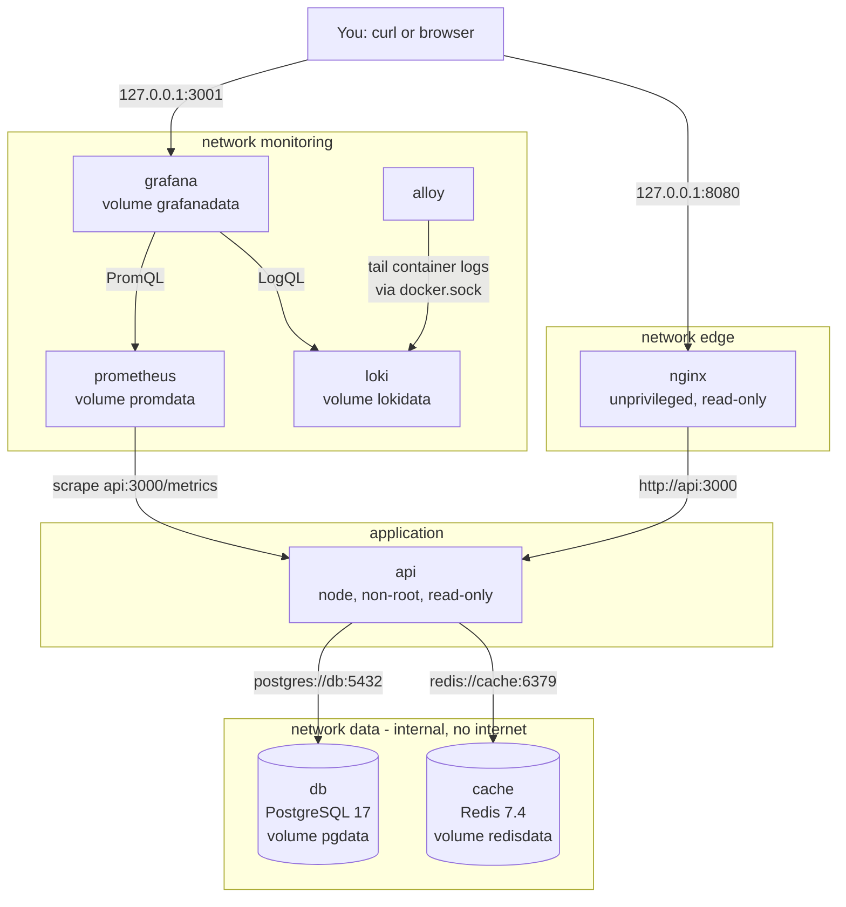
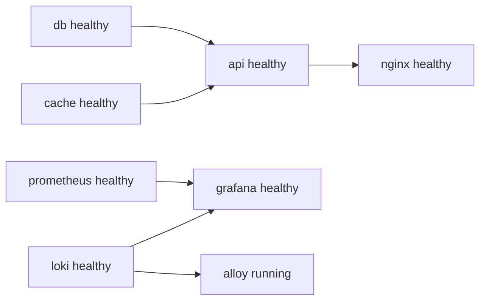

# L4 Capstone — Containerize shop-api with Docker Compose

> **Level 4: Docker** · Capstone · ⏱ ~8 hours

## 1. Goal and outcome

Containerize the whole `shop-api` platform and run it with **one command**: a Node.js API, PostgreSQL, Redis and an Nginx reverse proxy,
watched by Prometheus (metrics), Loki with Grafana Alloy (logs) and Grafana (dashboards). Along the way you apply **all 14 topics** of this level: image internals, layers, container lifecycle, registries, volumes, networks,
Dockerfiles, Compose, caching, multi-stage builds, non-root containers, health checks, minimal base images, and image scanning.

When you finish you will have:
- `docker compose up -d --wait` brings up **eight containers** (`nginx`, `api`, `db`, `cache`, `prometheus`, `loki`, `alloy`, `grafana`) in dependency order, gated by health checks.
- `curl http://127.0.0.1:8080/products` works through Nginx; the first call is a cache miss and the next a hit.
- A provisioned Grafana dashboard shows request rate, latency percentiles, cache hit ratio and live API/Nginx logs.
- Data survives `docker compose down` and container replacement; `db` and `cache` cannot reach the internet or the host network.
- A hardened, scanned, tagged API image pushed to a registry (a local one in this guide).

## 2. Architecture



Startup order enforced by `depends_on` plus health checks:



| Service | Image | Published port | Networks | Persistent data |
|---------|-------|----------------|----------|-----------------|
| nginx | `nginxinc/nginx-unprivileged:1.28-alpine` | `127.0.0.1:8080` | edge | none |
| api | `shop-api:dev` (built here) | none | edge, data, monitoring | none |
| db | `postgres:17-alpine` | none | data | `pgdata` |
| cache | `redis:7.4-alpine` | none | data | `redisdata` |
| prometheus | `prom/prometheus:v3.5.5` | `127.0.0.1:9090` | monitoring | `promdata` |
| loki | `grafana/loki:3.6` | none | monitoring | `lokidata` |
| alloy | `grafana/alloy:v1.20.1` | none | monitoring | `alloydata` |
| grafana | `grafana/grafana:12.2` | `127.0.0.1:3001` | monitoring | `grafanadata` |

## 3. Prerequisites and cost

- **Tools:** Docker Engine 25+ or Docker Desktop with Compose v2 (`docker compose version`), `curl`, `python3` (for JSON one-liners), a text editor. About 4 GB of free RAM and 3-4 GB of disk.
- **Free ports on localhost:** 8080, 9090, 3001. **Cost:** nothing; everything runs locally. (The optional ECR stretch goal has a small cost.)
- **Prior topics:** work through topics 1-14 first, or use this capstone as the checklist of what you must be able to do.
- **Authoring note:** the Compose file passed `docker compose config`, the Nginx configuration passed `nginx -t`, and the API source was run against local PostgreSQL and Redis with Nginx in front. The container images themselves could not be started in the authoring environment, so image versions, log lines and timings below are illustrative. If a tag has moved on, pick the nearest current one.
- **Security note:** Alloy mounts `/var/run/docker.sock` (read-only) to discover containers. Access to that socket is effectively root on the host, so this is a deliberate **lab trade-off**; stretch goal S3 replaces it.

## 4. Build it step by step

### Milestone 1 — Project skeleton and the `shop-api` source *(topics 3, 7)*

```bash
mkdir -p ~/lab/shopstack && cd ~/lab/shopstack
mkdir -p api db nginx prometheus loki alloy grafana/provisioning/datasources grafana/provisioning/dashboards grafana/dashboards
```

The API exposes `/healthz` (liveness), `/readyz` (readiness), `/products` (cached in Redis), `POST /orders`, and `/metrics` (Prometheus), logs one JSON object per line to stdout, and shuts down gracefully on `SIGTERM`.

`api/package.json`

```bash
cat > api/package.json <<'EOF'
{
  "name": "shop-api",
  "version": "1.0.0",
  "description": "Sample API used throughout the DevOps roadmap",
  "main": "server.js",
  "private": true,
  "scripts": {
    "start": "node server.js"
  },
  "engines": {
    "node": ">=22"
  },
  "dependencies": {
    "express": "^5.1.0",
    "pg": "^8.13.0",
    "prom-client": "^15.1.3",
    "redis": "^5.0.0"
  }
}
EOF
```

`api/server.js`

```bash
cat > api/server.js <<'EOF'
'use strict';
const express = require('express');
const { Pool } = require('pg');
const { createClient } = require('redis');
const client = require('prom-client');

const PORT = Number(process.env.PORT || 3000);
const CACHE_TTL = Number(process.env.CACHE_TTL_SECONDS || 30);

const pool = new Pool({ connectionString: process.env.DATABASE_URL, max: 10, connectionTimeoutMillis: 2000 });
// disableOfflineQueue: when Redis is down, commands fail immediately instead of hanging.
const redis = createClient({ url: process.env.REDIS_URL, disableOfflineQueue: true });

// One JSON object per line on stdout: easy for Loki (and any log shipper) to parse.
const LEVELS = { debug: 10, info: 20, warn: 30, error: 40 };
const MIN_LEVEL = LEVELS[process.env.LOG_LEVEL] || LEVELS.info;
function log(level, msg, extra = {}) {
  if (LEVELS[level] < MIN_LEVEL) return;
  console.log(JSON.stringify({ ts: new Date().toISOString(), level, msg, ...extra }));
}
redis.on('error', (err) => log('error', 'redis error', { err: err.message }));
pool.on('error', (err) => log('error', 'postgres pool error', { err: err.message }));

// Fail fast instead of hanging when a dependency is down (health checks must answer quickly).
function withTimeout(promise, ms) {
  let timer;
  const timeout = new Promise((_, reject) => {
    timer = setTimeout(() => reject(new Error('dependency timeout')), ms);
  });
  return Promise.race([promise, timeout]).finally(() => clearTimeout(timer));
}

// Prometheus metrics
const register = new client.Registry();
client.collectDefaultMetrics({ register });
const httpDuration = new client.Histogram({
  name: 'http_request_duration_seconds',
  help: 'HTTP request latency in seconds',
  labelNames: ['method', 'route', 'status'],
  buckets: [0.005, 0.01, 0.025, 0.05, 0.1, 0.25, 0.5, 1, 2.5],
  registers: [register],
});
const cacheResults = new client.Counter({
  name: 'shop_cache_requests_total',
  help: 'Product cache lookups by result',
  labelNames: ['result'],
  registers: [register],
});

const app = express();
app.disable('x-powered-by');
app.use(express.json());

app.use((req, res, next) => {
  const stop = httpDuration.startTimer();
  res.on('finish', () => {
    const route = req.route ? req.route.path : 'unmatched';
    stop({ method: req.method, route, status: res.statusCode });
    if (route !== '/metrics' && route !== '/healthz') {
      log('info', 'request', { method: req.method, path: req.originalUrl, status: res.statusCode });
    }
  });
  next();
});

// Liveness: the process is up and the event loop answers. Does NOT touch dependencies.
app.get('/healthz', (req, res) => res.json({ status: 'ok' }));

// Readiness: can we actually serve traffic? Checks PostgreSQL and Redis.
app.get('/readyz', async (req, res) => {
  try {
    await withTimeout(pool.query('SELECT 1'), 2000);
    await withTimeout(redis.ping(), 2000);
    res.json({ status: 'ready' });
  } catch (err) {
    res.status(503).json({ status: 'not ready', error: err.message });
  }
});

app.get('/products', async (req, res, next) => {
  try {
    const cached = await redis.get('products');
    if (cached) {
      cacheResults.inc({ result: 'hit' });
      res.set('X-Cache', 'HIT');
      return res.json(JSON.parse(cached));
    }
    cacheResults.inc({ result: 'miss' });
    const { rows } = await pool.query('SELECT id, name, price_cents FROM products ORDER BY id');
    await redis.set('products', JSON.stringify(rows), { EX: CACHE_TTL });
    res.set('X-Cache', 'MISS');
    res.json(rows);
  } catch (err) {
    next(err);
  }
});

app.post('/orders', async (req, res, next) => {
  try {
    const { product_id: productId, quantity } = req.body || {};
    if (!Number.isInteger(productId) || !Number.isInteger(quantity) || quantity < 1) {
      return res.status(400).json({ error: 'product_id and quantity must be positive integers' });
    }
    const { rows } = await pool.query(
      'INSERT INTO orders (product_id, quantity) VALUES ($1, $2) RETURNING id, product_id, quantity, created_at',
      [productId, quantity]
    );
    res.status(201).json(rows[0]);
  } catch (err) {
    next(err);
  }
});

app.get('/metrics', async (req, res) => {
  res.set('Content-Type', register.contentType);
  res.end(await register.metrics());
});

// Error handler: log details, return a generic message
app.use((err, req, res, next) => {
  log('error', 'unhandled error', { err: err.message, path: req.originalUrl });
  res.status(500).json({ error: 'internal error' });
});

async function main() {
  // Do not block startup on Redis: the node-redis client keeps retrying in the background,
  // /healthz stays green and /readyz reports 503 until the connection is up.
  redis.connect().catch((err) => log('error', 'redis connect failed', { err: err.message }));
  const server = app.listen(PORT, '0.0.0.0', () => log('info', 'shop-api listening', { port: PORT }));

  // Graceful shutdown: stop accepting connections, drain, close dependencies, exit 0.
  let shuttingDown = false;
  async function shutdown(signal) {
    if (shuttingDown) return;
    shuttingDown = true;
    log('info', 'shutdown started', { signal });
    server.close(async () => {
      try {
        await pool.end();
        await redis.quit();
      } catch (err) {
        log('error', 'error during shutdown', { err: err.message });
      }
      log('info', 'shutdown complete');
      process.exit(0);
    });
    setTimeout(() => process.exit(1), 8000).unref(); // hard stop before Docker's SIGKILL
  }
  process.on('SIGTERM', () => shutdown('SIGTERM'));
  process.on('SIGINT', () => shutdown('SIGINT'));
}

main().catch((err) => {
  log('error', 'fatal startup error', { err: err.message });
  process.exit(1);
});
EOF
```

`db/init.sql`

```bash
cat > db/init.sql <<'EOF'
CREATE TABLE IF NOT EXISTS products (
  id          SERIAL PRIMARY KEY,
  name        TEXT    NOT NULL,
  price_cents INTEGER NOT NULL CHECK (price_cents >= 0)
);

CREATE TABLE IF NOT EXISTS orders (
  id         SERIAL PRIMARY KEY,
  product_id INTEGER NOT NULL REFERENCES products(id),
  quantity   INTEGER NOT NULL CHECK (quantity > 0),
  created_at TIMESTAMPTZ NOT NULL DEFAULT now()
);

INSERT INTO products (name, price_cents) VALUES
  ('Mechanical keyboard', 8999),
  ('USB-C hub', 3499),
  ('27-inch monitor', 21999);
EOF
```

Create the lockfile (the Dockerfile uses `npm ci`, which requires one) and optionally run the API without Docker if you have Node.js 22:

```bash
cd api && npm install --package-lock-only && cd ..
ls api   # package-lock.json  package.json  server.js
```

(Note: at the time of writing the npm registry marks `prom-client` as deprecated in favour of a successor package; its API used here is stable and fine for this lab, and swapping libraries is a stretch goal.)

### Milestone 2 — A production-quality API image *(topics 2, 7, 9, 10, 11, 12, 13)*

`api/Dockerfile`

```bash
cat > api/Dockerfile <<'EOF'
# ---- base: manifests only, so dependency layers cache well ----
FROM node:22-alpine AS base
WORKDIR /app
COPY package.json package-lock.json ./

# ---- dev-deps: everything, used by the test stage ----
FROM base AS dev-deps
RUN --mount=type=cache,target=/root/.npm npm ci

# ---- prod-deps: runtime dependencies only ----
FROM base AS prod-deps
RUN --mount=type=cache,target=/root/.npm npm ci --omit=dev

# ---- test: run in CI with `docker build --target test` ----
FROM dev-deps AS test
COPY server.js ./
RUN node --check server.js

# ---- runtime: the image we ship ----
FROM node:22-alpine AS runtime
LABEL org.opencontainers.image.title="shop-api" \
      org.opencontainers.image.source="https://github.com/example/shop-api"
WORKDIR /app
ENV NODE_ENV=production PORT=3000
COPY --from=prod-deps /app/node_modules ./node_modules
COPY package.json server.js ./
USER 1000:1000
EXPOSE 3000
HEALTHCHECK --interval=10s --timeout=3s --start-period=15s --retries=3 \
  CMD node -e "fetch('http://127.0.0.1:3000/readyz').then(r=>process.exit(r.ok?0:1)).catch(()=>process.exit(1))"
CMD ["node", "server.js"]
EOF
```

`api/.dockerignore`

```bash
cat > api/.dockerignore <<'EOF'
node_modules
npm-debug.log
.git
.gitignore
.env
.env.*
Dockerfile
.dockerignore
*.md
coverage
EOF
```

Build the test stage first (a CI gate), then the runtime image, and inspect it:

```bash
docker build --target test -t shop-api:test ./api
docker build -t shop-api:dev ./api
docker image ls shop-api
docker history shop-api:dev
docker run --rm shop-api:dev id          # uid=1000(node) gid=1000(node)
```

Rebuild after touching only `server.js` and confirm the `npm ci` step prints `CACHED`:

```bash
echo "// touch" >> api/server.js && docker build --progress=plain -t shop-api:dev ./api 2>&1 | grep -E 'CACHED|npm ci'
```

### Milestone 3 — Supporting configuration files *(topics 5, 6, 7)*

**Nginx** — JSON access logs, a health endpoint, `/metrics` hidden from the outside:

`nginx/default.conf`

```bash
cat > nginx/default.conf <<'EOF'
# One JSON object per request: easy to query in Loki with `| json`.
log_format json_combined escape=json
  '{"ts":"$time_iso8601","remote_addr":"$remote_addr","method":"$request_method",'
  '"uri":"$request_uri","status":$status,"bytes":$body_bytes_sent,'
  '"request_time":$request_time,"upstream_time":"$upstream_response_time",'
  '"request_id":"$request_id"}';

upstream shop_api {
    server api:3000;
    keepalive 16;
}

server {
    listen 8080;
    server_name _;

    access_log /var/log/nginx/access.log json_combined;
    error_log  /var/log/nginx/error.log warn;

    # Cheap endpoint for the container health check (does not touch the API).
    location = /nginx-health {
        access_log off;
        default_type text/plain;
        return 200 "ok\n";
    }

    # Prometheus scrapes the API directly on the private network; never expose metrics publicly.
    location = /metrics {
        return 404;
    }

    location / {
        proxy_pass http://shop_api;
        proxy_http_version 1.1;
        proxy_set_header Connection "";
        proxy_set_header Host $host;
        proxy_set_header X-Real-IP $remote_addr;
        proxy_set_header X-Forwarded-For $proxy_add_x_forwarded_for;
        proxy_set_header X-Forwarded-Proto $scheme;
        proxy_set_header X-Request-Id $request_id;
        proxy_connect_timeout 3s;
        proxy_read_timeout 30s;
    }
}
EOF
```

**Prometheus** — scrape configuration and two alert rules:

`prometheus/prometheus.yml`

```bash
cat > prometheus/prometheus.yml <<'EOF'
global:
  scrape_interval: 15s
  evaluation_interval: 15s

rule_files:
  - /etc/prometheus/rules.yml

scrape_configs:
  - job_name: prometheus
    static_configs:
      - targets: ["localhost:9090"]

  - job_name: shop-api
    metrics_path: /metrics
    static_configs:
      - targets: ["api:3000"]

  - job_name: loki
    static_configs:
      - targets: ["loki:3100"]

  - job_name: grafana
    static_configs:
      - targets: ["grafana:3000"]

  - job_name: alloy
    static_configs:
      - targets: ["alloy:12345"]
EOF
```

`prometheus/rules.yml`

```bash
cat > prometheus/rules.yml <<'EOF'
groups:
  - name: shop-api
    rules:
      - alert: ShopApiDown
        expr: up{job="shop-api"} == 0
        for: 1m
        labels:
          severity: critical
        annotations:
          summary: "shop-api is not being scraped"

      - alert: ShopApiHighErrorRate
        expr: |
          sum(rate(http_request_duration_seconds_count{job="shop-api",status=~"5.."}[5m]))
            /
          sum(rate(http_request_duration_seconds_count{job="shop-api"}[5m])) > 0.05
        for: 5m
        labels:
          severity: warning
        annotations:
          summary: "More than 5 percent of shop-api requests are failing"
EOF
```

**Loki** — single-process, filesystem storage, 7-day retention:

`loki/loki-config.yaml`

```bash
cat > loki/loki-config.yaml <<'EOF'
auth_enabled: false

server:
  http_listen_port: 3100
  grpc_listen_port: 9096

common:
  instance_addr: 127.0.0.1
  path_prefix: /loki
  storage:
    filesystem:
      chunks_directory: /loki/chunks
      rules_directory: /loki/rules
  replication_factor: 1
  ring:
    kvstore:
      store: inmemory

schema_config:
  configs:
    - from: 2024-04-01
      store: tsdb
      object_store: filesystem
      schema: v13
      index:
        prefix: index_
        period: 24h

limits_config:
  retention_period: 168h        # keep 7 days of logs
  allow_structured_metadata: true

compactor:
  working_directory: /loki/compactor
  retention_enabled: true
  delete_request_store: filesystem

analytics:
  reporting_enabled: false
EOF
```

**Alloy** — discover containers through the Docker socket and ship their logs to Loki:

`alloy/config.alloy`

```bash
cat > alloy/config.alloy <<'EOF'
// Discover every container through the Docker socket.
discovery.docker "containers" {
  host = "unix:///var/run/docker.sock"
}

// Turn Docker metadata into Loki labels.
discovery.relabel "containers" {
  targets = discovery.docker.containers.targets

  rule {
    source_labels = ["__meta_docker_container_name"]
    regex         = "/(.*)"
    target_label  = "container"
  }
  rule {
    source_labels = ["__meta_docker_container_label_com_docker_compose_service"]
    target_label  = "service"
  }
  rule {
    source_labels = ["__meta_docker_container_label_com_docker_compose_project"]
    target_label  = "project"
  }
}

// Tail container stdout/stderr and forward to Loki.
loki.source.docker "containers" {
  host          = "unix:///var/run/docker.sock"
  targets       = discovery.docker.containers.targets
  relabel_rules = discovery.relabel.containers.rules
  forward_to    = [loki.write.default.receiver]
}

loki.write "default" {
  endpoint {
    url = "http://loki:3100/loki/api/v1/push"
  }
}
EOF
```

**Grafana** — provision data sources and a dashboard so there is nothing to click through:

`grafana/provisioning/datasources/datasources.yaml`

```bash
cat > grafana/provisioning/datasources/datasources.yaml <<'EOF'
apiVersion: 1
datasources:
  - name: Prometheus
    uid: prometheus
    type: prometheus
    access: proxy
    url: http://prometheus:9090
    isDefault: true
  - name: Loki
    uid: loki
    type: loki
    access: proxy
    url: http://loki:3100
EOF
```

`grafana/provisioning/dashboards/dashboards.yaml`

```bash
cat > grafana/provisioning/dashboards/dashboards.yaml <<'EOF'
apiVersion: 1
providers:
  - name: shop
    folder: Shop
    type: file
    allowUiUpdates: true
    options:
      path: /etc/grafana/dashboards
EOF
```

`grafana/dashboards/shop-api.json`

```bash
cat > grafana/dashboards/shop-api.json <<'EOF'
{
  "uid": "shop-api",
  "title": "shop-api overview",
  "schemaVersion": 39,
  "version": 1,
  "refresh": "10s",
  "time": {"from":"now-30m","to":"now"},
  "tags": ["shop"],
  "panels": [
    {"id":1,"title":"Request rate by status","type":"timeseries","gridPos":{"x":0,"y":0,"w":12,"h":8},"datasource":{"type":"prometheus","uid":"prometheus"},"targets":[{"refId":"A","expr":"sum by (status) (rate(http_request_duration_seconds_count{job=\"shop-api\"}[1m]))","legendFormat":"{{status}}"}],"fieldConfig":{"defaults":{"unit":"reqps"},"overrides":[]}},
    {"id":2,"title":"Latency p95 by route","type":"timeseries","gridPos":{"x":12,"y":0,"w":12,"h":8},"datasource":{"type":"prometheus","uid":"prometheus"},"targets":[{"refId":"A","expr":"histogram_quantile(0.95, sum by (le, route) (rate(http_request_duration_seconds_bucket{job=\"shop-api\"}[5m])))","legendFormat":"{{route}}"}],"fieldConfig":{"defaults":{"unit":"s"},"overrides":[]}},
    {"id":3,"title":"Cache hit ratio","type":"stat","gridPos":{"x":0,"y":8,"w":6,"h":6},"datasource":{"type":"prometheus","uid":"prometheus"},"targets":[{"refId":"A","expr":"sum(rate(shop_cache_requests_total{result=\"hit\"}[5m])) / sum(rate(shop_cache_requests_total[5m]))"}],"fieldConfig":{"defaults":{"unit":"percentunit"},"overrides":[]}},
    {"id":4,"title":"Scrape targets up","type":"stat","gridPos":{"x":6,"y":8,"w":6,"h":6},"datasource":{"type":"prometheus","uid":"prometheus"},"targets":[{"refId":"A","expr":"sum(up)"}]},
    {"id":5,"title":"shop-api logs","type":"logs","gridPos":{"x":12,"y":8,"w":12,"h":6},"datasource":{"type":"loki","uid":"loki"},"targets":[{"refId":"A","expr":"{service=\"api\"} | json"}]},
    {"id":6,"title":"nginx access logs","type":"logs","gridPos":{"x":0,"y":14,"w":24,"h":8},"datasource":{"type":"loki","uid":"loki"},"targets":[{"refId":"A","expr":"{service=\"nginx\"} | json | status >= 400"}]}
  ]
}
EOF
```

### Milestone 4 — The Compose file and secrets *(topics 5, 6, 8, 11, 12)*

Secrets live in `.env` (git-ignored); the template `.env.example` is committed:

```bash
cat > .env.example <<'EOF'
POSTGRES_PASSWORD=change-me-dev-only
GRAFANA_ADMIN_PASSWORD=change-me-too
EOF
cp .env.example .env
printf '.env\n' > .gitignore
```

`compose.yaml`

```bash
cat > compose.yaml <<'EOF'
name: shopstack

x-logging: &default-logging
  driver: json-file
  options:
    max-size: "10m"
    max-file: "3"

services:
  # ---------- edge ----------
  nginx:
    image: nginxinc/nginx-unprivileged:1.28-alpine
    ports:
      - "127.0.0.1:8080:8080"
    volumes:
      - ./nginx/default.conf:/etc/nginx/conf.d/default.conf:ro
    depends_on:
      api:
        condition: service_healthy
    healthcheck:
      test: ["CMD-SHELL", "wget -q --spider http://127.0.0.1:8080/nginx-health || exit 1"]
      interval: 10s
      timeout: 3s
      retries: 3
      start_period: 5s
    read_only: true
    tmpfs:
      - /tmp
    cap_drop: [ALL]
    security_opt: ["no-new-privileges:true"]
    mem_limit: 128m
    pids_limit: 100
    init: true
    restart: unless-stopped
    logging: *default-logging
    networks: [edge]

  # ---------- application ----------
  api:
    build:
      context: ./api
      target: runtime
    image: shop-api:dev
    environment:
      PORT: "3000"
      LOG_LEVEL: info
      CACHE_TTL_SECONDS: "30"
      DATABASE_URL: postgres://shop:${POSTGRES_PASSWORD:?set POSTGRES_PASSWORD in .env}@db:5432/shop
      REDIS_URL: redis://cache:6379
    depends_on:
      db:
        condition: service_healthy
      cache:
        condition: service_healthy
    read_only: true
    tmpfs:
      - /tmp
    cap_drop: [ALL]
    security_opt: ["no-new-privileges:true"]
    mem_limit: 256m
    cpus: 0.5
    pids_limit: 100
    init: true
    stop_grace_period: 15s
    restart: unless-stopped
    logging: *default-logging
    networks: [edge, data, monitoring]

  # ---------- data ----------
  db:
    image: postgres:17-alpine
    environment:
      POSTGRES_USER: shop
      POSTGRES_PASSWORD: ${POSTGRES_PASSWORD:?set POSTGRES_PASSWORD in .env}
      POSTGRES_DB: shop
    volumes:
      - pgdata:/var/lib/postgresql/data
      - ./db/init.sql:/docker-entrypoint-initdb.d/init.sql:ro
    healthcheck:
      test: ["CMD-SHELL", "pg_isready -U shop -d shop"]
      interval: 5s
      timeout: 3s
      retries: 10
      start_period: 10s
    mem_limit: 512m
    pids_limit: 200
    restart: unless-stopped
    logging: *default-logging
    networks: [data]

  cache:
    image: redis:7.4-alpine
    command: ["redis-server", "--appendonly", "yes", "--maxmemory", "64mb", "--maxmemory-policy", "allkeys-lru"]
    volumes:
      - redisdata:/data
    healthcheck:
      test: ["CMD", "redis-cli", "ping"]
      interval: 5s
      timeout: 3s
      retries: 10
    mem_limit: 128m
    restart: unless-stopped
    logging: *default-logging
    networks: [data]

  # ---------- observability ----------
  prometheus:
    image: prom/prometheus:v3.5.5
    command:
      - --config.file=/etc/prometheus/prometheus.yml
      - --storage.tsdb.path=/prometheus
      - --storage.tsdb.retention.time=7d
      - --web.enable-lifecycle
    ports:
      - "127.0.0.1:9090:9090"
    volumes:
      - ./prometheus/prometheus.yml:/etc/prometheus/prometheus.yml:ro
      - ./prometheus/rules.yml:/etc/prometheus/rules.yml:ro
      - promdata:/prometheus
    healthcheck:
      test: ["CMD-SHELL", "wget -q --spider http://localhost:9090/-/ready || exit 1"]
      interval: 10s
      timeout: 3s
      retries: 5
      start_period: 10s
    mem_limit: 512m
    restart: unless-stopped
    logging: *default-logging
    networks: [monitoring]

  loki:
    image: grafana/loki:3.6
    command: ["-config.file=/etc/loki/loki-config.yaml"]
    volumes:
      - ./loki/loki-config.yaml:/etc/loki/loki-config.yaml:ro
      - lokidata:/loki
    healthcheck:
      # Uses wget, falling back to curl, so it works whichever tool the image provides.
      test: ["CMD-SHELL", "wget -q --spider http://localhost:3100/ready || curl -sf http://localhost:3100/ready"]
      interval: 10s
      timeout: 3s
      retries: 10
      start_period: 30s
    mem_limit: 512m
    restart: unless-stopped
    logging: *default-logging
    networks: [monitoring]

  alloy:
    image: grafana/alloy:v1.20.1
    command:
      - run
      - --server.http.listen-addr=0.0.0.0:12345
      - --storage.path=/var/lib/alloy/data
      - /etc/alloy/config.alloy
    user: "0:0"        # needed to read the Docker socket; see the security note in the capstone
    volumes:
      - ./alloy/config.alloy:/etc/alloy/config.alloy:ro
      - /var/run/docker.sock:/var/run/docker.sock:ro
      - alloydata:/var/lib/alloy/data
    depends_on:
      loki:
        condition: service_healthy
    mem_limit: 256m
    restart: unless-stopped
    logging: *default-logging
    networks: [monitoring]

  grafana:
    image: grafana/grafana:12.2
    environment:
      GF_SECURITY_ADMIN_USER: admin
      GF_SECURITY_ADMIN_PASSWORD: ${GRAFANA_ADMIN_PASSWORD:?set GRAFANA_ADMIN_PASSWORD in .env}
      GF_USERS_ALLOW_SIGN_UP: "false"
    ports:
      - "127.0.0.1:3001:3000"
    volumes:
      - grafanadata:/var/lib/grafana
      - ./grafana/provisioning:/etc/grafana/provisioning:ro
      - ./grafana/dashboards:/etc/grafana/dashboards:ro
    depends_on:
      prometheus:
        condition: service_healthy
      loki:
        condition: service_healthy
    healthcheck:
      test: ["CMD-SHELL", "wget -q --spider http://localhost:3000/api/health || curl -sf http://localhost:3000/api/health"]
      interval: 10s
      timeout: 3s
      retries: 10
      start_period: 20s
    mem_limit: 512m
    restart: unless-stopped
    logging: *default-logging
    networks: [monitoring]

networks:
  edge:
  data:
    internal: true        # db and cache have no route to the internet
  monitoring:

volumes:
  pgdata:
  redisdata:
  promdata:
  lokidata:
  alloydata:
  grafanadata:
EOF
```

Validate it before running anything:

```bash
docker compose config --quiet && echo "compose file OK"
docker compose config --services
```

### Milestone 5 — Bring the stack up in stages *(topics 1, 3, 6, 8, 12)*

```bash
docker compose up -d --wait db cache        # data tier first
docker compose ps                            # both (healthy)
docker compose up -d --wait api nginx        # app and edge
curl -s http://127.0.0.1:8080/readyz         # {"status":"ready"}
curl -si http://127.0.0.1:8080/products | grep -iE 'HTTP/|x-cache'   # X-Cache: MISS
curl -si http://127.0.0.1:8080/products | grep -i x-cache            # X-Cache: HIT
curl -s -X POST -H 'content-type: application/json' -d '{"product_id":1,"quantity":2}' http://127.0.0.1:8080/orders
```

Then the observability tier, and finally everything together:

```bash
docker compose up -d --wait prometheus loki alloy grafana
docker compose up -d --wait                  # idempotent: converges the whole stack
docker compose ps
```

Expected: eight containers, seven of them `healthy` (Alloy has no health check and shows `running`).

### Milestone 6 — Generate traffic and observe *(topics 1, 5, 12)*

```bash
for i in $(seq 1 200); do
  curl -s -o /dev/null http://127.0.0.1:8080/products
  curl -s -o /dev/null -X POST -H 'content-type: application/json' -d '{"product_id":2,"quantity":1}' http://127.0.0.1:8080/orders
done
```

- **Prometheus** `http://127.0.0.1:9090/targets` shows five targets up (`prometheus`, `shop-api`, `loki`, `grafana`, `alloy`). Try `sum(rate(http_request_duration_seconds_count[1m]))`.
- **Grafana** `http://127.0.0.1:3001` (user `admin`, password from `.env`) → *Dashboards → Shop → shop-api overview*. You should see request rate by status, latency, cache hit ratio and the two log panels.
- **Loki via Grafana Explore:** run `{service="api"} | json | level="info"` and `{service="nginx"} | json | status >= 400`.

A scripted smoke test you can reuse (and call from CI):

```bash
cat > smoke.sh <<'EOF'
#!/usr/bin/env bash
set -euo pipefail
set -a; . ./.env; set +a
base=http://127.0.0.1:8080
curl -fsS "$base/readyz" >/dev/null && echo "PASS readyz via nginx"
curl -fsS "$base/products" >/dev/null                    # prime the cache
hdr=$(curl -fsS -D - -o /dev/null "$base/products")
grep -qi 'x-cache: hit' <<<"$hdr" && echo "PASS cache hit"
test "$(curl -s -o /dev/null -w '%{http_code}' "$base/metrics")" = 404 && echo "PASS metrics hidden from edge"
curl -fsS 'http://127.0.0.1:9090/api/v1/targets?state=active' | python3 -c '
import sys, json
t = json.load(sys.stdin)["data"]["activeTargets"]
bad = [x["labels"]["job"] for x in t if x["health"] != "up"]
print("targets:", len(t), "down:", bad); sys.exit(1 if bad else 0)' && echo "PASS prometheus targets"
curl -fsS -u "admin:${GRAFANA_ADMIN_PASSWORD}" http://127.0.0.1:3001/api/health >/dev/null && echo "PASS grafana"
labels=$(curl -fsS -u "admin:${GRAFANA_ADMIN_PASSWORD}" http://127.0.0.1:3001/api/datasources/proxy/uid/loki/loki/api/v1/labels)
grep -q service <<<"$labels" && echo "PASS loki has service labels"
echo "ALL CHECKS PASSED"
EOF
chmod +x smoke.sh && ./smoke.sh
```

### Milestone 7 — Harden, scan, tag and publish *(topics 2, 4, 11, 13, 14)*

```bash
# 1. Evidence of hardening
docker inspect shopstack-api-1 --format 'user={{.Config.User}} ro={{.HostConfig.ReadonlyRootfs}} capdrop={{.HostConfig.CapDrop}} secopt={{.HostConfig.SecurityOpt}}'

# 2. Scan the image (fail on fixable HIGH or CRITICAL)
docker run --rm -v /var/run/docker.sock:/var/run/docker.sock -v trivy-cache:/root/.cache \
  aquasec/trivy:0.58.0 image --severity HIGH,CRITICAL --ignore-unfixed --exit-code 1 shop-api:dev

# 3. SBOM
docker run --rm -v /var/run/docker.sock:/var/run/docker.sock -v "$PWD":/out aquasec/trivy:0.58.0 \
  image --format cyclonedx --output /out/sbom.cdx.json shop-api:dev

# 4. Tag by git SHA and version, push to a local registry, pull back by digest
docker run -d --name registry -p 127.0.0.1:5000:5000 registry:2
SHA=$(git rev-parse --short HEAD 2>/dev/null || echo local1)
docker tag shop-api:dev localhost:5000/shop/shop-api:1.0.0
docker tag shop-api:dev localhost:5000/shop/shop-api:git-$SHA
docker push --all-tags localhost:5000/shop/shop-api
docker image ls --digests localhost:5000/shop/shop-api
```

(Container names follow `<project>-<service>-1`; run `docker compose ps` if yours differ.) Whatever the scan reports, record the count and decide on each finding: fix, accept with an expiry, or document as a false positive.

## 5. Tasks

- [ ] **T1 — Build and run the API image alone** *(≈45 min, intermediate; milestones 1-2; topics 2, 3, 7, 9, 10, 11, 12)*
  - **Goal:** a lean, non-root, health-checked API image.
  - **Steps:**
    1. Create the files from milestones 1-2 and build `shop-api:dev` and the `test` target.
    2. Run `docker run --rm -d --name api-solo -p 3000:3000 -e DATABASE_URL=postgres://x -e REDIS_URL=redis://x shop-api:dev`, then check `curl localhost:3000/healthz` (200) and `/readyz` (503 after about 2 s).
    3. Run `docker stop api-solo` and time it; read `docker inspect api-solo --format '{{.State.Health.Status}}'`.
  - **Done when:** `/healthz` is 200, `/readyz` is 503 (dependencies absent), the container reports `unhealthy` after a minute, `docker stop` takes under 3 seconds, and `id` shows UID 1000.

- [ ] **T2 — Bring up the whole stack with health gating** *(≈60 min, intermediate; milestones 3-5; topics 6, 8, 12)*
  - **Goal:** the eight-container stack, started in the right order.
  - **Steps:**
    1. Create all configuration files and `compose.yaml`; run `docker compose config --quiet`.
    2. Run `docker compose up -d --wait` and then `docker compose ps`.
    3. Run `./smoke.sh`.
  - **Done when:** `smoke.sh` prints `ALL CHECKS PASSED` and `docker compose ps` shows seven healthy services plus a running Alloy.

- [ ] **T3 — Prove persistence and backups** *(≈45 min, intermediate; milestone 5; topic 5)*
  - **Goal:** data outlives containers; you can restore it.
  - **Steps:**
    1. `POST` three orders and note `SELECT count(*) FROM orders` via `docker compose exec db psql -U shop -d shop`.
    2. `docker compose down` then `up -d --wait`: the count must be unchanged. Then `docker compose rm -sf db && docker compose up -d --wait db`: still unchanged.
    3. Take a backup: `docker compose exec -T db pg_dump -U shop --clean --if-exists shop > backup.sql` (`--clean --if-exists` makes the dump drop and recreate the tables). Run `docker compose down -v`, bring the stack up (a fresh volume runs `init.sql` again), restore with `docker compose exec -T db psql -U shop -d shop < backup.sql`, and recount.
  - **Done when:** the order count is identical after `down`, after container replacement, and after the restore; and you can state what `down -v` deleted.

- [ ] **T4 — Prove the network design** *(≈45 min, intermediate; milestone 5; topic 6)*
  - **Goal:** demonstrate isolation instead of assuming it.
  - **Steps:**
    1. From the host confirm only `8080`, `9090`, `3001` are published, all on `127.0.0.1` (`docker compose ps`, `ss -ltn`).
    2. `docker compose exec nginx nslookup db` must fail (different network); `docker compose exec api nslookup db` must succeed.
    3. `docker compose exec cache sh -c 'wget -T 3 -qO- http://example.com || echo no-internet'` must print `no-internet` (the `data` network is internal).
    4. Explain the role of the embedded DNS server (`127.0.0.11`) with `docker compose exec api cat /etc/resolv.conf`.
  - **Done when:** each of the three negative/positive checks behaves as stated and you can draw the three networks from memory.

- [ ] **T5 — Observe a failure end to end** *(≈60 min, advanced; milestone 6; topics 1, 3, 12)*
  - **Goal:** use metrics and logs to find a broken dependency.
  - **Steps:**
    1. Run a background load loop on `/products` and `/orders`.
    2. `docker compose stop cache`. Watch `/readyz` go 503, the `api` container turn `unhealthy`, the error-rate panel rise, and the log panel show `redis error` lines.
    3. `docker compose start cache`; confirm recovery. Note how long each signal took to show up.
  - **Done when:** you have a short timeline (event, first signal, time) showing a metric, a log line and a health status all reflecting the outage, and the stack recovers without restarting the API by hand.

- [ ] **T6 — Break it three ways and fix each** *(≈60 min, advanced; milestones 4-5; topics 3, 5, 8, 11)*
  - **Goal:** diagnose common failures.
  - **Steps:**
    1. **Wrong password:** change `POSTGRES_PASSWORD` in `.env` only (not in the volume) and `docker compose up -d`. Explain why the API can no longer connect although the DB container is healthy (the password is baked into the existing volume).
    2. **Memory limit:** set `mem_limit: 20m` on `api` and run load; find `OOMKilled=true` and exit code 137 with `docker inspect`, then restore a sane limit.
    3. **Read-only root:** remove `tmpfs: [/tmp]` from `nginx` and observe the failure message in `docker compose logs nginx`; restore it.
  - **Done when:** for each failure you can show the exact log or `inspect` line that identified it and the one-line fix.

- [ ] **T7 — Measure caching and base-image choices** *(≈60 min, advanced; milestone 2; topics 9, 10, 13)*
  - **Goal:** quantify build speed and size.
  - **Steps:**
    1. Record cold build time (`docker build --no-cache`) and warm rebuild time after editing only `server.js`.
    2. Build variants on `node:22-slim` and a distroless Node.js runtime stage (check the distroless README for current tags) and compare `docker image ls` sizes and shell availability.
    3. Add `COPY . .` before `npm ci` to the Dockerfile, repeat the warm rebuild, and note the regression.
  - **Done when:** you have a table of build times and sizes for at least three variants and can explain each number.

- [ ] **T8 — Scan, gate and generate an SBOM** *(≈45 min, advanced; milestone 7; topics 13, 14)*
  - **Goal:** a security gate with evidence.
  - **Steps:**
    1. Run the Trivy gate from milestone 7 on `shop-api:dev` and on a copy built `FROM node:18` (end of life).
    2. Generate the CycloneDX SBOM and find `express` and its version inside it.
    3. Run `trivy config .` over the project and fix at least one misconfiguration it reports.
  - **Done when:** the old image fails the gate (exit 1) and the current one passes (or every remaining finding has a written decision), and the SBOM contains `express`.

- [ ] **T9 — Publish and pull by digest** *(≈30 min, intermediate; milestone 7; topics 2, 4)*
  - **Goal:** a registry round trip with immutable references.
  - **Steps:**
    1. Push the tags from milestone 7 to the local registry; note that tags share one digest.
    2. Change `compose.yaml` so `api` uses `image: localhost:5000/shop/shop-api@sha256:<digest>` and remove `build:`; run `docker compose pull api && docker compose up -d api`.
  - **Done when:** `docker compose ps` shows the API running from the digest reference and `smoke.sh` still passes.

- [ ] **T10 — Prove it: rebuild from nothing and explain it** *(≈90 min, advanced; all milestones; all topics)*
  - **Goal:** reproduce the platform without the guide, then teach it.
  - **Steps:**
    1. Run `docker compose down -v`, `docker system prune -af --volumes` (on a lab machine only), and delete your working directory except your notes.
    2. Rebuild everything from memory plus your own notes, in under two hours, until `./smoke.sh` passes.
    3. Present (aloud or in writing) the story of one request: Nginx container port, DNS lookup of `api`, cgroup limits, overlay layers, the volume holding the row, the metric emitted, and the log line shipped to Loki.
  - **Done when:** `smoke.sh` passes on the rebuilt stack and your explanation covers namespaces, cgroups, layers, networks, volumes, health checks and the security controls, without opening this page.

## 6. Verification checklist

- [ ] `docker compose config --quiet` succeeds and the file has no `version:` key.
- [ ] `docker compose ps` shows 8 containers: `nginx`, `api`, `db`, `cache`, `prometheus`, `loki`, `grafana` healthy and `alloy` running.
- [ ] `curl -si http://127.0.0.1:8080/products` returns 200 with `X-Cache: MISS`, then `HIT`.
- [ ] `curl http://127.0.0.1:8080/metrics` returns 404 (metrics are not public) while Prometheus shows `shop-api` as `UP`.
- [ ] `ss -ltn` shows 8080, 9090 and 3001 bound to `127.0.0.1` only; nothing publishes 5432 or 6379.
- [ ] `docker compose exec api id` shows UID 1000; `docker inspect` shows `ReadonlyRootfs=true` and `CapDrop=[ALL]` for `api` and `nginx`.
- [ ] Data survives `docker compose down && docker compose up -d --wait` (order count unchanged).
- [ ] `docker compose exec cache sh -c 'wget -T 3 -qO- http://example.com'` fails (internal network).
- [ ] Grafana dashboard *shop-api overview* shows data for all panels, and Loki returns lines for `{service="api"}` and `{service="nginx"}`.
- [ ] `docker stop`/`docker compose stop api` completes in a few seconds with exit code 0 (graceful `SIGTERM` handling).
- [ ] Trivy gate passes (or each finding has a documented decision) and an SBOM exists.
- [ ] `./smoke.sh` prints `ALL CHECKS PASSED`.

## 7. Teardown

```bash
docker compose down -v                  # containers, networks and ALL named volumes (data is deleted)
docker rm -f registry api-solo 2>/dev/null
docker rmi shop-api:dev shop-api:test localhost:5000/shop/shop-api:1.0.0 2>/dev/null
docker volume rm trivy-cache 2>/dev/null
docker builder prune -f                 # BuildKit cache
rm -rf ~/lab/shopstack
```

If you pushed anything to ECR or GHCR in a stretch goal, delete the repository or package and revoke any tokens you created.

## 8. Stretch goals and what to learn next

- **S1 — Distroless runtime:** switch the `runtime` stage to a distroless Node.js image, and debug it with an ephemeral toolbox container instead of a shell.
- **S2 — More exporters:** add `postgres-exporter`, `redis_exporter` and `cadvisor` services, scrape them from Prometheus, and add panels for database connections and container CPU/memory.
- **S3 — Remove the Docker socket:** replace Alloy's socket mount with the Loki Docker logging driver plugin, or a file-based approach, and compare the security trade-offs.
- **S4 — TLS at the edge:** generate a local certificate (for example with `mkcert`), terminate TLS in Nginx, and redirect HTTP to HTTPS.
- **S5 — Resolver-aware Nginx:** Nginx resolves `api` once at startup. Add `resolver 127.0.0.11 valid=10s;` with a variable in `proxy_pass` so it survives API container recreation, and test it with `docker compose up -d --force-recreate api`.
- **S6 — Compose profiles and overrides:** add a `dev` override with bind mounts and `node --watch`, and a `tools` profile with Adminer.
- **S7 — Sign the image** with cosign and verify the digest before `docker compose pull`.
- **S8 — Alerting:** connect Prometheus rules to Alertmanager (or Grafana alerting) and trigger `ShopApiDown` on purpose.

**Next:** push this build into a pipeline in [Level 5: CI/CD](../level-05-cicd/01-pipeline-design.md) (automated tests, image builds and registry pushes), then run the same images on a cluster in [Level 8: Kubernetes](../level-08-kubernetes/01-cluster-architecture.md). For a deeper treatment of the monitoring half of this stack, see [Level 10: Observability](../level-10-observability/01-three-pillars.md).

<!-- nav -->
---
← Previous: [Image Scanning and Container Security](14-image-scanning-and-container-security.md) · [Level 4 index](README.md) · Next level: [Level 5 — CI/CD](../level-05-cicd/README.md) →
