# Level 4 — Docker

> **Goal:** Go beyond basic container usage and understand how Docker works internally.

| | |
|---|---|
| **Recommended time** | 2-3 weeks |
| **Topics** | 14 |
| **Practice / capstone** | Containerize a Node.js API, PostgreSQL, Redis, Nginx, Prometheus, Grafana and Loki using Docker Compose. |

## Topics

| # | Topic | What you will learn |
|---|-------|---------------------|
| 1 | [How Docker Works Internally](01-docker-internals.md) | namespaces, cgroups, union filesystems, containerd/runc, Docker vs VMs |
| 2 | [Images and Layers](02-images-and-layers.md) | image anatomy, content-addressable layers, tags vs digests |
| 3 | [Containers and Their Lifecycle](03-containers.md) | run/stop/exec/logs, PID 1, signals, restart policies |
| 4 | [Registries](04-registries.md) | Docker Hub, ECR, GHCR, tagging/pushing, private registries |
| 5 | [Volumes and Bind Mounts](05-volumes.md) | named volumes, bind mounts, tmpfs, persistence and backups |
| 6 | [Docker Networks](06-networks.md) | bridge/host/none/overlay, DNS between containers, port publishing |
| 7 | [Dockerfile](07-dockerfile.md) | instructions, CMD vs ENTRYPOINT, .dockerignore, ARG vs ENV |
| 8 | [Docker Compose](08-docker-compose.md) | services, networks, volumes, depends_on with healthchecks, profiles, env files |
| 9 | [Image Caching and Layer Optimization](09-layer-caching-and-optimization.md) | cache invalidation order, BuildKit cache mounts, size reduction |
| 10 | [Multi-stage Builds](10-multi-stage-builds.md) | build vs runtime stage, copying artifacts, target stages |
| 11 | [Non-root Containers](11-non-root-containers.md) | USER, file ownership, dropping capabilities, read-only rootfs |
| 12 | [Health Checks](12-health-checks.md) | HEALTHCHECK, liveness vs readiness concepts, Compose health gating |
| 13 | [Minimal Base Images](13-minimal-base-images.md) | alpine vs slim vs distroless vs scratch, glibc/musl trade-offs |
| 14 | [Image Scanning and Container Security](14-image-scanning-and-container-security.md) | Trivy/Grype, CVEs, SBOM, signing basics, runtime hardening |
| ★ | [Level capstone project](99-capstone-project.md) | Containerize a Node.js API, PostgreSQL, Redis, Nginx, Prometheus, Grafana and Loki using Docker Compose. |

## How to work through this level

1. Read each topic in order: *what it is → why it matters → real-world example → diagram → guide*.
2. Do **every task** in the topic's *Tasks* section and tick the box (`- [x]`) in your own fork or notes.
3. Answer the *Self-check questions* without looking, then reveal the answers.
4. Finish with the **capstone project**, which combines all topics of the level.
5. Move on only when you can do the capstone's *Prove it* task without the guide.

## Topic flow

```mermaid
flowchart LR
    T1["1. How Docker Works Internally"]
    T2["2. Images and Layers"]
    T3["3. Containers and Their Lifecycle"]
    T4["4. Registries"]
    T5["5. Volumes and Bind Mounts"]
    T6["6. Docker Networks"]
    T7["7. Dockerfile"]
    T8["8. Docker Compose"]
    T9["9. Image Caching and Layer Optimization"]
    T10["10. Multi-stage Builds"]
    T11["11. Non-root Containers"]
    T12["12. Health Checks"]
    T13["13. Minimal Base Images"]
    T14["14. Image Scanning and Container Security"]
    CAP(["Capstone"])
    T1 --> T2 --> T3 --> T4 --> T5 --> T6 --> T7 --> T8 --> T9 --> T10 --> T11 --> T12 --> T13 --> T14 --> CAP
```

---
← [Level 3 — Git & GitHub](../level-03-git-and-github/README.md) · [Roadmap home](../README.md) · [Level 5 — CI/CD](../level-05-cicd/README.md) →
