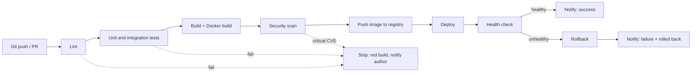
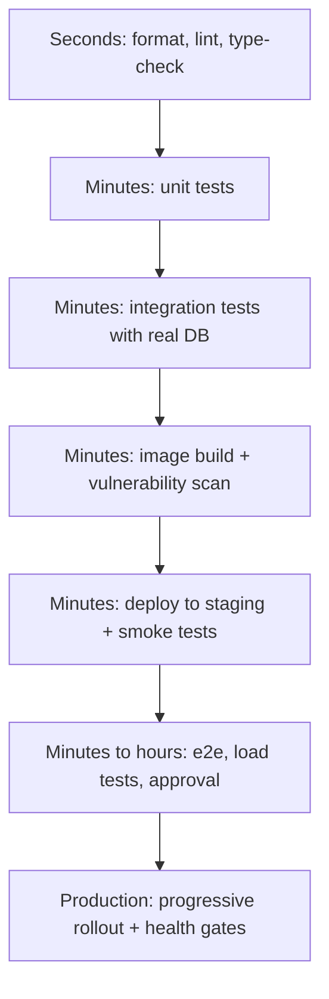

# L5.1 — Designing a CI/CD Pipeline End to End

> **Level 5: CI/CD** · Topic 1 of 12 · ⏱ ~4 hours · Difficulty: Intermediate

## 1. What it is

A **pipeline** is an automated assembly line that carries a code change from `git push` to running, verified software in
production. Each station on the line is a **stage** (lint, test, build, scan, push, deploy, health check, notify). A stage
either passes and hands its output to the next stage, or fails and stops the line so a broken change never reaches users.

Three related terms are often mixed up:

| Term | Meaning | Human approval before production? |
|------|---------|-----------------------------------|
| **Continuous Integration (CI)** | Every change is merged often and automatically built and tested | n/a |
| **Continuous Delivery (CD)** | Every change that passes the pipeline is *releasable*; a human presses the button | Yes |
| **Continuous Deployment (CD)** | Every change that passes the pipeline is released automatically | No |

This topic is about **designing** the whole line: which stages exist, in what order, what each one proves, how fast it must
be, and what happens when something fails. The next topics fill in the tools (GitHub Actions, Docker, secrets) and the
safe-release techniques (rollback, rolling, blue/green, canary). For the conceptual background see
[CI/CD in Level 0](../level-00-what-devops-is/02-ci-cd.md).

## 2. Why it matters in DevOps

- **Speed of feedback:** a developer who learns in 5 minutes that a change broke the build fixes it while the context is
  fresh. A developer who learns after 3 hours (or from a customer) pays a context-switch tax.
- **Safety through repetition:** a deploy done by a script 500 times is more reliable than a runbook followed by a tired
  human at 11 p.m. Pipelines make the boring path the safe path.
- **Cost of a bad design:** a pipeline that runs 40-minute end-to-end tests on every push is ignored; one with no scan
  stage ships known-vulnerable images; one that rebuilds the artifact per environment ships something nobody tested.
- **Auditability:** the pipeline run is the record of *who changed what, what was tested, and what went where*.

## 3. Real-world system example

**Amazon's automated deployment pipelines.** The Amazon Builders' Library article *"Automating safe, hands-off
deployments"* documents the design Amazon teams aim for: the pipeline starts from a commit to the source repository, builds
and tests the change, deploys to pre-production environments, then to production in **waves** (a small slice first,
typically one Region or cell, widening only if monitoring stays healthy), with a **bake time** between waves and
**automatic rollback** when alarms fire. Humans are removed from the routine path; they design the pipeline and respond to
alarms.

**Netflix and Spinnaker.** Netflix created and open-sourced the **Spinnaker** continuous delivery platform. Its pipelines
model deployment as stages (bake an image, deploy a server group, run canary analysis, manual judgment, destroy the old
group). Netflix and Google also open-sourced **Kayenta**, the automated canary analysis service used by Spinnaker. Both are
good references for what a mature pipeline looks like: stages are explicit, the artifact is immutable, and a deployment
only proceeds when measured health says so.

You do not need Amazon's scale to copy the *shape*: ordered stages, an immutable artifact, small blast radius first,
automatic checks, automatic rollback.

## 4. Diagram

The pipeline we build in this level (and in the [capstone](99-capstone-project.md)), including where it stops early:



Order stages by **cost and likelihood of failure**: cheapest and most likely to fail first.



## 5. How it works

### The stages and what each one proves

| Stage | Question it answers | Typical tools | Fails when |
|-------|--------------------|---------------|------------|
| **Trigger** | When does the pipeline run? | `push`, `pull_request`, tag, schedule, manual | n/a |
| **Lint / static analysis** | Is the code well-formed and consistent? | ESLint, ruff, hadolint, `terraform fmt` | style or obvious bug patterns |
| **Test** | Does it behave correctly? | Jest, pytest, JUnit, service containers | assertion fails |
| **Build** | Can we produce a runnable artifact? | npm, Maven, Go, `docker build` | compile or packaging error |
| **Scan** | Is it safe to ship? | Trivy, Grype, Snyk, secret scanners | critical CVE, leaked secret |
| **Push** | Is the artifact stored immutably? | GHCR, ECR, Artifactory | auth or registry failure |
| **Deploy** | Is the new version running where we want? | SSH + Compose, `kubectl`, Helm, CodeDeploy | rollout does not complete |
| **Health check** | Does it actually work in that environment? | `curl /healthz`, smoke tests, metrics | wrong status, wrong version |
| **Notify** | Does the team know the outcome? | Slack, email, GitHub deployments API | n/a |
| **Rollback** | Can we undo it automatically? | previous image, traffic switch | health gate failed |

### Design principles

1. **Fail fast.** Put cheap, likely-to-fail checks first and run independent checks in parallel (lint and unit tests in
   parallel; build waits for both). Aim for a CI result in **under ~10 minutes**; this "ten-minute build" target is an old
   Extreme Programming guideline that still works as a rule of thumb.
2. **Build once, deploy many.** Create the artifact (an image identified by digest) one time, then *promote* that exact
   artifact through staging and production. Only configuration differs. See [L5.6](06-artifacts.md).
3. **Every stage is a gate.** A non-zero exit code stops the line. No "continue-on-error" without a written reason.
4. **Pipeline as code.** The definition lives in the repo (`.github/workflows/*.yml`), is reviewed in pull requests, and is
   versioned with the app.
5. **Idempotent and re-runnable.** Re-running a deploy of the same image changes nothing. This is what makes retry and rollback safe.
6. **Environments are not snowflakes.** Staging and production are created by the same automation; secrets and sizes
   differ. See [L5.5](05-secrets-and-environment-variables.md).
7. **Deploy verification is part of the deploy.** "The command exited 0" is not "the app works". A health gate decides.
8. **Least privilege.** The pipeline gets short-lived, scoped credentials, not an admin key.
9. **Observable.** Log durations per stage; a pipeline that got 3x slower over a year is a bug.

### Branch and environment strategy

| Event | Runs | Deploys to |
|-------|------|-----------|
| Pull request | lint, tests, image build + scan (no push) | nothing (or a preview environment) |
| Merge to `main` | everything + push image | staging automatically |
| Staging healthy | approval gate (optional) | production |
| Manual "rollback" run | deploy of an older image | the chosen environment |

## 6. Step-by-step guide

**Prerequisites:** a free GitHub account and a repository (call it `shop-api`). Optional: Python 3 with PyYAML to
validate files locally. Cost: none (public repos and the free tier include enough Actions minutes for this).

1. **Write the pipeline on paper first.** Create `docs/pipeline.md` in the repo with a table: stage, input, output, time
   budget, what happens on failure. Use the table in section 5 as a starting point. Decide the total budget (for example:
   CI 8 min, staging deploy 3 min).

2. **Create a skeleton workflow with every stage stubbed.** Save as `.github/workflows/pipeline-skeleton.yml`:
   ```yaml
   name: pipeline-skeleton
   on:
     push:
       branches: [main]
     pull_request:

   permissions:
     contents: read

   jobs:
     lint:
       runs-on: ubuntu-24.04
       steps:
         - uses: actions/checkout@v4
         - run: echo "lint ok"
     test:
       runs-on: ubuntu-24.04
       steps:
         - uses: actions/checkout@v4
         - run: echo "tests ok"
     build:
       needs: [lint, test]
       runs-on: ubuntu-24.04
       steps:
         - run: echo "docker build ok"
     scan:
       needs: build
       runs-on: ubuntu-24.04
       steps:
         - run: echo "scan ok"
     push:
       needs: scan
       if: github.ref == 'refs/heads/main'
       runs-on: ubuntu-24.04
       steps:
         - run: echo "push image"
     deploy:
       needs: push
       runs-on: ubuntu-24.04
       steps:
         - run: echo "deploy"
     health-check:
       needs: deploy
       runs-on: ubuntu-24.04
       steps:
         - run: echo "health check"
     notify:
       needs: [push, deploy, health-check]
       if: always() && github.ref == 'refs/heads/main'
       runs-on: ubuntu-24.04
       steps:
         - run: echo "deploy=${{ needs.deploy.result }} health=${{ needs.health-check.result }}"
   ```
   `lint` and `test` have no dependency on each other, so they run **in parallel**. Everything after waits via `needs`.

3. **Validate the YAML locally (optional but quick).**
   ```bash
   python3 -c 'import yaml,sys; yaml.safe_load(open(".github/workflows/pipeline-skeleton.yml")); print("valid YAML")'
   ```
   Expected output: `valid YAML`. For GitHub-specific checks install `actionlint` (a static checker for workflows) and run it in the repo.

4. **Push and watch the graph.** Commit to a branch, open a pull request, then merge. In the **Actions** tab open the run:
   the graph shows `lint` and `test` side by side, then the chain. On the pull request the `push`, `deploy`,
   `health-check` jobs are **skipped** (`if` is false) — exactly the behaviour in the table above.

5. **Prove fail-fast.** Change the `lint` job to `run: exit 1`, push. Result: `lint` is red, and `build`, `scan`, `push`,
   `deploy` never start (shown as skipped). Revert.

6. **Measure.** Open the run summary and note each job's duration. Write the numbers in `docs/pipeline.md` as your baseline;
   in later topics you will make real stages replace the stubs and keep the total inside the budget.

## 7. Real-world scenario

*(Illustrative.)* A team of six at a small e-commerce company deploys `shop-api` by SSH-ing into a server and running
`git pull && npm install && pm2 restart`. One Friday a developer deploys a change that works on their laptop but
needs a new environment variable; the app boots and crashes in a loop. There is no health check and the previous
`node_modules` were overwritten, so nobody can quickly return to the old version. It takes 90 minutes to recover.

The team designs a pipeline: PR checks (lint + tests) required to merge; on merge an image tagged with the commit SHA is built,
scanned and pushed; a deploy job pulls *that exact image* on the server and then calls `/healthz`; if the response
is not `ok` for the new version within two minutes, the job redeploys the previous image and posts to Slack.
The next missing-variable mistake is caught by the health check, auto-rolled-back in under three minutes, and shows
up as a red Slack message instead of a customer complaint.
**Lesson:** the pipeline is not about speed alone; it is about turning "unknown unknowns at deploy time" into cheap, automatic, reversible failures.

## 8. Common mistakes and best practices

**Don't**

- Rebuild the artifact per environment ("it passed on staging" then means nothing for production).
- Put slow end-to-end tests *before* lint and unit tests.
- Let the pipeline pass when a stage is skipped or errors are ignored (`|| true`, `continue-on-error`).
- Deploy by tag name like `latest` — you cannot tell what is running or return to it.
- Give the pipeline a long-lived admin credential, or print secrets in logs.
- Treat a flaky pipeline as normal: people learn to click "re-run" and stop trusting red.

**Do**

- Keep a time budget per stage and alert when it is exceeded.
- Run independent jobs in parallel; use caching for dependencies and image layers.
- Make deploys idempotent and always verify with a health gate that checks the **version**, not just "200 OK".
- Require the pipeline to pass before merge (branch protection) — see [protected branches](../level-03-git-and-github/08-protected-branches-and-pull-requests.md).
- Notify on failure *and* on automatic rollback, and include a link to the run.
- Keep a documented, tested manual override (a "deploy this SHA" workflow) for when the automation is the problem.

## 9. Tasks

- [ ] **T1 — Run the skeleton pipeline** *(≈30 min, beginner)*
  - **Goal:** see a multi-stage pipeline with parallel and sequential jobs.
  - **Steps:**
    1. Create the repo and add `pipeline-skeleton.yml` from step 2.
    2. Open a pull request, then merge it.
    3. Compare the run graph for the PR and for the merge.
  - **Done when:** the PR run skips `push`/`deploy`/`health-check` and the `main` run executes all of them.

- [ ] **T2 — Prove fail-fast** *(≈20 min, beginner)*
  - **Goal:** show that a failed early stage prevents later stages.
  - **Steps:**
    1. Make `lint` exit with code 1.
    2. Push and open the run.
    3. Revert and confirm green.
  - **Done when:** you can point to `build`..`deploy` marked skipped in the failing run and green in the fixed run.

- [ ] **T3 — Write the stage contract** *(≈40 min, intermediate)*
  - **Goal:** define what each stage consumes, produces and how long it may take.
  - **Steps:**
    1. Create `docs/pipeline.md` with a row per stage: input, output, time budget, failure action.
    2. Add the sequence number of the stage and whether it blocks merge.
    3. Add a "who is notified" column.
  - **Done when:** every stage in the diagram has a row and no row says "TBD".

- [ ] **T4 — Optimise order** *(≈45 min, intermediate)*
  - **Goal:** reduce feedback time by re-ordering and parallelising.
  - **Steps:**
    1. Add `sleep 60` to `test` and `sleep 20` to `lint`.
    2. Record total time with `lint` and `test` chained (`test` needs `lint`) versus parallel.
    3. Record time until the *first* failure if lint fails.
  - **Done when:** you have two measured totals and can explain which layout gives the fastest failure signal.

- [ ] **T5 — Add a manual gate** *(≈30 min, intermediate)*
  - **Goal:** model continuous delivery (human approval) for production.
  - **Steps:**
    1. Create a GitHub **Environment** named `production` with a required reviewer (Settings → Environments).
    2. Add `environment: production` to a new `deploy-prod` job that `needs: health-check`.
    3. Merge a change and approve the deployment from the run page.
  - **Done when:** the run pauses at `deploy-prod` showing "Waiting for approval" and continues after you approve.

- [ ] **T6 — Prove it: design a pipeline for a new service** *(≈45 min, advanced)*
  - **Goal:** apply the principles to a service you have not seen.
  - **Steps:**
    1. Without the guide, draw (Mermaid or paper) a pipeline for a Python API with a PostgreSQL migration and a container image.
    2. Mark the fail-fast order, where the artifact is created, where it is promoted, and the health gate.
    3. Explain to a teammate (or write 6 sentences) why each stage is where it is.
  - **Done when:** your diagram has all ten stages from section 5, one artifact build, and a stated rollback path.

## 10. Self-check questions

1. What is the difference between continuous delivery and continuous deployment?
2. Why should lint run before integration tests, and why can lint and unit tests run in parallel?
3. What does "build once, deploy many" mean, and what goes wrong if you rebuild per environment?
4. Why is a health check that only tests for HTTP 200 insufficient after a deploy?
5. Name three things that make a pipeline slow and trusted less over time.

<details>
<summary>Answers</summary>

1. Delivery keeps every passing change releasable but requires a human to release; deployment releases every passing change automatically.
2. Lint is seconds and catches many errors, so it saves minutes of expensive stages. Lint and unit tests do not depend on each other's output, so parallel execution shortens the critical path.
3. One immutable artifact (image digest) is created and then promoted through environments with only configuration changing. Rebuilding can pick up different dependencies or base-image content, so production runs something never tested.
4. The old version might still be answering 200 (deploy did not take effect), or the app can be up but broken (database unreachable). Check the reported version and a dependency-aware endpoint.
5. Serial stages that could be parallel, no dependency or layer caching, slow end-to-end tests on every push, flaky tests that train people to re-run, undersized runners, rebuilding things that did not change.
</details>

## 11. Further reading

- *Continuous Delivery* by Jez Humble and David Farley — the origin of the deployment pipeline pattern.
- Amazon Builders' Library: *Automating safe, hands-off deployments*.
- *Accelerate* by Nicole Forsgren, Jez Humble and Gene Kim — research linking delivery practices to performance (the DORA metrics).
- Spinnaker documentation (spinnaker.io) — a reference for pipeline stage concepts.
- GitHub Docs: *Understanding GitHub Actions* (documentation root: docs.github.com/actions).
- See also [Deployment strategies in Level 0](../level-00-what-devops-is/07-deployment-strategies.md) and [GitHub Actions workflows in Level 3](../level-03-git-and-github/11-github-actions-workflows.md).

<!-- nav -->
---
← Previous level: [Level 4 — Docker](../level-04-docker/README.md) · [Level 5 index](README.md) · Next: [GitHub Actions for CI/CD](02-github-actions-pipelines.md) →
