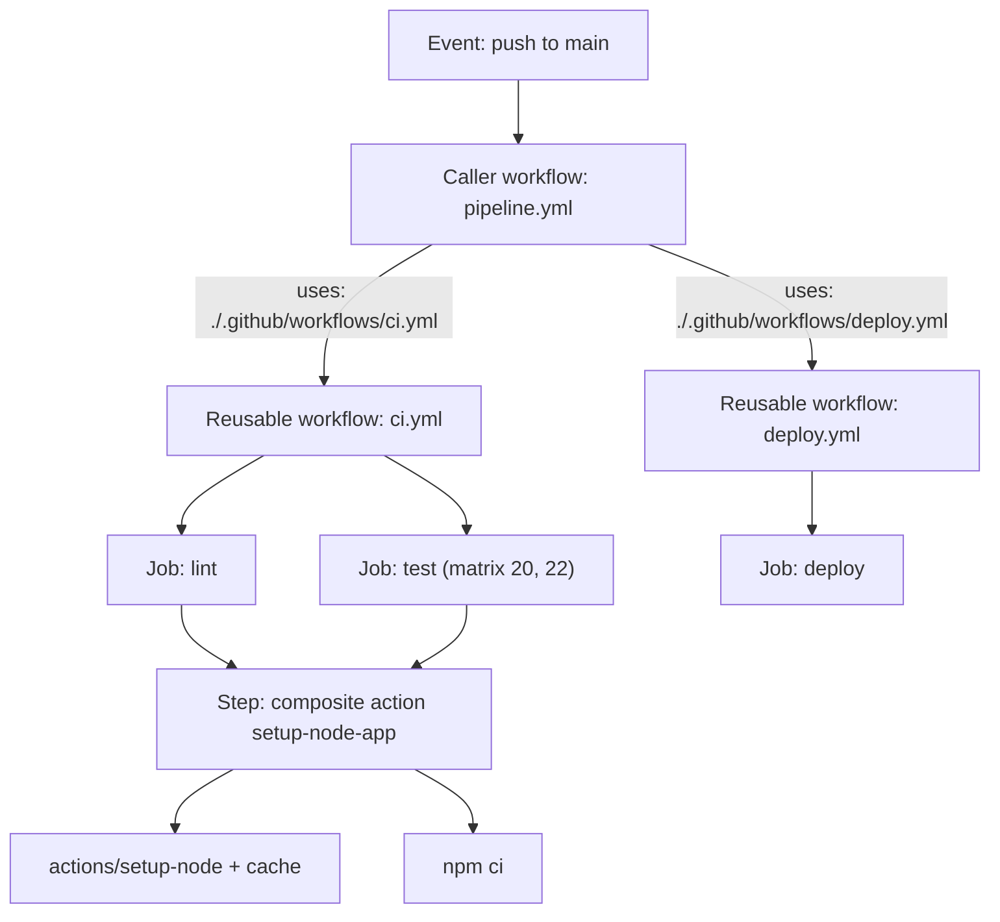
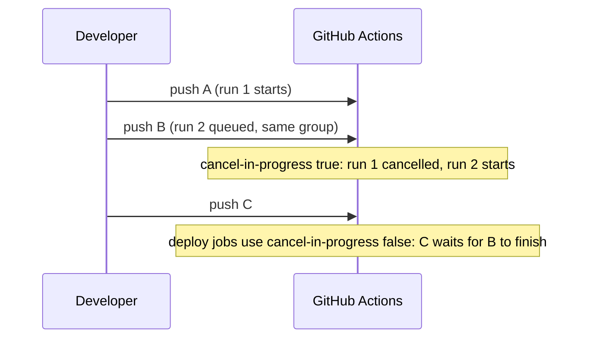

# L5.2 — GitHub Actions for CI/CD

> **Level 5: CI/CD** · Topic 2 of 12 · ⏱ ~5 hours · Difficulty: Intermediate

## 1. What it is

**GitHub Actions** is GitHub's built-in automation engine. A **workflow** is a YAML file in `.github/workflows/` that
starts on an **event** (push, pull request, schedule, manual dispatch, another workflow), runs one or more **jobs**
on **runners** (fresh virtual machines or containers), and each job is a sequence of **steps** (shell commands or reusable
**actions**). If you have not used it yet, read [GitHub Actions: Workflows, Jobs and Triggers](../level-03-git-and-github/11-github-actions-workflows.md) first.

This topic is about the features that turn a single workflow file into a maintainable **CI/CD system**: 

- **Reusable workflows** — a whole workflow that other workflows call like a function.
- **Composite actions** — a bundle of steps packaged as one step.
- **Matrix builds** — one job definition fanned out over versions/platforms.
- **Caching** — reusing downloaded dependencies and build layers between runs.
- **Concurrency** — controlling what happens when two runs of the same thing overlap.

## 2. Why it matters in DevOps

- **Copy-paste drift:** a team with 30 repositories and 30 slightly different `deploy.yml` files has 30 places to fix a
  security problem. Reusable workflows make it one.
- **Wasted minutes (money):** installing dependencies from scratch on every run is the most common cause of slow, expensive pipelines. Caching and cancelling superseded runs commonly cut runtime and billed minutes substantially.
- **Race conditions in production:** two merges a minute apart can start two overlapping deploys. Without `concurrency`, the older one may finish *last* and leave production on the older version.
- **Compatibility:** a library that supports Node 20 and 22 must be tested on both; a matrix does it without duplicating YAML.

## 3. Real-world system example

**Homebrew.** The Homebrew package manager's CI runs on GitHub Actions: every pull request to its core formulae
repository triggers builds and tests across several macOS versions and Linux — a natural matrix — and built packages
("bottles") are produced by workflows rather than by hand. Large open-source projects commonly run the same job across many OS and language-version combinations, which is exactly the matrix feature.

**GitHub itself publishes the runner images.** The virtual machine images used by GitHub-hosted runners (`ubuntu-24.04`,
`windows-2022`, `macos-14` ...) are built from a public repository, `actions/runner-images`, which also lists the
preinstalled software for each image. That is why you can write `runs-on: ubuntu-24.04` and rely on `docker`, `git`, `jq`
and `curl` being present.

Many organisations keep one shared repository (often called something like `.github` or `workflows`) containing the
company-standard reusable workflows (`build-image.yml`, `deploy.yml`) that every service calls with a few inputs.

## 4. Diagram

How a caller, a reusable workflow and a composite action nest:



What `concurrency` does to overlapping runs:



## 5. How it works

### Reusable workflows (`workflow_call`)

A reusable workflow declares inputs, secrets and outputs under `on: workflow_call`. A caller uses it at the **job** level:

```yaml
# .github/workflows/ci.yml  (the reusable one)
on:
  workflow_call:
    inputs:
      node-version:
        type: string
        default: "22"
    outputs:
      coverage:
        value: ${{ jobs.test.outputs.coverage }}
    secrets:
      NPM_TOKEN:
        required: false
```

```yaml
# caller
jobs:
  ci:
    uses: ./.github/workflows/ci.yml          # same repo
    with:
      node-version: "22"
    secrets: inherit                           # pass the caller's secrets down
  other:
    uses: my-org/shared-workflows/.github/workflows/build.yml@v1   # another repo, pinned
```

Rules worth memorising: a reusable workflow **cannot be a step** (only a job); the caller job can have `needs`, `if`,
`with`, `secrets`, `permissions` (the callee can only keep or reduce them) but not `runs-on` or `steps`; the called workflow's
`github` context is the *caller's*; nesting depth is limited, so check the docs rather than building deep chains.

### Composite actions

A composite action packages **steps** (not jobs). It lives in a folder with an `action.yml`:

| | Reusable workflow | Composite action |
|---|---|---|
| Unit of reuse | whole job(s) | a group of steps inside one job |
| Runs on | its own runner(s) | the caller job's runner |
| Can use `secrets:` | yes (declared) | no, pass as inputs |
| Called with | `jobs.<id>.uses` | `steps[*].uses` |
| Typical use | "build and test", "deploy to env" | "set up Node, restore cache, install" |

### Matrix

```yaml
strategy:
  fail-fast: false            # let all combinations finish; default is true
  max-parallel: 4
  matrix:
    node: [20, 22]
    os: [ubuntu-24.04, ubuntu-22.04]
    include:
      - node: 24
        os: ubuntu-24.04
    exclude:
      - node: 20
        os: ubuntu-22.04
```

Use `${{ matrix.node }}` in steps. Each combination is its own job (and its own billed run). In branch protection, require the
matrix jobs' names, or add a final "gate" job with `needs` on all of them.

### Caching

| Mechanism | What it caches | Key idea |
|-----------|----------------|----------|
| `actions/setup-node` with `cache: npm` | npm download cache | keyed on `package-lock.json` hash |
| `actions/cache@v4` | any path | `key` (exact) + `restore-keys` (prefix fallback) |
| Docker `cache-from/to: type=gha` | BuildKit layers | see [L5.4](04-docker-builds-and-registries.md) |

```yaml
- uses: actions/cache@v4
  with:
    path: ~/.cache/pip
    key: pip-${{ runner.os }}-${{ hashFiles('requirements*.txt') }}
    restore-keys: |
      pip-${{ runner.os }}-
```

Facts to know: a cache is **immutable** once saved for a key (change the key to refresh it); caches are scoped by branch
(a run can restore caches from its own branch and from the default branch, not from sibling branches); each repository has a
size limit (10 GB at the time of writing) and unused entries are evicted (after 7 days without access). A cache is an
*optimisation*: your build must succeed on a cache miss. Never cache secrets or build outputs you intend to ship — use
[artifacts](06-artifacts.md) for that.

### Concurrency

```yaml
concurrency:
  group: ${{ github.workflow }}-${{ github.ref }}
  cancel-in-progress: true        # for CI: only the newest commit matters
```

```yaml
concurrency:
  group: deploy-production
  cancel-in-progress: false       # for deploys: queue, never kill a half-finished deploy
```

At most one run **per group** is running and (at most) one is pending; a newer pending run replaces an older pending one.
**Pitfall:** if a caller and the workflow it calls declare the *same* group, the callee can cancel itself or its caller. Put
the group on the caller, or use distinct group names.

### Other things you will use constantly

- `permissions:` — set to `contents: read` by default at the top, widen per job (least privilege).
- `needs`, `if`, `outputs` — wire jobs together; `if: always()` runs notification jobs even after failures.
- `environment:` — links a job to an Environment with secrets, variables and approvals ([Environments](../level-03-git-and-github/12-environments-and-secrets.md)).
- `timeout-minutes:` — always set it; the default is 360 minutes.
- Pin third-party actions to a **full commit SHA** (or at least a major tag you trust); actions run with your token.

## 6. Step-by-step guide

**Prerequisites:** a GitHub repository with a small Node.js project (`package.json` with a `test` script; `npm init -y` and
`"test": "node --test"` is enough). Cost: free for public repos.

1. **Create a composite action.** Save as `.github/actions/setup-app/action.yml`:
   ```yaml
   name: Setup app
   description: Install Node.js with npm cache and install dependencies
   inputs:
     node-version:
       description: Node.js version
       default: "22"
   runs:
     using: composite
     steps:
       - uses: actions/setup-node@v4
         with:
           node-version: ${{ inputs.node-version }}
           cache: npm
       - name: Install
         shell: bash
         run: npm ci
   ```
   Every `run` step in a composite action **must** declare `shell`.

2. **Create a reusable workflow with a matrix.** Save as `.github/workflows/test.yml`:
   ```yaml
   name: test
   on:
     workflow_call:
       inputs:
         versions:
           type: string
           default: '["20","22"]'

   permissions:
     contents: read

   jobs:
     test:
       runs-on: ubuntu-24.04
       timeout-minutes: 10
       strategy:
         fail-fast: false
         matrix:
           node: ${{ fromJSON(inputs.versions) }}
       steps:
         - uses: actions/checkout@v4
         - uses: ./.github/actions/setup-app
           with:
             node-version: ${{ matrix.node }}
         - run: npm test
   ```
   `fromJSON` turns a JSON string input into a list — the standard trick for a dynamic matrix.

3. **Create the caller with concurrency.** Save as `.github/workflows/ci.yml`:
   ```yaml
   name: ci
   on:
     pull_request:
     push:
       branches: [main]

   concurrency:
     group: ci-${{ github.ref }}
     cancel-in-progress: true

   permissions:
     contents: read

   jobs:
     test:
       uses: ./.github/workflows/test.yml
       with:
         versions: '["20","22"]'
   ```

4. **Run it and read the logs.** Push a branch, open a PR. In **Actions** you see two jobs: `test / test (20)` and
   `test / test (22)`. On the first run the `Setup Node` step ends with `Cache not found`.

5. **Prove caching works.** Re-run the workflow (Re-run all jobs). The log of `Setup Node` should now say
   `Cache restored from key: node-cache-Linux-x64-npm-<hash>` and `npm ci` becomes noticeably faster.

6. **Prove concurrency works.** Add `sleep 60` to the test step, push, then push again within 30 seconds. The first run
   shows **Cancelled**; the second runs to completion.

7. **Validate locally** (optional). Run `python3 -c 'import yaml;[yaml.safe_load(open(f)) for f in ["a.yml"]]'` for syntax or
   install `actionlint` for GitHub-specific errors like a missing `shell:` or a bad `needs` reference.

## 7. Real-world scenario

*(Illustrative.)* A platform team owns 24 microservices. Each has its own copy of a 120-line `deploy.yml`. A routine
audit shows 9 of them still use a deprecated action version, 5 deploy with an over-broad token, and 3 can deploy two
builds at once. Fixing it means 24 pull requests.

The team writes one reusable `deploy.yml` in a shared repository with inputs (`environment`, `image`, `version`), sets
`permissions` explicitly, adds a `concurrency` group per environment with `cancel-in-progress: false`, and publishes it as a
tagged release `v1`. Each service shrinks to a 15-line caller. The next security fix is one commit and a retag; services pick
it up on their next run (or via a Dependabot bump of the `@v1` ref). **Lesson:** reuse turns CI/CD from per-repo craft into a maintained product.

## 8. Common mistakes and best practices

**Don't**

- Give workflows `permissions: write-all` or leave the default broad token scope.
- Use the same `concurrency.group` in a caller and the workflow it calls.
- Use `cancel-in-progress: true` on production deploys.
- Rely on a cache for correctness (a miss must still work), or put secrets in a cached path.
- Reference unpinned third-party actions on `@main`.
- Forget `shell:` in composite action `run` steps, or try to use `secrets` directly inside a composite action.

**Do**

- Put shared logic in reusable workflows (jobs) and shared step groups in composite actions, and version them (`@v1`).
- Use `fail-fast: false` for compatibility matrices where you want the full picture.
- Add `timeout-minutes` to every job and `if: always()` for notification jobs.
- Use a final "gate" job so branch protection needs only one required check.
- Prefer `${{ hashFiles('**/package-lock.json') }}`-style keys so the cache invalidates when dependencies change.

## 9. Tasks

- [ ] **T1 — Build and call a composite action** *(≈30 min, beginner)*
  - **Goal:** package repeated setup steps.
  - **Steps:**
    1. Create `.github/actions/setup-app/action.yml` as in step 1.
    2. Use it in a workflow with `uses: ./.github/actions/setup-app` after `actions/checkout`.
  - **Done when:** the run shows the composite action expanded into its inner steps and `npm ci` succeeded.

- [ ] **T2 — Matrix across versions** *(≈30 min, beginner)*
  - **Goal:** test on Node 20 and 22 from one job definition.
  - **Steps:**
    1. Add the `strategy.matrix` block from step 2.
    2. Add a third version and an `exclude` entry for one combination.
  - **Done when:** the Actions UI lists exactly the combinations you intended, each with its own green check.

- [ ] **T3 — Prove the cache** *(≈30 min, intermediate)*
  - **Goal:** measure caching.
  - **Steps:**
    1. Run once on a cold cache and note the `npm ci` step time.
    2. Re-run and note the time again.
    3. Change a dependency in `package-lock.json` and run a third time.
  - **Done when:** you have three timings and a log line proving a cache hit on run 2 and a miss (or `restore-keys` fallback) on run 3.

- [ ] **T4 — Concurrency: cancel and queue** *(≈40 min, intermediate)*
  - **Goal:** use both concurrency modes.
  - **Steps:**
    1. Add `cancel-in-progress: true` to CI and verify with two quick pushes.
    2. Add a dummy `deploy` job with `concurrency: { group: deploy, cancel-in-progress: false }` and `sleep 45`.
    3. Trigger two deploys in a row.
  - **Done when:** CI shows a cancelled run; the second deploy shows `Pending` until the first completes.

- [ ] **T5 — Break and fix a reusable workflow** *(≈40 min, intermediate)*
  - **Goal:** learn the sharp edges.
  - **Steps:**
    1. In the reusable workflow, reference `secrets.MY_SECRET` without declaring it under `workflow_call.secrets` and call it without `secrets: inherit`.
    2. Observe that the value is empty; fix by declaring and passing it (or use `secrets: inherit`).
    3. Set the same `concurrency.group` in caller and callee and watch the problem; rename one.
  - **Done when:** you can explain each failure from the run logs and both are fixed.

- [ ] **T6 — Prove it: shared workflow library** *(≈60 min, advanced)*
  - **Goal:** publish a versioned reusable workflow and consume it from a second repository.
  - **Steps:**
    1. Without the guide, create repo `workflows` with `.github/workflows/test.yml` (`workflow_call`), tag it `v1`.
    2. In `shop-api`, call it with `uses: <you>/workflows/.github/workflows/test.yml@v1`.
    3. Explain in writing the difference between this and a composite action and when you would use each.
  - **Done when:** the `shop-api` run executes the shared workflow from the other repository at ref `v1`.
  - *(The shared repository must be public, or its Actions access setting must allow other repos to use it.)*

## 10. Self-check questions

1. When would you choose a reusable workflow over a composite action?
2. What does `cancel-in-progress: true` do, and why is it wrong for deployments?
3. A cache key is `npm-${{ hashFiles('package-lock.json') }}`. When is a new cache created?
4. Why can a reusable workflow not use `runs-on` set by the caller?
5. What is the risk of `uses: someone/action@main`?

<details>
<summary>Answers</summary>

1. When you want to reuse whole jobs (own runner, own secrets/permissions handling, outputs), e.g. "deploy to environment". Composite actions reuse a handful of steps inside a job you already have.
2. It cancels the running run of the same group when a newer one starts. Killing a deploy halfway can leave the system in a mixed state; use queueing (`false`) for deploys.
3. When the hash of the lockfile changes (dependencies changed). With an unchanged lockfile the key matches and the existing cache is restored.
4. The reusable workflow defines its own jobs, and each job declares its own `runs-on`; the caller only invokes the workflow (it can pass the runner label as an input if the author supports it).
5. The ref is mutable; an upstream change (or compromise) runs inside your workflow with your token. Pin a commit SHA or a trusted release tag.
</details>

## 11. Further reading

- GitHub Docs: *Reusing workflows*, *Creating a composite action*, *Running variations of jobs in a workflow* (matrix),
  *Dependency caching reference*, *Control the concurrency of workflows and jobs* — all under docs.github.com/actions.
- `actions/runner-images` repository — the software installed on GitHub-hosted runners.
- `actionlint` project (static checker for workflow files).
- Next: [Automated testing in pipelines](03-automated-testing.md) and [Docker builds in CI](04-docker-builds-and-registries.md).

<!-- nav -->
---
← Previous: [Designing a CI/CD Pipeline End to End](01-pipeline-design.md) · [Level 5 index](README.md) · Next: [Automated Testing in Pipelines](03-automated-testing.md) →
