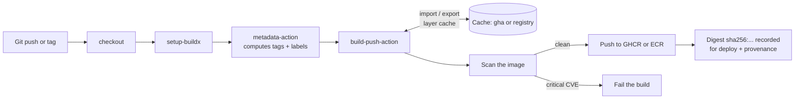
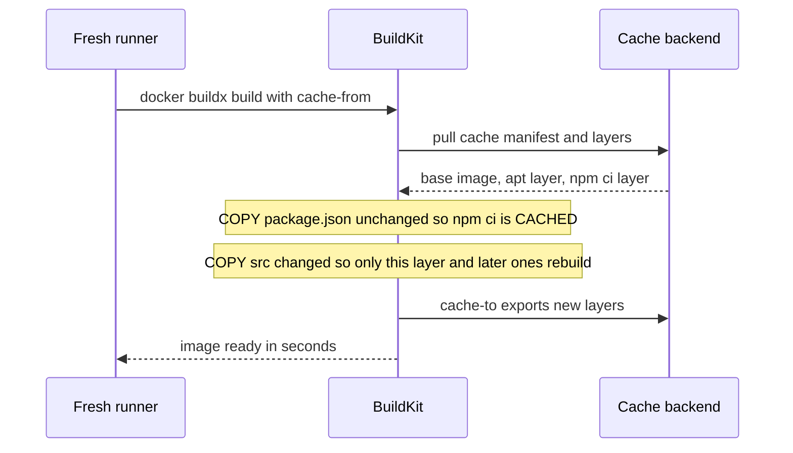

# L5.4 — Docker Image Builds and Registries in CI

> **Level 5: CI/CD** · Topic 4 of 12 · ⏱ ~5 hours · Difficulty: Intermediate

## 1. What it is

In CI, a Docker image is the **deployable artifact**: the build stage turns source code into an image, gives it a unique name,
and stores it in a **registry** (a server that stores and serves images) so that every later stage and every environment pulls
the *same bytes*. If you need a refresher on images, layers and registries, read
[Images and Layers](../level-04-docker/02-images-and-layers.md) and [Registries](../level-04-docker/04-registries.md) first.

Three ideas make this work well in a pipeline:

- **BuildKit / `buildx`** — `docker buildx build` is the modern builder front-end (BuildKit under the hood). It builds layers in
  parallel, supports **cache import/export** to places that survive a throw-away CI runner, and can build **multi-platform**
  images (for example `linux/amd64` and `linux/arm64`) in one command.
- **Layer cache in CI** — a CI runner starts empty every time, so without an external cache each build re-downloads and
  re-installs everything. You export the cache to GitHub's cache service or to the registry and import it on the next run.
- **Tagging strategy** — a tag is a movable label on an image. The tags you create decide whether you can answer "what exactly is
  running in production, and can I get back to the previous one?"

## 2. Why it matters in DevOps

- **Reproducibility and rollback:** if production runs `shop-api:latest`, you cannot say which commit it is, and "roll back" has
  no target. If it runs `shop-api:sha-3f2a9c1...`, the answer is exact and the previous version is still in the registry.
- **Speed and cost:** an uncached Node.js or Java image build can take many minutes of billed runner time; a good cache turns it into
  seconds when only application code changed.
- **Supply chain:** the registry is where an attacker would love to slip in a modified image. Immutable tags, short-lived push
  credentials, scanning before pushing, and provenance attestations all live in this stage.
- **Cost of registries:** untagged and stale images accumulate and are billed as storage; lifecycle rules are part of the design.

## 3. Real-world system example

**GitHub Container Registry (GHCR) and Docker's official build actions.** Docker maintains the GitHub Actions used in most
public pipelines: `docker/setup-buildx-action`, `docker/login-action`, `docker/metadata-action` (computes tags and labels from the
Git event) and `docker/build-push-action`. The Docker documentation describes the `gha` cache backend, which stores BuildKit layer
cache in the GitHub Actions cache service, and a `registry` backend, which stores it as an image in your registry. GitHub's own
registry, `ghcr.io`, accepts pushes authenticated with the workflow's built-in `GITHUB_TOKEN` when the job is granted
`packages: write`, so a public project needs no stored registry password at all.

**Amazon ECR.** On AWS, teams push to Amazon Elastic Container Registry. ECR supports **immutable tags** (a repository setting that
rejects pushing a tag that already exists), **lifecycle policies** that expire old images, and **image scanning**. In CI the
recommended pattern is for GitHub Actions to assume an IAM role through OpenID Connect (OIDC) instead of storing AWS keys; see
[L5.5](05-secrets-and-environment-variables.md).

Kubernetes-ecosystem projects also publish their official images as **multi-architecture** images, so one tag works on both
Intel/AMD and Arm nodes. That is the same `--platform linux/amd64,linux/arm64` feature shown below.

## 4. Diagram



How the cache turns a rebuild into seconds (a Node.js Dockerfile where only `src/` changed):



## 5. How it works

### Tagging strategy

A tag points at a **manifest digest** (`sha256:...`). Tags can be moved; digests cannot. Use tags for humans and digests for machines.

| Tag | Example | Mutable? | Use |
|-----|---------|----------|-----|
| **Commit SHA** | `sha-3f2a9c1e...` (full 40 chars) | No (treat as write-once) | The deploy identity. Every build gets one. Trace any running container to a commit. |
| **Semantic version** | `1.4.2`, `1.4`, `1` | `1.4.2` no, `1.4` and `1` move | Release tags created from Git tags `v1.4.2` ([SemVer](../level-03-git-and-github/10-semantic-versioning-and-releases.md)). |
| **Branch** | `main`, `pr-123` | Yes | Convenience for humans and preview environments. Never deploy production from it. |
| **`latest`** | `latest` | Yes | Convenience only. Avoid in manifests: it is not a version, so rollback and audit break. |
| **Digest** | `shop-api@sha256:9f86d0...` | No, by construction | The strongest pin; what GitOps tools and admission policies compare. |

Rule of thumb: **build and push by SHA on every merge; add SemVer tags only on release; deploy by SHA or digest.**
Set repository tag immutability where the registry supports it (ECR does; GHCR tags are mutable, so rely on convention + digests).

### Cache backends

| Backend | `cache-to` / `cache-from` | Notes |
|---------|---------------------------|-------|
| `gha` | `type=gha,mode=max` | Easiest in GitHub Actions. Shares the repository cache quota (10 GB at the time of writing; old entries are evicted), scoped by branch rules. |
| `registry` | `type=registry,ref=ghcr.io/acme/shop-api:buildcache,mode=max` | Works on any CI and between machines; costs registry storage. |
| `inline` | `type=inline` | Embeds cache metadata into the pushed image. Simple, but only exports the final stage layers. |
| `local` | `type=local,dest=/tmp/cache` | For self-hosted runners with a persistent disk. |

`mode=max` exports layers of **all** stages (essential for multi-stage builds); the default `mode=min` exports only the final image's layers.
Layer order in the Dockerfile still matters most: copy lockfiles and install dependencies **before** copying source
([Layer caching](../level-04-docker/09-layer-caching-and-optimization.md)). A cache is an optimisation, never a correctness
mechanism: a cache miss must still build correctly.

### Key actions and what they do

| Action | Purpose |
|--------|---------|
| `docker/setup-buildx-action@v3` | Creates a BuildKit builder (needed for the `gha` cache and multi-platform). |
| `docker/setup-qemu-action@v3` | Registers CPU emulators so an x86 runner can build Arm images (slow; native Arm runners are faster). |
| `docker/login-action@v3` | Logs in to `ghcr.io`, ECR or Docker Hub. |
| `docker/metadata-action@v5` | Turns the Git event (branch, tag, SHA) into image tags and OCI labels. |
| `docker/build-push-action@v6` | Runs the build, applies the cache, optionally pushes, outputs the `digest`. |

Action major versions keep moving; check each action's releases page and pin to a full commit SHA in security-sensitive pipelines.

### Registry authentication

| Registry | Authentication in CI | Stored secret? |
|----------|----------------------|----------------|
| GHCR | `GITHUB_TOKEN` with job permission `packages: write` | none |
| ECR | `aws-actions/configure-aws-credentials` with OIDC role, then `aws-actions/amazon-ecr-login` | none |
| Docker Hub | access token in `secrets.DOCKERHUB_TOKEN` | yes, rotate it |

### Provenance and SBOM

BuildKit can attach **attestations** to the pushed image: a *provenance* record (which workflow, commit and builder produced it)
and an *SBOM* (software bill of materials: the list of packages inside). Enable with `provenance: mode=max` and `sbom: true` on
`build-push-action`; GitHub can also sign build provenance with `actions/attest-build-provenance`. Recent `buildx` versions add a
minimal provenance attestation by default, which makes the pushed object an index (a manifest list) containing extra
"unknown/unknown" entries; some older tools display that oddly. See [L5.6](06-artifacts.md) for how provenance is used.

## 6. Step-by-step guide

**Prerequisites:** a GitHub repository `shop-api` (public is free; private uses your plan's minutes and package storage), Docker
installed locally to test (`docker version`). No cloud account needed for the GHCR path; the ECR variant at the end needs an AWS
account (a single repository costs almost nothing, but follow the cleanup in task T4).

1. **Write a cache-friendly Dockerfile.** Save as `Dockerfile` in the repo root:
   ```dockerfile
   # syntax=docker/dockerfile:1
   FROM node:22-alpine AS deps
   WORKDIR /app
   COPY package.json package-lock.json ./
   RUN --mount=type=cache,target=/root/.npm npm ci --omit=dev

   FROM node:22-alpine AS runtime
   ENV NODE_ENV=production
   WORKDIR /app
   COPY --from=deps /app/node_modules ./node_modules
   COPY src ./src
   COPY package.json ./
   USER node
   EXPOSE 3000
   CMD ["node", "src/server.js"]
   ```
   The lockfile is copied *before* `src`, so editing code does not invalidate the `npm ci` layer.

2. **Build locally with buildx and see the cache work.**
   ```bash
   docker buildx version
   docker buildx build -t shop-api:dev --load .
   touch src/server.js            # simulate a code change
   docker buildx build -t shop-api:dev --load .
   ```
   The second build prints `CACHED` next to the `npm ci` step and only re-runs `COPY src`. (Output is similar to
   `=> CACHED [deps 3/3] RUN --mount=type=cache,target=/root/.npm npm ci --omit=dev`.)

3. **Create the workflow.** Save as `.github/workflows/docker-image.yml`:
   ```yaml
   name: docker-image

   on:
     push:
       branches: [main]
       tags: ["v*.*.*"]
     pull_request:

   concurrency:
     group: docker-${{ github.ref }}
     cancel-in-progress: true

   permissions:
     contents: read

   env:
     REGISTRY: ghcr.io
     IMAGE_NAME: ${{ github.repository }}

   jobs:
     image:
       runs-on: ubuntu-24.04
       timeout-minutes: 20
       permissions:
         contents: read
         packages: write          # push to GHCR with GITHUB_TOKEN
         id-token: write          # needed by attestation signing
         attestations: write
       outputs:
         digest: ${{ steps.build.outputs.digest }}
       steps:
         - uses: actions/checkout@v4

         - uses: docker/setup-buildx-action@v3

         - name: Log in to GHCR
           if: github.event_name != 'pull_request'
           uses: docker/login-action@v3
           with:
             registry: ${{ env.REGISTRY }}
             username: ${{ github.actor }}
             password: ${{ secrets.GITHUB_TOKEN }}

         - name: Compute tags and labels
           id: meta
           uses: docker/metadata-action@v5
           with:
             images: ${{ env.REGISTRY }}/${{ env.IMAGE_NAME }}
             flavor: latest=false
             tags: |
               type=sha,format=long,prefix=sha-
               type=semver,pattern={{version}}
               type=semver,pattern={{major}}.{{minor}}
               type=ref,event=branch
               type=ref,event=pr

         - name: Build (and push on main or tags)
           id: build
           uses: docker/build-push-action@v6
           with:
             context: .
             push: ${{ github.event_name != 'pull_request' }}
             tags: ${{ steps.meta.outputs.tags }}
             labels: ${{ steps.meta.outputs.labels }}
             cache-from: type=gha
             cache-to: type=gha,mode=max
             provenance: mode=max
             sbom: true

         - name: Attest build provenance
           if: github.event_name != 'pull_request'
           uses: actions/attest-build-provenance@v2
           with:
             subject-name: ${{ env.REGISTRY }}/${{ env.IMAGE_NAME }}
             subject-digest: ${{ steps.build.outputs.digest }}
             push-to-registry: true

         - name: Summary
           run: |
             echo "### Image" >> "$GITHUB_STEP_SUMMARY"
             echo "digest: \`${{ steps.build.outputs.digest }}\`" >> "$GITHUB_STEP_SUMMARY"
             echo '```' >> "$GITHUB_STEP_SUMMARY"
             echo "${{ steps.meta.outputs.tags }}" >> "$GITHUB_STEP_SUMMARY"
             echo '```' >> "$GITHUB_STEP_SUMMARY"
   ```
   On a pull request the image is **built but not pushed** (it proves the Dockerfile works and warms the cache).
   `metadata-action` lowercases the image name for you, which matters because GHCR names must be lowercase.

4. **Run it.** Push to a branch and open a PR: the job builds, nothing is pushed. Merge to `main`: the run pushes
   `ghcr.io/<you>/shop-api:sha-<40-char-sha>` and `:main`. The step summary shows the digest. Create and push a tag:
   ```bash
   git tag v0.1.0 && git push origin v0.1.0
   ```
   The tag run pushes `0.1.0` and `0.1` as well.

5. **Prove the cache.** Re-run the job, or push a change that touches only `src/`. In the `build-push-action` log look for
   `CACHED` lines and for `importing cache manifest from gha:...`. The job duration should drop clearly compared with run 1.

6. **Pull the exact image by digest and inspect it.**
   ```bash
   docker pull ghcr.io/<you>/shop-api@sha256:<digest-from-summary>
   docker buildx imagetools inspect ghcr.io/<you>/shop-api:main
   docker image inspect ghcr.io/<you>/shop-api:main --format '{{ index .Config.Labels "org.opencontainers.image.revision" }}'
   ```
   The `revision` label (added by `metadata-action`) equals the commit SHA. For a private package, run
   `echo <YOUR_TOKEN> | docker login ghcr.io -u <you> --password-stdin` first with a token that has `read:packages`.

7. **Scan before you push (recommended).** Build locally in the job, scan, and only then push. Insert before the push step:
   ```yaml
         - name: Build image for scanning (single platform, not pushed)
           uses: docker/build-push-action@v6
           with:
             context: .
             load: true
             tags: shop-api:scan
             cache-from: type=gha
         - name: Scan with Trivy
           uses: aquasecurity/trivy-action@0.28.0
           with:
             image-ref: shop-api:scan
             severity: CRITICAL,HIGH
             exit-code: "1"
             ignore-unfixed: true
   ```
   The second `build-push-action` then reuses the cache, so the extra build costs seconds. Details of scanning are in
   [Image Scanning](../level-04-docker/14-image-scanning-and-container-security.md) and
   [Container Image Scanning with Trivy](../level-11-security-devsecops/09-container-image-scanning.md).

8. **Multi-architecture (optional).** Add `docker/setup-qemu-action@v3` before buildx and `platforms: linux/amd64,linux/arm64` to the
   push step. Emulated Arm builds are several times slower; keep the cache on, and note that `load: true` cannot load a multi-platform
   result, which is why the scan step above builds one platform.

9. **ECR variant.** Replace the login step and image name:
   ```yaml
         - uses: aws-actions/configure-aws-credentials@v4
           with:
             role-to-assume: arn:aws:iam::123456789012:role/shop-api-ci-push
             aws-region: us-east-1
         - id: ecr
           uses: aws-actions/amazon-ecr-login@v2
         # then: images: ${{ steps.ecr.outputs.registry }}/shop-api   (in metadata-action)
   ```
   Create the repository once, with immutable tags and scanning on push:
   ```bash
   aws ecr create-repository --repository-name shop-api --region us-east-1 \
     --image-tag-mutability IMMUTABLE \
     --image-scanning-configuration scanOnPush=true
   ```
   The push role needs `ecr:GetAuthorizationToken` (on `*`) plus `ecr:BatchCheckLayerAvailability`, `ecr:InitiateLayerUpload`,
   `ecr:UploadLayerPart`, `ecr:CompleteLayerUpload` and `ecr:PutImage` on that one repository, and a trust policy limited to your repo
   and branch (see [L5.5](05-secrets-and-environment-variables.md)). With **immutable tags**, do not push a moving `main` tag to ECR; use SHA and SemVer tags only.

## 7. Real-world scenario

*(Illustrative.)* A team deploys `shop-api` by pulling `shop-api:latest` onto two servers. On a Tuesday, checkout errors start. The
on-call engineer asks "which commit is running?" and nobody can say: one server pulled `latest` before the last merge, the
other after. Rolling back means rebuilding an old commit from scratch, 14 minutes of builds plus a hope that the dependencies resolve the same way.

After the incident the pipeline is changed: every merge builds once, tags the image `sha-<commit>`, records the digest in the
deploy step, and the Compose file on the servers references that tag. The `npm ci` layer is cached in `gha`, so builds drop from
about 4 minutes to well under 1 minute for code-only changes. The next bad release is rolled back by redeploying the previous SHA tag, already in
the registry, in under two minutes. **Lesson:** an image name that cannot answer "what is running" is a deployment bug waiting to happen; tags are the index of your rollback history.

## 8. Common mistakes and best practices

**Don't**

- Deploy `latest` (or any mutable tag) to production.
- Rebuild the image in the deploy stage or per environment; promote the one you tested ([L5.6](06-artifacts.md)).
- Put credentials into the build (`ARG NPM_TOKEN` or `COPY .env`): they stay in image layers and history forever ([L5.5](05-secrets-and-environment-variables.md)).
- Use `COPY . .` before installing dependencies: any file change busts the dependency layer.
- Forget `.dockerignore` (`.git`, `node_modules`, `.env`, test output); it bloats the context and can leak files.
- Export cache with the default mode for a multi-stage build and wonder why nothing is cached.
- Let the registry grow without a lifecycle policy.

**Do**

- Tag with the full commit SHA on every build; add SemVer tags on release; deploy by SHA or digest.
- Build pull-request images without pushing, so PRs cannot publish anything.
- Use `GITHUB_TOKEN` or OIDC for registry authentication; grant `packages: write` only to the job that pushes.
- Scan before pushing, fail on critical findings, and pin base images (`node:22-alpine` at minimum, a digest for strict environments).
- Add OCI labels (`metadata-action` does this) so any running container links back to its commit.
- Turn on immutable tags and lifecycle rules in ECR; delete untagged GHCR versions on a schedule.

## 9. Tasks

- [ ] **T1 — Build with buildx and read the cache** *(≈30 min, beginner)*
  - **Goal:** see layer caching locally before using it in CI.
  - **Steps:**
    1. Create the `Dockerfile` from step 1 for `shop-api` (any small Node.js app with a `src/server.js` is fine).
    2. Run `docker buildx build -t shop-api:dev --load .` twice, editing a file in `src/` between runs.
    3. Reorder the Dockerfile so `COPY . .` comes before `npm ci`, edit a source file again, and rebuild.
  - **Done when:** you can point at `CACHED` on the `npm ci` step in run 2, and at the same step re-running in the reordered version, and explain why.

- [ ] **T2 — Push to GHCR with SHA and SemVer tags** *(≈45 min, intermediate)*
  - **Goal:** an automated, traceable image push.
  - **Steps:**
    1. Add `.github/workflows/docker-image.yml` from step 3 to `shop-api`.
    2. Merge to `main`, then push tag `v0.1.0`.
    3. Open the package page (profile, then Packages) and list the tags.
  - **Done when:** the package shows `sha-<40 chars>`, `main`, `0.1.0` and `0.1`, and `docker pull` by digest works.

- [ ] **T3 — Measure and tune the cache** *(≈45 min, intermediate)*
  - **Goal:** prove the pipeline gets faster.
  - **Steps:**
    1. Record the build step duration on a cold run (change `cache-from`/`cache-to` temporarily to remove them, or use a new branch).
    2. Re-enable `type=gha,mode=max`; run twice and record the second run.
    3. Switch to `type=registry,ref=ghcr.io/<you>/shop-api:buildcache,mode=max` and record a third pair.
  - **Done when:** you have a small table (cold, warm gha, warm registry) and can say which you would use for a team and why.

- [ ] **T4 — Push to ECR with OIDC, then clean up** *(≈60 min, advanced; AWS free tier or a few cents — set a billing alarm first)*
  - **Goal:** push without any stored AWS keys.
  - **Steps:**
    1. Create the ECR repository with immutable tags (step 9) and an IAM role trusted by your repo via GitHub's OIDC provider.
    2. Change the workflow to log in with `configure-aws-credentials` + `amazon-ecr-login` and push only SHA and SemVer tags.
    3. Re-run the same commit and observe what happens to an immutable tag that already exists.
    4. **Cleanup:** `aws ecr delete-repository --repository-name shop-api --force --region us-east-1`, and delete the IAM role.
  - **Done when:** `aws ecr describe-images --repository-name shop-api` lists your SHA tag before cleanup, and the repository and role are gone afterwards.

- [ ] **T5 — Break and fix: leak a secret into a layer** *(≈40 min, intermediate)*
  - **Goal:** understand why secrets never belong in images.
  - **Steps:**
    1. In a throw-away Dockerfile add `ARG API_KEY=hunter2-demo` and `RUN echo $API_KEY > /tmp/k`, build it.
    2. Run `docker history --no-trunc <image>` and `docker run --rm <image> cat /tmp/k`.
    3. Fix it using a BuildKit secret mount (`RUN --mount=type=secret,id=api_key ...` with `secrets: api_key=...` in the action) and rebuild.
  - **Done when:** the leaked value is visible in `docker history` before the fix and absent in history and filesystem after it.

- [ ] **T6 — Prove it: from push to pinned deploy** *(≈60 min, advanced)*
  - **Goal:** show end-to-end traceability without notes.
  - **Steps:**
    1. Without the guide, extend the workflow so the job outputs the image digest, and a second job prints `ghcr.io/<you>/shop-api@<digest>`.
    2. Pick a running container (or just a pulled image) and, using only registry data and labels, find the commit that built it.
    3. Explain in writing why a deploy should reference the digest or SHA tag rather than `main`.
  - **Done when:** you can go from an image reference to its commit and workflow run in under two minutes, and your explanation covers tag mutability.

## 10. Self-check questions

1. What is the difference between a tag and a digest, and which should a deployment reference?
2. Why does the order of `COPY` instructions in a Dockerfile change CI build time?
3. When do you need `mode=max` for `--cache-to`?
4. Why build pull-request images without pushing them?
5. How does a GitHub Actions job push to GHCR without a stored password, and how to ECR?
6. Why is `latest` a poor deployment tag?

<details>
<summary>Answers</summary>

1. A tag is a movable name; a digest (`sha256:...`) is the content hash of the manifest and cannot change. Deploy by digest or by a write-once SHA tag.
2. Layers are cached top to bottom; once one layer changes, every later layer rebuilds. Copying lockfiles and installing dependencies before copying source keeps the expensive layer cached.
3. For multi-stage builds, so that intermediate stage layers are exported too; the default only exports the final image's layers.
4. Untrusted code from a pull request must not publish artifacts to your registry or access push credentials; the build still validates the Dockerfile and warms the cache.
5. GHCR: the workflow's `GITHUB_TOKEN` with `packages: write`. ECR: an IAM role assumed through GitHub's OIDC provider, then `amazon-ecr-login` exchanges it for a short-lived registry token.
6. It moves, so it does not identify a version: you cannot tell what is running, reproduce it or roll back to "the previous latest".
</details>

## 11. Further reading

- Docker Docs: *Docker Build* (BuildKit, cache backends, multi-platform builds) and *Continuous integration with Docker / GitHub Actions* at docs.docker.com.
- Docker's `build-push-action`, `metadata-action`, `setup-buildx-action` and `login-action` repositories and their README examples.
- GitHub Docs: *Working with the Container registry*; *Using artifact attestations* under docs.github.com.
- AWS Docs: *Amazon ECR User Guide* (image tag mutability, lifecycle policies, scanning).
- Next: [Secrets and environment variables](05-secrets-and-environment-variables.md) and [Build artifacts](06-artifacts.md).

<!-- nav -->
---
← Previous: [Automated Testing in Pipelines](03-automated-testing.md) · [Level 5 index](README.md) · Next: [Secrets and Environment Variables](05-secrets-and-environment-variables.md) →
