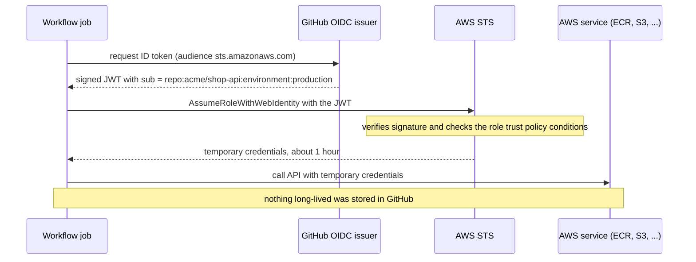
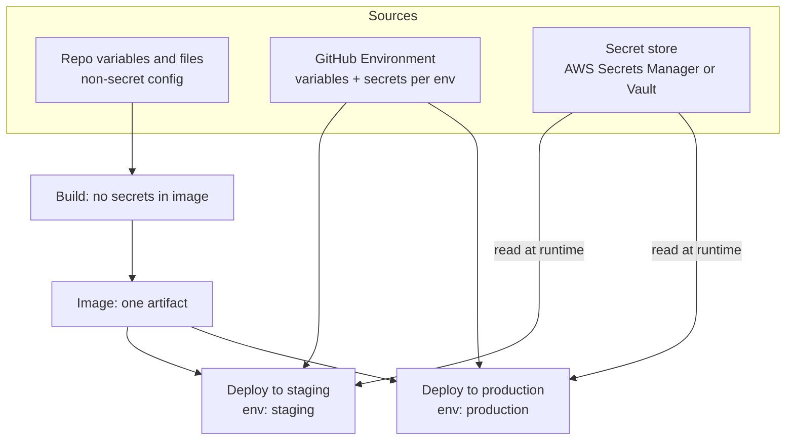

# L5.5 — Secrets and Environment Variables

> **Level 5: CI/CD** · Topic 5 of 12 · ⏱ ~5 hours · Difficulty: Intermediate

## 1. What it is

An **environment variable** is a named string handed to a process when it starts (`DATABASE_URL=...`). It is the standard way to give
one build artifact different **configuration** in different places: the same `shop-api` image runs in staging with a staging database
and in production with the production database, and only the variables differ. This is the third factor ("Config") of the
[Twelve-Factor App](https://12factor.net/) method: config lives in the environment, not in the code or the image.

A **secret** is configuration whose exposure causes harm: database passwords, API keys, signing keys, tokens. Secrets need extra
rules on top of ordinary config: they are stored encrypted, handed out only to the jobs and people that need them, masked in logs,
rotated, and (best of all) replaced by **short-lived credentials** that never need storing. The modern way to get those in a pipeline
is **OpenID Connect (OIDC)**: the CI system proves its identity to the cloud with a signed token, and the cloud returns temporary credentials.

## 2. Why it matters in DevOps

- **Leaks are permanent:** a key committed to Git, baked into an image layer or printed in a log should be treated as compromised
  the moment it is public. Removing it later does not un-leak it.
- **CI is a high-value target:** the pipeline holds the keys to production. Anyone who can change a workflow file or an action it uses
  can try to read them.
- **Blast radius:** one shared admin key in one repository setting means a single compromised job can destroy everything. Per-environment,
  least-privilege credentials limit the damage.
- **Operations:** a rotation that takes two weeks of coordination never happens. A rotation that is one command is done on schedule, and during an incident.

## 3. Real-world system example

**GitHub Actions OIDC with AWS, Google Cloud and Azure.** GitHub documents OpenID Connect hardening for workflows: each job can request a
short-lived signed JWT whose claims describe the run (repository, branch or tag, environment, workflow). AWS IAM, Google Cloud workload
identity federation and Azure federated credentials can trust GitHub's issuer (`https://token.actions.githubusercontent.com`) and exchange
that token for temporary cloud credentials, with trust conditions such as "only repository `acme/shop-api`, only environment `production`".
No long-lived cloud key is stored in GitHub at all.

**The 2025 `tj-actions/changed-files` incident.** In March 2025 a popular third-party GitHub Action was compromised and modified to print
secrets from the runner's memory into public workflow logs for repositories that used it. It is widely documented in security advisories
(CVE-2025-30066). The practical lessons: pin third-party actions to full commit SHAs, give jobs minimal `permissions`, prefer OIDC
over stored keys (there was little for the attacker to steal), and rotate anything that might have been exposed.

**CircleCI, January 2023.** CircleCI disclosed a security incident and advised all customers to rotate every secret stored in the
platform, including project environment variables and tokens. It is a good reminder that a CI vendor's secret store is still a
single place an attacker wants, and that rotation must be something you can do quickly.

## 4. Diagram

OIDC: how a job gets cloud access without any stored key.



Where configuration and secrets come from at each stage:



## 5. How it works

### Kinds of configuration

| Kind | Example | Where it lives | Secret? |
|------|---------|----------------|---------|
| Build-time constant | Node version, base image tag | Dockerfile, workflow file | No |
| Per-environment config | `LOG_LEVEL`, `PUBLIC_URL`, replica count | GitHub Environment **variables**, Helm values, `.env.<env>` in Git | No |
| Per-environment secret | `DATABASE_URL`, `STRIPE_API_KEY` | GitHub Environment **secrets**, cloud secret store | **Yes** |
| Pipeline credential | registry push, cloud deploy | OIDC role (preferred), or a scoped token | **Yes** |

### Where to keep secrets

| Store | Good for | Notes |
|-------|----------|-------|
| **GitHub encrypted secrets** (repo, environment, organization) | CI-only values and tokens | Masked in logs; **not** passed to workflows triggered from forks; environment secrets are released only to jobs that target that environment, after any required reviewers approve. |
| **AWS Secrets Manager / SSM Parameter Store** | Runtime secrets for the app | Encrypted with KMS, IAM-controlled, auditable, rotation support in Secrets Manager. See [Secrets Manager](../level-06-cloud-aws/16-secrets-manager.md). |
| **HashiCorp Vault** or cloud equivalents | Dynamic, short-lived credentials | Can issue a database user per deployment that expires. |
| **Kubernetes Secrets** | Pod-consumed values | Only base64-encoded by default; combine with encryption at rest, RBAC, and an external store ([Secrets](../level-08-kubernetes/07-secrets.md)). |
| **Encrypted files in Git** (SOPS, Sealed Secrets) | GitOps flows | Secret is encrypted with a key; the ciphertext is reviewed and versioned. |

See [Secrets Management and Encryption](../level-11-security-devsecops/04-secrets-management-and-encryption.md) for the deeper treatment.

### GitHub Environments

An **Environment** (`staging`, `production`) groups secrets, variables and **protection rules** (required reviewers, a wait timer,
allowed branches). The same name holds a different value in each environment, so the deploy job is identical and only `environment:` changes:

```yaml
jobs:
  deploy:
    runs-on: ubuntu-24.04
    environment: production      # selects production secrets/vars, applies approval rules
    steps:
      - run: ./deploy.sh
        env:
          DATABASE_URL: ${{ secrets.DATABASE_URL }}   # production value here
          LOG_LEVEL: ${{ vars.LOG_LEVEL }}
```

More background: [Environments and Secrets](../level-03-git-and-github/12-environments-and-secrets.md).

### OIDC trust: the part that matters

The cloud role's **trust policy** decides who may assume it. The `sub` claim of the token looks like
`repo:<owner>/<repo>:environment:<name>`, `repo:<owner>/<repo>:ref:refs/heads/main`, or `...:pull_request`. Narrow it as far as you can:

```json
{
  "Version": "2012-10-17",
  "Statement": [{
    "Effect": "Allow",
    "Principal": { "Federated": "arn:aws:iam::123456789012:oidc-provider/token.actions.githubusercontent.com" },
    "Action": "sts:AssumeRoleWithWebIdentity",
    "Condition": {
      "StringEquals": {
        "token.actions.githubusercontent.com:aud": "sts.amazonaws.com",
        "token.actions.githubusercontent.com:sub": "repo:acme/shop-api:environment:production"
      }
    }
  }]
}
```

A trust policy that omits the `sub` condition lets *any* GitHub repository assume your role. Always include both `aud` and `sub`.
The job needs `permissions: id-token: write` to request the token.

### Rules for secrets in pipelines

1. **Never in the image.** No `ENV API_KEY=...`, no `ARG` secrets (both land in `docker history`), no `COPY .env`. Pass config at run time. If a *build* needs a secret (a private npm registry), use a BuildKit secret mount, which never lands in a layer.
2. **Never in Git.** Enable secret scanning and push protection ([Secrets Scanning](../level-11-security-devsecops/11-secrets-scanning.md)).
3. **Never printed.** GitHub masks registered secrets in logs, but only exact matches: a transformed value (base64, a substring) is **not** masked. Do not `echo` them, do not enable `set -x` around them. For values computed at run time call `echo "::add-mask::$VALUE"`.
4. **Least privilege per environment.** The staging role cannot touch production. Pull requests get no deploy secrets.
5. **Untrusted code never meets secrets.** Secrets are not provided to workflows from forks. Be very careful with `pull_request_target` and `workflow_run`, which run with secrets in the base repository's context: never check out and run the pull request's code there.
6. **Prefer short-lived over long-lived.** OIDC, then tokens with expiry, then static keys as a last resort.
7. **Rotate on a schedule and on suspicion.** See below.

### Rotation

Rotation is replacing a secret with a new value and retiring the old one without downtime. The safe pattern is **overlap**:

1. Create the new credential (the database now accepts both old and new).
2. Update the store (Secrets Manager version, GitHub secret).
3. Roll the application so it reads the new value (a deploy or restart; or a library that re-reads the secret).
4. Verify with a health check and metrics.
5. Revoke the old credential.

Automating it (Secrets Manager rotation with a Lambda, Vault dynamic credentials) is better than a calendar reminder. Whatever you
choose, practise it: the first time you rotate must not be during an incident.

## 6. Step-by-step guide

**Prerequisites:** a GitHub repository `shop-api` (a public repo or a plan that supports Environments on private repos), the `gh` CLI
logged in (optional, the web UI works), Node.js 22 and `jq` locally. No cloud account is needed for steps 1 to 6; step 7 (AWS) needs one
and is free to configure (IAM roles cost nothing), but set a billing alarm anyway.

1. **Make the app fail fast on missing config.** Save as `src/config.js`:
   ```javascript
   const required = ["DATABASE_URL", "REDIS_URL", "SESSION_SECRET"];
   const missing = required.filter((k) => !process.env[k]);
   if (missing.length) {
     console.error(`FATAL: missing required env vars: ${missing.join(", ")}`);
     process.exit(1);
   }
   module.exports = {
     logLevel: process.env.LOG_LEVEL || "info",
     databaseUrl: process.env.DATABASE_URL,
   };
   ```
   Test it locally:
   ```bash
   node -e 'require("./src/config.js")'; echo "exit=$?"
   DATABASE_URL=x REDIS_URL=y SESSION_SECRET=z node -e 'console.log(require("./src/config.js").logLevel)'
   ```
   Expected: `FATAL: missing required env vars: DATABASE_URL, REDIS_URL, SESSION_SECRET` and `exit=1`; then `info`.
   A missing variable now fails at startup (and in the health check), not at 3 a.m. on the first request that needs it.

2. **Create two environments with different values.** In the repository, **Settings, Environments, New environment**: `staging` and
   `production`. In each, add the *secret* `DATABASE_URL` and the *variable* `LOG_LEVEL` (`debug` for staging, `info` for production). With the CLI:
   ```bash
   gh api -X PUT repos/<you>/shop-api/environments/staging
   gh api -X PUT repos/<you>/shop-api/environments/production
   gh secret set DATABASE_URL --env staging    --body 'postgres://shop:<STAGING_PW>@10.0.1.10:5432/shop'
   gh secret set DATABASE_URL --env production --body 'postgres://shop:<PROD_PW>@10.0.2.10:5432/shop'
   gh variable set LOG_LEVEL --env staging    --body debug
   gh variable set LOG_LEVEL --env production --body info
   ```
   On `production`, add **Required reviewers** (yourself) and restrict **Deployment branches** to `main`.

3. **Prove the same job gets different config.** Save as `.github/workflows/show-config.yml`:
   ```yaml
   name: show-config
   on:
     workflow_dispatch:
       inputs:
         environment:
           type: choice
           options: [staging, production]
           default: staging

   permissions:
     contents: read

   jobs:
     show:
       runs-on: ubuntu-24.04
       timeout-minutes: 5
       environment: ${{ inputs.environment }}
       steps:
         - name: Show config (never the secret itself)
           env:
             LOG_LEVEL: ${{ vars.LOG_LEVEL }}
             DATABASE_URL: ${{ secrets.DATABASE_URL }}
           run: |
             echo "environment=${{ inputs.environment }} LOG_LEVEL=$LOG_LEVEL"
             echo "db host: $(echo "$DATABASE_URL" | sed -E 's#.*@([^:/]+).*#\1#')"
             echo "attempting to print the secret: $DATABASE_URL"
   ```
   Run it for each environment (Actions tab, Run workflow). The production run waits for your approval. The log shows
   `LOG_LEVEL=debug` vs `info`, the two different host names, and the last line prints `***` instead of the connection string
   because GitHub masks it. (The host extraction is a derived value; deriving fragments is fine, but a derived *piece* of a secret such as a password would not be masked.)

4. **See the log-masking limit for yourself.** Add a step that prints `echo "$DATABASE_URL" | base64`. Run it. The base64 text is shown in
   clear, because only the exact registered value is masked. Delete the step, and treat the run logs as sensitive; if this had been a real secret you would now rotate it.

5. **Inspect an OIDC token's claims (no cloud needed).** Add this job; it requests a token and prints only the claims, not the token:
   ```yaml
     oidc-claims:
       runs-on: ubuntu-24.04
       timeout-minutes: 5
       permissions:
         id-token: write
         contents: read
       environment: staging
       steps:
         - name: Decode token claims
           run: |
             TOKEN=$(curl -sS -H "Authorization: bearer $ACTIONS_ID_TOKEN_REQUEST_TOKEN" \
               "$ACTIONS_ID_TOKEN_REQUEST_URL&audience=sts.amazonaws.com" | jq -r .value)
             echo "$TOKEN" | python3 -c 'import sys,base64,json; p=sys.stdin.read().strip().split(".")[1]; p+="="*(-len(p)%4); c=json.loads(base64.urlsafe_b64decode(p)); print(json.dumps({k:c.get(k) for k in ("iss","sub","aud","ref","environment","repository")},indent=2))'
   ```
   Output is similar to:
   ```json
   {
     "iss": "https://token.actions.githubusercontent.com",
     "sub": "repo:<you>/shop-api:environment:staging",
     "aud": "sts.amazonaws.com",
     "ref": "refs/heads/main",
     "environment": "staging",
     "repository": "<you>/shop-api"
   }
   ```
   The `sub` value is exactly what a cloud trust policy matches against.

6. **Keep secrets out of the image.** Show the wrong and right way:
   ```bash
   # WRONG: leaks into history
   printf 'FROM alpine\nARG API_KEY\nRUN echo "$API_KEY" > /dev/null\n' > /tmp/Dockerfile.bad
   docker build -f /tmp/Dockerfile.bad --build-arg API_KEY=demo-not-real -t leak:test /tmp
   docker history --no-trunc leak:test | grep API_KEY
   ```
   The build arg value appears in the history output. Fix with a BuildKit secret mount (build-time only):
   ```dockerfile
   # syntax=docker/dockerfile:1
   FROM alpine
   RUN --mount=type=secret,id=api_key sh -c 'test -s /run/secrets/api_key && echo "secret was available"'
   ```
   ```bash
   echo -n 'demo-not-real' > /tmp/api_key.txt
   docker build --secret id=api_key,src=/tmp/api_key.txt -t noleak:test .
   docker history --no-trunc noleak:test | grep -c demo-not-real     # 0
   ```
   In CI the same thing is `secrets: |` + `api_key=${{ secrets.API_KEY }}` on `docker/build-push-action`.

7. **Replace a stored AWS key with OIDC (AWS account required).**
   ```bash
   aws iam create-open-id-connect-provider \
     --url https://token.actions.githubusercontent.com \
     --client-id-list sts.amazonaws.com
   ```
   (Older CLI versions also required `--thumbprint-list`; follow the AWS documentation for your version.) Create a role with the trust
   policy shown in section 5 (replace the account ID and repository) and a minimal permission policy, then use it:
   ```yaml
   jobs:
     deploy:
       runs-on: ubuntu-24.04
       environment: production
       permissions:
         id-token: write
         contents: read
       steps:
         - uses: aws-actions/configure-aws-credentials@v4
           with:
             role-to-assume: arn:aws:iam::123456789012:role/shop-api-deploy-production
             aws-region: us-east-1
         - run: aws sts get-caller-identity
   ```
   `get-caller-identity` returns the assumed-role ARN. Change the repository name in the trust policy to a wrong value and re-run: the step must
   fail with `Not authorized to perform sts:AssumeRoleWithWebIdentity`. Cleanup: delete the role and the provider if this was only practice.

8. **Rotate a secret with overlap (rehearsal).** Update `DATABASE_URL` (staging) to a second database user, redeploy, and verify with
   `curl -fsS https://staging.example.com/healthz`, then drop the old user. Time the whole procedure and write the steps into `docs/runbook-rotate-secrets.md`.

## 7. Real-world scenario

*(Illustrative.)* A developer debugging a failing deploy adds `env | sort` to the workflow and pushes it to a branch. The job runs, prints the
environment, and GitHub masks the exact secret values it knows about. But the workflow also base64-encodes a kubeconfig before passing it
to a tool, and the encoded string is printed unmasked in the log, which is world-readable on this public repository. A secret-scanning alert
fires within minutes.

The on-call engineer treats the cluster credential as compromised: revokes it, issues a new one, updates the environment secret, re-runs the
deploy, and checks the cloud audit log (CloudTrail on AWS) for use of the old credential. The follow-up work moves the pipeline to OIDC (no stored kubeconfig),
adds the `production` environment with required reviewers and a branch restriction, and turns on push protection. **Lesson:** masking is a
safety net, not a control. The real controls are not having long-lived secrets, scoping them, and being able to rotate quickly.

## 8. Common mistakes and best practices

**Don't**

- Commit `.env` files with real values, or bake `ENV SECRET=...` / `ARG` secrets into the Dockerfile.
- Use one organization-wide admin key for every repository and environment.
- Echo secrets, or transform them (base64, split) and print the result; masking will not catch it.
- Run untrusted pull-request code with `pull_request_target` or `workflow_run` and secrets available.
- Omit the `sub` condition from an OIDC trust policy.
- Keep a rotation procedure "in someone's head".

**Do**

- Build one image; supply config at deploy time via environment variables or mounted files.
- Use GitHub Environments: separate secrets per environment, required reviewers and branch rules for production.
- Prefer OIDC and other short-lived credentials; use `permissions:` to grant `id-token: write` only to the job that needs it.
- Make the app validate required config at startup and fail with a clear message (never the values).
- Pin third-party actions by commit SHA; they can read what your job can read.
- Scan for leaked secrets (push protection, scheduled scans) and rehearse rotation.

## 9. Tasks

- [ ] **T1 — Fail fast on missing config** *(≈20 min, beginner)*
  - **Goal:** make configuration errors loud and early.
  - **Steps:**
    1. Add `src/config.js` from step 1 to `shop-api` and require it at the top of `src/server.js`.
    2. Start the server with and without the variables set.
  - **Done when:** without the variables the process exits 1 listing the names; with them it starts and `LOG_LEVEL` defaults to `info`.

- [ ] **T2 — Two environments, one job** *(≈40 min, beginner)*
  - **Goal:** same workflow, different config and secrets.
  - **Steps:**
    1. Create the `staging` and `production` environments with different `LOG_LEVEL` and `DATABASE_URL` (placeholders are fine).
    2. Add required reviewers and a `main`-only branch rule to `production`.
    3. Run `show-config.yml` for both.
  - **Done when:** the logs show different `LOG_LEVEL` and host names, the secret prints as `***`, and the production run paused for approval.

- [ ] **T3 — Break it: defeat the masking, then fix** *(≈30 min, intermediate)*
  - **Goal:** understand what masking does and does not do.
  - **Steps:**
    1. Print a base64 of a (fake) secret and observe it unmasked.
    2. Fix by deleting the step, and add `echo "::add-mask::$DERIVED"` for a computed sensitive value; show a second print is masked.
    3. Write two sentences on why you would rotate a real secret after step 1.
  - **Done when:** the first log shows the leak, the fixed log shows `***` for the derived value, and your note says "rotate".

- [ ] **T4 — Keep a build secret out of the image** *(≈30 min, intermediate)*
  - **Goal:** use BuildKit secret mounts.
  - **Steps:**
    1. Reproduce the `ARG` leak and inspect it with `docker history --no-trunc`.
    2. Rebuild using `--mount=type=secret`.
    3. Add the same to `build-push-action` with `secrets:` in your workflow (using a dummy repo secret).
  - **Done when:** `docker history --no-trunc` shows the value before the fix and not after, and the CI build passes.

- [ ] **T5 — Replace a stored key with OIDC** *(≈60 min, advanced; AWS account, no cost beyond a billing alarm)*
  - **Goal:** pipeline access to AWS with no stored credentials, and a trust policy that actually restricts.
  - **Steps:**
    1. Create the OIDC provider and a role trusted only by `repo:<you>/shop-api:environment:production`.
    2. Use `configure-aws-credentials` and run `aws sts get-caller-identity` from the production environment.
    3. Run the same job from `staging` (or a fork or another repository) and confirm it is denied.
    4. **Cleanup:** delete the role (and provider if unused).
  - **Done when:** production succeeds, the other context fails with `Not authorized to perform sts:AssumeRoleWithWebIdentity`, and no AWS key exists in repository secrets.

- [ ] **T6 — Prove it: write and rehearse the rotation runbook** *(≈60 min, advanced)*
  - **Goal:** rotate a secret with zero downtime and without the guide.
  - **Steps:**
    1. Write `docs/runbook-rotate-secrets.md`: the overlap procedure for `DATABASE_URL`, including verification and rollback.
    2. Execute it against staging while polling `/healthz` in a loop (`while sleep 1; do curl -s -o /dev/null -w '%{http_code}\n' https://staging.example.com/healthz; done`).
    3. Explain in writing why an exposed secret in a log must be rotated even if the log is deleted.
  - **Done when:** the polling loop never shows a non-200 during rotation and the old credential no longer works.

## 10. Self-check questions

1. What is the difference between configuration and a secret, and where does each live for `shop-api`?
2. Why must a secret never be an `ENV` or `ARG` in a Dockerfile?
3. How does OIDC remove the need for a stored cloud key, and which claim restricts which environment may assume the role?
4. Why are secrets not available to workflows triggered by pull requests from forks?
5. GitHub masks secrets in logs. Why is that not sufficient protection?
6. Describe a zero-downtime rotation of a database password.

<details>
<summary>Answers</summary>

1. Config varies by environment but is harmless (`LOG_LEVEL`); a secret causes harm if exposed (`DATABASE_URL`). Config: environment variables/Helm values/GitHub variables. Secrets: GitHub environment secrets or a secret store, injected at deploy/run time.
2. Both are recorded in image metadata/layers; anyone who can pull the image can read them with `docker history`. Use runtime injection or BuildKit secret mounts.
3. The job presents a signed JWT from GitHub; the cloud verifies it and returns temporary credentials. The `sub` claim (for example `repo:acme/shop-api:environment:production`) is matched in the role's trust policy.
4. Fork code is untrusted; if it received secrets, anyone could open a pull request that prints them.
5. Masking is exact-match string replacement in logs. Encoded or partial forms, other outputs (artifacts, network calls) and anyone with write access to the workflow are not covered.
6. Add the new credential alongside the old, store the new value, roll the app so it uses it, verify health, then revoke the old credential.
</details>

## 11. Further reading

- GitHub Docs: *Using secrets in GitHub Actions*, *Managing environments for deployment*, *About security hardening with OpenID Connect*, *Security hardening for GitHub Actions* (docs.github.com).
- AWS Docs: *Configuring OpenID Connect in AWS* and the `aws-actions/configure-aws-credentials` README.
- The Twelve-Factor App (12factor.net), factor III: Config.
- Docker Docs: *Build secrets* (BuildKit secret mounts).
- Next: [Build artifacts](06-artifacts.md); deeper security material in [Secrets Management and Encryption](../level-11-security-devsecops/04-secrets-management-and-encryption.md).

<!-- nav -->
---
← Previous: [Docker Image Builds and Registries in CI](04-docker-builds-and-registries.md) · [Level 5 index](README.md) · Next: [Build Artifacts](06-artifacts.md) →
