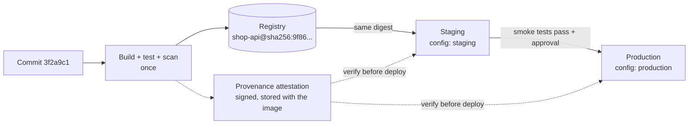
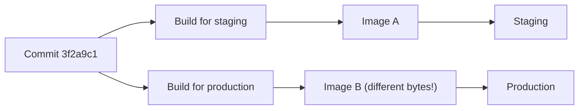
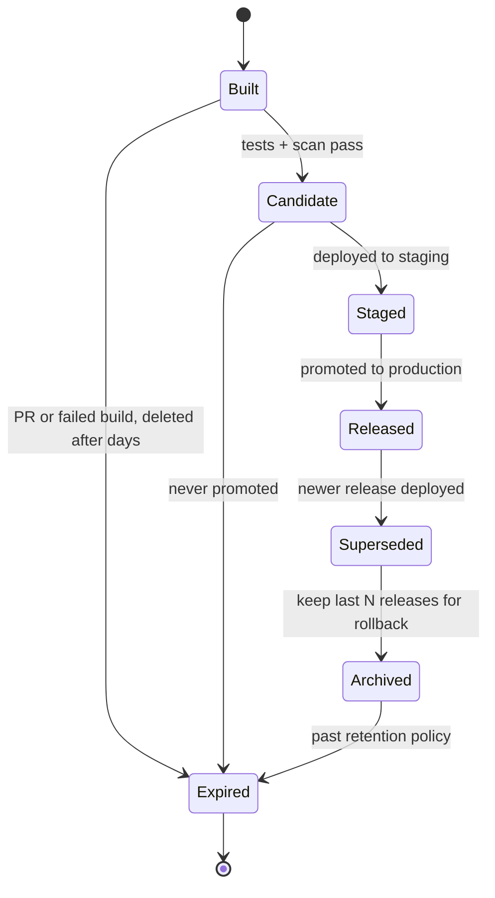

# L5.6 — Build Artifacts

> **Level 5: CI/CD** · Topic 6 of 12 · ⏱ ~4 hours · Difficulty: Intermediate

## 1. What it is

A **build artifact** is the output of a build that you intend to run, ship or keep: a container image, a `.jar`, a `.tgz` of a
Node.js app, a compiled binary, a Helm chart, a test report, a coverage file. A pipeline *produces* artifacts in early stages and
*consumes* them in later ones.

The core rule of this topic is **build once, deploy many**: compile and package the software **one time**, give the result an
immutable identity (a content hash called a **digest**), and move that exact artifact through every environment (test, staging, production).
Only the *configuration* changes between environments ([L5.5](05-secrets-and-environment-variables.md)). Moving the same artifact forward
is called **promotion**. The opposite, rebuilding "the same commit" in each environment, produces artifacts that are merely *similar*.

Two supporting ideas complete the picture:

- **Retention:** how long artifacts are kept before they are deleted (cheap build leftovers for days, released versions for years).
- **Provenance:** verifiable metadata saying *which source commit, which workflow and which builder produced this artifact*, so that you can
  prove it is the one your pipeline built and not something an attacker swapped in.

## 2. Why it matters in DevOps

- **"It passed in staging" only means something if production runs the same bytes.** A rebuild can pull a newer base image or dependency
  (`npm install` without a lockfile, an `apt-get` layer) and ship code nobody tested.
- **Fast, safe rollback:** if every release is stored and addressable, rollback is "deploy the previous artifact", not "rebuild an old commit and hope"
  ([L5.7](07-rollback.md)).
- **Speed:** promotion is a retag or a copy (seconds). A rebuild per environment costs minutes and adds failure points.
- **Cost:** keeping every PR build forever costs storage money; deleting too eagerly deletes the version you need to roll back to.
- **Security and audit:** regulators and customers increasingly ask "how do you know what is running was built from reviewed code?" Provenance answers that.

## 3. Real-world system example

**Spinnaker and "bake once".** Netflix's open-source continuous delivery platform Spinnaker models deployment as promotion of an immutable
image: a pipeline bakes a machine or container image once and then deploys that same image to successive clusters and accounts, rather than building per environment.
This immutable-artifact approach is one of the central design ideas of the tool.

**SLSA and Sigstore.** **SLSA** ("salsa", *Supply-chain Levels for Software Artifacts*, a framework from the Open Source Security Foundation)
defines levels of build integrity; its core ask is that artifacts come with signed **provenance** produced by the build platform, not by the
developer's laptop. The **Sigstore** project (including `cosign`) provides signing and verification for artifacts and container images, and
GitHub's **artifact attestations** (`actions/attest-build-provenance`, verified with `gh attestation verify`) produce signed SLSA-style provenance for builds that run on GitHub Actions.

**Container registries as artifact stores.** Amazon ECR and GitHub Container Registry store images by digest; npm, Maven Central and PyPI store
versioned packages that are immutable once published. The same principle: a published version number is never overwritten.

## 4. Diagram

Build once, promote the same digest through environments (compare with the anti-pattern below):





The second picture is the anti-pattern: image B was never tested.

Artifact lifecycle and retention:



## 5. How it works

### What counts as an artifact

| Kind | Examples | Where to store | Typical retention |
|------|----------|----------------|-------------------|
| **Deployable** | container image, `.jar`, `.tgz`, Helm chart | registry (GHCR, ECR), package repo (npm, Artifactory, Nexus), S3 | releases: long (a year or more); main builds: last N; PR builds: days |
| **Pipeline hand-off** | compiled `dist/` passed between jobs | workflow artifacts (`upload-artifact`) | days |
| **Evidence** | test reports, coverage, SBOM, scan results | workflow artifacts and/or attached to the release | weeks to years (compliance) |
| **Cache** | `node_modules`, BuildKit layers | cache service | automatic eviction; not an artifact! |

**Cache vs artifact:** a cache is a speed-up that may disappear; an artifact is a *product* of the build that later stages depend on. Never rely on a cache for correctness ([L5.2](02-github-actions-pipelines.md)).

### Identity: tag vs digest

A version tag says what you *meant*; the **digest** says what you *got*. Promote and deploy by digest (or a write-once SHA tag).
Verify that what is running equals what was tested: `docker inspect` / `kubectl get pod -o jsonpath` can show the digest.

### Promotion mechanisms

| Mechanism | How | Cost |
|-----------|-----|------|
| **Retag in the same registry** | `docker buildx imagetools create -t repo:staging repo@sha256:...` | zero copy: a new tag pointing at the same manifest |
| **Copy between registries/accounts** | `crane copy`, `skopeo copy`, ECR replication, or `docker buildx imagetools create` to another repo | copies layers once, digest preserved |
| **Environment pointer in Git** (GitOps) | a PR bumping `image: ...@sha256:` in the staging then production overlay | a Git commit is the promotion ([Environment Promotion](../level-17-gitops/04-environment-promotion.md)) |
| **Package repo promote** | Artifactory/Nexus "promote" from `snapshot` to `release` repository | metadata move |

What does not count as promotion: running `docker build` again on the same commit.

Promotion must be **gated**: the staging deployment, smoke tests and (for production) an approval or health gate decide whether the
digest advances. The pipeline records *which digest was promoted, by whom, when*: that is your release history.

### Workflow artifacts (GitHub Actions)

```yaml
# producer job
- uses: actions/upload-artifact@v4
  with:
    name: dist-${{ github.sha }}          # names must be unique within a run in v4
    path: dist/
    retention-days: 7                     # default is 90 days (repo setting can lower it)
    if-no-files-found: error

# consumer job (same run)
- uses: actions/download-artifact@v4
  with:
    name: dist-${{ github.sha }}
    path: dist/

# consumer in a different run: pass run-id and a token
- uses: actions/download-artifact@v4
  with:
    name: dist-<sha>
    run-id: ${{ inputs.build_run_id }}
    github-token: ${{ secrets.GITHUB_TOKEN }}
```

Artifacts of `upload-artifact@v4` are immutable per name within a run, count against your storage quota, and expire after `retention-days`.
Use them for hand-offs and evidence, not as the long-term home of releases: put releases in a registry or in a GitHub Release.

### Retention policy: decide, don't default

| Artifact | Suggested policy |
|----------|------------------|
| PR images / workflow artifacts | delete after 1 to 7 days |
| `main` build images (SHA tags) | keep the newest 30 to 50 builds, or 30 days |
| Released versions (`v1.4.2`) | keep for at least as long as you may need to roll back or audit (often 1 year or more) |
| Untagged images | delete after 1 to 7 days (ECR lifecycle: `"tagStatus": "untagged"`) |
| Evidence (SBOM, scan report, attestations) | same lifetime as the artifact they describe |

Never let a retention rule delete the image currently running in any environment or the one you would roll back to.
ECR lifecycle policies and scheduled cleanup jobs (for GHCR, a workflow using the Packages API) must never match releases or anything referenced by deployments (see step 7 in the guide: a separate repository per retention class avoids multi-tag surprises).

### Provenance and verification

1. **Build** produces the image; the builder records a statement: *subject* (image digest), *builder* (workflow identity), *source* (repository, commit, ref).
2. **Sign:** the statement is signed with a short-lived certificate tied to the workflow's OIDC identity (Sigstore) so there is no private key to steal.
3. **Store:** attached to the registry next to the image (and logged in a transparency log).
4. **Verify** before deploy: check that the digest has a valid attestation produced by *your* repository's workflow on *the expected branch*.

An **SBOM** (software bill of materials: list of components) is a separate attestation that answers "are we affected by this new CVE?" without unpacking images.

## 6. Step-by-step guide

**Prerequisites:** the `shop-api` repository and the `docker-image.yml` workflow from [L5.4](04-docker-builds-and-registries.md) (it pushes
`ghcr.io/<you>/shop-api:sha-<commit>`, outputs `digest`, and attests provenance). Local tools: `git`, Node.js 22 and `sha256sum`
(Linux/macOS: `shasum -a 256`). Optional: `gh` CLI. Cost: none on a public repository.

1. **Feel what "same bytes" means with a plain artifact.** Package the app twice and compare:
   ```bash
   npm pack --silent                       # creates shop-api-0.1.0.tgz
   sha256sum shop-api-0.1.0.tgz | tee SHA256SUMS
   sha256sum -c SHA256SUMS                 # shop-api-0.1.0.tgz: OK
   tar tzf shop-api-0.1.0.tgz              # lists package/package.json and package/src/...
   ```
   The checksum is the artifact's identity. Verify it after every copy ("did it arrive unchanged?"). Note that a
   rebuild is not guaranteed to produce the same hash (timestamps, ordering) unless the build is **reproducible**; this is why you build once.

2. **Hand an artifact between jobs.** Save as `.github/workflows/build-handoff.yml`:
   ```yaml
   name: build-handoff
   on:
     push:
       branches: [main]
     pull_request:

   permissions:
     contents: read

   jobs:
     build:
       runs-on: ubuntu-24.04
       timeout-minutes: 10
       steps:
         - uses: actions/checkout@v4
         - uses: actions/setup-node@v4
           with:
             node-version: "22"
             cache: npm
         - run: npm ci
         - run: npm pack
         - run: sha256sum shop-api-*.tgz | tee SHA256SUMS
         - uses: actions/upload-artifact@v4
           with:
             name: shop-api-${{ github.sha }}
             path: |
               shop-api-*.tgz
               SHA256SUMS
             retention-days: 7
             if-no-files-found: error

     verify-and-deploy:
       needs: build
       runs-on: ubuntu-24.04
       timeout-minutes: 5
       steps:
         - uses: actions/download-artifact@v4
           with:
             name: shop-api-${{ github.sha }}
         - name: Verify checksum before using the artifact
           run: sha256sum -c SHA256SUMS
         - run: echo "deploying exactly the tested tarball"
   ```
   The second job never rebuilds: it downloads, verifies the checksum, and uses the same file.

3. **Look at retention.** Open the run, scroll to **Artifacts** and note the size and expiry date. Under **Settings, Actions, General** see the repository's artifact and log retention setting.

4. **Promote an image by digest, not by rebuild.** Take the digest from the L5.4 run summary (or read it):
   ```bash
   IMG=ghcr.io/<you>/shop-api
   DIGEST=$(docker buildx imagetools inspect $IMG:main --format '{{json .Manifest}}' | jq -r .digest)
   echo "$DIGEST"                                   # sha256:...
   docker buildx imagetools create -t $IMG:staging $IMG@$DIGEST
   docker buildx imagetools inspect $IMG:staging --format '{{json .Manifest}}' | jq -r .digest   # identical digest
   ```
   Both digests must be identical: the `staging` tag is just another name for the same manifest. (Output is similar to the above; the digest value is yours.)

5. **Make promotion a gated workflow.** Save as `.github/workflows/promote.yml`:
   ```yaml
   name: promote
   on:
     workflow_dispatch:
       inputs:
         sha:
           description: Full commit SHA to promote (image tag sha-<sha>)
           required: true
         target:
           type: choice
           options: [staging, production]
           default: staging

   permissions:
     contents: read
     packages: write
     attestations: read

   jobs:
     promote:
       runs-on: ubuntu-24.04
       timeout-minutes: 10
       environment: ${{ inputs.target }}           # production can require reviewers
       env:
         GH_TOKEN: ${{ secrets.GITHUB_TOKEN }}
       steps:
         - uses: docker/setup-buildx-action@v3
         - uses: docker/login-action@v3
           with:
             registry: ghcr.io
             username: ${{ github.actor }}
             password: ${{ secrets.GITHUB_TOKEN }}
         - name: Resolve digest of the tested image
           id: d
           env:
             SHA: ${{ inputs.sha }}
           run: |
             IMG=ghcr.io/${GITHUB_REPOSITORY,,}
             DIGEST=$(docker buildx imagetools inspect "$IMG:sha-$SHA" --format '{{json .Manifest}}' | jq -r .digest)
             echo "image=$IMG" >> "$GITHUB_OUTPUT"
             echo "digest=$DIGEST" >> "$GITHUB_OUTPUT"
         - name: Verify provenance (must come from this repo's workflow)
           env:
             IMAGE: ${{ steps.d.outputs.image }}
             DIGEST: ${{ steps.d.outputs.digest }}
           run: gh attestation verify "oci://$IMAGE@$DIGEST" --repo "$GITHUB_REPOSITORY"
         - name: Promote by retagging (no rebuild)
           env:
             IMAGE: ${{ steps.d.outputs.image }}
             DIGEST: ${{ steps.d.outputs.digest }}
             TARGET: ${{ inputs.target }}
           run: docker buildx imagetools create -t "$IMAGE:$TARGET" "$IMAGE@$DIGEST"
         - name: Record the promotion
           env:
             DIGEST: ${{ steps.d.outputs.digest }}
             SHA: ${{ inputs.sha }}
             TARGET: ${{ inputs.target }}
           run: echo "promoted $DIGEST (commit $SHA) to $TARGET by $GITHUB_ACTOR" >> "$GITHUB_STEP_SUMMARY"
   ```
   Run it with a SHA from a merged build. If the image has no valid attestation (for example, it was pushed from a laptop), `gh attestation verify` fails and the job stops before any retag.

6. **Verify provenance by hand.**
   ```bash
   gh attestation verify oci://ghcr.io/<you>/shop-api@$DIGEST --repo <you>/shop-api
   ```
   On success it prints `Verification succeeded!` and the workflow, repository and commit that built the image. (Exact wording varies by `gh` version.)

7. **Protect the rollback set with a retention policy.** Retention rules act on tags, and one image can carry several tags (in L5.4 a release build
   has both `sha-<commit>` and `1.4.2`). A rule that expires old `sha-` images would therefore also expire old releases. The robust pattern is one
   repository per retention class: `shop-api` (every build, short retention) and `shop-api-release` (production-promoted images, long retention),
   with promotion copying the digest from the first to the second. For the build repository, expire untagged images quickly and keep only the newest 50 `sha-` images:
   ```json
   {
     "rules": [
       { "rulePriority": 1, "description": "expire untagged after 3 days",
         "selection": { "tagStatus": "untagged", "countType": "sinceImagePushed", "countUnit": "days", "countNumber": 3 },
         "action": { "type": "expire" } },
       { "rulePriority": 2, "description": "keep last 50 sha- images",
         "selection": { "tagStatus": "tagged", "tagPrefixList": ["sha-"], "countType": "imageCountMoreThan", "countNumber": 50 },
         "action": { "type": "expire" } }
     ]
   }
   ```
   Save it as `policy.json` and always **preview before applying**:
   ```bash
   aws ecr start-lifecycle-policy-preview --repository-name shop-api --lifecycle-policy-text file://policy.json
   aws ecr get-lifecycle-policy-preview --repository-name shop-api      # lists images that would expire
   aws ecr put-lifecycle-policy --repository-name shop-api --lifecycle-policy-text file://policy.json
   ```
   Cleanup of a sandbox repository: `aws ecr delete-repository --repository-name shop-api --force`.

## 7. Real-world scenario

*(Illustrative.)* A team's pipeline rebuilds the image in the production deploy job "so it can use production build args". One Thursday a deploy
goes out and checkout latency doubles. Staging, tested an hour earlier, was fine. The investigation compares the two images: the `npm ci` layer in the
production build pulled a patch release of a transitive dependency published between the two builds, because the base image tag
`node:22` also moved. The two environments never ran the same code.

The fix: a single `build` job pushes `sha-<commit>`, the staging and production deploy jobs reference its digest, environment differences move into runtime configuration, and
a `promote` workflow verifies provenance before retagging. Rollback becomes "promote the previous digest". Staging results now predict production because they are the same bytes.
**Lesson:** if you rebuild, you have two artifacts and one test result.

## 8. Common mistakes and best practices

**Don't**

- Rebuild per environment or per deploy.
- Bake environment-specific values into the artifact (use runtime config and secrets).
- Deploy by a movable tag (`latest`, `main`) and call it a release.
- Use workflow caches as the hand-off between jobs; use artifacts (or the registry).
- Let a cleanup job delete the version you are running or the previous one you would roll back to.
- Treat a green build as proof of provenance: an image pushed by a person looks the same until you verify the attestation.

**Do**

- Build once, record the digest, and promote that digest through gated stages.
- Store deployable artifacts in a registry/package repo with immutable versions; keep workflow artifacts for short-lived hand-offs and evidence.
- Verify checksums or attestations before using an artifact in a later stage.
- Define retention per artifact type, in code (lifecycle policy, scheduled cleanup).
- Generate and keep an SBOM and provenance with every release image.
- Keep a release record: digest, commit, who approved, when, where.

## 9. Tasks

- [ ] **T1 — Checksum a hand-off** *(≈30 min, beginner)*
  - **Goal:** pass a tarball between jobs and prove it is unchanged.
  - **Steps:**
    1. Create `build-handoff.yml` from step 2.
    2. Run it, then edit the workflow so the second job tampers with the file (`echo x >> shop-api-*.tgz`) before `sha256sum -c`.
  - **Done when:** the clean run passes and the tampered run fails with `FAILED` in the `sha256sum -c` step.

- [ ] **T2 — Promote by digest** *(≈30 min, intermediate)*
  - **Goal:** retag an image without rebuilding.
  - **Steps:**
    1. Run the `imagetools create` commands from step 4 against your GHCR image.
    2. Pull `:main` and `:staging` and compare `docker image inspect --format '{{.Id}}'`.
  - **Done when:** both tags resolve to the same digest and no build job ran.

- [ ] **T3 — Gated promotion workflow** *(≈45 min, intermediate)*
  - **Goal:** make promotion an auditable, approved action.
  - **Steps:**
    1. Add `promote.yml` (step 5) and require reviewers on the `production` environment.
    2. Promote a SHA to `staging`, then to `production`.
    3. Open the run summary and find the line recording the digest.
  - **Done when:** the production promotion waits for approval and the summary shows the promoted digest and commit.

- [ ] **T4 — Break it: promote an unattested image** *(≈45 min, advanced)*
  - **Goal:** see provenance verification stop a bad artifact.
  - **Steps:**
    1. Build a tiny image locally and push it to your GHCR repo as `sha-0000000000000000000000000000000000000000` (manual push with a PAT: `<YOUR_TOKEN>` with `write:packages`).
    2. Run `promote.yml` with that SHA.
    3. Observe the failure at `gh attestation verify`, then delete the test tag.
  - **Done when:** the promote job fails before the retag step, and you can explain why an image built on a laptop is refused.

- [ ] **T5 — Retention that protects rollback** *(≈45 min, intermediate)*
  - **Goal:** write a lifecycle policy and prove it with a preview.
  - **Steps:**
    1. Write the ECR policy from step 7 (or a scheduled GHCR cleanup workflow that keeps the newest 30 `sha-` versions and all semver tags).
    2. Preview what it would delete (`aws ecr start-lifecycle-policy-preview`) or run the cleanup in dry-run mode.
    3. **Cleanup:** remove any sandbox repository you created.
  - **Done when:** the preview lists only old `sha-` or untagged images from the build repository, and nothing from the release repository nor the currently deployed image.

- [ ] **T6 — Prove it: release record and rollback target** *(≈60 min, advanced)*
  - **Goal:** answer "what is in production and what do we roll back to?" from artifacts alone.
  - **Steps:**
    1. Without the guide, extend `promote.yml` so every promotion appends `environment, digest, commit, actor, time` to a `deployments.md` release record (or creates a GitHub Deployment via the API).
    2. Promote three different SHAs in sequence.
    3. Explain in writing why you promote by digest and not rebuild, and how the record gives you the rollback target.
  - **Done when:** the record lists the three promotions in order and its second-newest entry still exists in the registry and verifies.

## 10. Self-check questions

1. What does "build once, deploy many" mean, and what changes between environments?
2. Why is a digest a better identity than a tag?
3. What is the difference between a cache and an artifact?
4. What does an attestation prove that a successful build log does not?
5. What retention rules would you set for PR images, `main` builds and release tags?
6. A promote job runs `docker build` again from the same commit. What is wrong?

<details>
<summary>Answers</summary>

1. The artifact (image) is created once and the same digest is deployed everywhere; only configuration and secrets change per environment.
2. A tag can be moved to different content; a digest is the hash of the content, so it identifies exactly one artifact.
3. A cache is an optional speed-up that may be evicted; an artifact is a required product of the build consumed by later stages or kept as a release.
4. That the image with this digest was produced by a specific workflow in a specific repository from a specific commit, signed so it cannot be forged after the fact.
5. PR images: days. `main` SHA images: newest N or ~30 days, never the deployed or previous release. Release tags: long, often a year or more, matching rollback and audit needs.
6. The rebuild can differ (new base image or dependency versions, timestamps), so what is deployed is not what was tested; it must retag or copy the existing digest.
</details>

## 11. Further reading

- GitHub Docs: *Storing workflow data as artifacts*, *Using artifact attestations to establish provenance for builds*, `actions/upload-artifact`, `actions/download-artifact`.
- SLSA specification (slsa.dev) and Sigstore documentation (docs.sigstore.dev, `cosign`).
- Docker Docs: *Attestations* (SBOM and provenance) and `docker buildx imagetools`.
- *Continuous Delivery* by Jez Humble and David Farley: the chapters on the deployment pipeline and "build your binaries only once".
- Next: [Rollback](07-rollback.md). Related: [Docker builds and registries](04-docker-builds-and-registries.md), [Environment Promotion in GitOps](../level-17-gitops/04-environment-promotion.md).

<!-- nav -->
---
← Previous: [Secrets and Environment Variables](05-secrets-and-environment-variables.md) · [Level 5 index](README.md) · Next: [Rollback](07-rollback.md) →
