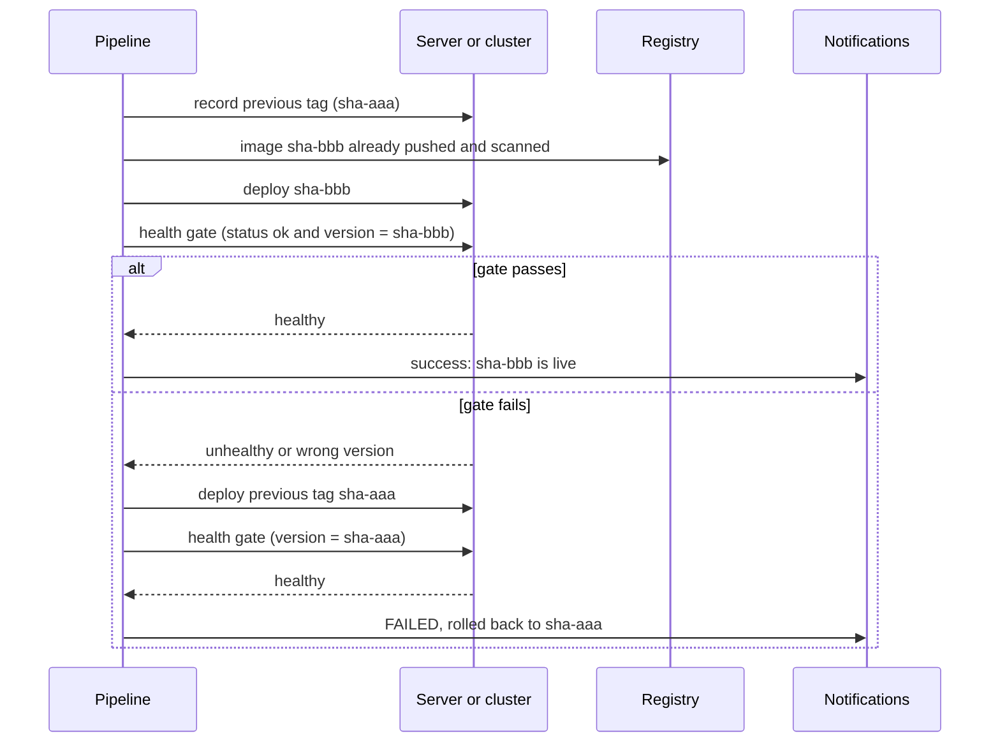
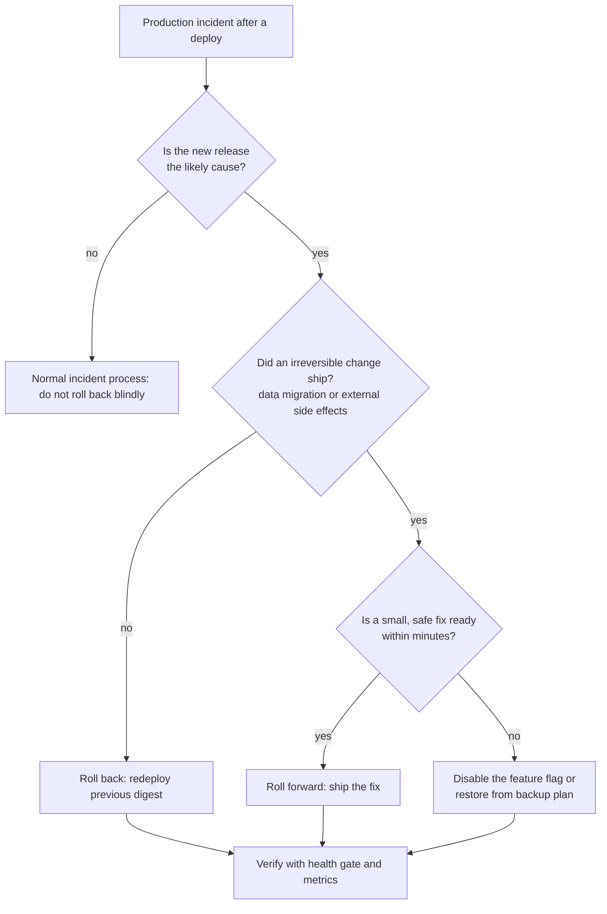

# L5.7 — Rollback

> **Level 5: CI/CD** · Topic 7 of 12 · ⏱ ~5 hours · Difficulty: Intermediate

## 1. What it is

A **rollback** returns production to the last known-good version after a bad release. In a container-based pipeline that means
"run the previous image again": the old artifact is still in the registry, so the operation is a deploy of an older tag or digest, not a rebuild.
The alternative is a **roll-forward**: leave the bad version running and ship a new fix as quickly as possible.

Four ideas make rollback dependable instead of heroic:

- **Versioned, immutable releases** — every release has an unambiguous identity (`sha-<commit>`, `1.4.2`, a digest) and stays in the registry
  ([L5.4](04-docker-builds-and-registries.md), [L5.6](06-artifacts.md)).
- **Rollback is a normal deploy** — it uses the same pipeline and the same script, so it is rehearsed every day.
- **Rollback triggers** — rules (a failed health check, a spike in 5xx errors, a person) that decide *when* to go back, ideally automatically.
- **State compatibility** — code rolls back easily, **data does not**. A migration that dropped a column cannot be undone by redeploying old code
  ([L5.9](09-database-migrations.md)).

## 2. Why it matters in DevOps

- **Mean time to recovery (MTTR):** the fastest way to end a customer-visible incident is usually to undo the last change. Teams that can roll back in
  minutes tolerate failures far better than teams that debug live in production.
- **Confidence to ship:** frequent small deploys are only safe if each one is cheaply reversible.
- **Rollback is a feature you must test.** An untested rollback path fails exactly when you need it (old image garbage-collected, config incompatible,
  migration irreversible).
- **Not every incident is a rollback.** Knowing when to roll forward (a data migration already ran; the fix is a one-liner) is part of the skill.

## 3. Real-world system example

**Amazon.** The Amazon Builders' Library article *"Automating safe, hands-off deployments"* describes pipelines that deploy in waves, watch alarms during a
bake period, and **roll back automatically** when an alarm fires, with the rollback itself being just a deployment of the previous version through the
same system. Making that path common, and not an emergency procedure, is the point.

**Kubernetes and Helm.** Kubernetes `Deployment` objects keep a history of ReplicaSets (controlled by `revisionHistoryLimit`) so `kubectl rollout undo`
can return to a previous revision. Helm records every release revision, and `helm rollback <release> <revision>` re-applies an earlier one. Both
are built-in expressions of the "previous version is kept and addressable" principle ([Releases](../level-09-helm/04-releases.md)).

**Knight Capital, August 2012 (a cautionary tale).** A trading firm deployed new software to its servers, but one of eight servers did not receive the new code,
and a repurposed flag caused that server to run old, dormant logic. In roughly 45 minutes the firm lost on the order of 440 million US dollars (the figure the firm reported at the time; the SEC documented the incident in a public 2013 order). Reports of the incident also note that reverting the new code on the other servers made things worse, because the old code
contained the faulty behaviour. The lessons are well known: deploys must be consistent and verified on every host, dead code must be removed, and
**rolling back is not automatically safe**. You need to know what the previous version does in the *current* environment.

## 4. Diagram

Automatic rollback in a pipeline:



Rollback or roll forward?



## 5. How it works

### What you roll back, and how

| Layer | Rollback action | Speed | Watch out for |
|-------|-----------------|-------|---------------|
| **Container image on a host** | redeploy previous tag/digest (`IMAGE_TAG=<old> docker compose up -d`) | seconds to minutes | old image must still exist; config must match the old version |
| **Kubernetes Deployment** | `kubectl rollout undo deployment/shop-api` (or to a specific revision) | seconds to minutes | `revisionHistoryLimit`; GitOps controllers may re-apply the bad version |
| **Helm release** | `helm rollback shop-api <revision> --wait` | minutes | rolls back chart state, not the database |
| **Blue/green** | switch traffic back to the old environment | seconds | old environment must be kept warm ([L5.11](11-blue-green-deployments.md)) |
| **Canary** | set canary weight to 0 / abort | seconds | only the canary slice was affected ([L5.12](12-canary-deployments.md)) |
| **Feature flag** | turn the flag off | seconds, no deploy | flag must be in place before release |
| **GitOps** | `git revert` the change and let the controller reconcile | minutes | the audit trail is the Git history ([Rollback through Git](../level-17-gitops/06-rollback-through-git.md)) |
| **Database** | restore from backup / point-in-time recovery, or forward-fix | slow, risky | avoid needing this: design migrations to be backwards compatible |

### Rollback triggers

| Trigger | Detected by | Action |
|---------|-------------|--------|
| Container fails its health check / does not start | orchestrator, deploy script | automatic rollback |
| Smoke test fails after deploy (wrong version, `/healthz` not ok) | pipeline health gate | automatic rollback |
| Error rate or latency SLO burn during the bake period | monitoring alarm (Prometheus/CloudWatch) | automatic rollback, or page then manual |
| Business metric drops (checkout conversions) | dashboard / alert | human decision |
| Security issue found in the release | scanner, report | human decision; may need roll forward |
| "Something feels wrong" | a person | one-click rollback workflow |

An automatic trigger needs a **bake time**: after a deploy, watch for several minutes, because many failures (memory leaks, a slow dependency) appear
only under real traffic. See [Observability](../level-00-what-devops-is/10-observability.md) for choosing signals, and [SLOs and error budgets](../level-14-sre/04-error-budgets.md).

### Making rollback safe

1. **Keep the previous N artifacts**, and never let retention delete the running or previous release ([L5.6](06-artifacts.md)).
2. **Record the deployed version** on the host or in a deployment record: `current.tag`, `previous.tag`, a GitHub Deployment, a Helm revision.
3. **Make the app report its version** in `/healthz` (`{"status":"ok","version":"<sha>"}`) so the gate can prove the *new* code is serving, not the old container that is still up.
4. **Backwards-compatible schema changes.** Version N-1 of the code must run on the schema left by version N. Use expand/contract ([L5.9](09-database-migrations.md)).
5. **Config compatibility.** A new required environment variable breaks a rollback if the old version cannot start with the new config (it usually can; check removed variables).
6. **Rehearse.** Roll back in staging every release, or on a schedule.
7. **Prefer small releases.** The smaller the change, the easier to decide and the less data it can touch.

### Rollback versus roll-forward

| | Rollback | Roll-forward |
|---|----------|--------------|
| What you do | redeploy the previous good version | write, test and deploy a fix |
| Time to relief | minutes, predictable | depends on the fix, usually longer |
| Risk | old code vs new data/config | new, less-tested code under pressure |
| Choose it when | the cause is the release and nothing irreversible shipped | a migration or external side effect already happened; or the fix is trivial and safe |

Even when you roll forward, the fix goes through the normal pipeline. The emergency path should be a faster *path through the same gates*, not a way around them.

## 6. Step-by-step guide

**Prerequisites:** a Linux VM or VPS (a free tier or a local VM is fine) with Docker Engine and the Compose plugin, a registry holding at least two
`shop-api` images (for example `sha-aaa...` and `sha-bbb...` from [L5.4](04-docker-builds-and-registries.md)), and `jq` and `curl` on the server. The app exposes
`GET /healthz` returning `{"status":"ok","version":"<tag>"}`. Cost: nothing beyond the VM. The deploy script below was tested for its control flow (success, failure and rollback paths) against stubbed `docker` and `curl`; running it for real needs your server.

1. **Describe the stack with an `IMAGE_TAG` variable and a health check.** Save as `/opt/shop-api/compose.yaml`:
   ```yaml
   services:
     api:
       image: ghcr.io/acme/shop-api:${IMAGE_TAG:?set IMAGE_TAG}
       restart: unless-stopped
       env_file: .env
       ports:
         - "127.0.0.1:3000:3000"
       healthcheck:
         test: ["CMD", "wget", "-qO-", "http://127.0.0.1:3000/healthz"]
         interval: 5s
         timeout: 3s
         retries: 6
         start_period: 10s
   ```

2. **Write the deploy script with automatic rollback.** Save as `/opt/shop-api/deploy.sh` and `chmod +x` it:
   ```bash
   #!/usr/bin/env bash
   # Deploy a tag with automatic rollback. Usage: deploy.sh <image-tag>
   set -euo pipefail

   NEW_TAG="${1:?usage: deploy.sh <image-tag>}"
   APP_DIR="${APP_DIR:-/opt/shop-api}"
   HEALTH_URL="${HEALTH_URL:-http://127.0.0.1:3000/healthz}"
   cd "$APP_DIR"

   PREV_TAG="$(cat current.tag 2>/dev/null || true)"
   echo "previous=${PREV_TAG:-none} new=$NEW_TAG"

   start() {   # start <tag>: bring the stack up on that tag and wait for the container healthcheck
     IMAGE_TAG="$1" docker compose up -d --wait --wait-timeout 90
   }

   healthy() { # healthy <tag>: the app must answer ok AND report the version we just deployed
     for _ in $(seq 1 20); do
       if curl -fsS --max-time 3 "$HEALTH_URL" | jq -e --arg v "$1" '.status == "ok" and .version == $v' >/dev/null; then
         return 0
       fi
       sleep 3
     done
     return 1
   }

   if start "$NEW_TAG" && healthy "$NEW_TAG"; then
     echo "$NEW_TAG" > current.tag
     [ -n "$PREV_TAG" ] && echo "$PREV_TAG" > previous.tag
     echo "DEPLOY OK: $NEW_TAG"
     exit 0
   fi

   echo "DEPLOY FAILED: $NEW_TAG" >&2
   if [ -n "$PREV_TAG" ]; then
     echo "rolling back to $PREV_TAG" >&2
     start "$PREV_TAG"
     if healthy "$PREV_TAG"; then
       echo "ROLLED BACK to $PREV_TAG" >&2
       exit 2        # 2 = failed but rolled back cleanly
     fi
     echo "ROLLBACK ALSO UNHEALTHY" >&2
     exit 3          # 3 = page a human
   fi
   exit 1
   ```
   Exit codes carry meaning: `0` success, `2` failed and safely rolled back, `3` rollback also failed (page someone), `1` failed with nothing to roll back to.

3. **First deploy, then a good upgrade.**
   ```bash
   cd /opt/shop-api
   ./deploy.sh sha-aaaaaaaaaaaaaaaaaaaaaaaaaaaaaaaaaaaaaaaa     # use your real tags
   ./deploy.sh sha-bbbbbbbbbbbbbbbbbbbbbbbbbbbbbbbbbbbbbbbb
   cat current.tag previous.tag
   ```
   Expected output ends with `DEPLOY OK: sha-bbbb...`; `current.tag` holds `sha-bbbb...`, `previous.tag` holds `sha-aaaa...`.

4. **Simulate a bad release and watch the automatic rollback.** Build a deliberately broken image (for example one that exits at startup when `FORCE_FAIL=1`
   is set, or whose `/healthz` returns 500) and push it as `sha-cccc...`; then:
   ```bash
   ./deploy.sh sha-cccccccccccccccccccccccccccccccccccccccc; echo "exit=$?"
   cat current.tag
   curl -s http://127.0.0.1:3000/healthz
   ```
   Expected: `DEPLOY FAILED`, `rolling back to sha-bbbb...`, `ROLLED BACK`, `exit=2`; `current.tag` still `sha-bbbb...`; `/healthz` shows the `bbbb` version. Production kept serving the previous version.

5. **Add the deploy job with the rollback-aware notification.** Fragment of `.github/workflows/deploy.yml` (secrets are per environment, see [L5.5](05-secrets-and-environment-variables.md)):
   ```yaml
   name: deploy
   on:
     workflow_dispatch:
       inputs:
         tag:
           description: Image tag to deploy (sha-<commit>)
           required: true
     workflow_call:
       inputs:
         tag:
           type: string
           required: true

   concurrency:
     group: deploy-production
     cancel-in-progress: false

   permissions:
     contents: read

   jobs:
     deploy:
       runs-on: ubuntu-24.04
       timeout-minutes: 15
       environment: production
       steps:
         - uses: actions/checkout@v4
         - name: Configure SSH
           env:
             SSH_KEY: ${{ secrets.DEPLOY_SSH_KEY }}
             KNOWN_HOSTS: ${{ vars.SSH_KNOWN_HOSTS }}
           run: |
             install -m 700 -d ~/.ssh
             printf '%s\n' "$SSH_KEY" > ~/.ssh/id_ed25519 && chmod 600 ~/.ssh/id_ed25519
             printf '%s\n' "$KNOWN_HOSTS" > ~/.ssh/known_hosts
         - name: Deploy with automatic rollback
           id: deploy
           env:
             TAG: ${{ inputs.tag }}
             HOST: ${{ vars.DEPLOY_HOST }}
           run: |
             set +e
             ssh "deploy@$HOST" "APP_DIR=/opt/shop-api bash -s -- '$TAG'" < scripts/deploy.sh
             rc=$?
             echo "rc=$rc" >> "$GITHUB_OUTPUT"
             exit $rc
         - name: Report
           if: always()
           env:
             RC: ${{ steps.deploy.outputs.rc }}
           run: |
             case "$RC" in
               0) echo "Deployed ${{ inputs.tag }}" >> "$GITHUB_STEP_SUMMARY" ;;
               2) echo "FAILED and rolled back to the previous version" >> "$GITHUB_STEP_SUMMARY" ;;
               3) echo "FAILED and rollback unhealthy: PAGE A HUMAN" >> "$GITHUB_STEP_SUMMARY" ;;
               *) echo "FAILED, nothing to roll back to (rc=$RC)" >> "$GITHUB_STEP_SUMMARY" ;;
             esac
   ```
   The job is red whenever the new version did not go live (exit codes 1, 2, 3), but the summary tells the on-call engineer whether production is safe.
   `scripts/deploy.sh` is the script from step 2 kept in the repository so the pipeline and the server never drift.

6. **Provide the human rollback button.** Rollback is the same workflow with an older tag. Add a `rollback.yml` that is a thin wrapper:
   ```yaml
   name: rollback
   on:
     workflow_dispatch:
       inputs:
         tag:
           description: Previously released tag to restore (see Deployments or previous.tag)
           required: true
   jobs:
     rollback:
       uses: ./.github/workflows/deploy.yml
       with:
         tag: ${{ inputs.tag }}
       secrets: inherit
   ```
   The `deploy.yml` from step 5 already declares `workflow_call`, so the wrapper reuses it unchanged: the same script, gates and notifications run for a rollback as for a release.
   Run **Actions, rollback, Run workflow** with the previous tag from `previous.tag` (or from the deployment history).

7. **Kubernetes version (if you use it).**
   ```bash
   kubectl rollout history deployment/shop-api
   kubectl rollout undo deployment/shop-api                    # previous revision
   kubectl rollout undo deployment/shop-api --to-revision=3    # a specific one
   kubectl rollout status deployment/shop-api --timeout=120s
   # Helm:
   helm history shop-api
   helm rollback shop-api 3 --wait --timeout 2m
   ```
   If Argo CD or Flux manages the Deployment, undoing by hand will be reverted by the controller on the next sync; roll back by reverting the Git commit instead ([L17](../level-17-gitops/06-rollback-through-git.md)).

## 7. Real-world scenario

*(Illustrative.)* At 14:05 a `shop-api` release adds a new `discount_code` lookup. Tests passed, but in production the lookup runs a query without an index. The health check
passes (it only checks the process is up), and by 14:11 the p95 latency of `/checkout` has risen from 180 ms to 4 s and orders are timing out. The alert fires.

The on-call engineer checks the deploy log: the only change in the last hour is this release, and its migration was additive (a new nullable column), so the old code runs fine on the new schema.
They run the rollback workflow with the previous tag; the same deploy script brings up the old image, the version-aware health gate confirms it, and latency is back to normal at 14:15, ten minutes after the first symptom.
The next day the team adds the index, writes a test with a realistic data volume, and extends the post-deploy gate to query a synthetic checkout and compare latency with a threshold.
**Lesson:** a cheap, rehearsed rollback converts an outage into a short blip; and the health gate should test what customers do, not only that the process is alive.

## 8. Common mistakes and best practices

**Don't**

- Roll back by rebuilding an old commit; redeploy the existing artifact.
- Let retention delete old images, or use `latest`, so there is nothing to go back to.
- Write irreversible migrations in the same release as the code that needs them.
- Treat "container started" as success; check the served version and a real request.
- Roll back by hand on a GitOps-managed cluster without reverting Git (the controller will undo you).
- Assume rollback is always safe: check whether data, caches, queues or external systems changed.

**Do**

- Record `current` and `previous` versions (and who deployed them) on every deploy.
- Automate the common case: failed health gate means automatic rollback and a notification.
- Keep rollback as a normal pipeline path with a one-click manual trigger.
- Bake after deploy, and wire rollback to SLO-based alarms where you can.
- Use backwards-compatible schema changes and feature flags to decouple deploy from release.
- Practise rollbacks, and review the decision (rollback vs roll-forward) in post-incident reviews.

## 9. Tasks

- [ ] **T1 — Version-aware health endpoint** *(≈30 min, beginner)*
  - **Goal:** let the pipeline prove which version is serving.
  - **Steps:**
    1. Make `/healthz` return `{"status":"ok","version":"<value of APP_VERSION>"}` and set `APP_VERSION` from the image tag in the Dockerfile/compose file.
    2. Run two containers with different `APP_VERSION` values and `curl` each.
  - **Done when:** `curl -s localhost:3000/healthz | jq .version` prints the tag you started, and differs between runs.

- [ ] **T2 — Deploy with `current.tag` / `previous.tag`** *(≈45 min, intermediate)*
  - **Goal:** a scripted deploy that records history.
  - **Steps:**
    1. Install `compose.yaml` and `deploy.sh` on a VM or locally (use `HEALTH_URL` and a local registry or local images).
    2. Deploy tag A, then tag B.
  - **Done when:** `cat current.tag previous.tag` shows B then A and `/healthz` reports B.

- [ ] **T3 — Break it: bad release, automatic rollback** *(≈45 min, intermediate)*
  - **Goal:** watch the gate catch a failure and restore service.
  - **Steps:**
    1. Create image C that fails (exits at start, or serves `/healthz` 500, or reports the wrong version).
    2. Run `./deploy.sh C` while polling the old endpoint in another terminal (`while sleep 1; do curl -s -o /dev/null -w '%{http_code}\n' localhost:3000/healthz; done`).
    3. Note the exit code and the length of any gap.
  - **Done when:** exit code is `2`, `current.tag` is unchanged, `/healthz` reports B, and you can state how many seconds of errors users would have seen.

- [ ] **T4 — One-click rollback workflow** *(≈45 min, intermediate)*
  - **Goal:** give the on-call a button.
  - **Steps:**
    1. Create `deploy.yml` (with `workflow_call` and `workflow_dispatch`) and `rollback.yml` as in steps 5 and 6, using a local runner or `echo` stand-ins for SSH if you have no server.
    2. Trigger a rollback to a previous tag from the Actions tab.
  - **Done when:** the run summary shows the older tag deployed and the history in `current.tag`/the run list lets you see who rolled back and when.

- [ ] **T5 — Rollback vs roll-forward decision drill** *(≈40 min, advanced)*
  - **Goal:** practise the judgment, not just the command.
  - **Steps:**
    1. Create a release whose migration drops a column (do it on a scratch database).
    2. Redeploy the previous code and observe the failure.
    3. Write which option you would choose for (a) a CSS bug, (b) a bad index, (c) a dropped column, and the reasoning in two lines each.
  - **Done when:** you can show the failing rollback and your decision notes mention schema compatibility and data.

- [ ] **T6 — Prove it: timed rollback drill** *(≈60 min, advanced)*
  - **Goal:** make rollback boring.
  - **Steps:**
    1. Without the guide, have a teammate (or your future self) break a release in staging in a way you do not know in advance.
    2. Detect it from the pipeline/monitoring signal, decide rollback or roll-forward, and recover. Time it from first signal to healthy.
    3. Write a five-line runbook: trigger, decision, command, verification, follow-up.
  - **Done when:** staging is healthy on the previous version, the elapsed time is recorded, and the runbook exists in the repository.

## 10. Self-check questions

1. Why is rollback faster and safer when you deploy immutable, versioned images?
2. What must `/healthz` return for a deploy gate to detect "the old container is still up"?
3. When is rolling forward better than rolling back?
4. What can make a code rollback fail even though the old image is intact?
5. On a cluster managed by Argo CD, why does `kubectl rollout undo` not stick?
6. Name three automatic rollback triggers.

<details>
<summary>Answers</summary>

1. The previous version already exists exactly as it ran before; redeploying it needs no build and carries no new surprises.
2. The deployed version identifier (for example the commit SHA) in addition to a healthy status, and the gate must compare it with the version it just deployed.
3. When irreversible changes already shipped (a destructive migration, external side effects) or the fix is small and quick; when the old version cannot run on the current data.
4. An incompatible database schema or data, changed or removed configuration, a cache or message format the old code cannot read, or the old image having been deleted.
5. The controller continuously reconciles the cluster to the desired state in Git and reverts manual changes; revert the Git change instead.
6. Failed container health check, failed post-deploy smoke test or version mismatch, and error-rate or latency alarm breach during the bake time.
</details>

## 11. Further reading

- Amazon Builders' Library: *Automating safe, hands-off deployments* and *Ensuring rollback safety during deployments*.
- Kubernetes Docs: *Deployments* (rolling back a Deployment); Helm Docs: `helm rollback` and `helm history`.
- *Site Reliability Engineering* (Google) and *The SRE Workbook*: chapters on release engineering and canarying.
- SEC Administrative Proceeding on Knight Capital Americas LLC (2013), the public record of the August 2012 incident.
- Next: [Zero-downtime deployments](08-zero-downtime-deployments.md). Related: [Deployment Strategies](../level-00-what-devops-is/07-deployment-strategies.md).

<!-- nav -->
---
← Previous: [Build Artifacts](06-artifacts.md) · [Level 5 index](README.md) · Next: [Zero-downtime Deployments](08-zero-downtime-deployments.md) →
