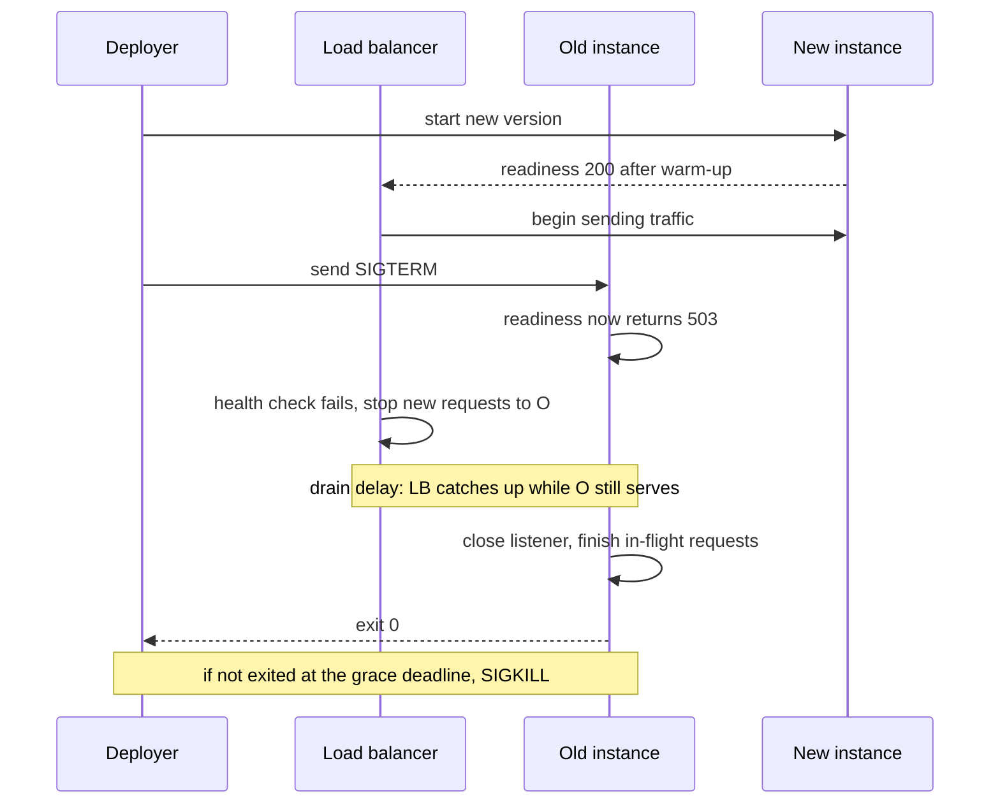
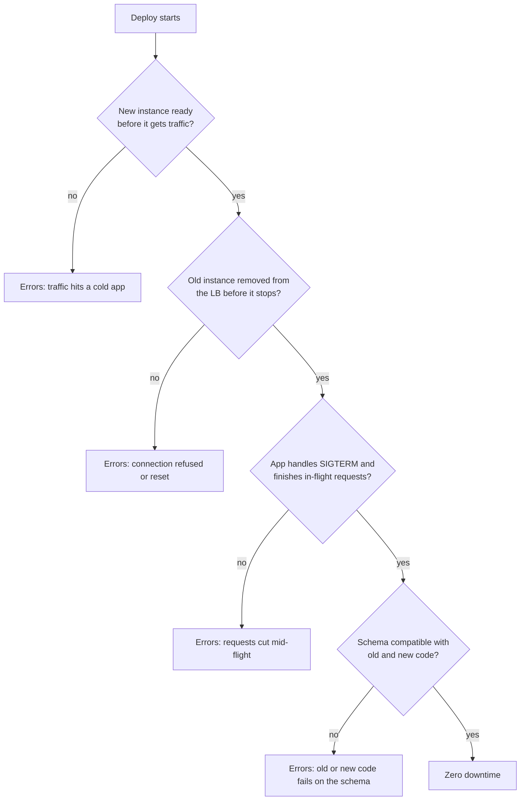

# L5.8 — Zero-downtime Deployments

> **Level 5: CI/CD** · Topic 8 of 12 · ⏱ ~5 hours · Difficulty: Intermediate

## 1. What it is

A **zero-downtime deployment** replaces the running version of a service with a new one without users noticing: no refused connections, no
`502` errors, no dropped requests, no "we are down for maintenance" page. The old version keeps serving until the new version is **ready**, and
the old version is only stopped after it has finished the work it already accepted.

It rests on four cooperating mechanisms, all of which you must get right:

1. **Readiness** — the new instance tells the platform when it can take traffic (for example `GET /readyz` returns 200 only after the database pool is connected).
2. **Health gates** — the pipeline (or orchestrator) refuses to move on until readiness and a real request succeed for the *new* version.
3. **Connection draining** — before an old instance stops, the load balancer stops sending it *new* requests while existing requests finish.
4. **Graceful shutdown** — the old process handles the termination signal (`SIGTERM`), finishes in-flight requests, closes connections and exits cleanly.

How the instances are swapped (rolling, blue/green, canary) is covered in [L5.10](10-rolling-deployments.md), [L5.11](11-blue-green-deployments.md)
and [L5.12](12-canary-deployments.md). Those strategies only deliver zero downtime if the four mechanisms above work.

## 2. Why it matters in DevOps

- **Deploy frequency:** if every deploy drops a few seconds of requests, teams deploy at night and rarely. If deploys are invisible, teams deploy ten times a day.
- **Hidden errors:** a deploy that causes 0.5% errors for 30 seconds is easy to miss in dashboards but it breaks real checkouts, retried webhooks and payments.
- **Error budgets:** every dropped request spends your SLO error budget ([Error Budgets](../level-14-sre/04-error-budgets.md)).
- **Most "mystery 502s at deploy time" have one of three causes:** the app ignores `SIGTERM`; the load balancer still routes to an instance that is shutting down; or the new instance receives traffic before it is ready.

## 3. Real-world system example

**Kubernetes pod termination.** The Kubernetes documentation describes the sequence exactly: when a pod is deleted, it is marked `Terminating`, a `preStop` hook (if defined)
runs, the container receives `SIGTERM`, and after `terminationGracePeriodSeconds` (30 seconds by default) it gets `SIGKILL`. At the same time the pod is removed from Service endpoints. These two
things happen **concurrently**, which is why well-run services add a short `preStop` sleep or keep serving for a few seconds after `SIGTERM`: the endpoint removal needs time to propagate to proxies and
load balancers. A Deployment's rolling update then uses readiness probes plus `maxUnavailable: 0` to keep capacity during the swap.

**Nginx.** `nginx -s reload` is the classic graceful reload: the master process starts new worker processes with the new configuration and tells the old workers to stop accepting new connections
and exit after finishing their current ones. It is the same drain-then-exit idea at the process level.

**AWS load balancers.** Application Load Balancers use a target-group **deregistration delay** (300 seconds by default): when a target is deregistered, it enters `draining`, receives no new requests,
and in-flight requests may finish until the delay expires. ECS and CodeDeploy rely on this and on health checks to shift traffic safely.

## 4. Diagram

What happens to one instance during a graceful shutdown (the order matters):



Where zero downtime is lost:



## 5. How it works

### Liveness, readiness and startup are different questions

| Check | Question | If it fails | Typical content |
|-------|----------|-------------|-----------------|
| **Liveness** (`/livez`) | Is the process stuck beyond recovery? | restart the container | returns 200 if the event loop runs; **never** checks the database (a DB outage must not restart-loop every pod) |
| **Readiness** (`/readyz`) | Can this instance take traffic *right now*? | remove from load balancing, do not restart | DB pool connected, caches warmed, not shutting down |
| **Startup** | Has the slow initialisation finished? | delay the other probes | used for apps with long boot times |
| **Deploy health gate** (pipeline) | Is the *new version* actually serving correct responses? | roll back | `status ok`, `version == deployed tag`, a smoke request, N consecutive successes |

See [Health Checks](../level-04-docker/12-health-checks.md) and [Liveness and Readiness Probes](../level-08-kubernetes/15-liveness-and-readiness-probes.md).

### The graceful shutdown recipe

1. Receive `SIGTERM` ([Processes and Signals](../level-01-linux-fundamentals/08-processes-and-signals.md)). Your process must be PID 1 in its container *or* receive forwarded signals: use the exec form
   `CMD ["node", "src/server.js"]`, never `CMD npm start` (npm does not forward signals), or add an init such as `docker run --init`.
2. **Immediately fail readiness** (return 503) so the load balancer stops choosing this instance.
3. **Keep serving for a short drain delay** (a few seconds) because the load balancer needs time to notice. Skipping this is the number one cause of deploy-time errors.
4. **Stop accepting new connections** (`server.close()`), finish in-flight requests, close idle keep-alive sockets, then close database pools and flush logs and metrics.
5. Exit `0` before the platform's kill deadline. Set the app's own hard timeout *below* it (`docker stop` waits 10 seconds by default; Kubernetes 30 seconds; ECS and others have `stopTimeout`).

### Connection draining at each layer

| Layer | Setting | Notes |
|-------|---------|-------|
| Docker / Compose | `stop_grace_period: 30s` | time between `SIGTERM` and `SIGKILL` |
| Kubernetes | `terminationGracePeriodSeconds`, `lifecycle.preStop`, readiness probe | grace period must exceed `preStop` + drain + longest request |
| AWS ALB | target group deregistration delay | default 300 seconds; lower it if your requests are short |
| Nginx | `nginx -s reload` / `quit` | old workers finish current connections |
| HAProxy / Envoy | drain a server (`set server ... state drain`) / hot restart | stop new sessions, keep existing |
| HTTP keep-alive | server closes connection after current response | long-lived keep-alive connections will otherwise stay on the old instance |

### Capacity and rollout settings (Kubernetes example)

```yaml
spec:
  replicas: 3
  strategy:
    type: RollingUpdate
    rollingUpdate:
      maxSurge: 1            # start one extra new pod
      maxUnavailable: 0      # never drop below 3 ready pods
  template:
    spec:
      terminationGracePeriodSeconds: 40
      containers:
        - name: api
          readinessProbe:
            httpGet: { path: /readyz, port: 3000 }
            periodSeconds: 5
            failureThreshold: 2
          lifecycle:
            preStop:
              exec: { command: ["sleep", "10"] }   # let endpoints propagate before SIGTERM is handled
```

`maxUnavailable: 0` with `maxSurge: 1` means a new pod must become **ready** before an old one is removed. A `PodDisruptionBudget` protects capacity during node drains, which are a different kind of "deploy".
(Newer Kubernetes versions also offer a built-in sleep action for `preStop`; check your version's documentation.)

### Database compatibility

During a deploy both versions run at once, against the *same* database. The schema must work for N-1 and N code. That is the expand/contract discipline of [L5.9](09-database-migrations.md).
Also check: message formats on queues, cache key formats, and API contracts between services.

## 6. Step-by-step guide

**Prerequisites:** Node.js 22, `curl`, and Nginx installed locally (Debian/Ubuntu: `sudo apt-get install -y nginx`; the commands below run Nginx from a private directory
and do not touch the system service). No cloud account. The server and Nginx sequence below was run in a sandbox; request counts will differ on your machine ("similar to").

1. **Write an app that shuts down gracefully.** Save as `server.js`:
   ```javascript
   const http = require("node:http");

   let ready = false;          // readiness: may we receive new traffic?
   let shuttingDown = false;
   let inFlight = 0;

   const server = http.createServer((req, res) => {
     if (req.url === "/livez") {            // liveness: process alive, no dependency checks
       res.writeHead(200).end("alive\n");
       return;
     }
     if (req.url === "/readyz") {           // readiness: flips to 503 as soon as shutdown starts
       const ok = ready && !shuttingDown;
       res.writeHead(ok ? 200 : 503, { "content-type": "application/json" });
       res.end(JSON.stringify({ status: ok ? "ok" : "draining", version: process.env.APP_VERSION || "dev" }) + "\n");
       return;
     }
     if (req.url.startsWith("/slow")) {     // simulates a 3 second request
       inFlight++;
       setTimeout(() => { inFlight--; res.end("slow done\n"); }, 3000);
       return;
     }
     res.end("hello\n");
   });

   const PORT = Number(process.env.PORT || 3000);
   server.listen(PORT, () => {
     ready = true;
     console.log("listening on", PORT, "version", process.env.APP_VERSION || "dev");
   });

   function shutdown(signal) {
     if (shuttingDown) return;
     shuttingDown = true;                   // 1. fail readiness first
     const drain = Number(process.env.DRAIN_MS || 5000);
     console.log(`${signal} received: readiness=503, waiting ${drain}ms for the load balancer`);
     setTimeout(() => {                     // 2. keep serving while the LB notices
       console.log("closing server, in-flight requests:", inFlight);
       server.close(() => {                 // 3. stop accepting, wait for in-flight requests
         console.log("all connections closed, exiting 0");
         process.exit(0);
       });
       server.closeIdleConnections();       // 4. drop idle keep-alive sockets so close() can finish
     }, drain);
     setTimeout(() => {                     // 5. hard deadline, below the platform kill timeout
       console.error("forced exit after timeout");
       process.exit(1);
     }, Number(process.env.FORCE_MS || 25000)).unref();
   }
   process.on("SIGTERM", () => shutdown("SIGTERM"));
   process.on("SIGINT", () => shutdown("SIGINT"));
   ```

2. **Prove the in-flight request survives `SIGTERM`.** Run the server in one terminal, then in a second:
   ```bash
   APP_VERSION=v2 DRAIN_MS=2000 node server.js &
   PID=$!
   curl -s -w ' [%{http_code}]\n' localhost:3000/readyz        # {"status":"ok","version":"v2"} [200]
   curl -s -w ' [%{http_code}]\n' localhost:3000/slow &         # a 3 second request starts
   sleep 0.5; kill -TERM $PID
   sleep 0.3
   curl -s -w ' [%{http_code}]\n' localhost:3000/readyz        # {"status":"draining",...} [503]
   curl -s -w ' [%{http_code}]\n' localhost:3000/livez         # alive [200]
   wait
   ```
   Expected: the `/slow` request still prints `slow done [200]` after about 3 seconds, `/readyz` flips to `503 draining` immediately, `/livez` stays 200, and the server log says
   `SIGTERM received...`, `closing server, in-flight requests: 1`, `all connections closed, exiting 0`.

3. **Prove what happens without a handler (the broken version).**
   ```bash
   node -e 'require("node:http").createServer((q,r)=>setTimeout(()=>r.end("slow done\n"),3000)).listen(3001)' &
   P=$!; sleep 0.7
   ( curl -s -w ' [%{http_code}]\n' localhost:3001/ ; echo "curl exit=$?" ) &
   sleep 0.5; kill -TERM $P; wait
   ```
   The request fails with `[000]` and `curl: (52) Empty reply from server` (similar output). Node's default `SIGTERM` behaviour is to exit immediately; the customer's request is cut.

4. **Run two instances behind Nginx.** Create a private Nginx directory and config:
   ```bash
   mkdir -p nginx/logs nginx/tmp
   cat > nginx/nginx.conf <<EOF
   worker_processes 1;
   pid $PWD/nginx/nginx.pid;
   error_log $PWD/nginx/logs/error.log warn;
   events { worker_connections 256; }
   http {
     access_log $PWD/nginx/logs/access.log;
     client_body_temp_path $PWD/nginx/tmp/body; proxy_temp_path $PWD/nginx/tmp/proxy;
     fastcgi_temp_path $PWD/nginx/tmp/fcgi; uwsgi_temp_path $PWD/nginx/tmp/uwsgi; scgi_temp_path $PWD/nginx/tmp/scgi;
     upstream api {
       server 127.0.0.1:3000 max_fails=0;
       server 127.0.0.1:3001 max_fails=0;
     }
     server {
       listen 8080;
       location / {
         proxy_pass http://api;
         proxy_next_upstream error timeout http_502 http_503;
         proxy_connect_timeout 1s;
       }
     }
   }
   EOF
   nginx -c $PWD/nginx/nginx.conf -p $PWD/nginx
   PORT=3000 APP_VERSION=v1 DRAIN_MS=2000 node server.js > a.log 2>&1 &  A=$!
   PORT=3001 APP_VERSION=v1 DRAIN_MS=2000 node server.js > b.log 2>&1 &  B=$!
   sleep 1; curl -s localhost:8080/readyz
   ```
   `proxy_next_upstream` makes Nginx retry another server on connection errors and `503`, which is how open-source Nginx copes with a draining instance (it has only *passive* health
   checks). `max_fails=0` disables its "mark the server down" behaviour; see the note after step 6.

5. **Create constant traffic and record every status code.** Save as `load.sh` (`chmod +x load.sh`):
   ```bash
   #!/usr/bin/env bash
   # print one status code per request for N seconds
   end=$((SECONDS+$1))
   while [ $SECONDS -lt $end ]; do
     curl -s -o /dev/null -w '%{http_code}\n' --max-time 5 http://127.0.0.1:8080/
     sleep 0.1
   done
   ```

6. **Do a rolling restart under load and count errors.** Run it in the same shell as step 4 (it uses `$A` and `$B`):
   ```bash
   ./load.sh 16 > codes.txt &  L=$!
   sleep 1
   # replace instance A (v1 -> v2): SIGTERM, wait for the clean exit, start v2, wait until ready
   kill -TERM $A; while kill -0 $A 2>/dev/null; do sleep 0.2; done
   PORT=3000 APP_VERSION=v2 DRAIN_MS=2000 node server.js > a2.log 2>&1 &  A=$!
   until curl -sf localhost:3000/readyz >/dev/null; do sleep 0.2; done
   # replace instance B
   kill -TERM $B; while kill -0 $B 2>/dev/null; do sleep 0.2; done
   PORT=3001 APP_VERSION=v2 DRAIN_MS=2000 node server.js > b2.log 2>&1 &  B=$!
   until curl -sf localhost:3001/readyz >/dev/null; do sleep 0.2; done
   wait $L
   sort codes.txt | uniq -c
   ```
   (Keep using the same shell as step 4 so that `$A` and `$B` still hold the process IDs.)
   Expected result is similar to `134 200` and **no other codes**: both instances were replaced while traffic flowed, and the readiness-then-drain-then-exit sequence meant no request failed.

   > **What went wrong in my first attempts:** with Nginx's default `max_fails=1 fail_timeout=10s`, a single `503` from a draining instance marks that server unavailable for 10 seconds.
   > When the second instance started draining, Nginx had *no live upstream* and returned `502 no live upstreams`; in the sandbox this produced a burst of `502` responses. Managed
   > load balancers (ALB, Kubernetes Services) use active health checks and readiness instead. With plain Nginx, either use `max_fails=0` as above, run enough instances, or use Nginx Plus / HAProxy
   > active checks.

7. **Add the same checks to the pipeline as a deploy health gate.** After the deploy step, require several consecutive successes for the *new* version:
   ```yaml
         - name: Health gate
           env:
             URL: ${{ vars.HEALTH_URL }}        # e.g. https://staging.example.com/readyz
             WANT: ${{ inputs.tag }}
           run: |
             ok=0
             for i in $(seq 1 30); do
               if curl -fsS --max-time 3 "$URL" | jq -e --arg v "$WANT" '.status == "ok" and .version == $v' >/dev/null; then
                 ok=$((ok+1))
               else
                 ok=0
               fi
               [ "$ok" -ge 5 ] && echo "healthy: $ok consecutive successes" && exit 0
               sleep 2
             done
             echo "health gate FAILED" >&2
             exit 1
   ```
   Requiring consecutive successes avoids a false pass while a load balancer is still rotating between old and new instances. Pair the gate with automatic rollback ([L5.7](07-rollback.md)).

8. **Clean up.** `kill -TERM $A $B` and `nginx -c $PWD/nginx/nginx.conf -p $PWD/nginx -s quit`.

## 7. Real-world scenario

*(Illustrative.)* Every `shop-api` deploy produces a handful of `502` errors for about 10 seconds. The team has two instances behind a load balancer and a rolling script that runs
`docker stop` on one container at a time. The logs show clients receiving `connection reset` exactly when containers stop. Investigation: the container's command is `npm start`, so the
`SIGTERM` goes to `npm`, not to Node, which is killed by `SIGKILL` after the 10 second grace period, cutting requests. The load balancer's health check runs every 15 seconds with two failures required,
so for up to 30 seconds it keeps sending traffic to the stopped instance.

Fixes: change to `CMD ["node", "src/server.js"]`; add the `SIGTERM` handler (fail readiness, wait 5 seconds, close the server); lower the health-check interval to 5 seconds with `unhealthy threshold 2`;
raise `stop_grace_period` to 30 seconds; and add a pipeline gate that checks `/readyz` for the new version. The next deploy shows zero non-2xx responses in the load balancer metrics.
**Lesson:** zero downtime is not a property of the deployment tool; it is the cooperation of app, load balancer and pipeline.

## 8. Common mistakes and best practices

**Don't**

- Start sending traffic to an instance because its process is running (rather than ready).
- Run the app as `npm start` or via a shell script that swallows `SIGTERM`.
- Make liveness depend on the database or other services; an outage will restart every healthy pod.
- Stop an instance before the load balancer has stopped routing to it.
- Set the grace period shorter than the longest legitimate request plus the drain delay.
- Ship a migration that breaks the previous version while the deploy is in progress.

**Do**

- Implement `/livez` (cheap) and `/readyz` (real dependencies and shutdown awareness), and include the version in the response.
- On `SIGTERM`: fail readiness, keep serving for a drain delay, finish in-flight requests, exit 0.
- Keep spare capacity during the swap (`maxUnavailable: 0`, surge by one).
- Gate the pipeline on the new version being healthy for several consecutive checks; roll back automatically on failure.
- Test deploys under load (a loop of `curl` is enough) and count non-2xx responses.
- Make the application and schema compatible across adjacent versions ([L5.9](09-database-migrations.md)).

## 9. Tasks

- [ ] **T1 — Graceful shutdown** *(≈45 min, beginner)*
  - **Goal:** an in-flight request survives `SIGTERM`.
  - **Steps:**
    1. Create `server.js` from step 1 and run the demonstration in step 2.
    2. Read the server log lines in order.
  - **Done when:** the slow request returns `200` after the signal, `/readyz` returned `503` immediately, and the log shows `exiting 0`.

- [ ] **T2 — Break it: no handler** *(≈30 min, beginner)*
  - **Goal:** see the failure that graceful shutdown prevents.
  - **Steps:**
    1. Run the handler-less server from step 3 and send `SIGTERM` during a request.
    2. Then run it with `CMD npm start` in a container (`docker run`, then `docker stop`) and time how long the stop takes.
  - **Done when:** you have a `curl` failure and a stop time of about 10 seconds, and can explain that npm did not forward the signal.

- [ ] **T3 — Rolling restart under load** *(≈60 min, intermediate)*
  - **Goal:** deploy two instances with zero failed requests.
  - **Steps:**
    1. Set up Nginx and two instances (steps 4 to 6).
    2. Run `load.sh` and perform the rolling restart.
    3. Count status codes with `sort | uniq -c`.
  - **Done when:** every recorded status code is `200`.

- [ ] **T4 — Break it: skip the drain** *(≈45 min, intermediate)*
  - **Goal:** understand why the drain delay and readiness matter.
  - **Steps:**
    1. Run the rolling restart with `kill -9` instead of `SIGTERM` (or `DRAIN_MS=0`) and the default Nginx `max_fails`/`fail_timeout` (remove `max_fails=0`).
    2. Record the status codes; read `nginx/logs/error.log`.
    3. Restore the correct sequence and re-measure.
  - **Done when:** you have two `uniq -c` outputs (with and without the correct sequence) and an explanation of each error line.

- [ ] **T5 — Kubernetes rollout with `maxUnavailable: 0`** *(≈75 min, advanced; kind or minikube, free)*
  - **Goal:** the same guarantee under an orchestrator.
  - **Steps:**
    1. Create a kind cluster, a Deployment of three `shop-api` pods with the readiness probe, `maxSurge: 1`, `maxUnavailable: 0`, a `preStop` sleep and `terminationGracePeriodSeconds: 40`.
    2. Expose it with a Service and port-forward; run the `curl` loop against it.
    3. Update the image tag (`kubectl set image`) and watch `kubectl rollout status`.
    4. **Cleanup:** `kind delete cluster`.
  - **Done when:** the loop shows only `200` during the rollout and `kubectl get pods -w` shows new pods becoming Ready before old ones terminate.

- [ ] **T6 — Prove it: a deploy gate that catches a bad release** *(≈60 min, advanced)*
  - **Goal:** make the pipeline refuse a release that cannot serve traffic.
  - **Steps:**
    1. Without the guide, add the health gate of step 7 to a deploy workflow.
    2. Deploy a good version and a deliberately bad one (wrong version string, or `/readyz` returning 500).
    3. Explain in writing what the gate checks, why it needs consecutive successes, and what your pipeline does on failure.
  - **Done when:** the good version passes, the bad version fails the gate and triggers rollback, and the workflow log shows the consecutive-success counting.

## 10. Self-check questions

1. Why should liveness not check the database, while readiness may?
2. Why does a graceful shutdown keep serving for a few seconds after `SIGTERM` instead of closing the listener at once?
3. What does `npm start` as a container command do to `SIGTERM`?
4. What do `maxSurge: 1` and `maxUnavailable: 0` guarantee during a Kubernetes rolling update?
5. Why must a deploy health gate check the version, not only the status?
6. Why does zero-downtime deployment depend on backwards-compatible database changes?

<details>
<summary>Answers</summary>

1. A failing liveness check restarts the container; a database outage would restart every pod, making things worse. A failing readiness check only removes the pod from traffic, which is the correct reaction to "dependency down".
2. The load balancer needs time (health-check interval, endpoint propagation) to stop sending new requests. Closing immediately causes refused connections for requests already routed to this instance.
3. `npm` becomes the main process and does not forward the signal to Node, so the app never runs its shutdown logic and is killed by `SIGKILL` after the grace period.
4. The controller creates one extra new pod and never lets the number of ready pods fall below the desired count: a new pod must be Ready before an old one is removed.
5. The old instance may still answer `ok`; only the version proves that the new code is the one serving.
6. Old and new application versions run against the same database at the same time during the swap, so the schema must work for both.
</details>

## 11. Further reading

- Kubernetes Docs: *Pod Lifecycle* (termination of pods), *Configure Liveness, Readiness and Startup Probes*, *Performing a Rolling Update*.
- Nginx Docs: *Controlling nginx* (`reload`, `quit`) and `ngx_http_upstream_module` (`max_fails`, `proxy_next_upstream`).
- AWS Docs: *Target groups for your Application Load Balancers* (deregistration delay) and *Health checks*.
- Node.js Docs: `http.Server.close()` and `closeIdleConnections()`.
- Next: [Database migrations in pipelines](09-database-migrations.md). Related: [Health Checks](../level-04-docker/12-health-checks.md), [Deployment Strategies](../level-00-what-devops-is/07-deployment-strategies.md).

<!-- nav -->
---
← Previous: [Rollback](07-rollback.md) · [Level 5 index](README.md) · Next: [Database Migrations in Pipelines](09-database-migrations.md) →
