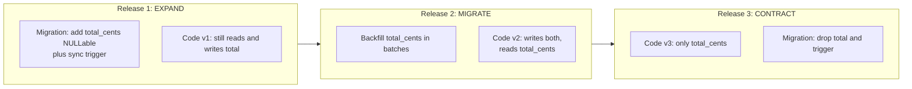
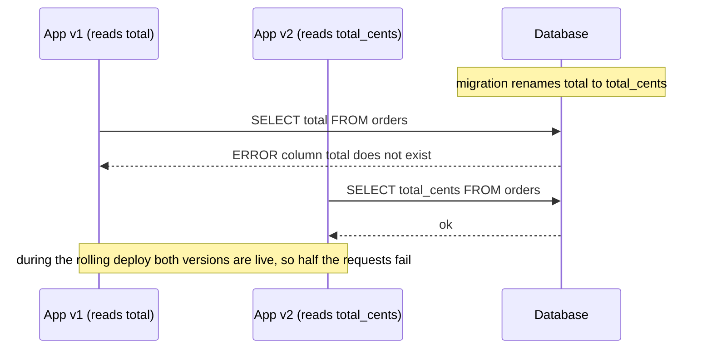
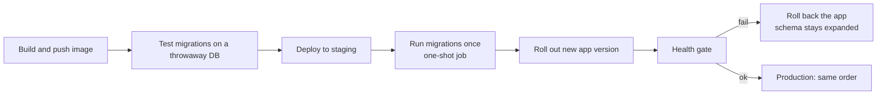

# L5.9 — Database Migrations in Pipelines

> **Level 5: CI/CD** · Topic 9 of 12 · ⏱ ~6 hours · Difficulty: Advanced

## 1. What it is

A **database migration** is a versioned, repeatable script that changes a database schema (tables, columns, indexes, constraints) or its data, from one version to the next.
A **migration tool** (Flyway, Prisma Migrate, Alembic, Liquibase, Rails/Django migrations) keeps a table in the database (for example `flyway_schema_history`) that records which migrations
have run, so applying "all pending migrations" is safe to repeat and every environment ends in the same state.

In a pipeline the problem is not *running* a migration; it is **timing and compatibility**. Code and schema do not change at the same instant:

- During a rolling, blue/green or canary deploy, **old and new application versions run at the same time against one database**.
- A rollback puts the **old code back against a schema the new code has already changed**.

So every migration must be compatible with the version before it and the version after it. The standard technique is **expand and contract** (also called "parallel change"):
first *expand* the schema in a backwards-compatible way, deploy code that works with both shapes, migrate the data, and only later *contract* by removing what is no longer used.

## 2. Why it matters in DevOps

- **Database changes are the main reason "rollback" and "zero downtime" fail.** Code is stateless and replaceable; data is not ([L5.7](07-rollback.md), [L5.8](08-zero-downtime-deployments.md)).
- **Locks cause outages without any error in the deploy.** An innocent `ALTER TABLE` on a busy table can queue behind a long transaction and then block *every* query on that table behind it.
- **Table rewrites are slow at scale:** a change that takes 20 ms on a laptop with 1,000 rows can hold a lock for many minutes on a table with 200 million.
- **Automation without discipline makes mistakes fast:** a pipeline that applies a destructive migration to production on every merge needs review rules, previews and a plan for failure.

## 3. Real-world system example

**Stripe.** Stripe's engineering blog post *"Online migrations at scale"* describes migrating a very large datastore with no downtime using a four-step pattern: **dual write** to the old and
new structures, **change reads** to the new one, **change writes** to the new one only, then **remove the old** data. The pipeline is expand and contract applied to a
huge, live database, with backfills done gradually and verification between steps.

**GitHub and `gh-ost`.** GitHub open-sourced `gh-ost`, an online schema-change tool for MySQL that builds a shadow copy of a table, applies ongoing changes to it by reading the binary log,
and swaps it in at the end, avoiding the long locks of a direct `ALTER`. (Percona's `pt-online-schema-change` takes a similar approach with triggers.) PostgreSQL gets
much of this behaviour natively through `CREATE INDEX CONCURRENTLY` and by making many `ALTER TABLE` forms metadata-only.

**GitLab.** GitLab's public development guidelines have a long section on migrations: a separation between regular migrations and **post-deployment migrations** (run after the new code is live),
requirements that migrations be backwards compatible and run within a time budget, and rules to avoid long locks. The Ruby on Rails ecosystem has a popular gem, `strong_migrations`, that blocks unsafe
operations in review for the same reasons.

## 4. Diagram

Expand and contract across three releases (the schema is always compatible with the code that runs against it):



Why a rename in one step breaks a rolling deploy:



The migration step inside the pipeline:



## 5. How it works

### Safe and unsafe changes (PostgreSQL)

| Change | Safe in one step? | Why / safer way |
|--------|-------------------|-----------------|
| Add a nullable column | Yes | Metadata-only, very fast |
| Add a column with a constant `DEFAULT` | Yes on PostgreSQL 11+ | Stored as metadata, no rewrite (older versions rewrite the table) |
| Add `NOT NULL` to an existing column | No (scans the table under lock) | `ADD CONSTRAINT ... CHECK (col IS NOT NULL) NOT VALID`, then `VALIDATE CONSTRAINT`, then `SET NOT NULL` (PostgreSQL 12+ reuses the validated check) |
| Add an index | No (blocks writes) | `CREATE INDEX CONCURRENTLY` (cannot run inside a transaction block) |
| Add a foreign key | No (locks both tables while validating) | `ADD CONSTRAINT ... NOT VALID`, then `VALIDATE CONSTRAINT` |
| **Rename** a column or table | **No** | Breaks old code; add new, dual write, switch, drop old |
| Change a column type | **No** | Often rewrites the table; add new column, backfill, switch, drop |
| Drop a column or table | **Only after** no deployed code uses it | Contract step in a later release |
| Backfill millions of rows | No in one statement | Batches of 1,000 to 20,000 rows with pauses; one transaction each |

### The locking pitfall

Most `ALTER TABLE` statements need an `ACCESS EXCLUSIVE` lock, which conflicts with every other lock. If a long-running query or an open transaction holds any lock on the table,
the `ALTER` **waits**, and while it waits, **every new query on that table queues behind it**, including plain `SELECT`s. A migration that waits 30 seconds for an idle-in-transaction session
can therefore stall the whole application. Defences:

1. `SET lock_timeout = '3s';` at the top of risky migrations: fail fast instead of queueing everyone; retry the migration.
2. `SET statement_timeout` for the statements that should be quick.
3. Run migrations at a low-traffic time *and* keep application transactions short; alert on `idle in transaction` sessions.
4. Prefer metadata-only operations and the `NOT VALID` / `CONCURRENTLY` patterns above.
5. Test on a copy of production-sized data, not only on an empty database.

### Tools compared

| Tool | Migration format | Typical pipeline command | Notes |
|------|------------------|--------------------------|-------|
| **Flyway** | SQL files `V2__add_total_cents.sql` (plus repeatable `R__` and Java) | `flyway migrate`, `flyway validate`, `flyway info` | Versioned SQL, simple and explicit; checksum validation detects edited, already-applied files. |
| **Prisma Migrate** | SQL generated from `schema.prisma` into `prisma/migrations/<timestamp>_name/` | `prisma migrate deploy` (CI and production), `prisma migrate dev` (local only) | Review and, when needed, hand-edit the generated SQL (`--create-only`). Never run `migrate dev` or `migrate reset` against production. |
| **Alembic** (Python/SQLAlchemy) | Python revision files with `upgrade()` and `downgrade()` | `alembic upgrade head`, `alembic current`, `alembic history` | Autogenerate is a draft only. `postgresql_concurrently=True` index builds need an `autocommit_block()`. |
| **Liquibase** | XML, YAML or SQL changelogs | `liquibase update` | Supports rollback scripts and contexts. |

Common rules, whatever the tool:

- **Never edit a migration that has been applied anywhere shared**; add a new one. Tools verify checksums and will refuse.
- **One tool, one source of truth;** the migrations live in the same repository and are reviewed like code.
- **Run migrations once per deploy, not at app startup in every replica.** Parallel replicas race, a slow migration makes health checks fail, and an app crash loop can leave a half-applied change.
  Use a one-shot step: a pipeline job on a runner that can reach the database, a `migrate` container run before the app, a Kubernetes Job or Helm `pre-upgrade` hook, or an ECS task.
- **Prefer forward fixes over down-migrations.** Down scripts for data-destroying changes are fiction; keep the rollback story as "old code works with the expanded schema".
- **Give the migration account its own credentials:** DDL rights for the migrator, not for the running app ([L5.5](05-secrets-and-environment-variables.md)).

### Migration-aware pipeline stages

1. **PR:** start a throwaway Postgres (a service container), apply *all* migrations from scratch, then run the test suite. Also apply only the *new* migration to a database built from the main branch.
2. **Compatibility test:** run the previous release's test suite (or smoke tests) against the schema after the new migration; this proves N-1 code works with N schema, the rollback case.
3. **Lint** migrations (for example with a SQL migration linter such as `squawk` for PostgreSQL, or code-review rules) to flag blocking operations.
4. **Staging:** run the same migration job as production against a production-like dataset.
5. **Production:** migration job, then rollout, then health gate. Contract migrations run in a **later** release.

## 6. Step-by-step guide

**Prerequisites:** PostgreSQL 14 or newer and `psql`. Fastest: `docker run --rm -d --name pg -e POSTGRES_PASSWORD=<YOUR_PASSWORD> -p 5432:5432 postgres:16`
(then `psql "postgresql://postgres:<YOUR_PASSWORD>@localhost:5432/postgres"`), or a local installation. Optional for the tool parts: Docker (for Flyway), Node.js (Prisma) or Python 3 (Alembic).
The SQL in steps 1 to 5 was run against PostgreSQL 16; timings will differ on your machine ("similar to").

1. **Create the starting schema and 100,000 rows.** Save as `seed.sql` and run `psql ... -d postgres -c "create database shop"` then `psql ... -d shop -f seed.sql`:
   ```sql
   create table orders (
     id          bigserial primary key,
     customer_id integer not null,
     total       numeric(10,2) not null,
     status      text not null default 'new',
     created_at  timestamptz not null default now()
   );
   insert into orders (customer_id, total)
   select (random()*1000)::int, (random()*200)::numeric(10,2) from generate_series(1, 100000);
   ```
   Goal of the scenario: change money from `total numeric` to integer `total_cents` (store cents to avoid rounding), without downtime. A direct `RENAME`/`TYPE` change is exactly what we avoid.

2. **Release 1, EXPAND.** Save as `db/migration/V2__expand_total_cents.sql`:
   ```sql
   -- additive and nullable: old code is unaffected
   ALTER TABLE orders ADD COLUMN total_cents bigint;

   -- old code only writes "total": keep the new column in sync for its writes
   CREATE OR REPLACE FUNCTION orders_sync_total() RETURNS trigger AS $$
   BEGIN
     IF NEW.total_cents IS NULL THEN
       NEW.total_cents := (NEW.total * 100)::bigint;
     END IF;
     RETURN NEW;
   END $$ LANGUAGE plpgsql;

   CREATE TRIGGER orders_sync_total_trg BEFORE INSERT OR UPDATE ON orders
     FOR EACH ROW EXECUTE FUNCTION orders_sync_total();
   ```
   Apply it with `psql -d shop -f db/migration/V2__expand_total_cents.sql`. Then prove old code still works and new rows are filled:
   ```sql
   insert into orders (customer_id, total) values (1, 12.34) returning id, total, total_cents;
   ```
   Expected: `total_cents` is `1234` even though the insert only mentioned `total`.

3. **Release 2, MIGRATE: backfill in batches, then validate.** Run repeatedly (a loop in a script or a job) until `remaining` is 0:
   ```sql
   UPDATE orders
   SET total_cents = (total * 100)::bigint
   WHERE id IN (SELECT id FROM orders WHERE total_cents IS NULL ORDER BY id LIMIT 20000);
   ```
   ```bash
   for i in $(seq 1 6); do psql -d shop -qc "UPDATE orders SET total_cents = (total*100)::bigint WHERE id IN (SELECT id FROM orders WHERE total_cents IS NULL ORDER BY id LIMIT 20000)"; sleep 1; done
   psql -d shop -c "select count(*) filter (where total_cents is null) as remaining from orders"
   ```
   Expected: `remaining` is `0`. Small batches keep each transaction short, so locks and replication lag stay small. Then make the column `NOT NULL` without a long scan under lock, in `V3__total_cents_not_null.sql`:
   ```sql
   ALTER TABLE orders ADD CONSTRAINT orders_total_cents_nn CHECK (total_cents IS NOT NULL) NOT VALID;
   ALTER TABLE orders VALIDATE CONSTRAINT orders_total_cents_nn;   -- scans, but allows concurrent writes
   ALTER TABLE orders ALTER COLUMN total_cents SET NOT NULL;       -- instant: PostgreSQL 12+ uses the validated check
   ALTER TABLE orders DROP CONSTRAINT orders_total_cents_nn;
   ```
   Deploy application v2 now: it writes both `total` and `total_cents` and reads `total_cents`. Rolling back to v1 is safe at every point, because `total` is still there and still correct.

4. **Release 3, CONTRACT** (only after v1 is gone everywhere and the rollback window has passed). Save as `V4__contract_drop_total.sql`:
   ```sql
   DROP TRIGGER orders_sync_total_trg ON orders;
   DROP FUNCTION orders_sync_total();
   ALTER TABLE orders DROP COLUMN total;
   ```
   Prove the danger of doing this too early: after it, run the old query `select total from orders;`. It fails with `ERROR:  column "total" does not exist`; any still-running v1 instance, or a rollback to v1, would hit this on every request.

5. **See the lock-queue problem yourself.** Open three `psql` sessions on database `shop`:
   ```sql
   -- session 1: an "innocent" long transaction
   begin; select count(*) from orders; -- leave it open (or: select pg_sleep(60);)

   -- session 2: a migration with no protection (here limited to 5 s so you can observe)
   set lock_timeout = '5s';
   alter table orders add column note text;     -- WAITS

   -- session 3: a plain read, started while session 2 is waiting
   select 1 from orders limit 1;                -- also WAITS, behind the ALTER
   ```
   In a fourth session `select pid, left(query,40), wait_event_type, wait_event from pg_stat_activity where datname='shop';` shows the `ALTER` and the `SELECT` both waiting on `Lock / relation`.
   After 5 seconds session 2 fails with `ERROR:  canceling statement due to lock timeout` and session 3 immediately completes. In my run the plain `SELECT` was delayed by about 4 seconds by a migration that did nothing. With `lock_timeout` the blast radius is bounded; without it, it lasts as long as session 1 stays open.
   Finish with `rollback;` in session 1.

6. **Index without blocking writes.** In a transaction block it is refused; outside it works:
   ```sql
   begin; create index concurrently idx_orders_customer on orders(customer_id); commit;
   -- ERROR:  CREATE INDEX CONCURRENTLY cannot run inside a transaction block
   create index concurrently if not exists idx_orders_customer on orders(customer_id);
   ```
   Keep such a statement alone in its own migration file. Tools differ on how they wrap migrations in transactions: with Flyway on PostgreSQL, a script that contains only the concurrent statement is the safe layout (it can also be set to run outside a transaction in the script configuration; check the Flyway documentation for your version).

7. **Run migrations with a tool, as a one-shot step.** With Flyway in Docker (files named `V<version>__<description>.sql`; note the double underscore):
   ```bash
   docker run --rm --network host \
     -v "$PWD/db/migration:/flyway/sql:ro" \
     -e FLYWAY_URL=jdbc:postgresql://localhost:5432/shop \
     -e FLYWAY_USER=postgres -e FLYWAY_PASSWORD=<YOUR_PASSWORD> \
     flyway/flyway:11 info
   docker run --rm --network host -v "$PWD/db/migration:/flyway/sql:ro" \
     -e FLYWAY_URL=jdbc:postgresql://localhost:5432/shop -e FLYWAY_USER=postgres -e FLYWAY_PASSWORD=<YOUR_PASSWORD> \
     flyway/flyway:11 migrate
   ```
   `info` lists each version as `Pending`/`Success`; `migrate` applies pending ones in order and records them in `flyway_schema_history`. Editing an applied file makes the next run fail checksum validation; that is deliberate. Use a fresh database for this step: put the step 1 seed into `db/migration/V1__init.sql` so Flyway applies V1 to V4 itself. (To adopt Flyway on an existing database, run it once with `-baselineOnMigrate=true -baselineVersion=1`.) Equivalents:
   ```bash
   # Prisma: develop locally, deploy in CI/production
   npx prisma migrate dev --create-only --name expand_total_cents   # generate SQL, then review/edit it
   npx prisma migrate deploy                                         # apply pending migrations, no shadow DB, no reset

   # Alembic
   alembic revision -m "expand total_cents"
   alembic upgrade head
   alembic current
   ```
   In Alembic, a safe index build looks like this (Alembic 1.12+ for `if_not_exists`):
   ```python
   def upgrade():
       with op.get_context().autocommit_block():
           op.create_index("idx_orders_customer", "orders", ["customer_id"],
                           postgresql_concurrently=True, if_not_exists=True)
   ```

8. **Wire the migration into the pipeline.** Migrations run as their own job *before* the rollout, and PRs test them on a throwaway database:
   ```yaml
   name: migrations-check
   on:
     pull_request:
       paths: ["db/migration/**"]

   permissions:
     contents: read

   jobs:
     migrate-from-scratch:
       runs-on: ubuntu-24.04
       timeout-minutes: 15
       services:
         postgres:
           image: postgres:16
           env:
             POSTGRES_PASSWORD: ci-only-password
             POSTGRES_DB: shop
           ports: ["5432:5432"]
           options: >-
             --health-cmd "pg_isready -U postgres"
             --health-interval 5s --health-timeout 5s --health-retries 10
       steps:
         - uses: actions/checkout@v4
         - name: Apply all migrations with Flyway
           run: |
             docker run --rm --network host \
               -v "$PWD/db/migration:/flyway/sql:ro" \
               -e FLYWAY_URL=jdbc:postgresql://localhost:5432/shop \
               -e FLYWAY_USER=postgres -e FLYWAY_PASSWORD=ci-only-password \
               flyway/flyway:11 migrate
         - name: Check for blocking operations (warn on risky DDL)
           run: |
             if grep -Eiq 'ALTER TABLE .* (DROP COLUMN|RENAME|ALTER COLUMN .* TYPE)' db/migration/*.sql; then
               echo "::warning::migration contains DROP/RENAME/TYPE change: confirm expand/contract is respected"
             fi
   ```
   And in the deploy job, run the migration against the target environment *before* the app rollout (from a runner that can reach the database, or via SSH/`docker compose run --rm migrate` on the host), and fail the deployment if it fails:
   ```yaml
   services:
     migrate:
       image: flyway/flyway:11
       command: -connectRetries=20 migrate
       environment:
         FLYWAY_URL: jdbc:postgresql://db:5432/shop
         FLYWAY_USER: ${DB_MIGRATOR_USER}
         FLYWAY_PASSWORD: ${DB_MIGRATOR_PASSWORD}
       volumes: ["./db/migration:/flyway/sql:ro"]
       profiles: ["migrate"]
   ```
   `docker compose --profile migrate run --rm migrate` runs it once and exits.

9. **Clean up.** `docker rm -f pg` (or `drop database shop;` on a local server).

## 7. Real-world scenario

*(Illustrative.)* A developer needs `orders.total` as integer cents. Their migration is one line: `ALTER TABLE orders RENAME COLUMN total TO total_cents;`, and the code change is merged with it. The pipeline is green: tests run against
a fresh database that has the new schema. The deploy is a rolling update over four instances. Within seconds the first new pod becomes ready and the migration has already run, so the three remaining old pods start returning
`500: column "total" does not exist` for every checkout. The health gate fails, the pipeline rolls the application back, but the rolled-back old code still hits the renamed column, so rollback does not help.
The on-call engineer restores service by adding a view/column alias manually (`ALTER TABLE orders ADD COLUMN total numeric GENERATED ALWAYS AS (total_cents / 100.0) STORED`) at 02:10; recovery takes about 25 minutes.

Follow-up: the team adopts expand/contract for all schema changes, adds a `migrations-check` PR job, runs migrations as a separate pre-rollout job with `lock_timeout`, and writes the rule in `CONTRIBUTING.md`:
"A migration must work with the previous release's code. Rename, drop and type changes take three releases."
**Lesson:** green tests on a fresh database prove nothing about *mixed-version* operation; compatibility between adjacent versions has to be designed and tested.

## 8. Common mistakes and best practices

**Don't**

- Rename or drop columns, or change types, in the same release as the code that stops using them.
- Edit a migration file that has already been applied in any shared environment.
- Run migrations from every app replica at startup.
- Run `ALTER TABLE` on a busy table without `lock_timeout`, or with a long transaction open.
- Add indexes without `CONCURRENTLY` on large production tables.
- Backfill millions of rows in a single statement or transaction.
- Run `prisma migrate dev`/`reset` or auto-generated destructive Alembic output against production.
- Rely on down-migrations as your rollback plan.

**Do**

- Use expand, migrate, contract across separate releases; document which phase each migration is in.
- Keep migrations small, idempotent where practical, and reviewed; test them from scratch and from the previous release's schema.
- Run migrations once, as a dedicated, retryable pipeline step that fails the deploy on error.
- Set `lock_timeout` (and `statement_timeout`) and retry; monitor `idle in transaction` sessions.
- Use separate credentials: a migrator with DDL rights, an application user with only DML.
- Take a backup or snapshot before risky production changes ([Backups and PITR](../level-13-databases-distributed-systems/05-backups-and-pitr.md)).
- Test on production-sized data in staging so lock and timing surprises appear there.

## 9. Tasks

- [ ] **T1 — Expand with a trigger and a backfill** *(≈45 min, intermediate)*
  - **Goal:** add `total_cents` without breaking old writes.
  - **Steps:**
    1. Build the `orders` table with 100,000 rows (step 1).
    2. Apply `V2__expand_total_cents.sql` and insert a row using only `total`.
    3. Backfill existing rows in batches.
  - **Done when:** `select count(*) from orders where total_cents is null` returns `0` and the inserted row has the right `total_cents`.

- [ ] **T2 — Add NOT NULL without a long lock** *(≈30 min, intermediate)*
  - **Goal:** use `NOT VALID` then `VALIDATE`.
  - **Steps:**
    1. Run the three-statement pattern from step 3.
    2. In another session, insert rows continuously (`pgbench -f` with a one-line insert script, or a shell loop) while you validate.
  - **Done when:** `\d orders` shows `total_cents` as `not null` and the concurrent inserts never blocked for more than a moment.

- [ ] **T3 — Break it: reproduce the lock queue** *(≈40 min, advanced)*
  - **Goal:** see a harmless migration stall unrelated queries.
  - **Steps:**
    1. Follow step 5 with and without `lock_timeout`.
    2. Record how long the plain `SELECT` in session 3 waited in both cases and capture the `pg_stat_activity` rows.
  - **Done when:** you have timings for both cases and can explain why the SELECT waited behind the ALTER.

- [ ] **T4 — Break it: the rename that kills the old version** *(≈40 min, intermediate)*
  - **Goal:** prove that a one-step rename is not rollback-safe.
  - **Steps:**
    1. Run an "old app" loop (`while sleep 0.5; do psql -d shop -tc "select total from orders limit 1"; done`).
    2. In another session run `ALTER TABLE orders RENAME COLUMN total TO total_cents`.
    3. Undo it and redo the change with the three-release pattern.
  - **Done when:** the loop shows `column "total" does not exist` after the rename and shows no error during the expand/contract version until the contract migration.

- [ ] **T5 — Migration job in a pipeline** *(≈75 min, advanced)*
  - **Goal:** a PR check and an ordered deploy.
  - **Steps:**
    1. Add `migrations-check.yml` (step 8) and open a PR with a new migration; make it fail with a syntax error and fix it.
    2. Add a `migrate` Compose service (or Kubernetes Job) and run it before the app in your deploy script; verify the deploy stops if the migration fails.
  - **Done when:** a bad migration turns the PR check red, and a deploy with a failing migration never starts the new app version.

- [ ] **T6 — Prove it: plan a column split without notes** *(≈60 min, advanced)*
  - **Goal:** design expand/contract for a new change.
  - **Steps:**
    1. Without the guide, write the three-release plan to split `customers.name` into `first_name` and `last_name`: migrations, application behaviour per release, backfill method, and the rollback story at each step.
    2. Execute it on a scratch database while a read/write loop runs; confirm zero errors.
    3. Explain which step you could not safely compress, and why.
  - **Done when:** the loop reported no errors during all three phases, and your write-up states that v(N-1) code worked after every migration.

## 10. Self-check questions

1. Why must a migration be compatible with both the previous and the next application version?
2. Describe expand and contract using a column rename as the example.
3. Why can a quick `ALTER TABLE` take an application down, and what two defences reduce the risk?
4. Why run migrations as a separate step rather than at app startup?
5. How do you add a `NOT NULL` constraint or a foreign key to a large PostgreSQL table with minimal locking?
6. Why is a down-migration a weak rollback plan?

<details>
<summary>Answers</summary>

1. During rolling, blue/green and canary deploys both versions run against one database, and a rollback runs the old version against the new schema.
2. Add the new column (nullable) plus a way to keep it in sync, deploy code that writes both and reads the new one, backfill, then in a later release stop using and drop the old column.
3. It needs an exclusive lock and waits behind open transactions, and everything else queues behind it. Use `lock_timeout` (with retry) and metadata-only/`NOT VALID`/`CONCURRENTLY` patterns, plus keep application transactions short.
4. Replicas race and duplicate work, a slow migration makes health checks fail, a crash loop can leave a half-applied change, and the app account should not have DDL rights; a single retryable job gives control and clear failure.
5. Add the constraint as `NOT VALID` (or a `CHECK ... IS NOT NULL NOT VALID`), then `VALIDATE CONSTRAINT`, which scans without blocking writes; then `SET NOT NULL` (PostgreSQL 12+ skips the rescan).
6. Data changes (dropped columns, rewritten values, lost rows) cannot be reversed by a script; it is safer to keep the schema backwards compatible so old code works, and to fix forward.
</details>

## 11. Further reading

- Stripe Engineering: *Online migrations at scale*.
- PostgreSQL Documentation: *ALTER TABLE*, *CREATE INDEX* (the `CONCURRENTLY` section) and *Explicit Locking*; the `lock_timeout` setting.
- Flyway Documentation (Redgate): *Migrations*, *Concepts*, *Commands*; Prisma Docs: *Prisma Migrate* (development and production workflows); Alembic Documentation: tutorial and operations reference.
- GitHub `gh-ost` repository documentation; GitLab Development Docs: *Migration style guide*.
- *Refactoring Databases* by Scott Ambler and Pramod Sadalage (evolutionary database design).
- Next: [Rolling deployments](10-rolling-deployments.md). Related: [Transactions and Locks](../level-13-databases-distributed-systems/02-transactions-and-locks.md), [Zero-downtime deployments](08-zero-downtime-deployments.md).

<!-- nav -->
---
← Previous: [Zero-downtime Deployments](08-zero-downtime-deployments.md) · [Level 5 index](README.md) · Next: [Rolling Deployments](10-rolling-deployments.md) →
