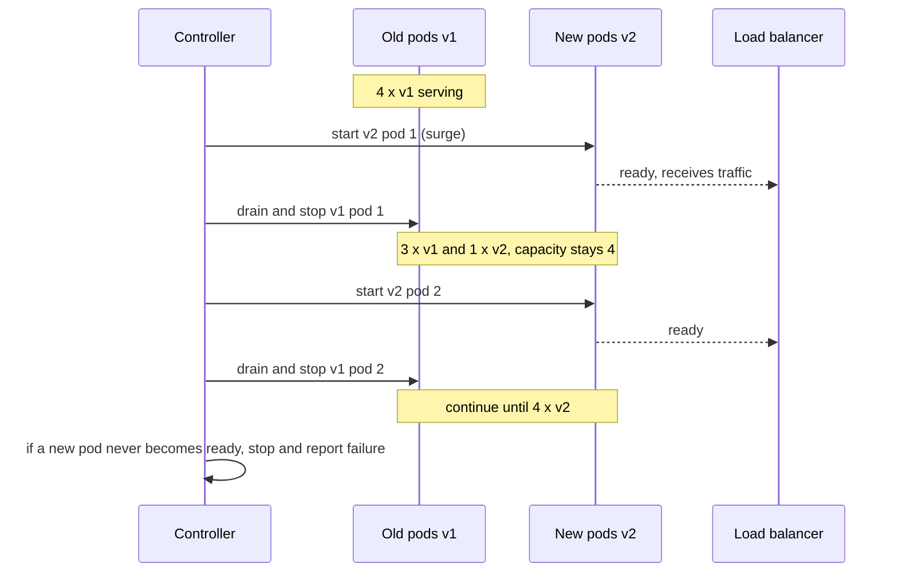
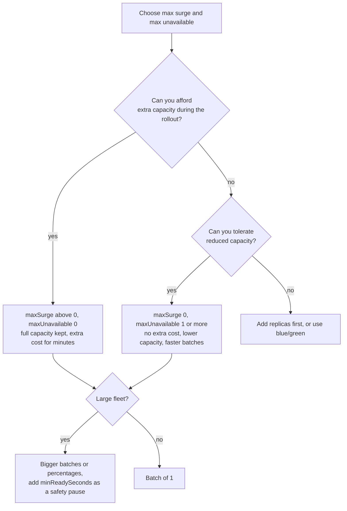

# L5.10 — Rolling Deployments

> **Level 5: CI/CD** · Topic 10 of 12 · ⏱ ~4 hours · Difficulty: Intermediate

## 1. What it is

A **rolling deployment** replaces the running instances of a service with the new version a few at a time. At every moment some instances run the old version and some the
new one, until all have been replaced. Because the service never has zero healthy instances, users keep being served, and because only a slice is replaced at once, a bad release
is noticed before it has replaced everything.

Two numbers define a rolling update:

- **Batch size:** how many instances are being replaced at the same time.
- **Capacity floor and ceiling:** how much capacity may disappear (**max unavailable**) and how much extra capacity may be created temporarily (**max surge**) during the swap.

Rolling is the default strategy of Kubernetes Deployments and Amazon ECS services, and the cheapest strategy in infrastructure terms: it needs no second full environment.
Compare it with [blue/green](11-blue-green-deployments.md) and [canary](12-canary-deployments.md) in [Deployment Strategies](../level-00-what-devops-is/07-deployment-strategies.md).

## 2. Why it matters in DevOps

- **It is what you get by default**, so you must understand its settings. The defaults may be too aggressive for a small service or too slow for a big one.
- **Mixed versions are normal.** For the length of the rollout both versions serve traffic and share the database, queues and caches. Anything not backwards compatible breaks here
  ([L5.9](09-database-migrations.md)).
- **Capacity during deploys:** with three replicas and `maxUnavailable: 1`, a deploy removes a third of your capacity. At peak traffic that can cause the very outage the deploy was supposed to avoid.
- **Speed vs safety:** a big batch finishes fast but a bad version hurts more users; a batch of one is gentle but a 200-instance fleet then takes hours.
- **Rollback is another rolling update** back to the old version, so it takes as long as the roll forward.

## 3. Real-world system example

**Kubernetes Deployments.** The Deployment controller implements `RollingUpdate` by scaling a new ReplicaSet up and the old one down, within the limits `maxSurge` and `maxUnavailable` (both default to 25%).
Percentages are rounded: the surge is rounded up and the unavailable count is rounded down. A pod counts as available only after its readiness probe passes (and `minReadySeconds`, if set), so a
crashing new version stalls the rollout instead of replacing healthy pods. If the rollout makes no progress for `progressDeadlineSeconds` (600 by default), the Deployment is reported as failed
(it is not rolled back automatically; you or your pipeline do that with `kubectl rollout undo`).

**Amazon ECS.** ECS services use rolling updates by default, controlled by `minimumHealthyPercent` and `maximumPercent` (documented defaults of 100 and 200 for the rolling update type), and can enable a
**deployment circuit breaker** that stops a failing deployment and rolls back automatically. **EC2 Auto Scaling instance refresh** replaces instances in a group in batches, governed by a minimum healthy percentage
and an instance warm-up time. All three are the same idea expressed in different APIs.

## 4. Diagram

A rolling update of four instances with batch size 1 (`maxSurge 1`, `maxUnavailable 0`):



How the settings trade off capacity, speed and cost:



## 5. How it works

### The settings, per platform

| Platform | Batch / pace | Capacity control | Safety net |
|----------|-------------|------------------|------------|
| **Kubernetes Deployment** | implied by `maxSurge` and `maxUnavailable` | `maxSurge` (extra pods allowed), `maxUnavailable` (pods that may be down), integers or percentages | readiness probe, `minReadySeconds`, `progressDeadlineSeconds`, `kubectl rollout pause/undo` |
| **Amazon ECS** | tasks started and stopped within the limits | `minimumHealthyPercent`, `maximumPercent` | health checks, deployment circuit breaker with rollback, CloudWatch alarms |
| **EC2 Auto Scaling instance refresh** | replaces instances in batches | minimum healthy percentage, instance warm-up | checkpoints (pause at 20%, 50%...), automatic rollback option |
| **Docker Swarm** | `update_config.parallelism`, `delay` | `order: start-first` or `stop-first` | `failure_action: rollback`, `monitor` |
| **Your script / Ansible** | `serial: 1` or `serial: "25%"` in Ansible | you decide | stop the play when a host fails the health gate |

Kubernetes examples for 4 replicas:

| `maxSurge` | `maxUnavailable` | Behaviour | Capacity during rollout | Extra cost |
|------------|------------------|-----------|-------------------------|------------|
| 1 | 0 | start one new pod, wait ready, remove one old pod | always 4 or more | one extra pod briefly |
| 0 | 1 | remove one old pod, then start its replacement | 3 or 4 | none |
| 25% (rounds to 1) | 25% (rounds to 1) | default; may overlap a bit | 3 to 5 | small |
| 2 | 1 | fast; two start while one is removed | 3 or more | two extra pods |
| 100% | 0 | everything new first (blue/green-like) | 4 to 8 | doubles for the rollout |

### Choosing batch size

- **Capacity:** `batch <= spare_capacity`. If you run at 70% utilisation with 4 instances, removing one leaves the other three at about 93%. Over-provision, or surge instead of removing.
- **Blast radius:** the first batch is your canary. If one instance of four is bad, about a quarter of requests hit it until the gate stops the rollout.
- **Warm-up:** JVM apps, caches and connection pools need time; add `minReadySeconds` or a warm-up period so a fresh instance is not counted healthy the instant it answers.
- **Stateful or sticky systems:** databases, queues with consumer groups and websocket servers need ordering and draining care (StatefulSets update one pod at a time in reverse ordinal order by default).

### What a rolling update does not give you

| Limitation | Consequence | Answer |
|------------|-------------|--------|
| Mixed versions for the whole rollout | schema, API and message formats must be compatible | expand/contract ([L5.9](09-database-migrations.md)); version APIs |
| No instant rollback | going back is another rolling update | blue/green ([L5.11](11-blue-green-deployments.md)) or feature flags |
| Traffic split is by instance count, not a chosen percentage | a bad version gets `new/total` of the traffic, uncontrolled by metrics | canary with metric gates ([L5.12](12-canary-deployments.md)) |
| Health gate quality decides everything | a weak readiness probe lets bad pods replace good ones | meaningful `/readyz`, post-deploy smoke tests ([L5.8](08-zero-downtime-deployments.md)) |
| Long-lived connections stay on old instances | uneven load after the rollout | drain with a deadline; clients reconnect |

## 6. Step-by-step guide

**Prerequisites:** Node.js 22, `curl`, Nginx (Debian/Ubuntu: `sudo apt-get install -y nginx`, used from a private directory; the system service is untouched), and the `server.js` from
[L5.8](08-zero-downtime-deployments.md) (graceful shutdown with `/readyz` returning `{"status":"ok","version":"..."}`). No cloud account. The local rollout below was run in a sandbox; timings are
"similar to" on your machine. A Kubernetes version follows in step 6 (kind or minikube, free).

1. **Create a private Nginx with four backends.** In an empty directory containing `server.js`:
   ```bash
   mkdir -p nginx/logs nginx/tmp run
   cat > nginx/nginx.conf <<EOF
   worker_processes 1;
   pid $PWD/nginx/nginx.pid;
   error_log $PWD/nginx/logs/error.log warn;
   events { worker_connections 256; }
   http {
     access_log off;
     client_body_temp_path $PWD/nginx/tmp/body; proxy_temp_path $PWD/nginx/tmp/proxy;
     fastcgi_temp_path $PWD/nginx/tmp/fcgi; uwsgi_temp_path $PWD/nginx/tmp/uwsgi; scgi_temp_path $PWD/nginx/tmp/scgi;
     upstream api {
       server 127.0.0.1:3000 max_fails=0;
       server 127.0.0.1:3001 max_fails=0;
       server 127.0.0.1:3002 max_fails=0;
       server 127.0.0.1:3003 max_fails=0;
     }
     server {
       listen 8080;
       location / {
         proxy_pass http://api;
         proxy_next_upstream error timeout http_502 http_503;
         proxy_connect_timeout 1s;
       }
     }
   }
   EOF
   nginx -c $PWD/nginx/nginx.conf -p $PWD/nginx
   ```
   (`max_fails=0` is explained in L5.8: it stops open-source Nginx from marking a draining server down.)

2. **Write the rolling-update script with a batch size and a health gate.** Save as `rolling.sh` and `chmod +x rolling.sh`:
   ```bash
   #!/usr/bin/env bash
   # Rolling update of local instances. Usage: rolling.sh <version> <batch-size>
   set -euo pipefail
   VERSION="${1:?version}"; BATCH="${2:-1}"
   PORTS=(3000 3001 3002 3003)
   mkdir -p run

   start() {   # start <port>
     PORT="$1" APP_VERSION="$VERSION" DRAIN_MS="${DRAIN_MS:-2000}" node server.js > "run/$1.log" 2>&1 &
     echo $! > "run/$1.pid"
   }
   stop() {    # stop <port>: SIGTERM, wait for the graceful exit
     [ -f "run/$1.pid" ] || return 0
     local pid; pid=$(cat "run/$1.pid")
     kill -TERM "$pid" 2>/dev/null || return 0
     while kill -0 "$pid" 2>/dev/null; do sleep 0.2; done
   }
   ready() {   # ready <port>: gate = 5 consecutive good readiness answers for the NEW version
     local ok=0
     for _ in $(seq 1 60); do
       if curl -fs --max-time 2 "http://127.0.0.1:$1/readyz" 2>/dev/null | grep -q "\"version\":\"$VERSION\""; then ok=$((ok+1)); else ok=0; fi
       [ "$ok" -ge 5 ] && return 0
       sleep 0.2
     done
     return 1
   }

   i=0
   while [ $i -lt ${#PORTS[@]} ]; do
     batch=("${PORTS[@]:$i:$BATCH}")
     echo "batch: ${batch[*]}"
     stoppers=()
     for p in "${batch[@]}"; do stop "$p" & stoppers+=($!); done
     wait "${stoppers[@]}"                       # wait only for the stop jobs, not for the servers
     for p in "${batch[@]}"; do start "$p"; done
     for p in "${batch[@]}"; do ready "$p" || { echo "GATE FAILED on $p: stop the rollout" >&2; exit 1; }; done
     i=$((i+BATCH))
   done
   echo "rollout of $VERSION complete"
   ```
   The `wait` takes explicit PIDs on purpose: a bare `wait` would also wait for the long-running servers you started and hang. The gate (five consecutive good answers *reporting the new version*)
   plays the role of a Kubernetes readiness probe plus `minReadySeconds`.

3. **Start version v1 on all four instances.**
   ```bash
   export DRAIN_MS=2000
   ./rolling.sh v1 4          # bootstraps: batch of 4 = everything at once
   curl -s localhost:8080/readyz      # {"status":"ok","version":"v1"}
   ```
   (The first run finds no PID files, so "stop" does nothing and all four start.)

4. **Generate traffic and record status code and version for every request.** Save as `load.sh` (`chmod +x load.sh`):
   ```bash
   #!/usr/bin/env bash
   # one line per request: "<status> <version>" for N seconds
   end=$((SECONDS+$1))
   while [ $SECONDS -lt $end ]; do
     out=$(curl -s -w ' %{http_code}' --max-time 5 http://127.0.0.1:8080/readyz || echo ' 000')
     code=${out##* }
     ver=$(echo "$out" | grep -o '"version":"[^"]*"' | cut -d'"' -f4)
     echo "$code ${ver:-none}"
     sleep 0.1
   done
   ```

5. **Roll out v2 with batch size 1, under load, and compare with batch size 2.**
   ```bash
   (./load.sh 22 > codes-b1.txt) &
   sleep 1; time ./rolling.sh v2 1; wait
   sort codes-b1.txt | uniq -c

   (./load.sh 22 > codes-b2.txt) &
   sleep 1; time ./rolling.sh v3 2; wait
   sort codes-b2.txt | uniq -c
   ```
   Expected shape (similar to; counts depend on timing): `batch: 3000`, `batch: 3001`, ... then `rollout of v2 complete`, taking around 15 seconds, with output like
   ```
        49 200 v1
       131 200 v2
   ```
   Every request succeeded and you can see both versions served during the rollout (mixed-version operation). Batch size 2 finishes sooner (fewer rounds) but half the instances are down at once, so each remaining instance
   carries double load for a few seconds. In `codes-b2.txt` watch for slower responses or a short burst of `v3` appearing all at once.

6. **Prove the health gate protects you.** Make the new version unready and watch the rollout stop after the first batch:
   ```bash
   # break v4: it starts but reports a different version than the gate expects (simulates a failed readiness)
   sed 's/process.env.APP_VERSION || "dev"/"broken"/' server.js > server-broken.js
   cp server.js server-good.js
   cp server-broken.js server.js
   ./rolling.sh v4 1; echo "exit=$?"
   cp server-good.js server.js
   ```
   Expected: `batch: 3000`, then (after the gate times out, about 12 seconds) `GATE FAILED on 3000: stop the rollout` and `exit=1`. Only the first batch (1 of 4 instances) ever ran the bad version; the other three
   still run the previous one. Run `./load.sh` during this experiment and count: in my run about 18% of requests (30 of 163) were answered by the `broken` instance, which is about one quarter of the traffic for as long as it stays in rotation.
   That is the blast radius of a batch of one on four instances. In this local model the load balancer does not know the gate failed, so the bad instance keeps receiving traffic until you act; a real orchestrator
   keeps an instance that fails readiness out of rotation. Recover with `./rolling.sh v3 1` (restores a single version) and put the good `server.js` back.

7. **The same thing on Kubernetes** (kind: `kind create cluster`). Save as `deploy.yaml`:
   ```yaml
   apiVersion: apps/v1
   kind: Deployment
   metadata:
     name: shop-api
   spec:
     replicas: 4
     minReadySeconds: 5
     progressDeadlineSeconds: 120
     selector:
       matchLabels: { app: shop-api }
     strategy:
       type: RollingUpdate
       rollingUpdate:
         maxSurge: 1
         maxUnavailable: 0
     template:
       metadata:
         labels: { app: shop-api }
       spec:
         terminationGracePeriodSeconds: 30
         containers:
           - name: api
             image: ghcr.io/<you>/shop-api:sha-<old>
             ports: [{ containerPort: 3000 }]
             readinessProbe:
               httpGet: { path: /readyz, port: 3000 }
               periodSeconds: 3
   ```
   ```bash
   kubectl apply -f deploy.yaml
   kubectl rollout status deployment/shop-api
   kubectl set image deployment/shop-api api=ghcr.io/<you>/shop-api:sha-<new>
   kubectl get pods -w                               # watch: new pod Ready before an old one terminates
   kubectl rollout status deployment/shop-api --timeout=120s
   kubectl rollout history deployment/shop-api
   kubectl rollout undo deployment/shop-api          # a rollout of the previous ReplicaSet
   ```
   Change to `maxSurge: 0, maxUnavailable: 2` and repeat to see capacity dip instead of surge. To pause after the first batch as a manual canary: `kubectl rollout pause deployment/shop-api`, inspect, then `kubectl rollout resume deployment/shop-api`.
   Clean up with `kind delete cluster`.

8. **Clean up the local sandbox.** `for f in run/*.pid; do kill -TERM $(cat $f); done; nginx -c $PWD/nginx/nginx.conf -p $PWD/nginx -s quit`.

## 7. Real-world scenario

*(Illustrative.)* `shop-api` runs three replicas with the Kubernetes defaults (`25%` rounds to `maxSurge 1`, `maxUnavailable 0`) and everything is fine. The team cuts costs by right-sizing to two replicas running at 75% CPU, and sets
`maxUnavailable: 1, maxSurge: 0` to avoid "extra pods that cannot be scheduled" on a small cluster. At the next lunchtime deploy, one of two pods is removed, the remaining one saturates, latency climbs from 150 ms to 3 s and the
readiness probe of the surviving pod starts timing out. Kubernetes removes it from the Service and the site is briefly fully down while the first new pod starts.

The postmortem finds that the rollout settings had been changed without considering capacity. Fixes: restore `maxSurge: 1, maxUnavailable: 0` and size the cluster for one extra pod; add a `PodDisruptionBudget`; deploy outside the daily peak unless needed; and add an alert for
`available replicas < desired - 0` during rollouts. **Lesson:** rolling update parameters are a capacity decision, and the safest default is "surge before you remove".

## 8. Common mistakes and best practices

**Don't**

- Reduce `maxSurge` and raise `maxUnavailable` to "make deploys faster" without checking capacity at peak.
- Use a readiness probe that only checks the process is up; the rollout then happily replaces good pods with broken ones.
- Assume both versions never overlap: ship incompatible schema or API changes and discover it halfway through the rollout.
- Rely on rolling for a risky change where you need an instant switch back or a measured exposure; use blue/green or canary.
- Forget `progressDeadlineSeconds` and alerts, so a stalled rollout sits half-finished for hours.
- Let the pipeline report success when `kubectl apply` returned; wait for `rollout status`.

**Do**

- Prefer surge-first (`maxUnavailable: 0`) when you can afford the extra instance for a few minutes.
- Add `minReadySeconds`/warm-up and a real `/readyz`; gate the pipeline on `kubectl rollout status` and a post-deploy smoke test.
- Keep rollbacks rehearsed: `kubectl rollout undo` or redeploy of the previous digest ([L5.7](07-rollback.md)).
- Size batches by capacity and blast radius: small for critical services, percentages for large fleets, with checkpoints.
- Make every change backwards compatible for one version, and design clients to retry safely.
- Watch error rate and latency by version during the rollout (label metrics with the version).

## 9. Tasks

- [ ] **T1 — Roll four instances with a gate** *(≈45 min, intermediate)*
  - **Goal:** run and read a rolling update.
  - **Steps:**
    1. Set up Nginx and `rolling.sh` (steps 1 to 3).
    2. Run `./rolling.sh v2 1` under `load.sh`.
    3. Count responses by status and version.
  - **Done when:** all responses are `200`, both `v1` and `v2` appear, and you can say which part of the log shows mixed-version operation.

- [ ] **T2 — Compare batch sizes** *(≈45 min, intermediate)*
  - **Goal:** measure the speed versus capacity trade-off.
  - **Steps:**
    1. Roll with batch sizes 1, 2 and 4, each under load; record total time and any non-200.
    2. Add an artificial per-request delay (`/slow`) to the load script to simulate heavy load and repeat batch 1 vs 2.
  - **Done when:** you have a table of batch size, duration and error count, and a sentence justifying a batch size for a four-instance service.

- [ ] **T3 — Break it: a bad release halts at the gate** *(≈45 min, intermediate)*
  - **Goal:** see the health gate limit the blast radius.
  - **Steps:**
    1. Do step 6 (broken version).
    2. Count how many instances ran the bad version and what the load script saw.
    3. Recover with a rollout of the previous version.
  - **Done when:** the rollout exits non-zero after the first batch and the system is restored to a single version with `200` responses.

- [ ] **T4 — Kubernetes: surge versus unavailable** *(≈60 min, advanced; kind, free)*
  - **Goal:** observe capacity under both settings.
  - **Steps:**
    1. Deploy `shop-api` with `maxSurge: 1, maxUnavailable: 0` and trigger an update while running a `curl` loop through a port-forward.
    2. Repeat with `maxSurge: 0, maxUnavailable: 2` and a deliberately slow readiness probe.
    3. In a second terminal record `kubectl get deploy shop-api -w` (READY and AVAILABLE counts).
    4. **Cleanup:** `kind delete cluster`.
  - **Done when:** you captured the READY counts for both settings and can show where capacity dipped below 4.

- [ ] **T5 — Auto-fail a stuck rollout in the pipeline** *(≈60 min, advanced)*
  - **Goal:** make the pipeline decide, not a human watching.
  - **Steps:**
    1. Write a deploy step: `kubectl set image ...` then `kubectl rollout status --timeout=120s`.
    2. On failure run `kubectl rollout undo` and exit non-zero.
    3. Test with an image that fails its readiness probe.
  - **Done when:** the job is red, the Deployment is back on the previous ReplicaSet (`kubectl rollout history` shows it), and the notification says "rolled back".

- [ ] **T6 — Prove it: choose settings for three services** *(≈45 min, advanced)*
  - **Goal:** justify rolling parameters from capacity, not habit.
  - **Steps:**
    1. Without the guide, choose `maxSurge`/`maxUnavailable`/`minReadySeconds` for: (a) 2 replicas at 70% load, (b) 100 replicas at 40% load, (c) a stateful consumer group with 6 pods.
    2. For each, state the minimum capacity during the rollout, the expected duration and the main risk.
    3. Run (a) on kind to check your numbers.
  - **Done when:** your table is internally consistent (capacity numbers match the settings) and the kind run confirms (a).

## 10. Self-check questions

1. What do `maxSurge` and `maxUnavailable` control, and what do percentages round to?
2. Why does a rolling update need backwards-compatible schema and API changes?
3. How can a rolling update take down a service with zero failed pods?
4. What stops Kubernetes from replacing all healthy pods with a broken version?
5. When would you pick blue/green or canary over rolling?
6. How does rollback differ for a rolling deployment compared with blue/green?

<details>
<summary>Answers</summary>

1. `maxSurge` is how many extra pods above the desired count may exist during the update; `maxUnavailable` is how many may be unavailable. Surge rounds up, unavailable rounds down.
2. Old and new versions serve traffic simultaneously against the same data stores during the rollout (and during rollback), so both must work with the schema and messages in use.
3. If the settings remove too much capacity (for example `maxUnavailable` too high at peak load), the remaining pods saturate and fail even though the rollout is "healthy".
4. Readiness probes (plus `minReadySeconds`): a new pod that never becomes ready does not count as available, so the controller does not remove more old pods and the rollout stalls.
5. Blue/green when you need an instant, whole-environment switch back; canary when you want a controlled small percentage of traffic and metric-based promotion.
6. Rolling rollback is another rolling update (takes as long and passes through mixed versions again); blue/green rollback is a traffic switch back to the still-running old environment.
</details>

## 11. Further reading

- Kubernetes Docs: *Deployments* (rolling update strategy, `maxSurge`, `maxUnavailable`, `minReadySeconds`, `progressDeadlineSeconds`) and `kubectl rollout`.
- AWS Docs: *Amazon ECS rolling update deployments* and the deployment circuit breaker; *Amazon EC2 Auto Scaling instance refresh*.
- Ansible Docs: the `serial` keyword for rolling updates across hosts.
- *Continuous Delivery* by Jez Humble and David Farley, chapter on deployment strategies.
- Next: [Blue/green deployments](11-blue-green-deployments.md). Related: [Deployments and ReplicaSets](../level-08-kubernetes/03-deployments-and-replicasets.md).

<!-- nav -->
---
← Previous: [Database Migrations in Pipelines](09-database-migrations.md) · [Level 5 index](README.md) · Next: [Blue/Green Deployments](11-blue-green-deployments.md) →
