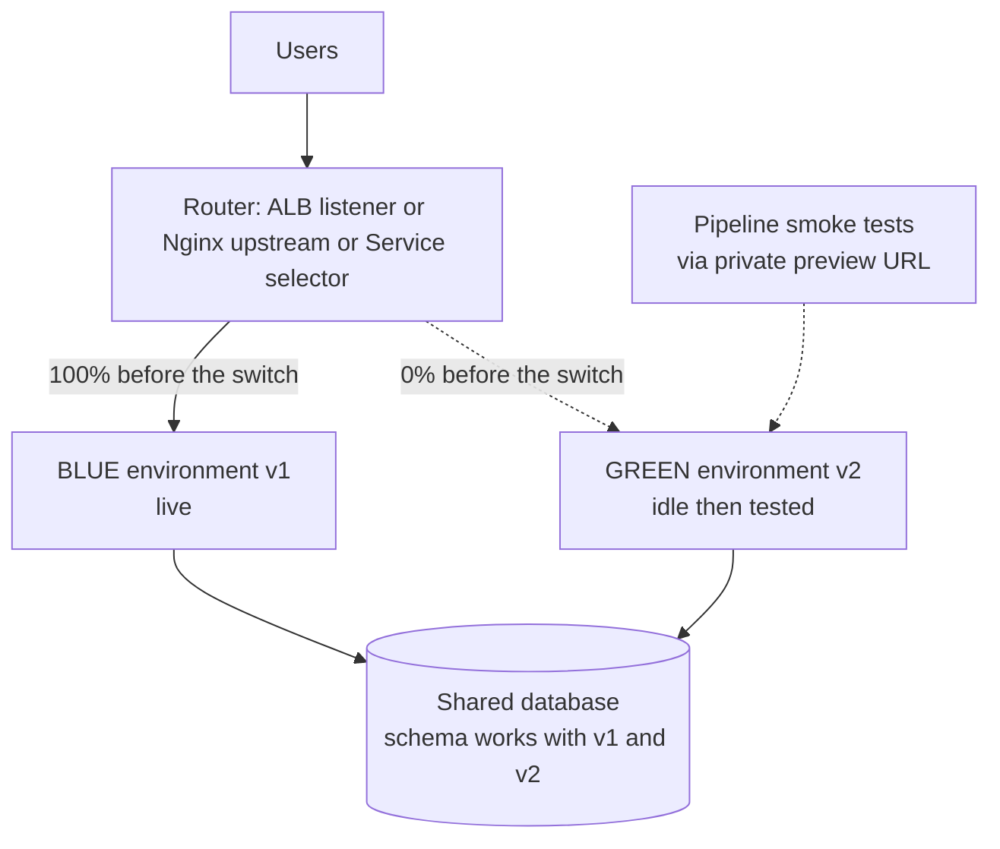
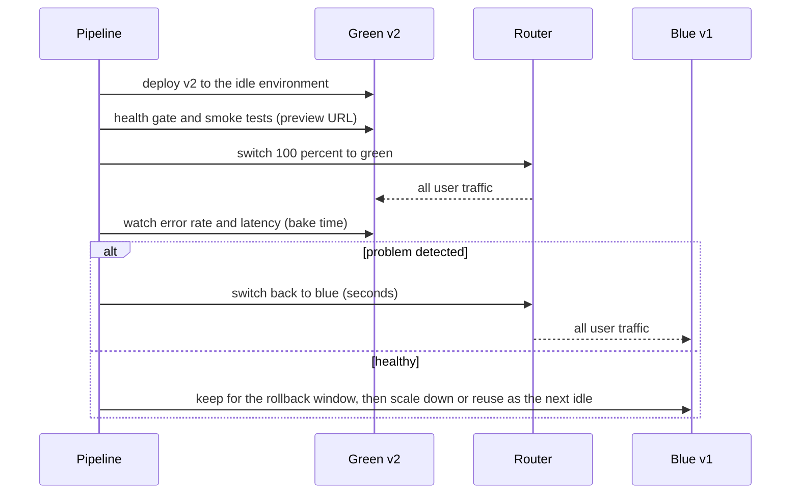

# L5.11 — Blue/Green Deployments

> **Level 5: CI/CD** · Topic 11 of 12 · ⏱ ~5 hours · Difficulty: Intermediate

## 1. What it is

A **blue/green deployment** keeps **two complete production environments**. One, say **blue**, is **live** and serves all users. The other, **green**, is idle. To release, you deploy the new version to the idle
environment, test it there with no user traffic, and then flip the router so that all traffic goes to green in one step. Blue stays running, untouched, as your instant way back.

The key properties:

- **Two environments** of the same shape (same instance counts, same configuration, same database connectivity), named by colour so nobody confuses them with "staging".
- **One traffic switch**: a load balancer listener, a Kubernetes Service selector, a DNS record or a reverse-proxy upstream. Flipping it is fast and atomic compared with replacing instances one by one.
- **Instant rollback:** flip the switch back. No rebuild, no redeploy, no waiting for pods.
- **Pre-flight testing in production conditions:** the idle environment runs on the real infrastructure and can be smoke-tested through a private URL before it takes any customer traffic.

The price is **cost** (two environments) and the **database problem**: both colours normally share one database, so schema changes must be backwards compatible ([L5.9](09-database-migrations.md)).

## 2. Why it matters in DevOps

- **Rollback in seconds:** the fastest recovery from a bad release is switching traffic back. This turns "we need to roll back" from a 15-minute operation into a one-line command ([L5.7](07-rollback.md)).
- **No mixed versions on the same traffic:** unlike rolling, a given request path sees either all-blue or all-green. This simplifies reasoning about caches and APIs (but not about the shared database).
- **Safer big or risky changes:** framework upgrades, runtime upgrades and infrastructure changes can be validated on the idle side first.
- **Cost-benefit decision:** teams must decide whether instant rollback justifies running twice the capacity during the deploy window. For most web services a short overlap is cheap; for large stateful fleets it is not.

## 3. Real-world system example

**The pattern's origin and AWS tooling.** The blue/green name and idea were popularised by Jez Humble and Dan North and described on Martin Fowler's site (*BlueGreenDeployment*). AWS supports it in several services: **AWS CodeDeploy** blue/green deployments
for EC2 and ECS (with Application Load Balancer target groups as the "colours" and a configurable wait before the old tasks are terminated), **AWS Elastic Beanstalk** environment *swap CNAMEs*, and weighted target groups on Application Load Balancers.
In Kubernetes, the same effect is achieved with two Deployments and a Service whose selector is switched, or by a traffic manager (Argo Rollouts supports a blue/green strategy with a preview service and a promotion step).

**Cloud Foundry** popularised "blue-green deploy" on its platform with a documented zero-downtime procedure of mapping the application route to the new app and then unmapping the old one.

Practical constraint seen in all of these: the databases and queues are not duplicated, which is why practitioners pair blue/green with expand/contract migrations and feature flags.

## 4. Diagram



The release timeline (switch and rollback are the same action in opposite directions):



## 5. How it works

### Ways to implement the switch

| Mechanism | Switch time | Notes |
|-----------|-------------|-------|
| **Reverse proxy upstream** (Nginx, HAProxy, Envoy) | instant after reload | simple on one host or VM; reload is graceful, in-flight requests finish on the old upstream |
| **ALB listener rule / weighted target groups** | seconds | `modify-listener` (or rule) to forward 100% to the green target group; target groups are the colours |
| **Kubernetes Service selector** | seconds | two Deployments labelled `track: blue` / `track: green`; patch the Service selector |
| **Ingress or Gateway weights / Argo Rollouts blue/green** | seconds | controller adds a preview Service and promotion step |
| **DNS (Route 53 records)** | minutes or longer | clients and resolvers cache answers beyond the TTL; the old environment keeps receiving traffic for a while. Acceptable for coarse switches (regions), not for instant rollback |
| **Elastic Beanstalk CNAME swap** | DNS-bound | uses DNS under the hood, with the same caching caveat |

Prefer a switch that lives **in your infrastructure** (proxy, load balancer) over DNS when you want instant, reliable rollback.

### The stages of a blue/green release

1. **Find the idle colour** (the one not currently live).
2. **Run migrations** in the expand phase ([L5.9](09-database-migrations.md)); both colours must work with the resulting schema.
3. **Deploy the new version to the idle colour** from the same artifact digest ([L5.6](06-artifacts.md)); configure it exactly like the live one.
4. **Gate it**: health check with version, then smoke tests through a private route (a preview hostname or a path that only your pipeline uses).
5. **Switch** the router to the idle colour, which becomes the live one.
6. **Bake**: watch metrics for a defined period; automatic rollback on SLO or alarm breach ([L5.7](07-rollback.md)).
7. **Decommission or reuse**: keep the previous colour warm for the rollback window (an hour, a day), then scale it down or make it the next idle target. Never run the contract migration until the window has passed.

### What blue/green does not solve

| Concern | Detail | Mitigation |
|---------|--------|------------|
| **Database/schema** | one shared database; an incompatible migration breaks the colour you roll back to | expand/contract, backwards-compatible changes |
| **Stateful sessions and caches** | users on blue have in-memory sessions or local caches that green does not have | external session store (Redis), stateless services; accept cache warm-up |
| **Warm-up** | the green side has cold caches and JIT; the switch moves 100% of traffic to it at once | pre-warm with synthetic traffic, or ramp traffic with weighted routing (which makes it a canary) |
| **In-flight work and queues** | background jobs consumed by both colours, long-running requests, websockets | drain consumers on the old side, version job payloads, let long requests finish |
| **Cost** | two full environments | the idle one exists only for the deploy window and rollback window; scale it down in between |
| **Third-party callbacks and cron jobs** | duplicates if both colours run schedulers | run schedulers on one colour only, or use leader election |
| **Hidden coupling** | hard-coded hostnames or IPs of "the" environment | resolve through configuration and service discovery |

### Cost model

If one environment costs `C` per hour and a release keeps both running for `T` hours, a release costs about `C × T` extra. Releasing four times a day with a one-hour overlap on a 10 USD/hour environment is roughly 40 USD/day of
overlap; keeping the idle side permanently warm would instead double the bill (`C × 24`). With containers or auto scaling, the idle side can be scaled to zero or to a minimum between releases; with fixed VMs it is a real standing cost.
(Illustrative arithmetic; use your own prices.)

## 6. Step-by-step guide

**Prerequisites:** Node.js 22, `curl`, Nginx (Debian/Ubuntu: `sudo apt-get install -y nginx`, used from a private directory), and the `server.js` from [L5.8](08-zero-downtime-deployments.md). The local switch below was run in a sandbox and the
traffic loop saw only `200` responses across the switch and the rollback (counts "similar to" yours). Cost: none; the AWS and Kubernetes snippets are reference material.

1. **Create two environments (blue on 3000, green on 3001) and a switchable Nginx.** In an empty directory containing `server.js`:
   ```bash
   mkdir -p nginx/logs nginx/tmp
   cat > nginx/nginx.conf <<EOF
   worker_processes 1;
   pid $PWD/nginx/nginx.pid;
   error_log $PWD/nginx/logs/error.log warn;
   events { worker_connections 256; }
   http {
     access_log off;
     client_body_temp_path $PWD/nginx/tmp/body; proxy_temp_path $PWD/nginx/tmp/proxy;
     fastcgi_temp_path $PWD/nginx/tmp/fcgi; uwsgi_temp_path $PWD/nginx/tmp/uwsgi; scgi_temp_path $PWD/nginx/tmp/scgi;
     upstream blue  { server 127.0.0.1:3000; }
     upstream green { server 127.0.0.1:3001; }
     include $PWD/nginx/active.conf;      # defines: map \$host \$live_env
     server {
       listen 8080;
       location / { proxy_pass http://\$live_env; }                     # live traffic
       location = /preview-green { proxy_pass http://green/readyz; }   # pipeline-only test route
       location = /preview-blue  { proxy_pass http://blue/readyz; }
     }
   }
   EOF
   printf 'map $host $live_env { default blue; }\n' > nginx/active.conf
   nginx -c $PWD/nginx/nginx.conf -p $PWD/nginx
   ```
   The file `active.conf` holds the single fact "which colour is live". Everything else is static. (The `\$` in the here-document keeps Nginx variables from being expanded by the shell.)

2. **Start blue as v1 (live) and green as v2 (idle, being tested).**
   ```bash
   export DRAIN_MS=2000
   PORT=3000 APP_VERSION=v1 node server.js > blue.log 2>&1 &
   PORT=3001 APP_VERSION=v2 node server.js > green.log 2>&1 &
   sleep 1
   curl -s localhost:8080/readyz              # {"status":"ok","version":"v1"}   <- users see blue
   curl -s localhost:8080/preview-green       # {"status":"ok","version":"v2"}   <- the pipeline sees green
   ```
   Green is fully running and reachable for tests, yet no user traffic reaches it.

3. **Write the switch script.** Save as `switch.sh` and `chmod +x switch.sh`:
   ```bash
   #!/usr/bin/env bash
   # Usage: switch.sh blue|green   (atomic switch + graceful reload)
   set -euo pipefail
   TARGET="${1:?blue|green}"
   CONF="$PWD/nginx/active.conf"
   printf 'map $host $live_env { default %s; }\n' "$TARGET" > "$CONF.new"
   mv "$CONF.new" "$CONF"                         # atomic replace
   nginx -t -c "$PWD/nginx/nginx.conf" -p "$PWD/nginx" 2>/dev/null
   nginx -s reload -c "$PWD/nginx/nginx.conf" -p "$PWD/nginx" 2>/dev/null
   echo "live environment is now: $TARGET"
   ```
   `nginx -t` validates the new configuration before the reload, and the reload is graceful, so in-flight requests finish on the old upstream.

4. **Switch under load, then roll back, and read the result.** Use the `load.sh` from [L5.10](10-rolling-deployments.md) (one line per request: status and version). Run this in one shell:
   ```bash
   (./load.sh 14 > codes.txt) &  LOAD=$!
   sleep 3; ./switch.sh green          # release v2
   sleep 4; ./switch.sh blue           # instant rollback to v1
   sleep 4
   wait $LOAD
   uniq -c codes.txt
   ```
   Expected (similar to): three blocks and no errors,
   ```
        84 200 v1        <- before the switch (and the rollback reuses v1)
        35 200 v2        <- while green was live
        27 200 v1        <- after rolling back to blue
   ```
   Note `wait $LOAD` waits for the load generator only; a bare `wait` would also wait for the long-running servers. The version flips at a single point in the log each time: no gradual mix, no failures. That is the blue/green signature.

5. **Gate the switch in a script.** The release decision as code, using the preview route:
   ```bash
   #!/usr/bin/env bash
   # release.sh <new-version>: assumes the idle colour already runs <new-version>
   set -euo pipefail
   NEW="$1"; IDLE="${2:-green}"; LIVE="${3:-blue}"
   body=$(curl -fsS --max-time 3 "http://127.0.0.1:8080/preview-$IDLE")
   echo "$body" | jq -e --arg v "$NEW" '.status == "ok" and .version == $v' >/dev/null \
     || { echo "idle env not healthy on $NEW: NOT switching" >&2; exit 1; }
   ./switch.sh "$IDLE"
   sleep 10                                 # bake: replace with a real SLO or error-rate query
   curl -fsS --max-time 3 http://127.0.0.1:8080/readyz | jq -e --arg v "$NEW" '.version == $v' >/dev/null \
     || { echo "post-switch check failed: ROLLING BACK" >&2; ./switch.sh "$LIVE"; exit 2; }
   echo "released $NEW; $LIVE kept as rollback target"
   ```
   The same structure, pre-switch gate then post-switch bake and rollback, applies to every platform below.

6. **The same thing on a Kubernetes Service.** Two Deployments (`shop-api-blue`, `shop-api-green`, each with label `track`) and one Service:
   ```yaml
   apiVersion: v1
   kind: Service
   metadata:
     name: shop-api
   spec:
     selector:
       app: shop-api
       track: blue            # the switch
     ports:
       - port: 80
         targetPort: 3000
   ```
   ```bash
   kubectl rollout status deployment/shop-api-green --timeout=120s          # green is ready
   kubectl port-forward deployment/shop-api-green 8081:3000 &              # private test route
   curl -s localhost:8081/readyz
   kubectl patch service shop-api -p '{"spec":{"selector":{"app":"shop-api","track":"green"}}}'    # switch
   kubectl patch service shop-api -p '{"spec":{"selector":{"app":"shop-api","track":"blue"}}}'     # rollback
   ```
   Endpoints update within seconds; with a readiness probe and `preStop` drain (L5.8) the switch is invisible to clients. Clean up with `kind delete cluster` if you created one.

7. **The same thing on AWS with an Application Load Balancer** (reference; creates no resources by itself). Two target groups are the colours; the listener decides:
   ```bash
   aws elbv2 modify-listener --listener-arn <LISTENER_ARN> --default-actions '[
     {"Type":"forward","ForwardConfig":{"TargetGroups":[
       {"TargetGroupArn":"<GREEN_TG_ARN>","Weight":100},
       {"TargetGroupArn":"<BLUE_TG_ARN>","Weight":0}]}}]'
   ```
   Rollback is the same command with the weights reversed. A weighted split such as 90/10 first, then 100/0, turns the same mechanism into a coarse canary ([L5.12](12-canary-deployments.md)). AWS CodeDeploy automates the whole sequence (deploy to the replacement task set, test listener, shift traffic, wait, terminate the original) for ECS services.
   Any real use of ALBs, target groups and listeners costs money while they exist; follow [ALB](../level-06-cloud-aws/14-alb.md) and delete them afterwards.

8. **Clean up.** `kill -TERM $(pgrep -x node)`, then `nginx -c $PWD/nginx/nginx.conf -p $PWD/nginx -s quit`.

## 7. Real-world scenario

*(Illustrative.)* A team upgrades `shop-api` from Node.js 20 to 22 and swaps the HTTP framework. The change passes tests and a staging deployment. They deploy to the idle green environment on the production network and run synthetic checkouts through the preview route:
everything passes. At 10:00 they switch; the dashboards are green for two minutes, then p99 latency for `/checkout` climbs and a downstream payments client begins timing out under production load; staging never saw that connection volume.

The pipeline's bake check sees the alert threshold crossed and runs `switch.sh blue`: traffic is back on the old version within seconds, about three minutes after the release. The post-incident work happens calmly on green, which is still running the new version and can be inspected (heap profile, connection counts) with no
customer traffic. The root cause is a connection-pool default that changed in the new framework. **Lesson:** blue/green gave an instant rollback *and* a live specimen to debug; the cost was one extra environment for 20 minutes.

## 8. Common mistakes and best practices

**Don't**

- Switch with DNS when you need instant, reliable rollback (caches keep sending traffic to the old side).
- Run an incompatible database migration "because we can switch back": the old side cannot run on the new schema.
- Let blue and green drift in configuration, secrets or sizes; the idle one must be a faithful copy of production.
- Tear down the old environment immediately after the switch; you lose the rollback.
- Forget that both sides may run schedulers, consumers or cron jobs that now run twice.
- Assume the switch is a test: green must be smoke-tested *before* it takes traffic.

**Do**

- Keep the switch in one place and one command, tested by a drill; rollback = the same command in reverse.
- Deploy the same artifact digest to the idle side; only configuration differs.
- Use backwards-compatible migrations (expand/contract) and run the contract step only after the rollback window.
- Warm green (synthetic traffic, cache priming) or ramp the traffic if cold starts matter.
- Bake with automatic checks on error rate, latency and business metrics, and roll back automatically on failure.
- Scale the old environment down after the window, or make it the next idle target; track the cost of the overlap.

## 9. Tasks

- [ ] **T1 — Build the switchable proxy** *(≈45 min, intermediate)*
  - **Goal:** two environments, one switch.
  - **Steps:**
    1. Set up Nginx with `blue`, `green` upstreams and `active.conf` (steps 1 and 2).
    2. Start blue as v1 and green as v2.
    3. Confirm live traffic shows v1 and `/preview-green` shows v2.
  - **Done when:** `curl localhost:8080/readyz` returns v1 while `curl localhost:8080/preview-green` returns v2.

- [ ] **T2 — Switch and roll back under load** *(≈45 min, intermediate)*
  - **Goal:** see the signature of an atomic switch.
  - **Steps:**
    1. Run `load.sh` for 14 seconds in the background.
    2. `./switch.sh green`, wait, then `./switch.sh blue`.
    3. Summarise with `uniq -c`.
  - **Done when:** the summary shows v1, then v2, then v1 blocks, with zero non-200 responses.

- [ ] **T3 — Break it: switch to an unhealthy environment** *(≈45 min, intermediate)*
  - **Goal:** understand why the pre-switch gate exists.
  - **Steps:**
    1. Start green with a version whose `/readyz` returns 500 (or kill green).
    2. Run `./switch.sh green` directly without the gate and watch `load.sh` output.
    3. Run `release.sh` instead and see it refuse to switch; then roll back with `switch.sh blue`.
  - **Done when:** the direct switch shows errors in the load output, and `release.sh` exits non-zero without switching.

- [ ] **T4 — Kubernetes Service selector switch** *(≈60 min, advanced; kind, free)*
  - **Goal:** the same release on Kubernetes.
  - **Steps:**
    1. Create two Deployments (`track: blue`, `track: green`) and the Service from step 6.
    2. Test green with `kubectl port-forward`, then patch the Service selector, then patch it back, with a `curl` loop running through a second port-forward to the Service.
    3. **Cleanup:** `kind delete cluster`.
  - **Done when:** the loop shows the version change at the patch time and again at rollback, and you can show `kubectl get endpoints shop-api` changing.

- [ ] **T5 — Break it: database incompatibility** *(≈60 min, advanced)*
  - **Goal:** feel why the database is the hard part.
  - **Steps:**
    1. With a scratch PostgreSQL ([L5.9](09-database-migrations.md)), let v2 depend on a column that v1 does not know about, and (separately) on a rename that v1 cannot read.
    2. Switch to v2, then roll back to v1 and observe which variant fails.
    3. Redo the change with expand/contract so both versions work at every step.
  - **Done when:** you have one rollback that fails and one that succeeds, and you can state the rule that makes the difference.

- [ ] **T6 — Prove it: cost and decision memo** *(≈45 min, advanced)*
  - **Goal:** decide when blue/green is worth it.
  - **Steps:**
    1. Without the guide, write a one-page memo for `shop-api`: how the switch works, how rollback works, what happens to the database and sessions, and the extra cost per release for your assumed environment price and overlap.
    2. Compare with rolling and canary in a three-row table (rollback speed, cost, risk exposure).
    3. Present it to a teammate and record their questions.
  - **Done when:** the memo contains numbers for cost and rollback time, and a recommendation with the conditions under which you would change it.

## 10. Self-check questions

1. What is the difference between "idle" green and a staging environment?
2. Why is rollback in blue/green faster than in rolling deployments?
3. Why is DNS a poor switch for instant rollback?
4. What happens to the shared database in a blue/green release, and what discipline does it require?
5. What cost does blue/green add, and how do you reduce it?
6. What must be true of green before you switch to it?

<details>
<summary>Answers</summary>

1. Green runs on the production infrastructure with production configuration and data connections, only without user traffic; staging is a separate, usually smaller environment with different data and dependencies.
2. Rollback is flipping a router back to an environment that is still running the old version; rolling needs another full instance-by-instance rollout.
3. Resolvers and clients cache answers beyond the TTL, so some traffic keeps going to the old side for minutes or longer, and you cannot guarantee a precise or instant cutover.
4. Both colours use the same database, so every schema change must work with the old and new code (expand/contract), and destructive contract steps wait until the rollback window has passed.
5. Double capacity during the overlap; reduce by scaling the idle side to a minimum between releases, keeping the overlap short, and automating teardown.
6. It runs the intended version from the same artifact, passes health and smoke tests through a private route, has production-equivalent configuration, and its dependencies (database schema, queues) are compatible.
</details>

## 11. Further reading

- Martin Fowler's site: *BlueGreenDeployment*; *Continuous Delivery* by Jez Humble and David Farley (release strategies).
- AWS Docs: *AWS CodeDeploy blue/green deployments*, *Application Load Balancer listener rules and weighted target groups*, *Elastic Beanstalk blue/green deployments*.
- Argo Rollouts Docs: BlueGreen strategy; Kubernetes Docs: *Services* (selectors).
- Cloud Foundry Docs: *Using blue-green deployment to reduce downtime and risk*.
- Next: [Canary deployments](12-canary-deployments.md). Related: [Deployment Strategies](../level-00-what-devops-is/07-deployment-strategies.md), [Immutable Infrastructure](../level-00-what-devops-is/05-immutable-infrastructure.md).

<!-- nav -->
---
← Previous: [Rolling Deployments](10-rolling-deployments.md) · [Level 5 index](README.md) · Next: [Canary Deployments](12-canary-deployments.md) →
