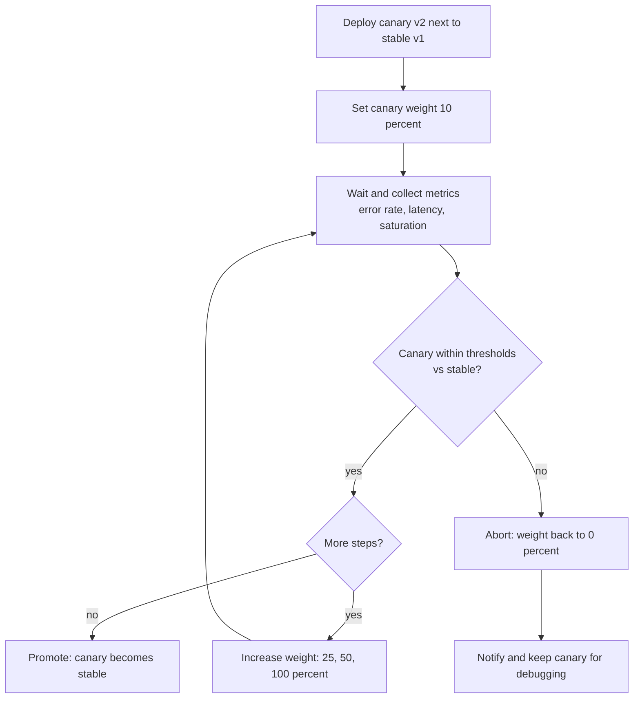
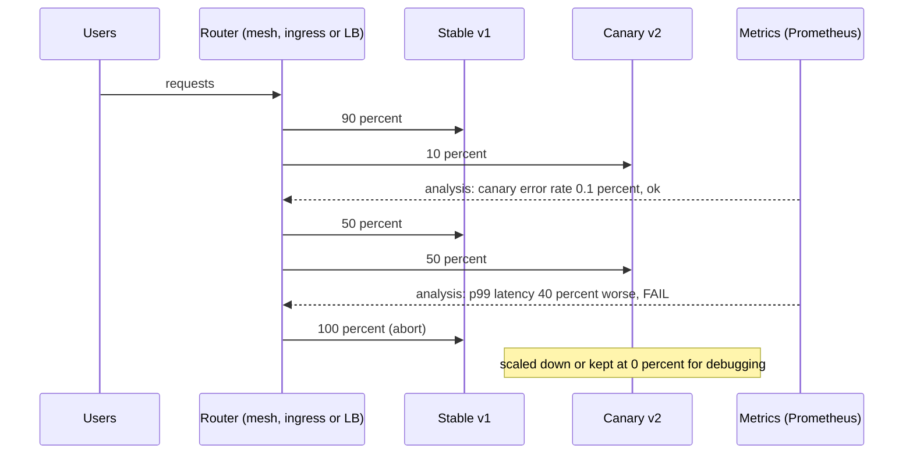

# L5.12 — Canary Deployments

> **Level 5: CI/CD** · Topic 12 of 12 · ⏱ ~5 hours · Difficulty: Advanced

## 1. What it is

A **canary deployment** releases a new version to a small slice of real traffic first (for example 1%, then 5%, 25%, 50%, 100%), measures how that slice behaves compared with the version already running, and only **promotes**
the release further when the measurements are good. If they are bad, the canary is aborted and traffic returns to the stable version. The name comes from the canary in a coal mine: a small, early warning that costs little when it dies.

Compared with the other strategies in this level:

| Strategy | Who sees the new version first | How you decide to continue |
|----------|--------------------------------|----------------------------|
| [Rolling](10-rolling-deployments.md) | whoever hits the first replaced instances | readiness probes only |
| [Blue/green](11-blue-green-deployments.md) | nobody until the switch, then everybody | tests before the switch, bake after |
| **Canary** | a **chosen, small percentage** of real users | **metrics** compared with the stable version, step by step |

The three ingredients: **progressive traffic shifting** (weights or a header/cookie rule), **automated analysis** (error rate, latency, saturation and business metrics) and **automatic promotion or abort** based on thresholds
you defined in advance.

## 2. Why it matters in DevOps

- **Smallest blast radius with real traffic:** tests cannot reproduce production data, load patterns and odd clients. A canary exposes the new code to a few percent of them and costs a few percent of requests if it fails.
- **Objective release decisions:** "it looks fine" becomes "the canary's error rate was 0.1% against 0.1% for stable, p99 latency within 5%, for 15 minutes".
- **Pairs with SLOs:** the thresholds are your service level objectives applied to the new version ([Error Budgets](../level-14-sre/04-error-budgets.md)). A canary that burns budget quickly is aborted.
- **Enables frequent deploys:** if each deploy exposes only a sliver of users and aborts itself, teams deploy more often with less fear.
- **Needs investment:** you need good metrics, traffic control, and a rollback-friendly design. Without metrics, a canary is just a slow rolling deploy.

## 3. Real-world system example

**Netflix, Google and Kayenta.** Netflix and Google jointly open-sourced **Kayenta**, the automated canary analysis platform integrated with Spinnaker. It runs a **baseline** (a fresh deployment of the current version) and a **canary** (the new version) side by side with comparable
traffic, collects metrics from both, and uses statistical tests to produce a pass/fail score. Using a fresh baseline rather than the long-running production fleet avoids bias from cache age, uptime and instance history.

**Google SRE.** *The Site Reliability Engineering Workbook* has a chapter on **canarying releases**, describing partial, time-limited deployments with evaluation against metrics, and discussing how to pick the canary size, duration and the metrics that matter.

**Argo Rollouts and Flagger.** On Kubernetes, **Argo Rollouts** (a controller and a `Rollout` resource that replaces `Deployment`) and **Flagger** (a progressive delivery operator that is part of the Flux project) automate canaries: they shift traffic through a service mesh, ingress controller or Gateway API implementation in steps, query
Prometheus (and other providers) for metrics, and promote or roll back automatically. Both are widely used open-source tools documented by their projects.

## 4. Diagram

The control loop of a metrics-based canary:



Traffic during a successful canary and during an aborted one:



## 5. How it works

### The moving parts

1. **Traffic splitter:** something that sends N% to the canary. Options: weighted target groups (ALB), Nginx `weight` / `split_clients`, ingress annotations, a service mesh (Istio/Linkerd weights), Gateway API `HTTPRoute` weights, or simply replica ratio (crude: 1 canary pod out of 10 is about 10%).
2. **Metrics with a version label:** every request metric (`http_requests_total`, latency histograms) must be attributable to `version="v2"` vs `version="v1"` ([Prometheus and PromQL](../level-10-observability/02-prometheus-and-promql.md), [What to Monitor](../level-10-observability/11-what-to-monitor.md)).
3. **Analysis:** thresholds on the canary's own metrics (absolute), or better a comparison with the stable/baseline (relative).
4. **Controller:** the loop that applies weights, waits, evaluates and either continues or aborts (your pipeline, Argo Rollouts, Flagger, Spinnaker + Kayenta, CodeDeploy).

### Which metrics to gate on

| Signal | Example query or check | Why |
|--------|------------------------|-----|
| Error rate | share of 5xx among canary requests | crashes, bad queries, broken dependencies |
| Latency | p95 or p99 of canary versus stable | regressions, missing indexes, N+1 queries |
| Saturation | CPU, memory, connection pool use per pod | leaks, inefficiency |
| Application errors | exceptions per minute by version (Sentry, logs) | errors that return 200 |
| Business metrics | checkout success rate, payment errors, cart conversions | the thing that actually pays the bills |
| Logs/traces | new error signatures | caught by looking, not only by thresholds |

### Designing the canary so the result means something

- **Enough traffic and time:** with 10 canary requests you cannot tell 0% from 3% errors. Set a *minimum sample size* and duration per step; low-traffic services need longer steps or synthetic traffic.
- **Compare like with like:** same time window, same request mix. Compare the canary against stable (or a fresh baseline), not against last week.
- **Sticky or random?** Random per-request splitting can show one user both versions. Use session affinity or user-ID hashing (cookie, header) when the user experience must stay consistent, or when the API is stateful. Header-based routing (`X-Canary: true`) lets internal users and testers see the canary first.
- **Choose conservative first steps** (1% to 5%), then bigger jumps. Time between steps should cover your metrics scrape interval and alerting delay several times over.
- **Include a failure for the unknown:** also abort on "no data" (a canary that reports no metrics is not healthy).
- **Database and downstream:** both versions still share the database and dependencies; use backwards-compatible migrations ([L5.9](09-database-migrations.md)) and watch downstream saturation.
- **Feature flags** complement canaries: a canary controls which *binary* serves users; a flag controls which *feature* is on, per user, without a deploy.

### Argo Rollouts overview

A `Rollout` replaces a `Deployment` and describes the strategy as steps; an `AnalysisTemplate` defines the metrics queries.

```yaml
apiVersion: argoproj.io/v1alpha1
kind: Rollout
metadata:
  name: shop-api
spec:
  replicas: 5
  selector:
    matchLabels: { app: shop-api }
  template:
    metadata:
      labels: { app: shop-api }
    spec:
      containers:
        - name: api
          image: ghcr.io/acme/shop-api@sha256:<digest>
          ports: [{ containerPort: 3000 }]
          readinessProbe:
            httpGet: { path: /readyz, port: 3000 }
  strategy:
    canary:
      stableService: shop-api-stable
      canaryService: shop-api-canary
      trafficRouting:
        nginx:
          stableIngress: shop-api            # needs the NGINX ingress controller; mesh and Gateway API options exist too
      steps:
        - setWeight: 10
        - pause: { duration: 2m }
        - analysis:
            templates: [{ templateName: success-rate }]
            args: [{ name: service, value: shop-api-canary }]
        - setWeight: 50
        - pause: { duration: 5m }
        - setWeight: 100
---
apiVersion: argoproj.io/v1alpha1
kind: AnalysisTemplate
metadata:
  name: success-rate
spec:
  args:
    - name: service
  metrics:
    - name: success-rate
      interval: 1m
      count: 5
      failureLimit: 1
      successCondition: result[0] >= 0.99
      provider:
        prometheus:
          address: http://prometheus.monitoring:9090
          query: |
            sum(rate(http_requests_total{service="{{args.service}}",status!~"5.."}[2m]))
            /
            sum(rate(http_requests_total{service="{{args.service}}"}[2m]))
```

Without a `trafficRouting` block, Argo Rollouts approximates weights by the ratio of canary to stable pods. Operations: `kubectl argo rollouts get rollout shop-api --watch`, `kubectl argo rollouts promote shop-api`, `kubectl argo rollouts abort shop-api` (the plugin is installed separately). It also supports a blue/green strategy.

### Flagger overview

Flagger keeps your normal `Deployment` and a `Canary` resource that points to it. It creates the primary/canary workloads and services, shifts traffic through your mesh or ingress (Istio, Linkerd, NGINX, Gateway API, and others), runs metric checks and webhooks (load tests, smoke tests), and promotes or rolls back:

```yaml
apiVersion: flagger.app/v1beta1
kind: Canary
metadata:
  name: shop-api
spec:
  targetRef: { apiVersion: apps/v1, kind: Deployment, name: shop-api }
  service: { port: 80, targetPort: 3000 }
  analysis:
    interval: 1m          # how often to evaluate
    threshold: 5          # failed checks before rollback
    maxWeight: 50         # stop shifting at 50, then promote
    stepWeight: 10
    metrics:
      - name: request-success-rate
        thresholdRange: { min: 99 }
        interval: 1m
      - name: request-duration
        thresholdRange: { max: 500 }     # milliseconds, p99
        interval: 1m
```

### Argo Rollouts vs Flagger vs your own pipeline

| | Your pipeline script | Argo Rollouts | Flagger |
|--|---------------------|---------------|---------|
| Resource model | anything | replaces `Deployment` with `Rollout` | keeps `Deployment`, adds `Canary` |
| Traffic control | proxy or LB API calls | ingress, mesh, Gateway API, replica ratio | mesh, ingress, Gateway API |
| Metrics | queries you write | `AnalysisTemplate` (Prometheus, Datadog, others) | built-in checks and custom metric templates |
| Best for | VMs, simple setups, learning | teams using Argo CD and wanting a UI and kubectl plugin | teams using Flux or meshes |

## 6. Step-by-step guide

**Prerequisites:** Node.js 22, `curl`, Nginx (Debian/Ubuntu: `sudo apt-get install -y nginx`, used from a private directory). No cloud account. The local demo below was run in a sandbox, including a promotion and an abort; counts are "similar to" on your machine. The Kubernetes sections are reference material that you can apply to kind in the tasks.

1. **A tiny API whose error rate you can dial.** Save as `api.js` (a stand-in for `shop-api`; `FAIL_PCT` makes that percentage of requests fail with 500):
   ```javascript
   const http = require("node:http");
   const version = process.env.APP_VERSION || "dev";
   const failPct = Number(process.env.FAIL_PCT || 0);   // percent of requests that fail with 500
   http.createServer((req, res) => {
     const fail = Math.random() * 100 < failPct;
     res.writeHead(fail ? 500 : 200, { "content-type": "application/json", "x-version": version });
     res.end(JSON.stringify({ version, ok: !fail }) + "\n");
   }).listen(Number(process.env.PORT || 3000));
   ```

2. **Nginx with a rewritable upstream.** Stable on 3000 and canary on 3001; the weights live in an included file:
   ```bash
   mkdir -p nginx/logs nginx/tmp
   cat > nginx/nginx.conf <<EOF
   worker_processes 1;
   pid $PWD/nginx/nginx.pid;
   error_log $PWD/nginx/logs/error.log warn;
   events { worker_connections 256; }
   http {
     access_log off;
     client_body_temp_path $PWD/nginx/tmp/body; proxy_temp_path $PWD/nginx/tmp/proxy;
     fastcgi_temp_path $PWD/nginx/tmp/fcgi; uwsgi_temp_path $PWD/nginx/tmp/uwsgi; scgi_temp_path $PWD/nginx/tmp/scgi;
     include $PWD/nginx/upstream.conf;          # defines: upstream api { ... }
     server {
       listen 8080;
       location / { proxy_pass http://api; }
     }
   }
   EOF
   printf 'upstream api { server 127.0.0.1:3000; }\n' > nginx/upstream.conf
   nginx -c $PWD/nginx/nginx.conf -p $PWD/nginx
   PORT=3000 APP_VERSION=stable node api.js > s.log 2>&1 &
   PORT=3001 APP_VERSION=canary FAIL_PCT=0 node api.js > c.log 2>&1 &
   sleep 1; curl -s localhost:8080/api/orders      # {"version":"stable","ok":true}
   ```

3. **Write the canary controller.** Save as `canary.sh` and `chmod +x canary.sh`. It shifts traffic in stages, analyses the canary's error rate at each stage, and aborts on a bad result or too little data:
   ```bash
   #!/usr/bin/env bash
   # Progressive canary: stable on :3000, canary on :3001.
   set -euo pipefail
   STAGES=(10 25 50 100)
   MAX_ERR_PCT=5          # abort if the canary error rate exceeds this
   MIN_SAMPLES=10         # need at least this many canary requests to judge
   PROBES=100             # requests per analysis window
   URL=http://127.0.0.1:8080/api/orders

   set_weight() {   # set_weight <canary-percent>: rewrite the upstream and reload gracefully
     local w=$1
     if   [ "$w" -ge 100 ]; then printf 'upstream api { server 127.0.0.1:3001; }\n' > nginx/upstream.conf
     elif [ "$w" -le 0 ];   then printf 'upstream api { server 127.0.0.1:3000; }\n' > nginx/upstream.conf
     else printf 'upstream api {\n  server 127.0.0.1:3000 weight=%d;\n  server 127.0.0.1:3001 weight=%d;\n}\n' $((100-w)) "$w" > nginx/upstream.conf
     fi
     nginx -s reload -c "$PWD/nginx/nginx.conf" -p "$PWD/nginx" 2>/dev/null
   }

   analyse() {      # sends PROBES requests; prints "<canary_total> <canary_errors>"
     local total=0 errs=0 code ver
     for _ in $(seq 1 $PROBES); do
       out=$(curl -s -w ' %{http_code}' --max-time 3 "$URL" || echo ' 000')
       code=${out##* }; ver=$(echo "$out" | grep -o '"version":"[^"]*"' | cut -d'"' -f4)
       if [ "$ver" = "canary" ]; then total=$((total+1)); [ "$code" != 200 ] && errs=$((errs+1)); fi
       sleep 0.02
     done
     echo "$total $errs"
   }

   for w in "${STAGES[@]}"; do
     set_weight "$w"
     echo "stage: canary weight ${w}%"
     read -r total errs < <(analyse)
     if [ "$w" -lt 100 ] && [ "$total" -lt "$MIN_SAMPLES" ]; then echo "not enough canary samples ($total)"; set_weight 0; exit 1; fi
     pct=0; [ "$total" -gt 0 ] && pct=$((100*errs/total))
     echo "  canary requests=$total errors=$errs error_rate=${pct}% (limit ${MAX_ERR_PCT}%)"
     if [ "$pct" -gt "$MAX_ERR_PCT" ]; then
       echo "ANALYSIS FAILED: aborting canary, all traffic back to stable"; set_weight 0; exit 2
     fi
   done
   echo "PROMOTED: canary is now 100%"
   ```

4. **Run a healthy canary.** Expected output (similar to):
   ```bash
   ./canary.sh; echo "exit=$?"
   ```
   ```
   stage: canary weight 10%
     canary requests=10 errors=0 error_rate=0% (limit 5%)
   stage: canary weight 25%
     canary requests=25 errors=0 error_rate=0% (limit 5%)
   stage: canary weight 50%
     canary requests=49 errors=0 error_rate=0% (limit 5%)
   stage: canary weight 100%
     canary requests=99 errors=0 error_rate=0% (limit 5%)
   PROMOTED: canary is now 100%
   exit=0
   ```
   Nginx's `weight=` gives a smooth weighted round robin, so 10% is almost exactly 10 of 100 requests: the demo is deterministic, unlike real random traffic.

5. **Run a bad canary and watch it abort.** Reset to stable only, restart the canary with a 30% failure rate, and run the controller again:
   ```bash
   printf 'upstream api { server 127.0.0.1:3000; }\n' > nginx/upstream.conf
   nginx -s reload -c $PWD/nginx/nginx.conf -p $PWD/nginx
   pkill -x node; sleep 0.5            # stops the demo servers (careful on a shared machine)
   PORT=3000 APP_VERSION=stable node api.js > s.log 2>&1 &
   PORT=3001 APP_VERSION=canary FAIL_PCT=30 node api.js > c.log 2>&1 &
   sleep 1
   ./canary.sh; echo "exit=$?"
   curl -s localhost:8080/api/orders
   ```
   Expected (similar to): at the first stage `canary requests=10 errors=3 error_rate=30% (limit 5%)`, then `ANALYSIS FAILED: aborting canary, all traffic back to stable`, `exit=2`, and the final `curl` answers from `stable`. Only 10% of requests could ever reach the bad version, and only for as long as one analysis window.

6. **Make the same decision from Prometheus (reference).** In production the analysis queries a metrics system. Compare canary and stable error ratios, per version label:
   ```promql
   (
     sum(rate(http_requests_total{app="shop-api",version="v2",status=~"5.."}[5m]))
     / sum(rate(http_requests_total{app="shop-api",version="v2"}[5m]))
   )
   -
   (
     sum(rate(http_requests_total{app="shop-api",version="v1",status=~"5.."}[5m]))
     / sum(rate(http_requests_total{app="shop-api",version="v1"}[5m]))
   ) > 0.01
   ```
   This expression returns a result only when the canary's error ratio exceeds stable's by more than one percentage point: a relative check that tolerates a generally bad hour for both versions. Add a latency check on `histogram_quantile(0.99, ...)` by version and require a minimum request rate.

7. **Wire it into the pipeline.** After the image is pushed and a baseline deploy is healthy, a job runs the controller (script, Argo Rollouts, or Flagger) and fails if it aborts:
   ```yaml
   jobs:
     canary:
       runs-on: ubuntu-24.04
       timeout-minutes: 45
       environment: production
       steps:
         - uses: actions/checkout@v4
         - name: Progressive rollout with automatic abort
           env:
             TAG: ${{ inputs.tag }}
           run: |
             ssh "deploy@${{ vars.DEPLOY_HOST }}" "bash -s -- '$TAG'" < scripts/canary-deploy.sh
         - name: Notify
           if: always()
           run: echo "canary result for ${{ inputs.tag }} is ${{ job.status }}" >> "$GITHUB_STEP_SUMMARY"
   ```
   On Kubernetes with Argo Rollouts, the job instead updates the image in Git or with `kubectl argo rollouts set image shop-api api=ghcr.io/<you>/shop-api@sha256:<digest>` and then waits with `kubectl argo rollouts status shop-api --timeout 20m`, which exits non-zero if the rollout is aborted or degraded.

8. **Clean up.** `pkill -x node` (only in your sandbox), then `nginx -c $PWD/nginx/nginx.conf -p $PWD/nginx -s quit`.

## 7. Real-world scenario

*(Illustrative.)* `shop-api` v2 changes the way totals are computed. The team enables a Flagger canary: 10% steps every minute, abort after 3 failed checks, gating on 99% request success and p99 latency below 500 ms. At the 20% step the success-rate check passes, but the p99 latency
check fails: a new query is slow for customers with many saved addresses, who are rare in staging but common in production. After three failed checks Flagger routes 100% back to stable and posts to Slack. About 20% of requests saw slower responses for a few minutes; no one was paged.

The engineer reproduces the slow path against a copy of the canary's traces ([Distributed Tracing](../level-10-observability/08-distributed-tracing.md)), adds an index, and re-releases; the second canary passes all steps. Without the canary, the same change in a rolling update would have reached all pods in ten minutes and been caught by customers.
**Lesson:** a canary is only as good as its metrics: the latency check, not the error check, caught this one.

## 8. Common mistakes and best practices

**Don't**

- Run a canary without version-labelled metrics, or with checks that have too little traffic to be meaningful.
- Gate only on error rate: slow, wrong-but-200 and business-metric regressions pass it.
- Treat "no data" as success.
- Judge a step in seconds; allow for scrape intervals and alert delay.
- Promote automatically past a step that was skipped, paused or never analysed.
- Forget the database: a canary with an incompatible migration breaks stable too.

**Do**

- Define thresholds (SLO-based) before the release, in code, next to the rollout definition.
- Start tiny (1% to 5%), compare against stable or a fresh baseline, and require a minimum sample size and duration.
- Use sticky routing when users must not flip between versions; use header routing for internal-first canaries.
- Automate abort and rollback, keep the aborted canary available for debugging, and notify the author.
- Combine canaries with feature flags and with backwards-compatible schema changes.
- Review canary outcomes: aborts are the system working; record why they happened.

## 9. Tasks

- [ ] **T1 — Healthy canary promotion** *(≈45 min, intermediate)*
  - **Goal:** run a staged, analysed canary end to end.
  - **Steps:**
    1. Set up `api.js`, Nginx and `canary.sh` (steps 1 to 3).
    2. Run the canary with `FAIL_PCT=0`.
    3. Read the weights and sample counts per stage.
  - **Done when:** the output ends with `PROMOTED` and exit code `0`, and you can explain why 10% stage had about 10 canary requests out of 100.

- [ ] **T2 — Break it: bad canary aborts** *(≈45 min, intermediate)*
  - **Goal:** prove the abort path protects users.
  - **Steps:**
    1. Restart the canary with `FAIL_PCT=30` and run `canary.sh`.
    2. Count how many failed requests users could have seen (canary errors at the first stage).
    3. Confirm traffic is back to stable afterwards.
  - **Done when:** exit code is `2`, the final `curl` answers `stable`, and you have the number of failed canary requests.

- [ ] **T3 — Add a latency check** *(≈60 min, advanced)*
  - **Goal:** gate on more than errors.
  - **Steps:**
    1. Add `SLOW_MS` to `api.js` (a delay for canary requests) and measure latency per request in `analyse` (`curl -w '%{time_total}'`).
    2. Abort if the canary's p95 (or average) exceeds stable's by more than 30%.
    3. Test with `SLOW_MS=300`.
  - **Done when:** a version with correct responses but slower latency is aborted by the latency check while the error check alone would have passed it.

- [ ] **T4 — Minimum samples and "no data"** *(≈30 min, intermediate)*
  - **Goal:** avoid false confidence.
  - **Steps:**
    1. Reduce `PROBES` to 20 and the first stage to 1% and run `canary.sh`.
    2. Observe the "not enough canary samples" abort.
    3. Explain how you would adapt for a low-traffic service (longer windows, synthetic traffic).
  - **Done when:** the script aborts on insufficient data rather than promoting, and your notes contain two ways to get more signal.

- [ ] **T5 — Argo Rollouts on kind** *(≈90 min, advanced; kind, free)*
  - **Goal:** run a canary with the Kubernetes controller.
  - **Steps:**
    1. Create a kind cluster, install Argo Rollouts and its kubectl plugin following the project's installation documentation.
    2. Apply a `Rollout` with `setWeight: 20`, `pause: {}`, `setWeight: 60`, `pause: {duration: 30s}` and a replica-ratio split (no traffic router needed).
    3. Update the image; use `kubectl argo rollouts get rollout shop-api --watch`, then `promote`; repeat with `abort`.
    4. **Cleanup:** `kind delete cluster`.
  - **Done when:** you saw the rollout pause at 20%, promote to 100% on `promote`, and return to the stable ReplicaSet on `abort`.

- [ ] **T6 — Prove it: design the canary policy for `shop-api`** *(≈60 min, advanced)*
  - **Goal:** choose steps, metrics and thresholds from the service's SLOs.
  - **Steps:**
    1. Without the guide, write the policy: step weights and durations, three gating metrics with thresholds (including one business metric), the minimum sample size, what "no data" does, and who is notified on abort.
    2. Implement the gates in `canary.sh` (or an `AnalysisTemplate`) and run one passing and one failing release.
    3. Explain in writing when you would choose canary over rolling or blue/green for this service.
  - **Done when:** both runs behave as your policy predicts and the write-up states the trade-offs (complexity, metric quality, traffic volume).

## 10. Self-check questions

1. How does a canary differ from a rolling update in how it decides to continue?
2. Why compare the canary against the stable version instead of an absolute threshold only?
3. What happens if the canary receives too little traffic during a step?
4. Why must metrics carry a version label?
5. What does Argo Rollouts add to a plain `Deployment`, and how does Flagger work with one?
6. Give two situations where a canary is the wrong tool.

<details>
<summary>Answers</summary>

1. A rolling update proceeds when readiness probes pass; a canary proceeds only when measured metrics for a controlled traffic slice stay within thresholds, step by step.
2. Conditions change (a traffic spike, a slow dependency) and affect both versions; a relative comparison isolates the effect of the new code, and a fresh baseline avoids bias from cache age and uptime.
3. The result is statistically meaningless; require a minimum sample size/duration, extend steps, add synthetic traffic, and treat missing data as failure.
4. Without it you cannot separate the canary's errors and latency from the stable version's, so the analysis cannot judge the change.
5. Argo Rollouts replaces `Deployment` with a `Rollout` resource that has steps, traffic routing and analysis; Flagger keeps the Deployment and manages primary/canary copies and traffic through a `Canary` resource, both promoting or aborting on metric results.
6. Very low-traffic services (not enough signal), changes that cannot be exposed to a subset (a database cutover with incompatible schema), or releases that need an instant full switch with a pre-tested environment (blue/green).
</details>

## 11. Further reading

- *The Site Reliability Engineering Workbook* (Google), chapter *Canarying Releases*; Spinnaker documentation on Kayenta and automated canary analysis.
- Argo Rollouts documentation (canary strategy, analysis, traffic management) and Flagger documentation (progressive delivery, metrics, deployment strategies).
- Prometheus Docs: *Querying basics* and *Histograms and summaries*.
- Amazon Builders' Library: *Automating safe, hands-off deployments*.
- Next: the [Level 5 capstone](99-capstone-project.md). Related: [Deployment Strategies](../level-00-what-devops-is/07-deployment-strategies.md), [Prometheus and PromQL](../level-10-observability/02-prometheus-and-promql.md), [Argo CD and Flux](../level-17-gitops/02-argo-cd-and-flux.md).

<!-- nav -->
---
← Previous: [Blue/Green Deployments](11-blue-green-deployments.md) · [Level 5 index](README.md) · Next: [Level capstone project](99-capstone-project.md) →
