# Level 5 — CI/CD

> **Goal:** Build a fully automated pipeline from git push to verified production deployment with rollback.

| | |
|---|---|
| **Recommended time** | 2-3 weeks |
| **Topics** | 12 |
| **Practice / capstone** | Pipeline: Git Push -> GitHub -> Lint -> Tests -> Build -> Docker Build -> Security Scan -> Push Image -> Deploy -> Health Check -> Notify. |

## Topics

| # | Topic | What you will learn |
|---|-------|---------------------|
| 1 | [Designing a CI/CD Pipeline End to End](01-pipeline-design.md) | stages, fail-fast, lint, tests, build, scan, push, deploy, health check, notify |
| 2 | [GitHub Actions for CI/CD](02-github-actions-pipelines.md) | reusable workflows, composite actions, matrix, caching, concurrency |
| 3 | [Automated Testing in Pipelines](03-automated-testing.md) | unit/integration/e2e, test pyramid, service containers, flaky tests |
| 4 | [Docker Image Builds and Registries in CI](04-docker-builds-and-registries.md) | buildx, layer cache in CI, tagging strategy (sha/semver), pushing to GHCR/ECR |
| 5 | [Secrets and Environment Variables](05-secrets-and-environment-variables.md) | per-env config, secret stores, OIDC, never in images, rotation |
| 6 | [Build Artifacts](06-artifacts.md) | build once deploy many, artifact promotion, retention, provenance |
| 7 | [Rollback](07-rollback.md) | image rollback, versioned releases, rollback triggers, roll-forward |
| 8 | [Zero-downtime Deployments](08-zero-downtime-deployments.md) | graceful shutdown, connection draining, readiness, health gates |
| 9 | [Database Migrations in Pipelines](09-database-migrations.md) | expand/contract, backwards compatible migrations, Flyway/Prisma/Alembic, locking pitfalls |
| 10 | [Rolling Deployments](10-rolling-deployments.md) | batch size, max surge/unavailable, trade-offs |
| 11 | [Blue/Green Deployments](11-blue-green-deployments.md) | two environments, traffic switch, instant rollback, cost |
| 12 | [Canary Deployments](12-canary-deployments.md) | progressive traffic shift, metrics-based promotion, Argo Rollouts/Flagger overview |
| ★ | [Level capstone project](99-capstone-project.md) | Pipeline: Git Push -> GitHub -> Lint -> Tests -> Build -> Docker Build -> Security Scan -> Push Image -> Deploy -> Health Check -> Notify. |

## How to work through this level

1. Read each topic in order: *what it is → why it matters → real-world example → diagram → guide*.
2. Do **every task** in the topic's *Tasks* section and tick the box (`- [x]`) in your own fork or notes.
3. Answer the *Self-check questions* without looking, then reveal the answers.
4. Finish with the **capstone project**, which combines all topics of the level.
5. Move on only when you can do the capstone's *Prove it* task without the guide.

## Topic flow

```mermaid
flowchart LR
    T1["1. Designing a CI/CD Pipeline End to End"]
    T2["2. GitHub Actions for CI/CD"]
    T3["3. Automated Testing in Pipelines"]
    T4["4. Docker Image Builds and Registries in CI"]
    T5["5. Secrets and Environment Variables"]
    T6["6. Build Artifacts"]
    T7["7. Rollback"]
    T8["8. Zero-downtime Deployments"]
    T9["9. Database Migrations in Pipelines"]
    T10["10. Rolling Deployments"]
    T11["11. Blue/Green Deployments"]
    T12["12. Canary Deployments"]
    CAP(["Capstone"])
    T1 --> T2 --> T3 --> T4 --> T5 --> T6 --> T7 --> T8 --> T9 --> T10 --> T11 --> T12 --> CAP
```

---
← [Level 4 — Docker](../level-04-docker/README.md) · [Roadmap home](../README.md) · [Level 6 — Cloud (AWS)](../level-06-cloud-aws/README.md) →
