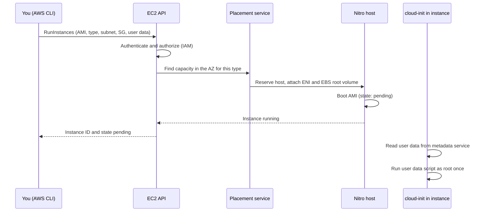
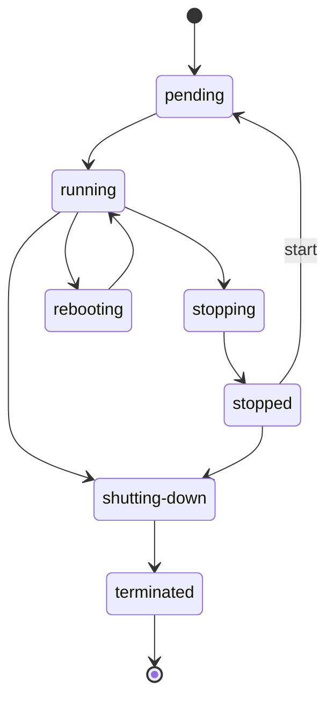

# L6.1 — EC2

> **Level 6: Cloud (AWS)** · Topic 1 of 18 · ⏱ ~5 hours · Difficulty: Beginner

## 1. What it is

**Amazon EC2 (Elastic Compute Cloud)** rents you virtual machines, called **instances**, by the second. You choose an
**AMI (Amazon Machine Image)** — the template containing the operating system and pre-installed software — an
**instance type** (how many vCPUs, how much memory, which network and storage capabilities), a network location
(a subnet) and a **security group** (a virtual firewall). AWS finds a physical host, boots a copy of the AMI on it
and hands you a running Linux or Windows machine in well under a minute.

Everything else in AWS that "runs your code on a server" is built on the same idea. Auto Scaling groups launch EC2
instances, an RDS database runs on EC2-class hardware you cannot see, and EKS worker nodes are EC2 instances. If you
understand EC2 — images, sizes, boot-time configuration, access and pricing — you understand the foundation.

## 2. Why it matters in DevOps

- **Cost:** compute is usually the largest line on the bill. A forgotten `m7i.4xlarge` costs real money every hour; a wrongly chosen pricing model wastes 30-70%.
- **Reliability:** an instance is *cattle, not a pet*. It can be stopped, retired by AWS or lost with its AZ. Designs that treat a single instance as permanent wake people up at 3 a.m.
- **Security:** instance metadata credentials (IMDS), open SSH ports and over-broad key pairs are the classic entry points in cloud breaches.
- **Automation:** AMIs, user data and launch templates are how Infrastructure as Code ([Level 0 topic](../level-00-what-devops-is/03-infrastructure-as-code.md)) and immutable infrastructure ([Level 0 topic](../level-00-what-devops-is/05-immutable-infrastructure.md)) become real.

## 3. Real-world system example

**Netflix** has publicly described running its streaming control plane on EC2 and pioneering the "bake an AMI, then
launch it" model: the build pipeline produces a machine image containing the application, and the deployment tool
(Spinnaker, which Netflix open-sourced) launches new instances from that image instead of patching running servers.
Rolling back means launching the previous image. That pattern — immutable, image-based deployment on EC2 behind
Auto Scaling groups — is the one this level builds toward.

Smaller teams use the same primitives: a typical `shop-api` deployment is an AMI (or stock Amazon Linux plus user data)
running Nginx and Node.js behind a load balancer, with the database on RDS and static files on S3.

## 4. Diagram

What happens when you call `RunInstances`:



Instance lifecycle:



## 5. How it works

**Instance type naming** — `m7i.large` breaks down as family `m`, generation `7`, attributes `i`, size `large`:

| Family | Optimized for | Typical use |
|--------|---------------|-------------|
| `t` (t3, t4g) | Burstable CPU with credits; cheap baseline | dev boxes, small web apps, bastions |
| `m` | General purpose, balanced CPU/RAM | app servers such as `shop-api` |
| `c` | Compute optimized | CI runners, encoding, high-QPS proxies |
| `r`, `x` | Memory optimized | caches, in-memory databases, JVM-heavy services |
| `i`, `d` | Local NVMe storage | databases needing very high local IOPS |
| `g`, `p` | GPUs / accelerators | ML training and inference |

Attribute letters: `a` = AMD, `i` = Intel, `g` = AWS Graviton (Arm), `d` = local NVMe disk, `n` = enhanced networking.
Graviton (`t4g`, `m7g`) is usually cheaper per unit of work but needs an `arm64` AMI and arm-compatible builds.

**Key concepts**

| Concept | What to remember |
|---------|------------------|
| **AMI** | Region-specific. Backed by EBS snapshots. Public (Amazon Linux 2023, Ubuntu), marketplace, or your own baked images. Look up the latest Amazon Linux via the public SSM parameter `/aws/service/ami-amazon-linux-latest/al2023-ami-kernel-default-x86_64`. |
| **Key pair** | AWS stores the *public* key and injects it for the default user (`ec2-user` on Amazon Linux, `ubuntu` on Ubuntu). You keep the private `.pem`; AWS cannot recover it. Prefer `ed25519`. See [SSH keys](../level-01-linux-fundamentals/12-ssh-keys-and-authorized-keys.md). |
| **User data** | A script (max 16 KB) that **cloud-init** runs as root **once, at first boot**. Output goes to `/var/log/cloud-init-output.log`. Not a secret store: anyone who can read instance attributes or metadata can read it. |
| **Instance metadata (IMDS)** | HTTP endpoint at `169.254.169.254` exposing instance ID, AZ, and IAM role credentials. **IMDSv2** requires a session token obtained with a `PUT` request, which blocks most SSRF-based theft. New Amazon Linux 2023 images default to IMDSv2 only; set `HttpTokens=required` explicitly everywhere. |
| **Root volume** | EBS, usually `gp3`. `DeleteOnTermination` defaults to true for the root volume and false for extra volumes. |
| **Public IPv4** | Auto-assigned public IPs change on stop/start. Since February 2024 AWS charges for every public IPv4 address (about $0.005 per hour each, in use or not). An **Elastic IP** is a fixed address you own until released. |
| **Placement** | An instance lives in one subnet, therefore one AZ. Spread across AZs for availability. |

**Pricing models (introduction)**

| Model | Discount vs On-Demand | Commitment | Use for |
|-------|----------------------|------------|---------|
| On-Demand | none; billed per second (60-second minimum for Linux) | none | spiky, short, unknown workloads, learning |
| Savings Plans / Reserved Instances | roughly up to 70% depending on term and type | 1 or 3 years of steady spend | steady baseline such as the always-on web tier |
| Spot | often up to ~90% | none, but AWS can reclaim with a 2-minute warning | stateless, fault-tolerant work: CI, batch, extra web capacity |
| Dedicated Hosts / Capacity Reservations | varies | varies | licensing or guaranteed capacity |

The discounts are indicative: check the pricing pages for exact numbers. A stopped instance costs **no instance
charge**, but its EBS volumes and Elastic IPs keep billing. Deep dives live in Level 20
([Reserved Instances and Savings Plans](../level-20-cost-optimization/02-reserved-instances-and-savings-plans.md),
[Spot](../level-20-cost-optimization/03-spot-instances.md)).

## 6. Step-by-step guide

**Prerequisites:** an AWS account, **AWS CLI v2** configured (`aws sts get-caller-identity` works; prefer IAM Identity
Center via `aws configure sso`, or a non-root IAM user — never root access keys), `ssh`, `curl`. Region `us-east-1`.

**Cost:** a `t3.micro` (or whichever type your account marks free-tier eligible) costs roughly a cent per hour. Free-tier
rules changed in 2025: newer accounts get a credit-based free plan, older accounts keep the 12-month 750-hour allowance —
check **Billing > Free Tier** in the console for what applies to you. The public IPv4 address is billed separately.
**Do the cleanup in step 9.** LocalStack can mock these API calls (`aws --endpoint-url http://localhost:4566 ec2 ...`),
but it does not give you a real booting OS to SSH into, so it is useful for scripting practice only.

1. **Set a billing safety net first** (mandatory for this level). Create a monthly cost budget that emails you at 80%:
   ```bash
   export AWS_DEFAULT_REGION=us-east-1
   ACCOUNT_ID=$(aws sts get-caller-identity --query Account --output text)
   cat > budget.json <<'EOF'
   {"BudgetName":"roadmap-monthly-10-usd","BudgetLimit":{"Amount":"10","Unit":"USD"},"TimeUnit":"MONTHLY","BudgetType":"COST"}
   EOF
   cat > notifications.json <<'EOF'
   [{"Notification":{"NotificationType":"ACTUAL","ComparisonOperator":"GREATER_THAN","Threshold":80,"ThresholdType":"PERCENTAGE"},
     "Subscribers":[{"SubscriptionType":"EMAIL","Address":"you@example.com"}]}]
   EOF
   aws budgets create-budget --account-id "$ACCOUNT_ID" --budget file://budget.json --notifications-with-subscribers file://notifications.json
   ```
   No output means success. Budget alerts lag by hours, so they are a safety net, not a substitute for teardown.

2. **Pick an AMI and an instance type.**
   ```bash
   AMI_ID=$(aws ssm get-parameter \
     --name /aws/service/ami-amazon-linux-latest/al2023-ami-kernel-default-x86_64 \
     --query Parameter.Value --output text)
   echo "$AMI_ID"                       # ami-0123456789abcdef0 (differs per region and over time)
   aws ec2 describe-instance-types --filters Name=free-tier-eligible,Values=true \
     --query 'InstanceTypes[].InstanceType' --output text   # for example: t3.micro t3.small ...
   ```

3. **Create a key pair** and lock down the file:
   ```bash
   aws ec2 create-key-pair --key-name shop-api-lab --key-type ed25519 \
     --query KeyMaterial --output text > shop-api-lab.pem
   chmod 400 shop-api-lab.pem
   ```

4. **Create a security group that only admits your own IP** (in the default VPC):
   ```bash
   VPC_ID=$(aws ec2 describe-vpcs --filters Name=isDefault,Values=true --query 'Vpcs[0].VpcId' --output text)
   SG_ID=$(aws ec2 create-security-group --group-name shop-web-sg \
     --description "shop-api lab web" --vpc-id "$VPC_ID" --query GroupId --output text)
   MY_IP=$(curl -s https://checkip.amazonaws.com)
   aws ec2 authorize-security-group-ingress --group-id "$SG_ID" --protocol tcp --port 22 --cidr "$MY_IP/32"
   aws ec2 authorize-security-group-ingress --group-id "$SG_ID" --protocol tcp --port 80 --cidr "$MY_IP/32"
   ```

5. **Write user data** that installs Nginx and prints which instance served the page (using IMDSv2):
   ```bash
   cat > userdata.sh <<'EOF'
   #!/bin/bash
   set -euxo pipefail
   dnf install -y nginx
   TOKEN=$(curl -s -X PUT http://169.254.169.254/latest/api/token -H "X-aws-ec2-metadata-token-ttl-seconds: 300")
   IID=$(curl -s -H "X-aws-ec2-metadata-token: $TOKEN" http://169.254.169.254/latest/meta-data/instance-id)
   AZ=$(curl -s -H "X-aws-ec2-metadata-token: $TOKEN" http://169.254.169.254/latest/meta-data/placement/availability-zone)
   echo "<h1>shop-api web</h1><p>served by $IID in $AZ</p>" > /usr/share/nginx/html/index.html
   systemctl enable --now nginx
   EOF
   ```

6. **Launch the instance**, enforcing IMDSv2 and tagging it so you can find it later:
   ```bash
   INSTANCE_ID=$(aws ec2 run-instances --image-id "$AMI_ID" --instance-type t3.micro \
     --key-name shop-api-lab --security-group-ids "$SG_ID" --user-data file://userdata.sh \
     --metadata-options HttpTokens=required,HttpEndpoint=enabled,HttpPutResponseHopLimit=1 \
     --tag-specifications 'ResourceType=instance,Tags=[{Key=Name,Value=shop-web-1},{Key=project,Value=devops-roadmap}]' \
     --query 'Instances[0].InstanceId' --output text)
   aws ec2 wait instance-running --instance-ids "$INSTANCE_ID"
   PUBLIC_IP=$(aws ec2 describe-instances --instance-ids "$INSTANCE_ID" \
     --query 'Reservations[0].Instances[0].PublicIpAddress' --output text)
   echo "$INSTANCE_ID $PUBLIC_IP"
   ```
   The default subnet assigns a public IP automatically. `wait instance-running` returns when the state is `running`;
   user data may need another minute.

7. **Connect and verify boot-time configuration.**
   ```bash
   ssh -i shop-api-lab.pem ec2-user@"$PUBLIC_IP" 'cloud-init status --wait; tail -3 /var/log/cloud-init-output.log'
   curl -s "http://$PUBLIC_IP/"      # <h1>shop-api web</h1><p>served by i-0abc... in us-east-1x</p>
   ```
   Expect `status: done`. If the page is missing, read `/var/log/cloud-init-output.log` on the instance.

8. **See IMDSv2 enforcement in action** (run on the instance):
   ```bash
   ssh -i shop-api-lab.pem ec2-user@"$PUBLIC_IP" '
     echo -n "no token -> HTTP "; curl -s -o /dev/null -w "%{http_code}\n" http://169.254.169.254/latest/meta-data/
     TOKEN=$(curl -s -X PUT http://169.254.169.254/latest/api/token -H "X-aws-ec2-metadata-token-ttl-seconds: 60")
     echo -n "with token -> "; curl -s -H "X-aws-ec2-metadata-token: $TOKEN" http://169.254.169.254/latest/meta-data/instance-type; echo'
   ```
   Expected: `no token -> HTTP 401` and `with token -> t3.micro`.
   Optionally stop and start the instance (`aws ec2 stop-instances`, `start-instances`) and notice the public IP changes.

9. **Clean up (do not skip).**
   ```bash
   aws ec2 terminate-instances --instance-ids "$INSTANCE_ID"
   aws ec2 wait instance-terminated --instance-ids "$INSTANCE_ID"
   aws ec2 delete-security-group --group-id "$SG_ID"
   aws ec2 delete-key-pair --key-name shop-api-lab && rm -f shop-api-lab.pem
   aws ec2 describe-instances --filters Name=tag:project,Values=devops-roadmap \
     --query 'Reservations[].Instances[].[InstanceId,State.Name]' --output text   # only "terminated" rows remain
   ```
   Keep the budget from step 1; it is free.

## 7. Real-world scenario

*Illustrative.* The `shop-api` team ran a single `m5.large` hand-configured over SSH. One Friday AWS emailed that the
underlying host was scheduled for retirement. The engineer stopped and started the instance (which moves it to new hardware),
but the site went down for ten minutes: the public IP changed, DNS still pointed at the old one, and a manually installed
cron job had lived on an instance-store disk that was wiped. **Investigation** showed no AMI, no user data, no
Elastic IP and no documentation. **Fix:** the team baked an AMI with the app, moved config into user data and a launch
template, put an Elastic Load Balancer in front and let an Auto Scaling group (next topic) replace instances.
**Lesson:** instances will be replaced; anything that is not reproducible from an image plus boot config is a liability.

## 8. Common mistakes and best practices

**Don't**

- Open port 22 to `0.0.0.0/0`, or share one key pair across the whole team.
- Leave IMDSv1 enabled, or put secrets in user data.
- Keep irreplaceable data on the instance-store (ephemeral) disks or only on the root volume.
- Forget stopped instances: their EBS volumes, snapshots and Elastic IPs still bill.
- Treat `t` instances as steady-state servers without watching CPU credit balance.

**Do**

- Launch from templates and AMIs you can rebuild; tag everything (`Name`, `project`, `owner`, `env`).
- Require IMDSv2 (`HttpTokens=required`), and prefer SSM Session Manager or EC2 Instance Connect over long-lived SSH keys in production.
- Use Graviton where your stack supports it, and use gp3 volumes.
- Set a budget and a billing alarm in every account before launching anything.
- Right-size using CloudWatch data, then commit to Savings Plans for the stable baseline.

## 9. Tasks

*Cost note: tasks T2-T5 use paid resources (pennies if you clean up). Finish each task with the cleanup commands.*

- [ ] **T1 — Billing alarm and budget** *(≈20 min, beginner)*
  - **Goal:** make sure a mistake cannot silently cost you hundreds of dollars.
  - **Steps:**
    1. Create the budget from step 1 with your real email address.
    2. In the console open **Billing > Billing preferences** and enable "Receive CloudWatch billing alerts", then in region `us-east-1` create an alarm on the `AWS/Billing` metric `EstimatedCharges` (currency USD) with threshold 5 and an SNS email topic.
    3. Confirm both subscription emails.
  - **Done when:** `aws budgets describe-budgets --account-id "$ACCOUNT_ID"` lists your budget and the CloudWatch alarm shows state `OK` or `INSUFFICIENT_DATA` with an email action.

- [ ] **T2 — Launch and prove it is yours** *(≈30 min, beginner)*
  - **Goal:** run the guide end to end.
  - **Steps:** follow steps 2-8, then clean up with step 9.
  - **Done when:** `curl http://<ip>/` returned a page naming your instance ID, and the final `describe-instances` shows only terminated instances.

- [ ] **T3 — Change the shape** *(≈30 min, intermediate)*
  - **Goal:** understand stop/modify/start and what changes.
  - **Steps:**
    1. Launch an instance as in the guide, note its public IP and instance type.
    2. Stop it, change the type with `aws ec2 modify-instance-attribute --instance-id "$INSTANCE_ID" --instance-type "{\"Value\":\"t3.small\"}"`, start it.
    3. Compare the public IP and the output of `curl` against the metadata `instance-type` path.
  - **Done when:** metadata reports the new type, the public IP differs, and you can explain why. Then terminate it.

- [ ] **T4 — Break it: lose SSH and recover** *(≈40 min, intermediate)*
  - **Goal:** diagnose connectivity problems systematically.
  - **Steps:**
    1. Revoke the SSH rule (`aws ec2 revoke-security-group-ingress ...`) and observe `ssh` hanging with no error.
    2. Diagnose in order: instance state, public IP, security group, then on-instance logs via `aws ec2 get-console-output --instance-id "$INSTANCE_ID" --latest --output text`.
    3. Restore the rule with your current IP.
  - **Done when:** SSH works again and you can state the difference between "connection timed out" (network/firewall) and "Permission denied (publickey)" (key/user).

- [ ] **T5 — Automate it** *(≈45 min, advanced)*
  - **Goal:** a single script that creates and destroys the whole lab.
  - **Steps:**
    1. Put steps 2-6 into `up.sh` and step 9 into `down.sh`, using tags to find resources.
    2. Make `down.sh` safe to run twice (ignore not-found errors).
    3. Run `up.sh`, verify, run `down.sh` twice.
  - **Done when:** a fresh run of `up.sh` yields a working page and `down.sh` leaves nothing tagged `project=devops-roadmap` running.

- [ ] **T6 — Prove it: explain IMDSv2 and pricing** *(≈30 min, advanced)*
  - **Goal:** teach two concepts that matter in security reviews and cost reviews.
  - **Steps:**
    1. Without the guide, demonstrate the 401-versus-token behaviour on a fresh instance.
    2. Write five sentences: why the PUT-token flow blunts SSRF, and which pricing model you would pick for the `shop-api` web tier, a nightly batch job and a CI runner fleet.
  - **Done when:** a teammate agrees your explanation is correct, and your demo ran from memory.

## 10. Self-check questions

1. What are the three things you must choose to launch an instance, and what extra network object is mandatory?
2. When does user data run, and how do you debug it?
3. Why does the public IP of an instance change, and how do you avoid it?
4. What does IMDSv2 add, and why does it matter for credential theft?
5. An instance is stopped. What do you still pay for?
6. When would you choose Spot over Savings Plans?

<details>
<summary>Answers</summary>

1. AMI, instance type and subnet (placement). A security group is attached too (the default one if you pick none).
2. As root by cloud-init at first boot only (unless configured otherwise). Read `/var/log/cloud-init-output.log` and `cloud-init status`.
3. Auto-assigned public IPs are released on stop and reassigned on start. Use an Elastic IP, or better a load balancer with DNS in front.
4. A session token obtained with a PUT request is required for every metadata read. Typical SSRF bugs only allow GETs and cannot add the header, so credentials are harder to steal.
5. EBS volumes, snapshots, Elastic IPs and any other attached resources — not the instance compute.
6. For interruptible, stateless, flexible workloads (CI, batch, queue workers); Savings Plans suit the steady always-on baseline.
</details>

## 11. Further reading

- *Amazon EC2 User Guide for Linux Instances* (AWS documentation) — instance types, AMIs, IMDS, user data.
- *AWS CLI v2 Command Reference*: `aws ec2 run-instances`.
- *AWS Well-Architected Framework* — Cost Optimization and Security pillars.
- *Amazon EC2 pricing* page — On-Demand, Spot, Savings Plans.
- *Docker/LocalStack documentation* — to script EC2 API calls without spending money.

<!-- nav -->
---
← Previous level: [Level 5 — CI/CD](../level-05-cicd/README.md) · [Level 6 index](README.md) · Next: [Auto Scaling](02-auto-scaling.md) →
