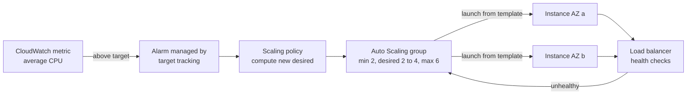
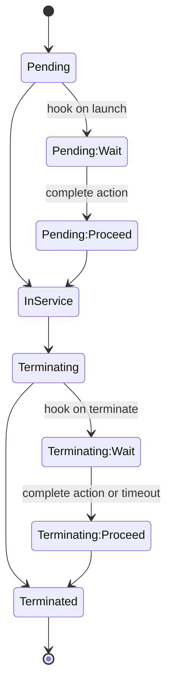

# L6.2 — Auto Scaling

> **Level 6: Cloud (AWS)** · Topic 2 of 18 · ⏱ ~5 hours · Difficulty: Intermediate

## 1. What it is

An **Auto Scaling group (ASG)** is a managed fleet of identical EC2 instances. You tell it a **minimum**, a **desired**
and a **maximum** size, which subnets (and therefore **AZs, Availability Zones**) to use, and a **launch template** that
describes what an instance looks like (AMI, instance type, security groups, user data, IAM instance profile). The ASG
then does three jobs continuously: it **launches** instances until the fleet matches the desired capacity, it
**replaces** instances that fail health checks, and it **scales** the desired capacity up or down according to policies
you define (for example "keep average CPU at 50%").

An ASG is the bridge between "I have one server" and "my servers are disposable". It is free to use — you pay only for the
instances (and related EBS, load balancer and data transfer) it creates.

## 2. Why it matters in DevOps

- **Availability:** a crashed or retired instance is replaced automatically, in another AZ if needed, without a human.
- **Cost:** you run 3 instances at 4 a.m. and 12 at the evening peak instead of 12 all day.
- **Deployments:** new application version means a new launch-template version and an *instance refresh* — the basis of rolling and blue/green deployments ([Level 5 rolling deployments](../level-05-cicd/10-rolling-deployments.md)).
- **Capacity events:** a marketing email or a retry storm doubles traffic in minutes; people cannot launch servers that fast.

## 3. Real-world system example

**Netflix** built much of its early AWS deployment tooling around ASGs and has publicly described two ideas that
shaped the industry: deployments as "red/black" pushes (Spinnaker creates a *new* ASG with the new AMI, shifts traffic,
then disables the old ASG, which remains available for instant rollback), and **Scryer**, an internal predictive
autoscaling system described on the Netflix Tech Blog that forecast demand to pre-provision capacity because reactive
scaling alone was too slow for their daily traffic curve. AWS later added its own *predictive scaling* policy type
based on the same idea. For most teams, the pattern is simpler: one ASG per service, spread over three AZs, behind an
Application Load Balancer, scaled on request count or CPU.

## 4. Diagram

Reactive scale-out with a target-tracking policy:



Lifecycle hooks pause an instance so you can run custom steps (warm a cache, drain connections, ship logs):



## 5. How it works

**Launch template.** A versioned definition of an instance (`aws ec2 create-launch-template`). New versions are
immutable; the ASG points at a specific version, `$Latest` or `$Default`. Use launch templates, not the older *launch
configurations*: AWS no longer lets new accounts create launch configurations and new EC2 features are only added to templates.

**Capacity settings.**

| Setting | Meaning |
|---------|---------|
| Minimum | never go below (your floor for availability, usually one instance per AZ at least) |
| Desired | what the ASG tries to run right now; scaling policies change this |
| Maximum | hard ceiling; protects your wallet from runaway scale-out |

**Health checks.** The default check is **EC2** (instance status is `running` and passes status checks). If the ASG is
attached to a load balancer target group, also enable **ELB** health checks, otherwise an instance whose app returned
500s forever stays "healthy" to the ASG. The **health check grace period** (default 300 seconds) stops the ASG from
killing instances that are still booting.

**Scaling policies.**

| Policy | How it works | When to use |
|--------|--------------|-------------|
| Target tracking | You pick a metric and target (e.g. `ASGAverageCPUUtilization` 50, or `ALBRequestCountPerTarget`); AWS creates and manages the alarms | default choice |
| Step scaling | Alarm thresholds map to bigger or smaller adjustments | when you need different reactions at different severities |
| Simple scaling | One adjustment per alarm, then a cooldown | legacy; prefer the others |
| Scheduled | Change min/desired/max at set times | known peaks (9 a.m. weekday ramp) |
| Predictive | ML forecast of load from history (needs ~24 h of data) | cyclical traffic; can run in forecast-only mode first |

**Instance warmup** tells the policy how long a new instance needs before its metrics count, which prevents
over-scaling. **Scale-in** removes instances according to the *termination policy* (by default it balances AZs, then
prefers older launch templates/oldest instances); *scale-in protection* shields specific instances.

**Instance refresh** replaces instances to roll out a new template version: `MinHealthyPercentage` controls how many
must stay in service, `InstanceWarmup` how long to wait before continuing.

**Lifecycle hooks** add a `Pending:Wait` or `Terminating:Wait` pause (default timeout 1 hour, max 48 hours of total
wait) until your code calls `complete-lifecycle-action` with `CONTINUE` or `ABANDON`, or the timeout elapses and the
hook's default result applies. Notifications go to EventBridge, SNS or SQS.

**Other features worth knowing:** mixed instances policy with On-Demand base and Spot top-up (see
[Spot Instances](../level-20-cost-optimization/03-spot-instances.md)), warm pools (pre-initialized stopped instances for
faster scale-out), and AZ rebalancing (the ASG launches in the under-filled AZ first, then terminates the surplus).

## 6. Step-by-step guide

**Prerequisites:** AWS CLI v2 configured, the default VPC in `us-east-1`, a budget set (L6.1 step 1).

**Cost:** the ASG itself is free; 2-4 `t3.micro` instances run for about an hour cost cents (check free-tier eligibility
on the Billing console). Detailed (1-minute) monitoring costs extra, so this lab uses the default 5-minute metrics and
scaling is slower than in production. **Clean up in step 8.** LocalStack's community edition can create launch templates and ASGs as API
objects, but it does not run real scaling; use it only to practise the CLI syntax.

1. **Collect subnets, AMI and a security group.**
   ```bash
   export AWS_DEFAULT_REGION=us-east-1
   SUBNETS=$(aws ec2 describe-subnets --filters Name=default-for-az,Values=true \
     --query 'Subnets[0:2].SubnetId' --output text | tr '\t' ',')
   echo "$SUBNETS"          # subnet-0aaa...,subnet-0bbb...
   AMI_ID=$(aws ssm get-parameter --name /aws/service/ami-amazon-linux-latest/al2023-ami-kernel-default-x86_64 \
     --query Parameter.Value --output text)
   VPC_ID=$(aws ec2 describe-vpcs --filters Name=isDefault,Values=true --query 'Vpcs[0].VpcId' --output text)
   SG_ID=$(aws ec2 create-security-group --group-name shop-asg-sg --description "asg lab" \
     --vpc-id "$VPC_ID" --query GroupId --output text)
   aws ec2 authorize-security-group-ingress --group-id "$SG_ID" --protocol tcp --port 80 --cidr "$(curl -s https://checkip.amazonaws.com)/32"
   ```

2. **Create the launch template** (the user data from L6.1, base64-encoded, plus IMDSv2 required):
   ```bash
   cat > userdata.sh <<'EOF'
   #!/bin/bash
   dnf install -y nginx stress-ng
   TOKEN=$(curl -s -X PUT http://169.254.169.254/latest/api/token -H "X-aws-ec2-metadata-token-ttl-seconds: 300")
   IID=$(curl -s -H "X-aws-ec2-metadata-token: $TOKEN" http://169.254.169.254/latest/meta-data/instance-id)
   echo "<h1>shop-api web v1</h1><p>$IID</p>" > /usr/share/nginx/html/index.html
   systemctl enable --now nginx
   EOF
   cat > lt-data.json <<EOF
   {"ImageId":"$AMI_ID","InstanceType":"t3.micro","SecurityGroupIds":["$SG_ID"],
    "UserData":"$(base64 -w0 userdata.sh)",
    "MetadataOptions":{"HttpTokens":"required","HttpEndpoint":"enabled"},
    "TagSpecifications":[{"ResourceType":"instance","Tags":[{"Key":"project","Value":"devops-roadmap"}]}]}
   EOF
   aws ec2 create-launch-template --launch-template-name shop-api-lt --version-description v1 \
     --launch-template-data file://lt-data.json
   ```
   Expect JSON with `"LatestVersionNumber": 1`. (`stress-ng` is in the Amazon Linux repositories; if `dnf` cannot find it, step 5 uses a shell loop instead.)

3. **Create the ASG across two AZs**, with a short grace period:
   ```bash
   aws autoscaling create-auto-scaling-group --auto-scaling-group-name shop-api-asg \
     --launch-template 'LaunchTemplateName=shop-api-lt,Version=$Latest' \
     --min-size 2 --max-size 4 --desired-capacity 2 \
     --vpc-zone-identifier "$SUBNETS" \
     --health-check-type EC2 --health-check-grace-period 120
   sleep 60
   aws autoscaling describe-auto-scaling-groups --auto-scaling-group-names shop-api-asg \
     --query 'AutoScalingGroups[0].Instances[].[InstanceId,AvailabilityZone,LifecycleState,HealthStatus]' --output table
   ```
   Expect two instances in different AZs, `Pending` then `InService`.

4. **Self-healing:** terminate one instance and watch the replacement.
   ```bash
   VICTIM=$(aws autoscaling describe-auto-scaling-groups --auto-scaling-group-names shop-api-asg \
     --query 'AutoScalingGroups[0].Instances[0].InstanceId' --output text)
   aws ec2 terminate-instances --instance-ids "$VICTIM"
   sleep 90
   aws autoscaling describe-scaling-activities --auto-scaling-group-name shop-api-asg \
     --query 'Activities[0:3].[StatusCode,Description]' --output text
   ```
   You should see a `Launching a new EC2 instance` activity. The ASG noticed the instance was no longer running and restored desired capacity.

5. **Add a target-tracking policy** and generate load.
   ```bash
   cat > tt.json <<'EOF'
   {"PredefinedMetricSpecification":{"PredefinedMetricType":"ASGAverageCPUUtilization"},"TargetValue":50.0}
   EOF
   aws autoscaling put-scaling-policy --auto-scaling-group-name shop-api-asg \
     --policy-name cpu50 --policy-type TargetTrackingScaling --target-tracking-configuration file://tt.json
   ```
   To burn CPU without SSH, create a second template version whose user data also runs `stress-ng --cpu 2 --timeout 1200` in the background, then refresh the fleet onto it:
   ```bash
   sed -i 's#^systemctl enable --now nginx#systemctl enable --now nginx\nstress-ng --cpu 2 --timeout 1200 \&#' userdata.sh
   aws ec2 create-launch-template-version --launch-template-name shop-api-lt --source-version 1 \
     --version-description v2-load --launch-template-data "{\"UserData\":\"$(base64 -w0 userdata.sh)\"}"
   aws autoscaling start-instance-refresh --auto-scaling-group-name shop-api-asg \
     --preferences '{"MinHealthyPercentage":50,"InstanceWarmup":120}'
   ```
   After ~10-15 minutes (5-minute metrics, three data points), `describe-scaling-activities` shows desired capacity rising toward 4 with a cause such as "target tracking ... alarm ... in ALARM". Check `aws autoscaling describe-instance-refreshes --auto-scaling-group-name shop-api-asg` to see the rolling replacement.

6. **Lifecycle hook on termination** (give yourself 2 minutes to drain):
   ```bash
   aws autoscaling put-lifecycle-hook --auto-scaling-group-name shop-api-asg --lifecycle-hook-name drain \
     --lifecycle-transition autoscaling:EC2_INSTANCE_TERMINATING --heartbeat-timeout 120 --default-result CONTINUE
   aws autoscaling set-desired-capacity --auto-scaling-group-name shop-api-asg --desired-capacity 2
   aws autoscaling describe-auto-scaling-groups --auto-scaling-group-names shop-api-asg \
     --query 'AutoScalingGroups[0].Instances[].[InstanceId,LifecycleState]' --output text   # one instance shows Terminating:Wait
   ```
   Finish early with `aws autoscaling complete-lifecycle-action --auto-scaling-group-name shop-api-asg --lifecycle-hook-name drain --lifecycle-action-result CONTINUE --instance-id <i-...>`; otherwise the timeout applies after 120 seconds.

7. **Roll back** by pointing the ASG at version 1 and refreshing:
   ```bash
   aws autoscaling update-auto-scaling-group --auto-scaling-group-name shop-api-asg \
     --launch-template 'LaunchTemplateName=shop-api-lt,Version=1'
   aws autoscaling start-instance-refresh --auto-scaling-group-name shop-api-asg --preferences '{"MinHealthyPercentage":50}'
   ```

8. **Clean up.**
   ```bash
   aws autoscaling delete-auto-scaling-group --auto-scaling-group-name shop-api-asg --force-delete
   sleep 120      # wait for instances to terminate
   aws ec2 delete-launch-template --launch-template-name shop-api-lt
   aws ec2 delete-security-group --group-id "$SG_ID"
   aws ec2 describe-instances --filters Name=tag:project,Values=devops-roadmap Name=instance-state-name,Values=pending,running \
     --query 'Reservations[].Instances[].InstanceId' --output text    # expect empty output
   ```
   If the security group delete fails with a dependency error, instances are still terminating; wait and retry.

## 7. Real-world scenario

*Illustrative.* A `shop-api` launch-day email tripled traffic. CPU hit 90% on both instances, but the ASG did not react for
nearly ten minutes: the policy used 5-minute metrics, new instances took four minutes to boot and install packages, and
the health-check grace period (60 s) was shorter than boot time, so the ASG **killed instances that were still starting**,
creating a flapping loop. **Investigation:** `describe-scaling-activities` showed launches immediately followed by
terminations with cause "health check failed". **Fix:** raise the grace period above the real boot time, bake an AMI
instead of installing packages at boot, enable 1-minute monitoring for the template, scale on
`ALBRequestCountPerTarget`, and raise the minimum before planned campaigns with a scheduled action.
**Lesson:** scaling speed = metric delay + decision time + boot time; you can only cheaply shrink the last term.

## 8. Common mistakes and best practices

**Don't**

- Run an ASG in one AZ or set min = max = 1 and call it "highly available".
- Use ELB-backed ASGs with only EC2 health checks, or a grace period shorter than boot time.
- Install packages and pull large artifacts at boot for production fleets.
- Scale on a metric that does not drop when load drops, or leave `max` unbounded.
- Store state (sessions, uploads) on instances that scale in.

**Do**

- Spread across at least two (preferably three) AZs and set min to at least the number of AZs for important services.
- Bake an AMI per release; use instance refresh with a health-based `MinHealthyPercentage`.
- Prefer target tracking; add scheduled actions for known peaks.
- Handle `Terminating:Wait` (or SIGTERM-style draining) so in-flight requests finish.
- Alarm on "ASG at max capacity" and on failed launches (capacity or quota limits).

## 9. Tasks

*Cost note: instances run while you work; always finish with step 8's cleanup.*

- [ ] **T1 — Build and heal** *(≈45 min, beginner)*
  - **Goal:** create an ASG and watch it self-heal.
  - **Steps:** follow guide steps 1-4.
  - **Done when:** after you terminate an instance, `describe-scaling-activities` shows a launch and the group is back to 2 `InService` instances in two AZs.

- [ ] **T2 — Scale with load** *(≈60 min, intermediate)*
  - **Goal:** observe target tracking add capacity, then remove it.
  - **Steps:** add the `cpu50` policy, generate CPU load with the v2 template, then remove the load (new template version without `stress-ng`, instance refresh) and watch scale-in.
  - **Done when:** the activity history shows at least one scale-out and one scale-in, each with the target-tracking cause text, and you can point to the CloudWatch graph that justified each.

- [ ] **T3 — Zero-touch release** *(≈45 min, intermediate)*
  - **Goal:** deploy v2 of the page by instance refresh and roll back.
  - **Steps:**
    1. Create template version 2 whose page says `v2`; update the ASG to it and start an instance refresh with `MinHealthyPercentage=50`.
    2. Poll `describe-instance-refreshes` until `Successful`.
    3. Roll back to version 1 as in step 7.
  - **Done when:** the page on a surviving instance flips v1 -> v2 -> v1 and the refresh history shows both operations.

- [ ] **T4 — Break it: a bad template version** *(≈45 min, advanced)*
  - **Goal:** see how ASG launch failures and failed refreshes look, and recover.
  - **Steps:**
    1. Create template version 3 with a nonexistent `ImageId` (for example `ami-00000000000000000`) and point the ASG at it.
    2. Terminate an instance (or start an instance refresh) and read `describe-scaling-activities` for the `Failed` activity and its status message.
    3. Fix by pointing the ASG back at a good version and confirm desired capacity is restored.
  - **Done when:** you can show the failed activity text, the recovery, and explain why the fleet kept serving traffic on the instances it already had.

- [ ] **T5 — Lifecycle hook that does real work** *(≈60 min, advanced)*
  - **Goal:** automate the hook response.
  - **Steps:** create an EventBridge rule on `EC2 Instance-terminate Lifecycle Action` that invokes a small Lambda (see [L6.3](03-lambda.md)) which writes the instance ID to CloudWatch Logs and calls `complete-lifecycle-action`.
  - **Done when:** scale-in produces a log line from your function and the instance leaves `Terminating:Wait` in seconds, not after the timeout.

- [ ] **T6 — Prove it: design the scaling** *(≈30 min, advanced)*
  - **Goal:** justify a design on paper.
  - **Steps:** without the guide, write the ASG definition for `shop-api` (min/desired/max, AZs, health checks and grace period, policy and metric, warmup, hook) and explain what limits its reaction time.
  - **Done when:** a reviewer cannot find an availability or cost hole in under five minutes.

## 10. Self-check questions

1. What are the three jobs an ASG performs?
2. Why enable ELB health checks, and what does the grace period protect against?
3. Target tracking versus step scaling: which would you start with and why?
4. What is the difference between a launch template and a launch configuration?
5. A scale-in terminates an instance mid-request. Name two mechanisms that reduce this.
6. How does an instance refresh differ from changing the template version alone?

<details>
<summary>Answers</summary>

1. Launch to reach desired capacity, replace unhealthy instances, adjust desired capacity per policies/schedules.
2. EC2 checks only see the VM; ELB checks see whether the app answers. Grace period prevents terminating instances that are still booting.
3. Target tracking: you state the goal and AWS manages alarms and math; step scaling needs hand-tuned thresholds.
4. Templates are versioned, support newer EC2 features and Spot mixes; launch configurations are legacy, immutable and no longer available to new accounts.
5. Connection draining / deregistration delay on the load balancer, and a `Terminating:Wait` lifecycle hook (plus apps handling SIGTERM).
6. Changing the version only affects future launches; an instance refresh actively replaces existing instances in controlled batches.
</details>

## 11. Further reading

- *Amazon EC2 Auto Scaling User Guide* (AWS documentation) — scaling policies, lifecycle hooks, instance refresh, warm pools.
- *AWS Well-Architected Framework* — Reliability pillar.
- Netflix Tech Blog — posts on Scryer and on Spinnaker red/black deployments.
- *Site Reliability Engineering* (Google) — capacity and load chapters for the underlying ideas.
- See also [High Availability and Scalability](../level-00-what-devops-is/08-high-availability-and-scalability.md).

<!-- nav -->
---
← Previous: [EC2](01-ec2.md) · [Level 6 index](README.md) · Next: [Lambda](03-lambda.md) →
