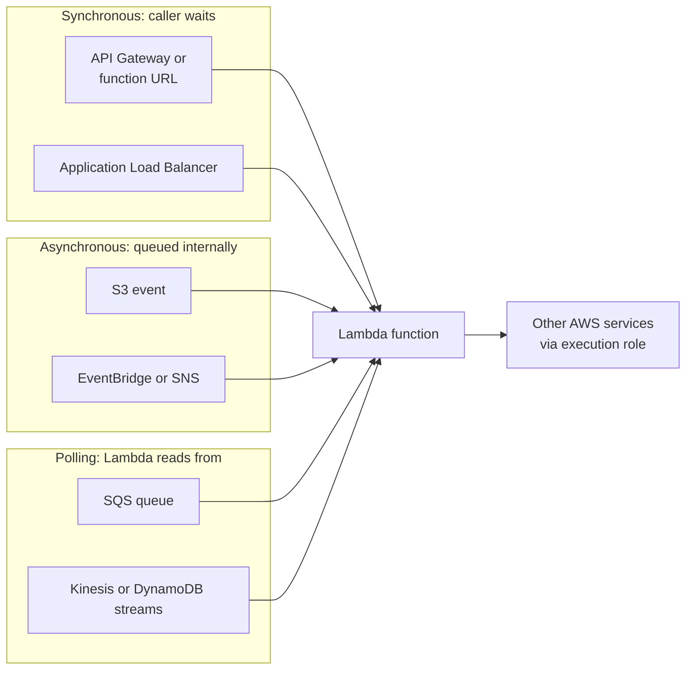
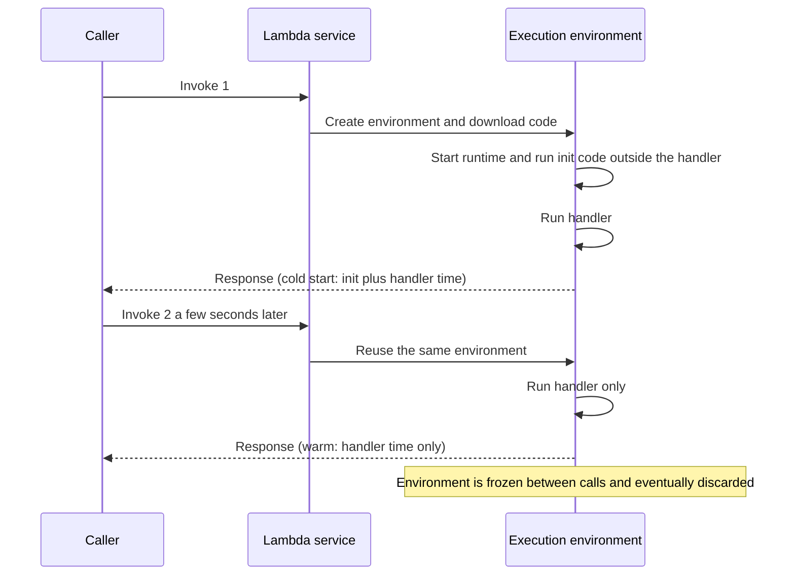

# L6.3 — Lambda

> **Level 6: Cloud (AWS)** · Topic 3 of 18 · ⏱ ~5 hours · Difficulty: Intermediate

## 1. What it is

**AWS Lambda** runs a function of your code in response to an **event**, without you managing servers. You upload code
(a zip or a container image) and choose a runtime such as Node.js 22 or Python 3.13. Something happens — an object lands
in S3, an HTTP request hits a **function URL**, a message arrives in an SQS queue, a schedule fires — and Lambda
starts an isolated **execution environment**, calls your **handler** function with the event, and bills you for the
milliseconds and memory used. When there is no traffic, nothing runs and nothing is billed. When traffic spikes, Lambda
runs many copies in parallel.

Lambda is "serverless" in the sense that patching, capacity, scaling and AZ placement are AWS's job. Your job is the code,
its permissions (an **execution role** in IAM), its configuration (memory, timeout, environment variables) and what
triggers it.

## 2. Why it matters in DevOps

- **Glue and automation:** react to infrastructure events (instance terminating, S3 upload, CloudWatch alarm, GuardDuty finding) with ten lines of code instead of a VM.
- **Cost:** spiky or rare workloads cost cents. Constant, high-volume workloads can cost more than containers, so you must be able to compare.
- **Operational model:** no SSH, no OS patches — but also no long-lived state, hard time limits and distributed debugging.
- **Failure modes are different:** cold starts, throttling from concurrency limits, retry storms and poison messages are the new 3 a.m. pages.

## 3. Real-world system example

**Amazon Prime Video's Video Quality Analysis tool** is a documented lesson in *both* directions. The team's 2023 engineering
blog post described how their first design — distributed components orchestrated with AWS Step Functions and Lambda — hit
scaling and cost limits, and that moving the pipeline into a single process on containers cut infrastructure cost
dramatically (they reported about 90%). It does not show that serverless is bad: it shows that per-request orchestration
overhead matters at very high, steady volume, and that Lambda excels elsewhere.

The canonical successful pattern, used from AWS's own launch examples to many production systems, is event-driven
glue: a photo uploaded to S3 triggers a function that creates thumbnails; a CloudWatch alarm triggers a function that
posts to chat; an ASG lifecycle hook ([L6.2](02-auto-scaling.md)) triggers a function that drains an instance.

## 4. Diagram

Where events come from, and how Lambda invokes your code:



Cold start versus warm start:



## 5. How it works

**Invocation models**

| Model | Examples | Error behaviour |
|-------|----------|-----------------|
| Synchronous | function URL, API Gateway, ALB, `aws lambda invoke` | error returned to the caller, caller retries |
| Asynchronous | S3, SNS, EventBridge | Lambda queues the event and retries failures twice by default; configure an on-failure destination or DLQ (dead-letter queue) |
| Event source mapping (poll) | SQS, Kinesis, DynamoDB Streams | Lambda polls and batches; failed batches are retried until success or expiry; use *partial batch responses* so one bad record does not block the rest |

**Cold starts.** The first request to a new execution environment pays the **init** phase: download the package, start the
runtime, run top-level code. Typical cold starts are tens to a few hundred milliseconds for Node.js and Python, longer for
big packages, Java/.NET without optimization, or functions attached to a VPC with heavy init work. Reduce them with: small
packages, lazy-loading heavy libraries, initializing SDK clients **outside** the handler (so warm calls reuse them), more memory (more CPU), arm64 (Graviton),
**SnapStart** (supported on selected runtimes such as Java), and **provisioned concurrency** (keeps environments pre-initialized, billed continuously).

**Limits to know** (always check the current Lambda quotas page; they change):

| Limit | Value to remember |
|-------|-------------------|
| Max duration | 15 minutes per invocation |
| Memory | 128 MB to 10,240 MB; CPU scales with memory |
| Synchronous payload | 6 MB each for request and response |
| Package size | 50 MB zipped (direct upload), 250 MB unzipped including layers; container images up to 10 GB |
| `/tmp` | 512 MB by default, configurable up to 10,240 MB; not shared between environments |
| Concurrency | account-level regional quota (commonly 1,000 by default, may be lower on new accounts; raise via Service Quotas); **reserved concurrency** caps or guarantees a function's share |

**Pricing.** You pay per request (about $0.20 per million) plus per GB-second of duration, with a monthly always-free
tier (1 million requests and 400,000 GB-seconds). Recent pricing changes bill the init phase for more configurations,
so check the pricing page. Related costs: CloudWatch Logs ingestion and storage, NAT Gateway if the function needs
internet from a VPC ([L6.5](05-route-tables-igw-nat.md)), provisioned concurrency.

**Permissions** have two sides: the **execution role** (what the function may call, e.g. `s3:GetObject`) and the
**resource policy** (who may invoke it, e.g. `s3.amazonaws.com` for one bucket). See [IAM](07-iam.md).

**When not to use Lambda**

- Steady, high-throughput, latency-sensitive services where a few containers or instances are cheaper and more predictable.
- Jobs longer than 15 minutes, or needing large local state, GPUs or special kernel features (use ECS/Fargate, Batch or EC2).
- Long-lived connections (WebSockets held open by your code), or heavy connection pooling to a relational database without RDS Proxy.
- Workloads that cannot tolerate occasional cold-start latency and cannot justify provisioned concurrency.
- Complex orchestration expressed as a web of tiny functions that nobody can debug end to end.

## 6. Step-by-step guide

**Prerequisites:** AWS CLI v2 configured, `zip`, region `us-east-1`. **Cost:** effectively zero for this lab (well inside the
always-free tier); CloudWatch Logs retain forever by default, so the cleanup deletes the log group. **LocalStack** supports
Lambda well in its community edition (it needs access to the Docker socket): replace `aws` with `awslocal`, or add
`--endpoint-url http://localhost:4566`, and use a dummy role ARN.

1. **Create an execution role** that can only write logs:
   ```bash
   export AWS_DEFAULT_REGION=us-east-1
   ACCOUNT_ID=$(aws sts get-caller-identity --query Account --output text)
   cat > trust.json <<'EOF'
   {"Version":"2012-10-17","Statement":[{"Effect":"Allow","Principal":{"Service":"lambda.amazonaws.com"},"Action":"sts:AssumeRole"}]}
   EOF
   aws iam create-role --role-name shop-hello-role --assume-role-policy-document file://trust.json
   aws iam attach-role-policy --role-name shop-hello-role \
     --policy-arn arn:aws:iam::aws:policy/service-role/AWSLambdaBasicExecutionRole
   sleep 10          # IAM is eventually consistent
   ```

2. **Write the function** (Node.js 22, ES module). Note the client-style code outside the handler runs once per environment:
   ```javascript
   // index.mjs
   const bootedAt = new Date().toISOString();   // init phase: runs once per execution environment
   let calls = 0;

   export const handler = async (event) => {
     calls += 1;
     const rec = event.Records?.[0];
     if (rec?.s3) {
       const key = decodeURIComponent(rec.s3.object.key.replace(/\+/g, " "));
       console.log(`new object s3://${rec.s3.bucket.name}/${key} size=${rec.s3.object.size}`);
       return { ok: true };
     }
     return { statusCode: 200, body: JSON.stringify({ message: `hello ${event.name ?? "shop"}`, bootedAt, calls }) };
   };
   ```

3. **Package and create the function** (arm64 is cheaper per GB-second and fine for plain JavaScript):
   ```bash
   zip function.zip index.mjs
   aws lambda create-function --function-name shop-hello --runtime nodejs22.x --architectures arm64 \
     --handler index.handler --zip-file fileb://function.zip \
     --role "arn:aws:iam::$ACCOUNT_ID:role/shop-hello-role" --memory-size 128 --timeout 10
   aws lambda wait function-active-v2 --function-name shop-hello
   ```

4. **Invoke it and read the REPORT line** (cold start first):
   ```bash
   aws lambda invoke --function-name shop-hello --cli-binary-format raw-in-base64-out \
     --payload '{"name":"damilare"}' --log-type Tail --query LogResult --output text out.json | base64 -d
   cat out.json
   ```
   Expect a line similar to `REPORT RequestId: ... Duration: 3.1 ms Billed Duration: ... Memory Size: 128 MB Max Memory Used: 64 MB Init Duration: 110 ms`.
   `Init Duration` appears **only on cold starts**. Run the command again: no `Init Duration`, and `calls` in `out.json` is now 2.
   (CLI v2 needs `--cli-binary-format raw-in-base64-out` to accept raw JSON for `--payload`.)

5. **Force a new cold start** by changing configuration, then invoke again:
   ```bash
   aws lambda update-function-configuration --function-name shop-hello --environment 'Variables={STAGE=dev}'
   aws lambda wait function-updated-v2 --function-name shop-hello
   aws lambda invoke --function-name shop-hello --payload '{}' --cli-binary-format raw-in-base64-out --log-type Tail \
     --query LogResult --output text out.json | base64 -d | grep REPORT
   ```
   `Init Duration` is back and `calls` reset to 1, proving the old environment was replaced.

6. **Add an event trigger: S3 upload invokes the function.**
   ```bash
   B="shop-lambda-lab-$ACCOUNT_ID"
   aws s3api create-bucket --bucket "$B"          # us-east-1 needs no LocationConstraint
   FN_ARN=$(aws lambda get-function --function-name shop-hello --query Configuration.FunctionArn --output text)
   aws lambda add-permission --function-name shop-hello --statement-id s3-invoke \
     --action lambda:InvokeFunction --principal s3.amazonaws.com \
     --source-arn "arn:aws:s3:::$B" --source-account "$ACCOUNT_ID"
   cat > notif.json <<EOF
   {"LambdaFunctionConfigurations":[{"LambdaFunctionArn":"$FN_ARN","Events":["s3:ObjectCreated:*"],
     "Filter":{"Key":{"FilterRules":[{"Name":"prefix","Value":"uploads/"}]}}}]}
   EOF
   aws s3api put-bucket-notification-configuration --bucket "$B" --notification-configuration file://notif.json
   echo "hello" > a.txt && aws s3 cp a.txt "s3://$B/uploads/a.txt"
   sleep 5; aws logs tail /aws/lambda/shop-hello --since 5m
   ```
   The log shows `new object s3://shop-lambda-lab-.../uploads/a.txt size=6`. Uploading outside `uploads/` triggers nothing.
   The resource policy (`add-permission`) is what lets S3 call your function; without it the notification call fails.

7. **Clean up.**
   ```bash
   aws s3 rb "s3://$B" --force
   aws lambda delete-function --function-name shop-hello
   aws logs delete-log-group --log-group-name /aws/lambda/shop-hello
   aws iam detach-role-policy --role-name shop-hello-role --policy-arn arn:aws:iam::aws:policy/service-role/AWSLambdaBasicExecutionRole
   aws iam delete-role --role-name shop-hello-role
   rm -f function.zip out.json a.txt notif.json trust.json
   ```

## 7. Real-world scenario

*Illustrative.* A `shop-api` order-confirmation function consumed an SQS queue and wrote to PostgreSQL. After a marketing push
the database hit `too many connections` and orders were delayed. **Investigation:** CloudWatch showed Lambda concurrency
rising to several hundred, each environment opening its own database connection; a bug also made one malformed message fail
every batch, so the queue kept redelivering it and starving valid orders. **Fix:** set **reserved concurrency** (e.g. 20) to cap
parallel connections, introduce RDS Proxy for pooling, enable *partial batch responses* and a dead-letter queue with a
`maxReceiveCount` so poison messages move aside, and alarm on queue age.
**Lesson:** infinite scale on one side meets finite capacity on the other; always bound concurrency toward stateful backends.

## 8. Common mistakes and best practices

**Don't**

- Give a function `AdministratorAccess` or `Resource: "*"` "to get it working".
- Create SDK clients or load config inside the handler on every call.
- Put secrets in plaintext environment variables in source control; fetch from Secrets Manager or Parameter Store.
- Use recursive triggers (a function that writes to the bucket that triggers it) — a classic runaway bill.
- Assume exactly-once delivery: events can arrive twice or out of order.

**Do**

- Make handlers **idempotent** and keep them small and fast.
- Set a sensible timeout (not the 15-minute max) and memory (measure; more memory often lowers cost via shorter duration).
- Set log retention, structured JSON logs and alarms on `Errors`, `Throttles` and `Duration`.
- Use DLQs or failure destinations on async functions, and reserved concurrency to protect downstreams.
- Deploy with Infrastructure as Code and versions/aliases for safe rollouts.

## 9. Tasks

*Cost note: all tasks stay within the free tier if you clean up; delete log groups at the end.*

- [ ] **T1 — Hello, cold start** *(≈30 min, beginner)*
  - **Goal:** deploy a function and observe a cold start.
  - **Steps:** do guide steps 1-5.
  - **Done when:** you captured two REPORT lines, one with `Init Duration` and one without, and `out.json` showed `calls` incrementing.

- [ ] **T2 — Measure memory versus cost** *(≈40 min, intermediate)*
  - **Goal:** learn that more memory can mean faster and not always costlier.
  - **Steps:**
    1. Add a CPU-bound loop to the handler (e.g. hash a string 200,000 times).
    2. Invoke at 128, 512 and 1769 MB (`update-function-configuration --memory-size`), three times each.
    3. Compare `Duration` and compute duration times memory in GB-seconds.
  - **Done when:** you have a table of memory versus billed duration versus GB-seconds and a one-line conclusion.

- [ ] **T3 — Queue-driven worker** *(≈60 min, intermediate)*
  - **Goal:** wire an event source mapping with failure handling.
  - **Steps:**
    1. Create an SQS queue and a dead-letter queue with `maxReceiveCount` 3; attach `AWSLambdaSQSQueueExecutionRole` to the role.
    2. `aws lambda create-event-source-mapping --function-name shop-hello --event-source-arn <queue-arn> --batch-size 5`.
    3. Send one good and one malformed message (make the function throw on `"poison"`).
  - **Done when:** the good message is processed once and the poison message appears in the DLQ after three attempts.

- [ ] **T4 — Break it: throttling** *(≈30 min, advanced)*
  - **Goal:** recognise throttle errors and recover.
  - **Steps:**
    1. Run `aws lambda put-function-concurrency --function-name shop-hello --reserved-concurrent-executions 0`.
    2. Invoke the function and capture the `TooManyRequestsException`/throttle response.
    3. Remove the setting with `aws lambda delete-function-concurrency` and invoke again.
  - **Done when:** you reproduced a throttle, found the `Throttles` metric in CloudWatch, and fixed it.

- [ ] **T5 — Automate deployment** *(≈45 min, advanced)*
  - **Goal:** make deploys one command with a rollback.
  - **Steps:** write a script that zips, runs `update-function-code --publish`, points an alias `live` at the new version, and can repoint it to the previous version.
  - **Done when:** `aws lambda get-alias --function-name shop-hello --name live` shows the version change and rolls back on request. (If you adopt Terraform later, see [Level 7](../level-07-terraform-iac/01-providers-and-resources.md).)

- [ ] **T6 — Prove it: Lambda or container?** *(≈30 min, advanced)*
  - **Goal:** make a defensible compute decision.
  - **Steps:** without notes, choose compute for three `shop-api` workloads (nightly report taking 40 minutes, image thumbnails on upload, the public REST API at steady 500 requests per second) and justify each with limits, cost and cold-start reasoning.
  - **Done when:** each choice cites at least one limit or cost factor and a colleague can follow the logic.

## 10. Self-check questions

1. What are the three invocation models and how do retries differ?
2. What is a cold start and name three ways to reduce it?
3. Why create SDK clients outside the handler?
4. What two policies are involved when S3 triggers a function?
5. Name four situations where Lambda is the wrong tool.
6. What does reserved concurrency do, and why is it a safety feature?

<details>
<summary>Answers</summary>

1. Synchronous (caller handles errors), asynchronous (Lambda retries twice and can send failures to a destination/DLQ), and polling event source mappings (batches retried until success or expiry).
2. The init phase of a new environment (download, runtime start, init code). Smaller packages and lazy loading, more memory/arm64, SnapStart, provisioned concurrency.
3. Warm invocations reuse the initialized objects and connections, saving time on every call after the first.
4. The function's resource-based policy (lets S3 invoke it) and the execution role (what the code may do once running).
5. Jobs over 15 minutes, steady high-volume latency-sensitive APIs, unpooled relational DB access at scale, workloads needing GPUs/special kernels or big local state, over-fragmented orchestration.
6. It caps (and reserves) the number of concurrent executions of a function, protecting downstream systems and your bill from runaway scaling.
</details>

## 11. Further reading

- *AWS Lambda Developer Guide* (AWS documentation) — runtimes, concurrency, event source mappings, quotas.
- *AWS Lambda pricing* page — always-free tier, GB-second rates, provisioned concurrency.
- Amazon Prime Video technology blog, 2023: "Scaling up the Prime Video audio/video monitoring service and reducing costs by 90%".
- *Serverless Applications Lens* of the AWS Well-Architected Framework.
- See also [Infrastructure Automation](../level-00-what-devops-is/06-infrastructure-automation.md).

<!-- nav -->
---
← Previous: [Auto Scaling](02-auto-scaling.md) · [Level 6 index](README.md) · Next: [VPC and Subnets](04-vpc-and-subnets.md) →
