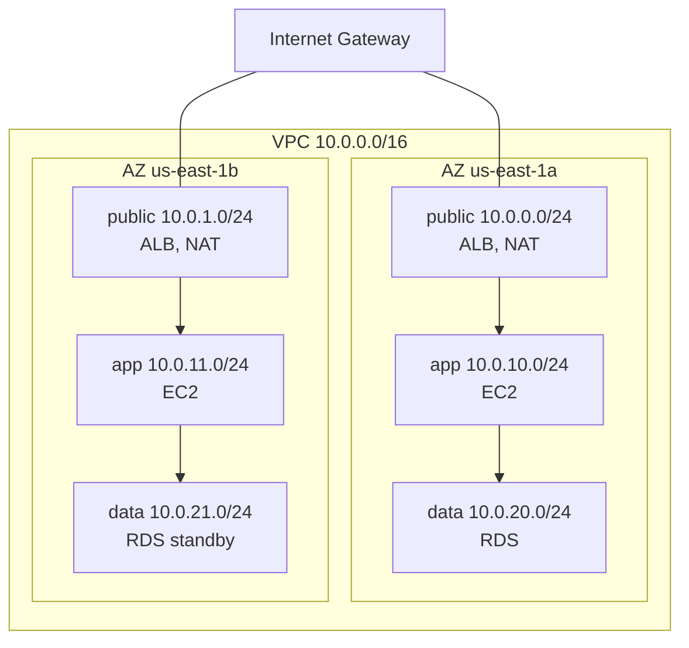
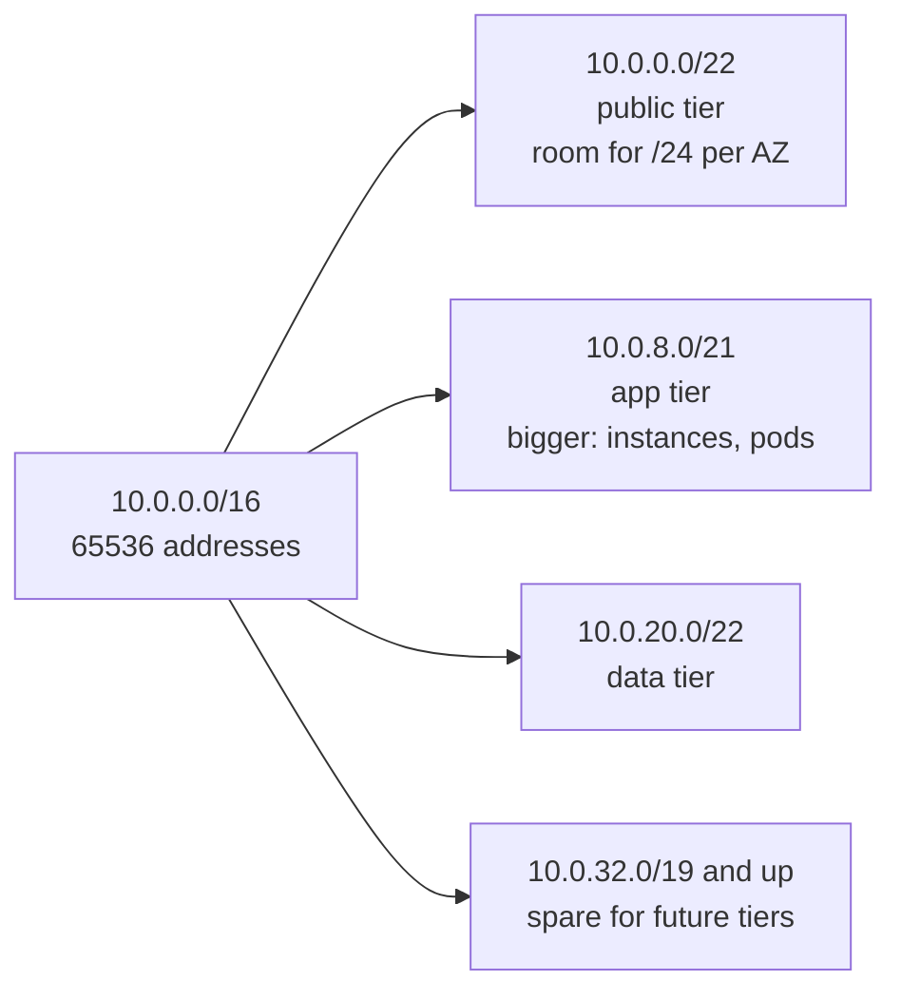

# L6.4 — VPC and Subnets

> **Level 6: Cloud (AWS)** · Topic 4 of 18 · ⏱ ~5 hours · Difficulty: Intermediate

## 1. What it is

A **VPC (Virtual Private Cloud)** is your own logically isolated network inside AWS. You pick its private IP range
(a **CIDR block**, such as `10.0.0.0/16`), carve it into **subnets**, and decide which subnets can talk to the internet
and which cannot. Nothing enters or leaves a VPC unless you build a path for it. If you have read
[IPv4, IPv6, CIDR and Subnets](../level-02-networking/03-ipv4-ipv6-cidr-subnets.md), a VPC is the same idea with the
router, switches and cabling replaced by an API.

A **subnet** is a slice of the VPC's address range that lives in **exactly one Availability Zone (AZ)**, one isolated
data-centre group inside a region. This is the key fact for resilience: to survive the loss of an AZ you need subnets
in at least two AZs and resources spread across them. A subnet is called **public** only because its route table has a
route to an Internet Gateway (covered in [Route Tables, IGW and NAT](05-route-tables-igw-nat.md)); the word is a
convention about routing, not a property you set on the subnet itself.

## 2. Why it matters in DevOps

- **Security boundary:** databases and app servers belong in subnets with no route from the internet. The VPC layout is the first and cheapest layer of defence.
- **Irreversible choices:** the VPC's primary CIDR cannot be changed after creation, and two networks with overlapping ranges cannot be peered or joined through a Transit Gateway or VPN without painful NAT. A sloppy `/24` chosen on day one blocks the merger, the VPN to the office or the second region two years later.
- **Availability:** single-AZ designs fail when that AZ does. Multi-AZ is mostly a subnet-and-placement decision.
- **Capacity:** subnets that are too small run out of IP addresses during a scale-out, and Auto Scaling or Kubernetes pods then fail to launch. See [Auto Scaling](02-auto-scaling.md).
- **Infrastructure as code:** the network is the first thing Terraform creates and everything else depends on it ([IaC](../level-00-what-devops-is/03-infrastructure-as-code.md)).

## 3. Real-world system example

**Amazon RDS, EKS and ElastiCache all consume subnets you provide.** An RDS DB subnet group must span subnets in at
least two AZs so that a Multi-AZ failover has somewhere to go. EKS places control-plane network interfaces in your
subnets and, with the default AWS VPC CNI plugin, gives every Pod a real VPC IP address, which is why undersized
subnets are a well-known cause of "Pods stuck in ContainerCreating" on EKS.

AWS's own well-architected guidance and its "VPC with public and private subnets" reference layouts use the pattern in
this topic: load balancers in public subnets, application instances in private subnets, data stores in isolated
private subnets, repeated across at least two (commonly three) AZs. The `shop-api` layout below follows it.

## 4. Diagram

The target layout for `shop-api` in `us-east-1` (one VPC, three AZs, three tiers):



Carving a `/16` into planned blocks (the third octet encodes the tier, which makes route tables and logs readable):



## 5. How it works

**CIDR rules in AWS**

| Rule | Detail |
|------|--------|
| VPC size | Between `/16` (65,536 addresses) and `/28` (16 addresses) for IPv4 |
| Address space | Use RFC 1918 ranges: `10.0.0.0/8`, `172.16.0.0/12`, `192.168.0.0/16` |
| Reserved per subnet | AWS reserves **5 addresses** in every subnet: the network address, VPC router (`.1`), AWS DNS (`.2`), one reserved for future use (`.3`) and the broadcast address (last). A `/24` therefore gives 251 usable addresses, a `/28` only 11 |
| Subnet scope | One subnet = one AZ. It cannot span AZs and cannot overlap another subnet in the VPC |
| Growing | You can add **secondary CIDR blocks** to a VPC later, but you cannot resize or remove the primary |
| IPv6 | Optionally associate an AWS-provided `/56` block; subnets then take a `/64`. IPv6 addresses are globally unique, so there is no NAT; use an egress-only internet gateway for outbound-only |
| Default VPC | Every region has one (`172.31.0.0/16`, one `/20` public subnet per AZ). Fine for experiments; build your own VPC for anything real |

**Planning checklist**

1. **Choose a range that will not collide.** Inventory your office, other VPCs, other regions, partner networks and any on-prem ranges. Avoid `10.0.0.0/16` if you know a VPN will land on it, and avoid `172.17.0.0/16` (the default Docker bridge). Teams with many accounts allocate non-overlapping blocks centrally (AWS offers **VPC IP Address Manager, IPAM**, for this).
2. **Size for the biggest consumer.** A `/16` VPC is the usual choice; running out of VPC space is far more painful than wasting private addresses. Kubernetes with the VPC CNI needs large app subnets (`/20` or `/19`).
3. **Use at least two AZs, three for production.** Three tolerates one AZ failing while still keeping quorum-based systems healthy.
4. **Separate tiers into separate subnets:** *public* (load balancers, NAT gateways, rarely a bastion), *private app* (EC2, containers) and *private data* (RDS, ElastiCache). Different subnets let you give each tier its own route table and Network ACL ([Security Groups and NACLs](06-security-groups-and-nacls.md)).
5. **Think in AZ IDs, not names.** The name `us-east-1a` maps to a different physical AZ in different accounts. The AZ ID (`use1-az1`) is stable and matters when two accounts must share a physical AZ (for example, to avoid cross-AZ data charges).
6. **Leave gaps.** Do not allocate the whole VPC on day one; keep a spare block for a new tier, a new endpoint subnet or a Transit Gateway attachment subnet.

**Multi-AZ design principles**

- Every tier has one subnet per AZ, with the same size in each.
- Stateless tiers (ALB, app servers) run in all AZs. Stateful tiers use the service's own multi-AZ feature ([RDS and Aurora](10-rds-and-aurora.md)).
- Cross-AZ traffic is billed (about $0.01 per GB in each direction at the time of writing), so chatty services should prefer same-AZ calls where the design allows.
- The ALB must be given subnets in at least two AZs ([Application Load Balancer](14-alb.md)).

**The VPC itself costs nothing.** Subnets, route tables, security groups and Internet Gateways are free. What you
*attach* costs money: NAT gateways, public IPv4 addresses, VPC endpoints (interface type), Transit Gateway attachments
and the data you move.

## 6. Step-by-step guide

**Prerequisites:** AWS CLI v2 configured (`aws sts get-caller-identity` works), region `us-east-1`. Use a non-root
identity. **Cost:** everything in this guide is free (a VPC and subnets have no hourly charge). **LocalStack:** the
free edition emulates the VPC and subnet APIs, so you can rehearse the same commands offline:
`docker run -d --rm -p 4566:4566 localstack/localstack`, then add `--endpoint-url http://localhost:4566` to every
command (any dummy credentials work). LocalStack does not enforce real networking or the exact AZ ID mapping.

1. **Set variables and look at the AZs.**
   ```bash
   export AWS_DEFAULT_REGION=us-east-1
   aws ec2 describe-availability-zones \
     --query 'AvailabilityZones[].[ZoneName,ZoneId,State]' --output table
   ```
   You see rows such as `us-east-1a | use1-az1 | available`. The name-to-ID pairing differs per account; note yours.

2. **Verify your CIDR plan before creating anything.** Python's standard library does the arithmetic:
   ```bash
   python3 - <<'EOF'
   import ipaddress
   vpc = ipaddress.ip_network("10.0.0.0/16")
   plan = {"public-a":"10.0.0.0/24","public-b":"10.0.1.0/24",
           "app-a":"10.0.10.0/24","app-b":"10.0.11.0/24",
           "data-a":"10.0.20.0/24","data-b":"10.0.21.0/24"}
   nets = {k: ipaddress.ip_network(v) for k, v in plan.items()}
   for k, n in nets.items():
       assert n.subnet_of(vpc), k
       print(f"{k:9} {n}  usable={n.num_addresses-5}")
   items = list(nets.values())
   assert not any(a.overlaps(b) for i, a in enumerate(items) for b in items[i+1:])
   print("no overlaps")
   EOF
   ```
   Expected: six lines with `usable=251`, then `no overlaps`.

3. **Create the VPC and enable DNS hostnames.**
   ```bash
   VPC_ID=$(aws ec2 create-vpc --cidr-block 10.0.0.0/16 \
     --tag-specifications 'ResourceType=vpc,Tags=[{Key=Name,Value=shop-api-vpc}]' \
     --query Vpc.VpcId --output text)
   aws ec2 modify-vpc-attribute --vpc-id "$VPC_ID" --enable-dns-hostnames '{"Value":true}'
   echo "$VPC_ID"
   ```
   Expected: an ID like `vpc-0abc1234def567890`. DNS support is on by default; DNS hostnames let instances with public
   IPs get names, and are needed by several features such as interface VPC endpoints.

4. **Create the six subnets** (two AZs shown; copy the pattern for a third):
   ```bash
   mk() { # name cidr az
     aws ec2 create-subnet --vpc-id "$VPC_ID" --cidr-block "$2" --availability-zone "$3" \
       --tag-specifications "ResourceType=subnet,Tags=[{Key=Name,Value=shop-api-$1}]" \
       --query Subnet.SubnetId --output text
   }
   PUB_A=$(mk public-a 10.0.0.0/24  us-east-1a)
   PUB_B=$(mk public-b 10.0.1.0/24  us-east-1b)
   APP_A=$(mk app-a    10.0.10.0/24 us-east-1a)
   APP_B=$(mk app-b    10.0.11.0/24 us-east-1b)
   DAT_A=$(mk data-a   10.0.20.0/24 us-east-1a)
   DAT_B=$(mk data-b   10.0.21.0/24 us-east-1b)
   ```

5. **Inspect the result.**
   ```bash
   aws ec2 describe-subnets --filters "Name=vpc-id,Values=$VPC_ID" \
     --query 'Subnets[].[Tags[?Key==`Name`]|[0].Value,CidrBlock,AvailabilityZone,AvailableIpAddressCount]' \
     --output table
   ```
   Each `/24` shows `AvailableIpAddressCount` of `251`.

6. **Mark the public subnets to auto-assign public IPs.** This only matters once a route to an Internet Gateway exists
   (next topic), and it is best practice to leave it off for private subnets:
   ```bash
   aws ec2 modify-subnet-attribute --subnet-id "$PUB_A" --map-public-ip-on-launch
   aws ec2 modify-subnet-attribute --subnet-id "$PUB_B" --map-public-ip-on-launch
   ```
   Remember that every public IPv4 address now has an hourly charge (about $0.005 per hour), so avoid public IPs on anything that does not need one.

7. **Check which subnets are actually public.** Right now none are: the VPC has the implicit "main" route table with only
   the local route.
   ```bash
   aws ec2 describe-route-tables --filters "Name=vpc-id,Values=$VPC_ID" \
     --query 'RouteTables[].Routes[].[DestinationCidrBlock,GatewayId]' --output table
   ```
   Expected: a single `10.0.0.0/16 | local` row. A route like `0.0.0.0/0 | igw-...` is what would make a subnet public.

8. **Clean up** (delete subnets first, then the VPC):
   ```bash
   for s in "$PUB_A" "$PUB_B" "$APP_A" "$APP_B" "$DAT_A" "$DAT_B"; do
     aws ec2 delete-subnet --subnet-id "$s"
   done
   aws ec2 delete-vpc --vpc-id "$VPC_ID"
   ```
   If `delete-vpc` fails with `DependencyViolation`, something is still attached (an endpoint, gateway or network
   interface). Later topics reuse this VPC; if you want to keep it for the next topic, skip this step. It is free either way.

## 7. Real-world scenario

*Illustrative scenario, not a documented incident.* The `shop-api` team launched with a single `/24` VPC
(`10.0.0.0/24`) split into two `/25` subnets "because it was only a prototype". A year later, three problems arrive at
once. Black Friday scale-out fails halfway: the Auto Scaling group reports `InsufficientFreeAddressesInSubnet` because
the app subnet only has 123 usable addresses and a rolling deployment temporarily doubles the instance count. The
company then acquires a startup whose network is `10.0.0.0/16`, and the VPN between the two cannot be built because
the ranges overlap. And RDS Multi-AZ cannot be enabled cleanly because both subnets are in one AZ.

**Fix:** they create a new VPC with a planned `/16` range registered in a central IPAM pool, three AZs and three tiers,
then migrate behind the load balancer using [blue/green deployment](../level-05-cicd/11-blue-green-deployments.md),
tearing the old VPC down afterwards. **Lesson:** CIDR and AZ decisions are the hardest to change; spend an hour on the
plan now to avoid a quarter-long migration later.

## 8. Common mistakes and best practices

**Don't**

- Use the default VPC for production workloads (all subnets public, no planned ranges).
- Pick a tiny VPC or reuse `10.0.0.0/16` in every account without an allocation plan.
- Put everything in one AZ, or give each tier a different number of AZs.
- Assume "private subnet" means "secure": it only means no inbound path from the internet. Security groups and IAM still apply.
- Forget that subnets reserve 5 addresses, and that Kubernetes Pods, Lambda in a VPC and ENIs consume subnet addresses.

**Do**

- Plan CIDRs across every account and region first (a spreadsheet or AWS IPAM) and leave unallocated space.
- Create one subnet per tier per AZ with consistent sizes and a naming scheme (`shop-api-app-a`).
- Use three AZs for production and refer to AZ IDs when cross-account placement matters.
- Define the network in code ([Terraform](../level-07-terraform-iac/01-providers-and-resources.md)) so it can be reviewed and rebuilt.
- Tag every resource (`Name`, `Environment`, `Owner`) so unknown spend can be traced.

## 9. Tasks

- [ ] **T1 — Plan a CIDR layout on paper and verify it** *(≈30 min, beginner)*
  - **Goal:** produce a non-overlapping plan for three environments (dev, staging, prod) and three tiers across three AZs.
  - **Steps:**
    1. Give each environment its own `/16` (`10.10.0.0/16`, `10.20.0.0/16`, `10.30.0.0/16`).
    2. For prod, assign a `/24` per tier per AZ (9 subnets) plus a documented spare block.
    3. Encode the plan in the Python snippet from step 2 and run it.
  - **Done when:** the script prints every subnet with `usable=251` and reports `no overlaps`.

- [ ] **T2 — Build the VPC and subnets with the CLI** *(≈30 min, beginner, free)*
  - **Goal:** create the layout from section 4 for real (or in LocalStack).
  - **Steps:**
    1. Follow steps 1-5 of the guide with two AZs.
    2. Save the IDs in a file for the next topic: `echo "VPC_ID=$VPC_ID" > shop-vpc.env`.
    3. Run the `describe-subnets` query from step 5.
  - **Done when:** the table lists six subnets across two AZs, each with `AvailableIpAddressCount` 251.

- [ ] **T3 — Break it on purpose** *(≈30 min, intermediate)*
  - **Goal:** learn the error messages that appear in real pipelines.
  - **Steps:**
    1. Try to create a subnet `10.0.5.0/24` and then another `10.0.5.0/25`, in the same VPC.
    2. Try a subnet `192.168.0.0/24` that is outside the VPC range.
    3. Try `aws ec2 create-vpc --cidr-block 10.0.0.0/8` and one with a `/29` block.
    4. Write down each error code and why AWS refused (overlap, out of range, invalid prefix size).
  - **Done when:** you have three different error messages (similar to `InvalidSubnet.Conflict`, `InvalidSubnet.Range`, `InvalidVpc.Range`) and an explanation for each.

- [ ] **T4 — Run out of addresses** *(≈30 min, intermediate)*
  - **Goal:** feel the effect of the 5 reserved addresses and of undersized subnets.
  - **Steps:**
    1. Create a `/28` subnet and read its `AvailableIpAddressCount`.
    2. Compute the smallest subnet that would hold 50 instances plus 50 Pods' worth of IPs, with 30 percent growth headroom.
    3. Add a secondary CIDR to the VPC (`aws ec2 associate-vpc-cidr-block --vpc-id "$VPC_ID" --cidr-block 100.64.0.0/16`) and create a subnet in it.
  - **Done when:** the `/28` reports `11` available addresses, you have a written sizing answer, and the secondary-CIDR subnet exists.

- [ ] **T5 — Automate it as a reusable script** *(≈45 min, advanced)*
  - **Goal:** make network creation repeatable and idempotent-ish.
  - **Steps:**
    1. Write `create-vpc.sh` that takes an environment name and a `/16`, creates the VPC and a subnet per tier per AZ from a loop, and prints a JSON summary.
    2. Add a `destroy` mode that deletes subnets then the VPC.
    3. Run create then destroy twice.
  - **Done when:** the second create/destroy cycle works with no leftover resources (`aws ec2 describe-vpcs --filters Name=tag:Name,Values=shop-api-vpc` returns nothing).

- [ ] **T6 — Prove it: design review** *(≈30 min, advanced)*
  - **Goal:** defend a VPC design without notes.
  - **Steps:**
    1. On a blank page, draw a three-AZ, three-tier VPC for `shop-api` with CIDRs.
    2. Explain out loud: why `/16`, why three AZs, what the reserved five addresses are, why the primary CIDR is hard to change, how an overlap with the office network would be handled.
  - **Done when:** a teammate (or you, recorded) can follow the reasoning and finds no gaps.

## 10. Self-check questions

1. Can a subnet span two AZs? What does that imply for high availability?
2. How many usable IPv4 addresses are in a `/24` subnet in AWS, and why not 254?
3. What makes a subnet "public"?
4. Why is choosing a VPC CIDR a one-way door, and what is the escape hatch?
5. Why should you plan with AZ IDs rather than AZ names in multi-account setups?

<details>
<summary>Answers</summary>

1. No. A subnet lives in exactly one AZ, so high availability needs at least one subnet per AZ and resources spread across them.
2. 251: AWS reserves the network address, the VPC router, the DNS server, one future-use address and the broadcast address.
3. A route in its route table to an Internet Gateway for `0.0.0.0/0` (plus resources with public IPs). It is routing, not a checkbox.
4. The primary CIDR cannot be changed, and overlapping networks cannot be peered. The escape hatch is adding secondary CIDR blocks, or building a new VPC and migrating.
5. AZ names are shuffled per account; AZ IDs refer to the same physical zone everywhere.
</details>

## 11. Further reading

- AWS documentation: *Amazon VPC User Guide* (CIDR blocks, subnet sizing, IPv6 support).
- AWS documentation: *Amazon VPC IP Address Manager (IPAM)*.
- AWS whitepaper: *Building a Scalable and Secure Multi-VPC AWS Network Infrastructure*.
- *AWS Well-Architected Framework*, Reliability pillar (workload architecture across AZs).
- [Level 2: IPv4, IPv6, CIDR and Subnets](../level-02-networking/03-ipv4-ipv6-cidr-subnets.md) for the underlying math.

<!-- nav -->
---
← Previous: [Lambda](03-lambda.md) · [Level 6 index](README.md) · Next: [Route Tables, Internet Gateway and NAT Gateway](05-route-tables-igw-nat.md) →
