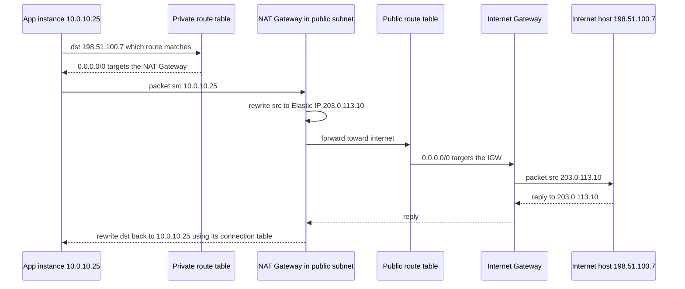
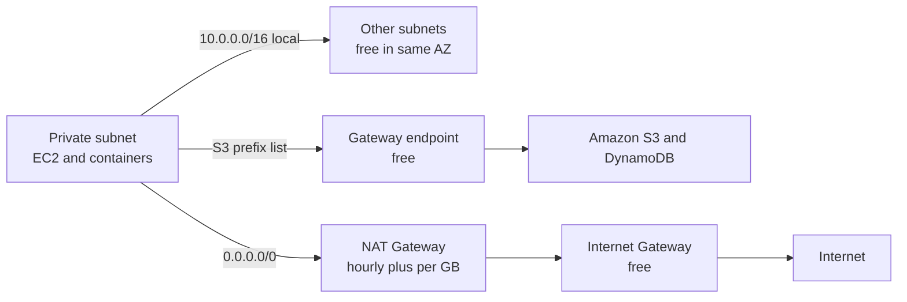

# L6.5 — Route Tables, Internet Gateway and NAT Gateway

> **Level 6: Cloud (AWS)** · Topic 5 of 18 · ⏱ ~5 hours · Difficulty: Intermediate

## 1. What it is

Subnets by themselves are islands. What connects them to each other, to the internet and to AWS services is the
**route table**: a short list of rules of the form "traffic for *this destination range* goes to *this target*". Every
subnet is associated with exactly one route table, and every packet leaving an instance is matched against it using
**longest-prefix match** (the most specific rule wins), exactly as in
[Routing, NAT, Ports and Firewalls](../level-02-networking/04-routing-nat-ports-firewalls.md).

Three targets matter most. The **local** route (always present, cannot be deleted) lets all subnets in the VPC reach
each other. An **Internet Gateway (IGW)** is the doorway between the VPC and the public internet. A **NAT Gateway** lets
instances in *private* subnets start outbound connections to the internet (for package updates, third-party APIs)
without being reachable from it. A fourth family, **VPC endpoints**, gives private subnets a direct path to AWS
services such as S3 without touching the internet at all, which often saves real money.

## 2. Why it matters in DevOps

- **"It can't reach the internet" / "it is reachable and shouldn't be"** are the two most common AWS networking tickets, and both are route-table questions.
- **Cost:** a NAT Gateway is one of the most frequent surprise line items on an AWS bill (an hourly charge per gateway plus a per-GB processing charge on all traffic). Understanding the traffic paths is how you cut it.
- **Security:** the only thing that stops a database subnet from being internet-facing is the absence of a `0.0.0.0/0 -> igw` route. Reviewing routes is a core security audit step.
- **Availability:** a NAT Gateway lives in one AZ. A design with one NAT for three AZs loses outbound access (and pays cross-AZ charges) when that AZ fails.
- **Infrastructure as code:** routes and associations are exactly the resources Terraform modules get wrong when a subnet silently falls back to the VPC's *main* route table ([Providers and Resources](../level-07-terraform-iac/01-providers-and-resources.md)).

## 3. Real-world system example

**Amazon EKS and ECS on private subnets.** The common production pattern for a container platform on AWS is worker
nodes in private subnets, with the load balancer in public subnets. Those private nodes must pull images from Amazon
ECR, send logs to CloudWatch and call AWS APIs. AWS documents two ways: route everything through a NAT Gateway, or use
VPC endpoints (an S3 *gateway* endpoint, because ECR stores image layers in S3, plus *interface* endpoints for ECR,
CloudWatch Logs and STS). Fully private clusters with no NAT at all are a documented, supported setup, and teams use it
both to reduce the NAT bill and to ensure workloads cannot reach arbitrary internet destinations.

The same split applies to `shop-api` on EC2: Nginx behind the ALB in public subnets, the Node.js instances in private
subnets that reach S3 through an endpoint and `registry.npmjs.org` through NAT during deploys.

## 4. Diagram

The path of an outbound request from a private instance, and the return path:



Three exits from a private subnet, and what each costs:



## 5. How it works

**Route table anatomy** (the public table of the `shop-api` VPC):

| Destination | Target | Meaning |
|-------------|--------|---------|
| `10.0.0.0/16` | `local` | Anything inside the VPC stays inside; always present |
| `0.0.0.0/0` | `igw-0abc...` | Everything else goes to the Internet Gateway: this single line makes the subnet "public" |

The private table has `local` plus either `0.0.0.0/0 -> nat-0abc...` (outbound internet through NAT) or nothing (fully isolated).

Rules worth memorising:

- **Longest prefix wins.** `10.0.0.0/16 -> local` beats `0.0.0.0/0 -> nat` for VPC traffic. A more specific route to a peering connection or Transit Gateway beats the default route.
- **Main route table:** every VPC has one, and any subnet without an explicit association silently uses it. Keep the main table *private* (local only) and associate public subnets explicitly, so a forgotten subnet fails closed.
- **One table per subnet, but a table can serve many subnets.** Create one private table **per AZ** if each AZ has its own NAT Gateway.
- **Blackhole:** if a route's target is deleted (a NAT Gateway, a peering connection), the route shows state `blackhole` and traffic is dropped.

**Internet Gateway.** Horizontally scaled, redundant, no bandwidth limit to plan for, and **free**. It attaches to one VPC. For
IPv4 it performs one-to-one NAT between an instance's private address and its public/Elastic IP. For an instance to
reach the internet through the IGW **all four** must be true: the subnet route table has `0.0.0.0/0 -> igw`, the
instance has a public IPv4 (or IPv6) address, the security group allows the traffic, and the network ACL allows it
([next topic](06-security-groups-and-nacls.md)). Missing any one is the classic "I added the route but it still doesn't work".

**NAT Gateway (public).** A managed NAT device you place in a **public subnet** and give an **Elastic IP**. Private
subnets route `0.0.0.0/0` to it; it translates source addresses and tracks connections, so replies come back but no
one on the internet can initiate a connection in. It is zonal, so use one per AZ in production.

| Cost item | Approximate US East (N. Virginia) price at time of writing |
|-----------|-----------------------------------------------------------|
| NAT Gateway hour | about $0.045 per hour per gateway (roughly $33 per month if left running) |
| NAT data processing | about $0.045 per GB, **on top of** normal data transfer charges |
| Elastic IP / public IPv4 | about $0.005 per hour |

Three AZs with one NAT each is roughly $100 per month **before** any traffic. Always check the current pricing page.
Cheaper options: share one NAT across AZs in non-production (accepting the AZ risk and cross-AZ charges); run a NAT
instance (a small EC2 instance doing the translation, used by cost-sensitive teams, you patch and scale it); or avoid
NAT for AWS traffic with endpoints. AWS has also introduced a *regional* NAT gateway mode that spans AZs; read the
current VPC documentation before choosing, since the details have been changing.

**IPv6:** addresses are globally routable, so no NAT. For outbound-only IPv6 access use an **egress-only internet gateway**.

**VPC endpoints** keep traffic to AWS services on the AWS network:

| Type | How it works | Cost | Services |
|------|--------------|------|----------|
| **Gateway endpoint** | Adds a route (to an AWS-managed *prefix list*) in the route tables you choose | **Free** | S3 and DynamoDB only |
| **Interface endpoint** (AWS PrivateLink) | Creates ENIs with private IPs in your subnets; DNS name resolves to them | Roughly $0.01 per hour per AZ plus about $0.01 per GB | most other services (ECR, STS, CloudWatch, SSM, Secrets Manager...) and partner services |

Rule of thumb: **always** create the free S3 gateway endpoint in any VPC that uses S3 heavily, then decide on
interface endpoints by comparing their fixed cost with the NAT data charges they would replace.

## 6. Step-by-step guide

**Prerequisites:** AWS CLI v2, region `us-east-1`, and the VPC from [topic 4](04-vpc-and-subnets.md). If you deleted it,
recreate a minimal version:
```bash
export AWS_DEFAULT_REGION=us-east-1
VPC_ID=$(aws ec2 create-vpc --cidr-block 10.0.0.0/16 \
  --tag-specifications 'ResourceType=vpc,Tags=[{Key=Name,Value=shop-api-vpc}]' --query Vpc.VpcId --output text)
mk() { aws ec2 create-subnet --vpc-id "$VPC_ID" --cidr-block "$2" --availability-zone "$3" \
  --tag-specifications "ResourceType=subnet,Tags=[{Key=Name,Value=shop-api-$1}]" --query Subnet.SubnetId --output text; }
PUB_A=$(mk public-a 10.0.0.0/24 us-east-1a);  PUB_B=$(mk public-b 10.0.1.0/24 us-east-1b)
APP_A=$(mk app-a 10.0.10.0/24 us-east-1a);    APP_B=$(mk app-b 10.0.11.0/24 us-east-1b)
```

**Cost:** steps 1-5 are free (IGW, route tables and gateway endpoints cost nothing). **Step 6 creates a NAT Gateway and
Elastic IP: about 5 cents per hour combined plus data. Do it for under an hour and run the cleanup in step 8.**
Set a billing alarm first (see [EC2 step 1](01-ec2.md) for a budget). LocalStack (`docker run -d --rm -p 4566:4566 localstack/localstack`
and `--endpoint-url http://localhost:4566`) accepts these API calls for practice, but it does not route real packets.

1. **Create and attach an Internet Gateway.**
   ```bash
   IGW_ID=$(aws ec2 create-internet-gateway \
     --tag-specifications 'ResourceType=internet-gateway,Tags=[{Key=Name,Value=shop-api-igw}]' \
     --query InternetGateway.InternetGatewayId --output text)
   aws ec2 attach-internet-gateway --internet-gateway-id "$IGW_ID" --vpc-id "$VPC_ID"
   ```

2. **Create a public route table, add the default route, and associate the public subnets.**
   ```bash
   RT_PUB=$(aws ec2 create-route-table --vpc-id "$VPC_ID" \
     --tag-specifications 'ResourceType=route-table,Tags=[{Key=Name,Value=shop-api-public}]' \
     --query RouteTable.RouteTableId --output text)
   aws ec2 create-route --route-table-id "$RT_PUB" --destination-cidr-block 0.0.0.0/0 --gateway-id "$IGW_ID"
   aws ec2 associate-route-table --route-table-id "$RT_PUB" --subnet-id "$PUB_A"
   aws ec2 associate-route-table --route-table-id "$RT_PUB" --subnet-id "$PUB_B"
   ```
   `create-route` prints `{"Return": true}`.

3. **Create one private route table per AZ** and associate the app subnets (no internet route yet):
   ```bash
   mkrt() { aws ec2 create-route-table --vpc-id "$VPC_ID" \
     --tag-specifications "ResourceType=route-table,Tags=[{Key=Name,Value=shop-api-private-$1}]" \
     --query RouteTable.RouteTableId --output text; }
   RT_PRIV_A=$(mkrt a); RT_PRIV_B=$(mkrt b)
   aws ec2 associate-route-table --route-table-id "$RT_PRIV_A" --subnet-id "$APP_A"
   aws ec2 associate-route-table --route-table-id "$RT_PRIV_B" --subnet-id "$APP_B"
   ```

4. **Inspect every table.** A summary of destination, target and state:
   ```bash
   aws ec2 describe-route-tables --filters "Name=vpc-id,Values=$VPC_ID" \
     --query 'RouteTables[].[Tags[?Key==`Name`]|[0].Value,Routes[].[DestinationCidrBlock,GatewayId,NatGatewayId,State]]' \
     --output json
   ```
   The public table shows `10.0.0.0/16 local` and `0.0.0.0/0 igw-...`. The private tables show only `local`.

5. **Add the free S3 gateway endpoint to the private tables.**
   ```bash
   aws ec2 create-vpc-endpoint --vpc-id "$VPC_ID" --service-name com.amazonaws.us-east-1.s3 \
     --route-table-ids "$RT_PRIV_A" "$RT_PRIV_B" --query VpcEndpoint.VpcEndpointId --output text
   aws ec2 describe-route-tables --route-table-ids "$RT_PRIV_A" \
     --query 'RouteTables[].Routes[].[DestinationCidrBlock,DestinationPrefixListId,GatewayId]' --output table
   ```
   A new route appears with a destination of the form `pl-xxxxxxxx` (the S3 prefix list) and a target `vpce-...`.
   Instances in the private subnets now reach S3 without any internet path.

6. **(Optional, costs money) Add a NAT Gateway for outbound internet from the private subnets.**
   ```bash
   EIP_ALLOC=$(aws ec2 allocate-address --domain vpc --query AllocationId --output text)
   NAT_ID=$(aws ec2 create-nat-gateway --subnet-id "$PUB_A" --allocation-id "$EIP_ALLOC" \
     --query NatGateway.NatGatewayId --output text)
   aws ec2 wait nat-gateway-available --nat-gateway-ids "$NAT_ID"      # about 1-2 minutes
   aws ec2 create-route --route-table-id "$RT_PRIV_A" --destination-cidr-block 0.0.0.0/0 --nat-gateway-id "$NAT_ID"
   ```
   The NAT Gateway sits in the **public** subnet (it needs the IGW route to reach the internet). Only the AZ-a private
   table points at it, which shows the "one NAT per AZ" design (the AZ-b table would need its own NAT).

7. **Verify with a real instance (optional).** Launch a `t3.micro` into `APP_A` with no public IP (see [EC2](01-ec2.md)),
   connect through Session Manager or a bastion, and run `curl -s https://checkip.amazonaws.com`. The address returned
   is the NAT's Elastic IP (`aws ec2 describe-addresses --allocation-ids "$EIP_ALLOC"`). Remove the NAT route
   (`aws ec2 delete-route --route-table-id "$RT_PRIV_A" --destination-cidr-block 0.0.0.0/0`) and the same `curl` hangs.
   Without an instance, the route listing from step 4 is your evidence.

8. **Clean up in dependency order.** Do not skip the NAT Gateway and Elastic IP: they bill by the hour.
   ```bash
   aws ec2 delete-nat-gateway --nat-gateway-id "$NAT_ID"
   until [ "$(aws ec2 describe-nat-gateways --nat-gateway-ids "$NAT_ID" --query 'NatGateways[0].State' --output text)" = deleted ]; do sleep 10; done
   aws ec2 release-address --allocation-id "$EIP_ALLOC"
   # endpoint, IGW, route tables, then subnets and VPC
   VPCE=$(aws ec2 describe-vpc-endpoints --filters "Name=vpc-id,Values=$VPC_ID" --query 'VpcEndpoints[].VpcEndpointId' --output text)
   aws ec2 delete-vpc-endpoints --vpc-endpoint-ids $VPCE
   aws ec2 detach-internet-gateway --internet-gateway-id "$IGW_ID" --vpc-id "$VPC_ID"
   aws ec2 delete-internet-gateway --internet-gateway-id "$IGW_ID"
   for rt in "$RT_PUB" "$RT_PRIV_A" "$RT_PRIV_B"; do
     for a in $(aws ec2 describe-route-tables --route-table-ids "$rt" --query 'RouteTables[0].Associations[].RouteTableAssociationId' --output text); do
       aws ec2 disassociate-route-table --association-id "$a"; done
     aws ec2 delete-route-table --route-table-id "$rt"
   done
   for s in "$PUB_A" "$PUB_B" "$APP_A" "$APP_B"; do aws ec2 delete-subnet --subnet-id "$s"; done
   aws ec2 delete-vpc --vpc-id "$VPC_ID"
   ```
   Finish with `aws ec2 describe-nat-gateways --filter Name=state,Values=available,pending` and
   `aws ec2 describe-addresses`; both should list nothing from this exercise. If you plan to continue to the next topic, keep the VPC, IGW and route tables (all free) but delete the NAT Gateway and Elastic IP.

## 7. Real-world scenario

*Illustrative scenario, not a documented incident.* The `shop-api` team's monthly AWS bill jumps by roughly $1,400 after
they move their nightly report job into private subnets. Cost Explorer filtered by usage type shows `NatGateway-Bytes`
as the new top item. The job reads about 30 TB a month of export files from S3 and writes results back, and every byte
now crosses the NAT Gateway and pays the per-GB processing fee.

**Investigation:** VPC Flow Logs ([CloudWatch](18-cloudwatch.md) or S3 as destination) confirm the destination
addresses are S3 ranges. **Fix:** add the free S3 gateway endpoint to the private route tables. The route for S3's prefix
list is more specific than `0.0.0.0/0`, so traffic shifts immediately with no instance restarts; the next day's NAT bytes
fall by more than 95 percent. **Lesson:** map your traffic to its path. S3 and DynamoDB traffic should never ride a NAT,
and a cost anomaly alert on the NAT usage type would have caught it in a day instead of a month.

## 8. Common mistakes and best practices

**Don't**

- Put `0.0.0.0/0 -> igw` in the main route table (every new subnet becomes public by accident).
- Place a NAT Gateway in a private subnet: it needs a route to the IGW, so it must sit in a public subnet.
- Forget to delete NAT Gateways, Elastic IPs and interface endpoints after a lab; they bill hourly even with zero traffic.
- Assume a route is enough: public IP, security group and NACL must also allow the flow.
- Send S3 or DynamoDB traffic through NAT.

**Do**

- Keep the main route table local-only and associate every subnet explicitly.
- Use one NAT Gateway per AZ in production and one private route table per AZ; accept a single NAT only for dev.
- Add the S3 gateway endpoint to every VPC by default; add interface endpoints where the numbers justify them.
- Use VPC Reachability Analyzer (a small per-analysis charge) or Flow Logs to debug paths instead of guessing.
- Alert on `NatGateway-Bytes` and hourly NAT charges with AWS Budgets or Cost Anomaly Detection.

## 9. Tasks

- [ ] **T1 — Make a subnet public** *(≈30 min, beginner, free)*
  - **Goal:** build the IGW, public route table and associations.
  - **Steps:**
    1. Run steps 1-4 of the guide on your VPC.
    2. Run the `describe-route-tables` query and highlight which line makes the subnet public.
  - **Done when:** the public table shows `0.0.0.0/0 -> igw-...` and both public subnets list it under their associations.

- [ ] **T2 — Add the S3 gateway endpoint and read the route** *(≈20 min, beginner, free)*
  - **Goal:** see that an endpoint is just a route to a prefix list.
  - **Steps:**
    1. Run step 5.
    2. Look up the prefix list with `aws ec2 describe-managed-prefix-lists --filters Name=prefix-list-name,Values=com.amazonaws.us-east-1.s3`.
    3. Explain why this route wins over `0.0.0.0/0` for S3 traffic.
  - **Done when:** you can point at the `pl-` route and state "longest prefix match" as the reason.

- [ ] **T3 — Break it: blackhole and wrong association** *(≈30 min, intermediate, uses NAT for minutes)*
  - **Goal:** recognise the two silent failures.
  - **Steps:**
    1. Do step 6, then `aws ec2 delete-nat-gateway` without removing the route. Inspect the private table.
    2. Disassociate `APP_B` from its private table (`aws ec2 disassociate-route-table --association-id ...`). It now silently uses the VPC's main route table; show that table with `aws ec2 describe-route-tables --filters Name=vpc-id,Values=$VPC_ID Name=association.main,Values=true`. To see the danger, add a temporary `0.0.0.0/0 -> igw` route to the main table and note that `APP_B` is now public.
    3. Repair both.
  - **Done when:** you saw a route with state `blackhole`, explained the implicit main-table association, and restored valid routes (including removing the temporary main-table IGW route).

- [ ] **T4 — Price the NAT before you build it** *(≈30 min, intermediate)*
  - **Goal:** estimate cost like a reviewer.
  - **Steps:**
    1. Using the AWS pricing page, compute the monthly cost of three NAT Gateways plus 2 TB of processing.
    2. Compare with one NAT plus an S3 gateway endpoint when 1.5 TB of that traffic is S3.
    3. Write the numbers and your assumptions.
  - **Done when:** you have two figures, the saving, and a cited pricing page date.

- [ ] **T5 — Automate the public/private network as code** *(≈45 min, advanced)*
  - **Goal:** repeatable routing with correct associations and cleanup.
  - **Steps:**
    1. Extend your `create-vpc.sh` from topic 4 to create the IGW, public and per-AZ private tables, S3 endpoint and an optional `--with-nat` flag.
    2. Make `destroy` reverse everything in the right order (step 8).
  - **Done when:** a create plus destroy cycle with `--with-nat` leaves `describe-nat-gateways` and `describe-addresses` empty.

- [ ] **T6 — Prove it: trace a packet** *(≈30 min, advanced)*
  - **Goal:** explain every hop without notes.
  - **Steps:**
    1. Draw the path of (a) a browser request to a public ALB, (b) an app instance calling `api.stripe.com`, (c) an app instance writing to S3.
    2. For each, name the route table entry used and whether it costs per-GB.
  - **Done when:** your drawing matches the sequence diagram's logic and you can answer "what happens if the NAT's AZ fails?".

## 10. Self-check questions

1. What exactly makes a subnet public?
2. Why must a NAT Gateway sit in a public subnet, and why do private instances not need public IPs?
3. A private instance can reach S3 but not `github.com`. Name two possible causes.
4. Which route wins for `S3 prefix list` versus `0.0.0.0/0`, and why?
5. How can a design with a NAT Gateway still fail when one AZ goes down?

<details>
<summary>Answers</summary>

1. A route `0.0.0.0/0 -> Internet Gateway` in its associated route table (plus public IPs on its instances).
2. The NAT Gateway itself needs a path to the internet through the IGW and an Elastic IP; private instances use the NAT's address so they need none.
3. The private route table has no NAT route (or it is a blackhole), the NAT Gateway was deleted or is in a failed AZ, or security group, NACL or DNS blocks it. S3 works through the gateway endpoint regardless.
4. The prefix-list route wins: longest-prefix match prefers the more specific destination.
5. If a single NAT serves all AZs and its AZ fails, the others lose outbound internet. Use one NAT per AZ with per-AZ route tables.
</details>

## 11. Further reading

- AWS documentation: *Amazon VPC User Guide* (route tables, internet gateways, NAT gateways, gateway endpoints, AWS PrivateLink).
- AWS pricing pages: *Amazon VPC pricing* (NAT Gateway, PrivateLink and public IPv4 charges).
- AWS documentation: *VPC Reachability Analyzer* and *VPC Flow Logs*.
- [Level 20: Network Egress Costs](../level-20-cost-optimization/07-network-egress-costs.md) for the wider cost picture.

<!-- nav -->
---
← Previous: [VPC and Subnets](04-vpc-and-subnets.md) · [Level 6 index](README.md) · Next: [Security Groups and Network ACLs](06-security-groups-and-nacls.md) →
