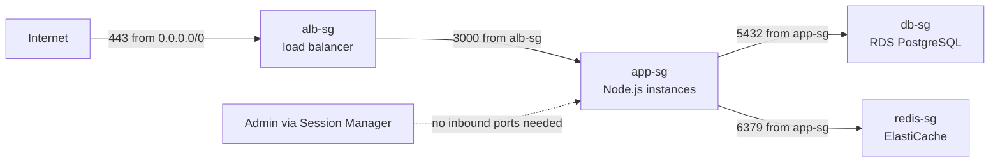
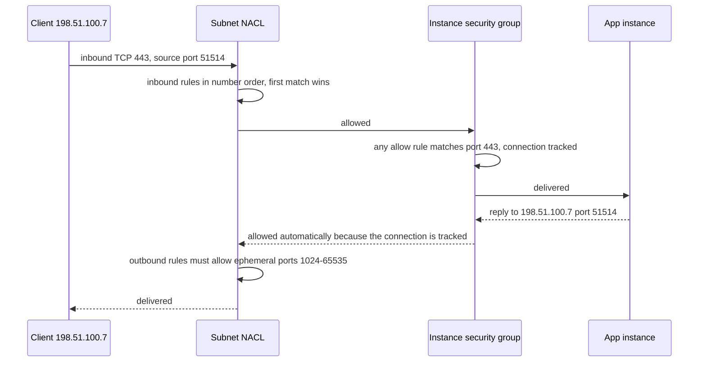

# L6.6 — Security Groups and Network ACLs

> **Level 6: Cloud (AWS)** · Topic 6 of 18 · ⏱ ~5 hours · Difficulty: Intermediate

## 1. What it is

AWS gives you two firewalls inside a VPC. A **Security Group (SG)** is a virtual firewall attached to a network
interface (so, in practice, to an EC2 instance, a load balancer, an RDS database and so on). It is **stateful**: if you
allow a request in, the reply is automatically allowed out, and vice versa. It has only **allow** rules, and everything
not allowed is denied. A **Network ACL (NACL, Network Access Control List)** is a firewall attached to a **subnet**. It
is **stateless**: it judges every packet in each direction separately, so return traffic needs its own rule. It has
numbered **allow and deny** rules evaluated in order.

The most useful trick in the whole topic is **security group referencing**: instead of writing "allow port 5432 from
10.0.10.0/24", you write "allow port 5432 from *the app tier's security group*". The rule then follows the instances as
they scale, get replaced and change IP addresses.

## 2. Why it matters in DevOps

- **Most cloud breaches begin with exposure:** an SSH port, a database or an admin UI open to `0.0.0.0/0`. Security groups are the control that prevents it, and reviewing them is a standard audit step.
- **Debugging connectivity** is mostly "which of the SG, NACL, route table or OS firewall is dropping this?" Knowing stateful versus stateless saves hours of staring at a timeout.
- **Blast radius:** tiered security groups mean a compromised web server cannot talk to the database unless the app tier is also allowed to.
- **Automation:** SG rules are among the most frequently edited resources in Terraform; a rule that references an IP instead of a group becomes stale as soon as autoscaling replaces a host ([Auto Scaling](02-auto-scaling.md)).
- See the security view in [Level 11: Cloud Security Groups and Policies](../level-11-security-devsecops/03-cloud-security-groups-and-policies.md).

## 3. Real-world system example

**The three-tier reference pattern used throughout AWS documentation.** AWS's own guides for Elastic Load Balancing and
RDS recommend this chain: the load balancer's security group accepts HTTPS from the internet; the application
instances' group accepts the app port **only from the load balancer's group**; the database group accepts the database port **only
from the application group**. Amazon EKS follows the same idea: it creates a *cluster security group* that allows the
managed control plane and the worker nodes to talk to each other, and you attach additional groups for your own rules.
Teams at large companies also run automated scanners over all security groups (Netflix open-sourced one early example,
Security Monkey, to flag risky rules; today AWS Config rules and Security Hub do the same job natively).

Our `shop-api` uses exactly this chain, plus a Redis group that only the app tier may reach.

## 4. Diagram

Layered defence for `shop-api`; arrows are the only allowed flows:



Stateful versus stateless on one HTTPS request. The SG remembers the connection; the NACL does not:



## 5. How it works

| | **Security group** | **Network ACL** |
|---|---|---|
| Attached to | Network interface (instance, ALB, RDS, Lambda in VPC...) | Subnet (every subnet has exactly one) |
| State | **Stateful** (return traffic automatic) | **Stateless** (allow both directions yourself) |
| Rule types | Allow only | Allow and deny |
| Evaluation | All rules are evaluated together; any allow permits | Rules in ascending number; first match wins; final `*` rule denies |
| Default for new resource | No inbound; **all outbound** allowed | The default NACL allows everything; a *custom* NACL denies everything until you add rules |
| Sources | CIDR, prefix list or **another security group** | CIDR only |
| Typical use | The main control, per tier | Coarse backstop: block a bad CIDR, subnet-level guardrail |

Details that cause real incidents:

- **Referenced SGs match private IPs.** A rule that allows `app-sg` matches traffic whose *source private IP* belongs to an interface with that group. Traffic that arrives via a public or Elastic IP does not match; use the private address in the connection string.
- **Rules are additive.** An instance can have several security groups (the default limit is five per network interface); the effective policy is the union. A single stray `0.0.0.0/0` rule in any attached group opens it.
- **Removing a rule does not always kill an existing flow.** Tracked connections can persist briefly; do not rely on a rule deletion to cut an active session.
- **Ephemeral ports.** A client connects from a random high port (Linux defaults to 32768-60999; Windows and some NAT devices use others). The usual stateless NACL pattern is to allow outbound TCP `1024-65535` to cover replies.
- **NACLs do not filter everything.** Traffic to the VPC DNS resolver, the instance metadata service and DHCP is not evaluated by NACLs.
- **Quotas** (adjustable): by default 60 inbound and 60 outbound rules per security group and 5 groups per interface.
- **Egress is open by default.** Locking outbound traffic down is a legitimate hardening step for sensitive tiers, but plan for the destinations you need: package mirrors, S3 endpoints, the metadata service (link-local, not filtered by SGs).

**Typical rule sets for `shop-api`**

| SG | Inbound | Why |
|----|---------|-----|
| `alb-sg` | TCP 443 from `0.0.0.0/0` (and 80 for redirect) | Public entry point |
| `app-sg` | TCP 3000 from `alb-sg` | Only the load balancer reaches the app |
| `db-sg` | TCP 5432 from `app-sg` | Only the app reaches PostgreSQL |
| `redis-sg` | TCP 6379 from `app-sg` | Only the app reaches Redis |

For shell access prefer **AWS Systems Manager Session Manager** (needs an instance role and either outbound
internet/NAT or VPC endpoints) over opening port 22. If you must allow SSH, restrict it to your own `/32` and remove it
after use. Compare with host firewalls in [Level 2](../level-02-networking/04-routing-nat-ports-firewalls.md).

## 6. Step-by-step guide

**Prerequisites:** AWS CLI v2, region `us-east-1`, and a VPC (from [topic 4](04-vpc-and-subnets.md); the default VPC works too:
`VPC_ID=$(aws ec2 describe-vpcs --filters Name=is-default,Values=true --query 'Vpcs[0].VpcId' --output text)`).
**Cost:** security groups and NACLs are free. Step 6 optionally launches a `t3.micro` (a few cents per hour); clean up in
step 8. **LocalStack** (`docker run -d --rm -p 4566:4566 localstack/localstack`, add `--endpoint-url http://localhost:4566`)
supports the SG and NACL APIs for rehearsal but does not enforce them on traffic.

1. **Create the four groups.**
   ```bash
   export AWS_DEFAULT_REGION=us-east-1
   sg() { aws ec2 create-security-group --vpc-id "$VPC_ID" --group-name "shop-api-$1" \
          --description "$2" --query GroupId --output text; }
   ALB_SG=$(sg alb   "ALB public entry")
   APP_SG=$(sg app   "Node.js app tier")
   DB_SG=$(sg db     "PostgreSQL")
   REDIS_SG=$(sg redis "Redis")
   echo "$ALB_SG $APP_SG $DB_SG $REDIS_SG"
   ```

2. **Add the rules, referencing groups rather than CIDRs.**
   ```bash
   aws ec2 authorize-security-group-ingress --group-id "$ALB_SG" --protocol tcp --port 443 --cidr 0.0.0.0/0
   aws ec2 authorize-security-group-ingress --group-id "$APP_SG" --protocol tcp --port 3000 --source-group "$ALB_SG"
   aws ec2 authorize-security-group-ingress --group-id "$DB_SG"  --protocol tcp --port 5432 --source-group "$APP_SG"
   aws ec2 authorize-security-group-ingress --group-id "$REDIS_SG" --protocol tcp --port 6379 --source-group "$APP_SG"
   ```
   Each call prints the new rule (`SecurityGroupRules`).

3. **Read the result back.**
   ```bash
   aws ec2 describe-security-group-rules --filters "Name=group-id,Values=$DB_SG" \
     --query 'SecurityGroupRules[].[IsEgress,IpProtocol,FromPort,ToPort,CidrIpv4,ReferencedGroupInfo.GroupId]' --output table
   ```
   You see an inbound TCP 5432 rule whose source is `$APP_SG` (no CIDR) and the default egress-all rule.

4. **Tighten the database group's egress.** A database rarely needs to start outbound connections:
   ```bash
   aws ec2 revoke-security-group-egress --group-id "$DB_SG" \
     --ip-permissions 'IpProtocol=-1,IpRanges=[{CidrIp=0.0.0.0/0}]'
   ```
   Note: RDS managed features (backups, monitoring) use AWS-side paths and do not depend on this rule, but test any
   non-trivial change in a non-production environment first.

5. **Add a stateless NACL for the data subnets and see the ordering rules.** First a model you can run anywhere. This
   toy evaluator mirrors the NACL algorithm (lowest number that matches wins, implicit final deny):
   ```bash
   python3 - <<'EOF'
   import ipaddress
   def evaluate(rules, proto, ip, port):
       for num, action, p, cidr, lo, hi in sorted(rules):
           if p in ("all", proto) and ipaddress.ip_address(ip) in ipaddress.ip_network(cidr) and lo <= port <= hi:
               return f"{action} (rule {num})"
       return "deny (rule *)"
   inbound  = [(100,"allow","tcp","0.0.0.0/0",443,443), (90,"deny","tcp","203.0.113.0/24",0,65535)]
   outbound = [(100,"allow","tcp","0.0.0.0/0",1024,65535)]
   print("in  443 from 198.51.100.7:", evaluate(inbound,"tcp","198.51.100.7",443))
   print("in  443 from 203.0.113.9 :", evaluate(inbound,"tcp","203.0.113.9",443))
   print("in  22  from 198.51.100.7:", evaluate(inbound,"tcp","198.51.100.7",22))
   print("out reply to port 51514  :", evaluate(outbound,"tcp","198.51.100.7",51514))
   print("out reply to port 80     :", evaluate(outbound,"tcp","198.51.100.7",80))
   EOF
   ```
   Expected output:
   ```text
   in  443 from 198.51.100.7: allow (rule 100)
   in  443 from 203.0.113.9 : deny (rule 90)
   in  22  from 198.51.100.7: deny (rule *)
   out reply to port 51514  : allow (rule 100)
   out reply to port 80     : deny (rule *)
   ```
   Rule 90 is evaluated before rule 100, so the denied range loses even though a later rule would allow it.

6. **Create a real custom NACL and attach it** (use a subnet you can afford to break; the default VPC's subnet is fine):
   ```bash
   NACL=$(aws ec2 create-network-acl --vpc-id "$VPC_ID" --query NetworkAcl.NetworkAclId --output text)
   # inbound: HTTPS from anywhere; outbound: ephemeral replies
   aws ec2 create-network-acl-entry --network-acl-id "$NACL" --ingress --rule-number 100 \
     --protocol tcp --port-range From=443,To=443 --cidr-block 0.0.0.0/0 --rule-action allow
   aws ec2 create-network-acl-entry --network-acl-id "$NACL" --egress --rule-number 100 \
     --protocol tcp --port-range From=1024,To=65535 --cidr-block 0.0.0.0/0 --rule-action allow
   ASSOC=$(aws ec2 describe-network-acls --filters "Name=association.subnet-id,Values=$SUBNET_ID" \
     --query 'NetworkAcls[0].Associations[?SubnetId==`'"$SUBNET_ID"'`].NetworkAclAssociationId' --output text)
   aws ec2 replace-network-acl-association --association-id "$ASSOC" --network-acl-id "$NACL"
   ```
   Set `SUBNET_ID` to the chosen subnet first. Any instance in it is now reachable only on 443; SSH, ping and even
   `dnf` downloads on port 80 fail until you add rules. That is the "custom NACL denies everything" default in action.

7. **Restore the original NACL** so you are not locked out:
   ```bash
   DEFAULT_NACL=$(aws ec2 describe-network-acls --filters "Name=vpc-id,Values=$VPC_ID" "Name=default,Values=true" \
     --query 'NetworkAcls[0].NetworkAclId' --output text)
   NEW_ASSOC=$(aws ec2 describe-network-acls --network-acl-ids "$NACL" --query 'NetworkAcls[0].Associations[0].NetworkAclAssociationId' --output text)
   aws ec2 replace-network-acl-association --association-id "$NEW_ASSOC" --network-acl-id "$DEFAULT_NACL"
   ```

8. **Clean up.** Delete the custom NACL, then the groups (a group still referenced by another group cannot be deleted, so
   remove referencing groups first):
   ```bash
   aws ec2 delete-network-acl --network-acl-id "$NACL"
   for g in "$DB_SG" "$REDIS_SG" "$APP_SG" "$ALB_SG"; do aws ec2 delete-security-group --group-id "$g"; done
   ```
   `DependencyViolation` means something still uses the group (an instance, a network interface or another group's rule).
   Terminate any test instance and delete the VPC if you created one just for this topic.

9. **Audit your account for risky rules** (read-only, free). It lists groups open to the world:
   ```bash
   aws ec2 describe-security-group-rules \
     --filters Name=group-id,Values="$APP_SG" --query 'SecurityGroupRules[?CidrIpv4==`0.0.0.0/0` && !IsEgress]'
   aws ec2 describe-security-groups --filters Name=ip-permission.cidr,Values=0.0.0.0/0 \
     --query 'SecurityGroups[].[GroupId,GroupName]' --output table
   ```
   Anything on this list other than a public load balancer on 80/443 needs a justification.

## 7. Real-world scenario

*Illustrative scenario, not a documented incident.* After a deploy, `shop-api` pages start timing out at random. The
database is fine, the app logs show `ETIMEDOUT` connecting to Redis. Nothing changed in the security groups, which is
suspicious. The engineer checks the instance's groups and finds the new Auto Scaling launch template attached
`shop-api-app` correctly, but the Redis group's rule was written months ago as "6379 from 10.0.10.0/24". The new
instances landed in the new `10.0.11.0/24` subnet in the second AZ, which that CIDR does not cover. Half the fleet
works; half cannot reach Redis.

**Fix:** replace the CIDR rule with a reference to `app-sg`, in Terraform, and add a test that connects from each AZ.
**Lesson:** reference groups, not addresses. The rule should describe *who* may connect, not *where* they currently live.

## 8. Common mistakes and best practices

**Don't**

- Open SSH (22), RDP (3389), databases or admin dashboards to `0.0.0.0/0`.
- Use the VPC's *default* security group for workloads; it allows all traffic between members of the group.
- Rely on NACLs as your main control; they are hard to reason about and easy to break with a missing ephemeral-port rule.
- Reuse one big "allow everything internal" group for all tiers.
- Write CIDR rules for traffic that comes from your own instances.

**Do**

- Chain groups by reference: internet to ALB to app to data.
- Name groups by role (`shop-api-app`) and describe every rule (the description field is searchable in audits).
- Prefer Session Manager to inbound SSH; if SSH is required, allow only a specific `/32`.
- Use prefix lists for sets of CIDRs (office ranges, partner ranges) so there is one place to update.
- Keep NACLs at the default or add only coarse deny rules; check rules continuously with AWS Config or Security Hub.

## 9. Tasks

- [ ] **T1 — Build the security-group chain** *(≈30 min, beginner, free)*
  - **Goal:** reproduce the four-group layout using references.
  - **Steps:**
    1. Run guide steps 1-3.
    2. Print each group's rules and underline where a group, not a CIDR, is the source.
  - **Done when:** `db-sg` has exactly one inbound rule whose source is `app-sg`.

- [ ] **T2 — Prove a SG reference works on real instances** *(≈45 min, intermediate, about 10 cents)*
  - **Goal:** show the chain with live traffic.
  - **Steps:**
    1. Launch two `t3.micro` instances (see [EC2](01-ec2.md)): one with `alb-sg` and one with `app-sg`, in the same VPC, no key pair, Session Manager access if your account has an instance profile ready (see [IAM](07-iam.md)).
    2. On the `app-sg` instance run `python3 -m http.server 3000`.
    3. From the `alb-sg` instance run `curl -s -m 5 http://<app-private-ip>:3000/`, then repeat from a third instance with a different group.
    4. Terminate all instances.
  - **Done when:** the call from `alb-sg` returns the directory listing and the call from the unrelated group times out.

- [ ] **T3 — Break it with a NACL and fix it** *(≈30 min, intermediate)*
  - **Goal:** experience stateless filtering.
  - **Steps:**
    1. Do guide steps 6-7 but omit the egress ephemeral rule first.
    2. Observe that connections to port 443 hang even though the SG and inbound NACL allow them.
    3. Add the egress rule 100 and see the connection succeed; restore the default NACL.
  - **Done when:** you can explain, in one sentence, why the reply was dropped and show the rule that fixed it.

- [ ] **T4 — Simulate rule ordering** *(≈20 min, intermediate)*
  - **Goal:** predict NACL decisions.
  - **Steps:**
    1. Save the Python evaluator from step 5 as `nacl.py`.
    2. Add a deny rule numbered 150 for port 443 from `198.51.100.0/24` and predict the result for `198.51.100.7:443` before running.
    3. Renumber the rule to 50 and predict again.
  - **Done when:** both predictions match the script output (rule 100 allows when the deny is 150; the deny wins as rule 50).

- [ ] **T5 — Automate a security-group audit** *(≈45 min, advanced)*
  - **Goal:** a script that fails CI when a world-open sensitive port exists.
  - **Steps:**
    1. Write `audit-sg.sh` that runs `describe-security-groups` with `--query` and exits non-zero if any inbound rule for ports 22, 3389, 5432, 6379 or 3306 has `0.0.0.0/0` or `::/0`.
    2. Test it against a deliberately bad group, then clean up.
    3. Add it to a GitHub Actions workflow with read-only credentials ([Level 5 pipelines](../level-05-cicd/02-github-actions-pipelines.md)).
  - **Done when:** the script exits 1 on the bad group and 0 after you delete it.

- [ ] **T6 — Prove it: design the firewall plan** *(≈30 min, advanced)*
  - **Goal:** defend a layered design without notes.
  - **Steps:**
    1. Without the guide, draw the network for `shop-api` with ALB, app, RDS, Redis and a bastion-free admin path.
    2. Write the security group rules and say what, if anything, you would add as NACL rules and why.
    3. Explain stateful versus stateless using one packet's round trip.
  - **Done when:** a reviewer can find no world-open ports except 443 on the load balancer.

## 10. Self-check questions

1. What does "stateful" mean for a security group, and what extra rules does a NACL need because it is stateless?
2. Why is allowing `app-sg` as a source better than allowing `10.0.10.0/24`?
3. If a security group allows a connection but the NACL has no matching rule, what happens?
4. An instance has two security groups. One allows TCP 22 from `0.0.0.0/0`, the other allows nothing. Is SSH open?
5. When is a NACL the right tool?

<details>
<summary>Answers</summary>

1. The SG remembers accepted connections and allows replies automatically. A NACL needs explicit rules for return traffic, typically outbound ephemeral ports 1024-65535 (and inbound ones for outbound-initiated connections).
2. The reference tracks membership: new or replaced instances are covered immediately, whatever their IP or subnet.
3. The packet is dropped (implicit deny at the end of the NACL). Both must allow it.
4. Yes. Rules are the union across all attached groups.
5. For coarse subnet-wide guardrails such as blocking a hostile CIDR, or when a compliance requirement demands an explicit deny layer.
</details>

## 11. Further reading

- AWS documentation: *Amazon VPC User Guide* (security groups, network ACLs, security group rules).
- AWS documentation: *AWS Systems Manager Session Manager*.
- AWS documentation: *VPC Reachability Analyzer* and *VPC Flow Logs* for debugging.
- *AWS Well-Architected Framework*, Security pillar (infrastructure protection).

<!-- nav -->
---
← Previous: [Route Tables, Internet Gateway and NAT Gateway](05-route-tables-igw-nat.md) · [Level 6 index](README.md) · Next: [IAM](07-iam.md) →
