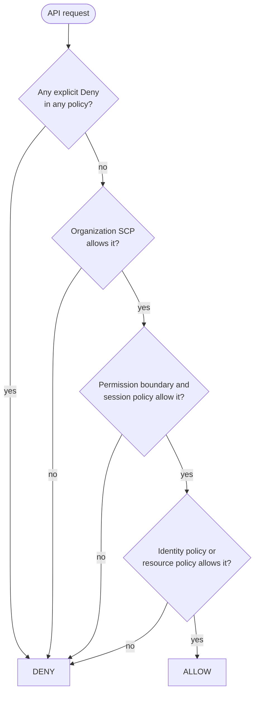
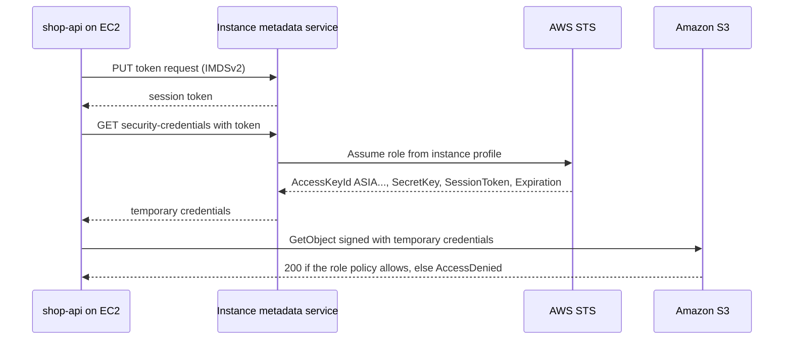

# L6.7 — IAM

> **Level 6: Cloud (AWS)** · Topic 7 of 18 · ⏱ ~6 hours · Difficulty: Intermediate

## 1. What it is

**IAM (Identity and Access Management)** is the AWS service that decides **who** (a *principal*) may do **what**
(an *action*, such as `s3:GetObject`) on **which thing** (a *resource*, identified by an **ARN**, Amazon Resource Name),
and under which *conditions*. Every single AWS API call, from the console, the CLI or your code, is authenticated and
authorized by IAM. IAM itself is free.

The building blocks: **users** (long-lived identities for a person or program, with passwords or access keys),
**groups** (collections of users), **roles** (identities with no permanent credentials that anyone allowed can
*assume* to receive temporary ones) and **policies** (JSON documents that allow or deny actions). A policy attached to an
identity says what it can do; a **trust policy** on a role says who may assume it; a **resource policy** (for example
an S3 bucket policy) says who may touch that resource. Short-lived credentials are issued by the **STS (Security Token
Service)**.

## 2. Why it matters in DevOps

- **It is the real perimeter.** Network controls matter, but nearly every serious cloud incident involves leaked or over-powered credentials. IAM mistakes are how a leaked key becomes a full account takeover.
- **Everything automated needs an identity:** Terraform, CI pipelines, Lambda functions, EC2 instances and Kubernetes pods each need a role with just enough permission ([Level 11: Least-privilege IAM](../level-11-security-devsecops/02-least-privilege-iam.md)).
- **Debugging:** `AccessDenied` is the most frequent error in AWS. Knowing the evaluation logic turns a day of guessing into a ten-minute read of the error and the policies.
- **Cost of mistakes is asymmetric:** an over-broad policy costs nothing until the day it costs everything; static access keys committed to Git are found by bots within minutes.

## 3. Real-world system example

**GitHub Actions deploying to AWS.** Instead of storing long-lived AWS keys as repository secrets, the documented modern
pattern is OpenID Connect (OIDC) federation: AWS IAM trusts GitHub's identity provider
(`token.actions.githubusercontent.com`), the workflow requests a signed token for a specific repository and branch, and
exchanges it with STS (`AssumeRoleWithWebIdentity`) for temporary credentials of a role whose trust policy matches only
that repository. No secret is stored, and credentials expire in an hour or less
([Secrets and Environments](../level-03-git-and-github/12-environments-and-secrets.md)).

Inside AWS, **EC2 instance profiles** and **EKS IAM roles for service accounts** work the same way: the platform
hands the workload short-lived credentials from STS. Netflix has also publicly described and open-sourced tooling (Repokid)
that uses IAM's "last accessed" data to shrink role permissions automatically: least privilege as a continuous process.

## 4. Diagram

How a request is evaluated (simplified from the AWS "policy evaluation logic" documentation):



How an EC2 instance gets credentials with no stored secrets (instance profile and STS):



## 5. How it works

**Identity types**

| Type | Credentials | Use for |
|------|-------------|---------|
| **Root user** | Email + password (+ MFA) | Almost nothing: account setup, billing settings, a few break-glass tasks. Enable MFA, never create root access keys |
| **IAM user** | Password and/or long-lived access keys (`AKIA...`) | Legacy; avoid for humans and workloads |
| **IAM Identity Center user** | SSO login, short-lived CLI credentials | The recommended way for **people**, especially across many accounts |
| **IAM role** | None of its own; temporary keys (`ASIA...`) + session token from STS | EC2, Lambda, ECS/EKS tasks, CI via OIDC, cross-account access, human federation |

**Policy types**

| Policy | Attached to | Effect |
|--------|-------------|--------|
| Identity-based (managed or inline) | user, group, role | Grants permissions |
| Resource-based (S3 bucket policy, KMS key policy, SQS queue policy, role **trust policy**) | the resource | Grants access to named principals, even in other accounts |
| Permissions boundary | user or role | Sets the **maximum** an identity could ever get |
| Service control policy (SCP) | AWS Organizations account or OU | Guardrail for whole accounts; never grants, only limits |
| Session policy | an assumed-role session | Further narrows a single session |

**Anatomy of a policy** (a least-privilege policy for the `shop-api` app role):

```json
{
  "Version": "2012-10-17",
  "Statement": [
    {
      "Sid": "ReadWriteUploads",
      "Effect": "Allow",
      "Action": ["s3:GetObject", "s3:PutObject"],
      "Resource": "arn:aws:s3:::shop-api-assets-<ACCOUNT_ID>/uploads/*"
    },
    {
      "Sid": "ListUploadsPrefix",
      "Effect": "Allow",
      "Action": "s3:ListBucket",
      "Resource": "arn:aws:s3:::shop-api-assets-<ACCOUNT_ID>",
      "Condition": { "StringLike": { "s3:prefix": ["uploads/*"] } }
    }
  ]
}
```

`Effect`, `Action`, `Resource` and optional `Condition` are the four moving parts. Note that object actions use the
object ARN (`bucket/key`) while `s3:ListBucket` uses the bucket ARN, a common source of confusing `AccessDenied` errors.

**Evaluation rules to memorise**

1. **Default deny.** If nothing allows it, it is denied.
2. **Explicit deny always wins**, over any number of allows.
3. **Same account:** an allow in the identity policy *or* in the resource policy is enough (unless a boundary/SCP blocks it).
4. **Cross account:** both sides must allow: the caller's identity policy **and** the target's resource policy (or trusting role).
5. SCPs, permission boundaries and session policies only *restrict*; they never grant.

**Roles in practice**

- A role has a **trust policy** ("who can assume me") and **permission policies** ("what I can do"). Both must be right: a perfect permission policy with the wrong trust policy fails at `AssumeRole`.
- **Instance profile:** the container that passes a role to EC2. The console creates one automatically; the CLI needs `create-instance-profile` and `add-role-to-instance-profile`.
- **STS** operations: `AssumeRole` (cross-account, humans, chaining), `AssumeRoleWithWebIdentity` (OIDC such as GitHub or EKS), `GetCallerIdentity` (who am I?). Default role session lasts one hour; credentials always carry an expiry and a session token.
- **Cross-account to third parties:** use an `ExternalId` condition to prevent the "confused deputy" problem.

**Tools:** `aws sts get-caller-identity` (who am I), IAM **policy simulator** (`aws iam simulate-principal-policy`), **IAM Access Analyzer**
(finds public/cross-account access and can generate a least-privilege policy from [CloudTrail](17-cloudtrail.md) activity),
and **last accessed information** (which services and actions a role actually used) to prune permissions.

## 6. Step-by-step guide

**Prerequisites:** AWS CLI v2 authenticated as an admin-level identity in a **sandbox account** (prefer IAM Identity Center,
`aws configure sso`; do not use root keys). **Cost:** IAM, STS and the simulator are free. Nothing in this guide creates
billable resources. **LocalStack:** the IAM and STS APIs work for practice with `--endpoint-url http://localhost:4566`, but
policy *enforcement* is not part of the free edition, so use real AWS (still free) to see `AccessDenied` for real.

1. **See who you are and your account ID.**
   ```bash
   export AWS_DEFAULT_REGION=us-east-1
   aws sts get-caller-identity
   ACCOUNT_ID=$(aws sts get-caller-identity --query Account --output text)
   ```
   Output: `UserId`, `Account` (12 digits) and `Arn` (for SSO this is an `assumed-role/...` ARN).

2. **Write the permission policy** shown above to a file (replace the placeholder with your account ID):
   ```bash
   cat > shop-api-s3.json <<EOF
   {
     "Version": "2012-10-17",
     "Statement": [
       {"Sid":"ReadWriteUploads","Effect":"Allow","Action":["s3:GetObject","s3:PutObject"],
        "Resource":"arn:aws:s3:::shop-api-assets-${ACCOUNT_ID}/uploads/*"},
       {"Sid":"ListUploadsPrefix","Effect":"Allow","Action":"s3:ListBucket",
        "Resource":"arn:aws:s3:::shop-api-assets-${ACCOUNT_ID}",
        "Condition":{"StringLike":{"s3:prefix":["uploads/*"]}}}
     ]
   }
   EOF
   ```

3. **Create the role with an EC2 trust policy, attach the policy, and make an instance profile.**
   ```bash
   cat > trust-ec2.json <<'EOF'
   {"Version":"2012-10-17","Statement":[{"Effect":"Allow",
     "Principal":{"Service":"ec2.amazonaws.com"},"Action":"sts:AssumeRole"}]}
   EOF
   aws iam create-role --role-name shop-api-app --assume-role-policy-document file://trust-ec2.json
   aws iam put-role-policy --role-name shop-api-app --policy-name s3-uploads --policy-document file://shop-api-s3.json
   aws iam create-instance-profile --instance-profile-name shop-api-app
   aws iam add-role-to-instance-profile --instance-profile-name shop-api-app --role-name shop-api-app
   ```
   You can now pass `--iam-instance-profile Name=shop-api-app` to `aws ec2 run-instances` ([EC2](01-ec2.md)).

4. **Test the permissions without running anything** using the policy simulator:
   ```bash
   ROLE_ARN=arn:aws:iam::${ACCOUNT_ID}:role/shop-api-app
   BUCKET=shop-api-assets-${ACCOUNT_ID}
   aws iam simulate-principal-policy --policy-source-arn "$ROLE_ARN" \
     --action-names s3:GetObject s3:PutObject s3:DeleteObject \
     --resource-arns "arn:aws:s3:::${BUCKET}/uploads/a.png" \
     --query 'EvaluationResults[].[EvalActionName,EvalDecision]' --output table
   ```
   Expected: `s3:GetObject allowed`, `s3:PutObject allowed`, `s3:DeleteObject implicitDeny`. Repeat with the resource
   `arn:aws:s3:::${BUCKET}/private/a.png`; all three are `implicitDeny` because the path is outside `uploads/`.
   (The simulator may take a few seconds after role creation because IAM changes are eventually consistent.)

5. **Practice assuming a role and using temporary credentials.** Create a second role that your own account can assume:
   ```bash
   cat > trust-self.json <<EOF
   {"Version":"2012-10-17","Statement":[{"Effect":"Allow",
     "Principal":{"AWS":"arn:aws:iam::${ACCOUNT_ID}:root"},"Action":"sts:AssumeRole"}]}
   EOF
   aws iam create-role --role-name lab-readonly --assume-role-policy-document file://trust-self.json
   aws iam attach-role-policy --role-name lab-readonly --policy-arn arn:aws:iam::aws:policy/ReadOnlyAccess
   sleep 10
   aws sts assume-role --role-arn arn:aws:iam::${ACCOUNT_ID}:role/lab-readonly \
     --role-session-name lab --query Credentials --output json
   ```
   The output has `AccessKeyId` starting `ASIA`, `SecretAccessKey`, `SessionToken` and `Expiration` about an hour ahead.
   Trusting `:root` of the account means any principal in the account **that also has `sts:AssumeRole` permission**
   may assume the role; that is why it is a lab shortcut, not a production pattern.

6. **Use the credentials, then try something forbidden.**
   ```bash
   eval "$(aws sts assume-role --role-arn arn:aws:iam::${ACCOUNT_ID}:role/lab-readonly --role-session-name lab \
     --query 'Credentials.[AccessKeyId,SecretAccessKey,SessionToken]' --output text |
     awk '{printf "export AWS_ACCESS_KEY_ID=%s AWS_SECRET_ACCESS_KEY=%s AWS_SESSION_TOKEN=%s", $1,$2,$3}')"
   aws sts get-caller-identity                     # Arn now shows assumed-role/lab-readonly/lab
   aws iam create-user --user-name should-fail     # AccessDenied: ReadOnlyAccess does not allow writes
   unset AWS_ACCESS_KEY_ID AWS_SECRET_ACCESS_KEY AWS_SESSION_TOKEN
   ```
   The error reads similar to `User: arn:aws:sts::...:assumed-role/lab-readonly/lab is not authorized to perform: iam:CreateUser ...`.
   Read it carefully: it names the principal, the action and the resource, which is everything you need to fix it.

7. **See an explicit deny beat an allow.** Add a deny and re-run the simulator from step 4:
   ```bash
   aws iam put-role-policy --role-name shop-api-app --policy-name deny-put --policy-document \
   '{"Version":"2012-10-17","Statement":[{"Effect":"Deny","Action":"s3:PutObject","Resource":"*"}]}'
   ```
   `s3:PutObject` now shows `explicitDeny` even though step 3 allowed it. Remove it with
   `aws iam delete-role-policy --role-name shop-api-app --policy-name deny-put`.

8. **Clean up.**
   ```bash
   aws iam remove-role-from-instance-profile --instance-profile-name shop-api-app --role-name shop-api-app
   aws iam delete-instance-profile --instance-profile-name shop-api-app
   aws iam delete-role-policy --role-name shop-api-app --policy-name s3-uploads
   aws iam delete-role --role-name shop-api-app
   aws iam detach-role-policy --role-name lab-readonly --policy-arn arn:aws:iam::aws:policy/ReadOnlyAccess
   aws iam delete-role --role-name lab-readonly
   ```
   If you want to keep `shop-api-app` for the S3 and EC2 labs ([S3](08-s3.md)), skip its deletion; it is free.

## 7. Real-world scenario

*Illustrative scenario, not a documented incident.* A developer pushes a `.env` file containing a `shop-api` IAM user's
access key to a public repository. Within minutes the account's bill alarm fires: dozens of large GPU instances are
running in regions the company has never used. The key belonged to a user with `AdministratorAccess` because "it was
quicker".

**Response:** deactivate the key immediately (`aws iam update-access-key --status Inactive`), review
[CloudTrail](17-cloudtrail.md) for what the key did, terminate the instances, delete anything the attacker created, and
rotate everything it could read. **Prevention:** no IAM users for workloads; the app runs with an instance role limited
to its bucket prefix; CI uses OIDC roles; an SCP denies all regions except `us-east-1` and `eu-west-1`; secret scanning
([Level 11](../level-11-security-devsecops/11-secrets-scanning.md)) blocks the next accidental commit. **Lesson:** the blast radius of a leaked
credential is exactly the permission set attached to it, so the work is making that set tiny and short-lived.

## 8. Common mistakes and best practices

**Don't**

- Use the root user for daily work, or create root access keys.
- Create long-lived access keys for applications, or commit them anywhere.
- Attach `AdministratorAccess` or `"Action": "*", "Resource": "*"` "just to make it work".
- Forget that `Resource: "*"` with `iam:PassRole` or `iam:*` is a privilege-escalation path.
- Trust `:root` of another account or `"Principal": "*"` without strong conditions.

**Do**

- Enable MFA on root and every human; use IAM Identity Center for people.
- Use roles for every workload: instance profiles, task roles, OIDC for CI.
- Start from a narrow policy, iterate on `AccessDenied` messages, then confirm with Access Analyzer or last-accessed data.
- Add conditions (`aws:PrincipalOrgID`, `aws:SourceVpce`, `aws:RequestedRegion`, MFA required) where they fit.
- Put organisation-wide guardrails in SCPs and keep accounts separate (prod, staging, tooling).
- Manage IAM as code so every permission change is reviewed.

## 9. Tasks

- [ ] **T1 — Secure the account basics** *(≈30 min, beginner, free)*
  - **Goal:** remove the standing risks before building.
  - **Steps:**
    1. Confirm MFA is enabled on the root user and that no root access keys exist (**IAM > Security recommendations** or `aws iam get-account-summary`, field `AccountAccessKeysPresent` should be `0`).
    2. Confirm you work through an SSO/role session, not an IAM user key.
    3. Confirm a monthly budget alert exists (see [EC2 step 1](01-ec2.md)); billing alarms are mandatory for this level.
  - **Done when:** `AccountAccessKeysPresent` is `0` and you can name your budget.

- [ ] **T2 — Build the least-privilege app role** *(≈45 min, beginner, free)*
  - **Goal:** an instance role scoped to one prefix of one bucket.
  - **Steps:**
    1. Run guide steps 2-4.
    2. Use the simulator to prove four cases: read in `uploads/`, write in `uploads/`, read in `private/`, delete in `uploads/`.
  - **Done when:** the table shows allowed, allowed, implicitDeny, implicitDeny respectively.

- [ ] **T3 — Assume a role and read the error** *(≈30 min, intermediate, free)*
  - **Goal:** use temporary credentials and learn to read `AccessDenied`.
  - **Steps:**
    1. Run guide steps 5-6.
    2. Copy the full `AccessDenied` message; underline the principal, action and resource.
    3. Fix it by creating a policy that allows exactly that action, retest, then remove it.
  - **Done when:** the forbidden call succeeds only after you add one precise statement.

- [ ] **T4 — Break it: trust policy versus permission policy** *(≈30 min, intermediate)*
  - **Goal:** distinguish the two failure points.
  - **Steps:**
    1. Change `trust-self.json` so the principal is a non-existent account ID and update with `aws iam update-assume-role-policy`.
    2. Run `assume-role` and record the error.
    3. Fix the trust policy; then remove the `ReadOnlyAccess` attachment and show that assuming works but calls fail.
  - **Done when:** you can state which error means "I may not become the role" and which means "the role may not do this".

- [ ] **T5 — Automate a policy lint and design the CI role** *(≈60 min, advanced)*
  - **Goal:** catch wildcards before they merge and design OIDC access.
  - **Steps:**
    1. Write `lint_policy.py` that loads a policy JSON file and exits 1 if any `Allow` statement has `Action` `*`, `service:*` or `Resource` `*`. Test on a good and a bad file.
    2. Draft (do not need to deploy) a role trust policy for GitHub OIDC with `Federated` set to `arn:aws:iam::<ACCOUNT_ID>:oidc-provider/token.actions.githubusercontent.com`, action `sts:AssumeRoleWithWebIdentity`, and a `StringEquals` condition on `token.actions.githubusercontent.com:aud` of `sts.amazonaws.com` and a `StringLike` condition on `...:sub` of `repo:<ORG>/shop-api:ref:refs/heads/main`.
    3. Run the lint script in a GitHub Actions job ([GitHub Actions for CI/CD](../level-05-cicd/02-github-actions-pipelines.md)).
  - **Done when:** the lint job fails on a wildcard policy and passes on a scoped one, and your trust policy limits the role to one repository and branch.

- [ ] **T6 — Prove it: explain a denied request** *(≈30 min, advanced)*
  - **Goal:** teach policy evaluation.
  - **Steps:**
    1. Without notes, draw the evaluation flow and give an example where an identity allow is overridden by (a) an explicit deny, (b) an SCP, (c) a permission boundary.
    2. Explain the difference between a role's trust policy and its permission policy and show where an instance profile fits.
  - **Done when:** a teammate can use your explanation to debug a made-up `AccessDenied`.

## 10. Self-check questions

1. What is the difference between a role's trust policy and its permission policy?
2. If an identity policy allows `s3:GetObject` and a bucket policy denies it, what is the result?
3. Why are role credentials safer than access keys?
4. A cross-account S3 read fails although the caller's role has `s3:GetObject`. What is probably missing?
5. What does an SCP do that an IAM policy cannot?

<details>
<summary>Answers</summary>

1. The trust policy says who may assume the role; the permission policy says what the role can do once assumed.
2. Denied. An explicit deny in any applicable policy overrides every allow.
3. They are temporary (they expire, typically within an hour), are issued automatically by STS and are never stored in code or files.
4. The bucket's resource policy (or the target-account role) must also allow the caller; cross-account access needs both sides.
5. It sets a maximum permission boundary for every identity in an account or OU, including the account's admins, without granting anything itself.
</details>

## 11. Further reading

- AWS documentation: *IAM User Guide* (policy evaluation logic, roles, STS, policy reference).
- AWS documentation: *IAM Access Analyzer* and *Security best practices in IAM*.
- AWS documentation: *AWS IAM Identity Center User Guide*.
- GitHub documentation: *Configuring OpenID Connect in Amazon Web Services*.
- *AWS Well-Architected Framework*, Security pillar (identity and access management).

<!-- nav -->
---
← Previous: [Security Groups and Network ACLs](06-security-groups-and-nacls.md) · [Level 6 index](README.md) · Next: [S3](08-s3.md) →
