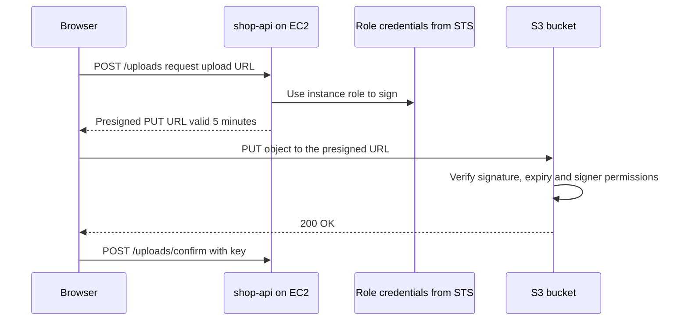
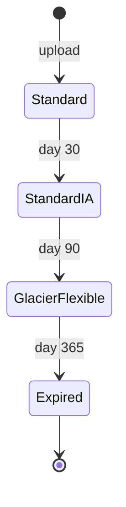

# L6.8 — S3

> **Level 6: Cloud (AWS)** · Topic 8 of 18 · ⏱ ~6 hours · Difficulty: Intermediate

## 1. What it is

**Amazon S3 (Simple Storage Service)** is AWS's **object storage**. You create a **bucket** (a container with a
globally unique name that lives in one region) and put **objects** in it: a blob of bytes up to 5 TB plus metadata,
addressed by a **key** such as `uploads/2026/10/avatar.png`. There are no real directories (the `/` in a key is just
a character that tools display as folders), no file locking, no in-place edits: you write whole objects, read them
back over HTTPS, overwrite them or delete them.

S3 is designed for 99.999999999% (eleven nines) durability by storing data redundantly across multiple Availability
Zones in the region (except the One Zone classes), and offers strong read-after-write consistency: after a successful
write, any read sees the new data. You pay for the gigabytes stored, the requests made and the data transferred out.
S3 is the default place for backups, build artifacts, logs, static websites, user uploads, data lakes and Terraform state.

## 2. Why it matters in DevOps

- **It is everywhere in the platform:** CloudTrail and ALB logs, CloudFront origins, Lambda packages, AMI snapshots' cousins, Terraform remote state ([State and Remote Backends](../level-07-terraform-iac/04-state-and-remote-backends.md)), database backups ([Backups](../level-15-disaster-recovery/01-backups.md)) and container image layers.
- **Security:** misconfigured public buckets have been behind many publicly reported data leaks. Block Public Access, bucket policies and encryption are table stakes.
- **Cost:** storage is cheap but forgotten data, old versions, incomplete multipart uploads, request-heavy workloads and internet egress add up. Lifecycle rules are the cost control ([Storage Lifecycle Policies](../level-20-cost-optimization/06-storage-lifecycle-policies.md)).
- **Reliability:** versioning and replication turn "someone ran `rm -r`" from a disaster into a one-command restore.

## 3. Real-world system example

**Terraform remote state.** The standard AWS backend for Terraform is an S3 bucket with versioning enabled, so every
state change is recoverable. Recent Terraform versions can lock state with a lock file stored in the same bucket (the
S3 backend's `use_lockfile` setting, from Terraform 1.10), replacing the older approach of a separate DynamoDB table
([State Locking](../level-07-terraform-iac/08-state-locking.md)).

**AWS itself eats S3:** CloudTrail delivers audit logs to a bucket, load balancers write access logs to one, and ECR keeps
image layers in S3-backed storage, which is why a private cluster needs an S3 endpoint to pull images
([Route Tables, IGW and NAT](05-route-tables-igw-nat.md)). Dropbox has publicly written that it originally stored file
data on S3 before building its own storage system, an example of how far a single service can carry a product.

For `shop-api`, product images live in `s3://shop-api-assets-<ACCOUNT_ID>/uploads/`, served through CloudFront
([CloudFront](13-cloudfront.md)) and uploaded by browsers directly via presigned URLs.

## 4. Diagram

Direct browser upload using a presigned URL, so file bytes never pass through the API servers:



Lifecycle of storage cost for objects under `logs/`:



## 5. How it works

**Core concepts**

| Concept | What to remember |
|---------|------------------|
| **Bucket** | Name is globally unique across all AWS accounts (3-63 chars, lowercase). Region-specific; data never leaves the region unless you replicate it |
| **Object** | Key + data + metadata (+ tags, + version ID). Max 5 TB; one `PUT` up to 5 GB; use **multipart upload** above ~100 MB (the CLI does it automatically) |
| **Consistency** | Strongly consistent for reads after writes and for listings |
| **Block Public Access** | Four switches at account and bucket level. **On by default for new buckets**, along with ACLs disabled ("bucket owner enforced") |
| **Access control** | IAM policies, **bucket policies** (resource-based, can grant other accounts or enforce rules such as TLS only), and legacy ACLs (avoid) |
| **Versioning** | Keeps every version. A delete adds a **delete marker**; removing the marker restores the object. Cannot be turned off, only suspended |
| **Lifecycle rules** | Automatically transition objects between storage classes, expire current and non-current versions, and abort incomplete multipart uploads |
| **Encryption at rest** | All new objects are encrypted automatically with **SSE-S3** (AES-256, AWS-managed keys). Upgrade to **SSE-KMS** when you need key policies and audit trails ([KMS](15-kms.md)). Always encrypted in transit with HTTPS |
| **Presigned URL** | A URL carrying a signature that grants time-limited access to one object operation with the signer's permissions. Valid up to 7 days when signed by an IAM user, but never longer than the temporary credentials of a role or SSO session that signed it |
| **Static website hosting** | Serves an index page via a **website endpoint** that supports HTTP only and requires public content. For HTTPS and a private bucket, put CloudFront in front with Origin Access Control |

**Storage classes (pick by access pattern)**

| Class | Use for | Notes |
|-------|---------|-------|
| Standard | Frequently accessed data | Default |
| Intelligent-Tiering | Unknown or changing access | Moves objects between tiers automatically for a small monitoring fee |
| Standard-IA / One Zone-IA | Infrequent access, still millisecond | Cheaper storage, per-GB retrieval fee, minimum duration and size charges. One Zone keeps data in a single AZ |
| Glacier Instant / Flexible / Deep Archive | Archives, compliance, backups | Cheapest storage; Flexible takes minutes to hours to retrieve and Deep Archive up to about half a day |

**Approximate cost shape (US East, at time of writing; verify on the pricing page):** Standard storage is a few cents per GB-month
(about $0.023); requests are fractions of a cent per thousand; data in is free; data out to the internet costs roughly
$0.09 per GB after a monthly free allowance; transfer to CloudFront is free. New accounts get a limited S3 allowance in the
free tier, and rules for free-tier accounts changed in 2025, so check **Billing > Free Tier** to see yours.

## 6. Step-by-step guide

**Prerequisites:** AWS CLI v2, a sandbox account, region `us-east-1`. **Cost:** a handful of tiny objects for an hour costs
effectively nothing, but the cleanup in step 9 is mandatory because versioned buckets cannot be deleted while any version
or delete marker exists. **LocalStack** can do everything except real HTTPS/CloudFront behaviour:
`docker run -d --rm -p 4566:4566 localstack/localstack` and add `--endpoint-url http://localhost:4566` (any credentials).

1. **Create a private bucket and inspect the secure defaults.**
   ```bash
   export AWS_DEFAULT_REGION=us-east-1
   ACCOUNT_ID=$(aws sts get-caller-identity --query Account --output text)
   B=shop-api-lab-${ACCOUNT_ID}
   aws s3api create-bucket --bucket "$B"          # in other regions add: --create-bucket-configuration LocationConstraint=<region>
   aws s3api get-public-access-block --bucket "$B"
   aws s3api get-bucket-encryption --bucket "$B"
   ```
   Expect all four Block Public Access flags `true`, and an encryption rule with `SSEAlgorithm` `AES256` (SSE-S3).

2. **Upload, download and list.**
   ```bash
   echo "hello s3 v1" > hello.txt
   aws s3 cp hello.txt "s3://$B/uploads/hello.txt"
   aws s3 ls "s3://$B/uploads/"
   aws s3 cp "s3://$B/uploads/hello.txt" -
   ```
   The last command prints `hello s3 v1`. Try `aws s3api head-object --bucket "$B" --key uploads/hello.txt` and note `ServerSideEncryption`.

3. **Turn on versioning and see a delete marker.**
   ```bash
   aws s3api put-bucket-versioning --bucket "$B" --versioning-configuration Status=Enabled
   echo "hello s3 v2" > hello.txt && aws s3 cp hello.txt "s3://$B/uploads/hello.txt"
   aws s3 rm "s3://$B/uploads/hello.txt"
   aws s3api list-object-versions --bucket "$B" --prefix uploads/hello.txt \
     --query '{Versions:Versions[].[VersionId,IsLatest],Markers:DeleteMarkers[].[VersionId,IsLatest]}'
   ```
   The object has one version from before versioning (`VersionId` `null`), one new version, and a delete marker that is
   the latest. `aws s3 ls` no longer shows the key. Restore it by deleting the marker:
   ```bash
   MARK=$(aws s3api list-object-versions --bucket "$B" --prefix uploads/hello.txt --query 'DeleteMarkers[0].VersionId' --output text)
   aws s3api delete-object --bucket "$B" --key uploads/hello.txt --version-id "$MARK"
   aws s3 cp "s3://$B/uploads/hello.txt" -        # prints hello s3 v2 again
   ```

4. **Enforce TLS with a bucket policy.**
   ```bash
   cat > policy.json <<EOF
   {"Version":"2012-10-17","Statement":[{"Sid":"DenyInsecureTransport","Effect":"Deny","Principal":"*",
     "Action":"s3:*","Resource":["arn:aws:s3:::${B}","arn:aws:s3:::${B}/*"],
     "Condition":{"Bool":{"aws:SecureTransport":"false"}}}]}
   EOF
   aws s3api put-bucket-policy --bucket "$B" --policy file://policy.json
   ```
   The CLI uses HTTPS, so it keeps working; a plain `http://` request would be denied. This is a Deny, so it overrides any
   allow elsewhere (see [IAM](07-iam.md)).

5. **Add a lifecycle rule** (tiering, expiry, cleanup of old versions and abandoned multipart uploads):
   ```bash
   cat > lifecycle.json <<'EOF'
   {"Rules":[{"ID":"logs-tiering","Status":"Enabled","Filter":{"Prefix":"logs/"},
     "Transitions":[{"Days":30,"StorageClass":"STANDARD_IA"},{"Days":90,"StorageClass":"GLACIER"}],
     "Expiration":{"Days":365},
     "NoncurrentVersionExpiration":{"NoncurrentDays":30},
     "AbortIncompleteMultipartUpload":{"DaysAfterInitiation":7}}]}
   EOF
   aws s3api put-bucket-lifecycle-configuration --bucket "$B" --lifecycle-configuration file://lifecycle.json
   aws s3api get-bucket-lifecycle-configuration --bucket "$B" --query 'Rules[].ID'
   ```
   Lifecycle actions run asynchronously, typically at midnight UTC, so you will not see transitions in this session.

6. **Generate presigned URLs.** For reading (CLI):
   ```bash
   URL=$(aws s3 presign "s3://$B/uploads/hello.txt" --expires-in 60)
   curl -s "$URL"                  # prints the object even though the bucket is private
   sleep 65; curl -s "$URL" | head -3
   ```
   The second request returns an XML `AccessDenied` error with message `Request has expired`. For uploading, sign a `PUT`
   with an SDK (the CLI only presigns downloads). Install `pip install boto3` and run:
   ```bash
   python3 - <<EOF
   import boto3
   s3 = boto3.client("s3", region_name="us-east-1")
   url = s3.generate_presigned_url("put_object",
         Params={"Bucket": "$B", "Key": "uploads/from-browser.txt", "ContentType": "text/plain"}, ExpiresIn=300)
   print(url)
   EOF
   ```
   Then upload with `curl -X PUT -H "Content-Type: text/plain" --data "uploaded via presigned URL" "<that URL>"`. The `Content-Type` must match what was
   signed. Check with `aws s3 ls "s3://$B/uploads/"`.

7. **Host a static website (sandbox only).** Use a separate bucket, because this one must be public:
   ```bash
   W=shop-api-site-${ACCOUNT_ID}
   aws s3api create-bucket --bucket "$W"
   aws s3api put-public-access-block --bucket "$W" --public-access-block-configuration \
     BlockPublicAcls=true,IgnorePublicAcls=true,BlockPublicPolicy=false,RestrictPublicBuckets=false
   aws s3api put-bucket-website --bucket "$W" --website-configuration '{"IndexDocument":{"Suffix":"index.html"}}'
   aws s3api put-bucket-policy --bucket "$W" --policy "{\"Version\":\"2012-10-17\",\"Statement\":[{\"Sid\":\"PublicRead\",\"Effect\":\"Allow\",\"Principal\":\"*\",\"Action\":\"s3:GetObject\",\"Resource\":\"arn:aws:s3:::${W}/*\"}]}"
   echo '<h1>shop-api status: ok</h1>' > index.html
   aws s3 cp index.html "s3://$W/index.html" --content-type text/html
   curl -s "http://${W}.s3-website-us-east-1.amazonaws.com/"
   ```
   You should see the `<h1>` line. Note this endpoint speaks HTTP only. In production, keep the bucket **private**, put
   [CloudFront](13-cloudfront.md) in front with Origin Access Control for HTTPS, caching and a custom domain
   ([Route 53](12-route-53.md)).

8. **(Optional) Inspect request cost drivers.** Count what you did: a few PUT/GET/LIST requests. At a few tenths of a cent per
   thousand requests, this lab costs a tiny fraction of a cent; a service doing millions of tiny GETs per day is where request charges matter.

9. **Clean up.** Versioned buckets must be emptied of all versions and delete markers first:
   ```bash
   empty() {
     for key in Versions DeleteMarkers; do
       aws s3api list-object-versions --bucket "$1" --query "${key}[].{Key:Key,VersionId:VersionId}" --output json |
       jq -c 'if . == null then empty else . end | . as $a | range(0; length; 1000) | {Objects: $a[.:.+1000], Quiet: true}' |
       while read -r batch; do aws s3api delete-objects --bucket "$1" --delete "$batch" >/dev/null; done
     done
   }
   empty "$B"; aws s3api delete-bucket --bucket "$B"
   aws s3 rm "s3://$W" --recursive; aws s3api delete-bucket --bucket "$W"
   aws s3api list-buckets --query 'Buckets[].Name'
   ```
   (`jq` is required; the helper sends batches of 1,000, the API limit. Alternatively use the
   console's **Empty** button.) The list at the end must not contain either lab bucket.

## 7. Real-world scenario

*Illustrative scenario, not a documented incident.* A `shop-api` engineer runs a cleanup script with the wrong prefix and
deletes the `uploads/` folder of 40,000 product images. Customers see broken images within minutes. Because versioning
was enabled when the bucket was created, nothing is actually gone: each object has a delete marker on top. The team
lists delete markers under the prefix and removes them in a batch; images return as the CloudFront cache is
refreshed. The whole recovery takes under an hour.

**Follow-ups:** MFA Delete and a restrictive bucket policy for bulk deletes, S3 Cross-Region Replication to a second
region for the "region disappeared" case ([Disaster Recovery](../level-00-what-devops-is/09-disaster-recovery.md)), a
`NoncurrentVersionExpiration` rule to keep the extra versions from growing forever, and an alarm on deletion-request
metrics. **Lesson:** versioning is cheap insurance; turn it on before you need it.

## 8. Common mistakes and best practices

**Don't**

- Make a bucket public to "quickly share" a file; use a presigned URL or CloudFront.
- Put secrets, `.env` files or database dumps in a bucket with broad read access.
- Use S3 like a filesystem for small, frequently updated files (no atomic rename, no locking).
- Leave versioned buckets without a non-current-version expiry rule (silent cost growth).
- Forget that bucket names are public: do not embed secrets or customer names in them.

**Do**

- Keep **Block Public Access** on at the account level and open exceptions deliberately.
- Enable **versioning** on anything you cannot regenerate; add lifecycle rules for tiering, expiry and multipart cleanup.
- Use bucket policies for guardrails (TLS only, specific VPC endpoint, organisation only) and IAM roles for access, never access keys in code.
- Use SSE-KMS where you need key-level audit or separation, and a bucket key to reduce KMS request cost.
- Enable access logging or CloudTrail data events for sensitive buckets ([CloudTrail](17-cloudtrail.md)).
- Prefer CloudFront with Origin Access Control to the S3 website endpoint.

## 9. Tasks

- [ ] **T1 — Create a private, encrypted bucket and prove the defaults** *(≈20 min, beginner, free)*
  - **Goal:** see Block Public Access and default encryption.
  - **Steps:**
    1. Run guide step 1 and step 2.
    2. Try `curl -I https://$B.s3.amazonaws.com/uploads/hello.txt` and note the status.
  - **Done when:** Block Public Access shows four `true` values, `head-object` reports `ServerSideEncryption`, and the anonymous `curl` returns 403.

- [ ] **T2 — Delete and recover with versioning** *(≈30 min, beginner)*
  - **Goal:** recover an object after deletion.
  - **Steps:**
    1. Run guide step 3.
    2. Now overwrite the object three times; use `list-object-versions` to download version 2 by `--version-id` with `aws s3api get-object`.
  - **Done when:** you retrieved the content of an older version and restored a deleted object.

- [ ] **T3 — Presign, expire, and break it** *(≈30 min, intermediate)*
  - **Goal:** understand what a presigned URL actually grants.
  - **Steps:**
    1. Generate a 60-second download URL and a 300-second upload URL (guide step 6).
    2. Test them before and after expiry.
    3. Change the `Content-Type` in the upload request and observe the `SignatureDoesNotMatch` error.
    4. Use `aws sts get-caller-identity` to note who signed; then explain why a URL signed by a role session dies when the session does.
  - **Done when:** you have seen both an `AccessDenied` (expired) and a `SignatureDoesNotMatch` and can explain each.

- [ ] **T4 — Lifecycle and cost plan** *(≈40 min, intermediate)*
  - **Goal:** turn an access pattern into a rule set.
  - **Steps:**
    1. Take `shop-api` logs (written daily, read for 7 days, kept for a year for audit) and write a lifecycle JSON using the right transitions and expiry.
    2. Apply it to the lab bucket under prefix `logs/` and read it back.
    3. Estimate monthly storage cost for 500 GB/month ingestion using the pricing page and compare Standard-only versus tiered.
  - **Done when:** `get-bucket-lifecycle-configuration` returns your rule and you have a two-column cost comparison with assumptions.

- [ ] **T5 — Automate: private site with CloudFront or a TLS-only audit** *(≈60 min, advanced)*
  - **Goal:** secure delivery as code.
  - **Steps:**
    1. Write a script that loops over all your buckets and reports any without Block Public Access, default encryption or a TLS-deny policy.
    2. Or deploy the static site behind CloudFront with Origin Access Control after finishing [CloudFront](13-cloudfront.md), with the bucket fully private.
  - **Done when:** the audit lists your lab bucket as compliant (or a `curl https://<cloudfront-domain>/` returns the page while the direct S3 URL returns 403).

- [ ] **T6 — Prove it: design an upload flow** *(≈30 min, advanced)*
  - **Goal:** justify an S3 design.
  - **Steps:**
    1. Without notes, sketch how `shop-api` should accept 5 MB image uploads and serve them globally, naming bucket settings, IAM, presigned URLs, lifecycle and the CDN.
    2. State what happens when the user deletes an image and what recovers it.
  - **Done when:** your design has no public bucket, no long-lived keys and a recovery story, and a teammate agrees.

## 10. Self-check questions

1. Why is S3 not a filesystem? Name two things you cannot do.
2. A user deletes an object in a versioned bucket. Is the data gone? How do you bring it back?
3. What does a presigned URL grant, and what limits its lifetime?
4. Why prefer CloudFront with OAC over the S3 website endpoint?
5. A bucket cannot be deleted. Name two likely reasons.

<details>
<summary>Answers</summary>

1. No real directories, no append or in-place edits, no file locking, no atomic rename; objects are written whole.
2. Not gone: a delete marker hides it. Delete the marker (or fetch/copy a specific version) to restore.
3. Time-limited access to one operation on one object, with the signer's permissions; it expires at its set time or when the signer's temporary credentials expire, whichever is earlier.
4. The website endpoint is HTTP only and needs a public bucket; CloudFront gives HTTPS, caching, custom domains and keeps the bucket private.
5. It still contains objects, old versions or delete markers (versioning), or incomplete multipart uploads/replication settings still reference it.
</details>

## 11. Further reading

- AWS documentation: *Amazon S3 User Guide* (buckets, versioning, lifecycle, bucket policies, presigned URLs, storage classes).
- AWS pricing page: *Amazon S3 pricing* for current numbers.
- AWS documentation: *Security best practices for Amazon S3*.
- Terraform documentation: *S3 backend* (state storage and locking).

<!-- nav -->
---
← Previous: [IAM](07-iam.md) · [Level 6 index](README.md) · Next: [EBS and EFS](09-ebs-and-efs.md) →
