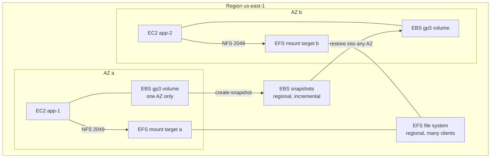
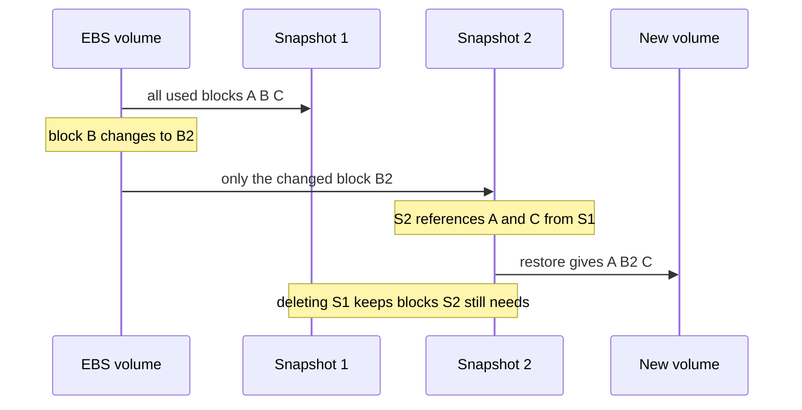

# L6.9 — EBS and EFS

> **Level 6: Cloud (AWS)** · Topic 9 of 18 · ⏱ ~5 hours · Difficulty: Intermediate

## 1. What it is

**Amazon EBS (Elastic Block Store)** gives an EC2 instance a virtual hard disk. It is **block storage**: the instance sees
a raw device (such as `/dev/nvme1n1`), puts a filesystem like `xfs` or `ext4` on it and mounts it. An EBS volume is
network-attached, lives in **one Availability Zone**, survives instance stop and (for non-root volumes) termination,
and is normally attached to **one instance at a time**. Your instance's root disk is an EBS volume too.

**Amazon EFS (Elastic File System)** is a managed **file storage** service: an NFS (Network File System, version 4.1)
share that many Linux instances, containers or Lambda functions mount **at the same time**, across multiple AZs. It
grows and shrinks automatically, so you never provision capacity. Where EBS is "a disk for one server", EFS is "a shared
folder for a fleet". (Object storage, the third kind, is [S3](08-s3.md).)

## 2. Why it matters in DevOps

- **Data lives or dies here.** Databases you run yourself, queues, Prometheus and Elasticsearch data all sit on EBS. A wrong volume type is a performance incident; a missing snapshot is a data-loss incident ([Backups](../level-15-disaster-recovery/01-backups.md), [Snapshots](../level-15-disaster-recovery/03-snapshots.md)).
- **Cost:** unattached ("available") volumes, orphaned snapshots and over-provisioned IOPS silently bill every hour. `gp2` to `gp3` is one of the easiest savings in AWS.
- **Scaling:** autoscaled fleets cannot share an EBS volume; shared state needs EFS, S3 or a database ([Auto Scaling](02-auto-scaling.md)).
- **Kubernetes:** PersistentVolumes on AWS are EBS (single-node, `ReadWriteOnce`) or EFS (shared, `ReadWriteMany`) ([Volumes, PV and PVC](../level-08-kubernetes/09-volumes-pv-pvc.md)).
- **Recovery time:** restoring from a snapshot has a "first read is slow" behaviour that decides whether your RTO is five minutes or an hour.

## 3. Real-world system example

**Amazon RDS for PostgreSQL and MySQL** store database files on EBS volumes managed for you: when you choose "gp3,
200 GB, 6000 IOPS" or "io2" in the RDS console, you are choosing an EBS volume type, and RDS snapshots are EBS snapshots
under the hood ([RDS and Aurora](10-rds-and-aurora.md)). Aurora instead uses its own distributed storage layer.

**Kubernetes on EKS** uses the AWS EBS CSI driver to turn a `PersistentVolumeClaim` into an EBS volume attached to
whichever node the Pod lands on, and the AWS EFS CSI driver for volumes shared across Pods and nodes, such as a shared
media directory. A WordPress fleet is the classic EFS use case: many web servers must see the same `wp-content/uploads`.

For `shop-api`, the PostgreSQL data lives on RDS (so EBS under the hood), Redis on ElastiCache, uploads on S3,
and EBS appears as instance root volumes plus an optional data volume; EFS is only needed if several app servers must share files.

## 4. Diagram

Where the data lives:



Snapshots are incremental: the second snapshot stores only blocks changed since the first, yet each is independently restorable:



## 5. How it works

**EBS volume types** (check the documentation for current limits and prices):

| Type | Medium | Best for | Notes |
|------|--------|----------|-------|
| **gp3** | SSD | The default for almost everything: boot disks, app data, small and mid databases | Baseline **3,000 IOPS and 125 MiB/s included at any size**; raise IOPS and throughput independently of size at extra cost. About 20% cheaper per GB than gp2 |
| gp2 | SSD | Legacy | IOPS tied to size (3 per GB) with burst credits; migrate to gp3 with a live `modify-volume` |
| **io2** (Block Express) | SSD | Latency-sensitive, IO-heavy databases | Provisioned IOPS, highest durability class and performance; costs most; supports Multi-Attach to several Nitro instances in one AZ |
| io1 | SSD | Older provisioned-IOPS | Prefer io2 |
| **st1** | HDD | Large sequential throughput: logs, data warehouses, Kafka-like streams | Cannot be a boot volume |
| **sc1** | HDD | Cold, infrequently read data | Cheapest EBS; cannot be a boot volume |

Remember the shape: **IOPS** (operations per second) matters for random reads and writes such as databases;
**throughput** (MiB/s) matters for large sequential reads such as analytics. Instance types also cap EBS performance,
so a fast volume on a small instance is bottlenecked by the instance ([EC2](01-ec2.md)).

**Other EBS facts**

- **Snapshots** are incremental, stored durably by AWS (in S3-managed storage you cannot browse), regional, copyable across regions and accounts, and by default **crash-consistent** (like pulling the power, so freeze or stop writes for application-consistent copies of databases). Automate them with **Amazon Data Lifecycle Manager (DLM)** or AWS Backup. Snapshot storage is billed per GB-month for the stored blocks.
- **Restore is lazy:** a volume created from a snapshot is usable immediately, but blocks are fetched on first read, so the first pass is slow. **Fast Snapshot Restore** or pre-reading with `fio`/`dd` avoids this for time-critical restores.
- **Elastic Volumes:** change size, type, IOPS and throughput while attached. Sizes only grow, never shrink, and after a change you must also grow the partition and filesystem. There is a cooling-off period of about six hours before the next modification.
- **Encryption:** AES-256 with [KMS](15-kms.md) keys, no meaningful performance penalty on current instances. Turn on **EBS encryption by default** per region so every new volume and snapshot-copy is encrypted.
- **DeleteOnTermination:** true for the root volume, false for extra volumes by default. Check it for any volume holding data.
- **Instance store** (physical disks on the host in `i`/`d` instance types) is faster but **ephemeral**: it is lost when the instance stops or fails.
- **Multi-AZ:** an EBS volume is not. For cross-AZ protection use snapshots, replication at the application layer, or EFS/S3/RDS.

**EFS essentials**

| Item | Detail |
|------|--------|
| Protocol | NFSv4.1 over TCP **2049**; Linux only (use FSx for Windows or FSx for NetApp ONTAP for Windows and multi-protocol needs) |
| Availability | A regional file system stores data across multiple AZs; you create one **mount target** (an ENI with an IP) per AZ. **One Zone** file systems are cheaper and live in one AZ |
| Access control | Security group on the mount target (allow 2049 from your app SG, see [Security Groups](06-security-groups-and-nacls.md)), IAM and **access points** (per-application root directory and POSIX identity) |
| Throughput | **Elastic** (default; scales automatically, pay per use), Provisioned, or Bursting. Performance mode: General Purpose for almost everything |
| Storage classes | Standard, Infrequent Access and Archive, moved by lifecycle policy; One Zone variants exist |
| Cost shape | Roughly ten times the per-GB price of EBS gp3 for Standard storage (about $0.30 per GB-month in US East at time of writing), plus elastic throughput charges; IA is far cheaper |
| Encryption | At rest with KMS (set `--encrypted` on creation) and in transit with the mount helper's `tls` option |

**EBS vs EFS vs S3 vs instance store**

| | EBS | EFS | S3 | Instance store |
|---|---|---|---|---|
| Type | Block | File (NFS) | Object (HTTP API) | Block (local) |
| Shared by many clients | No (Multi-Attach is niche) | **Yes** | **Yes** | No |
| Scope | One AZ | Region (multi-AZ) | Region | One host |
| Latency | Lowest of the networked options | Low (ms) | Higher (tens of ms) | Lowest |
| Capacity | Provisioned, grow only | Elastic | Unlimited | Fixed by instance |
| Typical use | Databases, boot disks | Shared content, CMS, ML datasets, home dirs | Uploads, backups, logs, static files | Caches, scratch |

## 6. Step-by-step guide

**Prerequisites:** AWS CLI v2, region `us-east-1`, a running `t3.micro` Amazon Linux 2023 instance in a subnet with the
AZ you will use (create one following [EC2](01-ec2.md); Session Manager or SSH both work). Set:
```bash
export AWS_DEFAULT_REGION=us-east-1
INSTANCE_ID=i-0123456789abcdef0        # replace with yours
AZ=$(aws ec2 describe-instances --instance-ids "$INSTANCE_ID" --query 'Reservations[0].Instances[0].Placement.AvailabilityZone' --output text)
```
**Cost:** an 8 GiB gp3 volume is under a dollar per month (cents for this lab), snapshots about $0.05 per GB-month, EFS a few
cents for tiny data, and the `t3.micro` roughly a cent an hour. **Run the cleanup in step 9.** LocalStack mocks the EBS
volume and snapshot APIs only (no real block device, so you cannot format or mount); EFS needs LocalStack's paid tier.

1. **Create and attach a gp3 volume** in the same AZ as the instance:
   ```bash
   VOL=$(aws ec2 create-volume --availability-zone "$AZ" --size 8 --volume-type gp3 --encrypted \
     --tag-specifications 'ResourceType=volume,Tags=[{Key=Name,Value=shop-api-data}]' --query VolumeId --output text)
   aws ec2 wait volume-available --volume-ids "$VOL"
   aws ec2 attach-volume --volume-id "$VOL" --instance-id "$INSTANCE_ID" --device /dev/sdf
   ```
   The state goes `creating` then `available`, then `in-use` once attached.

2. **On the instance: find, format and mount it.** On Nitro instances the device appears as an NVMe name, not `/dev/sdf`:
   ```bash
   lsblk -o NAME,SIZE,TYPE,MOUNTPOINT,SERIAL
   ```
   Similar to: `nvme0n1 8G disk` (root, with partitions) and `nvme1n1 8G disk` with serial `vol0123456789abcdef` (your volume ID without the dash). Use that new disk:
   ```bash
   sudo mkfs -t xfs /dev/nvme1n1
   sudo mkdir -p /data && sudo mount /dev/nvme1n1 /data
   echo "snapshot me" | sudo tee /data/hello.txt
   df -h /data
   ```
   Always confirm it is the empty disk (`lsblk`, no filesystem) before running `mkfs`; it erases whatever is there.

3. **Make the mount survive reboots, safely.** Use the UUID and `nofail` so a missing volume does not hang boot:
   ```bash
   UUID=$(sudo blkid -s UUID -o value /dev/nvme1n1)
   echo "UUID=$UUID /data xfs defaults,nofail 0 2" | sudo tee -a /etc/fstab
   sudo umount /data && sudo mount -a && df -h /data
   ```
   `mount -a` succeeding is your proof the fstab line is valid; a bad line can otherwise stop the next boot.

4. **Take a snapshot** (from your laptop):
   ```bash
   SNAP=$(aws ec2 create-snapshot --volume-id "$VOL" --description "shop-api-data lab" \
     --tag-specifications 'ResourceType=snapshot,Tags=[{Key=Name,Value=shop-api-data-1}]' --query SnapshotId --output text)
   aws ec2 wait snapshot-completed --snapshot-ids "$SNAP"
   aws ec2 describe-snapshots --snapshot-ids "$SNAP" --query 'Snapshots[0].[State,VolumeSize,Encrypted]'
   ```
   Expect `completed`, `8`, `true`. The snapshot is crash-consistent; for a real database you would flush/freeze first.

5. **Restore into a new volume and mount the clone.** Restores can target any AZ in the region:
   ```bash
   VOL2=$(aws ec2 create-volume --availability-zone "$AZ" --snapshot-id "$SNAP" --volume-type gp3 --query VolumeId --output text)
   aws ec2 wait volume-available --volume-ids "$VOL2"
   aws ec2 attach-volume --volume-id "$VOL2" --instance-id "$INSTANCE_ID" --device /dev/sdg
   ```
   On the instance:
   ```bash
   sudo mkdir -p /restore && sudo mount /dev/nvme2n1 /restore       # fails: duplicate XFS UUID
   sudo mount -o nouuid /dev/nvme2n1 /restore && cat /restore/hello.txt
   ```
   The first mount fails (similar to `wrong fs type, bad option, bad superblock` and a kernel message about duplicate UUID)
   because XFS refuses two filesystems with the same UUID; `-o nouuid` is the standard workaround for a cloned volume.
   `cat` prints `snapshot me`.

6. **Grow the live volume.**
   ```bash
   aws ec2 modify-volume --volume-id "$VOL" --size 12
   aws ec2 describe-volumes-modifications --volume-ids "$VOL" --query 'VolumesModifications[0].ModificationState'
   ```
   Wait for `optimizing` (the new size is usable then), and on the instance:
   ```bash
   lsblk /dev/nvme1n1            # device now 12G, filesystem still 8G
   sudo xfs_growfs -d /data      # for ext4 use: sudo resize2fs /dev/nvme1n1
   df -h /data                   # now about 12G
   ```
   Because this filesystem sits directly on the device there is no partition to grow first; for a partitioned disk run `sudo growpart /dev/nvme0n1 1` before resizing.

7. **Create an EFS file system and mount it.** First allow NFS from the instance's security group to the mount target's:
   ```bash
   SUBNET_ID=$(aws ec2 describe-instances --instance-ids "$INSTANCE_ID" --query 'Reservations[0].Instances[0].SubnetId' --output text)
   VPC_ID=$(aws ec2 describe-instances --instance-ids "$INSTANCE_ID" --query 'Reservations[0].Instances[0].VpcId' --output text)
   INST_SG=$(aws ec2 describe-instances --instance-ids "$INSTANCE_ID" --query 'Reservations[0].Instances[0].SecurityGroups[0].GroupId' --output text)
   EFS_SG=$(aws ec2 create-security-group --group-name shop-api-efs --description "EFS NFS" --vpc-id "$VPC_ID" --query GroupId --output text)
   aws ec2 authorize-security-group-ingress --group-id "$EFS_SG" --protocol tcp --port 2049 --source-group "$INST_SG"
   FS=$(aws efs create-file-system --encrypted --performance-mode generalPurpose --throughput-mode elastic \
     --tags Key=Name,Value=shop-api-efs --query FileSystemId --output text)
   until [ "$(aws efs describe-file-systems --file-system-id "$FS" --query 'FileSystems[0].LifeCycleState' --output text)" = available ]; do sleep 5; done
   aws efs create-mount-target --file-system-id "$FS" --subnet-id "$SUBNET_ID" --security-groups "$EFS_SG"
   ```
   Wait until `aws efs describe-mount-targets --file-system-id "$FS" --query 'MountTargets[0].LifeCycleState'` says `available`, then on the instance:
   ```bash
   sudo dnf install -y amazon-efs-utils
   sudo mkdir -p /mnt/efs && sudo mount -t efs -o tls "$FS":/ /mnt/efs     # use your fs-... ID literally on the instance
   echo "shared by every client" | sudo tee /mnt/efs/readme.txt
   df -h /mnt/efs
   ```
   `df` shows a very large (8 EiB-style) capacity because EFS is elastic; you pay only for bytes stored. Mount the same file
   system on a second instance in another AZ (with its own mount target) and you will read `readme.txt` there too.

8. **Check for waste** (a habit worth forming): unattached volumes and old snapshots appear in these queries.
   ```bash
   aws ec2 describe-volumes --filters Name=status,Values=available --query 'Volumes[].[VolumeId,Size,VolumeType]' --output table
   aws ec2 describe-snapshots --owner-ids self --query 'Snapshots[].[SnapshotId,StartTime,VolumeSize]' --output table
   ```

9. **Clean up.** On the instance: `sudo umount /restore /mnt/efs /data`, then remove the `/data` line from `/etc/fstab`. Then:
   ```bash
   aws ec2 detach-volume --volume-id "$VOL2"; aws ec2 wait volume-available --volume-ids "$VOL2"
   aws ec2 delete-volume --volume-id "$VOL2"
   aws ec2 detach-volume --volume-id "$VOL";  aws ec2 wait volume-available --volume-ids "$VOL"
   aws ec2 delete-volume --volume-id "$VOL"
   aws ec2 delete-snapshot --snapshot-id "$SNAP"
   MT=$(aws efs describe-mount-targets --file-system-id "$FS" --query 'MountTargets[].MountTargetId' --output text)
   for m in $MT; do aws efs delete-mount-target --mount-target-id "$m"; done
   until [ -z "$(aws efs describe-mount-targets --file-system-id "$FS" --query 'MountTargets[].MountTargetId' --output text)" ]; do sleep 5; done
   aws efs delete-file-system --file-system-id "$FS"
   aws ec2 delete-security-group --group-id "$EFS_SG"
   ```
   Terminate the instance if you created it only for this lab. Confirm with step 8 that no volumes or snapshots remain.

## 7. Real-world scenario

*Illustrative scenario, not a documented incident.* A self-managed PostgreSQL replica for `shop-api` reports slow queries
every night at 02:00. CloudWatch shows `VolumeQueueLength` climbing and `BurstBalance` at zero on the 500 GB **gp2** data
volume: the nightly report exhausts the burst credits and the volume falls to its baseline of 1,500 IOPS (3 per GB).
Nothing is wrong with the database.

**Fix:** a live `modify-volume` to **gp3** with 6,000 provisioned IOPS, no downtime and a lower per-GB price, then
`iostat -x 1` during the next run confirms the latency drop. **Lesson:** match volume type to the IO pattern, read the
volume's own metrics ([CloudWatch](18-cloudwatch.md)) before blaming the application, and remember changes can be made
online. A follow-up item: a daily snapshot policy, tested by actually restoring one.

## 8. Common mistakes and best practices

**Don't**

- Assume an EBS volume is multi-AZ or that it protects against deletion; it protects against hardware failure only.
- Forget snapshots, or never test a restore.
- Run `mkfs` on a device without checking `lsblk` (formatting the wrong disk erases data).
- Add an `/etc/fstab` line without `nofail` or without testing `mount -a`.
- Use EFS for a single-server database or a high-IOPS workload (use EBS io2/gp3) or leave EFS in Standard class for cold data.
- Leave unattached volumes, old snapshots or idle EFS file systems running.

**Do**

- Default to **gp3**; migrate gp2 volumes; provision IOPS only when metrics demand it.
- Enable **EBS encryption by default** and encrypt EFS at creation.
- Automate snapshots with DLM or AWS Backup, copy critical ones to another region and test restores ([Testing Backup Restoration](../level-15-disaster-recovery/09-testing-backup-restoration.md)).
- Mount by UUID; set `DeleteOnTermination` deliberately; tag volumes with owner and application.
- Allow NFS to EFS only from the application's security group.
- Choose EFS Infrequent Access lifecycle and One Zone where the durability trade-off is acceptable.

## 9. Tasks

- [ ] **T1 — Attach, format and persist a volume** *(≈40 min, beginner, cents)*
  - **Goal:** add a data disk that survives reboots.
  - **Steps:**
    1. Run guide steps 1-3 on a `t3.micro`.
    2. Reboot the instance (`sudo reboot`), reconnect and check `df -h /data` and the file.
  - **Done when:** `/data/hello.txt` still exists after a reboot with the mount coming from `/etc/fstab`.

- [ ] **T2 — Snapshot and restore into a different AZ** *(≈45 min, intermediate, cents)*
  - **Goal:** prove snapshots are the way to move data between AZs.
  - **Steps:**
    1. Take a snapshot (step 4).
    2. Create a volume from it in a *different* AZ than the instance and attach it to a second instance there.
    3. Mount it (with `-o nouuid` if needed) and read the file.
  - **Done when:** the second instance in another AZ prints `snapshot me`.

- [ ] **T3 — Break it: grow without growing the filesystem** *(≈30 min, intermediate)*
  - **Goal:** understand the three layers (volume, partition, filesystem).
  - **Steps:**
    1. Run `modify-volume` to a larger size and check `lsblk` versus `df -h`.
    2. Notice the filesystem did not change, then run `xfs_growfs`.
    3. Try to reduce the size with `modify-volume` and record the error.
  - **Done when:** `df -h` shows the new size, and you can explain why the shrink request is refused.

- [ ] **T4 — Automate snapshot retention** *(≈60 min, advanced)*
  - **Goal:** a repeatable backup with cleanup.
  - **Steps:**
    1. Write a script that snapshots every volume tagged `Backup=daily`, tags the snapshots with a date, and deletes your own snapshots older than 7 days.
    2. Run it from cron or a scheduled GitHub Actions workflow with a least-privilege role (`ec2:CreateSnapshot`, `ec2:DescribeSnapshots`, `ec2:DeleteSnapshot`, `ec2:CreateTags`; see [IAM](07-iam.md)).
    3. Read about DLM and say what it would replace.
  - **Done when:** two runs create tagged snapshots and a simulated old snapshot is removed.

- [ ] **T5 — Share files with EFS across two AZs** *(≈60 min, advanced, cents)*
  - **Goal:** see shared file storage.
  - **Steps:**
    1. Complete guide step 7 on instance A.
    2. Launch instance B in another AZ, add an EFS mount target in its subnet, and mount the same file system.
    3. Write a file on A and read it on B; append on B and read on A.
  - **Done when:** both instances see each other's writes within seconds; then run the full cleanup.

- [ ] **T6 — Prove it: pick the storage** *(≈30 min, advanced)*
  - **Goal:** justify storage choices.
  - **Steps:**
    1. For each of these: PostgreSQL data on EC2, a WordPress `uploads` folder on 4 web servers, nightly backups, a 10 TB sequential log archive, Kubernetes `ReadWriteMany` volume, state which of EBS gp3, io2, st1, EFS or S3 you pick and why.
    2. Explain what a snapshot is and why the first read after a restore is slow.
  - **Done when:** your six answers are defensible against the comparison table.

## 10. Self-check questions

1. Why can't two instances in different AZs share one EBS volume, and what do you use instead?
2. What does "incremental snapshot" mean, and what happens when you delete an older snapshot?
3. Why choose gp3 over gp2?
4. After `modify-volume` increases the size, `df -h` is unchanged. Why?
5. When is EFS the right answer, and when is it the wrong one?

<details>
<summary>Answers</summary>

1. A volume lives in a single AZ and is attached to one instance. Use EFS or S3 for shared data, or snapshots and application replication to move or copy data across AZs.
2. After the first full copy, each snapshot stores only changed blocks yet restores a complete volume. Deleting an older snapshot keeps any blocks still needed by later ones.
3. It is cheaper per GB, gives a 3,000 IOPS / 125 MiB/s baseline at any size, and IOPS and throughput can be scaled independently of capacity.
4. The block device is bigger but the filesystem (and maybe partition) was not resized; run `growpart` if partitioned, then `xfs_growfs` or `resize2fs`.
5. Right: many Linux clients need one POSIX shared directory (CMS uploads, shared tooling, `ReadWriteMany`). Wrong: single-server databases and IOPS-hungry workloads (EBS), or object-style storage of assets (S3), due to cost and latency.
</details>

## 11. Further reading

- AWS documentation: *Amazon EBS User Guide* (volume types, snapshots, Elastic Volumes, encryption, Data Lifecycle Manager).
- AWS documentation: *Amazon EFS User Guide* (mounting with the EFS mount helper, throughput modes, lifecycle management).
- AWS pricing pages for EBS and EFS.
- *Systems Performance* by Brendan Gregg, for IOPS, latency and throughput fundamentals.

<!-- nav -->
---
← Previous: [S3](08-s3.md) · [Level 6 index](README.md) · Next: [RDS and Aurora](10-rds-and-aurora.md) →
