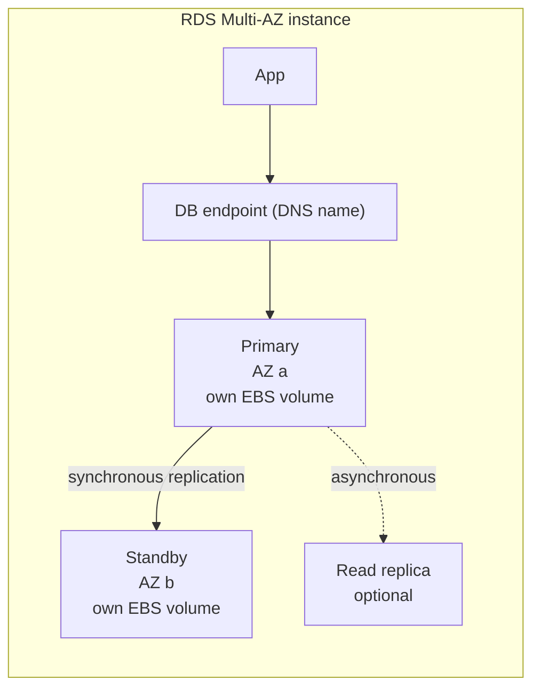
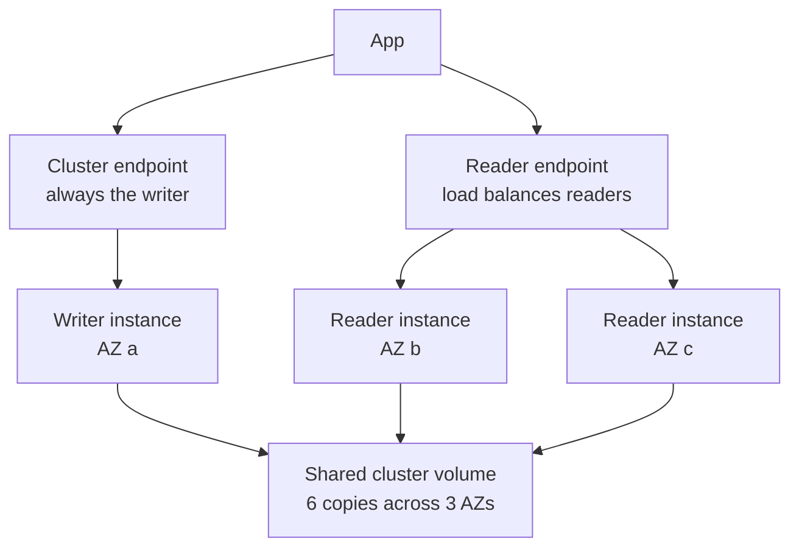

# L6.10 — RDS and Aurora

> **Level 6: Cloud (AWS)** · Topic 10 of 18 · ⏱ ~5 hours · Difficulty: Intermediate

## 1. What it is

**Amazon RDS (Relational Database Service)** runs a relational database for you: AWS provisions the instance, installs the
engine (PostgreSQL, MySQL, MariaDB, Oracle, SQL Server or Db2), patches it, takes backups, and can fail over to a standby in
another Availability Zone (AZ). You still design schemas, tune queries and size the instance; AWS owns the operating system
and the "keep it running" work. You cannot SSH into an RDS instance — you reach it only over the database port.

**Amazon Aurora** is AWS's own database engine family, available in **MySQL-compatible** and **PostgreSQL-compatible**
editions and managed through the RDS API. Instead of each database server owning a disk, Aurora separates compute from a
shared, distributed storage layer that keeps copies of your data across three AZs. That changes how replicas, failover and
backups behave, which is why Aurora is treated as its own product even though the CLI says `aws rds`.

## 2. Why it matters in DevOps

- **The database is the part of the system you cannot just redeploy.** A wrong choice (single-AZ, no backups, public endpoint)
  turns a bad day into data loss.
- **Failover, restore and scaling are your job to design and rehearse**, even when AWS performs the mechanics.
- **Cost:** a forgotten Multi-AZ instance with provisioned storage bills every hour whether or not anything uses it.
- **Security:** RDS is the most common place for customer data; network isolation, encryption (see [KMS](15-kms.md)) and
  credential handling (see [Secrets Manager](16-secrets-manager.md)) are decided here.
- Backups are only useful if restores are tested — see [DR in Level 0](../level-00-what-devops-is/09-disaster-recovery.md).

## 3. Real-world system example

**AWS's own managed-database offering underpins many public-facing products.** Aurora was announced by AWS in 2014 and is
documented as a "cloud-native" design in which the database layer sends redo log records to a storage service instead of
writing full data pages; AWS's published Aurora paper (SIGMOD 2017, *Amazon Aurora: Design Considerations for High Throughput
Cloud-Native Relational Databases*) describes the six-copy, quorum-based storage. Many SaaS companies publicly describe
running PostgreSQL on RDS or Aurora to avoid operating replication and backups themselves, while larger operators often still
run their own databases on EC2 or Kubernetes when they need extensions, kernel tuning or parameters RDS does not expose.
The recurring pattern: **one writer, several read replicas, automated backups with point-in-time recovery, and a connection
pool (for example RDS Proxy or PgBouncer) in front** — exactly the `shop-api` shape used in this roadmap.

## 4. Diagram

RDS Multi-AZ (instance deployment) versus Aurora:





## 5. How it works

**Key RDS building blocks**

| Concept | What it means |
|---------|---------------|
| DB instance class | CPU/RAM size, e.g. `db.t4g.micro` (burstable, Graviton), `db.m7g.large`, `db.r7g.large` (memory optimized) |
| Storage | EBS-backed: `gp3` (default choice), `io1/io2` (provisioned IOPS). Storage can grow (storage autoscaling) but cannot shrink |
| DB subnet group | Set of subnets in **at least two AZs** where RDS may place instances. Use private subnets |
| Parameter group | Engine settings (`max_connections`, `log_min_duration_statement`). Some changes need a reboot |
| Endpoint | A DNS name. On failover AWS repoints the name, so apps must re-resolve DNS and reconnect |
| Maintenance window | Weekly window when AWS applies minor patches |

**Multi-AZ versus read replicas — different problems**

| | Multi-AZ | Read replica |
|--|----------|--------------|
| Purpose | **Availability** (survive an AZ or host failure) | **Read scaling** (and cross-Region copies, migrations) |
| Replication | Synchronous (instance deployment) | Asynchronous — replica can lag |
| Readable? | Instance deployment: standby is **not** readable. Multi-AZ **DB cluster** (PostgreSQL/MySQL): two readable standbys | Yes, has its own endpoint |
| Failover | Automatic; the endpoint DNS name moves to the standby. Typically about a minute or two for the instance deployment; the DB-cluster deployment is documented as faster | Manual `promote-read-replica`; the replica becomes a standalone DB |
| Cost | About 2x the instance | One more instance per replica |

**Backups and recovery**

- **Automated backups:** daily snapshot plus transaction logs, retention **0-35 days** (0 disables them — never do that in
  production). They enable **point-in-time recovery (PITR)** to any second inside the window, usually up to about the last
  five minutes. Restore always creates a **new instance** with a new endpoint; it never rewinds the old one.
- **Manual snapshots:** kept until you delete them, survive instance deletion, can be copied across Regions and shared.
- **Encryption** is chosen at creation (see [KMS](15-kms.md)). You cannot flip an existing unencrypted instance to encrypted:
  snapshot, copy the snapshot with encryption, restore.

**Aurora specifics**

- Storage is a **cluster volume** that grows automatically (in 10 GB segments, up to 128 TiB) and is replicated six ways across
  three AZs; writes need a quorum (4 of 6), reads 3 of 6. You pay for storage actually used plus I/O (or choose
  **Aurora I/O-Optimized**, which trades higher instance/storage prices for no per-I/O charge).
- One **writer** plus up to **15 readers**, all reading the same volume, so replica lag is typically milliseconds and a reader
  can be promoted quickly. Use the **cluster endpoint** for writes and the **reader endpoint** for reads.
- **Aurora Serverless v2** scales capacity in fine steps (ACUs) and can scale to zero ACUs with auto-pause (check current
  behavior for your engine version). **Global Database** replicates to other Regions; **Backtrack** (MySQL edition) rewinds in place.
- Aurora usually costs more per instance-hour than RDS but removes replication-lag and storage-copy chores. Pick plain RDS for
  small, predictable workloads; Aurora when you need fast failover, many readers or very large storage.

**Other features worth knowing:** **RDS Proxy** (connection pooling in front of the DB, helps Lambda and failover times),
**Blue/Green Deployments** (staging copy for major upgrades), **Performance Insights**, and **Extended Support** (extra
hourly fee when you stay on an engine version past community end-of-life).

## 6. Step-by-step guide

**Prerequisites:** AWS CLI v2 configured (`aws sts get-caller-identity` works), a default or custom VPC in `us-east-1`, a
billing alarm ([CloudWatch topic](18-cloudwatch.md)). **Cost warning:** a `db.t4g.micro` with 20 GB `gp3` costs a few cents
per hour (a few dollars per month); Multi-AZ roughly doubles it; read replicas and snapshots add more. Free-tier rules changed
for accounts created after July 2025 (credit-based "Free plan" instead of 12 free months) — check the Billing console's
**Free Tier** page for what applies to you. Keep the session short and run step 9 (cleanup).

1. **Pick networking.** Using the default VPC for a lab (production uses private subnets, see [VPC](04-vpc-and-subnets.md)):
   ```bash
   export AWS_REGION=us-east-1
   VPC_ID=$(aws ec2 describe-vpcs --filters Name=isDefault,Values=true --query 'Vpcs[0].VpcId' --output text)
   SUBNETS=$(aws ec2 describe-subnets --filters Name=vpc-id,Values=$VPC_ID --query 'Subnets[].SubnetId' --output text)
   echo $VPC_ID $SUBNETS
   ```
   Expect a `vpc-...` id and several `subnet-...` ids from different AZs.

2. **Create a subnet group and a security group that only allows your IP.**
   ```bash
   aws rds create-db-subnet-group --db-subnet-group-name shop-lab \
     --db-subnet-group-description "shop-api lab" --subnet-ids $SUBNETS
   SG_ID=$(aws ec2 create-security-group --group-name shop-db-lab --description "lab db" \
     --vpc-id $VPC_ID --query GroupId --output text)
   MYIP=$(curl -s https://checkip.amazonaws.com)
   aws ec2 authorize-security-group-ingress --group-id $SG_ID --protocol tcp --port 5432 --cidr $MYIP/32
   ```
   In real systems the source is the *application's security group*, never an IP range (see
   [Security Groups](06-security-groups-and-nacls.md)).

3. **Create a PostgreSQL instance.** `--manage-master-user-password` makes RDS generate the admin password and keep it in
   [Secrets Manager](16-secrets-manager.md), so no password appears in your shell history.
   ```bash
   aws rds create-db-instance --db-instance-identifier shop-lab \
     --engine postgres --db-instance-class db.t4g.micro \
     --allocated-storage 20 --storage-type gp3 --storage-encrypted \
     --master-username shopadmin --manage-master-user-password \
     --db-name shop --db-subnet-group-name shop-lab \
     --vpc-security-group-ids $SG_ID --publicly-accessible \
     --backup-retention-period 7 --no-multi-az
   aws rds wait db-instance-available --db-instance-identifier shop-lab   # ~5-10 minutes
   ```
   `--publicly-accessible` is only so you can test from a laptop in this lab; production databases are not public.

4. **Find the endpoint and the secret, then connect.**
   ```bash
   aws rds describe-db-instances --db-instance-identifier shop-lab \
     --query 'DBInstances[0].[Endpoint.Address,MasterUserSecret.SecretArn,MultiAZ,DBInstanceStatus]' --output text
   SECRET=$(aws rds describe-db-instances --db-instance-identifier shop-lab --query 'DBInstances[0].MasterUserSecret.SecretArn' --output text)
   export PGPASSWORD=$(aws secretsmanager get-secret-value --secret-id $SECRET --query SecretString --output text | python3 -c 'import sys,json;print(json.load(sys.stdin)["password"])')
   HOST=$(aws rds describe-db-instances --db-instance-identifier shop-lab --query 'DBInstances[0].Endpoint.Address' --output text)
   psql "host=$HOST user=shopadmin dbname=shop sslmode=require" -c "select version();"
   ```
   Expect a line starting `PostgreSQL ...`. (RDS PostgreSQL 15+ requires TLS by default, hence `sslmode=require`.)

5. **Turn on Multi-AZ and watch it.**
   ```bash
   aws rds modify-db-instance --db-instance-identifier shop-lab --multi-az --apply-immediately
   aws rds describe-db-instances --db-instance-identifier shop-lab --query 'DBInstances[0].[DBInstanceStatus,MultiAZ]' --output text
   ```
   Status goes `modifying` and returns to `available` with `True` — AWS builds the standby from a snapshot. Billing doubles from here.

6. **Force a failover and measure it.**
   ```bash
   aws rds reboot-db-instance --db-instance-identifier shop-lab --force-failover
   while true; do date +%T; psql "host=$HOST user=shopadmin dbname=shop sslmode=require connect_timeout=2" -tc "select 1" 2>&1 | head -1; sleep 2; done
   ```
   You will see errors for a minute or two, then success. Check `aws rds describe-events --source-type db-instance --source-identifier shop-lab --duration 30`
   for "Multi-AZ instance failover started/completed". The takeaway: **apps must retry and re-resolve DNS**.

7. **Create a read replica, then promote it.**
   ```bash
   aws rds create-db-instance-read-replica --db-instance-identifier shop-lab-ro --source-db-instance-identifier shop-lab
   aws rds wait db-instance-available --db-instance-identifier shop-lab-ro
   aws rds promote-read-replica --db-instance-identifier shop-lab-ro   # replica becomes an independent database
   ```
   After promotion it no longer follows the source — this is the manual disaster-recovery move.

8. **Snapshot and point-in-time restore.**
   ```bash
   aws rds create-db-snapshot --db-instance-identifier shop-lab --db-snapshot-identifier shop-lab-manual-1
   aws rds restore-db-instance-to-point-in-time --source-db-instance-identifier shop-lab \
     --target-db-instance-identifier shop-lab-restored --use-latest-restorable-time \
     --db-subnet-group-name shop-lab --db-instance-class db.t4g.micro
   ```
   The restored copy has a **different endpoint**; you cut the app over by changing config, not by overwriting the original.

9. **Clean up (do not skip).**
   ```bash
   for DB in shop-lab-restored shop-lab-ro shop-lab; do
     aws rds delete-db-instance --db-instance-identifier $DB --skip-final-snapshot --delete-automated-backups
   done
   aws rds delete-db-snapshot --db-snapshot-identifier shop-lab-manual-1
   aws rds wait db-instance-deleted --db-instance-identifier shop-lab
   aws rds delete-db-subnet-group --db-subnet-group-name shop-lab
   aws ec2 delete-security-group --group-id $SG_ID
   ```
   Deleting `shop-lab` also removes its managed secret. Verify with `aws rds describe-db-instances --query 'DBInstances[].DBInstanceIdentifier'`
   (empty list) and check for leftover snapshots in the console.

**Cheaper sandbox:** for SQL practice, `docker run --rm -e POSTGRES_PASSWORD=dev -p 5432:5432 postgres:17` behaves like RDS PostgreSQL for
queries (not for Multi-AZ, backups or parameter groups). LocalStack can emulate parts of the RDS API, but its coverage depends on
edition and has changed over time — check its current coverage page before relying on it.

## 7. Real-world scenario

*Illustrative scenario.* On a Monday the `shop-api` team gets paged: checkout latency spikes and CloudWatch shows the RDS
instance at 95% CPU and `DatabaseConnections` near `max_connections`. The cause: a new report endpoint runs heavy aggregations
on the primary, and each autoscaled app instance opens 20 connections. Short term, they create a read replica and point the
report code at its endpoint; they also cap the app's pool size. Replica lag appears in `ReplicaLag` during a bulk import, so
the finance team's "real-time" dashboard briefly shows stale numbers — a documented trade-off of asynchronous replication.
Next quarter they add RDS Proxy and a Multi-AZ standby after a maintenance-window failover caused 90 seconds of errors because
the app did not retry. **Lesson:** replicas scale reads, Multi-AZ gives availability, neither replaces connection pooling and
retry logic in the application.

## 8. Common mistakes and best practices

**Don't**

- Leave a database `publicly-accessible` with `0.0.0.0/0` on port 5432/3306.
- Set the backup retention to 0, or never test a restore.
- Treat the standby as a read replica (it is not readable in a Multi-AZ instance deployment) or rely on replicas for failover without promoting them.
- Hard-code the master password in code or Terraform state; use managed or rotated secrets.
- Forget that stopped RDS instances restart automatically after seven days, and that snapshots/storage keep billing after a stop.

**Do**

- Run production in private subnets, Multi-AZ, encrypted, with `deletion protection` on, and allow access only from the app's security group.
- Alert on `CPUUtilization`, `FreeStorageSpace`, `DatabaseConnections`, `ReplicaLag` ([CloudWatch](18-cloudwatch.md)).
- Make applications reconnect with backoff; keep DNS TTL caching short in clients.
- Rehearse a PITR restore and record how long it took (this is your real RTO).
- Use parameter groups and Blue/Green Deployments for upgrades instead of editing a live server by hand.

## 9. Tasks

*Cost note: these tasks create billable resources. Set a billing alarm first, delete everything at the end of each task.*

- [ ] **T1 — Launch a managed PostgreSQL** *(≈45 min, beginner)*
  - **Goal:** create, connect to and delete an RDS instance with the CLI.
  - **Steps:**
    1. Follow guide steps 1-4 (use `--no-multi-az`, `db.t4g.micro`).
    2. Create a table `products(id serial primary key, name text)` and insert two rows with `psql`.
    3. Run step 9 for this instance only.
  - **Done when:** `select count(*) from products;` returned `2` and `describe-db-instances` no longer lists the instance.

- [ ] **T2 — Inspect Multi-AZ** *(≈45 min, intermediate)*
  - **Goal:** see what Multi-AZ changes.
  - **Steps:**
    1. Run `aws rds describe-db-instances --query 'DBInstances[0].[AvailabilityZone,SecondaryAvailabilityZone,MultiAZ]'` before and after `modify-db-instance --multi-az`.
    2. Note the cost difference using the AWS Pricing Calculator for both configurations.
  - **Done when:** you can show a populated `SecondaryAvailabilityZone` and state the hourly price difference.

- [ ] **T3 — Break it: measure a failover** *(≈45 min, intermediate)*
  - **Goal:** quantify the downtime a failover causes.
  - **Steps:**
    1. Run the polling loop from step 6 in one terminal.
    2. In another, run `reboot-db-instance --force-failover`.
    3. Record the first failing and first succeeding timestamps and the AZ before and after.
  - **Done when:** you have a measured outage duration in seconds and the AZ changed.

- [ ] **T4 — Replica lag experiment** *(≈60 min, intermediate)*
  - **Goal:** observe asynchronous replication.
  - **Steps:**
    1. Create a read replica (step 7 without promotion).
    2. Insert 100,000 rows on the primary using `generate_series`.
    3. Query the replica repeatedly and graph `ReplicaLag` in CloudWatch.
  - **Done when:** you saw `ReplicaLag` rise above 0 seconds and fall back, and the replica row count caught up.

- [ ] **T5 — Automate a restore drill** *(≈60 min, advanced)*
  - **Goal:** make restore a script, not a heroic act.
  - **Steps:**
    1. Write `restore-drill.sh` that PITR-restores to a new identifier, waits for availability, runs `select count(*) from products`, prints elapsed seconds and deletes the copy.
    2. Run it twice.
  - **Done when:** the script prints a row count that matches the source and a duration, and leaves no instance behind.

- [ ] **T6 — Prove it: Multi-AZ vs replica vs Aurora** *(≈45 min, advanced)*
  - **Goal:** justify a design choice.
  - **Steps:**
    1. Without the guide, draw the `shop-api` database design for "99.95% availability and a reporting workload", choosing RDS Multi-AZ, replicas, or Aurora.
    2. List failure modes (AZ loss, bad migration, accidental `DELETE`) and the recovery action for each.
  - **Done when:** a teammate can read your one-page design and name the recovery step for all three failures.

## 10. Self-check questions

1. Which feature protects against an AZ outage and which one scales reads?
2. Why can an application still see errors after a "successful" Multi-AZ failover?
3. How do you restore a database to 10:42 yesterday, and what do you get back?
4. What is different about Aurora's storage compared with an RDS instance's EBS volume?
5. Why must the DB subnet group span two AZs even for a single-AZ instance?
6. How do you encrypt an existing unencrypted RDS instance?

<details>
<summary>Answers</summary>

1. Multi-AZ gives availability (synchronous standby); read replicas scale reads (asynchronous).
2. The endpoint name is repointed to the standby, but existing connections are dropped and clients may cache DNS; apps need reconnect/retry logic.
3. PITR (`restore-db-instance-to-point-in-time`) within the retention window; you get a **new instance** with a new endpoint, and you cut over by configuration.
4. Aurora uses a shared distributed cluster volume replicated six ways across three AZs that grows automatically; readers share it, so lag is low and failover is fast.
5. RDS requires at least two AZs in the group so it can place a standby or recover elsewhere later.
6. Take a snapshot, copy it with encryption enabled (choosing a KMS key), and restore from the encrypted copy.
</details>

## 11. Further reading

- *Amazon RDS User Guide* and *Amazon Aurora User Guide* (AWS documentation) — Multi-AZ, backups, parameter groups.
- *Amazon Aurora: Design Considerations for High Throughput Cloud-Native Relational Databases* (SIGMOD 2017).
- AWS Well-Architected Framework — Reliability Pillar.
- *Designing Data-Intensive Applications* by Martin Kleppmann — the replication chapter.
- See also: [Secrets Manager](16-secrets-manager.md), [ElastiCache](11-elasticache.md) (cache in front of the database).

<!-- nav -->
---
← Previous: [EBS and EFS](09-ebs-and-efs.md) · [Level 6 index](README.md) · Next: [ElastiCache](11-elasticache.md) →
