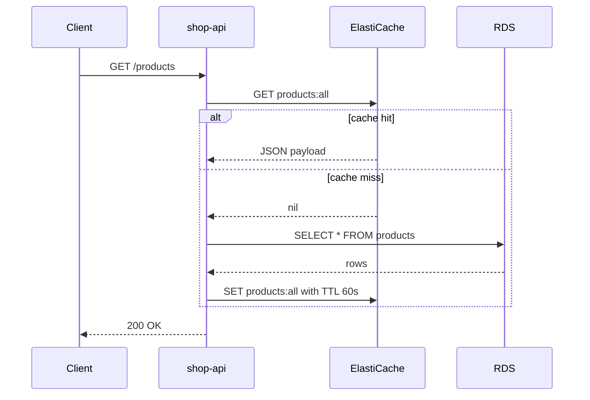
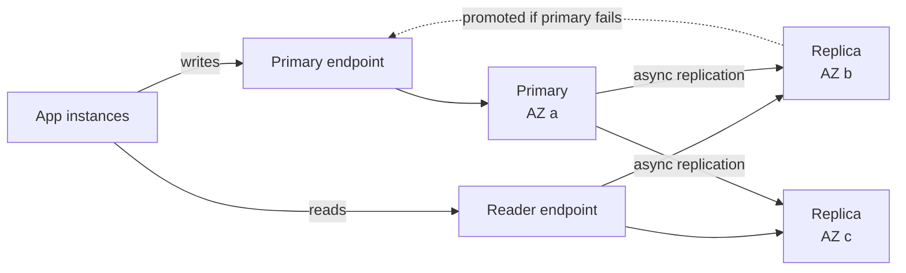

# L6.11 — ElastiCache

> **Level 6: Cloud (AWS)** · Topic 11 of 18 · ⏱ ~4 hours · Difficulty: Intermediate

## 1. What it is

**Amazon ElastiCache** is a managed in-memory data store. You get a **Valkey**, **Redis OSS** or **Memcached** endpoint that
answers in well under a millisecond because the data lives in RAM, and AWS handles node provisioning, patching, replication,
failover and monitoring. Valkey is the open-source (Linux Foundation) fork of Redis created after Redis changed its license in
2024; ElastiCache supports it alongside Redis OSS (up to version 7.1), and AWS prices Valkey lower than Redis OSS.

It comes in two shapes: **node-based clusters** (you choose node type, shard and replica counts) and **ElastiCache Serverless**
(you name a cache and pay for stored data and compute used; AWS scales it). ElastiCache lives **inside your VPC** and has no
public endpoint — you reach it from EC2, containers or Lambda in the same network.

## 2. Why it matters in DevOps

- **It takes load off the database.** A cache hit costs microseconds and no database CPU; during traffic spikes the cache often
  decides whether [RDS](10-rds-and-aurora.md) survives.
- **Shared state for stateless apps:** sessions, rate-limit counters, distributed locks and job queues must live outside the instances so that
  [Auto Scaling](02-auto-scaling.md) can add and remove servers freely.
- **It fails in interesting ways:** evictions silently lower the hit rate, a cold cache after failover can melt the database
  (a "thundering herd"), and a cache without TTLs serves stale data forever.
- **Cost:** memory is the most expensive resource per GB in AWS; right-sizing matters (see [Cost](../level-20-cost-optimization/08-database-costs.md)).

## 3. Real-world system example

**Caching in front of a relational database** is a pattern AWS documents in its whitepaper *Database Caching Strategies Using
Redis*, which describes **lazy loading (cache-aside)** and **write-through** with TTLs. Large web platforms typically run
Redis- or Memcached-compatible fleets for session data, leaderboards, rate limiting and queues; Shopify, for instance, has
written publicly about using Redis alongside its primary databases for background jobs and caching. ElastiCache itself is the managed version of the same thing: a primary node, replicas in other
AZs, and automatic promotion when the primary dies. For the Redis internals (data types, persistence, eviction) see
[Redis in Level 13](../level-13-databases-distributed-systems/07-redis.md).

## 4. Diagram

Cache-aside read path:



Replication group with automatic failover (cluster mode disabled):



## 5. How it works

**Engines**

| | Valkey / Redis OSS | Memcached |
|--|--------------------|-----------|
| Data types | strings, hashes, lists, sets, sorted sets, streams, pub/sub | strings only |
| Persistence / replication | replication, Multi-AZ failover, snapshots | none — a node loss loses its data |
| Scaling | add replicas; cluster mode shards data across up to hundreds of shards | add nodes; the **client** hashes keys |
| Use when | sessions, queues, counters, leaderboards, anything needing failover | simple, multi-threaded, throw-away cache |

**Topologies (node-based)**

- **Cluster mode disabled:** one shard = one primary + up to 5 replicas. Simple; clients use the *primary endpoint* for writes and
  the *reader endpoint* for reads. Data must fit in one node's memory.
- **Cluster mode enabled:** data is split into 16,384 hash slots over multiple shards, each with its own replicas. Clients use the
  *configuration endpoint* and must be cluster-aware; multi-key operations need keys in the same slot (hash tags like `{user42}`).
- **Serverless:** no node sizing; you set optional maximum limits. Good for spiky or unknown loads; it has a minimum cost for stored data.

**Failover.** Enable **Multi-AZ with automatic failover** and at least one replica. When the primary fails, ElastiCache promotes
the replica with the least lag and updates DNS of the primary endpoint — typically within tens of seconds to a couple of
minutes, and writes made but not yet replicated can be lost (asynchronous replication). You can rehearse it with `test-failover`.

**Security.** Place it in private subnets with a security group that allows port 6379 only from the app's security group.
Turn on **encryption in transit** (clients then use TLS, `rediss://`) and **at rest** (KMS, see [KMS](15-kms.md)). Authenticate with an
**AUTH token** or, better, **RBAC users and user groups**.

**Caching patterns**

| Pattern | How | Trade-off |
|---------|-----|-----------|
| Cache-aside (lazy loading) | App checks cache, on miss loads from DB and fills cache | Only requested data cached; first request slow; data can go stale |
| Write-through | App writes DB and cache together | Cache always warm; wasted memory for never-read data |
| TTL (expiry) | Every key gets `EX`/`EXPIRE` | Bounds staleness; add random jitter to avoid synchronized expiry |
| Write-behind | Write cache first, flush to DB later | Fast writes, risk of data loss — rarely appropriate |

Eviction policy (`maxmemory-policy`) decides what is dropped when memory is full; the ElastiCache default is `volatile-lru`
(evict least-recently-used keys *that have a TTL*). Keys without TTL are never evicted, so a full cache of non-expiring keys returns write errors.

## 6. Step-by-step guide

**Prerequisites:** AWS CLI v2; a VPC with subnets in two AZs and a security group for the app (use your default VPC for a lab);
an EC2 instance in that VPC to connect from (see [EC2](01-ec2.md)). **Cost warning:** two `cache.t4g.micro` nodes cost a few cents
per hour in total (single-digit dollars per month); billing continues until you delete the replication group. Free-tier eligibility
for ElastiCache depends on when your account was created — check the Billing console's Free Tier page. Do the cleanup step.

1. **Local practice first (free).**
   ```bash
   docker run -d --name cache -p 6379:6379 valkey/valkey:8      # redis:7 works identically for these commands
   redis-cli ping                                                  # PONG
   redis-cli set products:all '[{"id":1}]' EX 60
   redis-cli ttl products:all                                      # a number below 60
   ```
   LocalStack may emulate the ElastiCache control-plane API, but a local container is the better way to learn commands.

2. **Network objects.**
   ```bash
   export AWS_REGION=us-east-1
   VPC_ID=$(aws ec2 describe-vpcs --filters Name=isDefault,Values=true --query 'Vpcs[0].VpcId' --output text)
   SUBNETS=$(aws ec2 describe-subnets --filters Name=vpc-id,Values=$VPC_ID --query 'Subnets[].SubnetId' --output text)
   aws elasticache create-cache-subnet-group --cache-subnet-group-name shop-cache-lab \
     --cache-subnet-group-description "shop-api cache lab" --subnet-ids $SUBNETS
   CACHE_SG=$(aws ec2 create-security-group --group-name shop-cache-lab --description "lab cache" \
     --vpc-id $VPC_ID --query GroupId --output text)
   ```
   For the client, put your EC2 instance's security group as the source:
   ```bash
   APP_SG=sg-0123456789abcdef0     # replace with the security group of your EC2 instance
   aws ec2 authorize-security-group-ingress --group-id $CACHE_SG --protocol tcp --port 6379 --source-group $APP_SG
   ```

3. **Create a replication group: one primary + one replica across AZs.**
   ```bash
   aws elasticache create-replication-group --replication-group-id shop-cache-lab \
     --replication-group-description "shop-api cache lab" \
     --engine valkey --cache-node-type cache.t4g.micro \
     --num-cache-clusters 2 --automatic-failover-enabled --multi-az-enabled \
     --transit-encryption-enabled --at-rest-encryption-enabled \
     --cache-subnet-group-name shop-cache-lab --security-group-ids $CACHE_SG
   aws elasticache wait replication-group-available --replication-group-id shop-cache-lab   # ~5-15 min
   ```
   If your CLI is older and rejects `valkey`, update AWS CLI v2 or use `--engine redis`.

4. **Read the endpoints.**
   ```bash
   aws elasticache describe-replication-groups --replication-group-id shop-cache-lab \
     --query 'ReplicationGroups[0].NodeGroups[0].[PrimaryEndpoint.Address,ReaderEndpoint.Address,Status]' --output text
   ```
   Similar to `shop-cache-lab.abc123.ng.0001.use1.cache.amazonaws.com  shop-cache-lab-ro.abc123.ng.0001.use1.cache.amazonaws.com  available`.

5. **Connect from the EC2 instance (TLS is on, so use `--tls`).**
   ```bash
   redis-cli -h <PRIMARY_ENDPOINT> --tls -p 6379 ping        # PONG (install with: sudo dnf install -y redis6 or valkey)
   ```
   From your laptop this times out — by design the cluster has no public address. For laptop access use an SSM Session Manager
   port-forward through the EC2 instance.

6. **Implement cache-aside in Node.js** (the pattern `shop-api` uses; `npm i redis`):
   ```javascript
   const { createClient } = require('redis');
   const cache = createClient({ url: `rediss://${process.env.CACHE_HOST}:6379` });
   cache.on('error', (e) => console.error('cache error', e.message));   // never let cache outages crash the app
   async function getProducts(db) {
     const hit = await cache.get('products:all').catch(() => null);
     if (hit) return JSON.parse(hit);
     const { rows } = await db.query('select id, name from products');
     await cache.set('products:all', JSON.stringify(rows), { EX: 60 + Math.floor(Math.random() * 10) }).catch(() => {});
     return rows;
   }
   ```
   Note the TTL jitter and that cache failures degrade to a database read instead of an error.

7. **Rehearse a failover.**
   ```bash
   aws elasticache test-failover --replication-group-id shop-cache-lab --node-group-id 0001
   aws elasticache describe-events --source-type replication-group --duration 30 --query 'Events[].[Date,Message]' --output text
   ```
   Keep a `redis-cli ... ping` loop running; expect a short window of errors, then recovery, and events mentioning failover.

8. **Look at the metrics that matter.**
   ```bash
   aws cloudwatch get-metric-statistics --namespace AWS/ElastiCache --metric-name CacheHitRate \
     --dimensions Name=CacheClusterId,Value=shop-cache-lab-001 --start-time $(date -u -d '-1 hour' +%FT%TZ) \
     --end-time $(date -u +%FT%TZ) --period 300 --statistics Average
   ```
   Also watch `EngineCPUUtilization`, `DatabaseMemoryUsagePercentage`, `Evictions`, `CurrConnections`.

9. **Clean up.**
   ```bash
   aws elasticache delete-replication-group --replication-group-id shop-cache-lab
   aws elasticache wait replication-group-deleted --replication-group-id shop-cache-lab
   aws elasticache delete-cache-subnet-group --cache-subnet-group-name shop-cache-lab
   aws ec2 delete-security-group --group-id $CACHE_SG
   docker rm -f cache
   ```
   Verify with `aws elasticache describe-replication-groups --query 'ReplicationGroups[].ReplicationGroupId'` (empty).

## 7. Real-world scenario

*Illustrative scenario.* Black Friday: `shop-api` serves the product list from Valkey with a 60 s TTL; the RDS CPU sits at 15%.
At 02:00 a maintenance event promotes a replica and the primary endpoint briefly refuses connections. The app's cache client
throws, and because every request path awaited the cache without a fallback, the API returns 500s for 40 seconds. Worse, the
promoted node has the data, but the app also restarted its pool and 300 instances tried to repopulate the same hot key from
RDS at once, spiking its CPU to 90%. The fix: treat the cache as optional (catch errors and read the DB), add jitter and a
short single-flight lock on refills, and set alarms on `Evictions` and `CacheHitRate`. **Lesson:** a cache is an optimization,
not a dependency — design the failure path as carefully as the happy path.

## 8. Common mistakes and best practices

**Don't**

- Expose the cache with a permissive security group, or turn off TLS/AUTH because "it's inside the VPC".
- Store data that exists nowhere else (a cache can be wiped by failover, scaling or maintenance).
- Cache with no TTL or with identical TTLs for millions of keys.
- Use `KEYS *` in production (it blocks the single-threaded engine); use `SCAN`.
- Use cluster mode with a non-cluster-aware client.

**Do**

- Enable Multi-AZ with automatic failover and a replica for anything serving production traffic.
- Handle cache errors gracefully, use connection pooling and exponential backoff.
- Alert on `Evictions`, `CPU`/`EngineCPUUtilization`, memory use and `ReplicationLag`.
- Size memory with headroom (reserved-memory settings) so a backup/snapshot does not push the node into swap.
- Namespace keys (`shop-api:products:all`) and version them when the cached format changes.

## 9. Tasks

*Cost note: tasks 2-5 create billable ElastiCache nodes. Billing alarm first; delete at the end of each session.*

- [ ] **T1 — Cache-aside locally** *(≈40 min, beginner)*
  - **Goal:** implement and observe a hit/miss cycle without any cloud cost.
  - **Steps:**
    1. Run Valkey or Redis in Docker and PostgreSQL in Docker.
    2. Implement the `getProducts` function from step 6 with a `console.log` for hit/miss.
    3. Call it three times within 60 s, then wait for the TTL to expire and call again.
  - **Done when:** the log shows `miss, hit, hit, miss` and `redis-cli ttl` counted down between calls.

- [ ] **T2 — Provision a replicated cache** *(≈60 min, intermediate)*
  - **Goal:** build the replication group from the CLI.
  - **Steps:**
    1. Do guide steps 2-4.
    2. Run `describe-replication-groups` and record both endpoints and the AZ of each node.
  - **Done when:** the status is `available`, `MultiAZ` is `enabled` and the nodes sit in two AZs.

- [ ] **T3 — Connect over TLS from EC2** *(≈45 min, intermediate)*
  - **Goal:** prove the cache is private and TLS-only.
  - **Steps:**
    1. From your laptop, run `redis-cli -h <endpoint> --tls ping` and note that it times out.
    2. From an EC2 instance in the app security group, run it again; then try without `--tls`.
  - **Done when:** laptop times out, EC2 + `--tls` returns `PONG`, and EC2 without `--tls` fails.

- [ ] **T4 — Break it: test failover** *(≈45 min, advanced)*
  - **Goal:** measure what failover does to a client.
  - **Steps:**
    1. Run a loop that writes `incr counter` once per second and prints errors.
    2. Execute `test-failover` and note the error window and which node became primary.
    3. Check whether any writes were lost (compare the counter to the number of successes).
  - **Done when:** you report the error window in seconds and whether the counter lost increments.

- [ ] **T5 — Explain a stampede and fix it** *(≈60 min, advanced)*
  - **Goal:** prevent a thundering herd on a hot key.
  - **Steps:**
    1. Using `autocannon` or `ab`, hit an endpoint right after `redis-cli del products:all` and count DB queries.
    2. Add a `SET products:lock 1 NX EX 5` guard so only one request refills the cache while others wait or serve stale data.
    3. Repeat the load test.
  - **Done when:** the DB query count after the delete drops from many to one.

- [ ] **T6 — Prove it: choose the right engine** *(≈30 min, intermediate)*
  - **Goal:** justify engine and topology choices.
  - **Steps:**
    1. Without notes, decide Valkey/Redis vs Memcached and cluster mode on/off for: HTTP sessions, a 400 GB product catalog cache, a rate limiter.
    2. State the failure behavior of each choice.
  - **Done when:** a teammate agrees with your reasoning on all three cases.

## 10. Self-check questions

1. Why does ElastiCache refuse connections from your laptop, and how do you reach it for debugging?
2. What is the difference between cache-aside and write-through?
3. What can be lost during a failover, and why?
4. When would you pick Memcached over Valkey/Redis?
5. What happens when `maxmemory` is reached and all keys lack a TTL under `volatile-lru`?

<details>
<summary>Answers</summary>

1. It has no public endpoint and its security group only allows the app; use a bastion or SSM port-forward from a host inside the VPC.
2. Cache-aside fills on read misses; write-through updates the cache on every write.
3. Recent writes not yet replicated to the promoted replica (asynchronous replication), plus in-flight connections.
4. A simple, multi-threaded, disposable cache where persistence, replication and rich data types are unnecessary.
5. Nothing is evictable, so writes fail with an out-of-memory error.
</details>

## 11. Further reading

- *Amazon ElastiCache User Guide* (AWS documentation), including *Best practices* and the *Valkey* sections.
- AWS whitepaper *Database Caching Strategies Using Redis*.
- Valkey and Redis command documentation (valkey.io, redis.io).
- See also: [RDS and Aurora](10-rds-and-aurora.md), [Auto Scaling](02-auto-scaling.md).

<!-- nav -->
---
← Previous: [RDS and Aurora](10-rds-and-aurora.md) · [Level 6 index](README.md) · Next: [Route 53](12-route-53.md) →
