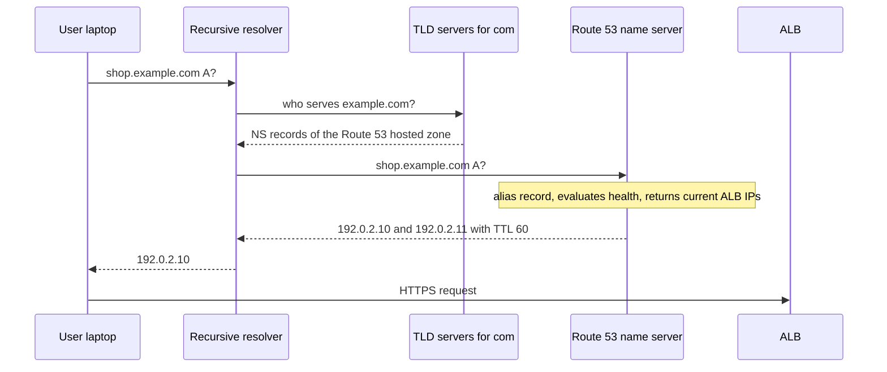
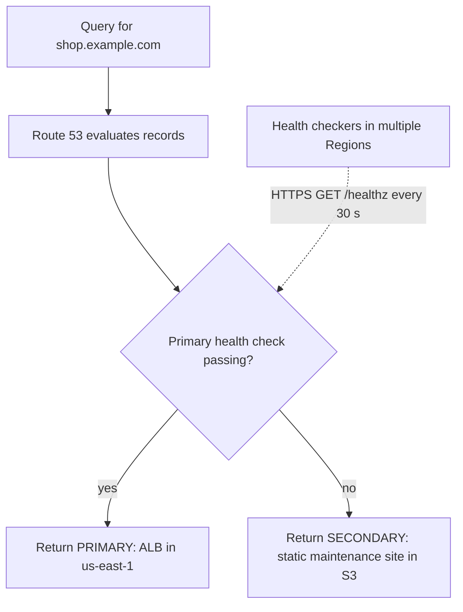

# L6.12 — Route 53

> **Level 6: Cloud (AWS)** · Topic 12 of 18 · ⏱ ~4 hours · Difficulty: Intermediate

## 1. What it is

**Amazon Route 53** is AWS's **DNS (Domain Name System)** service: it turns names such as `shop.example.com` into the
addresses or AWS endpoints that serve them. It can also register domains and run **health checks**, and it can answer
differently depending on who is asking or whether a target is healthy (weighted, latency-based, failover and geolocation
routing). The "53" is the DNS port number.

The core object is a **hosted zone**: a container of records for one domain. A **public** hosted zone answers queries from the
internet; a **private** hosted zone answers only inside the VPCs you associate with it (for names like `db.internal.example.com`).
Each hosted zone gets four **name servers** (NS records); you tell your domain registrar to delegate to them. If you want the
underlying DNS concepts first, read [DNS Resolution](../level-02-networking/05-dns-resolution.md).

## 2. Why it matters in DevOps

- **DNS is the first hop of every request.** A wrong record, an expired delegation or a long TTL during a migration is a full outage that no load balancer can hide.
- **It is a deployment tool:** weighted records shift traffic between environments (canary), failover records implement active-passive disaster recovery ([DR](../level-00-what-devops-is/09-disaster-recovery.md)).
- **It is a dependency of everything else:** ACM certificate validation, CloudFront aliases, ALB names, SES, email (MX) and service discovery all use records.
- **Cost surprises are small but real:** hosted zones bill monthly, queries per million, health checks per check.

## 3. Real-world system example

**The 2016 Dyn attack** is the textbook DNS-dependency incident: on 21 October 2016 a Mirai-botnet DDoS against the managed DNS
provider Dyn made many popular sites (including Twitter, GitHub and Netflix, per public reporting) unreachable for some users, even
though their own servers were healthy. A widely drawn lesson was to use more than one DNS provider for critical names. In AWS's own
incident report for the 19-20 October 2025 `us-east-1` event, AWS described a latent race condition in the automation that manages
DNS records for the DynamoDB regional endpoint, which left that endpoint with an empty record and cascaded to dependent services — a reminder that DNS
changes are production changes. Route 53 itself is built around anycast name servers on AWS's edge network and is documented
with a 100% availability SLA for the DNS data plane. For a deep dive into DNS architecture see
[DNS Architecture](../level-12-advanced-networking/03-dns-architecture.md).

## 4. Diagram

How a lookup for `shop.example.com` reaches Route 53 and an alias target:



Failover routing with health checks:



## 5. How it works

**Record types you will actually use**

| Type | Maps | Notes |
|------|------|-------|
| `A` / `AAAA` | name to IPv4 / IPv6 | |
| `CNAME` | name to another name | **Not allowed at the zone apex** (`example.com`), cannot coexist with other records on the same name |
| **Alias** (Route 53-specific) | name to an AWS resource (ALB, CloudFront, S3 website, API Gateway, another record) | Shown as `A`/`AAAA`; works at the apex; no charge for alias queries to AWS resources; follows the target's IP changes automatically |
| `MX` / `TXT` | mail routing / arbitrary text (SPF, DKIM, domain verification) | |
| `NS` / `SOA` | delegation and zone metadata | created automatically; do not edit the apex NS/SOA |
| `CAA` | which CAs may issue certificates | Amazon's CA uses `amazon.com`, `amazontrust.com`, `awstrust.com`, `amazonaws.com` |
| `SRV`, `PTR`, `DS` | service location, reverse lookups, DNSSEC chain | |

**Routing policies**

| Policy | Use it for |
|--------|------------|
| Simple | One record, no logic |
| Weighted | Blue/green and canary: 90/10 split ([Deployment Strategies](../level-00-what-devops-is/07-deployment-strategies.md)) |
| Latency | Send users to the AWS Region with the lowest measured latency |
| Failover | Active-passive: primary until its health check fails |
| Geolocation / Geoproximity | Content restrictions, data residency, regional sites |
| IP-based | Route by the client's CIDR (for example a partner's network) |
| Multivalue answer | Up to 8 healthy records returned (basic client-side load spreading, not a real load balancer) |

**Health checks** are run by checkers in several AWS Regions. Three kinds: an **endpoint** check (HTTP/HTTPS/TCP to an IP or name,
every 30 s or every 10 s "fast", with a failure threshold), a **calculated** check (combines other checks with AND/OR), and a
check that mirrors a **CloudWatch alarm** (useful for private resources). A record is considered unhealthy after the failure
threshold, and Route 53 stops returning it. Remember **TTL**: clients that cached the old answer keep using it until the TTL expires,
so low TTLs (30-60 s) matter for failover records. For alias records, `EvaluateTargetHealth` uses the target's own health
(for example whether the ALB has healthy targets) without a separate health check.

**Pricing shape (check the pricing page for current figures):** a hosted zone is billed monthly (about $0.50 for the first
25 zones, and no charge if you delete the zone within 12 hours of creating it), standard queries per million, each health check
monthly, and domain registration yearly depending on the TLD. Alias queries to AWS resources are free.

**Delegation.** After creating the zone, copy its four NS values into the registrar (if the domain is registered in Route 53,
this is done automatically for the zone *you set as the domain's name servers*; check them after you delete and recreate a zone because the NS set changes).

## 6. Step-by-step guide

**Prerequisites:** AWS CLI v2. **You do not need to own a domain for steps 1-7** — you can create a hosted zone for a name you
do not own and query it directly with `test-dns-answer`; it simply is not reachable by the public. With a real domain,
see step 8. **Cost warning:** a hosted zone is about $0.50 per month (free if deleted within 12 hours), each health check costs
a small monthly fee, and a registered domain costs from a few to tens of dollars per year and is non-refundable. Do step 9.

1. **Create a hosted zone.**
   ```bash
   aws route53 create-hosted-zone --name lab.example.com --caller-reference "lab-$(date +%s)"
   ZONE_ID=$(aws route53 list-hosted-zones-by-name --dns-name lab.example.com --query 'HostedZones[0].Id' --output text | cut -d/ -f3)
   aws route53 get-hosted-zone --id $ZONE_ID --query 'DelegationSet.NameServers'
   ```
   Output: four names like `ns-123.awsdns-45.com`.

2. **Create simple and weighted records.** Write `weighted.json`:
   ```json
   {
     "Changes": [
       {"Action": "UPSERT", "ResourceRecordSet": {"Name": "api.lab.example.com", "Type": "A", "SetIdentifier": "blue",
         "Weight": 90, "TTL": 60, "ResourceRecords": [{"Value": "192.0.2.10"}]}},
       {"Action": "UPSERT", "ResourceRecordSet": {"Name": "api.lab.example.com", "Type": "A", "SetIdentifier": "green",
         "Weight": 10, "TTL": 60, "ResourceRecords": [{"Value": "192.0.2.20"}]}}
     ]
   }
   ```
   ```bash
   aws route53 change-resource-record-sets --hosted-zone-id $ZONE_ID --change-batch file://weighted.json
   for i in 1 2 3 4 5 6 7 8 9 10; do
     aws route53 test-dns-answer --hosted-zone-id $ZONE_ID --record-name api.lab.example.com --record-type A --query 'RecordData[0]' --output text
   done
   ```
   You should see mostly `192.0.2.10` and occasionally `192.0.2.20`.

3. **Create a health check on a primary endpoint.** (`203.0.113.10` is a documentation address, so it will report unhealthy —
   which is exactly what we want for the demo.)
   ```bash
   cat > hc.json <<'EOF'
   {"IPAddress":"203.0.113.10","Port":80,"Type":"HTTP","ResourcePath":"/healthz","RequestInterval":30,"FailureThreshold":3}
   EOF
   HC_ID=$(aws route53 create-health-check --caller-reference "hc-$(date +%s)" --health-check-config file://hc.json --query 'HealthCheck.Id' --output text)
   echo $HC_ID
   ```

4. **Create failover records.** Write `failover.json` (replace `HC_ID_HERE` with `$HC_ID`):
   ```json
   {
     "Changes": [
       {"Action": "UPSERT", "ResourceRecordSet": {"Name": "www.lab.example.com", "Type": "A", "SetIdentifier": "primary",
         "Failover": "PRIMARY", "TTL": 30, "HealthCheckId": "HC_ID_HERE", "ResourceRecords": [{"Value": "203.0.113.10"}]}},
       {"Action": "UPSERT", "ResourceRecordSet": {"Name": "www.lab.example.com", "Type": "A", "SetIdentifier": "secondary",
         "Failover": "SECONDARY", "TTL": 30, "ResourceRecords": [{"Value": "198.51.100.20"}]}}
     ]
   }
   ```
   ```bash
   sed -i "s/HC_ID_HERE/$HC_ID/" failover.json
   aws route53 change-resource-record-sets --hosted-zone-id $ZONE_ID --change-batch file://failover.json
   ```

5. **Watch failover happen.**
   ```bash
   aws route53 get-health-check-status --health-check-id $HC_ID --query 'HealthCheckObservations[].StatusReport.Status' --output text
   aws route53 test-dns-answer --hosted-zone-id $ZONE_ID --record-name www.lab.example.com --record-type A --query RecordData
   ```
   After one to two minutes the checkers report failures and the answer switches to `["198.51.100.20"]`. (Right after creation, Route 53
   may still treat a new check as healthy.)

6. **Add an alias record (needs a real ALB or CloudFront).** Alias to an ALB needs the ALB's DNS name and *its* hosted zone ID
   (visible in `aws elbv2 describe-load-balancers`, for `us-east-1` it is `Z35SXDOTRQ7X7K`; a CloudFront alias always uses `Z2FDTNDATAQYW2`):
   ```json
   {"Changes":[{"Action":"UPSERT","ResourceRecordSet":{"Name":"shop.lab.example.com","Type":"A",
     "AliasTarget":{"HostedZoneId":"Z35SXDOTRQ7X7K","DNSName":"shop-alb-123456.us-east-1.elb.amazonaws.com","EvaluateTargetHealth":true}}}]}
   ```
   See [ALB](14-alb.md) and [CloudFront](13-cloudfront.md).

7. **Inspect everything.**
   ```bash
   aws route53 list-resource-record-sets --hosted-zone-id $ZONE_ID --query 'ResourceRecordSets[].[Name,Type,SetIdentifier]' --output table
   dig +short NS lab.example.com @$(aws route53 get-hosted-zone --id $ZONE_ID --query 'DelegationSet.NameServers[0]' --output text)
   ```
   `dig` against the zone's own name server works even without a registered domain (the second command queries NS for the apex).

8. **With a real domain you own:** create the zone for it (`example.com` in the docs; use yours), set the four NS values at your registrar, and wait for propagation
   (`dig +short NS yourdomain.tld` shows the AWS names). Lower the TTL of any existing records a day before a migration.

9. **Clean up.** A hosted zone must be empty (except NS/SOA) before it can be deleted.
   ```bash
   sed 's/UPSERT/DELETE/' weighted.json > del1.json
   sed 's/UPSERT/DELETE/' failover.json > del2.json
   aws route53 change-resource-record-sets --hosted-zone-id $ZONE_ID --change-batch file://del1.json
   aws route53 change-resource-record-sets --hosted-zone-id $ZONE_ID --change-batch file://del2.json
   aws route53 delete-health-check --health-check-id $HC_ID
   aws route53 delete-hosted-zone --id $ZONE_ID
   ```
   Delete any alias records you added in step 6 the same way before deleting the zone.

**LocalStack:** the Route 53 API can be emulated locally to test scripts, but resolution and health-check behavior are not real.

## 7. Real-world scenario

*Illustrative scenario.* The `shop-api` team migrates from a single VM to an ALB. They forget that the old record has a 24-hour
TTL (86400), so after cutover half of the world keeps hitting the old VM for a day while the other half gets the new stack,
and the old VM's database drifts out of sync. Next time they lower the TTL to 60 s a day before the change, use weighted
records (5%, 25%, 100%) to shift traffic, and keep the old record for a week for fast rollback. Separately, they add a failover
record that points to an S3-hosted maintenance page, with a health check on `/healthz`, so a full ALB failure shows an apology page
instead of a browser error. **Lesson:** DNS is cached by people you do not control; plan TTLs and rollback before you change a record.

## 8. Common mistakes and best practices

**Don't**

- Put a `CNAME` at the zone apex (use an alias record).
- Leave long TTLs on records you may need to move quickly.
- Delete and recreate a hosted zone casually: the new zone has **different name servers**, so the domain breaks until the registrar is updated.
- Forget that health checks run from the internet: private endpoints need a CloudWatch-alarm-based check.
- Leave dangling records that point to deleted resources (subdomain-takeover risk).

**Do**

- Use alias records for AWS targets; keep zones in version control (Terraform, see Level 7) and review DNS changes like code.
- Add `CAA` records and enable DNSSEC signing for important zones if your threat model needs it.
- Use `EvaluateTargetHealth` and low TTLs on failover records; test failover regularly.
- Use private hosted zones for internal names; enable DNS hostnames/support on the VPC.
- Consider a second DNS provider for the most critical domains.

## 9. Tasks

*Cost note: a hosted zone and health checks bill monthly. Delete the lab within 12 hours to avoid the zone charge; set a billing alarm.*

- [ ] **T1 — Create a zone and records** *(≈30 min, beginner)*
  - **Goal:** create a hosted zone, an `A` and a `TXT` record via CLI.
  - **Steps:**
    1. Do guide step 1.
    2. UPSERT `hello.lab.example.com A 192.0.2.50` and a `TXT` record with `"owner=devops-roadmap"`.
    3. Verify each with `test-dns-answer`.
  - **Done when:** both answers come back with `NOERROR` and the expected data.

- [ ] **T2 — Weighted traffic split** *(≈30 min, intermediate)*
  - **Goal:** model a canary.
  - **Steps:**
    1. Create two weighted records 95/5 and run `test-dns-answer` 40 times, counting each answer.
    2. Change to 50/50 and repeat; then set blue to 0.
  - **Done when:** your counts roughly match the weights and weight 0 never returns blue.

- [ ] **T3 — Failover with a health check** *(≈45 min, intermediate)*
  - **Goal:** watch DNS fail over automatically.
  - **Steps:**
    1. Run `docker run -d -p 8080:80 nginx` on a VPS with a public IP and create a health check against it (port 8080, path `/`) with a primary/secondary pair.
    2. Confirm primary answers, then `docker stop` the container.
    3. Poll `test-dns-answer` until the secondary is returned.
  - **Done when:** you recorded the seconds between stopping the container and the answer changing.

- [ ] **T4 — Break it: the apex CNAME and the dangling record** *(≈30 min, intermediate)*
  - **Goal:** hit two classic errors safely.
  - **Steps:**
    1. Try to create a `CNAME` for `lab.example.com` (the apex) and read the error.
    2. Replace it with an alias or `A` record.
    3. Create `old.lab.example.com CNAME deleted-bucket.s3.amazonaws.com` and explain why this is a takeover risk.
  - **Done when:** you can state the exact error and the safe alternative.

- [ ] **T5 — Script a DNS audit** *(≈45 min, advanced)*
  - **Goal:** automate review.
  - **Steps:**
    1. Write a script that lists all records in a zone, flags TTL above 300 s on non-NS/SOA records and flags `CNAME`s whose targets fail `dig`.
    2. Run it against your lab zone.
  - **Done when:** the script prints a table with at least one flagged and one clean record.

- [ ] **T6 — Prove it: plan a zero-downtime DNS migration** *(≈45 min, advanced)*
  - **Goal:** explain a safe cutover.
  - **Steps:**
    1. Without the guide, write the timeline (T-24h, T-0, T+1h, T+7d) for moving `shop.example.com` from a VM to an ALB with rollback.
    2. Include TTL values, weights and health checks.
  - **Done when:** a teammate can execute the plan and knows when to roll back.

## 10. Self-check questions

1. Why can't you use a CNAME for `example.com` itself, and what do you use?
2. A failover record did not switch for several minutes. Name three reasons.
3. What is the difference between a public and a private hosted zone?
4. What happens to your site if you delete and recreate the hosted zone?
5. How does Route 53 weighted routing differ from an ALB's weighted target groups?

<details>
<summary>Answers</summary>

1. The apex must hold SOA/NS records and a CNAME cannot coexist with other records; use an alias `A`/`AAAA` record.
2. Health-check interval times failure threshold has not elapsed; resolvers cached the old answer for the TTL; the health check was probing the wrong path/port or the record was not linked to a check.
3. Public answers the internet; private answers only from associated VPCs.
4. It gets new name servers, so resolution breaks until the registrar's NS records are updated.
5. DNS weights split *clients* via cached answers (coarse, TTL-delayed); ALB weights split *requests* per connection/request instantly.
</details>

## 11. Further reading

- *Amazon Route 53 Developer Guide* (AWS documentation) — routing policies and health checks.
- RFC 1034 and RFC 1035 (DNS concepts) and RFC 2308 (negative caching).
- *DNS and BIND* by Cricket Liu and Paul Albitz.
- See also: [CloudFront](13-cloudfront.md), [Disaster Recovery](../level-00-what-devops-is/09-disaster-recovery.md).

<!-- nav -->
---
← Previous: [ElastiCache](11-elasticache.md) · [Level 6 index](README.md) · Next: [CloudFront](13-cloudfront.md) →
