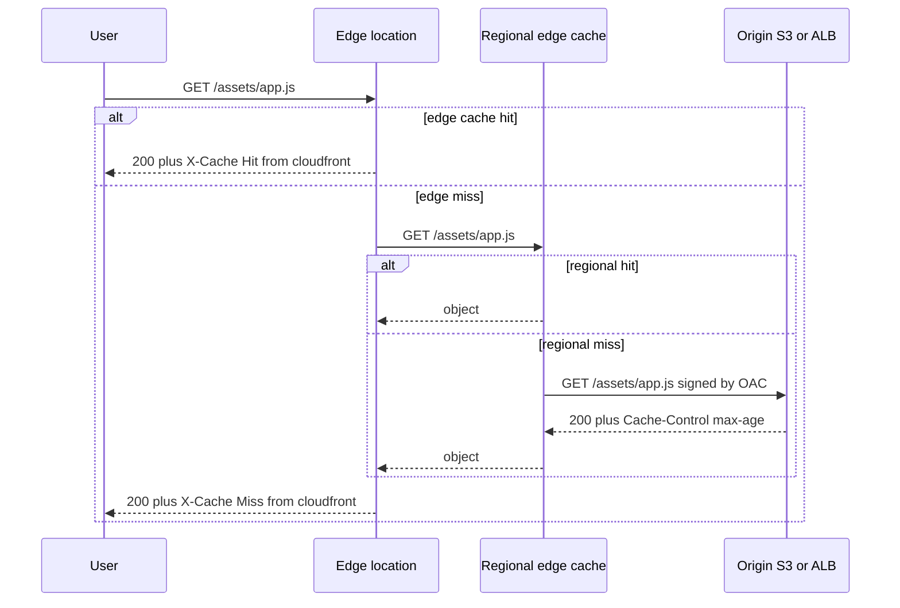
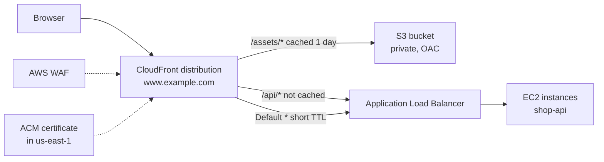

# L6.13 — CloudFront

> **Level 6: Cloud (AWS)** · Topic 13 of 18 · ⏱ ~5 hours · Difficulty: Intermediate

## 1. What it is

**Amazon CloudFront** is AWS's **Content Delivery Network (CDN)**: a global fleet of caching servers (called **edge locations**
and, behind them, larger **regional edge caches**) that sit between your users and your **origin** — the S3 bucket or load balancer
that actually holds the content. A user in Lagos or Sydney is routed (via DNS and anycast-style routing) to a nearby edge
location; if that edge already has the object it answers in a few milliseconds, otherwise it fetches it from your origin
once, keeps a copy, and serves the next thousand users from memory or disk.

You configure CloudFront as a **distribution**: a name (`d111111abcdef8.cloudfront.net`, or your own domain such as
`www.example.com`), a list of **origins**, and one or more **cache behaviors** that say "requests matching this path pattern go
to that origin, are cached by this rule, and allow these HTTP methods". Besides speed, a distribution is also a **security and
cost layer**: it terminates TLS at the edge, absorbs traffic spikes and DDoS attempts (AWS Shield Standard is included),
can attach AWS WAF, and lets you keep your S3 bucket and even your load balancer closed to the public internet.

## 2. Why it matters in DevOps

- **Latency and load:** static assets (JS, CSS, images, downloads) and cacheable API responses never reach your servers.
  A cache hit costs you no [EC2](01-ec2.md) CPU and no [RDS](10-rds-and-aurora.md) query.
- **Cost:** data transferred from AWS origins (S3, ALB, EC2) to CloudFront is free of charge, and CloudFront's own egress is
  typically cheaper than sending the same bytes straight from S3 or EC2 to the internet. For heavy download workloads this
  is one of the simplest big savings (see [Network Egress Costs](../level-20-cost-optimization/07-network-egress-costs.md)).
- **Security:** with **Origin Access Control (OAC)** the S3 bucket stays fully private ([S3](08-s3.md)); with a private ALB or
  header checks, attackers cannot bypass your WAF by hitting the origin directly.
- **Operations:** most "the site is serving old files" tickets and many "everything is slow after the deploy" incidents are cache
  mistakes — wrong TTLs, missing cache-busting file names, or an invalidation that was forgotten.
- **Resilience:** CloudFront can fail over between two origins (an **origin group**) and serve stale content if configured to,
  which can turn an origin outage into a degraded-but-up experience.

## 3. Real-world system example

**Static sites and single-page apps on S3 + CloudFront** is the canonical AWS pattern: AWS's own documentation and
solution guides describe hosting a static site or SPA by putting a private S3 bucket behind CloudFront with OAC. Media and
software-download businesses use CDNs the same way — large streaming platforms typically push video segments through CDN
edges so that the origin sees a tiny fraction of viewer requests. CloudFront also fronts dynamic applications: the edge
keeps a persistent, optimized connection back to the origin, so even **uncacheable** API calls are often faster than going direct,
because TLS and TCP handshakes happen near the user. A common AWS-documented arrangement, and the one used in this
roadmap's capstone, is **CloudFront → ALB → EC2** for the dynamic app and **CloudFront → S3** for static assets, both
served under one domain using two cache behaviors. For the CDN concept in general see
[CDNs in Level 12](../level-12-advanced-networking/07-cdns.md).

## 4. Diagram

Request flow through a cache (hit versus miss):



The `shop-api` distribution with two origins and path-based behaviors:



## 5. How it works

**Core building blocks**

| Concept | What it is | Notes |
|---------|------------|-------|
| **Distribution** | The CloudFront resource: domain, origins, behaviors, TLS, logging | Gets a `*.cloudfront.net` name; add your domain as an **alternate domain name (CNAME)** plus an ACM certificate |
| **Origin** | Where content comes from | S3 bucket, ALB/EC2 or any HTTP(S) server ("custom origin"), API Gateway, MediaPackage; a private ALB/EC2 in a VPC via **VPC origins** |
| **Cache behavior** | Path pattern (`/api/*`, `*.jpg`, default `*`) + origin + policies | Evaluated most specific first; the **Default (`*`)** behavior is mandatory |
| **Cache policy** | Which parts of the request form the **cache key** (headers, cookies, query strings) and the min/default/max TTL | Managed examples: `CachingOptimized`, `CachingDisabled` |
| **Origin request policy** | What extra info is *forwarded* to the origin without becoming part of the cache key | Example: `AllViewerExceptHostHeader` for an ALB |
| **Response headers policy** | Adds CORS and security headers (HSTS, X-Frame-Options) at the edge | Avoids code changes in the app |
| **Price class** | Which edge regions you pay to use | `PriceClass_100` = cheapest (North America and Europe) |

**Cache keys and TTLs.** The cache key decides when two requests are "the same object". Every extra header, cookie or query
string in the key *splits* the cache and lowers the hit ratio, so include only what changes the response. TTL comes from the
origin's `Cache-Control: max-age` / `s-maxage` or `Expires`, clamped between the policy's minimum and maximum; if the origin
sends nothing, the policy's default TTL (24 hours for `CachingOptimized`) applies. A cached object past its TTL is revalidated
with the origin (`If-None-Match` / `If-Modified-Since`) and served from cache again if the origin answers `304`.

**Origin Access Control (OAC).** OAC lets CloudFront sign its requests to S3 with **Signature Version 4**. The bucket policy
then allows only the CloudFront service principal, and only when the request comes from *your* distribution:

```json
{
  "Version": "2012-10-17",
  "Statement": [{
    "Sid": "AllowCloudFrontServicePrincipalReadOnly",
    "Effect": "Allow",
    "Principal": { "Service": "cloudfront.amazonaws.com" },
    "Action": "s3:GetObject",
    "Resource": "arn:aws:s3:::BUCKET/*",
    "Condition": { "StringEquals": { "AWS:SourceArn": "arn:aws:cloudfront::ACCOUNT_ID:distribution/DIST_ID" } }
  }]
}
```

OAC replaces the older **Origin Access Identity (OAI)**, which AWS now recommends migrating away from; OAC supports all S3
regions, SSE-KMS-encrypted objects (the CloudFront principal also needs `kms:Decrypt` in the key policy — see [KMS](15-kms.md))
and additional HTTP methods. OAC also exists for Lambda function URLs.

**Protecting a dynamic origin (ALB).** An ALB origin is reachable on its public DNS name, so anyone can bypass CloudFront. Three
layers fix that: (1) **VPC origins** — put the ALB in private subnets and let CloudFront reach it privately; (2) a security
group rule that allows only the AWS-managed prefix list `com.amazonaws.global.cloudfront.origin-facing`; (3) a secret
custom header (for example `X-Origin-Verify: <random>`) added by CloudFront and checked by an ALB listener rule. See
[Application Load Balancer](14-alb.md).

**Invalidation.** To replace content before its TTL expires you create an **invalidation** for paths (`/index.html`, `/assets/*`,
or `/*`). It takes seconds to a few minutes, and the first 1,000 invalidation paths per month are free, then a small charge per
path (wildcards count as one path). Better than invalidating: **version your file names** (`app.3f9c2a.js`) and set a
very long TTL on them, with a short TTL (or `no-cache`) on the HTML that references them. Then a deploy never needs an
invalidation except for `index.html`.

**TLS.** Viewer HTTPS uses either the default `*.cloudfront.net` certificate or your own certificate from **AWS Certificate
Manager (ACM)** — and for CloudFront that certificate **must be requested in `us-east-1`**, whatever region your app lives in.
Choose a minimum TLS version via a security policy (for example `TLSv1.2_2021`). The connection *from* CloudFront *to* the origin is
set separately (origin protocol policy: `https-only` is the right default).

**Edge compute.** **CloudFront Functions** (tiny JavaScript, sub-millisecond, viewer request/response only) are for URL
rewrites, redirects and header tweaks. **Lambda@Edge** (full Node.js/Python, origin and viewer triggers, regional) handles heavier
logic such as authentication. Both are optional extras for this topic.

**Cost model.** You pay per GB transferred out to viewers and per 10,000 requests, by region. CloudFront has a long-standing
always-free tier of **1 TB of data transfer out and 10 million requests per month**. AWS has also introduced flat-rate pricing
plans that bundle CloudFront with related services; check the pricing page for what applies to your account today. WAF, Lambda@Edge,
real-time logs and Origin Shield are billed separately.

## 6. Step-by-step guide

**Prerequisites:** AWS CLI v2 configured (`aws sts get-caller-identity` works), a **billing alarm already created** (see
[CloudWatch](18-cloudwatch.md)), and a private S3 bucket (any name; example below uses `shop-static-<ACCOUNT_ID>`).
**Cost warning:** a lab distribution serving a few files costs effectively nothing inside the always-free allowance, but a
distribution that is left running with WAF attached or serving large files can cost money. Do the cleanup step. CloudFront is
a global service; the CLI talks to it through `us-east-1` regardless of your region setting.

> **No AWS account?** LocalStack's CloudFront support is limited and may require a paid tier, so for a free local
> experiment simulate the *caching behavior* with Nginx instead (step 9).

1. **Create the bucket and upload two files.**
   ```bash
   export AWS_REGION=us-east-1
   ACCOUNT_ID=$(aws sts get-caller-identity --query Account --output text)
   BUCKET=shop-static-$ACCOUNT_ID
   aws s3api create-bucket --bucket $BUCKET          # us-east-1 needs no LocationConstraint
   aws s3api put-public-access-block --bucket $BUCKET \
     --public-access-block-configuration BlockPublicAcls=true,IgnorePublicAcls=true,BlockPublicPolicy=true,RestrictPublicBuckets=true
   mkdir -p site/assets
   echo '<h1>shop-api static site</h1><script src="/assets/app.js"></script>' > site/index.html
   echo 'console.log("shop-api v1")' > site/assets/app.js
   aws s3 sync site/ s3://$BUCKET/
   ```
   Expected: two `upload:` lines. A direct `curl` to the bucket URL will return `403` — that is what we want.

2. **Create an Origin Access Control.**
   ```bash
   OAC_ID=$(aws cloudfront create-origin-access-control --origin-access-control-config \
     'Name=shop-static-oac,Description=OAC for shop static,SigningProtocol=sigv4,SigningBehavior=always,OriginAccessControlOriginType=s3' \
     --query 'OriginAccessControl.Id' --output text)
   echo $OAC_ID
   ```
   Expected: an ID such as `E2QWRUHAPOMQZL`.

3. **Create the distribution** (S3 origin, HTTPS redirect, managed `CachingOptimized` policy, cheapest price class).
   ```bash
   cat > dist.json <<EOF
   {
     "CallerReference": "shop-static-lab-1",
     "Comment": "shop-api static lab",
     "Enabled": true,
     "DefaultRootObject": "index.html",
     "PriceClass": "PriceClass_100",
     "Origins": { "Quantity": 1, "Items": [{
       "Id": "s3-static",
       "DomainName": "$BUCKET.s3.us-east-1.amazonaws.com",
       "S3OriginConfig": { "OriginAccessIdentity": "" },
       "OriginAccessControlId": "$OAC_ID"
     }]},
     "DefaultCacheBehavior": {
       "TargetOriginId": "s3-static",
       "ViewerProtocolPolicy": "redirect-to-https",
       "AllowedMethods": { "Quantity": 2, "Items": ["GET", "HEAD"] },
       "Compress": true,
       "CachePolicyId": "658327ea-f89d-4fab-a63d-7e88639e58f6"
     }
   }
   EOF
   aws cloudfront create-distribution --distribution-config file://dist.json \
     --query 'Distribution.{Id:Id,Domain:DomainName,Status:Status}' --output table
   ```
   `658327ea-f89d-4fab-a63d-7e88639e58f6` is the ID of the AWS-managed `CachingOptimized` policy. Save the `Id` and `Domain`:
   ```bash
   DIST_ID=E1ABCDEXAMPLE            # from the output
   DOMAIN=d111111abcdef8.cloudfront.net
   ```

4. **Allow only this distribution to read the bucket.**
   ```bash
   cat > policy.json <<EOF
   { "Version": "2012-10-17", "Statement": [{
       "Sid": "AllowCloudFrontServicePrincipalReadOnly", "Effect": "Allow",
       "Principal": { "Service": "cloudfront.amazonaws.com" },
       "Action": "s3:GetObject", "Resource": "arn:aws:s3:::$BUCKET/*",
       "Condition": { "StringEquals": { "AWS:SourceArn": "arn:aws:cloudfront::$ACCOUNT_ID:distribution/$DIST_ID" } } }] }
   EOF
   aws s3api put-bucket-policy --bucket $BUCKET --policy file://policy.json
   aws cloudfront wait distribution-deployed --id $DIST_ID      # a few minutes
   ```

5. **Watch a cache miss become a hit.**
   ```bash
   curl -sI https://$DOMAIN/assets/app.js | grep -iE "^(HTTP|x-cache|age|cache-control|x-amz-cf-pop)"
   curl -sI https://$DOMAIN/assets/app.js | grep -iE "^(HTTP|x-cache|age)"
   ```
   Similar to: first call `X-Cache: Miss from cloudfront`, second call `X-Cache: Hit from cloudfront` and an `Age:` header
   counting seconds in cache (the very first request can also show `RefreshHit` or `Miss` depending on the edge you hit).
   Prove the bucket is private: `curl -sI https://$BUCKET.s3.amazonaws.com/index.html` returns `403`.

6. **Change the file and see the stale copy.**
   ```bash
   echo 'console.log("shop-api v2")' > site/assets/app.js
   aws s3 cp site/assets/app.js s3://$BUCKET/assets/app.js
   curl -s https://$DOMAIN/assets/app.js          # still prints v1, the edge has the old copy
   ```

7. **Invalidate and verify.**
   ```bash
   aws cloudfront create-invalidation --distribution-id $DIST_ID --paths "/assets/app.js"
   aws cloudfront list-invalidations --distribution-id $DIST_ID --query 'InvalidationList.Items[].[Id,Status]' --output table
   # once Status is Completed:
   curl -s https://$DOMAIN/assets/app.js          # now prints v2
   ```

8. **Add a second behavior for the dynamic app** (for the capstone). Behaviors live in the distribution config; fetch, edit and
   push it with the ETag as a concurrency token:
   ```bash
   aws cloudfront get-distribution-config --id $DIST_ID > current.json
   ETAG=$(jq -r .ETag current.json)
   jq '.DistributionConfig' current.json > config.json
   # edit config.json: add an ALB origin and a CacheBehaviors item for "/api/*" using
   #   CachePolicyId 4135ea2d-6df8-44a3-9df3-4b5a84be39ad   (managed CachingDisabled)
   #   OriginRequestPolicyId b689b0a8-53d0-40ab-baf2-68738e2966ac (managed AllViewerExceptHostHeader)
   #   AllowedMethods GET HEAD OPTIONS PUT POST PATCH DELETE
   aws cloudfront update-distribution --id $DIST_ID --if-match "$ETAG" --distribution-config file://config.json
   ```
   In the console this is *CloudFront → Distributions → your ID → Behaviors → Create behavior*, which is much easier for a first
   attempt. The full multi-origin config is built in the [capstone](99-capstone-project.md).

9. **Free local simulation of cache behavior (Nginx).**
   ```bash
   mkdir -p nginx-cdn && cd nginx-cdn
   cat > default.conf <<'EOF'
   proxy_cache_path /tmp/cache keys_zone=edge:10m max_size=100m inactive=60m;
   server {
     listen 8080;
     location / {
       proxy_pass http://host.docker.internal:9000;
       proxy_cache edge;
       proxy_cache_valid 200 30s;
       add_header X-Cache $upstream_cache_status;
     }
   }
   EOF
   python3 -m http.server 9000 &                # the "origin"
   docker run -d --name edge -p 8080:8080 --add-host=host.docker.internal:host-gateway \
     -v "$PWD/default.conf:/etc/nginx/conf.d/default.conf:ro" nginx:1.27
   curl -sI localhost:8080/ | grep -i x-cache   # MISS, then HIT on the second call
   ```

10. **Cleanup (do not skip).** A distribution must be disabled, fully deployed, then deleted.
    ```bash
    aws cloudfront get-distribution-config --id $DIST_ID > current.json
    ETAG=$(jq -r .ETag current.json)
    jq '.DistributionConfig | .Enabled=false' current.json > disabled.json
    aws cloudfront update-distribution --id $DIST_ID --if-match "$ETAG" --distribution-config file://disabled.json
    aws cloudfront wait distribution-deployed --id $DIST_ID
    ETAG=$(aws cloudfront get-distribution-config --id $DIST_ID --query ETag --output text)
    aws cloudfront delete-distribution --id $DIST_ID --if-match "$ETAG"
    aws cloudfront delete-origin-access-control --id $OAC_ID --if-match "$(aws cloudfront get-origin-access-control --id $OAC_ID --query ETag --output text)"
    aws s3 rm s3://$BUCKET --recursive && aws s3api delete-bucket --bucket $BUCKET
    docker rm -f edge 2>/dev/null; kill %1 2>/dev/null
    ```

## 7. Real-world scenario

*Illustrative scenario.* The `shop-api` team ships a front-end release at 14:00. At 14:10 support reports that half the
customers see the new layout with broken buttons while the rest see the old site. **Investigation:** `curl -sI` on
`/index.html` shows `X-Cache: Hit` with `Age: 3100` and a `Last-Modified` from yesterday; `/assets/app.js` is the new
build. CloudFront edges were holding the old `index.html` (24-hour default TTL) that referenced old bundle names that the
deploy script had already deleted — or new HTML pointed at JS not yet cached, depending on the edge. **Fix:** invalidate
`/index.html` (and `/` if the default root object is used), which resolves it within a minute. **Lesson:** the pipeline now
uploads hashed asset files with `Cache-Control: public, max-age=31536000, immutable`, uploads `index.html` last with
`Cache-Control: no-cache`, and runs one invalidation for `/index.html` as the final deploy step. Old assets are retained for a week
so that stale HTML never points at a missing file.

## 8. Common mistakes and best practices

**Don't**

- Make the S3 bucket public "so CloudFront can read it" — use OAC and block public access.
- Forward all headers, cookies and query strings to the origin by default; every value splits the cache and ruins the hit ratio.
- Cache `/api/*` responses that vary by user (cookies/Authorization) with a shared cache key — users see each other's data.
- Rely on `/*` invalidations for every deploy; use versioned file names instead.
- Request the ACM certificate in your app's region — CloudFront only sees certificates in `us-east-1`.
- Leave an ALB origin reachable directly from the internet, bypassing WAF and caching rules.

**Do**

- Use the managed cache policies (`CachingOptimized` for static, `CachingDisabled` for dynamic APIs) until you have a reason to write your own.
- Set `Cache-Control` at the origin so TTLs are explicit and visible in the code that produces the content.
- Enable standard access logs (to S3) or real-time logs when you need to investigate hit ratios; watch the `CacheHitRate` and `5xxErrorRate` metrics in [CloudWatch](18-cloudwatch.md) (these appear in `us-east-1` under the `AWS/CloudFront` namespace).
- Redirect HTTP to HTTPS, set a minimum TLS 1.2 policy, and add a response headers policy for security headers.
- Define distributions as code ([Terraform](../level-07-terraform-iac/01-providers-and-resources.md)) so the cache rules are reviewed like any other change.

## 9. Tasks

- [ ] **T1 — Serve a private bucket through CloudFront** *(≈45 min, beginner)*
  - **Goal:** a working HTTPS site whose bucket is not publicly readable.
  - **Steps:**
    1. Follow steps 1-4 of the guide.
    2. Open `https://$DOMAIN/` in a browser.
    3. Run `curl -sI https://$BUCKET.s3.amazonaws.com/index.html`.
  - **Done when:** the CloudFront URL returns `200` with your page and the direct S3 URL returns `403`.

- [ ] **T2 — Observe the cache** *(≈30 min, beginner)*
  - **Goal:** read cache status from response headers.
  - **Steps:**
    1. Request `/assets/app.js` five times with `curl -sI`.
    2. Note `X-Cache`, `Age` and `X-Amz-Cf-Pop` each time.
    3. In the console open *Monitoring* for the distribution and find the request count.
  - **Done when:** you can show one `Miss` followed by `Hit`s with a growing `Age`, and name the edge (`X-Amz-Cf-Pop`) that served you.

- [ ] **T3 — Stale content and invalidation** *(≈30 min, intermediate)*
  - **Goal:** reproduce the stale-file problem and fix it two ways.
  - **Steps:**
    1. Change `app.js` in S3 and show CloudFront still returns the old body.
    2. Fix it with `create-invalidation` for that path.
    3. Fix it a second way: rename to `app.v3.js`, update `index.html`, upload with `Cache-Control: max-age=31536000, immutable`.
  - **Done when:** both fixes work and you can say which one costs nothing per deploy.

- [ ] **T4 — Add a dynamic behavior** *(≈60 min, intermediate)*
  - **Goal:** one domain serving static files from S3 and `/api/*` from an origin with caching disabled.
  - **Steps:**
    1. Run any HTTP origin (an EC2 instance, or a public test origin you control) and add it as a second origin.
    2. Create a behavior for `/api/*` using `CachingDisabled` and `AllViewerExceptHostHeader`, allowing all methods.
    3. Request `/api/health` twice and `/assets/app.js` twice.
  - **Done when:** `/api/health` never shows `Hit from cloudfront` while `/assets/app.js` does.

- [ ] **T5 — Break the OAC and fix it** *(≈30 min, intermediate)*
  - **Goal:** recognize the symptom of a wrong bucket policy.
  - **Steps:**
    1. Change `AWS:SourceArn` in the bucket policy to a wrong distribution ID.
    2. Request a not-yet-cached object (a new file) and note the status code.
    3. Restore the correct ARN.
  - **Done when:** you saw `403 AccessDenied` from CloudFront for the broken policy and `200` after fixing it, and can explain why cached objects kept working in between.

- [ ] **T6 — Prove it: design the cache rules** *(≈45 min, advanced)*
  - **Goal:** justify cache settings for a real app without notes.
  - **Steps:**
    1. For `shop-api`, write a table of path pattern, origin, cache policy, TTL, and what is in the cache key for `/`, `/assets/*`, `/api/products` (public, cacheable 60 s) and `/api/cart` (per user).
    2. Explain how a deploy replaces a bad `app.js` with zero invalidations.
    3. Run the cleanup in step 10 and confirm nothing remains with `aws cloudfront list-distributions --query 'DistributionList.Items[].Id'`.
  - **Done when:** the table is internally consistent (nothing user-specific in a shared cache key) and the distribution list no longer shows your lab ID.

## 10. Self-check questions

1. What is the difference between a cache policy and an origin request policy?
2. Why does CloudFront need its ACM certificate in `us-east-1`?
3. What does OAC do, and why is it better than making the bucket public or using OAI?
4. How can you keep the ALB origin from being reached directly, bypassing CloudFront?
5. Why are versioned file names usually better than invalidations?
6. A user reports seeing another user's data on an API call. Which CloudFront setting is the first suspect?

<details>
<summary>Answers</summary>

1. The cache policy defines the cache key and TTLs (what makes two requests "the same"); the origin request policy defines extra values forwarded to the origin that are *not* part of the key.
2. CloudFront is a global service and reads viewer certificates from ACM in `us-east-1`; a certificate in any other region cannot be attached.
3. OAC makes CloudFront sign origin requests (SigV4) and the bucket policy allows only that distribution's service principal, so the bucket stays private. OAI is the older mechanism with fewer features (for example, limited support for SSE-KMS-encrypted objects, newer regions and some HTTP methods).
4. Use VPC origins with a private ALB, restrict the ALB security group to the CloudFront origin-facing managed prefix list, and/or require a secret custom header checked by an ALB rule.
5. A new name is a new cache key, so there is nothing to purge, rollback is just re-pointing the HTML, and there is no per-path invalidation charge or propagation delay.
6. A cache policy that caches a personalized response without including the user identity (cookie or Authorization header) in the cache key — or caching enabled on a path that should use `CachingDisabled`.
</details>

## 11. Further reading

- *Amazon CloudFront Developer Guide* (docs.aws.amazon.com/cloudfront) — distributions, cache policies, OAC, invalidation.
- *Amazon CloudFront pricing* page — current free allowance, regional rates and flat-rate plans.
- AWS Prescriptive Guidance and Solutions Library material on hosting static websites with S3 and CloudFront.
- *High Performance Browser Networking* by Ilya Grigorik (free online) — why edge termination reduces latency.

<!-- nav -->
---
← Previous: [Route 53](12-route-53.md) · [Level 6 index](README.md) · Next: [Application Load Balancer](14-alb.md) →
